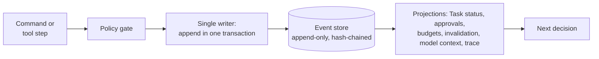

# Aksha

[](https://github.com/SaiiPittu/aksha/actions/workflows/ci.yml)
[](pyproject.toml)

**A harness that thinks fast and slow.**

Aksha is a headless agent harness in Python. One runtime runs many agents, each defined as data in its own module. Fast models extract and classify, slow models generate, and a fast answer is accepted only at or above a declared confidence. Every fact lands in one append-only, hash-chained event store; every tool call passes a policy gate in code; a run pauses durably for an approval or a missing answer, and resumes after a crash without sending anything twice.

[Quick start](docs/quickstart.md) · [Architecture](docs/architecture/overview.md) · [Interfaces](docs/interfaces.md) · [Evals](docs/evals/README.md) · [Limitations](docs/limitations.md)

## Try it in one minute

No API key, and no network after the install: every model is an offline fake.

```sh
uvx --from git+https://github.com/SaiiPittu/aksha aksha demo
```

Two agents run, their input changes, only the dependent work is rebuilt, and a send survives a real `SIGKILL`. An excerpt of the output from a run on 26 Nov 2026:

```text
1. Both agents run on the stillroom world (10.9 s)
   research R-0001 complete: 11 outputs, 21 model calls
   patent   R-0002 complete: 23 outputs, 42 model calls
2. The input changes to stillroom-v2's change set (0.25 s)
3. Invalidation reopens only what depends on the change (6.94 s)
   rebuilt 10: C1: comparison, disclosure, extraction, handoff, packet, prior_art, recommendation, worksheet; selection, table
   kept 13 patent outputs: C2: ...; C3: ...; C4: ...; portfolio
   kept all 11 research outputs: nothing they read moved
4. SIGKILL mid-send, then recovery (2.99 s)
   at restart: 1 outbox entry open with no receipt; recovery asked the mailbox by key 1 time, sent 0 times
   mailbox: 2 deliveries for 2 idempotency keys (patent.packet/C1@v1, patent.packet/C1@v2): each packet version exactly once
5. Event store
   hash chain verified: 1108 events, head sha256:68c06d6e8abaf4c3...
```

The command exits 0 only when every check passes.

## Install

Python 3.12 or newer. Today Aksha installs from GitHub:

```sh
# Recommended: an isolated tool install
uv tool install git+https://github.com/SaiiPittu/aksha
```

```sh
# With pipx
pipx install "aksha-harness @ git+https://github.com/SaiiPittu/aksha"
```

Once the first release is on PyPI, the distribution is `aksha-harness`; the command and the import stay `aksha`. (`aksha` on PyPI is an unrelated project, so never `pip install aksha` or a bare `uvx aksha`.)

```sh
uv tool install aksha-harness     # or: pipx install aksha-harness, or pip install aksha-harness
```

Optional extras, always quoted: `"aksha-harness[server]"` for `aksha serve`, `"aksha-harness[otel]"` for `aksha trace`, `"aksha-harness[postgres]"` for the PostgreSQL event store. `aksha doctor` prints the version, where state is kept, and the install command for any extra that is missing.

## Your first run

The research agent works on a folder of your own files. `aksha example` copies a bundled synthetic one to try it on:

```sh
aksha example stillroom my-inputs
aksha run --agent research --input my-inputs "Who sells camera-free occupancy sensing for offices, and at what price?"
#   waiting for input (question) I-0001: aksha answer I-0001 TEXT
#     asks: Which geography should this cover? ...                       (exit code 3)
aksha answer I-0001 EU
# R-0001 research ended complete                                          (exit code 0)
```

Then `aksha show` lists every output the agents saved, `aksha show research.matrix` prints one as JSON with every value cited, `aksha inspect R-0001` shows the run's steps and budget, and `aksha verify` checks the hash chain. The patent agent, approvals, uploads that reopen only changed work, and headless runs are in the [quick start](docs/quickstart.md).

## What you get

- **An event store as the source of truth:** append-only and hash-chained, on SQLite by default or PostgreSQL; every view is rebuilt from it. [Architecture](docs/architecture/overview.md)
- **Durable execution and a transactional outbox:** a crash mid-run resumes from the record, and an effect is keyed by its meaning, so a retry never sends twice. [Primitives](docs/design/03-primitives.md)
- **A policy gate in code:** deny by default, approvals bound to the exact action by signature, headless runs that never ask. [Interfaces](docs/interfaces.md)
- **Model classes:** extraction, classification and generation as separate contracts, thresholds with an abstention band, cascades that never cross a class. [Rationale](docs/design/rationale.md)
- **Grounding:** a cited value must quote a span a tool actually returned, checked at save; a value not found is an explicit unknown. [Primitives](docs/design/03-primitives.md)
- **Invalidation:** when an input changes, only the work that read it is rebuilt, and a human-reviewed output gets a diff review. [Quick start](docs/quickstart.md)
- **One session API** behind a command line and an HTTP server, with fixed exit codes and a capability record. [Interfaces](docs/interfaces.md)
- **Evals:** worlds as environments, ordered graders, pass^k, invariance runs, and grader self-tests. [Evals](docs/evals/README.md)

## How it works



Facts go in through one writer and every view is computed from them by pure functions, so a restart rebuilds the same state and a budget cannot reset. The runtime in `src/aksha/runtime/` imports no adapter; backends plug in behind ports, and `src/aksha/app.py` is the one place that wires them. Agents and extensions import only `aksha.runtime.api`, and the tests in `tests/architecture/` enforce both rules. The three tiers, the ports and the hash chain are in [docs/architecture/overview.md](docs/architecture/overview.md).

## Status and limitations

As of 26 Nov 2026, 29 of the 30 primitives are built and tested. The three limits a first user meets:

1. **Offline models only.** `AKSHA_MODE` accepts only `fake`: every model is a rule-based fake or a replay, so results show the harness working, not model quality.
2. **The only system of record is a mock.** An approved send goes to a development mailbox, a JSON file that reaches no one.
3. **One sandbox backend, Linux only.** Bubblewrap is the only confining backend; on a host without it, exec tools do not run.

The full list is in [docs/limitations.md](docs/limitations.md).

## Documentation

- [Quick start](docs/quickstart.md): the demo and the command line, step by step
- [Architecture overview](docs/architecture/overview.md) and [codebase structure](docs/architecture/codebase-structure.md)
- [Interfaces](docs/interfaces.md) and [evals](docs/evals/README.md)
- [Design](docs/design/README.md): the reading order, the primitives and the decisions log

## Development

```sh
make venv    # .venv with aksha (editable), the dev group, the server and the trace exporter
make check   # lint, type check and the full test suite on SQLite, offline
make demo    # the same demo, state in var/demo/
```

Contributing, the test layout and the PostgreSQL tests: [CONTRIBUTING.md](CONTRIBUTING.md). Releasing: [docs/releasing.md](docs/releasing.md).

## License

No license has been chosen yet. Until one is, the code is published for reading, and no license is granted.
