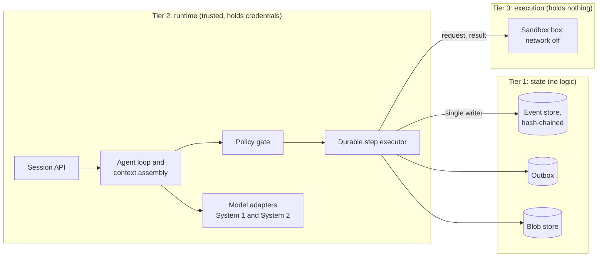
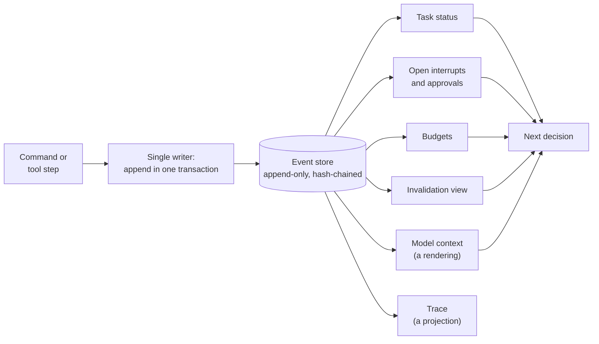
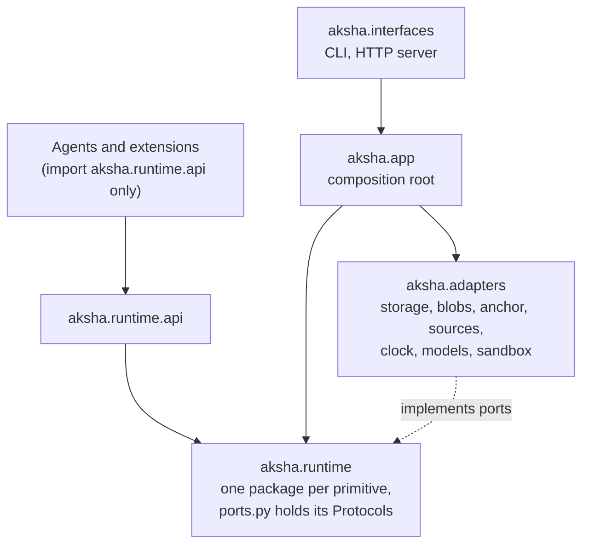

# Aksha

Aksha is a general, headless agent harness in Python. One runtime runs many different agents, each defined as data in its own module. The runtime records every fact in one append-only, hash-chained event store, gates every tool call in code, pauses durably for an approval or a missing answer, and resumes after a crash without repeating a write or a send.

It thinks fast and slow. Model work is split by the kind of answer it needs: System 1 models (fast, narrow) do extraction and classification, and System 2 models (slow, general) do generation. The three are first-class model classes with their own contracts, routed the same way, so a fast model can route a request or pull typed fields out of a page while a generation model writes the report.

*Status as of 26 Nov 2026: 22 of the 30 primitives are built and tested, among them the session API with the `aksha` command line and server, a trace exporter and the eval runner. Two general agents, competitor research and patent disclosure, run on any folder of a person's own files (`aksha run --input`), and are tested on two synthetic worlds in different domains; `make demo` shows change and recovery offline.*

## Quick start

`make venv` downloads the dependencies once; after that everything below runs offline. There are no API keys and no model calls over the network: every model is a rule-based fake or a replay of a recorded run. Python 3.12 or newer and [uv](https://docs.astral.sh/uv/) are needed.

```sh
make venv    # .venv with aksha (editable), dev tools, the server and the trace exporter
make test    # the full suite on SQLite, offline
make demo    # the change-and-recovery demo, about 20 seconds (creates .venv itself if missing)
```

`make demo` tells the change-and-recovery story in one command:

1. The research agent and the patent agent run to completion on the synthetic `stillroom` world. The patent agent sends one invention's counsel-review packet to a mock mailbox after an approval.
2. The input changes to the `stillroom-v2` change set: a new publication family, and an earlier date on an outside suggestion.
3. Invalidation reopens only the work that read the moved records. In the run on 26 Nov 2026 it rebuilt 10 patent outputs and kept the other 13 and all 11 research outputs. The packet's diff review is accepted and a fresh approval is asked for the new version.
4. The new packet is sent by a child process that kills itself with a real `SIGKILL` after the mailbox stores it and before the runtime records the receipt. On restart, recovery asks the mailbox by idempotency key and does not send again: 2 deliveries for 2 keys, one per packet version.
5. The event store's hash chain is verified.

Every answer and approval a person would give is scripted and recorded with `by="demo-script"`; the store and the mailbox stay in `var/demo/`.

### Your own files

The research agent and the patent agent work on whatever you give them: a folder or a set of files (saved web pages, Markdown notes, CSV or JSON exports, email text, text extracted from a PDF). The request says what to research, for whom and what to compare; the agents find each input by its content, never by its name or folder. The example below uses the synthetic `tilldew` world (an agritech venture; see [fixtures/README.md](fixtures/README.md)) as if it were your folder. Run it from a fresh clone, after `make venv`:

```sh
. .venv/bin/activate
cp -r fixtures/worlds/tilldew/sources my-inputs     # stands in for your own folder

aksha run --agent research --input my-inputs "Research the competitors for Tilldew's solar soil-moisture probe, for smallholder vegetable farmers in India. Compare power (solar, battery, AA, cells), battery life (battery life, years of battery) and connectivity (SMS, 2G, LoRa, gateway). What do farmers say about: accuracy (accura*, wrong reading*, false alert*, still wet, trust*); connectivity (sms, signal, network, gateway); price (price*, expensive, cost*, cheap*, paid)?"
# uploaded 23 input files
# session S-...
# R-0001 research ended complete                                          (exit code 0)

aksha show                   # every current output: research.matrix@v1, research.needs@v1, ...
aksha show research.needs    # one output's content as JSON, every value cited
```

Uploaded files become versioned records of your inputs (`var/inputs/<user>/`). Upload the folder again after changing a file, and only the work built on that file reopens:

```sh
aksha upload my-inputs       # nothing changed
# uploaded 23 input files
# no work reopened: no input changed, or none that work was built on
sed -i 's/Too expensive for a two-acre plot./Too expensive, and the battery died./' my-inputs/exports/farmer-reviews.csv
aksha upload my-inputs
# uploaded 23 input files
# R-0002 research ended complete                                          (exit code 0)
aksha inspect R-0002         # its steps: only the review reading (voice) and the report re-ran
```

The patent agent reads the same inputs (invention notes, contributor and disclosure tables, emails, priorities, blank forms, publications) and prepares a counsel-review packet:

```sh
aksha run --agent patent "Prepare Tilldew's invention candidates for counsel review."
#     asks: TD-2: the note leaves Tariff table source undecided. What is it?   (exit code 3)
aksha answer I-0001 "The state utility's published time-of-day tariff table."
#     asks: Which candidate should be prepared for counsel review? TD-1: prioritize_counsel_review; TD-2: collect_more_evidence; TD-3: collect_more_evidence
aksha answer I-0002 TD-1
#     packet: patent.packet/TD-1@v1                                       (exit code 4)
```

The approval and the mock mailbox that receives the packet work as in the stillroom walk-through below. The offline models understand a small grammar in the request: `Compare <dimension> (<terms>), ...` names the matrix's dimensions besides price (a term ending in `*` is a prefix, `not <phrase>` excludes text), `say about: <theme> (<terms>); ...` names the review themes, `for <segment>` and a country or region fix the segment and the geography, and a missing one is asked for. A live model reads the request as free text; see the limitations.

### The command line, step by step

The research agent runs end to end through `aksha run` on the synthetic `stillroom` world, here configured as a folder every run reads (`AKSHA_SOURCES`) instead of uploaded. Run this from a fresh clone, after `make venv`:

```sh
. .venv/bin/activate
rm -rf var                   # an empty store, so the IDs below match
export AKSHA_SOURCES=inputs=fixtures/worlds/stillroom/sources   # a configured inputs folder

aksha run "Who sells camera-free occupancy sensing for offices, and at what price?" --agent research
# session S-...
# R-0001 research waiting
#   waiting for input (question) I-0001: aksha answer I-0001 TEXT
#     asks: Which geography should this cover? Prices and reviews can come from several ...  (exit code 3)

aksha answer I-0001 EU       # the agent asked which geography to cover
# R-0001 research ended complete                                          (exit code 0)

aksha status                 # where every run stands, read from the event store
aksha inspect R-0001         # the run inspector: budget, steps, stop decisions, as JSON
aksha verify                 # chain ok: <n> events, head sha256:...
aksha trace R-0001           # var/traces/R-0001/1.otlp.jsonl, one file per execution segment

aksha run "Who sells camera-free occupancy sensing for offices, and at what price?" --agent research --headless
# refused: sandbox_required (...)                                         (exit code 7)
AKSHA_SANDBOX=bwrap aksha run "Who sells camera-free occupancy sensing for offices in the EU, and at what price?" --agent research --headless
# R-0002 research ended complete (headless)
```

`AKSHA_SANDBOX` chooses the sandbox backend, which is probed once at start: `bwrap` (bubblewrap, Linux), `auto` (the strongest that probes available) or `refuse` (runs nothing). A backend that does not probe available becomes `refuse` with the reason, never a weaker box, so on a host without bubblewrap the headless run above is refused. `<name>:<strength>` with any other name declares an outer box the operator attests the process runs in, such as a container: a headless run may start, and exec tools are still refused. The choice and every probe are recorded on `run.started`. Tools reach the network only through the runtime's HTTP client, under their egress policy, and only with `AKSHA_NETWORK=on`. With `--agent` left out, the router picks the agent from the loaded agents' purposes. State lives in `var/`; delete it to start again.

The patent agent runs end to end the same way, up to an approved send. Every waiting line says what is being asked:

```sh
rm -rf var                   # an empty store, so the IDs below match
export AKSHA_SOURCES=inputs=fixtures/worlds/stillroom/sources

aksha run "Assess the four invention candidates and prepare the chosen one for counsel." --agent patent
#   waiting for input (missing detail) I-0001: aksha answer I-0001 TEXT
#     asks: C2: the note leaves Minimum distance from a vent undecided. What is it?   (exit code 3)
aksha answer I-0001 "0.5 m from the vent edge"
#   waiting for choice (candidate selection) I-0002: aksha answer I-0002 TEXT
#     options: C1, C2, C3, C4                                              (exit code 3)
aksha answer I-0002 C1
#   waiting for approval A-0001: aksha approve A-0001 --signature v1:...
#     approves: send_packet
#     packet: patent.packet/C1@v1
#     recipient: counsel-primary                                           (exit code 4)

aksha approve A-0001 --signature v1:<the first 12 or more digits shown>
# refused: system_unavailable (...)                                       (exit code 7)
```

Nothing is set up to receive the packet by default, so the approval is refused `system_unavailable`: nothing is approved, the run keeps waiting on the same approval, and your other commands go on working. For development, bind the patent agent's `counsel_mail` to the mock mailbox `make demo` uses, a JSON file that delivers once per key and reaches no one; every command then says it is a mock:

```sh
export AKSHA_SYSTEMS=counsel_mail=mailbox:var/mock-counsel
aksha approve A-0001 --signature v1:<the first 12 or more digits shown>
# mock: counsel_mail is a development mailbox at var/mock-counsel/mailbox.json (AKSHA_SYSTEMS); nothing it receives leaves this machine
# R-0001 patent ended complete                                            (exit code 0)
```

`var/mock-counsel/mailbox.json` then holds one delivery; approving again is refused `already_decided` and delivers nothing.

## Architecture in one page

### Three tiers

The system is split by what each part may hold, so a compromise of one part costs only what that part holds.

| Tier | Holds | Writes the record? |
|---|---|---|
| 1, state | The event store, the content-addressed blob store and the transactional outbox | It is the record |
| 2, runtime | The session API, the agent loop, Tasks and the scheduler, stop policies, the policy gate, the durable step executor, context assembly, model adapters, and every credential | Yes, through one writer |
| 3, execution | Sandbox workers and one throwaway workspace per call; no credentials, no state | No |



Caption: every arrow into tier 1 starts in tier 2, and tier 3 returns only its result. Tier 3 is designed; as of 26 Nov 2026 only its declared types and a process-group kill unit exist.

### The event store is the source of truth

Nothing in Aksha is stored as mutable state. A Task's status, the open approvals, the budget spent, which outputs are out of date, and the model's own context window are all projections: views computed from the event store by pure functions (reducers). A restart rebuilds them from the record, so a crash cannot leave them inconsistent and a budget cannot reset.



Caption: facts go in through one writer; every view, the trace included, is rebuilt from the facts.

### Ports and adapters

The domain is `src/aksha/runtime/`, one package per primitive. Every dependency on the outside world is a `typing.Protocol` in that package's `ports.py`, and backends are adapters in `src/aksha/adapters/`. `src/aksha/app.py` is the composition root, the one place that picks adapters. The runtime never imports an adapter, agents and extensions import only `aksha.runtime.api`, and `tests/architecture/` enforces both rules.



Caption: arrows are imports. Adapters depend on the runtime's ports; the runtime depends on nothing outside itself.

The event store has two adapters behind one port and one contract suite. SQLite is the default: one file at `var/aksha.sqlite`, no setup. PostgreSQL is the production backend: set `AKSHA_STORE=postgres` and `AKSHA_POSTGRES_DSN`, and install the driver with `make venv-postgres`.

The layout and how to add an agent or an adapter are in [docs/architecture/codebase-structure.md](docs/architecture/codebase-structure.md); the design is in [docs/design/02-architecture.md](docs/design/02-architecture.md).

## Interfaces

Every way in goes through one session API (P19): a closed set of named commands (`SendMessage`, `AnswerInterrupt`, `Approve`, `Reject`, `Stop`, `Finalize`, `GrantBudget`, `UploadInputs`, review and source-change commands; over HTTP an upload is `POST /api/v1/inputs`), one `dispatch` that commits each command with a stored receipt, so a retried command ID gets the first receipt back, and a capability record that lists what this runtime accepts. A command type this runtime does not carry out is refused `unsupported` with a receipt, never dropped; any other refusal carries its own code, such as `sandbox_required`.

1. **`aksha serve`** runs the server: FastAPI under `/api/v1`, with Server-Sent Events for a session's event stream (replay from a cursor, then live). It holds the store's writer lock, so it is the single writer; it binds to `127.0.0.1:8765` by default.
2. **The CLI** (`aksha run` with `--input`, `upload`, `answer`, `approve`, `reject`, `stop`, `resume`, `status`, `show`, `inspect`, `verify`, `trace`, `capabilities`) finds a running server and sends it the command. With no server it runs embedded: the command takes the writer lock for its one invocation, drives the runs until they yield, and exits. Read commands open a read-only handle and work beside a server. Exit codes are fixed: 0 done, 3 waiting for input, 4 waiting for an approval, 5 partial, 6 stopped, 7 refused, 8 environment, 9 failed, 10 chain broken.
3. **Headless runs** (`aksha run --headless`) never ask: every ask becomes an allow, every deny still holds, and the start is refused `sandbox_required` unless the operator declares a sandbox in `AKSHA_SANDBOX=<backend>:<strength>`.
4. **Tracing** (P21) is a projection of the event store named by the OpenTelemetry semantic conventions for generative AI, with content capture off by default. `aksha trace RUN` writes OTLP JSON Lines files, one per execution segment, through the official OpenTelemetry SDK.

## Evals

The eval runner (P22) treats each fixture world as an environment: an episode resets a fresh copy of the world, gives the agent the world's tools behind a path guard, and grades what the agent left in the episode's own event store against the world's answer key, never what it says it did. Graders run in order (the chain and the invariants first, such as at most one delivery per effect key and no send without its own bound approval, then outputs, citations and planted traps), and pass@k and pass^k are reported with the unbiased estimators. Invariance and directional runs compare a variant world with its base. Before any score counts, every grader runs against an oracle, perturbed oracles, a null bundle and one mutant per criterion.

```sh
aksha eval list              # suites, their cases and the registered agents
aksha eval selftest          # the grader self-tests for every world
aksha eval run scripted      # self-tests, then every case of the scripted suite
aksha eval run research      # the research agent on the runtime, fake model, both worlds
aksha eval run patent        # the patent agent on the runtime, fake model, both worlds
aksha eval run tilldew       # both agents on a world in another domain their code never names
aksha eval run change --k 3  # resume against fresh on a scope change, one run per arm
aksha eval key-check         # recompute every answer key's anchors and counts
```

In a run on a fresh clone on 26 Nov 2026 the self-tests passed with 33 of 33 gradeable criteria killed by their mutants, and every suite passed. The research and patent agents run as they ship, with their own tools reading through the episode: research passed 11 of 11 episodes (6 of 6 cases, `rel.same_calls` included on every invariance pair), patent 16 of 16 (8 of 8), the scripted suite 17 of 17 (7 of 7), and the change suite 9 of 9: the resume-against-fresh case (decision 36) at k = 3 per arm, every arm correct against the change's derived key. In that case plain resume resumed only the scope (the other re-entries fell back to fresh: premise changed, session missing, tainted session), and the arm that exempts the scope from the premise check resumed two Tasks. With the scope exempt, the rebuild took 9 model turns, 23 tool calls and 183,723 context characters, against fresh's 11, 23 and 211,638. Those measures are properties of the rule-based fake, not of a model, and the fake reports no tokens; [docs/evals/resume-vs-fresh.md](docs/evals/resume-vs-fresh.md) says what they do and do not show. In fake model mode the rates are plumbing checks, not reliability, and the report says so on its second line. Results go to `var/evals/<suite>-<seed>/`. The details are in [docs/evals/README.md](docs/evals/README.md).

The `tilldew` suite runs both agents, unchanged, on an agritech world with other folders, file formats, column names, section headings and form fields (see [fixtures/README.md](fixtures/README.md)); their offline models follow general rules there, never a lexicon of that world. In the run on a fresh clone on 26 Nov 2026 it passed 12 of 12 episodes (6 research cases, 6 patent cases), with the self-tests passing 33 of 33 mutants on its key. `tests/architecture/test_agent_generality.py` fails if any agent module other than its offline model names a value of either world.

## The primitives

A primitive is one capability every agent gets from the runtime without writing it. Each has one architecture decision record (ADR) in [docs/design/adr/](docs/design/adr/). Status, as of 26 Nov 2026: **built** means the code and its tests exist (parts still designed inside a built primitive are listed in the structure document); **designed** means an ADR with a decision exists and at most its declared types are in code; **planned** means the options are listed and none is chosen.

| ID | Primitive | Status | What exists (26 Nov 2026) |
|---|---|---|---|
| P01 | Event store and projections | built | Append-only store with hash chain, `verify()`, anchors, SQLite and PostgreSQL adapters, reducers and a projection cache |
| P02 | Durable execution | built | Deterministic step IDs, injected clock, retries and timeouts, recovery on startup |
| P03 | Transactional outbox and idempotency keys | built | Effects committed before the call, keyed by meaning, reconciled after a crash; command receipts |
| P04 | Artifact store and lineage | built | Typed immutable versions, recorded reads, typed relations with excerpt evidence, blob store |
| P05 | Invalidation | built | Source changes, early cutoff, rebuild runs, diff reviews for human-reviewed outputs |
| P06 | Agent loop and turn | built | `run_turn` and `drive` over projections; every turn end goes to stop-policy evaluation |
| P07 | Model interface and routing by class | built | Extraction, classification and generation contracts, thresholds with an abstention band, cascades, rule-based fakes, replay, a live generation adapter |
| P08 | Context assembly and compaction | built | Context as a projection, observation masking, recorded summaries (on by default) |
| P09 | Memory | designed | |
| P10 | Tool registry and schemas | built | One declared spec per tool with one effect class |
| P11 | Policy gate and permissions | built | Deny by default, one checker in code, headless mode that never asks |
| P12 | Sandbox and execution environment | built | A bubblewrap backend (allowlisted root, network off, cleared environment, hard limits, process-group kill), the `refuse` backend, policies that only narrow, the exec record on every step |
| P13 | Grounding and citations | built | Tool-minted spans, verbatim quote checks at save, explicit unknowns |
| P14 | Budgets, limits, timeouts, retries | built | Every cap counted from the event store |
| P15 | Task model and scheduler | built | Compiled Task tree, completion checks, status as a projection, the supervisor rule |
| P16 | Stop policy and evaluation | built | Derived policy stack, one recorded decision per stop candidate, the hold predicate |
| P17 | Interrupts and approvals | built | Six interrupt kinds, approvals bound to the exact action by signature |
| P18 | Cancellation | built | Durable stop requests honoured after a crash, a kill boundary, `aksha stop` |
| P19 | Session API | built | Named commands with receipts, the capability record, session streams, server and embedded modes |
| P20 | Extension API and agent definition | built | Loader that checks and hashes every agent definition; import boundary |
| P21 | Tracing and observability | built | The trace as a projection, OpenTelemetry GenAI names, an OTLP JSON Lines file exporter |
| P22 | Evals, fake and replay models | built | The eval runner with ordered graders, pass@k and pass^k, invariance and directional runs, grader self-tests; fakes and replay for every model class |
| P23 | Request router | built | Classification over the loaded agents' purposes, a route question when it abstains |
| P24 | Partial results and finalization | built | Explicit unknowns, the `blocked` outcome, finalize on a budget interrupt |
| P25 | Durable timers and recorded time | designed | |
| P26 | Egress policy | built | Deny by default; the runtime's HTTP client checks every resolved address and every redirect, and records each decision |
| P27 | Steering and follow-up input | designed | The `Steer` command type exists and is refused `unsupported` |
| P28 | Execution environment image | built | Images keyed by a content hash of the spec and lock files, first build approved, packages fetched under egress and hash-checked, installed offline, recorded, mounted read-only at `/env` |
| P29 | External record state | designed | |
| P30 | Erasure in an append-only store | planned | |

The catalogue, with dependencies and the build order, is [docs/design/03-primitives.md](docs/design/03-primitives.md).

## The rule of three

No abstraction enters the runtime until three different agents fit it without agent-specific code in the runtime. Every ADR except the open P30 was reviewed against all three:

| Agent | Status | What it does | What it presses on |
|---|---|---|---|
| Research agent | built | Researches competitors of a fictional hardware venture from fetched pages and reviews, and writes a competitor matrix with a verified excerpt behind every finding | Grounding, deduplication through typed relations, partial results when a fetch fails |
| Patent agent | built | Extracts invention candidates from engineering notes, compares them with patent families, prepares a counsel-ready packet and asks for approval before a mock send | Invalidation, review of changed documents, approvals bound to the exact action, no duplicate send after a crash |
| Contrast coding agent | designed | Edits a Git repository in a sandbox for hours, runs tests and pushes a branch after approval | Long contexts and compaction, a shell in a sandbox, a completion check that runs the tests, cancellation mid-edit |

An ADR that fits two document agents and fails the coding agent has designed a document pipeline, not a harness. The document agents' world is synthetic and lives in [fixtures/](fixtures/).

## Design rationale

Each choice follows a published pattern or standard rather than a new invention.

1. **Event sourcing.** The record of facts is the authority and every view is derived from it, so replay, recovery, invalidation and tracing all read the same record.
2. **Ports and adapters.** The domain owns its interfaces and backends plug in behind them.
3. **Transactional outbox and idempotency keys.** An external effect is committed with the step that wants it, before it is attempted, under a key derived from its meaning, so a retry after a crash finds the first receipt instead of sending twice.
4. **Durable execution.** Steps have deterministic IDs and recorded results, so a resumed run replays recorded steps instead of re-running them (Burckhardt and others, "Durable Functions: Semantics for Stateful Serverless", OOPSLA 2021).
5. **Canonical encoding and SHA-256.** Every hashed record is encoded with a subset of the JSON Canonicalization Scheme (RFC 8785: sorted keys, no whitespace, no floats) and hashed with SHA-256 (FIPS 180-4), so both store adapters produce the same hashes for the same events.
6. **Least privilege, decided in code.** The gate denies by default and nothing the model writes is an input to the decision (Saltzer and Schroeder, "The Protection of Information in Computer Systems", 1975).
7. **Fast and slow models.** System 1 and System 2 are the two modes of dual-process psychology. A fast-class answer is accepted only at or above a declared confidence threshold, compared in integer parts per million so two runs judge it the same way; below it, or inside the abstention band, the model abstains and says why. Fallback never crosses a class.
8. **Context as a rendering.** The model's context is rebuilt from the store each turn; compaction masks old tool results before it summarises, since simple observation masking has been reported to match summarisation (Lindenbauer and others, "The Complexity Trap", arXiv 2508.21433).

## Why a hash-chained event store

Each event row stores `prev_hash`, the hash of the row before it, and `hash`, a SHA-256 over the row's canonical encoding, covering its whole envelope and `prev_hash`. The first row links to a genesis hash computed from the store's random ID, so rows copied from another store do not verify. Changing, deleting or reordering a past row breaks the chain at that row. `aksha verify` (and `store.verify()`) walks the chain and reports the first break; `anchor_head` copies the head hash to an anchor sink, and `verify_against` also checks every anchor. It is the structure of a Git history, with no consensus and no peers: one writer appends.

The reason is that agents have been observed rewriting the record they are judged by:

1. Baker and others, "Monitoring Reasoning Models for Misbehavior and the Risks of Promoting Obfuscation", arXiv 2503.11926, 2025. A coding agent rewrote a verifier to always pass and skipped the tests, then hid its intent once penalised.
2. Meinke and others, "Frontier Models are Capable of In-context Scheming", arXiv 2412.04984, 2024. Models edited their oversight configuration and kept up the deception under questioning.
3. MacDiarmid and others, "Natural Emergent Misalignment from Reward Hacking in Production RL", arXiv 2511.18397, 2025. A model that learned to reward hack later tried to sabotage code meant to detect reward hacking.

So the record is written by the harness at the step executor, never by the agent; it lives outside every sandbox; and a reader who was not there can check it rather than trust it.

A hash chain is tamper-evident, not tamper-proof: anyone who can open the database can rewrite rows and recompute every later hash, and a truncated tail is still a valid, shorter chain. An anchor held where the writer cannot rewrite it turns both into detected changes, the idea behind the signed tree heads of Certificate Transparency (RFC 6962) and the secure audit logs of Schneier and Kelsey (1999).

## Known limitations

As of 26 Nov 2026:

1. **One sandbox backend, Linux only.** Bubblewrap (strength `os-jail`) is the only confining backend (P12); container and VM backends, the materialisation cache and nested tree manifests are designed and not built. A host without bubblewrap, or with unprivileged user namespaces turned off, runs no exec tool. The box's total memory and writable storage are sampled every 20 ms and the box is killed on a breach, so a box can overshoot by one interval's growth; no cgroup limit is built. Neither example agent has an exec tool yet. A first image build that no policy pre-approves needs an operator grant (`AKSHA_APPROVED_ENVIRONMENTS`); the approval interrupt for it is not built.
2. **The only system of record is a mock.** An approved send from the command line goes to the development mailbox `AKSHA_SYSTEMS` binds (a JSON file); no real mail or document system is built. Without the setting the approval is refused `system_unavailable` and the run keeps waiting. A run that was approved by a process with the mailbox and resumed by one without it waits too, and says why, while the owner's other runs go on; recovery still refuses an owner with an unfinished send and no system for it.
3. **OTLP/HTTP export is not built.** Traces go to local OTLP JSON Lines files only; sending them to a collector over HTTP is designed (P21) and not built.
4. **Steering is unsupported.** The `Steer` command type exists, but the session API refuses it `unsupported` and the capability record does not list it (P27 is designed).
5. **A rebuilt Task starts from a fresh context.** When invalidation rebuilds work, the rebuilt instance starts from a fresh context that opens with what changed (`rebuild_brief`); that is the default. Resuming the instance in its own recorded history, with stale tool results masked and a change notice, is built (decision 36) but off by default: a run opts in with `AKSHA_REENTRY=resume`, and a resume that hits a named trigger (a moved premise, a blocked or looping session, injected text, a changed definition, a session over budget) falls back to fresh. Resume becomes the default only if the measured comparison of the two shows it does better. The comparison runs (`aksha eval run change`), but only in fake model mode, where it shows that the arms run and grade correctly and not which mode is better; the live-model run that decides has not been done.
6. **Egress is per tool, not per process.** The runtime's HTTP client enforces each tool's policy, and the source scan refuses network imports in agent and extension modules; a body that hides an import (`getattr` chains, `exec`) is beyond the scan, which is why only trusted folders load.
7. **Anchoring is partial.** A file anchor sink and `verify_against` exist; scheduled anchoring, a `chain.anchored` event and a write-once sink do not.
8. **Erasure is open.** An append-only, hash-chained store and erasing personal data pull in opposite directions; P30 lists options and picks none.
9. **One Task instance at a time.** Concurrency above one and keyed children below the top level are refused by the loader.
10. **Offline only, in practice.** `AKSHA_MODE` accepts only `fake`. A live generation adapter exists but is never tested against a live server, and there is no live extraction or classification adapter.
11. **Evals run in fake model mode only, and the coding agent has never run.** The research and patent agents run their suites on the runtime with rule-based fakes, so the numbers are plumbing checks; replay and live modes are not built. The rule of three is a reading for the third agent, not a run.
12. **The agents' offline models read a grammar, not free text.** With no live model, the research agent's fake finds the dimensions and review themes in a small request grammar (`Compare ...`, `say about: ...`) and the patent agent's fake makes one element per mechanism step from its distinctive words; neither is a model, and a request outside the grammar compares on price only and reads no themes. The agent code (definitions, tools, readers, rules, checks) takes no fixture or grammar assumption, but no live model has been run through it: `AKSHA_MODE` accepts only `fake` (item 10).
13. **Inputs are text, kept per user.** Uploads must be UTF-8 text: a PDF needs its text extracted first (`.pdf.txt`), and binaries are skipped. Each user's inputs are one workspace that all their sessions read (`var/inputs/<user>/`); uploading a single file stores it under its name, so to replace a file inside an uploaded folder upload the folder again. An upload adds or replaces files and never removes one: a file deleted from the folder stays among the inputs until `var/inputs/<user>/` is cleared. A CSV row read as a part must be one line. The readers recognise the layouts their module documents name (for example a mechanism section of numbered steps, a bold numbered priorities list, WIPO ST.9 codes in a publication's text); a file in another layout is listed but not understood.
14. **Some reopening is wider than the change.** A changed seller page re-resolves the companies, which reopens every company's evidence (it reads the whole competitor list) though each saves an equal profile; a changed row of a table reopens what read that row, and a renamed name inside it moves it too.

## Roadmap

[docs/design/05-future-directions.md](docs/design/05-future-directions.md) records what an unattended software factory needs on top of the first release, each item an extension of an existing primitive: a stronger isolation tier for untrusted code (X-1), a halt-everything stop (X-2), repeated denials that ask a person (X-3), per-agent identity and credentials (X-4), an untrusted-origin mark that follows lineage (X-5), a conversation view and a cross-run approval inbox (X-6), and runs started by incoming events (X-7). X-1 to X-7 are designed and not built; X-8, the hash-chained event store, is built, with external anchoring next.

The nearer steps: a container backend behind the P12 port, a real system of record behind the outbox, OTLP/HTTP export, and the live-model run of the comparison of fresh and resumed rebuild contexts (it runs in fake model mode today).

## Development

```sh
make venv           # .venv with aksha (editable), dev tools, the server and the trace exporter
make venv-postgres  # also install the PostgreSQL driver, so the PostgreSQL tests run
make test           # pytest; the PostgreSQL tests skip, saying why, if they cannot run
make test-postgres  # the storage tests, failing instead of skipping without PostgreSQL
make lint           # ruff check and ruff format --check
make typecheck      # mypy --strict over src/aksha/ and tests/
make check          # all three
make demo           # the change-and-recovery demo
```

Tests are in `tests/`: `unit/` mirrors the package, `contract/` runs each port's suite against every adapter, `integration/` runs primitives together (including a real SIGKILL recovery harness and the CLI and HTTP server), `agents/` runs the example agents on the fixture worlds, and `architecture/` enforces the dependency rule. The PostgreSQL tests use `AKSHA_TEST_POSTGRES_DSN`, or start a throwaway container from a local `postgres:16` image that is never pulled.

## Further reading

1. [docs/design/README.md](docs/design/README.md): the reading order, from problem and goals to the ADRs.
2. [docs/design/04-decisions-log.md](docs/design/04-decisions-log.md): the maintainer's numbered decisions.
3. [REVIEWING.md](REVIEWING.md): how changes to this repository are reviewed.
