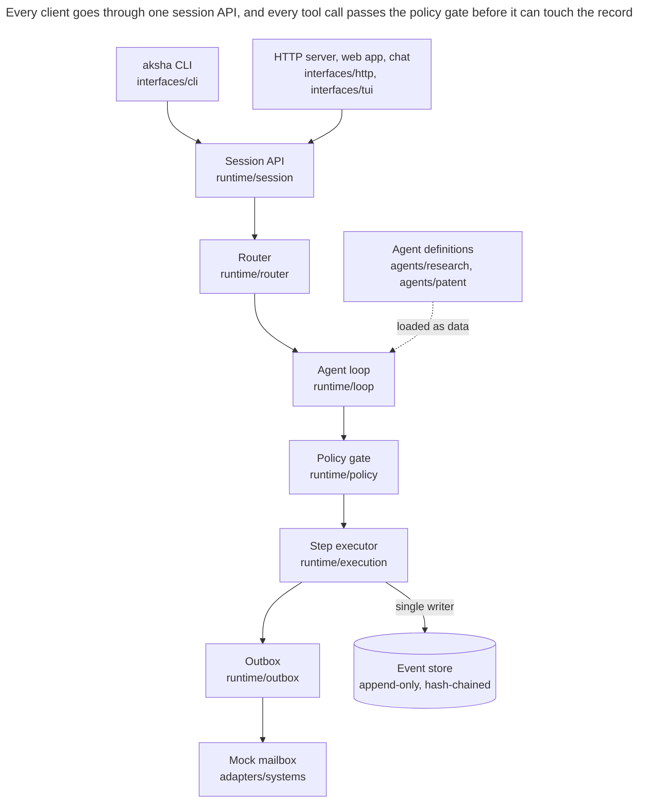

# Aksha

[](https://github.com/SaiiPittu/aksha/actions/workflows/ci.yml)
[](pyproject.toml)

Aksha is a headless agent harness in Python. One shared runtime runs many agents, and each agent is defined as data in its own module. It ships with two built agents, research and patent, which work on a synthetic venture that builds camera-free occupancy sensors (the `stillroom` world). Every fact either agent produces lands in one append-only, hash-chained event store, and every saved output records the versioned reads it was built from. When an input changes, only the work that depends on it is rebuilt.

[Assignment requirements and evidence](docs/requirements.md) · [Architecture](docs/architecture/README.md) · [Agents](docs/agents/research.md) · [Add an agent](docs/agents/authoring.md) · [Examples](docs/examples.md) · [Limitations](docs/limitations.md)

> **Reviewing this assignment?** Start with [docs/assignment/README.md](docs/assignment/README.md). It is a short reviewer's guide: a two-minute check, six targeted tests, the runtime and agent boundary, each agent's evidence rules, change and crash recovery, and honest results on held-out worlds and live model runs, each claim tied to a path, a test or a real event ID.

## Three agents, one runtime (the rule of three)

The runtime follows one rule: no abstraction enters it until three different agents fit that abstraction with no agent-specific code in the runtime. Two document agents alone could pass with a design that is only a document pipeline, so the third agent is chosen to work differently. The three are the Research Agent (built), the Patent Agent (built) and a contrast coding agent (designed, not built). The coding agent would edit a Git repository in a sandbox, run its tests and push a branch after approval. It presses on what the two document agents do not: long contexts, a shell in a sandbox, a completion check that runs the tests, and cancellation mid-edit.

On 25 Nov 2026 each of the 22 original primitive decision records (ADRs) was checked against all three agents. The coding agent is a design, not running code, so its verdicts come from reading interfaces and are the weakest evidence of the three. The running check is narrower: `test_third_agent_runtime_hash_unchanged` in [tests/architecture/test_extension_boundary.py](tests/architecture/test_extension_boundary.py) loads a third, toy agent and checks that every Python file under `src/aksha/runtime` hashes the same before and after. What each agent presses on is in [docs/design/rationale.md](docs/design/rationale.md), and the verdict counts per agent are in [section 7 of the problem and goals](docs/design/01-product/01-problem-and-goals.md#7-the-rule-of-three).

## See it work in under 2 minutes

You need Python 3.12 or newer and [uv](https://docs.astral.sh/uv/). No API key is needed, and nothing goes over the network after the install. Offline, every model is a rule-based fake.

```sh
uvx --from git+https://github.com/SaiiPittu/aksha aksha demo
```

The demo runs both agents, changes the inputs, rebuilds only what depends on the change, kills a send with a real `SIGKILL` and recovers it. It takes about 20 seconds and exits 0 only when every check passes. An excerpt from a run on 28 Nov 2026, with what each line means for the venture:

```text
1. Both agents run on the stillroom world (8.32 s)
   research R-0001 complete: 11 outputs, 23 model calls
   patent   R-0002 complete: 23 outputs, 54 model calls
2. The input changes to stillroom-v2's change set (0.75 s)
   added publications/SYN-PUB-0011.json (a new publication family)
   edited disclosures/consultant-email.eml.txt, disclosures/history.csv (the outside suggestion, now dated earlier)
3. Invalidation reopens only what depends on the change (6.6 s)
   weak, noticed and not rebuilt: patent.portfolio read reviews.json outside what it rests on; 1 low-priority recheck item(s)
   keyed on every read instead, the same change would reopen 27 outputs, not 17
   rebuilt 17: C1: comparison, extraction, handoff, packet, prior_art, recommendation; ...; C2: recommendation; C3: recommendation; C4: recommendation; findings, matrix, needs, tests, selection, table
   kept 10 patent outputs: C2: comparison, extraction, prior_art; ...; portfolio
   kept 7 of 11 research outputs: ...
   C1 next action: prioritize_counsel_review -> collect_more_evidence (the v2 answer key expects collect_more_evidence)
   C1 recommendation read research.findings@v1, research.needs@v1 (business importance only), then research.findings@v2, research.needs@v2 once the research rebuilt; ...
   C1 outside contributor P-05: suggested F2, F3 on 2025-11-21, before their agreement took effect; flagged needs_counsel_confirmation for counsel
   A-0001 approved patent.packet/C1@v1 only, so it does not cover patent.packet/C1@v2; a fresh approval is requested
4. SIGKILL mid-send, then recovery (3.45 s)
   at restart: 1 outbox entry open with no receipt; recovery asked the mailbox by key 1 time, sent 0 times; R-0005 ended complete
   mailbox: 2 deliveries for 2 idempotency keys (patent.packet/C1@v1, patent.packet/C1@v2): each packet version exactly once
```

What this shows:

- **Act 1.** The research agent maps the competitors and customer needs. The patent agent triages four invention candidates and sends an approved disclosure packet for C1.
- **Act 2.** A new prior-art publication appears, and a consultant's suggestion turns out to predate their agreement.
- **Act 3.** Only 17 of the 34 outputs reopen. The research needs and findings move, so every patent recommendation, which reads them for business importance only, reopens with them. C1 moves from counsel review to collecting more evidence, the ownership question goes to counsel, and the old approval does not cover the new packet.
- **Act 4.** The process dies after the mailbox stored the packet but before the receipt was recorded. Recovery asks the mailbox by key instead of sending again, so each packet version arrives once.

The whole output, act by act, is in [examples/change-and-recovery.md](examples/change-and-recovery.md). To run the test suite from a clone:

```sh
make venv && make check   # lint, type check and every test, offline; about 6 minutes on 8 cores
```

## Assignment requirements at a glance

[docs/requirements.md](docs/requirements.md) is the one page to read. It maps the 97 assignment requirements to code paths, pytest node IDs and commands, and a test fails if any named path or test stops existing. Its summary as of 28 Nov 2026:

- **91 met, 6 partly met.** Every row that is not fully met says why, at the top of the page.
- **One interface, routed.** The command line, an HTTP server, a web app and a terminal chat all drive one session API. A named agent skips the router; an unclear request gets a route question.
- **One runtime.** Model calls, tools, timeouts, retries, budgets, approvals and the record are shared code. Tool permissions are checked by a deny-by-default policy gate in code.
- **Durable.** Conversations, checkpoints, outputs and pending approvals survive a restart, and a crash mid-send never sends twice.
- **Research reused, never as novelty (R-36).** Each patent recommendation reads the research needs and findings by artifact ID and version, cites them for business importance only, and is refused if it names them as novelty or prior-art evidence.
- **Partly met.** The change demo re-dates an existing contributor rather than adding a new one (R-83), and the demo restarts during the send, not before the rebuild (R-84). Held-out results are R-64.

## The two built agents

| | Research | Patent |
|---|---|---|
| Job | Who sells camera-free occupancy sensing, at what price, and what customers ask for | Which invention candidates to take to counsel, and a disclosure packet for the chosen one |
| Tools | The six shared tools: `list_inputs`, `read_document`, `search_inputs`, `web_search`, `fetch_url`, `todo` | The shared tools plus `search_publications`, `fetch_publication`, `list_templates`, `read_template`, `fill_form`, `send_packet` |
| Outputs | `research.scope`, `competitors`, one `profile` per company, `matrix`, `needs`, `findings`, `tests` | Per candidate `extraction`, `prior_art`, `comparison`, `recommendation`; `portfolio`, `table`, `selection`, `form`, `packet`, `handoff` |
| People in the loop | A question when the segment or geography is missing | The candidate choice, then an approval on `send_packet` bound to the packet version and recipient |
| Docs | [docs/agents/research.md](docs/agents/research.md) | [docs/agents/patent.md](docs/agents/patent.md) |

Every tool, its owner, effect class and schema is in [docs/agents/tools-and-schemas.md](docs/agents/tools-and-schemas.md). The outputs above, as the agents saved them, are in [examples/outputs/](examples/outputs/).

## Add an agent

An agent is a folder the loader finds on a search path. Its `agent.py` declares a purpose, instructions, the tools it may use, the outputs it saves and a graph of Tasks. Abridged from the conformance agent in [tests/fixtures/agents/toy/agent.py](tests/fixtures/agents/toy/agent.py):

```python
AGENT = Agent(
    name="toy",
    purpose="Summarise a few short notes, one line each, then one overall line.",
    instructions="prompts/instructions.md",
    reads=("record:notes",),
    artifacts=(ArtifactKind("line", LINE, keyed=True), ArtifactKind("summary", SUMMARY)),
    tools=(ToolUse("echo.lookup"), ToolUse("save_artifact")),
    tasks=(
        Task("collect", per=source_keys("notes"), tools=("echo.lookup", "save_artifact"), writes=("line",)),
        Task("summarise", needs=("collect",), reads=(Read("toy.line", keys="all"),), tools=("save_artifact",)),
    ),
)
```

Adding one never edits the runtime. `test_third_agent_runtime_hash_unchanged` in [tests/architecture/test_extension_boundary.py](tests/architecture/test_extension_boundary.py) loads `toy` and checks that every Python file under `src/aksha/runtime` hashes the same before and after. A fixture agent from outside `src` runs end to end in `tests/integration/test_cli.py`. The steps are in [docs/agents/authoring.md](docs/agents/authoring.md).

## Talk to it

```sh
aksha example stillroom my-inputs
export AKSHA_SEARCH=world:stillroom   # the world's offline web: vendor pages mixed with noise
aksha run --agent research --input my-inputs "Who sells camera-free occupancy sensing for offices, and at what price?"
aksha answer I-0001 EU                # the agent asked which geography to cover
aksha show                            # every saved output
aksha show research.matrix            # one output as JSON, every value cited
aksha verify                          # check the hash chain
```

Generated transcripts, each from a real offline run:

- [examples/research-conversation.md](examples/research-conversation.md): a research run, the clarifying question and the answer.
- [examples/patent-conversation.md](examples/patent-conversation.md): a missing-detail question, the choice of C1, the approval and the send.
- [examples/routing-conversation.md](examples/routing-conversation.md): a request with no `--agent`, routed or asked about.

The same conversation runs in the terminal with `aksha chat --agent research --input my-inputs` (extra `[tui]`), or in the browser with `aksha serve --web web/dist` after building `web/` ([web/README.md](web/README.md)). `--record DIR` keeps a run's model answers, searches and fetches, and `aksha replay DIR` runs it again with no model and no network. Every command and its output is in the [quick start](docs/quickstart.md).

## Architecture at a glance



Caption: the agents are data loaded into the loop, so no box in the runtime names an agent. Notice that the only path to the mailbox runs through the gate and the outbox, and only the step executor writes the store.

- **Recorded reads.** Every tool read is an event naming the record, its version and the span returned. Staleness is computed from those events, never stored as a flag.
- **Citation-keyed invalidation with early cutoff.** An output reopens when a span it cites changes. A rebuild that comes out equal stops the cascade ([ADR-P05](docs/design/adr/ADR-P05-invalidation.md)).
- **Approvals in code.** An approval is bound to the exact action by signature, and the gate re-checks it before each delivery.
- **A transactional outbox.** An external effect is keyed by meaning, so a retry or a recovery never sends twice.

The layered pages start at [docs/architecture/README.md](docs/architecture/README.md): context, tiers, runtime, lifecycles, change and recovery, data model and the trust boundary.

## Tests and evals

- **Tests.** 3,720 collected offline: unit, contract, integration, architecture and agent tests (`make test`). The web app has its own Vitest and Playwright tests in `web/`.
- **Evals.** `aksha eval list` and `aksha eval run <suite>` run an eval set (`suite` in the code) and grade each eval case from the episode's event store (one episode is one trial of one eval case), never from what the agent says it did ([docs/evals/README.md](docs/evals/README.md)).
- **Development eval sets.** research, patent, scripted, change, tilldew, cindral and portfolio, over the worlds the agents were built on, pass every eval case in fake model mode.
- **Held-out eval sets.** Six worlds were written without sight of the agent code, each with its own eval set. The three patent worlds were read later, while the patent reader was made general, so they no longer count as held out ([limitations item 19](docs/limitations.md)). The research agent passes 25 of 26 of their eval cases and the patent agent 17 of 24. The table per eval set is in [docs/status.md](docs/status.md#results-on-the-held-out-worlds).

These are fake-model numbers. They test the harness and the offline rules, not a model.

## Live models

Offline is the default. `AKSHA_MODE=live` calls any provider through LiteLLM, or any chat-completions server, with keys read from the provider's own environment variable and never recorded. So far the adapters have been smoke-tested on one Gemini model. Live research runs found two problems that are now fixed: retries too short for a provider under load ([#99](https://github.com/SaiiPittu/aksha/pull/99)), and a model that was never told how to write a citation ([#100](https://github.com/SaiiPittu/aksha/pull/100)). On 28 Nov 2026 the Research Agent ran a whole task on GPT-6.2 Sol: 392 model calls in 27.6 minutes, ending partial with two competitors left unknown rather than guessed. That recording ships in `src/aksha/data/recordings/research-live-gpt/`; it is stale until re-recorded, since each keyed instance is now told its key ([docs/live-mode.md](docs/live-mode.md)). Tested live after the fixes: the same agent, interactive on the assignment's example prompt with only the reviews uploaded, ended complete in about 8.5 minutes with all 5 competitors matching the world's answer key; its events, outputs and trace are in [examples/live/research-2026-11-28/](examples/live/research-2026-11-28/README.md). The evals have not yet run live. Settings and detail: [docs/live-mode.md](docs/live-mode.md).

## Documentation map

| Page | What it holds |
|---|---|
| [Reviewer's guide](docs/assignment/README.md) | For the assignment's reviewers: what to run, what to read and what each claim rests on |
| [Assignment requirements and evidence](docs/requirements.md) | Every assignment requirement, how it is met, and the paths, tests and commands that show it |
| [Architecture](docs/architecture/README.md) | Layered pages from context to recovery, the data model and the trust boundary |
| [Agents](docs/agents/research.md) | The [research](docs/agents/research.md) and [patent](docs/agents/patent.md) agents, [tools and schemas](docs/agents/tools-and-schemas.md), [adding an agent](docs/agents/authoring.md) |
| [Examples](docs/examples.md) | Conversations, every saved output and the change-and-recovery demo |
| [Quick start](docs/quickstart.md) and [interfaces](docs/interfaces.md) | Every command with its output; the session API, server, CLI and tracing |
| [Status](docs/status.md) | What is built, the eval results per eval set and the roadmap |
| [Live mode](docs/live-mode.md) | Settings for real models and what has run live |
| [Evals](docs/evals/README.md) and [design](docs/design/README.md) | Writing eval cases; the primitives, decision records and decisions log |

## Known limitations and what comes next

The top four, as of 28 Nov 2026. The full list is in [docs/limitations.md](docs/limitations.md).

1. **Few live runs so far.** The Research Agent has run whole tasks on a real model (GPT-6.2 Sol), the latest ending complete; the Patent Agent has not yet finished a live run, the evals run only on rule-based fakes, and every confidence threshold is unfitted.
2. **The only system of record is a mock.** An approved send goes to a development mailbox, a JSON file that reaches no one.
3. **A headless run sends without approval.** `aksha run --headless` is opt-in, recorded on `run.started` and needs a sandbox, but it turns the approval route into the outbox route ([trust boundary](docs/architecture/trust-boundary.md)).
4. **Erasure is open.** `forget` hides a memory from recall but erases nothing from the append-only store (P30).

Next: a whole Patent Agent task and the evals on a real model, a real system of record behind the outbox, and a container sandbox backend. The roadmap with each item's status is in [docs/status.md](docs/status.md#roadmap).

## Development

```sh
make venv            # .venv with aksha (editable), the dev group and the optional extras
make check           # lint, type check and the full test suite on SQLite, offline
make test-postgres   # the PostgreSQL adapter's tests (make venv-postgres first)
make demo            # the same demo, state in var/demo/
```

The distribution is `aksha-harness`; the command and the import are `aksha`. Never `pip install aksha`, which is an unrelated project. Contributing and the test layout: [CONTRIBUTING.md](CONTRIBUTING.md). Releasing: [docs/releasing.md](docs/releasing.md).

## License

MIT. See [LICENSE](LICENSE).
