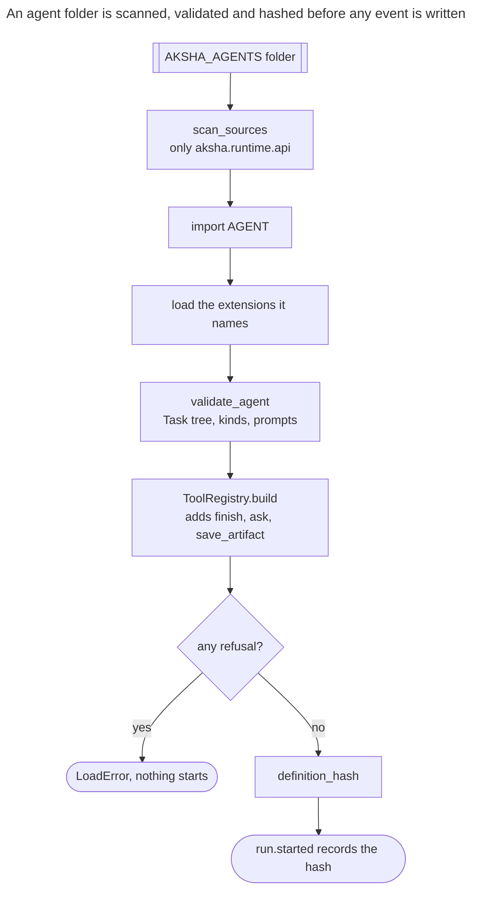

# Adding an agent

An agent is a folder of Python and prompt files that the loader finds on a search path. Adding one never edits the runtime: no file under `src/aksha/runtime` names an agent, an agent's artifact kind or an agent's tool, and a test checks both facts. The research and patent agents are built the same way as the one you would add; read [research.md](research.md) and [patent.md](patent.md) for two full examples.

## What proves it

| Test | What it checks |
|---|---|
| [`tests/architecture/test_extension_boundary.py`](../../tests/architecture/test_extension_boundary.py) `test_third_agent_runtime_hash_unchanged` | The conformance agent `toy` loads from a temporary folder, and the hash of every file under `src/aksha/runtime` is the same before and after. |
| same file, `test_conformance_fixtures_import_only_the_api` | The fixture agent and its extension import only `aksha.runtime.api` (`scan_sources` finds nothing) and live outside the runtime package. |
| same file, `test_runtime_has_no_agent_terms` and `test_term_check_catches_a_planted_term` | The runtime source holds no word from [`tests/fixtures/agent_terms.txt`](../../tests/fixtures/agent_terms.txt), and a planted one is caught. |
| [`tests/integration/test_cli.py`](../../tests/integration/test_cli.py) `test_run_embedded_completes_and_exits_zero` | A fixture agent outside `src` (`scribe`) runs end to end through the command line and ends `complete`. |

The hash test loads the agent; it does not drive a turn. The end-to-end run is carried by the `scribe` fixture in the command-line test.

## The minimal definition

This is the conformance agent from [`tests/fixtures/agents/toy/agent.py`](../../tests/fixtures/agents/toy/agent.py), the agent the hash test loads. One line is left out, marked below: the `summarise` Task's per-Task prompt file, `prompts/summarise.md`.

```python
from aksha.runtime.api import (
    Agent,
    ArtifactKind,
    Budget,
    ContextPolicy,
    Goal,
    Limits,
    ModelAlias,
    Read,
    RelationKind,
    Task,
    TodoReminder,
    ToolUse,
    source_keys,
)

from . import checks

LINE = {
    "type": "object",
    "properties": {"line": {"type": "string", "minLength": 1}},
    "required": ["line"],
}
SUMMARY = {
    "type": "object",
    "properties": {"text": {"type": "string"}},
    "required": ["text"],
}

AGENT = Agent(
    name="toy",
    purpose="Summarise a few short notes, one line each, then one overall line.",
    instructions="prompts/instructions.md",
    reads=("record:notes",),
    artifacts=(ArtifactKind("line", LINE, keyed=True), ArtifactKind("summary", SUMMARY)),
    relations=(RelationKind("summarises", src=("summary",), dst=("line",)),),
    tools=(ToolUse("echo.lookup"), ToolUse("save_artifact")),
    tasks=(
        Task(
            "collect",
            per=source_keys("notes"),
            extracts=True,
            tools=("echo.lookup", "save_artifact"),
            writes=("line",),
            stop_policies=(TodoReminder(every=2),),
            children=(
                Task("read", tools=("echo.lookup",), done=checks.note_read),
                Task(
                    "write",
                    tools=("save_artifact",),
                    done=checks.line_saved,
                    model_aliases=("classify.tone",),
                ),
            ),
        ),
        Task(
            "summarise",
            needs=("collect",),
            reads=(Read("toy.line", keys="all"),),
            tools=("save_artifact",),
            writes=("summary",),
            done=checks.summary_saved,
            # one line left out here: the Task's prompt file, prompts/summarise.md
            stop_policies=(Goal(checks.every_line_in_summary),),
        ),
    ),
    completion=(checks.summary_saved,),
    model_aliases=(ModelAlias("classify.tone", "classification"),),
    budget=Budget(model_turns=10, tool_calls=20),
    limits=Limits(turn_limit=5),
    context_policy=ContextPolicy(result_cap_chars=2_000),
    extensions=("echo",),
)
```

Each field maps to one requirement for an agent definition:

| Field | What it holds |
|---|---|
| `purpose` | One sentence the router and the person read. |
| `instructions` | A prompt file inside the folder, read on every Task. A Task may also name its own prompt file. |
| `tools` | The tools the agent may use: its own `ToolDecl`s, or `ToolUse` of a loader-added tool (`save_artifact`) or an extension's tool (`echo.lookup`). Each Task then lists the subset it may call; the gate refuses any other. |
| `artifacts`, `relations` | The kinds it saves, each with a JSON Schema, and the relation kinds between them. |
| `tasks` | The Task tree: fan-out (`per`), dependencies (`needs`), reads, writes, completion checks (`done`) and interrupts. |
| `completion` | The run-level checks. |
| `budget`, `limits`, `context_policy` | The run's turn and call budget (the backstop on a long run), the limits and the context caps. A Task has no turn limit unless it declares `turn_limit=` (decision 42, ADR-P15 S8). The toy's agent-wide `Limits(turn_limit=5)` ends no instance by itself ([limitations](../limitations.md) item 24); give the Task its own `turn_limit=` to cap it. |

The completion checks are pure functions over the Task view, in [`tests/fixtures/agents/toy/checks.py`](../../tests/fixtures/agents/toy/checks.py):

```python
def summary_saved(view: Any) -> CheckResult:
    """The summary was saved."""
    return CheckResult(ok=bool(getattr(view, "summary", False)), message="save the summary")
```

## How the loader takes it in



Notice that every refusal is collected and raised together as one `LoadError`, so a broken definition never writes an event. The definition hash covers the agent's files, so a run that crashed under one definition is ended `definition_changed` instead of resumed under an edited one.

The loader is [`src/aksha/runtime/definitions/loader.py`](../../src/aksha/runtime/definitions/loader.py); the source scan is [`modules.py`](../../src/aksha/runtime/definitions/modules.py) in the same folder. The scan refuses an import of any `aksha` module other than `aksha.runtime.api` (an agent may also import `aksha.extensions.<name>` for each extension it names), a class shaped like a stop policy, and an import of a network module.

## Steps

1. **Make the folder.** Create `<folder>/<name>/` with `__init__.py`, `agent.py` defining `AGENT`, `checks.py`, and `prompts/instructions.md`. Import only `aksha.runtime.api`.
2. **Declare the outputs.** One `ArtifactKind` per output, with its JSON Schema. Mark `keyed=True` for one version per key, and add `cites=(CitePolicy(...),)` for the fields that must quote their evidence.
3. **Choose the tools.** Reuse the harness's tools with the factory functions in `aksha.runtime.api`: `input_tools(agent, reading)`, `web_search_tool(agent)`, `fetch_url_tool(agent, reading)` and `todo_tool(agent)`, as the research agent does in [`src/aksha/agents/research/tools.py`](../../src/aksha/agents/research/tools.py). Declare a domain tool as a `ToolDecl(ToolSpec(...), body)`. An `external` tool needs an `EffectSpec` and an `ApprovalRule`, as `send_packet` in [`src/aksha/agents/patent/tools.py`](../../src/aksha/agents/patent/tools.py) and `publish` in [`tests/fixtures/agents/scribe/agent.py`](../../tests/fixtures/agents/scribe/agent.py) show.
4. **Write the Task tree.** Give each Task the tools it may call, what it reads and writes, a completion check, and an interrupt where it may ask a person.
5. **Add a fake model.** For the offline `fake` mode, `fakes.py` defines `ADAPTERS`, a model per alias. The `scribe` fixture's [`fakes.py`](../../tests/fixtures/agents/scribe/fakes.py) is a short example (`ADAPTERS = {"generate": ScribePolicy()}`).
6. **Point the runtime at it.** Set `AKSHA_AGENTS` to the folder that holds your agent folder (several folders are joined with the path separator), and `AKSHA_EXTENSIONS` if it needs an extension of its own.

## Testing it

1. **It loads.** Copy the pattern of `test_third_agent_runtime_hash_unchanged`: call `load_agents([folder], [extensions])` and assert the agent's name. A refusal raises `LoadError` with every problem listed.
2. **Its checks hold.** Unit-test each completion check on a small view, as [`tests/agents/research/test_checks.py`](../../tests/agents/research/test_checks.py) does for the research agent.
3. **It runs.** Run it offline in fake mode through the command line, as `test_run_embedded_completes_and_exits_zero` does for `scribe`:

   ```
   AKSHA_AGENTS=<folder> aksha run "<request>" --agent <name> --session S-1
   ```

   The run ends `complete` when its completion checks pass; `aksha status <run>` and `aksha inspect <run>` show the outcome.
4. **The runtime is untouched.** Run `make test`. The boundary tests in [`tests/architecture/test_extension_boundary.py`](../../tests/architecture/test_extension_boundary.py) fail if a runtime file had to change or now names your agent's words.
