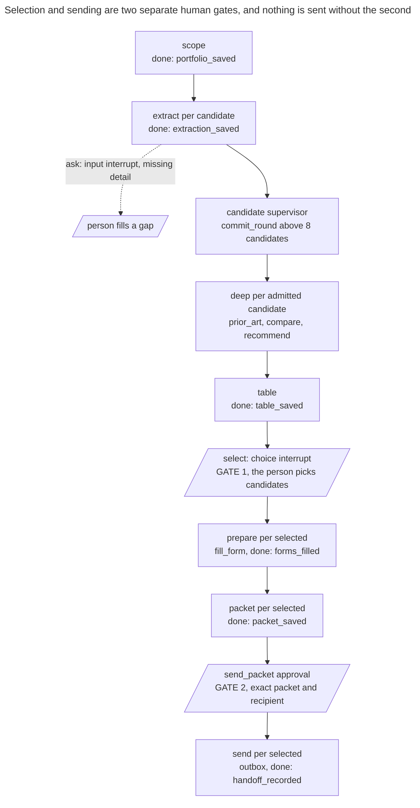

# The patent agent

The patent agent helps a team decide which invention candidates deserve a patent attorney's attention, and prepares what that attorney needs. It reads the team's own papers, searches and compares prior art, recommends one next step per candidate, asks the person which candidates to prepare, fills the blank forms through a tool, and sends a counsel-review packet only after a person approves that exact packet.

Everything below is taken from [`src/aksha/agents/patent/agent.py`](../../src/aksha/agents/patent/agent.py), its rules in [`rules.py`](../../src/aksha/agents/patent/rules.py), its checks in [`checks.py`](../../src/aksha/agents/patent/checks.py), its tools in [`tools.py`](../../src/aksha/agents/patent/tools.py) and its portfolio binding in [`portfolio.py`](../../src/aksha/agents/patent/portfolio.py).

## Purpose

The `purpose` field of the `Agent`:

> Prepare any venture's invention candidates for counsel review from its own papers: extract each mechanism, its contributors and dated disclosures, search and compare prior art, recommend a next step, and send a counsel-review packet only after a person approves it.

The agent prepares; it never decides a legal question. See [the legal boundary](#the-legal-boundary).

## Where the instructions live

| File | Read by |
|---|---|
| [`prompts/instructions.md`](../../src/aksha/agents/patent/prompts/instructions.md) | Every Task. Quote every fact, leave unstated values empty with a question, record dates and elapsed days only, call an unseen feature `not_found` and never "new", keep every status wording, give no opinion, mark inventorship and ownership for counsel, send only through `send_packet`. |
| [`prompts/supervisor.md`](../../src/aksha/agents/patent/prompts/supervisor.md) | The `candidate` supervisor, only when there are more than eight candidates. It reads the work board and commits rounds of directives. |

## Allowed tools

| Task | Tools it lists | Plus |
|---|---|---|
| `scope` | `list_inputs`, `search_inputs`, `read_document`, `list_templates`, `todo`, `save_artifact` | `finish` |
| `candidate` (supervisor) | `commit_round` | `finish` |
| `extract[Cn]` | `list_inputs`, `search_inputs`, `read_document`, `todo`, `save_artifact` | `finish`, `ask` |
| `deep[Cn]/prior_art` | `search_publications`, `fetch_publication`, `web_search`, `fetch_url`, `save_artifact` | `finish` |
| `deep[Cn]/compare` | `save_artifact` | `finish` |
| `deep[Cn]/recommend` | `save_artifact` | `finish` |
| `table` | `save_artifact` | `finish` |
| `select` | `save_artifact` | `finish`, `ask` |
| `prepare[Cn]` | `list_inputs`, `search_inputs`, `read_document`, `list_templates`, `read_template`, `fill_form` | `finish` |
| `packet[Cn]` | `save_artifact` | `finish` |
| `send[Cn]` | `send_packet`, `save_artifact` | `finish` |

`prepare` does not list `save_artifact`: a filled form can only be saved by `fill_form`, which checks it against the blank template in code. Schemas and limits are in [tools-and-schemas.md](tools-and-schemas.md).

## The Task graph

Notice that the selection is saved as a `selection` artifact and only its keys start `prepare`, `packet` and `send`. Selecting a candidate authorizes nothing to leave the system: `send_packet` raises its own approval, bound to the packet version and the recipient, and a new packet version needs a new approval.

Inside `deep[Cn]` the three children run in order: `prior_art`, then `compare` (needs `prior_art`), then `recommend` (needs `compare`). With eight candidates or fewer (`SUPERVISE_ABOVE = 8`) every candidate gets deep work and the supervisor takes no turn.

Dependencies, as declared:

| Task | Runs per | Needs | Writes | Completion check |
|---|---|---|---|---|
| `scope` | once | none | `portfolio` | `portfolio_saved` |
| `candidate` | once (supervisor) | none | `directive`, `round` | `portfolio_goal` |
| `extract` | each key in `portfolio.candidates` | none | `extraction` | `extraction_saved` |
| `deep` | each admitted key | `extract` | through its children | its children's |
| `deep/prior_art` | its parent's key | none | `prior_art` | `prior_art_saved` |
| `deep/compare` | its parent's key | `prior_art` | `comparison` | `comparison_saved` |
| `deep/recommend` | its parent's key | `compare` | `recommendation` | `recommendation_follows_rules` |
| `table` | once | `candidate` | `table` | `table_saved` |
| `select` | once | `table` | `selection` | `selection_saved` |
| `prepare` | each key in `selection.selected` | none | `form` | `forms_filled` |
| `packet` | each selected key | `prepare` | `packet` | `packet_saved` |
| `send` | each selected key | `packet` | `handoff` | `handoff_recorded` |

No Task declares a turn limit, and the agent sets no agent-wide one (decision 42, ADR-P15 S8): an instance takes turns until its completion check passes on a finish, three refused finishes block it (the stop-veto limit), a person stops it, or the run budget below holds the run. A live run's turn factor (`AKSHA_LIVE_TURN_FACTOR`) therefore scales only the run budget's model turns and tool calls.

### What each completion check refuses

| Check | Refuses when |
|---|---|
| `portfolio_saved` | No `portfolio`. |
| `extraction_saved` | No extraction, or a `{file, quote}` whose quote is in no passage a read tool minted for that file (`checks.ungrounded`). |
| `prior_art_saved` | No record; `skipped` while the plan asks for a search; an ungrounded quote. |
| `comparison_saved` | A cell without an element, or whose `state` is not `disclosed`, `partial`, `not_found` or `not_checked`; an ungrounded quote. |
| `recommendation_follows_rules` | The saved `next_action` differs from `rules.next_action` over the current extraction and comparison. |
| `table_saved` | A candidate with a recommendation and no row; under the supervisor, a `review` that differs from the recorded decisions, drop list and audit. |
| `selection_saved` | No `selection`. |
| `forms_filled` | A form the plan names is not filled for this candidate, or no form at all. |
| `packet_saved` | The first section is not `Needs counsel confirmation`; no `scope_note`; no filled forms; an ungrounded quote; any required form field still `missing`. |
| `handoff_recorded` | No handoff; `status: "held"` while the plan asks to send. |

Tests: [`tests/agents/test_patent_units.py`](../../tests/agents/test_patent_units.py) (`test_the_recommendation_check_vetoes_an_action_the_rules_do_not_give`, `test_the_packet_check_needs_the_counsel_section_first`, `test_a_missing_required_field_keeps_the_packet_from_ready`).

## Workflow states

Task instance statuses are computed from the log ([`src/aksha/runtime/tasks/status.py`](../../src/aksha/runtime/tasks/status.py)):

| Status | Recorded fact that sets it | Where it shows in this agent |
|---|---|---|
| `new` | No fact yet | `prepare[Cn]` before the selection lists `Cn` |
| `running` | `task.entered`, or `completion_check.reset` after a block | Any Task taking turns |
| `suspended` | An open `interrupt.raised` | `extract[Cn]` waiting on a missing detail; `select` waiting on the choice; `send[Cn]` waiting on the approval |
| `done` | `stop.decided` with `pop: done` | Each Task once its check passes |
| `blocked` | `stop.decided` with `pop: fail` | A Task whose finish was refused past `max_finish_vetoes` |
| `withdrawn` | `task.withdrawn`, or its key left the key source | `prepare[Cn]` after a new selection drops `Cn` |

The two human gates use different records:

| Gate | Declared as | Events | What it binds |
|---|---|---|---|
| Missing detail | `DeclaredInterrupt("input", "missing detail")` on `extract` | `interrupt.raised`, `interrupt.resolved`, `interrupt.amended` | That one candidate's instance only |
| Candidate selection | `DeclaredInterrupt("choice", "candidate selection")` on `select` | `interrupt.raised`, `interrupt.resolved` | The saved `selection` artifact, which keys the later Tasks |
| Send approval | `ApprovalRule` on `send_packet` | `approval.requested` with an `approval` interrupt (`interrupt.raised`), then `approval.granted`, `approval.rejected`, `approval.voided`, then `outbox.enqueued`, `outbox.claimed`, `outbox.completed` | The exact action: packet version and recipient (`key_fields = ("/packet", "/recipient")`) |

Tests: [`tests/agents/test_patent_episodes.py`](../../tests/agents/test_patent_episodes.py) (`test_only_extract_c2_waits_for_its_gap_question`, `test_the_selection_comes_before_any_form_and_one_send_happens`, `test_no_send_without_an_approval_bound_to_the_packet_signature`, `test_the_fresh_approval_for_the_new_packet_sends_it_once`, `test_restart_mid_approval_and_mid_send_sends_once`).

## Decision rules

### The next-action rule table

`rules.next_action(extraction, comparison, top_n)` returns one of the three `NEXT_ACTIONS`. The first matching row wins. `top_n` is `portfolio.plan.priority_cutoff`, or `TOP_PRIORITIES = 2` when the request names no number.

| Rule | Next action | Conditions |
|---|---|---|
| R1 | `prioritize_counsel_review` | At least one element is `not_found` in every family searched, **and** `implementation.status` is `built_and_tested` or `in_use_under_nda`, **and** no referenced document is missing, **and** the business-priority rank is within the top `top_n`. |
| R2 | `collect_more_evidence` | The status is `idea_only`, or a referenced document is missing. |
| R3 | `collect_more_evidence` | The venture's own public disclosure (`public: "yes"`) describes the invention in full. |
| R4 | `collect_more_evidence` | The rank is within the top `top_n`. |
| R5 | `deprioritize_for_now` | Everything else. |

Code, not the model, owns this table. `recommendation_follows_rules` refuses a recommendation that disagrees with it, and the test `test_the_rule_table` covers each row.

What evidence moves a candidate between actions:

| Evidence that arrives | Effect |
|---|---|
| A reference discloses the last unseen element (its cell moves from `not_found` to `disclosed` or `partial`) | R1 no longer matches; the candidate falls to R4 or R5. |
| A missing referenced document is found | R2 no longer matches; R1 can match. |
| A prototype is shown built and tested | The status leaves `idea_only` or `prototype`; R1 can match. |
| A public disclosure is found to describe it in full | R3 matches unless R1 or R2 matched first. |
| The business priorities are re-ranked | R1 and R4 can start or stop matching. |
| An outside contributor's record changes | The extraction that cites it is rebuilt and the contribution is raised for counsel; the action still follows the table, since contributors are not one of its inputs. |

Because the agent declares `invalidation="rebuild"` with `invalidation_keys="citations"`, a change in a cited passage reopens the extraction, comparison or recommendation that cites it, and the packet and approval built on it. The demo shows this with a closer prior-art reference ([`tests/agents/test_patent_episodes.py`](../../tests/agents/test_patent_episodes.py), `test_the_change_set_invalidates_exactly_the_c1_chain`).

### Families

`rules.family_of` joins publications that share any priority number, from any office. A family is named by its earliest priority claim proper; a continuation joins a family but does not name it. Each member keeps its own identifiers, dates and status wordings (`test_families_group_by_any_shared_priority_number`, `test_status_wordings_are_kept_verbatim_and_the_conflict_stays_visible`).

### The triage score

Above eight candidates, `portfolio.columns` computes a card per candidate from its extraction: built (0 to 2), priority (0 to 2), minus 2 for any public disclosure, minus 1 for missing documents. The score only orders work for the supervisor. It is never saved in an output and never shown as a patentability view. Code caps the deep tier at `DEEP_CAP = 10` and gives deep work to an audit sample of `AUDIT_SAMPLE = 3` dropped candidates, because the score can rank low a candidate that R1 would put first.

## Outputs

| Kind | Keyed | Required fields | Notes |
|---|---|---|---|
| `portfolio` | no | `candidates`, `plan` (`candidates`, `prior_art`, `forms`, `send`, `priority_cutoff`) | The request read into a plan |
| `extraction` | by candidate | `candidate`, `mechanism`, `contributors`, `disclosures`, `implementation.status`, `business_priority.rank`, `missing_documents` | Each disclosure has `public` and `describes_fully` |
| `prior_art` | by candidate | `candidate`, `query`, `publications`, `families` | |
| `comparison` | by candidate | `candidate`, `cells` (`element`, `family`, `state`) | `state` is one of `rules.STATES` |
| `recommendation` | by candidate | `candidate`, `next_action`, `why` | |
| `table` | no | `rows` | One row per candidate with a recommendation |
| `selection` | no, reviewable | `selected`, `based_on` | The person's choice |
| `form` | `<candidate>~<template>` | `template`, `candidate`, `fields`, `counts` | Saved only by `fill_form`; each field `complete`, `missing` or `needs_counsel_confirmation` |
| `packet` | by candidate, reviewable | `candidate`, `scope_note`, `sections` | The first section is titled `Needs counsel confirmation` |
| `handoff` | by candidate | `candidate`, `packet`, `status` | The send receipt, or `held` when the plan does not send |
| `directive`, `round` | from the portfolio extension | | The supervisor's decisions |

### How an output traces to evidence

1. Each read tool mints a span over every passage it returns (`excerpts.minted`).
2. Facts in `extraction`, `prior_art`, `comparison`, `recommendation` and `packet` are written as `{file, quote}`. The checks refuse any quote that is not inside a passage minted for that file.
3. `fill_form` records the blank template's version as a read, so a changed template reopens the form.
4. `table` reads every `patent.recommendation` and `patent.extraction`; `packet` reads every `patent.form` for its candidate plus the comparison, recommendation, extraction and prior art. Those reads are recorded with their versions, so a packet names exactly which versions it was built from.

## The legal boundary

| The agent does | The agent never does | Enforced by |
|---|---|---|
| Records dates and elapsed days | Computes a deadline, a "file by" date or a window end | Instructions; `test_grace_period_fact_is_dates_and_days_only` |
| Says an element is `not_found` in this search | Calls a feature new or novel | `rules.STATES`, `comparison_saved`; `test_no_forbidden_output_anywhere` |
| Recommends one of three next actions from a rule table | Gives a patentability or freedom-to-operate opinion or a score | `rules.next_action`, `recommendation_follows_rules` |
| Lists possible coverage directions as questions for counsel | Drafts claims | Instructions; `test_no_forbidden_output_anywhere` |
| Marks inventorship, ownership and outside contributions `needs_counsel_confirmation` | Decides inventorship or ownership | `rules.form_refusal` refuses `complete` on a counsel field (`counsel_decides`); `test_fill_form_refuses_marking_a_counsel_field_complete`, `test_consultant_suggestion_is_raised_for_counsel` |
| Keeps a packet not ready while a required field is `missing` | Fills a field with a guess | `packet_saved`; `test_gaps_are_asked_never_filled` |
| Sends a review packet to counsel after approval | Files anything | `send_packet` goes only to the `counsel_mail` system through the outbox |

A complete packet is not filing approval. Counsel and the authorized client decide filing strategy, inventorship, jurisdictions and the final documents.

## Limits

| Limit | Value |
|---|---|
| Run budget | 160 model turns, 900 tool calls |
| Task turn limit | none declared; the run budget is the backstop (decision 42) |
| Stop-veto limit | 3 refused finishes per instance entry |
| Deep tier | at most 10 candidates, `DEEP_EFFORT = 10` planned turns each (an admission estimate, not a cap), `DEEP_BUDGET = 100` turns |
| Tool result cap and read cap | 60,000 characters each |
| Context limit | 600,000 characters, with a high water mark of 400,000 and a low water mark of 300,000 |
| Read retry | 600,000 ms timeout, one retry |
