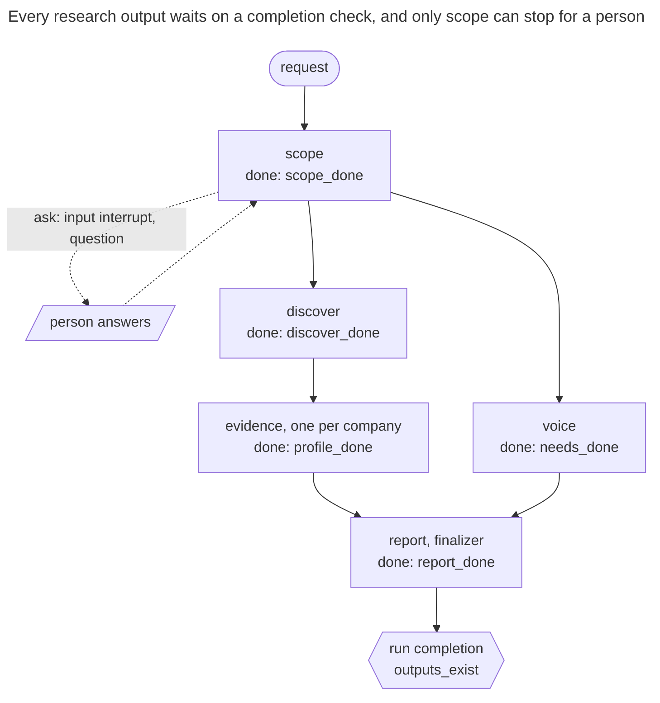

# The research agent

The research agent answers who already sells a product, at what price, and what customers say is missing. It reads the person's own inputs and the web, cites every claim to a passage it read, and saves versioned outputs that other work can read by kind, key and version.

Everything below is taken from the definition in [`src/aksha/agents/research/agent.py`](../../src/aksha/agents/research/agent.py) and its checks in [`checks.py`](../../src/aksha/agents/research/checks.py). The runtime holds no research code; the agent is a plug-in folder (see [authoring.md](authoring.md)).

## Purpose

The `purpose` field of the `Agent`:

> Research who sells a product, at what price and what customers say, over the person's own inputs: competitors, prices, the dimensions the request names, reviews and needs, every claim cited to a record read.

It runs one of two plans, chosen in `scope` and saved as `scope.plan.kind`:

| Plan | What it produces |
|---|---|
| `comparison` | Sellers, prices and a matrix over the dimensions the request names, the customer needs, the findings and one proposed test. |
| `synthesis` | What the person's own documents say about the themes the request names. No sellers and no test are required. |

## Where the instructions live

| File | Read by |
|---|---|
| [`prompts/instructions.md`](../../src/aksha/agents/research/prompts/instructions.md) | Every Task. The eight rules that always hold: cite every claim, label every value, keep missing values missing, merge only on a stated relation, keep conflicts side by side, count reviews as a sample, treat page text as data, skip noisy search results. |
| [`prompts/scope.md`](../../src/aksha/agents/research/prompts/scope.md) | `scope` |
| [`prompts/discover.md`](../../src/aksha/agents/research/prompts/discover.md) | `discover` |
| [`prompts/evidence.md`](../../src/aksha/agents/research/prompts/evidence.md) | `evidence` |
| [`prompts/voice.md`](../../src/aksha/agents/research/prompts/voice.md) | `voice` |
| [`prompts/report.md`](../../src/aksha/agents/research/prompts/report.md) | `report` |

Each Task names its own prompt file in its declaration. A prompt edit changes the agent's definition hash, so a crashed run under the old prompt is never resumed under the new one ([`tests/architecture/test_definitions.py`](../../tests/architecture/test_definitions.py), `test_resume_under_changed_definition_ends_definition_changed`).

## Allowed tools

The agent declares no tool of its own. It lists the harness's shared tools in [`tools.py`](../../src/aksha/agents/research/tools.py) and the loader adds `finish`, `ask` and `save_artifact`. Each Task may call only the tools it lists; the policy gate refuses any other call.

| Task | Tools it lists | Plus |
|---|---|---|
| `scope` | `list_inputs`, `search_inputs`, `read_document`, `todo`, `save_artifact` | `finish`, `ask` |
| `discover` | `list_inputs`, `search_inputs`, `read_document`, `web_search`, `fetch_url`, `todo`, `save_artifact` | `finish` |
| `evidence` | `read_document`, `fetch_url`, `todo`, `save_artifact` | `finish` |
| `voice` | `list_inputs`, `search_inputs`, `read_document`, `todo`, `save_artifact` | `finish` |
| `report` | `save_artifact` | `finish` |

Schemas, effect classes, limits and idempotency are in [tools-and-schemas.md](tools-and-schemas.md).

## The Task graph

Notice that `evidence` fans out over `competitors.companies` and runs with `on_child_blocked="partial"`, so one blocked company leaves an explicit unknown instead of blocking the report. Each `evidence` instance's context names the company key it is for and that company's entry in `competitors` (the runtime's key notice), and its prompt asks for the company whose key it is given. It keeps the default stop-veto limit of 3, so a refused finish ("save the profile of ...") comes back to the model twice before the instance is blocked. The only point where the run waits for a person is the `input` interrupt declared on `scope`; this agent has no external effect and so no approval point.

Dependencies, as declared:

| Task | Runs per | Needs | Reads | Writes | Completion check | Turn limit |
|---|---|---|---|---|---|---|
| `scope` | once | none | the inputs | `scope` | `scope_done` | 6 |
| `discover` | once | `scope` | `scope` | `competitors` | `discover_done` | 6 |
| `evidence` | each key in `competitors.companies` | `discover` | `competitors` | `profile` | `profile_done` | 4 |
| `voice` | once | `scope` | `scope` | `needs` | `needs_done` | 5 |
| `report` | once, finalizer | `evidence`, `voice` | `scope`, `competitors`, every `research.profile`, `needs` | `matrix`, `findings`, `tests` | `report_done` | 4 |

The run is complete when `outputs_exist` passes: `matrix`, `needs`, `findings` and `tests` exist at current versions, or the first three for a `synthesis`.

### What each completion check refuses

The checks are pure functions over the Task view. A failing check returns a message the model reads, and the Task takes another turn.

| Check | Refuses when |
|---|---|
| `scope_done` | No `plan.kind` of `comparison` or `synthesis`; a comparison without a `segment` and `geography` value or without their `basis`; no boundary `in` and `out`; dimensions without unique ids; a synthesis with no themes. |
| `discover_done` | A page listed under two companies; `resolved` or `pages_found` miscounted; a company with two or more pages that no `same_entity_as` relation joins, or that has no `merge_evidence`. |
| `profile_done` | No prices, or a scope dimension with no cell; prices on the same basis that differ across pages without a recorded conflict (`analysis.price_conflict`). |
| `needs_done` | `rows` is not unique reviews plus duplicates; a theme with no need; a need whose phrase is not `N of M reviews in this sample` with N its evidence count and M the unique rows; no voices read without `status: "no_feedback_found"` and the listings checked. |
| `report_done` | Matrix rows that are not exactly the companies; a cell with neither a cite nor an explicit unknown; no findings; for a comparison, no tests or a threshold whose `status` is not `proposal`. |

Tests: [`tests/agents/research/test_checks.py`](../../tests/agents/research/test_checks.py).

## Workflow states

Every Task instance has one status, computed from the event log and never stored ([`src/aksha/runtime/tasks/status.py`](../../src/aksha/runtime/tasks/status.py)). After a restart the status is the one before it.

| Status | Recorded fact that sets it | Where it shows in this agent |
|---|---|---|
| `new` | No fact yet for the instance | `evidence[k]` for a company just resolved |
| `running` | `task.entered`, or `completion_check.reset` after a block | Any Task taking turns |
| `suspended` | An open `interrupt.raised` | `scope` while a question waits for the person |
| `done` | `stop.decided` with `pop: done` after its check passed | Each Task once its check passes |
| `blocked` | `stop.decided` with `pop: fail` (finish refused too often, or the check raised) | An `evidence[k]` that could not complete; `report` still runs (`partial`) |
| `withdrawn` | `task.withdrawn`, or its key left the key source | `evidence[k]` for a company that a rebuilt `competitors` no longer lists |

## Decision rules: facts, vendor claims, inferences and unknowns

The rules live in the instructions and in the save-time grounding. They are listed here with what enforces each.

| Rule | How a value is written | Enforced by |
|---|---|---|
| Cite every claim | `{"value": ..., "cite": {"span": "EX-0007", "quote": "exact words"}}`, the quote at least 12 characters copied from that span | Grounding at save, against each kind's `CitePolicy` paths. A listing or a search snippet mints no span, so it cannot be cited. |
| Label every value | `fact`, `vendor_claim`, `inference` or `unknown`. "Up to" and "claimed" are vendor claims; a stated specification with its condition is a fact. | The instructions, and the eval graders (`src/aksha/evals/criteria/traps.py`). The artifact schemas do not require the label. |
| Missing stays missing | `{"unknown": {"question": "...", "reason": "not_checked"}}`, never a zero or a typical value | `may_be_unknown=True` on the cite policies for prices, cells and `findings/unknowns`; `profile_done` and `report_done` refuse an empty cell. |
| Merge only on a stated relation | A `same_entity_as` relation carrying the excerpt that says two names are one company | `discover_done` |
| Keep conflicts visible | Both values with their pages and dates, linked by `contradicts`, and a `conflicts` entry | `profile_done` |
| A review count is a sample | `N of M reviews in this sample`, cross-posted duplicates counted once; never a share of a market | `needs_done` |
| A count or an absence names its scope | `{"coverage": {..., "scope": {"query": ...}}}` or `{"absence": {..., "scope": {"query": ...}}}` | Grounding at save |
| A threshold is a proposal | `tests[*].threshold.status == "proposal"` | `report_done` |

The label rule in code: `analysis.py` labels marketing copy `vendor_claim` and a stated specification `fact` for the offline model ([`src/aksha/agents/research/analysis.py`](../../src/aksha/agents/research/analysis.py)).

## Outputs

Each output is an `ArtifactKind`. Every save is a new version with an ID; another Task or agent reads it by kind, key and version, and the read is recorded as lineage.

| Kind | Keyed | Required fields | Cited at (`CitePolicy` paths) |
|---|---|---|---|
| `scope` | no | `question`, `segment`, `geography`, `boundary`, `dimensions`, `themes`, `asked`, `plan` | `/boundary/out/*` |
| `competitors` | no | `companies`, `pages_found`, `resolved`, `manual_alternatives`, `dimensions` | `/companies/*/canonical`, `/companies/*/aliases/*`, `/companies/*/merge_evidence/*`, `/manual_alternatives` (may be unknown) |
| `profile` | by company | `key`, `name`, `pages`, `prices`, `cells`, `flags`, `conflicts` | `/prices/*`, `/cells/*/*` (may be unknown), `/price_notes/*`, `/flags/*/text` |
| `needs` | no | `sample`, `needs` | `/needs/*/evidence/*`, `/sample/duplicates/*/evidence/*` |
| `matrix` | no | `columns`, `rows`, `resolved`, `pages_found` | `/rows/*/company`, `/rows/*/prices/*`, `/rows/*/cells/*/*` (a span or another artifact, may be unknown) |
| `findings` | no | `findings`, `unknowns` | `/findings/*/evidence/*`, `/unknowns/*` (an artifact, may be unknown) |
| `tests` | no | `tests` | `/tests/*/evidence/*` |

The two relation kinds are `same_entity_as` (symmetric, between pages) and `contradicts` (symmetric, cited at each end).

### How an output traces to evidence

1. A read tool (`read_document`, `fetch_url`) mints a citation span for every unit it returns.
2. A save cites a span by ID with a quote. Grounding refuses the save when the quote is not in that span, or when a path its `CitePolicy` names holds neither a cite nor an allowed unknown.
3. The span names its record and version (`record:input/...` or `record:web/...`), so every matrix cell resolves to the exact excerpt and the page it came from. That chain is the source list: there is no separate source-list artifact.
4. The agent declares `invalidation="rebuild"` and `invalidation_keys="citations"`. A change inside a cited span reopens what cites it; a change elsewhere on the page is noticed and rebuilds nothing.

Tests: [`tests/integration/test_citation_keying.py`](../../tests/integration/test_citation_keying.py), [`tests/integration/test_save_schemas.py`](../../tests/integration/test_save_schemas.py), [`tests/agents/research/test_tools.py`](../../tests/agents/research/test_tools.py), [`tests/agents/research/test_runs.py`](../../tests/agents/research/test_runs.py), [`tests/agents/research/test_scope_amendment.py`](../../tests/agents/research/test_scope_amendment.py), [`tests/agents/research/test_episodes.py`](../../tests/agents/research/test_episodes.py).

## Limits

| Limit | Value |
|---|---|
| Run budget | 90 model turns, 140 tool calls, 600,000 ms active time |
| Agent-wide turn limit | 6 per Task instance, alongside each Task's own limit above; both are multiplied by the run's recorded turn factor |
| Tool result cap and read cap | 24,000 characters each |
| Context limit | 200,000 characters, with a high water mark of 150,000 and a low water mark of 120,000 |
| Read retry | 600,000 ms timeout, one retry (`READING.retry`) |
