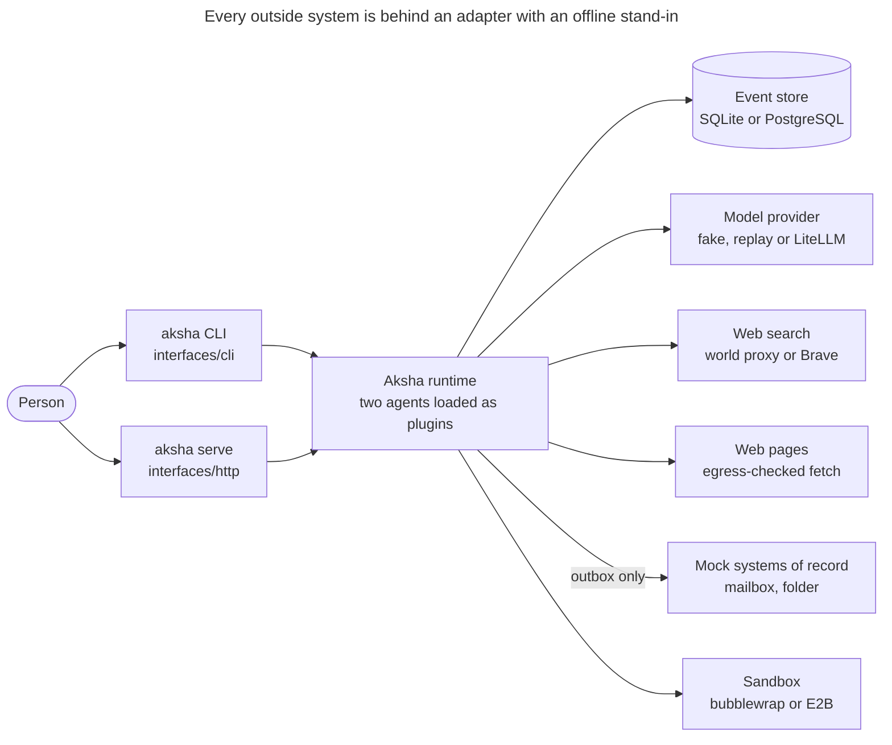

# Layer 0: context

*As of 28 Nov 2026. Next: [1, tiers](1-tiers.md). Index: [README](README.md).*

Aksha is one runtime that hosts pluggable agents. Today it loads two, a research agent and a patent agent, from [`src/aksha/agents/`](../../src/aksha/agents/). A person talks to it through a command line or an HTTP server. Everything it reaches outside itself goes through an adapter chosen in one place, the composition root [`src/aksha/app.py`](../../src/aksha/app.py), and every outside system has an offline stand-in, so the whole project runs with no credentials and no network.

## Diagram: every outside system is behind an adapter with an offline stand-in

Caption: every arrow out of Aksha crosses a port that has an offline adapter, which is why `AKSHA_MODE=fake` runs end to end with no network. Notice that the mock systems are reached only through the outbox, so a send is always a recorded, keyed effect and never a direct call.

## The outside parties

| Party | What it is | Offline adapter | Live adapter | Code |
|---|---|---|---|---|
| Person | Starts runs, uploads inputs, answers questions, approves or rejects actions | not applicable | not applicable | [`interfaces/cli/main.py`](../../src/aksha/interfaces/cli/main.py), [`interfaces/http/server.py`](../../src/aksha/interfaces/http/server.py) |
| Model provider | Generation, extraction and classification calls | each agent's `fakes.py` (`AKSHA_MODE=fake`), recorded replay, scripted replies for tests | LiteLLM, with a standard-library chat-completions fallback (`AKSHA_MODE=live`) | [`adapters/models/`](../../src/aksha/adapters/models/) |
| Web search | The `web_search` tool | a world's offline web (`web.json`) | Brave (`AKSHA_BRAVE_API_KEY`, read from the environment, never recorded) | [`adapters/search/`](../../src/aksha/adapters/search/) |
| Web pages | The `fetch_url` tool | the same world files | the runtime's HTTP client under the egress policy (`AKSHA_NETWORK=on`) | [`adapters/web/http.py`](../../src/aksha/adapters/web/http.py), [`runtime/egress/`](../../src/aksha/runtime/egress/) |
| Systems of record | Where an approved effect lands, for example the patent agent's `send_packet` to `counsel_mail` | `MailboxSystem` and `FolderSystem`, each with a ledger keyed by idempotency key | none; a real system implements the same `SystemOfRecord` port | [`adapters/systems/`](../../src/aksha/adapters/systems/) |
| Sandbox | Where exec tools and document parsers run | `refuse` (no exec) | bubblewrap on Linux, E2B (`AKSHA_SANDBOX`) | [`adapters/sandbox/`](../../src/aksha/adapters/sandbox/) |
| Event store | The record of everything that happened | SQLite, one file (default) | PostgreSQL (`AKSHA_STORE=postgres`, `AKSHA_POSTGRES_DSN`) | [`adapters/storage/`](../../src/aksha/adapters/storage/) |

A web app with accounts (`aksha serve --web web/dist`) and an `aksha chat` terminal interface are built ([#101](https://github.com/SaiiPittu/aksha/pull/101)); both are clients of the same HTTP session API, and accounts live in the HTTP layer only.

## Where to go deeper

- How a real model connects: [ADR-P07](../design/adr/ADR-P07-model-interface-and-routing.md) and [../interfaces.md](../interfaces.md).
- The egress rules for live network use: [ADR-P26](../design/adr/ADR-P26-egress-policy.md).
- Session commands and the HTTP surface: [ADR-P19](../design/adr/ADR-P19-session-api.md).
