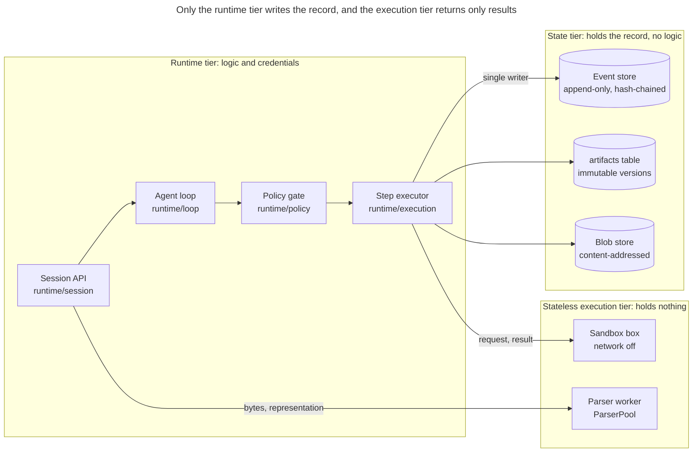

# Layer 1: tiers

*As of 28 Nov 2026. Previous: [0, context](0-context.md). Next: [2, runtime](2-runtime.md).*

Aksha is split into three tiers by what each may hold. The state tier holds the record and has no logic. The runtime tier holds the logic and every credential, and is the only writer of the record. The execution tier holds nothing: it gets a request, runs it in a throwaway workspace and returns a result. A compromise of a tier costs only what that tier holds.

## Diagram: only the runtime tier writes the record, and the execution tier returns only results

Caption: every arrow into the state tier starts at the step executor or the session's one writer, and nothing in the execution tier has an arrow back into state. Notice that the policy gate sits before the executor, so no tool call reaches the record or the sandbox without being checked.

## The tiers

| Tier | Holds | Writes the record? | Code |
|---|---|---|---|
| State | `events`, `artifacts`, `boots`, `meta` and `store_meta` tables; the blob store; the anchor file | It is the record. Updates and deletes are refused by triggers. | [`adapters/storage/sqlite.py`](../../src/aksha/adapters/storage/sqlite.py), [`adapters/storage/postgres.py`](../../src/aksha/adapters/storage/postgres.py), [`adapters/blobs/filesystem.py`](../../src/aksha/adapters/blobs/filesystem.py), [`adapters/anchor/file.py`](../../src/aksha/adapters/anchor/file.py) |
| Runtime | Session API, router, agent loop, scheduler, stop policies, policy gate, step executor, outbox worker, invalidation, context assembly, model adapters, credentials | Yes, through one writer per store | [`src/aksha/runtime/`](../../src/aksha/runtime/), wired by [`app.py`](../../src/aksha/app.py) |
| Execution | A throwaway workspace per call; for exec tools, a bubblewrap or E2B box with the network off and a cleared environment; for uploads, parser worker processes under time, memory and CPU caps | No | [`adapters/sandbox/`](../../src/aksha/adapters/sandbox/), [`extensions/ingest/worker.py`](../../src/aksha/extensions/ingest/worker.py) |

## What holds the tiers apart

- **One writer.** A store opened with `writer=True` takes a lock; a second writer is refused, and a CLI read still works while it is held (`test_a_held_writer_lock_exits_eight_and_reads_still_work` in [`tests/integration/test_cli.py`](../../tests/integration/test_cli.py)).
- **Transaction boundaries.** Every event type names the boundaries it may be appended in (U1 to U11 in [`runtime/events/boundaries.py`](../../src/aksha/runtime/events/boundaries.py)); an append outside them raises `BoundaryNotAllowed` ([`tests/unit/runtime/storage/test_append.py`](../../tests/unit/runtime/storage/test_append.py)).
- **Import rules.** The runtime never imports an adapter, and agents import only `aksha.runtime.api`. [`tests/architecture/test_dependency_rule.py`](../../tests/architecture/test_dependency_rule.py) and [`tests/architecture/test_extension_boundary.py`](../../tests/architecture/test_extension_boundary.py) fail the build otherwise.
- **The execution tier is checked as a tier.** [`tests/integration/test_execution_tier.py`](../../tests/integration/test_execution_tier.py) runs exec steps through the sandbox and checks what comes back.

## Where to go deeper

- The event store and why it is hash-chained: [ADR-P01](../design/adr/ADR-P01-event-store-and-projections.md) and [overview.md](overview.md).
- The sandbox and the execution image: [ADR-P12](../design/adr/ADR-P12-sandbox-and-execution-environment.md), [ADR-P28](../design/adr/ADR-P28-execution-environment-image.md).
- Every package and its import rules: [codebase-structure.md](codebase-structure.md).
