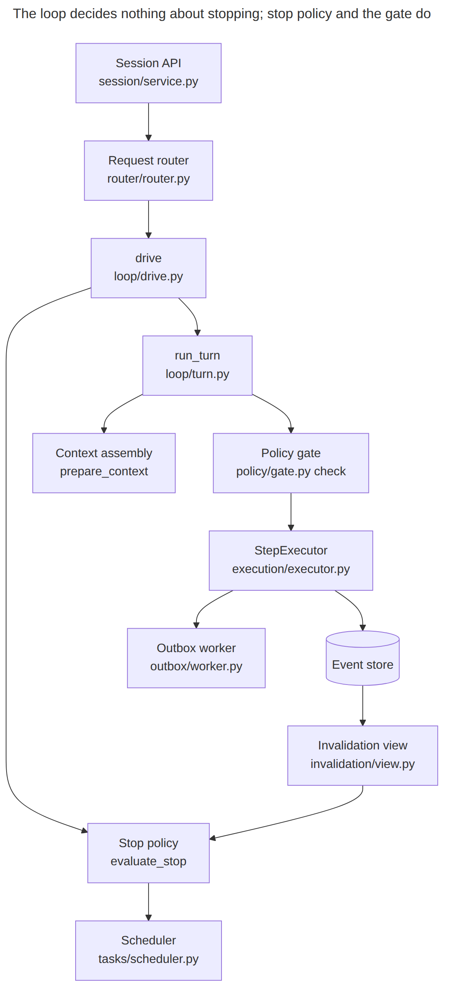
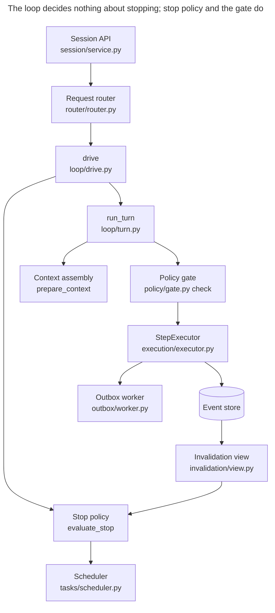
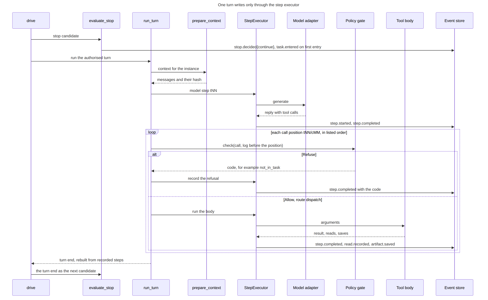
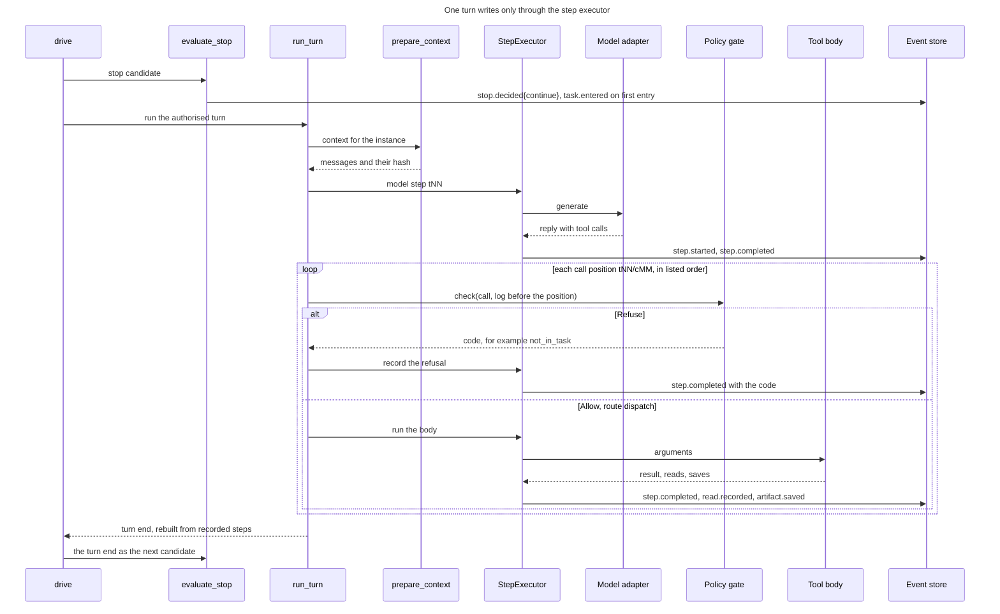

# Layer 2: the runtime

*As of 28 Nov 2026. Previous: [1, tiers](1-tiers.md). Next: [3, lifecycles](3-lifecycles.md).*

The runtime is one package per primitive under [`src/aksha/runtime/`](../../src/aksha/runtime/). No part keeps state between calls. Each one reads projections of the event store, decides, and hands its facts to a writer. Agents are data: a definition with a purpose, instructions, a Task tree and a tool list, loaded and hashed by [`runtime/definitions/`](../../src/aksha/runtime/definitions/) ([ADR-P20](../design/adr/ADR-P20-extension-api-and-agent-definition.md)).

## Diagram: the loop decides nothing about stopping; stop policy and the gate do

<!-- diagram: docs/diagrams/architecture-2-runtime-1.png -->

Diagram source (Mermaid)

Caption: `drive` only alternates two calls, `evaluate_stop` and `run_turn`, and every decision about what runs next is a `stop.decided` fact that stop policy commits. Notice that the invalidation view feeds stop policy, not the loop, so stale work can stop a finish without the loop knowing about invalidation.

| Component | Job | Code | ADR |
|---|---|---|---|
| Session API | Named commands with receipts (`command.accepted`, `command.refused`), one owner per session, streams | [`runtime/session/`](../../src/aksha/runtime/session/) | [P19](../design/adr/ADR-P19-session-api.md) |
| Request router | Picks an agent from the loaded agents' purposes; asks a `route` question when it abstains | [`runtime/router/`](../../src/aksha/runtime/router/) | [P23](../design/adr/ADR-P23-request-router.md) |
| `drive` | Alternates `evaluate_stop` and `run_turn` until a run holds or ends | [`runtime/loop/drive.py`](../../src/aksha/runtime/loop/drive.py) | [P06](../design/adr/ADR-P06-agent-loop-and-turn.md) |
| Stop policy | One `stop.decided` per stop candidate, whose verdict reaches the driver as `continue`, `hold` or `stop` (`pass`, `push`, `done` and `fail` resolve inside evaluation); Task facts (`task.entered`, `completion_check.evaluated`) commit inside it | [`runtime/stop_policy/`](../../src/aksha/runtime/stop_policy/) | [P16](../design/adr/ADR-P16-stop-policy-and-evaluation.md) |
| Scheduler | Which Task instance is runnable next, from the compiled tree and the facts | [`runtime/tasks/scheduler.py`](../../src/aksha/runtime/tasks/scheduler.py) | [P15](../design/adr/ADR-P15-task-model-and-scheduler.md) |
| `run_turn` | One turn of one instance: context, model step, each call in order | [`runtime/loop/turn.py`](../../src/aksha/runtime/loop/turn.py) | [P06](../design/adr/ADR-P06-agent-loop-and-turn.md) |
| Context assembly | The model's context as a projection, with masking and recorded summaries | [`runtime/context/`](../../src/aksha/runtime/context/) | [P08](../design/adr/ADR-P08-context-assembly-and-compaction.md) |
| Policy gate | Deny by default; eight layers in a fixed order; returns `Allow` with a route or `Refuse` with a code | [`runtime/policy/gate.py`](../../src/aksha/runtime/policy/gate.py) | [P11](../design/adr/ADR-P11-policy-gate-and-permissions.md) |
| `StepExecutor` | Every write: deterministic step IDs, retries, timeouts, the recorded result | [`runtime/execution/executor.py`](../../src/aksha/runtime/execution/executor.py) | [P02](../design/adr/ADR-P02-durable-execution.md) |
| Outbox worker | Delivers effects after their commit, keyed by idempotency key | [`runtime/outbox/worker.py`](../../src/aksha/runtime/outbox/worker.py) | [P03](../design/adr/ADR-P03-transactional-outbox-and-idempotency-keys.md) |
| Invalidation view | Which versions are stale, computed from the log | [`runtime/invalidation/view.py`](../../src/aksha/runtime/invalidation/view.py) | [P05](../design/adr/ADR-P05-invalidation.md) |

## Diagram: one turn writes only through the step executor

<!-- diagram: docs/diagrams/architecture-2-runtime-2.png -->

Diagram source (Mermaid)

Caption: the gate judges each call against the log as it stood before that call, so a resumed turn is judged exactly as the first time. Notice that `run_turn` returns nothing it remembers: its turn end is rebuilt from recorded step events, so a crash anywhere in the turn loses no decision.

The other routes an `Allow` can take are in [`runtime/loop/calls.py`](../../src/aksha/runtime/loop/calls.py): `reserved` (`finish`, or `ask`, which writes `interrupt.raised`), `approval` (a granted approval of this exact action runs through the outbox; otherwise `approval.requested` and its interrupt), and `outbox` (the effect, through its idempotency key). Once a position has signalled a finish, a question or an approval request, every later position in that reply is recorded `skipped`, so nothing runs after the run has asked a person something.

## Tests that pin this layer

- A tool result changes the next call: `test_tool_result_changes_next_call` in [`tests/integration/test_loop.py`](../../tests/integration/test_loop.py).
- The loop writes no event of its own: `test_runner_writes_no_event_of_its_own` in the same file.
- Calls after an approval request are skipped: `test_positions_after_approval_are_skipped` in the same file.
- Every gate layer and refusal code: [`tests/integration/test_policy_gate.py`](../../tests/integration/test_policy_gate.py) and [`tests/architecture/test_policy_gate.py`](../../tests/architecture/test_policy_gate.py).
- Reducers are pure: [`tests/architecture/test_reducer_purity.py`](../../tests/architecture/test_reducer_purity.py).
