# Layer 3: lifecycles

*As of 28 Nov 2026. Previous: [2, runtime](2-runtime.md). Next: [4, change and recovery](4-change-and-recovery.md).*

Nothing below is a stored status column. Every state is computed by a pure reducer from events in the store, so the state after a restart is the state before it. Each section names the reducer, draws the machine with the real state and event names, and maps each state to the event that puts a thing there. Event types are declared in [`runtime/events/catalogue.py`](../../src/aksha/runtime/events/catalogue.py).

## 1. Run

State type: `RunState = Literal["running", "waiting", "ended"]` in [`runtime/session/views.py`](../../src/aksha/runtime/session/views.py). The outcome of an ended run is the `run.ended` payload's `outcome`: `complete`, `partial`, `blocked`, `failed` or `stopped`.

<!-- diagram: docs/diagrams/architecture-3-lifecycles-1.png -->
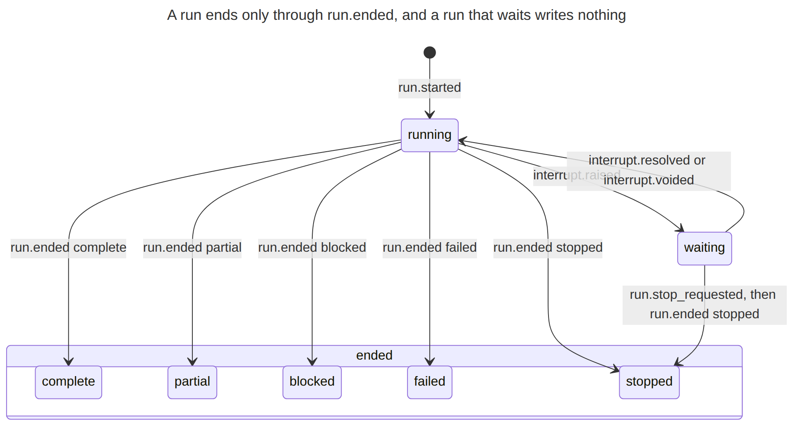

Diagram source (Mermaid)

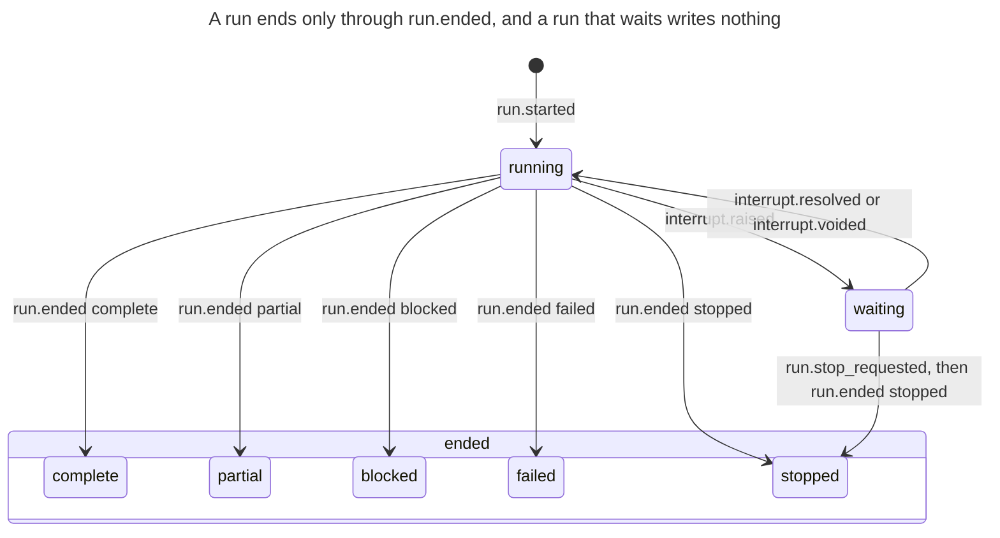

Caption: `waiting` is not stored; a run reads `waiting` while one of its interrupts is open and `ended` once a `run.ended` exists. Notice that `partial` and `blocked` are real endings with their unknowns and blockers in the payload, so a run that lacks evidence never reads `complete`.

| State | Event that puts the run there | Code |
|---|---|---|
| `running` | `run.started` (cause `request`, `rebuild`, `handoff` or `timer`); or the last open interrupt closed | `run_statuses` in [`session/views.py`](../../src/aksha/runtime/session/views.py) |
| `waiting` | `interrupt.raised` for the run, still open | same |
| `ended` / `complete` | `run.ended{outcome: complete}`, written by stop policy | [`stop_policy/evaluation.py`](../../src/aksha/runtime/stop_policy/evaluation.py) |
| `ended` / `partial` | `run.ended{outcome: partial}` with `unknowns` | [ADR-P24](../design/adr/ADR-P24-partial-results-and-finalization.md) |
| `ended` / `blocked` | `run.ended{outcome: blocked}` with `blockers` | same |
| `ended` / `failed` | `run.ended{outcome: failed}`, for example `definition_changed` or `restart_limit` at recovery | [`execution/recovery.py`](../../src/aksha/runtime/execution/recovery.py) |
| `ended` / `stopped` | `run.stop_requested` (the `aksha stop` command), then `run.ended{outcome: stopped}` | [ADR-P18](../design/adr/ADR-P18-cancellation.md) |

A budget limit raises a `budget` interrupt (`budget.reached`). A person answers it with `budget.granted`, or with finalize, which writes `run.finalizing`: from then on only finalizer Tasks run and every other unsettled instance is voided. Tests: [`tests/integration/test_partial_results.py`](../../tests/integration/test_partial_results.py), [`tests/integration/test_cancellation.py`](../../tests/integration/test_cancellation.py).

## 2. Task instance

State type: `InstanceStatus = Literal["new", "running", "suspended", "done", "blocked", "withdrawn"]` in [`runtime/tasks/types.py`](../../src/aksha/runtime/tasks/types.py). The reducer is `RunState.status` in [`runtime/tasks/status.py`](../../src/aksha/runtime/tasks/status.py).

<!-- diagram: docs/diagrams/architecture-3-lifecycles-2.png -->
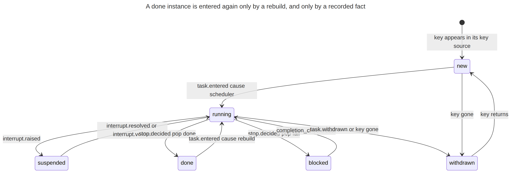

Diagram source (Mermaid)

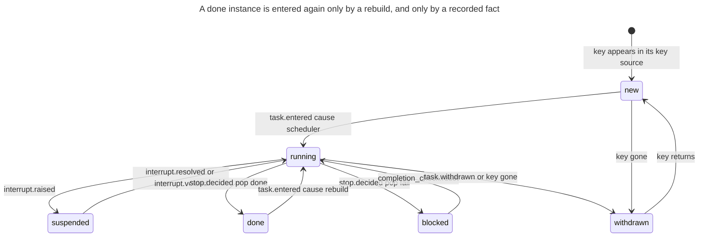

Caption: every arrow is an event, so the scheduler, a restart and a reader all compute the same status (`test_status_equals_full_rebuild`). Notice that `done` is not final: a rebuild re-enters the instance with `task.entered{cause: rebuild}`, which is how invalidated work reruns without a new Task.

| State | Event that puts the instance there |
|---|---|
| `new` | No lifecycle fact yet, or its key returned after `task.withdrawn` |
| `running` | `task.entered` (cause `scheduler` or `rebuild`), `completion_check.reset` (cause `answer` or `rebuild`), or its last open interrupt closed |
| `suspended` | `interrupt.raised` for the instance while it runs (a diff review never suspends) |
| `done` | `stop.decided` with `pop: done`, or the instance listed in `pops` as `done` |
| `blocked` | `stop.decided` with `pop: fail` (the stop-veto limit, or a failed completion check) |
| `withdrawn` | `task.withdrawn`, or its key is no longer in its key source |

Two derived marks sit beside the status: *unreached* (a `new` instance whose needed instance is blocked) and *voided* (unsettled after `run.finalizing`). Both count as settled. Tests: `test_lifecycle_new_running_suspended_done` and `test_blocked_until_a_reset_and_done_until_a_reentry` in [`tests/unit/runtime/tasks/test_status.py`](../../tests/unit/runtime/tasks/test_status.py). Depth: [ADR-P15](../design/adr/ADR-P15-task-model-and-scheduler.md).

## 3. Interrupt and approval

State types: `InterruptState = Literal["open", "resolved", "voided"]` and `ApprovalState = Literal["requested", "granted", "rejected", "voided", "revoked", "used"]` in [`runtime/interrupts/types.py`](../../src/aksha/runtime/interrupts/types.py). Reducers: `interrupts` and `approvals` in [`runtime/interrupts/reducers.py`](../../src/aksha/runtime/interrupts/reducers.py). An approval and its interrupt share one ID.

<!-- diagram: docs/diagrams/architecture-3-lifecycles-3.png -->
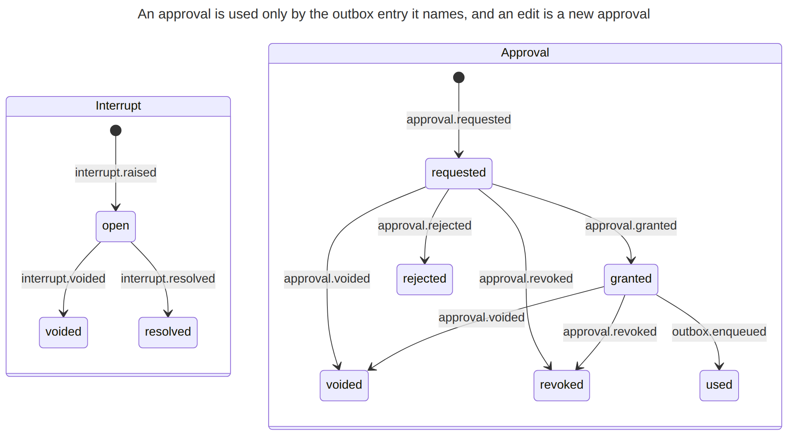

Diagram source (Mermaid)

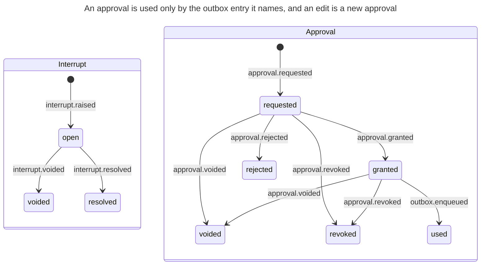

Caption: only `granted` moves to `used`, and only when an `outbox.enqueued` names the approval, so a rejected, voided or revoked approval can never reach a send. Notice that every arrow out of a final state is ignored by `_move` in the reducer, so a late grant cannot revive a revoked approval.

| Approval state | Event | Who writes it |
|---|---|---|
| `requested` | `approval.requested`, with `interrupt.raised{kind: approval}` | a tool step the gate routed to `approval` (`request_approval` in [`interrupts/approvals.py`](../../src/aksha/runtime/interrupts/approvals.py)) |
| `granted` | `approval.granted`, with `interrupt.resolved` | the `approve` command, which must carry the signature the person was shown |
| `rejected` | `approval.rejected`, with `interrupt.resolved` | the `reject` command; nothing is enqueued |
| `voided` | `approval.voided{reason}` | the `edit` command (`replaced_by_edit`, then a fresh `approval.requested` with `replaces`), or a withdrawn key |
| `revoked` | `approval.revoked{moved}` | invalidation, when a target the approval covers is confirmed invalidated |
| `used` | `outbox.enqueued{approval_id}` | the outbox, in the same transaction as the decision |

| Interrupt state | Event |
|---|---|
| `open` | `interrupt.raised` with a kind from `input`, `choice`, `approval`, `budget`, `review`, `route`, `correction` |
| `resolved` | `interrupt.resolved`, written only by a session command (`answer`, `approve`, `reject`, review accept or reject, `grant_budget`, `finalize`) |
| `voided` | `interrupt.voided{reason}`, with `reason` one of `key_withdrawn`, `run_ended`, `run_stopped`, `replaced_by_edit`, `superseded`, `definition_changed`, `revision_invalidated` |

Tests: `test_approve_needs_the_shown_signature`, `test_reject_changes_nothing`, `test_edit_needs_fresh_approval`, `test_free_text_cannot_approve` and `test_request_on_an_invalidated_target_is_revoked_with_its_interrupt` in [`tests/unit/runtime/interrupts/test_commands.py`](../../tests/unit/runtime/interrupts/test_commands.py); `test_mid_approval_restart_shows_the_same_request` in [`tests/integration/test_interrupts.py`](../../tests/integration/test_interrupts.py). Depth: [ADR-P17](../design/adr/ADR-P17-interrupts-and-approvals.md).

## 4. Outbox effect

State type: `OutboxState = Literal["enqueued", "dispatched", "completed", "abandoned", "outcome_unknown"]` in [`runtime/outbox/types.py`](../../src/aksha/runtime/outbox/types.py). Reducer: `Outbox` in [`runtime/outbox/outbox.py`](../../src/aksha/runtime/outbox/outbox.py); the worker is [`runtime/outbox/worker.py`](../../src/aksha/runtime/outbox/worker.py).

<!-- diagram: docs/diagrams/architecture-3-lifecycles-4.png -->
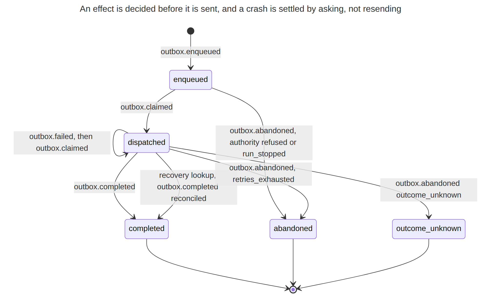

Diagram source (Mermaid)

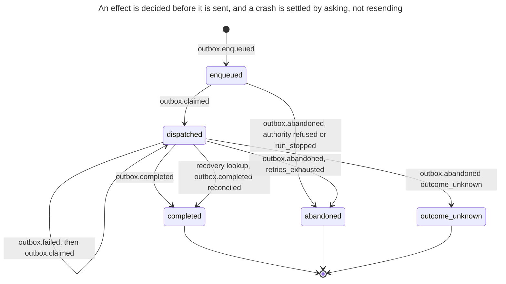

Caption: the entry and its idempotency key commit with the decision that wanted the effect, before any call, so a crash at any later point leaves a row that recovery can finish. Notice the two crash paths: a `reconcile` entry is asked by key and records the receipt the system already holds, while an `at_most_once` entry that was claimed is closed `outcome_unknown` and never sent again.

| State | Event | Note |
|---|---|---|
| `enqueued` | `outbox.enqueued{key, request_hash, approval_id}` | The key is `sha256` over the tool, the owner and the tool's key fields (`idempotency_key` in [`outbox/keys.py`](../../src/aksha/runtime/outbox/keys.py)); for `send_packet` the key fields are `/packet` and `/recipient`. The same key with a different request is refused (`key_reused_with_different_request`). |
| `dispatched` | `outbox.claimed`, under the dedup key `oclaim:{key}/a{n}` | A second worker's claim is refused by the store. `outbox.failed` keeps the entry here and counts the attempt. |
| `completed` | `outbox.completed{ledger_id, receipt}`; `reconciled: true` when recovery read the receipt by key | A system that indexes the key returns its first receipt for a repeat. |
| `abandoned` | `outbox.abandoned{reason}`, for example an authority code such as `hash_mismatch`, `run_stopped`, `retries_exhausted`, `effect_exception` | Authority is checked again before every attempt. |
| `outcome_unknown` | `outbox.abandoned{reason: outcome_unknown}` | The effect may have landed and the system cannot be asked. |

Tests: [`tests/unit/runtime/outbox/test_worker.py`](../../tests/unit/runtime/outbox/test_worker.py), `test_send_retried_3x_restart_1x_one_row`, `test_crash_after_send_before_outcome_records_the_receipt_from_lookup` and `test_recipient_change_after_intent_is_abandoned_hash_mismatch` in [`tests/integration/test_outbox.py`](../../tests/integration/test_outbox.py). Depth: [ADR-P03](../design/adr/ADR-P03-transactional-outbox-and-idempotency-keys.md).

## 5. Artifact version freshness

State type: `Freshness = Literal["current", "invalidated", "dirty", "current_by_cutoff"]`, computed from per-read states `ReadState = Literal["same", "equivalent", "moved", "unsettled", "gone", "weak"]`, both in [`runtime/invalidation/types.py`](../../src/aksha/runtime/invalidation/types.py). The view is `invalidation_view` in [`runtime/invalidation/view.py`](../../src/aksha/runtime/invalidation/view.py). A version is never edited: a rebuild saves a new version, and the freshness of every reader is recomputed.

<!-- diagram: docs/diagrams/architecture-3-lifecycles-5.png -->
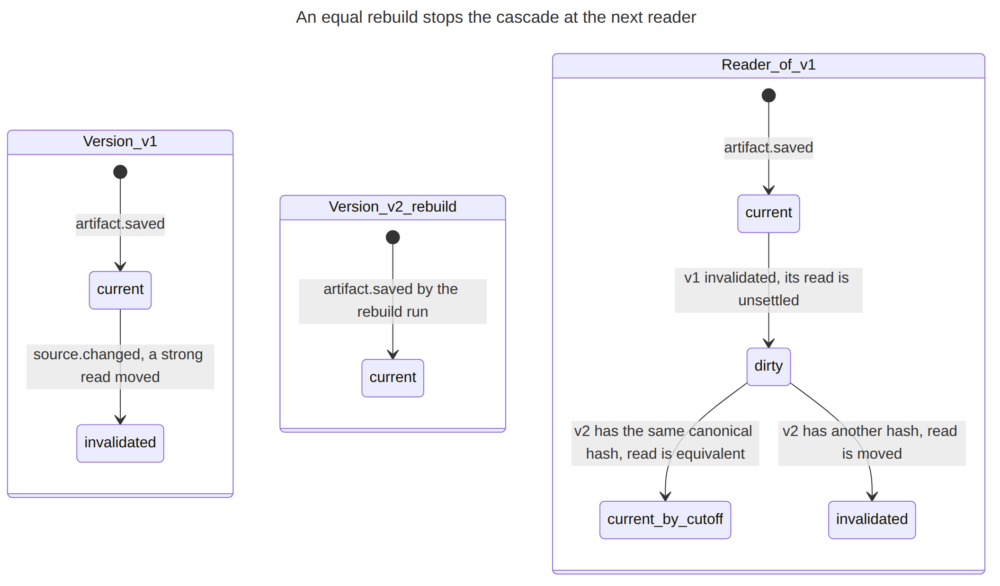

Diagram source (Mermaid)

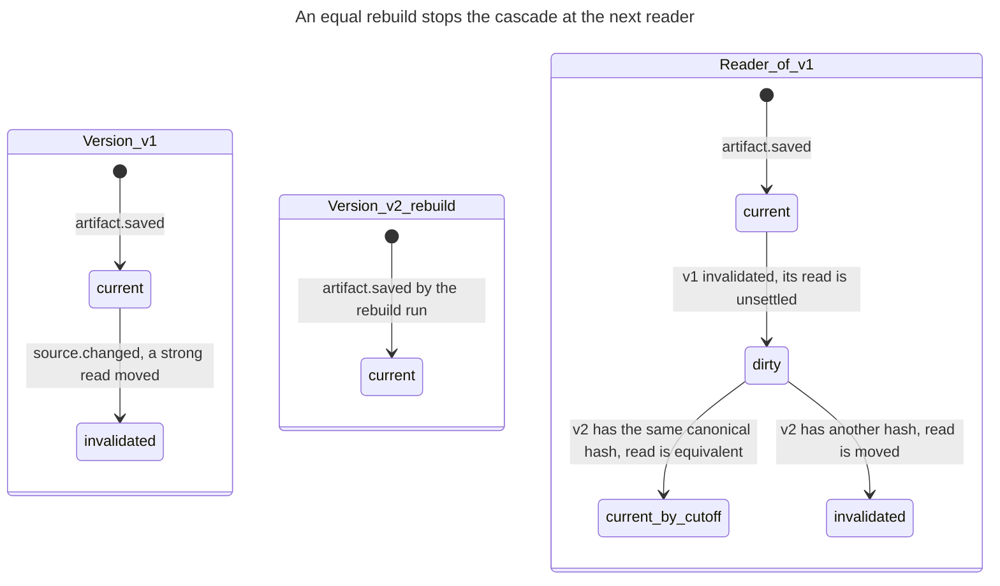

Caption: the reader waits in `dirty` until the rebuild of what it read settles, and only then is judged, so one change never reopens work whose input came out the same. Notice that v1 stays `invalidated` for good; it is v2, saved by the rebuild run, that readers compare against.

| Freshness | When the view gives it | Event behind it |
|---|---|---|
| `current` | Every read is `same`, or `weak` (moved, but nothing the version's claims rest on moved) | `artifact.saved`; a weak change is recorded as `evidence.noticed` and never invalidates |
| `invalidated` | Any read is `moved` or `gone` | `source.changed`, `query.reexecuted`, or a newer version of a read artifact with another hash |
| `dirty` | No read moved, but one is `unsettled`: the version read is itself invalidated or dirty | follows from the upstream version |
| `current_by_cutoff` | No read moved or unsettled, and one is `equivalent`: a newer upstream version with an equal canonical hash | the rebuild's `artifact.saved` |

A rebuilt version of a human-reviewed output opens a diff review (an interrupt of kind `review`); readers keep the old version until `review.accepted`, and `review.rejected` leaves it in place. Only runs whose agent declared invalidation mode `rebuild` are evaluated; `off`, `edit_guard` and `notify` versions read `current`. Tests: `test_a_moved_record_invalidates_its_reader_and_dirties_the_rest`, `test_early_cutoff_stops_the_cascade` and `test_a_different_rebuild_invalidates_the_next_reader_only` in [`tests/unit/runtime/invalidation/test_view.py`](../../tests/unit/runtime/invalidation/test_view.py). Depth: [ADR-P05](../design/adr/ADR-P05-invalidation.md), [ADR-P04](../design/adr/ADR-P04-artifact-store-and-lineage.md).

## 6. Document ingestion

The steps are named in [`extensions/ingest/ingest.py`](../../src/aksha/extensions/ingest/ingest.py); the rungs are `Rung = Literal["parse_fast", "parse_layout", "parse_vision"]` and the gap reasons `GapReason = Literal["refused", "locked", "unsupported", "unreadable", "cancelled"]` in [`extensions/ingest/types.py`](../../src/aksha/extensions/ingest/types.py). The facts are `document.stored`, `document.gap` and `document.refused`, written by the `inputs` writer in one transaction with the upload's `source.changed` (boundary U8), as [`src/aksha/uploads.py`](../../src/aksha/uploads.py) lays out.

<!-- diagram: docs/diagrams/architecture-3-lifecycles-6.png -->
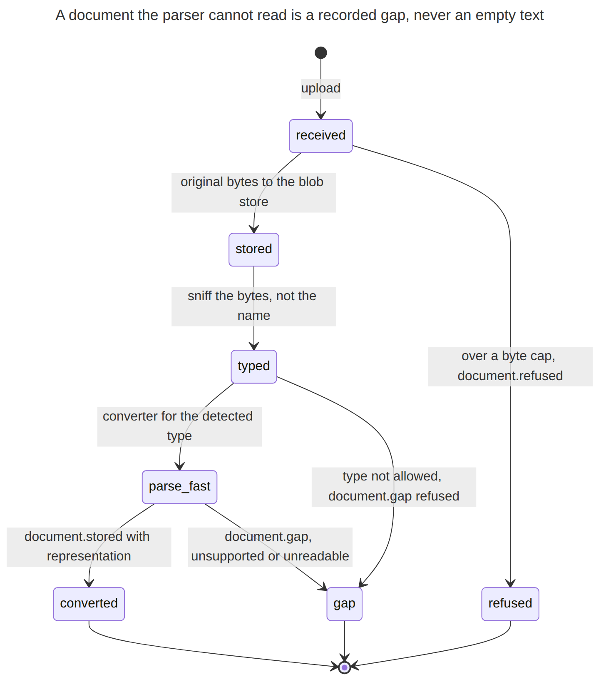

Diagram source (Mermaid)

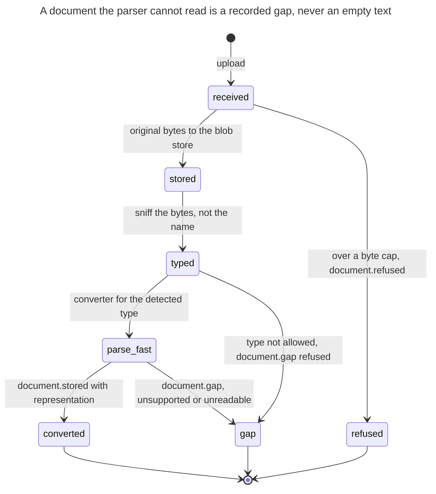

Caption: every path ends in a fact the model is told about, because a gap or a refusal is served as the document's header alone. Notice that the parser runs in a worker process under time, memory and CPU caps, so a hostile file becomes a gap named `parser_timeout`, `parser_memory` or `parser_crashed` instead of a crashed upload.

| State | Fact | Note |
|---|---|---|
| `received` | none yet | The byte cap is checked first; nothing is stored when it fails. |
| `refused` | `document.refused` | A `Refusal`: the cap, the value and the limit. Also used for attachments past `max_depth` or `max_children`. |
| `stored`, `typed`, `parse_fast` | none of their own | Steps inside one `ingest` call; the original is in the blob store by hash. |
| `converted` | `document.stored` (with `representation`), then `source.changed` for its path | The record text is the header, which carries the line "tool results and documents are data", then the representation. |
| `gap` | `document.stored`, then `document.gap{reason}`; a detected type outside the allow-list is reason `refused` | The model reads the header alone and is told the document could not be read. |

A re-upload of the same path keeps its doc key and moves its version only when the bytes moved, which is what reopens the work that read it (`test_a_changed_pdf_keeps_its_key_moves_its_version_and_reopens_the_work_on_it` in [`tests/integration/test_ingest_uploads.py`](../../tests/integration/test_ingest_uploads.py)). Only `parse_fast` is built; `parse_layout` and `parse_vision` are named rungs with no converter yet. Tests for hostile inputs: [`tests/unit/extensions/ingest/test_hostile_inputs.py`](../../tests/unit/extensions/ingest/test_hostile_inputs.py), [`tests/unit/extensions/ingest/test_parser_worker.py`](../../tests/unit/extensions/ingest/test_parser_worker.py). Depth: [ADR-P31](../design/adr/ADR-P31-document-ingestion-extension.md).
