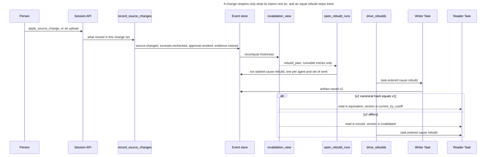
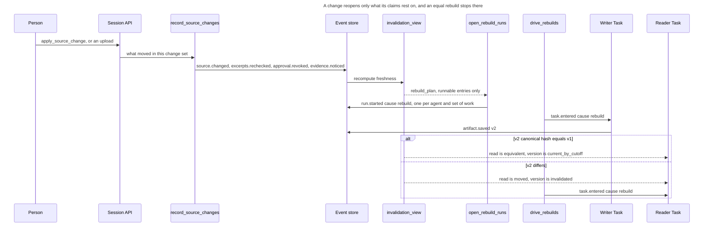
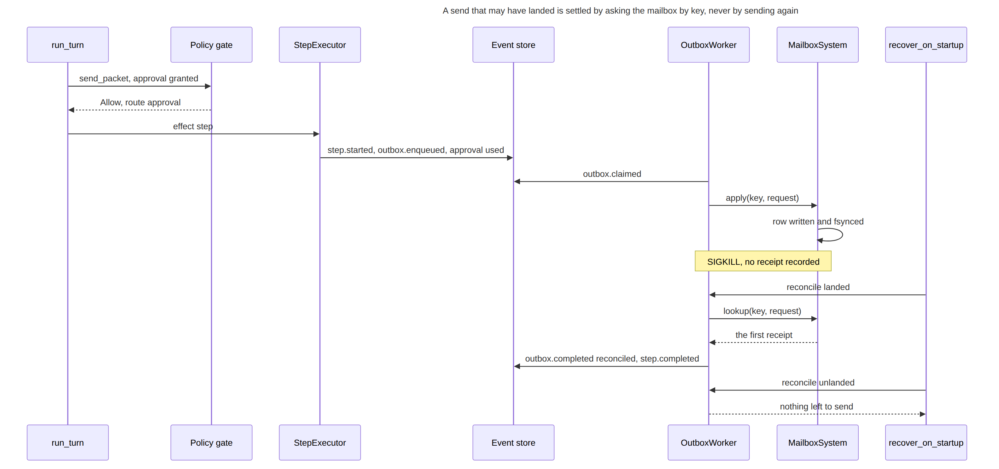
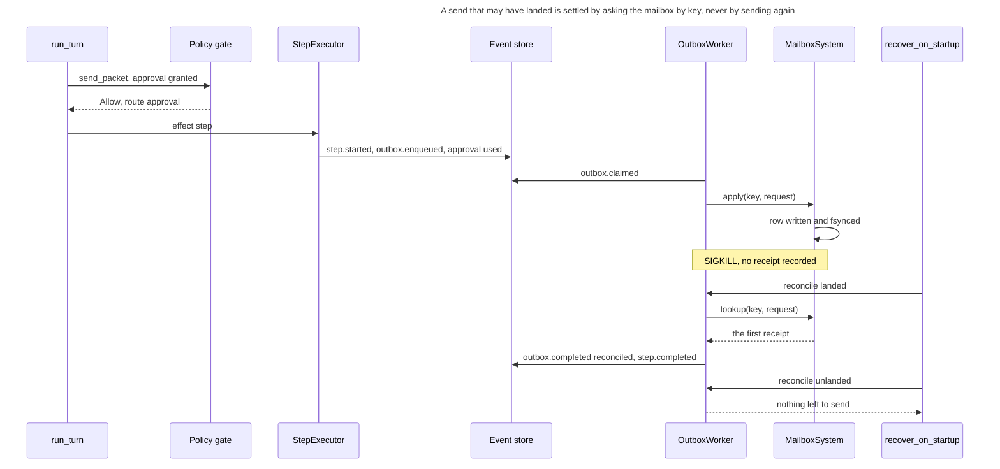
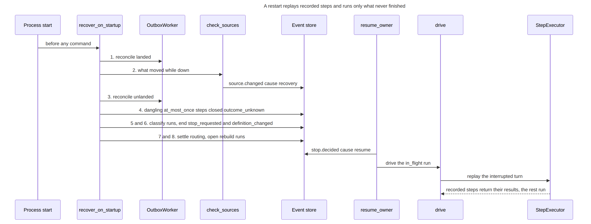
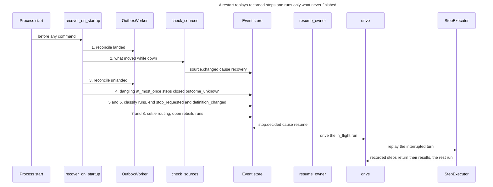

# Layer 4: change and recovery

*As of 28 Nov 2026. Previous: [3, lifecycles](3-lifecycles.md). Reference: [data model](data-model.md), [trust boundary](trust-boundary.md).*

Three things happen to a running system that a demo of the happy path never shows: an input changes, the process dies in the middle of an outside effect, and the process restarts with work open. Each is handled by code that reads the event store, so each is covered here as one sequence. The end-to-end proof is `aksha demo` ([`interfaces/demo/`](../../src/aksha/interfaces/demo/)), which runs all three on the `stillroom` fixture world and exits non-zero if any check fails; its assertions are in [`tests/integration/test_demo.py`](../../tests/integration/test_demo.py).

## 1. An input changes: citation keys and early cutoff

When a source changes, the one writer of source facts, `record_source_changes` in [`invalidation/sources.py`](../../src/aksha/runtime/invalidation/sources.py), records `source.changed` for every record that moved. For an agent that keys on citations (`invalidation_keys = "citations"` on `run.started`), a moved read is strong only when the version's claims rest on it: a cited span whose text changed (`excerpts.rechecked`), the scope of an absence or coverage claim, or an extraction definition. Every other moved read is weak and produces `evidence.noticed`, not a rebuild ([`invalidation/keying.py`](../../src/aksha/runtime/invalidation/keying.py)).

<!-- diagram: docs/diagrams/architecture-4-change-and-recovery-1.png -->

Diagram source (Mermaid)

Caption: the only stored facts are the change, the rebuild run and the new save; staleness and the cutoff are recomputed by `invalidation_view` each time, so a crash in the middle of this cannot leave a stale mark wrong. Notice that an approval whose target moved is revoked in the same transaction as the change, so a send cannot slip through before the rebuild.

What a person sees:

- **What reruns.** `aksha show` marks every invalidated version, and every version waiting on one, as stale from the same view; a rebuild run names the runs whose work it regenerates in `run.started{for_runs}`.
- **What is kept.** A version whose reads are all `same` or `weak` stays `current`, and its writer is not entered again (`test_unrelated_writer_is_not_touched` in [`tests/integration/test_invalidation.py`](../../tests/integration/test_invalidation.py)).
- **Human-reviewed outputs.** A rebuilt version of one opens a diff review (interrupt kind `review`), and its readers keep the old version until `review.accepted`.
- **Fresh approval.** The rebuilt send asks a new `approval.requested`, because the old one is `revoked` ([`test_demo.py`](../../tests/integration/test_demo.py): `test_a_fresh_approval_is_asked_for_the_new_packet_and_scripted`).

Rules that keep this bounded, from [`invalidation/rebuild.py`](../../src/aksha/runtime/invalidation/rebuild.py): an agent with an open run regenerates in place instead of getting a second run; the `rebuild_key` includes the set of invalidated versions, so the same set is never opened twice and a failed rebuild is not retried in a loop; and held work (a person's stop) gets no rebuild run.

Tests: `test_a_changed_uncited_paragraph_does_not_reopen`, `test_a_changed_cited_span_reopens`, `test_a_new_source_matching_an_absence_scope_reopens` and `test_a_new_source_matching_only_an_unscoped_search_is_noticed` in [`tests/integration/test_citation_keying.py`](../../tests/integration/test_citation_keying.py); `test_change_and_recovery_through_the_loop` and `test_a_writer_that_fails_its_rebuild_ends_the_run_blocked_naming_it` in [`tests/integration/test_rebuild_loop.py`](../../tests/integration/test_rebuild_loop.py). Depth: [ADR-P05](../design/adr/ADR-P05-invalidation.md).

## 2. A crash in the middle of a send

The patent agent's `send_packet` tool declares `EffectSpec("counsel_mail", ("/packet", "/recipient"), "reconcile")` in [`agents/patent/tools.py`](../../src/aksha/agents/patent/tools.py). So its idempotency key is fixed by the packet and the recipient, and recovery may ask the mailbox whether a key landed. The demo kills the process with a real `SIGKILL` right after the mailbox has written its row and before the runtime has recorded the receipt ([`interfaces/demo/child.py`](../../src/aksha/interfaces/demo/child.py)).

<!-- diagram: docs/diagrams/architecture-4-change-and-recovery-2.png -->

Diagram source (Mermaid)

Caption: the entry and its key are committed before the call, so after the kill there is always a `dispatched` row for recovery to find. Notice that the landed phase runs before the unlanded phase, so an entry that did land is closed from its receipt and never reaches the code path that would send it.

If the mailbox had not written the row, the unlanded phase sends it once under the same key, after checking that the approval and its targets still hold. An `at_most_once` effect that was claimed is closed `outcome_unknown` instead, because nothing can be asked. Tests: `test_the_sigkill_mid_send_recovers_to_exactly_one_send_per_packet` in [`tests/integration/test_demo.py`](../../tests/integration/test_demo.py); `test_crash_after_send_intent_sends_once_after_restart`, `test_crash_after_send_before_outcome_records_the_receipt_from_lookup` and `test_send_retried_3x_restart_1x_one_row` in [`tests/integration/test_outbox.py`](../../tests/integration/test_outbox.py); `test_every_commit_point_recovers_to_one_result_per_step` in [`tests/integration/test_sigkill_recovery.py`](../../tests/integration/test_sigkill_recovery.py). Depth: [ADR-P03](../design/adr/ADR-P03-transactional-outbox-and-idempotency-keys.md).

## 3. A restart with work open

`recover_on_startup` in [`execution/recovery.py`](../../src/aksha/runtime/execution/recovery.py) runs before the process accepts a command, in a fixed order per owner. It then classifies each open run as one of `RunClass = Literal["stop_requested", "definition_changed", "suspended", "held", "in_flight"]` ([`execution/types.py`](../../src/aksha/runtime/execution/types.py)). In-flight runs are resumed lazily by `resume_owner`, before that owner's next mutating command or on `aksha resume`.

<!-- diagram: docs/diagrams/architecture-4-change-and-recovery-3.png -->

Diagram source (Mermaid)

Caption: a suspended run is not touched at all, so a person who was asked a question before the crash sees the same question after it. Notice that the resume record is a `stop.decided` like any other, judged by the restart limit, so a run that crashes on every resume ends `failed` with reason `restart_limit` instead of looping.

Tests: `test_mid_approval_restart_shows_the_same_request` in [`tests/integration/test_interrupts.py`](../../tests/integration/test_interrupts.py); `test_sigkill_at_every_commit_of_a_resumed_rebuild_recovers` in [`tests/integration/test_resume.py`](../../tests/integration/test_resume.py); `test_crash_during_invalidation` and `test_recovery_source_check_records_what_moved` in [`tests/integration/test_invalidation.py`](../../tests/integration/test_invalidation.py). Depth: [ADR-P02](../design/adr/ADR-P02-durable-execution.md), [ADR-P18](../design/adr/ADR-P18-cancellation.md).
