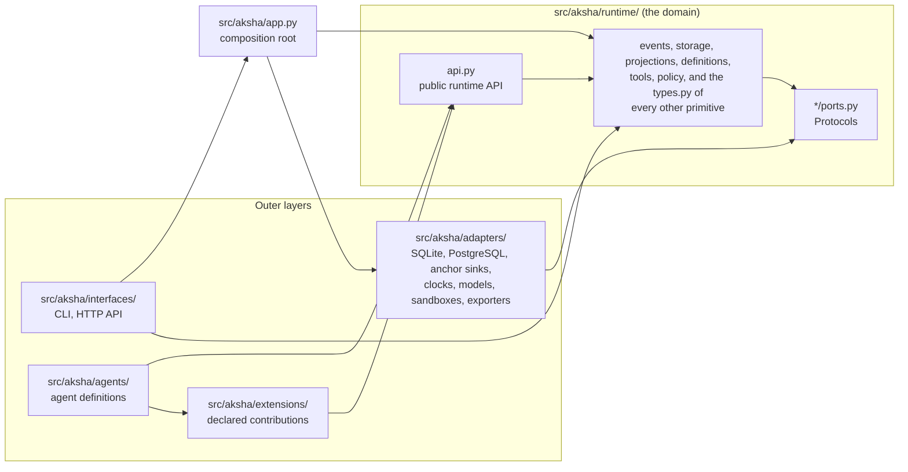

# Aksha codebase structure

*Status on 25 Nov 2026: four primitives are built and tested. The event store and projections (ADR-P01): `runtime/events/`, `runtime/storage/` (hash-chained since 25 Nov 2026, Amendment H), `runtime/projections/`, both storage adapters (SQLite, the default, and PostgreSQL), the file anchor sink and the storage wiring in `app.py`. The agent definition and the core of the extension API (ADR-P20): `runtime/definitions/` and `runtime/api.py`. The tool registry (ADR-P10): `runtime/tools/`. The policy gate (ADR-P11): `runtime/policy/`. Every other primitive holds only the values the built ones need, in its `types.py`; the tree lists only modules that exist, and "Built and planned" lists the rest. The guards in `tests/architecture/` are built and pass. The architecture decision records (ADRs) it follows are in `docs/design/adr/`; their "Amendments from the build" sections record where the code differs from the first text.*


A reader who opens the repository should be able to answer three questions in a minute: where does a concept live, what may it import, and where does its test go. Without a fixed answer, the event store's rules end up split between a SQLite file and the code that calls it, a model driver gets imported by the core, and swapping SQLite for PostgreSQL means editing every primitive. This page fixes the answers. It uses ports and adapters (hexagonal architecture): the runtime is the domain in the middle, it states what it needs from the outside world as `typing.Protocol` classes (the ports), and concrete backends (the adapters) implement those Protocols from outside.

If you know Express: the runtime is your service layer, a port is the interface your service takes in its constructor (a `UserRepository`), an adapter is the Postgres or in-memory class that implements it, and `src/aksha/app.py` is the file that wires them together before `app.listen`. The difference is that here a test enforces the direction of every import.

## The layers and the dependency rule



Caption: every arrow is an allowed import, and every arrow ends at or inside the runtime; nothing inside `src/aksha/runtime/` points out.

The rule, as `tests/architecture/rules.py` checks it on every module:

| Layer | May import | Never imports |
|---|---|---|
| `src/aksha/runtime/` (domain) | itself, the standard library, `jsonschema` | adapters, agents, extensions, interfaces, `aksha.app`, any other third-party package |
| `src/aksha/adapters/<family>/` | the runtime (its ports and the domain values they name), its own family, any library | another adapter family, agents, extensions, interfaces |
| `src/aksha/extensions/<name>/` | `aksha.runtime.api`, itself | any other runtime module, adapters, agents, interfaces |
| `src/aksha/agents/<name>/` | `aksha.runtime.api`, the extensions it names, itself | any other runtime module, adapters, interfaces |
| `src/aksha/interfaces/` | the runtime, `aksha.app`, itself | adapters, agents and extensions directly |
| `src/aksha/app.py` | anything: it is the composition root | nothing is refused |

Imports under `if TYPE_CHECKING:` count, because they are still a dependency a reader has to follow. The tests in `tests/architecture/test_dependency_rule.py` plant one violation of each row in a temporary copy of the package and assert the guard reports it, so the guard is seen to fail before it is trusted (ADR-P20 decision 8). Two more guards run beside it: every `Protocol` class lives in a `ports.py`, and every module under `src/aksha/` appears in the tree below.

## The tree, one line per module

`P01` to `P30` are the primitive IDs of the ADRs. A module with no ID belongs to its folder's primitive. The tree holds only modules that exist; "Built and planned" below lists what each primitive still needs. One rule for every primitive: one package named for the ADR's term, holding `types.py` (the values it declares), `ports.py` (the Protocols it needs from outside, when it has any) and one module per piece of behaviour.

```text
src/aksha/
├── __init__.py                              package version
├── app.py                                   composition root: picks adapters (SQLite by default)
├── runtime/                                 THE DOMAIN: agent-neutral core, stdlib + jsonschema only
│   ├── __init__.py                          the one layout rule and the three import rules
│   ├── api.py                               P20 public runtime API; agents and extensions import only this
│   ├── canonical.py                         canonical JSON, the chain's RFC 8785 bytes, SHA-256, freeze, UTC, NUL
│   ├── errors.py                            base error with a stable snake_case code
│   ├── events/                              P01 the event model
│   │   ├── __init__.py                      what an event is
│   │   ├── envelope.py                      NewEvent, Event
│   │   ├── catalogue.py                     EventTypeSpec, Catalogue, core event types, payload checks
│   │   ├── boundaries.py                    the closed list of transaction boundaries
│   │   └── errors.py                        CatalogueError, PayloadInvalid, DedupKeyError, ...
│   ├── storage/                             P01 the EventStore port
│   │   ├── __init__.py                      what an adapter must implement
│   │   ├── ports.py                         EventStore, Subscription, AnchorSink (Protocols)
│   │   ├── append.py                        prepare_append: every append check that needs no database
│   │   ├── chain.py                         the hash chain: genesis, event_hash, Anchor, ChainBreak, verify_chain
│   │   ├── anchors.py                       anchor_head, verify_against: the CLI-free anchor helpers
│   │   ├── rows.py                          ArtifactRow, StoredArtifact
│   │   ├── schema.py                        SCHEMA_VERSION, check_schema_version
│   │   └── errors.py                        StoreError, AlreadyRecorded, LockHeld, NotWriter, ...
│   ├── projections/                         P01 projections built by a reducer
│   │   ├── __init__.py                      no projection is the truth
│   │   ├── ports.py                         Reducer (Protocol)
│   │   ├── view.py                          LogView (complete or not), ArtifactsView, load_view
│   │   ├── project.py                       rebuild, apply_events, project (always through the cache)
│   │   ├── cache.py                         ProjectionCache keyed by the last sequence read
│   │   └── runs.py                          the runs projection: open runs and their outcomes
│   ├── definitions/                         P20 agent definitions and the extension machinery
│   │   ├── __init__.py                      load, check and hash agents
│   │   ├── types.py                         Agent, Extension, Projection: the declared values
│   │   ├── errors.py                        LoadRefusal (module, Task, field, code), LoadError
│   │   ├── names.py                         namespacing: qualify, resolve_kind, is_local_name
│   │   ├── versions.py                      API_VERSION, requires_api specifiers
│   │   ├── modules.py                       import a folder fresh; scan every aksha import first
│   │   ├── validate.py                      validate_agent: the fixed order of value refusals
│   │   ├── tree_checks.py                   the Task tree walk: tools, reads, writes, needs, depth
│   │   ├── contributions.py                 contribution names, event type checks, full-name merge
│   │   ├── loader.py                        discover, load_extensions, load_agents
│   │   ├── hashing.py                       definition_hash, run_started_fields, resume_refusal
│   │   └── surface.py                       api_surface, required_bump, for the snapshot test
│   ├── tools/                               P10 tool registry and schemas
│   │   ├── __init__.py                      every tool is declared data
│   │   ├── types.py                         ToolSpec, ToolDecl, ToolUse, ToolContext, ToolOutcome, Ok, Err
│   │   ├── registry.py                      ToolRegistry: build, offered, check_arguments, canonical_hash
│   │   ├── checks.py                        the loader refusals of an unsafe registry
│   │   ├── arguments.py                     schema_refusal (every failing path), JSON pointers
│   │   ├── bodies.py                        call_body: a raising body is a tool_exception result
│   │   ├── loader_added.py                  finish, ask (reserved effect) and save_artifact (store)
│   │   └── results.py                       render_result: the capped model view
│   ├── policy/                              P11 policy gate and permissions
│   │   ├── __init__.py                      deny by default, one checker, never appends
│   │   ├── types.py                         ArgumentRule (with role), Permissions, GateInput, Allow, Refuse
│   │   ├── errors.py                        RuleInvalid: rule_root_invalid, rule_role_invalid
│   │   ├── paths.py                         normal-form paths and is_under for the two path matchers
│   │   ├── rules.py                         the five argument matchers, JSON pointer lookup
│   │   ├── permissions.py                   agent_tools, task_tools, ceiling_of, route_of
│   │   ├── gate.py                          check(): the one checker, pure; permitted (layers 1-4)
│   │   ├── matrix.py                        matrix(): one row per (agent, Task, tool), markdown
│   │   └── events.py                        decision_event, boundary_of, tool_calls_used
│   ├── execution/                           P02 durable execution (the clock and types so far)
│   │   ├── __init__.py                      what is built, what is planned
│   │   ├── ports.py                         Clock (Protocol)
│   │   └── types.py                         StepSemantics
│   ├── outbox/                              P03 transactional outbox (types so far)
│   │   ├── __init__.py                      what is built, what is planned
│   │   └── types.py                         SystemOfRecordSpec, EffectSpec
│   ├── artifacts/                           P04 artifacts and lineage (types so far)
│   │   ├── __init__.py                      what is built, what is planned
│   │   └── types.py                         ArtifactKind, RelationKind, SaveRequest
│   ├── invalidation/                        P05 invalidation (types so far)
│   │   ├── __init__.py                      what is built, what is planned
│   │   └── types.py                         VersionedSourceSpec
│   ├── models/                              P07 model classes (types so far)
│   │   ├── __init__.py                      what is built, what is planned
│   │   └── types.py                         ModelClass, ModelAlias, ModelAdapterSpec
│   ├── context/                             P08 context assembly (types so far)
│   │   ├── __init__.py                      what is built, what is planned
│   │   └── types.py                         ContextPolicy, SummaryPolicy
│   ├── sandbox/                             P12 sandbox (types so far)
│   │   ├── __init__.py                      what is built, what is planned
│   │   └── types.py                         SandboxNeeds, SandboxPolicy, Availability, backend specs
│   ├── budgets/                             P14 budgets and limits (types so far)
│   │   ├── __init__.py                      what is built, what is planned
│   │   └── types.py                         Backoff, Budget, Limits
│   ├── tasks/                               P15 Task model (types so far)
│   │   ├── __init__.py                      what is built, what is planned
│   │   └── types.py                         Task, Read, KeySource, Check, CheckResult
│   ├── stop_policy/                         P16 stop policy (types so far)
│   │   ├── __init__.py                      what is built, what is planned
│   │   └── types.py                         StopPolicyOptIn, Goal, Plan, ForcedTool, TodoReminder
│   ├── interrupts/                          P17 interrupt and suspension (types so far)
│   │   ├── __init__.py                      what is built, what is planned
│   │   └── types.py                         DeclaredInterrupt, ApprovalRule
│   └── egress/                              P26 egress policy (types so far)
│       ├── __init__.py                      what is built, what is planned
│       └── types.py                         EgressPolicy
├── adapters/                                ADAPTERS: implement runtime ports
│   ├── __init__.py                          families and the import rule
│   ├── storage/                             event store backends
│   │   ├── __init__.py                      both pass one contract suite
│   │   ├── postgres.py                      PostgresEventStore: production (extra aksha[postgres])
│   │   └── sqlite.py                        SQLiteEventStore: zero setup, local, tests, offline runs
│   ├── anchor/                              AnchorSink implementations (chain anchors outside the store)
│   │   ├── __init__.py                      a sink is only as good as the writer's inability to rewrite it
│   │   └── file.py                          FileAnchorSink: JSON Lines, fsync, idempotent per seq
│   └── clock/                               Clock implementations
│       ├── __init__.py                      the Clock port's adapters
│       ├── system.py                        SystemClock
│       └── fake.py                          FakeClock
├── extensions/                              EXTENSIONS: one folder per extension (none yet)
│   └── __init__.py                          imports aksha.runtime.api only
├── agents/                                  AGENTS: one folder per agent (none yet)
│   └── __init__.py                          imports aksha.runtime.api and named extensions
└── interfaces/                              INTERFACES: how people reach the runtime (none yet)
    └── __init__.py                          calls the session API through aksha.app
```

The package uses the src layout from the Python Packaging User Guide: it lives at `src/aksha/`, and `make venv` installs it in editable mode, so the tests import the installed package rather than whatever sits in the working directory. Outside the package: `tests/` (below), `docs/` (this page), `web/` (the web front end, not Python), and `scratch-pad/` (local design material, never packaged or pushed). Agents stay inside the package, in `src/aksha/agents/<name>/`, so packaging and the import guard cover them; ADR-P20 D1 is amended to say so.

Takeaway: a primitive is one package named for the ADR's own term; its values are in `types.py`, its Protocols in `ports.py`, its behaviour in one module per job, and its backends under `src/aksha/adapters/`. A package holds only code that exists.

## Built and planned

One row per primitive. "Built" exists and is tested. "Planned" is the modules each ADR's interface names; they are written when that primitive is built, and not before. The empty placeholder modules that stood in for them were removed on 25 Nov 2026, so the tree above shows only what exists.

| Primitive | Built | Planned modules |
|---|---|---|
| P01 event store and projections | `events/`, `storage/` (with the hash chain, `chain.py`, `anchors.py`), `projections/`, both storage adapters, `adapters/anchor/file.py` | the blob table for payloads over the cap (with P04); the `chain.anchored` event, scheduled anchoring, `VerifyReport` and a WORM sink (H7, B10); the blob half of H6; `aksha verify` (P19) |
| P02 durable execution | `execution/ports.py` (`Clock`), `execution/types.py` (`StepSemantics`) | `execution/executor.py` (appends each gate decision), `recovery.py`, `replay.py`; `IdSource` in `ports.py` |
| P03 transactional outbox | `outbox/types.py` | `outbox/ports.py` (`SystemOfRecord`), `keys.py`, `outbox.py`, `reconcile.py` |
| P04 artifacts and lineage | `artifacts/types.py` | `artifacts/ports.py`, `hashing.py`, `store.py`, `lineage.py`, `relations.py` |
| P05 invalidation | `invalidation/types.py` | `invalidation/view.py` (the invalidation view, early cutoff) |
| P06 agent loop | none | `runtime/loop/` (one turn of one Task instance) |
| P07 model interface | `models/types.py` | `models/ports.py`, `routing.py`; `adapters/models/fake.py`, `replay.py` |
| P08 context assembly | `context/types.py` | `context/assembly.py` |
| P10 tool registry | `tools/` | none for Friday |
| P11 policy gate | `policy/` | none for Friday |
| P12 sandbox | `sandbox/types.py` | `sandbox/ports.py` (`SandboxBackend`); `adapters/sandbox/refusing.py`, `bwrap.py` |
| P13 grounding | none | `runtime/grounding/` (citation spans, quote checks) |
| P14 budgets | `budgets/types.py` | `budgets/meter.py` (budget accounting reducer, `Meter`) |
| P15 Task model | `tasks/types.py` | `tasks/view.py`, `tree.py`, `status.py`, `scheduler.py`, `completion.py` |
| P16 stop policy | `stop_policy/types.py` | `stop_policy/ports.py`, `builtins.py`, `evaluation.py`, `hold.py` |
| P17 interrupts | `interrupts/types.py` | `interrupts/reducers.py`, `approvals.py` |
| P18 cancellation | none | `runtime/cancellation/` |
| P19 session API | none | `runtime/session/` (`commands.py`, `resolutions.py`, `streams.py`, `capabilities.py`); `interfaces/cli/`, `interfaces/http/` |
| P20 agent definition and extension API | `definitions/`, `api.py` | none for Friday |
| P21 tracing | none | `runtime/tracing/` (`ports.py`, `spans.py`, `inspection.py`); `adapters/exporters/otel.py` |
| P23 request router | none | `runtime/router/` |
| P24 partial results | none | `runtime/finalization/` |
| P26 egress | `egress/types.py` | `egress/check.py` and an `HttpClient` port |

## Where each ADR's proposed file lives

The ADR interface sections name a flat file per primitive (for example `aksha/runtime/store.py`). The layout keeps every name inside those files and splits each file along the port line; the four built ADRs' amendment sections point here.

| ADR proposal | Lives in |
|---|---|
| P01 `store.py` | `events/` (event model); `storage/` (the `EventStore` and `AnchorSink` ports, `prepare_append`, the hash chain in `chain.py`, rows, schema version, errors); `projections/` (`Reducer`, `LogView`, `project`, the cache); `adapters/storage/postgres.py` and `sqlite.py` (`PostgresEventStore`, `SQLiteEventStore`, each with `open_store`) |
| P01 `api.py` part (`register_event_type`) | the declared field `Extension.event_types`, which `definitions/loader.py` registers through `Catalogue.register_extension(spec, extension=name)` |
| P02 `steps.py`, `clock.py` | `execution/types.py` and the `Clock` Protocol in `execution/ports.py`; `SystemClock` and `FakeClock` in `adapters/clock/` |
| P10 `tools.py` | `tools/` |
| P11 `gate.py` | `policy/gate.py`, with its values in `policy/types.py` |
| P20 `api.py` | `runtime/api.py` |
| P20 `loader.py` | `definitions/loader.py`, with `definition_hash` in `definitions/hashing.py` |

## Naming conventions

1. A package under `src/aksha/runtime/` is named for the ADR's term in snake case: `events`, `artifacts`, `stop_policy`, `interrupts`. The ADR ID goes in the docstring, never in a name. Only `api.py`, `canonical.py` and `errors.py` sit at the top of the runtime, because every primitive shares them.
2. Every subsystem uses the same file names for the same roles:
   1. `ports.py`: every `typing.Protocol` the subsystem defines. Nothing else defines a Protocol.
   2. `types.py`: frozen dataclasses, `Literal` aliases and other plain values.
   3. A module per behaviour, named for what it does: `registry.py`, `gate.py`, `loader.py`. No module exists before its code does.
   4. `errors.py` when a subsystem has more than two refusals.
3. Class and function names are the ADR's names, exactly: `EventStore`, `ToolSpec`, `StopDecision`, `evaluate_stop`, `approval_signature`.
4. An adapter class is named backend then port: `SQLiteEventStore`, `PostgresEventStore`, `FakeClock`, `SystemClock`. Its module is named for the backend alone: `adapters/storage/postgres.py`.
5. Every error subclasses the base in `runtime/errors.py` and carries a stable snake_case `code` (`already_recorded`, `not_allowed`). Tests assert the code, not the message.
6. Event types are `<namespace>.<past participle>` (`stop.decided`, `outbox.enqueued`); extension event types carry the extension's namespace (`memory.recalled`).
7. Every public module, class and function has a Google-style docstring (ruff's `D` rules enforce it). A module's first docstring line says what it holds in one sentence.

## Where tests go

| Folder | What goes in it | Example |
|---|---|---|
| `tests/unit/` | One test module per source module; the folder tree mirrors `src/aksha/` | `src/aksha/runtime/tools/registry.py` is tested in `tests/unit/runtime/tools/test_registry.py` |
| `tests/contract/` | One suite per port, parametrised over every adapter of that port; a new adapter must pass it unchanged | `tests/contract/storage/test_event_store.py` runs against `SQLiteEventStore` and `PostgresEventStore` |
| `tests/integration/` | Several primitives together through `aksha.app`, on a temporary store | a run that suspends on an approval and resumes after a restart |
| `tests/architecture/` | The dependency rule, the layout rules and the ADR-named guards, each with a planted violation; the committed snapshots (`api_surface.json`, `permission_matrix.md`) | `test_dependency_rule.py`, `test_definitions.py` |
| `tests/support/` | Values and harnesses the suites share, never tests themselves | `events.py` (probe event types), `backends.py` (one harness per storage adapter), `postgres.py` (the test container), `agents.py` (copies the fixture agent and extension into a temporary folder) |
| `tests/fixtures/` | Plugins the loader tests copy, never load in place | `agents/toy/` (the conformance agent), `extensions/echo/` (the conformance extension), `agent_terms.txt` (words the runtime must not contain) |

1. A test function name says the behaviour it checks. A test named in an ADR's Tests section keeps that name (`test_update_and_delete_refused`).
2. A behaviour every adapter must keep is a contract test. A behaviour of one backend only (SQLite's WAL mode, a PostgreSQL advisory lock) is a unit test of that adapter.
3. Tests never use the network. The contract run against PostgreSQL starts one docker container named `aksha-pg-test` (labelled `aksha.test=contract`) from a local image on a free port, with `--pull=never`, and removes it at the end of the session; each test gets a fresh database. It touches no other container. `AKSHA_TEST_POSTGRES_DSN` points it at a server you already run instead, and `AKSHA_PG_IMAGE` picks another local image (default `postgres:16`). Without psycopg, docker or the image, `make test` skips those tests with the reason; `make test-postgres` sets `AKSHA_REQUIRE_POSTGRES=1`, which turns every such skip into a failure.

## How to add an adapter

The steps for a new backend of an existing port, using a PostgreSQL event store as the example.

1. Find the port. Every Protocol the runtime depends on is in a `ports.py`; the event store's is `src/aksha/runtime/storage/ports.py`.
2. Create one module in the port's family: `src/aksha/adapters/storage/postgres.py`, with a class named backend then port, `PostgresEventStore`.
3. Implement the Protocol and keep its rules, not just its signatures. For the event store that is: append-only, one writer, a unique dedup key per owner, the owner first on every read, and a whole boundary rolled back on a dedup-key conflict. Raise the runtime's errors (`AlreadyRecorded`, `LockHeld`), never the driver's.
4. Declare any third-party driver as an optional extra in `pyproject.toml` (`postgres = ["psycopg>=3.2"]` is already there) and import it only inside the adapter module. The runtime package must still install with the standard library and `jsonschema` alone.
5. Add the adapter to the contract suite's parameter list in `tests/contract/<family>/`, and run it. It must pass the suite unchanged; if it cannot, the port or the suite is wrong, and that is a design change to raise, not a test to skip.
6. Put backend-only tests in `tests/unit/adapters/<family>/test_<backend>.py`.
7. Wire it in `src/aksha/app.py` behind a configuration value. No other module learns the adapter exists.
8. Add its line to the tree on this page. `test_every_module_is_listed_in_the_structure_doc` fails until you do.
9. Run `make check` (lint, type check, tests), which includes the dependency-rule guard.

## How to add an agent or an extension

An agent is one folder and one `Agent` value; an extension is one package and one `Extension` value (ADR-P20). Neither edits `src/aksha/runtime/`: `test_conformance_fixtures_import_only_the_api` checks that the conformance agent (`tests/fixtures/agents/toy/`) and extension (`tests/fixtures/extensions/echo/`) reach the runtime only through `aksha.runtime.api`, and the two runtime-hash tests check that loading them writes nothing. When the agent loop (ADR-P06) exists, those tests must run a turn.

1. Make `src/aksha/agents/<name>/` with `__init__.py`, `agent.py` (exactly one `AGENT = Agent(...)`, its `name` equal to the folder name and to no extension's name), `checks.py` (pure completion checks) and `prompts/`. Import only `aksha.runtime.api` and `aksha.extensions.<name>` for the extensions you name. The loader refuses every other `aksha` import in any form (`import aksha.x`, `from aksha import x`, `from aksha.app import y`, `importlib.import_module("aksha.x")`) with `import_outside_api`.
2. Declare names locally: kinds (`line`), relations, model aliases and own tools. The loader prefixes your agent's name (`<name>.line`). Refer to another agent's or extension's kind by its full name (`other.kind`), and list another agent's namespace in `reads` (`"other.*"`) before reading it.
3. Keep fixtures and templates outside the folder: every file in it except `tests/` enters the agent definition version hash, and a source root inside it is refused (`source_root_inside_agent`).
4. Opt into built-in stop policies (`Goal`, `Plan`, `ForcedTool`, `TodoReminder`); a stop-policy class of your own is refused (`stop_policy_class`).
5. An extension is `src/aksha/extensions/<name>/__init__.py` with one `EXTENSION = Extension(...)`. It contributes data (tools, kinds, relations, projections, event types, specs), never hooks. Its event types are named `<name>.<past participle>` and name the extension as their writer; the loader registers them in the catalogue once every definition loads. It may not declare a tool of the `reserved` effect class (`reserved_effect_not_allowed`).
6. Run `make check`. A refusal reads `module: Task 'path', field 'name': message`, with a stable code a test can assert.

Changing `src/aksha/runtime/api.py` changes the extension API: bump `API_VERSION` in `runtime/definitions/versions.py` (minor to add a name or a trailing field with a default, major to change or remove anything), then refresh the snapshot with `AKSHA_UPDATE_API_SNAPSHOT=1 make test`. The refresh refuses to write unless the bump is big enough. The version is 1.1: 1.0 is the first frozen snapshot (ADR-P20 S1), and 1.1 added `Extension.event_types` and `LogView.complete`.

## PostgreSQL and SQLite

On 25 Nov 2026 the maintainer chose PostgreSQL over SQLite, which may not hold up at scale. ADR-P01 decision 1 is amended to match: PostgreSQL is the production backend, chosen with `AKSHA_STORE=postgres` and `AKSHA_POSTGRES_DSN`. On 26 Nov 2026 decision 34 made SQLite the default in `src/aksha/app.py` (`StorageConfig.backend = "sqlite"`, the file `var/aksha.sqlite`), so a local or offline run and the tests need no setup. Both are built behind the one `EventStore` port and pass one contract suite (`tests/contract/storage/`), so the choice is configuration, not a rewrite. The driver, psycopg, stays in the optional extra `aksha[postgres]`, so the runtime is still the standard library plus `jsonschema`.

| Rule (ADR-P01) | PostgreSQL adapter | SQLite adapter |
|---|---|---|
| Append-only | a PL/pgSQL trigger refuses `UPDATE`, `DELETE` and `TRUNCATE` | `BEFORE UPDATE/DELETE` triggers raise `append-only` |
| One writer | session advisory lock `pg_try_advisory_lock`; the pid is in `application_name` | `fcntl.flock` on `var/aksha.lock`; the pid is written in the file |
| Readers | `default_transaction_read_only = on` | `mode=ro` file plus `query_only` |
| Sequence | `BIGINT PRIMARY KEY`, set by the writer as last + 1, so a rollback leaves no gap | `INTEGER PRIMARY KEY`, set the same way |
| Dedup keys | unique index on `(owner, uniq)` | `UNIQUE (owner, uniq)` |
| Subscribers | `LISTEN aksha_events`, `pg_notify` sent inside the append transaction | woken by this handle's commits, otherwise poll every 50 ms |
| Payloads | `JSONB` | canonical JSON text |
| Schema version | one-row append-only `meta`, written with the tables, checked on every open (version 2: the hash chain) | the same |
| Hash chain (Amendment H) | `prev_hash`, `hash` (both unique), one-row `store_meta` with the genesis; `seq` set by the writer; `pg_advisory_xact_lock` in each append | the same columns and table; `seq` set by the writer under `BEGIN IMMEDIATE` |
| NUL in a string | refused before the backend sees it (`Catalogue.validate_payload`, `prepare_append`) | the same, so both backends accept the same facts |
| Lone surrogate in an envelope string | refused in `prepare_append` before `BEGIN` (`not_canonical_field`) | the same |
| Server encoding | `UTF8` required on open (`encoding_unsupported`) | always UTF-8 |
| Stored text in `verify()` | `JSONB`, so the decoded value is checked | must decode and be exactly the writer's canonical JSON (`not_canonical`) |

### Why a hash chain

Each event's `hash` covers its own envelope and the previous event's `hash`, the way a git commit's hash covers its parent's: the one idea a blockchain shares with git, without peers, consensus or mining. One harness has to serve a person on a laptop and an unattended software factory whose record is read later by someone who was not there, so the record must be checkable, not trusted: `verify()` finds the first edited, reordered or deleted row. It is tamper-evident, not tamper-proof. Someone with write access can re-hash every later row, and a truncated tail is a valid shorter chain; only an anchor in a sink the writer cannot rewrite (`AnchorSink`; the file sink is for tests and laptops) or WORM storage catches those. The pure half (records, genesis, the walk) is `runtime/storage/chain.py`, so both adapters hash with one piece of code, and `test_sqlite_and_postgres_hash_identically` checks they agree byte for byte. A payload may not hold a float or an integer beyond plus or minus 2^53 (`payload_invalid`), and neither may artifact content (`not_canonical_content`), because the chain's encoding (`canonical_bytes`, a subset of RFC 8785) refuses them. An artifact row is bound to the chain through its `artifact.saved` event's `content_hash` (H6), so editing the row breaks `verify()` at that event.

## Open points for the maintainer

1. ADR-P20's `Projection` had `event_types`, `initial` and `reducer` fields; as built it holds an ADR-P01 `Reducer` (which carries `reads` and `initial`), so there is one reducer shape. ADR-P20 is amended to record it.
2. `Task.model_aliases` is new: ADR-P07 D2 says a Task names the aliases it uses, and ADR-P15's `Task` has no field for it.
3. `SandboxBackendSpec`, `ModelAdapterSpec`, `SystemOfRecordSpec` and `VersionedSourceSpec` are named by ADR-P20 but defined by no ADR. As built each is a name plus a factory (or, for a source, a name, a `root` and collections, so S3's refusal has something to check); their primitives finish them.
4. Argument rules have nowhere to be declared in an agent definition yet: `Agent` and `Task` have no `rules` field. As built, rules ride on the run ceiling (`ceiling_of(agent, rules=...)`, set by whoever starts the run), and that is where they are checked: building a `Permissions` refuses a path root not in normal form (`rule_root_invalid`) and a recipient rule that does not use `id_in_source` (`rule_role_invalid`). Adding `Agent.rules` and `Task.rules` and exporting `ArgumentRule` is a minor API bump for the maintainer to approve.
5. Layer 0 reads `MeterReading` (the set of spent budget dimensions), a stand-in for ADR-P14's `Meter`. It refuses every tool once any dimension is spent, `finish` and `ask` included, as the ADR's table reads; whether `finish` should stay callable is a question for ADR-P14.
6. Refusal codes the ADRs imply but do not name, chosen in the build: `schema_not_object`, `result_key_without_query`, `key_field_invalid`, `semantics_unknown`, `external_not_allowed`, `sandbox_not_allowed`, `model_alias_not_allowed`, `override_not_allowed`, `override_invalid`, `nul_in_field`, `nul_in_content`, `event_type_invalid`.
7. `test_injection_world_equals_clean_world` runs with an obedient fake model and the gate in place of the agent loop (ADR-P06 is not built).
8. The hash chain (ADR-P01 Amendment H) is built with four differences from the ADR's interface: `verify(*, anchors=())` returns the first `ChainBreak` or `None` rather than a `VerifyReport`, and has no `from_seq` or `trusted_hash` yet; the store's id and genesis come from `identity()` (a `StoreIdentity`) rather than `store_id()`; `Event` does not carry `prev_hash` and `hash` (the chain is read through `head()` and `verify()`, so the extension API stays at 1.1); and the encoder is `canonical_bytes` beside the existing `canonical_json`, which other hashes still use. An anchor of another store is a refusal (`anchor_store_mismatch`), not a break. The writer refuses to append onto a head it did not write (`chain_head_moved`). The schema version is 2. H6 is built (ADR-P01 B9): `artifact.saved` carries `content_hash` over `canonical_bytes` of the content, and `verify()` reports an edited artifact row as `artifact_mismatch` at its event. ADR-P01 B10 to B13 record the rest: the H7 deferrals, the two encoders, what `verify()` refuses to read (`not_canonical`, `chain_version_unsupported`, `anchor_invalid`) and the refusals moved before the transaction.

## Sources

1. `scratch-pad/design/primitives/00-index.md` and `00-primitives-catalogue.md`, 25 Nov 2026: the primitive list, IDs and build order.
2. ADR-P01, P02, P03, P04, P10, P11, P15, P16, P17 and P20 in `docs/design/adr/`, Interface and Decision sections, read on 25 Nov 2026.
3. ADR-P20 decisions 1, 2, 3 and 8: the three layers, the one public runtime API, contributions as declared data, and guards shown to fail.
4. The maintainer's direction of 25 Nov 2026: PostgreSQL over SQLite, and a readable codebase with proper interfaces and structures.
5. The review of the four built primitives, 25 Nov 2026 (22 issues and a mutation run), which this layout and the ADR amendments answer.
