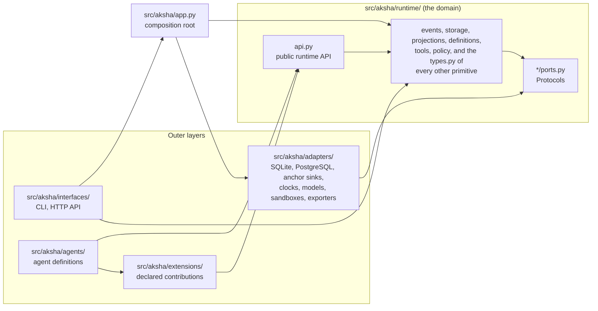

# Aksha codebase structure

*Status on 26 Nov 2026: twenty-nine primitives are built and tested. The event store and projections (ADR-P01): `runtime/events/`, `runtime/storage/` (hash-chained since 25 Nov 2026, Amendment H), `runtime/projections/`, both storage adapters (SQLite, the default, and PostgreSQL), the file anchor sink and the storage wiring in `app.py`. The agent definition and the core of the extension API (ADR-P20): `runtime/definitions/` and `runtime/api.py`. The tool registry (ADR-P10): `runtime/tools/`. The policy gate (ADR-P11): `runtime/policy/`. Durable execution (ADR-P02, slice 2): `runtime/execution/`, the step executor, step IDs, IDs from the store and recovery on startup. The transactional outbox and idempotency keys (ADR-P03): `runtime/outbox/`, with command receipts in `runtime/session/commands.py`. Budgets, limits, timeouts and bounded retries (ADR-P14): `runtime/budgets/`, every count a reducer over the event store, with resume records and the restart limit in `execution/recovery.py`. Cancellation (ADR-P18): `runtime/cancellation/`, the durable stop request, its holds and the TC-4 audit, the skip and kill boundary in the step executor, and `adapters/sandbox/process.py`. The artifact store and lineage (ADR-P04): `runtime/artifacts/`, typed versions with three hashes, recorded reads, typed relations with excerpt evidence, the `BlobStore` port with `adapters/blobs/filesystem.py`, and payload offload over 64 KiB (decision 25). Invalidation (ADR-P05): `runtime/invalidation/`, source changes through one writer, the invalidation view with early cutoff and the sibling rule, the rebuild plan and rebuild runs, diff reviews with a redline, accept and reject, revocation in the confirming transaction and effects refused on stale targets, with recovery's source check in `execution/recovery.py`. Grounding and citations (ADR-P13): `runtime/grounding/`, spans minted only by tools that declare it and only over text the reader returned, the shown set (S1), statement spans, one verifier at save for content and for every relation's evidence, record-grain staleness (S2), `value_in_quote` (S3), explicit unknowns and `citation.bound`. The Task model and scheduler (ADR-P15): `runtime/tasks/`, the compiled tree, key sources, instance status as a projection, `TaskView`, completion evaluation with the parent rule, the scheduler with withdrawal and re-entry by writer key, and the supervisor rule. Stop policy and stop-policy evaluation (ADR-P16): `runtime/stop_policy/`, the stack derived from the event store, one recorded decision per stop candidate with seven verdicts, the Run, Task and interrupt policies, the five opt-in policies (goal, plan, forced tool, todo reminder, recite), the budget, turn and stop-veto limits, and the hold predicate narrowed to the held work (S1) with the full TC-4 audit. Interrupts and approvals (ADR-P17): `runtime/interrupts/`, the six interrupt kinds with `route` scoped to a session, suspension as a projection, the `ask` tool's request with one answer per question (S2), the generic action body and its version-prefixed approval signature, the approval states, the deciding commands (`answer`, `approve`, `reject`, `edit`, `grant_budget`, `handoff`) with `target_changing` (S1) and the void on key withdrawal (S3), the execution re-check at handoff and before every delivery, and headless option B in the policy gate (`resolve_ask`, `policy/headless.py`). The model interface and routing by model class (ADR-P07): `runtime/models/`, extraction and classification (System 1) and generation (System 2) as three first-class contracts, aliases bound by run mode and checked against each adapter's capability record, fixed-point probabilities, thresholds and the abstention band applied by code, cascades that never cross a class, every call a durable step, rule-based fakes, and `adapters/models/` (scripted, replay by step key, and an optional live adapter). Context assembly and compaction (ADR-P08): `runtime/context/`, each model request a pure projection of the event store read as of the turn's model step, declared reads rendered within caps with the spans they showed, the rebuild brief, observation masking with stale results superseded by a placeholder and a change notice (decision 32), recorded masks that keep the plan monotone, the recitation, the hard limit, and summary compaction as a recorded step replayed on resume, on by default since extension API 2.0 and approved by the run's limits through stop-policy evaluation. The agent loop and turn (ADR-P06): `runtime/loop/`, `run_turn` (the stop-policy preparation, the context, the model step under the context hash, each call position through the policy gate and the step executor in listed order, the skip rule after a finish, a question, an approval request or a spent budget), the turn end classified by the fixed priority and rebuilt from the recorded steps, and `drive`, which alternates stop-policy evaluation and turns, reads where a run stands from the log alone and resumes a turn mid-way through recovery's `RunDriver`. Partial results and finalization (ADR-P24): `runtime/finalization/`, explicit unknowns as a projection (a blocked key a partial rule tolerates reads `unverified`, a key finalization voided reads `not_checked`), `TaskView.entries` and the unknown slots in a reader's context, the run outcome `complete`, `partial` or `blocked` with every unknown in `run.ended`, the `finalize` answer to the budget interrupt with `run.finalizing`, and the reserved budget only finalizer Tasks spend. Durable timers and recorded time (ADR-P25): `runtime/timers/`, timers as facts fired by cause on the injected clock (an approval's expiry, a freshness recheck that writes `source.expired`, a reminder that opens a run only when nothing holds it and the automatic-start window allows), the date a tool body counts to read from the log and recorded as a `time:clock` read, and the date recorded as a versioned source so a later day invalidates what read an earlier one. The request router (ADR-P23): `runtime/router/`, one classification under the runtime-owned alias `runtime.route` whose options are the loaded agents' purpose lines and whose state is the message alone, recorded as a durable step in the session's routing namespace, the session-scoped `route` question when the answer abstains or the classifier fails (never a generation guess), `route.decided` in the transaction that opens the run, a named agent skipping the router, `lane_required` for a session with an open run, recovery's settling of an unrouted message, and the offline purpose-word classifier. The session API (ADR-P19): `runtime/session/`, one dispatch over a closed union of named commands with stored receipts, the start command with the headless flag and its sandbox refusal, a single writer that admits commands between passes of one stop-policy decision and at most one turn, the runtime thread of server mode, the session stream with replay from a cursor, a resync and one catch-up marker, and the capability record; `interfaces/http/` (FastAPI and Server-Sent Events, extra `aksha-harness[server]`) and `interfaces/cli/` (`aksha serve`, `run`, `status`, `approve`, `resume`, `stop`, `steer`, `inspect`, `verify` and more, in server or embedded mode, with fixed exit codes). Steering and follow-up input (ADR-P27): `runtime/inputs/`, a person's message to an open run as `input.queued` in one of three lanes through `Steer`, pending input as a projection, a steer rendered before the target's next model call and consumed with that step, a follow-up (or a still-unread steer) turning a proposed finish into CONTINUE in stop-policy evaluation, and an amendment that supersedes the answered statement in `interrupts/amend.py` so the invalidation view rebuilds what read it; `POST /runs/{run}/steer` and `aksha steer`. Memory (ADR-P09): `extensions/memory/`, memory records as artifact kinds keyed by subject with their citation rules as declared data, `remember` and `forget` returning save requests (a tombstone for `forget`) with `supersedes` set, `recall` reading current records through the tool context's artifact reader, skipping facts whose cited version moved, flagging instruction-like sources and ranking by a corpus-independent term match under a record limit and a character cap, `apply` putting recall first in each intake Task, episodes as a projection and the erasure inventory ADR-P30 will act on; in the core, `SaveRequest.supersedes` and its relation, the supersession rule in the invalidation view, `ToolContext.artifacts`, `TaskView.called` and `ended_runs`. The portfolio kit (ADR-P15 D7 S5, ADR-P16 S4): `extensions/portfolio/`, a supervisor Task over per-item worker Tasks reading a capped work board through the recite policy, `commit_round` writing notes, plan and directives in one step with code-enforced tier, budget and batch caps, two tiers, a seeded audit of the drops with a reported miss rate, a goal tagged by who clears each failing check and a batched review; the patent agent runs its candidates under it above eight. Tracing (ADR-P21): `extensions/otel/`, the trace as a pure projection of a run's events, one trace per execution segment, every OpenTelemetry name pinned in `semconv.py`, content capture off by default, and the OTLP JSON Lines file exporter on the official SDK (extra `aksha-harness[otel]`). Evals (ADR-P22): `evals/`, worlds as environments behind a path guard, the grader cascade with self-tests and mutation coverage, pass@k and pass^k with `k_effective`, invariance and directional relations, results as `eval.*` events, and `aksha eval` in `interfaces/cli/evals.py`. Tier 3, the stateless credential-free execution tier: the sandbox (ADR-P12) in `runtime/sandbox/` (the `Sandbox` port, the `refuse` backend, policies that only narrow, the exec API with its kill boundary and the exec record on `step.completed`) and `adapters/sandbox/bwrap.py` (an allowlisted root, the network off, a cleared environment, hard limits and a process-group kill, with a conformance suite that skips where bubblewrap does not probe available), with one stateful workspace per session since decision 37 (`adapters/sandbox/workspace.py`, a folder under the data directory or a git worktree on its own branch) and the optional E2B cloud backend (`adapters/sandbox/e2b.py`, one remote sandbox per session); egress (ADR-P26) in `runtime/egress/` (deny by default, the check after DNS and on every redirect, each decision on `step.completed`) and `adapters/egress/network.py`; environment images (ADR-P28) in `runtime/sandbox/images.py` (keyed by a content hash, first build approved, fetched under egress, installed offline, recorded). External record state (ADR-P29): `runtime/outbox/records.py`, record identity from `EffectSpec.record_fields` recorded on `outbox.enqueued` with the artifact versions the request was written from, one `ExternalRecord` per (owner, tool, record identity) reduced from the outbox facts with its receipts oldest first, its pending and unknown revisions, and its freshness joined from the invalidation view at read time, never stored. Every other primitive holds only the values the built ones need, in its `types.py`; the tree lists only modules that exist, and "Built and planned" lists the rest. The guards in `tests/architecture/` are built and pass. The architecture decision records (ADRs) it follows are in `docs/design/adr/`; their "Amendments from the build" sections record where the code differs from the first text.*


A reader who opens the repository should be able to answer three questions in a minute: where does a concept live, what may it import, and where does its test go. Without a fixed answer, the event store's rules end up split between a SQLite file and the code that calls it, a model driver gets imported by the core, and swapping SQLite for PostgreSQL means editing every primitive. This page fixes the answers. It uses ports and adapters (hexagonal architecture): the runtime is the domain in the middle, it states what it needs from the outside world as `typing.Protocol` classes (the ports), and concrete backends (the adapters) implement those Protocols from outside.

If you know Express: the runtime is your service layer, a port is the interface your service takes in its constructor (a `UserRepository`), an adapter is the Postgres or in-memory class that implements it, and `src/aksha/app.py` is the file that wires them together before `app.listen`. The difference is that here a test enforces the direction of every import.

## The layers and the dependency rule



Caption: every arrow is an allowed import, and every arrow ends at or inside the runtime; nothing inside `src/aksha/runtime/` points out.

The rule, as `tests/architecture/rules.py` checks it on every module:

| Layer | May import | Never imports |
|---|---|---|
| `src/aksha/runtime/` (domain) | itself, the standard library, `jsonschema` | adapters, agents, extensions, interfaces, `aksha.app`, any other third-party package |
| `src/aksha/adapters/<family>/` | the runtime (its ports and the domain values they name), its own family, any library | another adapter family, agents, extensions, interfaces |
| `src/aksha/extensions/<name>/` | `aksha.runtime.api`, itself | any other runtime module, adapters, agents, interfaces |
| `src/aksha/agents/<name>/` | `aksha.runtime.api`, the extensions it names, itself | any other runtime module, adapters, interfaces |
| `src/aksha/interfaces/` | the runtime, `aksha.evals`, `aksha.app`, itself | adapters, agents and extensions directly |
| `src/aksha/evals/` | the runtime, itself; `evals/agents/` also `aksha.agents` and `aksha.extensions` | adapters and `aksha.app` (stores and clocks arrive through the composition root) |
| `src/aksha/app.py` | anything: it is the composition root | nothing is refused |

Imports under `if TYPE_CHECKING:` count, because they are still a dependency a reader has to follow. The tests in `tests/architecture/test_dependency_rule.py` plant one violation of each row in a temporary copy of the package and assert the guard reports it, so the guard is seen to fail before it is trusted (ADR-P20 decision 8). Two more guards run beside it: every `Protocol` class lives in a `ports.py`, and every module under `src/aksha/` appears in the tree below.

## The tree, one line per module

`P01` to `P30` are the primitive IDs of the ADRs. A module with no ID belongs to its folder's primitive. The tree holds only modules that exist; "Built and planned" below lists what each primitive still needs. One rule for every primitive: one package named for the ADR's term, holding `types.py` (the values it declares), `ports.py` (the Protocols it needs from outside, when it has any) and one module per piece of behaviour.

```text
src/aksha/
├── __init__.py                              package version
├── app.py                                   composition root: picks adapters (SQLite by default), wires the demo
├── uploads.py                               composition root: UploadIngester, the ingest extension behind the inputs port
├── data/                                    the bundled synthetic worlds and eval sets, shipped in the wheel
│   └── __init__.py                          root, worlds, suites, world_path: the one place a world is found
├── runtime/                                 THE DOMAIN: agent-neutral core, stdlib + jsonschema only
│   ├── __init__.py                          the one layout rule and the three import rules
│   ├── api.py                               P20 public runtime API; agents and extensions import only this
│   ├── canonical.py                         canonical JSON, the chain's RFC 8785 bytes, SHA-256, freeze, UTC, NUL
│   ├── errors.py                            base error with a stable snake_case code
│   ├── events/                              P01 the event model
│   │   ├── __init__.py                      what an event is
│   │   ├── envelope.py                      NewEvent, Event
│   │   ├── catalogue.py                     EventTypeSpec, Catalogue, core event types, payload checks
│   │   ├── boundaries.py                    the closed list of transaction boundaries
│   │   ├── stubs.py                         blob stubs: the shape an offloaded value leaves
│   │   └── errors.py                        CatalogueError, PayloadInvalid, DedupKeyError, ...
│   ├── storage/                             P01 the EventStore port
│   │   ├── __init__.py                      what an adapter must implement
│   │   ├── ports.py                         EventStore, Subscription, AnchorSink (Protocols)
│   │   ├── append.py                        prepare_append: every append check that needs no database
│   │   ├── chain.py                         the hash chain: genesis, event_hash, Anchor, ChainBreak, verify_chain
│   │   ├── anchors.py                       anchor_head, verify_against: the CLI-free anchor helpers
│   │   ├── rows.py                          ArtifactRow, StoredArtifact
│   │   ├── schema.py                        SCHEMA_VERSION, check_schema_version
│   │   └── errors.py                        StoreError, AlreadyRecorded, LockHeld, NotWriter, ...
│   ├── projections/                         P01 projections built by a reducer
│   │   ├── __init__.py                      no projection is the truth
│   │   ├── ports.py                         Reducer (Protocol)
│   │   ├── view.py                          LogView (complete or not), ArtifactsView, load_view
│   │   ├── project.py                       rebuild, apply_events, project (always through the cache)
│   │   ├── cache.py                         ProjectionCache keyed by the last sequence read
│   │   └── runs.py                          the runs projection: open runs and their outcomes; ended_runs
│   ├── definitions/                         P20 agent definitions and the extension machinery
│   │   ├── __init__.py                      load, check and hash agents
│   │   ├── types.py                         Agent, Extension, Projection: the declared values
│   │   ├── errors.py                        LoadRefusal (module, Task, field, code), LoadError
│   │   ├── names.py                         namespacing: qualify, resolve_kind, is_local_name
│   │   ├── versions.py                      API_VERSION, requires_api specifiers
│   │   ├── modules.py                       import a folder fresh; scan every aksha import first
│   │   ├── validate.py                      validate_agent: the fixed order of value refusals
│   │   ├── tree_checks.py                   the Task tree walk: tools, reads, writes, needs, depth
│   │   ├── contributions.py                 contribution names, event type checks, full-name merge
│   │   ├── loader.py                        discover, load_extensions, load_agents
│   │   ├── hashing.py                       definition_hash, run_started_fields, resume_refusal
│   │   ├── imports.py                       imports from outside the folder: pinned or import_unpinned
│   │   └── surface.py                       api_surface, required_bump, for the snapshot test
│   ├── tools/                               P10 tool registry and schemas
│   │   ├── __init__.py                      every tool is declared data
│   │   ├── types.py                         ToolSpec, ToolDecl, ToolUse, ToolContext, ToolOutcome, Ok, Err
│   │   ├── ports.py                         ToolModels (Protocol): the fast-class handle a body asks (P07 G1)
│   │   ├── registry.py                      ToolRegistry: build, offered, check_arguments, canonical_hash
│   │   ├── checks.py                        the loader refusals of an unsafe registry
│   │   ├── arguments.py                     schema_refusal (every failing path), JSON pointers
│   │   ├── bodies.py                        call_body: a raising body is a tool_exception result
│   │   ├── loader_added.py                  finish, ask (reserved effect) and save_artifact (store)
│   │   ├── common.py                        todo and think: common tools any agent may list (T2)
│   │   └── results.py                       render_result: the capped model view
│   ├── policy/                              P11 policy gate and permissions
│   │   ├── __init__.py                      deny by default, one checker, never appends
│   │   ├── types.py                         ArgumentRule (with role), Permissions, GateInput, Allow, Refuse
│   │   ├── errors.py                        RuleInvalid: rule_root_invalid, rule_role_invalid
│   │   ├── paths.py                         normal-form paths and is_under for the two path matchers
│   │   ├── rules.py                         the five argument matchers, JSON pointer lookup
│   │   ├── permissions.py                   agent_tools, task_tools, ceiling_of, route_of
│   │   ├── gate.py                          check(): the one checker, pure; permitted (layers 1-4); resolve_ask
│   │   ├── headless.py                      headless_start_refusal (sandbox_required), started_headless
│   │   ├── matrix.py                        matrix(): one row per (agent, Task, tool), markdown
│   │   └── events.py                        decision_event, boundary_of, tool_calls_used
│   ├── execution/                           P02 durable execution
│   │   ├── __init__.py                      what is built, what is planned
│   │   ├── ports.py                         Clock, IdSource, DurableStepExecutor, RunDriver (Protocols)
│   │   ├── types.py                         StepId and its grammar, StepSemantics, StepPolicy, StepOutput, StepResult
│   │   ├── errors.py                        StepIdInvalid, StepMismatch, EffectNeedsOutbox, TransientStepError
│   │   ├── facts.py                         the five step facts, their boundaries and dedup keys; pure
│   │   ├── executor.py                      StepExecutor: record before and after, replay, retry, abandon, discard; effect_step
│   │   ├── ids.py                           LogIdSource: run and other IDs counted from the event store
│   │   └── recovery.py                      recover_on_startup (outbox phases first), resume_owner, classify_open_run, dangling_steps
│   ├── outbox/                              P03 transactional outbox and idempotency keys
│   │   ├── __init__.py                      what is built, what is planned
│   │   ├── ports.py                         SystemOfRecord, Authority (Protocols)
│   │   ├── types.py                         EffectSpec, SystemOfRecordSpec, SystemReceipt, OutboxEntry
│   │   ├── errors.py                        OutboxRefused, KeyFieldMissing, SystemUnknown, TransientEffectError
│   │   ├── keys.py                          idempotency_key from key_fields and the owner; request_hash; record_key and artifact_sources (P29)
│   │   ├── facts.py                         the five outbox facts, their boundaries and dedup keys; pure
│   │   ├── outbox.py                        the outbox projection, pending_outbox, enqueue
│   │   ├── records.py                       P29 external record state: ExternalRecord, the reducer over outbox facts, external_records with freshness joined
│   │   └── worker.py                        OutboxWorker: claim, apply, retry, record; recovery by key
│   ├── artifacts/                           P04 artifact store, lineage, typed relations, blobs
│   │   ├── __init__.py                      what is built, what is planned
│   │   ├── types.py                         ArtifactKind, RelationKind, ArtifactRef, InputRef, SaveRequest, Saved
│   │   ├── errors.py                        SaveRefused (code and pointer), BlobError
│   │   ├── ports.py                         BlobStore (content-addressed, write-once), ArtifactReader (Protocols)
│   │   ├── hashing.py                       content, canonical and reads hashes; entry_hash; pointers
│   │   ├── versions.py                      versions, latest, current, version: read from a LogView
│   │   ├── lineage.py                       read.recorded, recorded_reads, the lineage graph
│   │   ├── relations.py                     relation.saved, the relation index, components
│   │   ├── store.py                         ArtifactStore: the one save path and its readers
│   │   └── blobs.py                         offload over 64 KiB, inflate, blob_problems
│   ├── invalidation/                        P05 invalidation, early cutoff, rebuilds, diff reviews
│   │   ├── __init__.py                      what is built, what is planned
│   │   ├── types.py                         VersionedSourceSpec, ReadStatus, VersionState, RebuildEntry, DiffReview
│   │   ├── ports.py                         VersionedSource, RecordTexts, PartialSource, QueryRunner, InputWorkspace (Protocols): outside the core
│   │   ├── sources.py                       the one writer of source.changed and query.reexecuted; source_facts
│   │   ├── modes.py                         the four invalidation modes an agent opts into (decision 38)
│   │   ├── guard.py                         the edit-time check: stale_edit, unread_overwrite (edit_guard and up)
│   │   ├── keying.py                        citation keying (M2): strong and weak reads, span rechecks, notices
│   │   ├── notices.py                       evidence.noticed in a source change's transaction (M2)
│   │   ├── definitions.py                   DefinitionSource: each agent's alias definitions as a versioned source (M2)
│   │   ├── view.py                          the invalidation view: four states, early cutoff, the sibling rule, supersession
│   │   ├── reading.py                       ViewArtifactReader: a read tool's versions of its reads_kinds, as of its step
│   │   ├── plan.py                          the rebuild plan (modes, holds, rejected writers) and F2
│   │   ├── rebuild.py                       rebuild runs (cause rebuild, for_runs) and the rebuild brief
│   │   ├── reviews.py                       diff reviews and approvals read from the log; the card hash
│   │   ├── revision.py                      a pending revision's diff review (interrupt.raised{review})
│   │   ├── redline.py                       the field-level redline, keyed lists matched by key
│   │   ├── confirm.py                       revocations and review voids in the confirming transaction
│   │   ├── saving.py                        what a saving step commits: copy_choice, diff reviews, confirmations
│   │   ├── effects.py                       effects refused on stale targets; the outbox Authority
│   │   └── commands.py                      apply_source_change, accept_review, reject_review, check_sources
│   ├── grounding/                           P13 grounding and citations
│   │   ├── __init__.py                      what is built, what is planned
│   │   ├── types.py                         SpanDraft, ReturnedText, CitationSpan, SpanIndex, the cite forms, Unknown, CitePolicy
│   │   ├── errors.py                        MintRefused (class_violation)
│   │   ├── spans.py                         mint_spans, mint_for_result, statement_span, spans_shown, span_index
│   │   ├── verify.py                        verify_citation and verify_content: the one verifier; pure
│   │   ├── claims.py                        scoped absence and coverage claims and their refusals (M1)
│   │   ├── ports.py                         RecordReader (Protocol): the reader a tool body reads records through
│   │   ├── reading.py                       AttemptReader: one attempt's reads, the texts drafts are minted over
│   │   ├── parts.py                         where_part, part_version: a read of some rows, versioned by those rows
│   │   ├── segment.py                       sniff_format, segment, read_rows, parse_date: any record cut by structure (P13 G3)
│   │   └── facts.py                         citation.bound, the evidence a save is verified against
│   ├── models/                              P07 model interface and routing by model class
│   │   ├── __init__.py                      what is built, what is planned
│   │   ├── types.py                         the three classes, aliases, specs, thresholds, requests, results
│   │   ├── ports.py                         GenerationModel, ExtractionModel, ClassificationModel (Protocols)
│   │   ├── errors.py                        TransientModelError, PermanentModelError, ContextOverflow, BindRefused
│   │   ├── fixed.py                         parts per million and decimal strings at the event boundary
│   │   ├── thresholds.py                    threshold_extraction, threshold_classification, unfitted_thresholds; pure
│   │   ├── checks.py                        the loader's refusals of an alias declaration
│   │   ├── routing.py                       bind_aliases, AliasTable, cascade_for, binding hash, live_adapters
│   │   ├── codec.py                         results and judgements as recorded JSON, and back
│   │   ├── steps.py                         generation_step and run_cascade on the durable step executor
│   │   ├── calls.py                         ToolModelCalls: a body's extraction and classification calls, recorded on its step (G1)
│   │   ├── definitions.py                   alias_definition: the version of an alias's declared schema (P05 M2)
│   │   ├── documents.py                     DocumentKind, read_document: decide a record's kind, pick its schema, extract (G3)
│   │   ├── offline.py                       OfflineReaders: rule readers run in process by a rule-based model
│   │   ├── options.py                       resolve_questions: options read from a saved artifact (S1)
│   │   ├── adapted.py                       AdaptedClassificationModel: generation under a forced choice
│   │   ├── rules.py                         RuleGenerationModel, RuleExtractionModel, RuleClassificationModel
│   │   └── replay.py                        step_key, recorded_model_steps: an earlier run's model steps
│   ├── context/                             P08 context assembly and compaction
│   │   ├── __init__.py                      what is built, what is planned
│   │   ├── types.py                         ContextPolicy, SummaryPolicy, Turn, ToolPair, Rendered, Masked, MaskingPlan, Assembled
│   │   ├── policy.py                        policy_hash (in the definition hash), policy_refusals for the loader
│   │   ├── turns.py                         as_of (the log before a step started), instance_turns
│   │   ├── reads.py                         render_reads: declared reads full, by summary template or by ref; spans shown (S1)
│   │   ├── masking.py                       plan_masking: stale (decision 32), recorded, superseded, then oldest; stubs (S2)
│   │   ├── notices.py                       recitation, change notice, rebuild brief, answers, the CONTINUE reason
│   │   ├── reentry.py                       resume or fresh per re-entry: the setting, choose_reentry, the session, replay
│   │   ├── summary.py                       summary_through, summary_request, summarise: the recorded summary step
│   │   ├── assembly.py                      assemble_context: the request as a pure projection; ContextOverLimit
│   │   └── prepare.py                       prepare_context: assemble, summarise when due, assemble again
│   ├── loop/                                P06 agent loop and turn
│   │   ├── __init__.py                      what is built, what is planned
│   │   ├── types.py                         TurnEndKind, TurnEnd (and its stop candidate), PositionOutcome, LoopSetup, DriveResult
│   │   ├── classify.py                      classify_turn_end (the fixed priority), recorded_turn_end; pure
│   │   ├── calls.py                         run_calls, run_position: the gate, the route, the skip rule, through the executor
│   │   ├── turn.py                          run_turn: prep, context, model step, call positions, the turn end
│   │   ├── drive.py                         drive, drive_pass, control_point, LoopDriver (the RunDriver recovery calls)
│   │   └── tier.py                          http_for, exec_for, with_records: tier 3 per call attempt, records on the step
│   ├── sandbox/                             P12 sandbox, P28 environment images (tier 3's port and refuse backend)
│   │   ├── __init__.py                      what is built, what is planned
│   │   ├── types.py                         Strength, Availability, Limits, SandboxPolicy (narrow), ExecPolicy, TreeManifest, SandboxNeeds, BoxRequest, BoxResult, EnvironmentSpec
│   │   ├── errors.py                        PolicyWidened, SandboxRefused (sandbox_unavailable)
│   │   ├── ports.py                         Sandbox (probe, version, run), BlobReader, UnitHolder, ExecAPI
│   │   ├── policy.py                        effective_policy: ceiling, agent, Task, tool needs; only narrows
│   │   ├── refuse.py                        RefuseSandbox: runs nothing, always there
│   │   ├── select.py                        select_backend: auto, refuse or a name, from probes, never a weaker fallback
│   │   ├── exec.py                          BoxedExec (ctx.exec), ExecOutcome, ExecUnit (the exec step's kill boundary)
│   │   ├── images.py                        environment_key, pinned_packages, EnvironmentImages (approve, fetch, offline build, hit)
│   │   └── tier.py                          ExecutionTier: backend, probes, ceiling, network, egress, environments, run.started record
│   ├── budgets/                             P14 budgets, limits, timeouts and bounded retries
│   │   ├── __init__.py                      what is built, what is planned
│   │   ├── types.py                         Dimension, Backoff, Budget, Limits, LimitHit
│   │   ├── backoff.py                       next_backoff_ms: fixed backoff, no jitter; pure
│   │   ├── records.py                       what each recorded fact counts for; pure
│   │   ├── meter.py                         BudgetAccounting reducer, Meter, meter
│   │   ├── limits.py                        turn, stop-veto and restart limits, attempt_number, auto starts
│   │   └── facts.py                         budget.reached, budget.granted
│   ├── tasks/                               P15 Task model and scheduler
│   │   ├── __init__.py                      what is built, what is planned
│   │   ├── types.py                         Task, Read, KeySource, CheckResult, InstanceRef, InstanceStatus, Evaluation
│   │   ├── errors.py                        TreeInvalid, TaskUnknown, KeyInvalid
│   │   ├── ports.py                         KeyLister (Protocol): a source collection's keys
│   │   ├── tree.py                          compile_tree, CompiledTree, state_table
│   │   ├── keys.py                          keys_of, keys.listed, list_source_keys
│   │   ├── status.py                        RunState, instance_status, statuses, task_tree: a projection
│   │   ├── view.py                          TaskView: all a completion check may read
│   │   ├── checks.py                        run_check: a raising check is a FAIL
│   │   ├── completion.py                    evaluate_completion, the parent rule, finish_verdict, task_done
│   │   ├── scheduler.py                     runnable, next_instance, schedule, withdrawals, reentry, run_outcome
│   │   ├── rebuilds.py                      rebuild_targets: what the plan re-enters in a run (D7, D8, F2)
│   │   ├── reuse.py                         cross-run reuse by writer key: reuse_facts, hidden_for (P04 R1)
│   │   └── supervisor.py                    is_supervisor, supervisor_step and its two limits
│   ├── stop_policy/                         P16 stop policy and stop-policy evaluation
│   │   ├── __init__.py                      what is built, what is planned
│   │   ├── types.py                         StopPolicyOptIn and its four constructors, StopCandidate, StopView, Verdict, Prep, StopDecision, Hold
│   │   ├── ports.py                         StopPolicy (Protocol): prepare, judge, limit
│   │   ├── errors.py                        StopRefused: run_not_open, evaluation_loop
│   │   ├── core.py                          RunPolicy, TaskPolicy, InterruptPolicy; the budget, turn and stop-veto limits
│   │   ├── builtins.py                      GoalPolicy, PlanPolicy, ForcedToolPolicy, TodoReminderPolicy, build
│   │   ├── stack.py                         derive_stack, task_group, compose_prep, prep_for, narrowing_of
│   │   ├── hold.py                          hold_reason (S1 scopes), rebuild_blocked, held_auto_starts (TC-4 audit)
│   │   ├── evaluation.py                    evaluate_stop: hold first, judge inner to outer, limits outer to inner; pure
│   │   └── commit.py                        commit_stop_decision: the one U3 transaction
│   ├── cancellation/                        P18 cancellation
│   │   ├── __init__.py                      what is built, what is planned
│   │   ├── types.py                         StopScope, StopRequestView, StopHold, HeldStart, KillPolicy
│   │   ├── ports.py                         KillableUnit (Protocol)
│   │   ├── facts.py                         the run.stop_requested event
│   │   ├── requests.py                      stop_requests, pending_stop, runs_to_resume_for_stop, stop_before_step
│   │   ├── hold.py                          stop_hold, standing_hold, held_auto_starts (the TC-4 audit)
│   │   ├── ending.py                        stop_ending, honour_stop: voided interrupts, run.ended stopped
│   │   ├── command.py                       the stop command, through dispatch
│   │   └── kill.py                          kill_boundary: settle, bounded grace, terminate
│   ├── corrections/                         P05 C1 corrections: proposal, owner decision, apply, outcome
│   │   ├── __init__.py                      what it holds
│   │   ├── types.py                         Target, Evidence, CorrectionRouting, Correction, Affected, codes
│   │   ├── resolve.py                       resolve: a target against the live sources and artifacts; version_now
│   │   ├── commands.py                      propose_correction, decide_correction, apply_upload, apply_outbox
│   │   └── view.py                          corrections, outcome: state, what it reopened and replaced; a projection
│   ├── session/                             P19 session API: commands, receipts, streams, capabilities
│   │   ├── __init__.py                      what is built, what is planned
│   │   ├── types.py                         Command, CommandSpec, CommandAccepted, CommandRefused, CommandReceipt
│   │   ├── errors.py                        CommandIdReused, CommandNameMismatch
│   │   ├── commands.py                      dispatch, derive_command_id, command_key
│   │   ├── named.py                         the closed union of named commands (SendMessage, Approve, Stop, ...)
│   │   ├── start.py                         the start command: run.started with budget, binding, headless
│   │   ├── service.py                       Session: the single writer's dispatch and passes; SessionAgent
│   │   ├── worker.py                        RuntimeThread: the server's one writer, queue drained between passes
│   │   ├── streams.py                       subscribe, Synchronized, Resync, decode: the session stream
│   │   ├── capabilities.py                  CapabilityRecord, derived from the session, never stored
│   │   └── views.py                         run and session status, the run inspector
│   ├── interrupts/                          P17 interrupts, suspension and approvals
│   │   ├── __init__.py                      what is built, what is planned
│   │   ├── types.py                         kinds, InterruptRequest, InterruptView, ActionBody, ApprovalView, Refusal
│   │   ├── reducers.py                      interrupts, open_interrupts, open_session_interrupts, pending_interrupts
│   │   ├── raising.py                       raised (interrupt.raised), ask_request, route_request
│   │   ├── approvals.py                     approval_signature, build_body, request_approval, approvals, verify_for_execution, approval_authority
│   │   ├── commands.py                      answer, approve, reject, edit, grant_budget, finalize, handoff
│   │   └── amend.py                         amend, amendment_facts, last_answered: a superseding statement (P27 D5)
│   ├── inputs/                              P27 steering and follow-up input; uploaded documents
│   │   ├── __init__.py                      what is built, what is planned
│   │   ├── types.py                         lanes, QueuedInput, the input.* names; KnownDocument, IngestedInput
│   │   ├── ports.py                         DocumentIngester: uploaded bytes to what the workspace serves
│   │   ├── reducers.py                      queued_inputs, pending_input, consumed_at, consumed_by_step, known_documents; pure
│   │   ├── uploads.py                       upload_bytes: UploadInputs files and base64 binary as one map
│   │   ├── tools.py                         list_inputs, read_document, search_inputs: the shared input tools (P10 T1)
│   │   └── commands.py                      steer: input.queued, and an amendment's facts, in U4
│   ├── router/                              P23 request router
│   │   ├── __init__.py                      what is built, what is planned
│   │   ├── types.py                         ROUTE_ALIAS, RoutableAgent, RouteDecision, RoutePending, RouteHeld
│   │   ├── errors.py                        RouterInvalid, MessageUnknown
│   │   ├── question.py                      route_question, route_alias, route_request, clarifying_question; pure
│   │   ├── fake.py                          PurposeClassifier: the offline classifier over purpose words
│   │   ├── facts.py                         user.message, route.decided and the run.started it opens
│   │   ├── decisions.py                     route_step_id, messages, route_decisions, route_label, unrouted; pure
│   │   ├── step.py                          route_step: the classification as a durable session-scoped step
│   │   ├── router.py                        Router, route_message, settle_routes (recovery's RouteCheck)
│   │   └── commands.py                      send_message, answer_route, submit, through dispatch
│   ├── finalization/                        P24 partial results and finalization
│   │   ├── __init__.py                      what is built, what is planned
│   │   ├── types.py                         UnknownEntry, Finalizing, the reserve's placeholder shares
│   │   ├── state.py                         finalizing: the run.finalizing fact read back (D4)
│   │   ├── unknowns.py                      unknowns, entries, unknown_reads: explicit unknowns as a projection
│   │   ├── reserve.py                       finalizer_paths, reserve_for, held_back: the reserved budget (D5)
│   │   └── finalize.py                      finalize_facts: run.finalizing and the voids it implies; pure
│   ├── timers/                              P25 durable timers and time as a recorded input
│   │   ├── __init__.py                      a timer is a fact on the injected clock; the date is a read
│   │   ├── types.py                         TimerSet, Timer, ApprovalRef, Reminder, the three causes
│   │   ├── reads.py                         TimeReads: one attempt's time:clock reads (on ToolContext)
│   │   ├── facts.py                         timer.scheduled, timer.fired, timer.cancelled; scope JSON
│   │   ├── view.py                          timers, pending, due, due_timers: the projection on a clock reading
│   │   ├── clock.py                         observe_time, recorded_date, ClockSource, date_change
│   │   ├── freshness.py                     lifetimes, recheck_timers: max_age_s as a recheck per fetch or save
│   │   └── firing.py                        fire_due (expiry, recheck, reminder) and tick, the session's pass
│   ├── egress/                              P26 egress policy
│   │   ├── __init__.py                      what is built, what is planned
│   │   ├── types.py                         EgressPolicy (deny by default; "*" any public host)
│   │   ├── check.py                         check_url, check_destination: scheme, lists, resolved addresses; pure
│   │   ├── errors.py                        EgressRefused (egress_refused)
│   │   ├── ports.py                         HttpClient, Resolver, Transport, HttpRequest, HttpResponse, Network
│   │   └── client.py                        PolicedHttpClient (check after DNS, every redirect), RefusingHttpClient, EgressDecision
│   └── web/                                 P26 A3 web search and fetch as ports
│       ├── __init__.py                      a snippet is a pointer, a fetched page a record
│       ├── types.py                         SearchHit, SearchResults, FetchedPage, WebError, web_record_id, WEB_EGRESS (aksha.web)
│       ├── ports.py                         WebSearch, WebFetch (Protocols)
│       ├── attempt.py                       AttemptWeb (ToolContext.web): a fetched page kept as a returned text, so it can be cited
│       └── tools.py                         web_search_tool, fetch_url_spec, fetch_text, page_read: the generic web tools
├── adapters/                                ADAPTERS: implement runtime ports
│   ├── __init__.py                          families and the import rule
│   ├── storage/                             event store backends
│   │   ├── __init__.py                      both pass one contract suite
│   │   ├── decoded.py                       RowMemo: decoded rows reused while the stored row is unchanged
│   │   ├── postgres.py                      PostgresEventStore: production (extra aksha-harness[postgres])
│   │   └── sqlite.py                        SQLiteEventStore: zero setup, local, tests, offline runs
│   ├── blobs/                               BlobStore implementations (decision 25)
│   │   ├── __init__.py                      each passes tests/contract/blobs
│   │   └── filesystem.py                    FilesystemBlobStore: read-only files named by hash
│   ├── sources/                             versioned sources a tool body reads through (ADR-P13 D1)
│   │   ├── __init__.py                      the record readers
│   │   ├── folder.py                        FolderSource: a folder of files, versions by content hash
│   │   └── workspace.py                     InputWorkspace: each owner's uploaded inputs as one versioned source
│   ├── anchor/                              AnchorSink implementations (chain anchors outside the store)
│   │   ├── __init__.py                      a sink is only as good as the writer's inability to rewrite it
│   │   └── file.py                          FileAnchorSink: JSON Lines, fsync, idempotent per seq
│   ├── models/                              model adapters (ADR-P07)
│   │   ├── __init__.py                      scripted, replay, live, litellm; the fakes are in runtime/models/rules.py
│   │   ├── scripted.py                      Scripted*Model: fixed replies for tests, script_exhausted
│   │   ├── replay.py                        Replay*Model, replay_adapters: answers by step key
│   │   ├── live.py                          Live*Model: chat-completions over HTTP, the stdlib fallback
│   │   └── litellm.py                       LiteLLM*Model: every provider through LiteLLM, per class (P07 G6)
│   ├── clock/                               Clock implementations
│   │   ├── __init__.py                      the Clock port's adapters
│   │   ├── system.py                        SystemClock
│   │   └── fake.py                          FakeClock
│   ├── sandbox/                             sandbox backends and kill units (tier 3)
│   │   ├── __init__.py                      what is built, what is planned
│   │   ├── process.py                       ProcessGroupUnit: SIGTERM, then SIGKILL to the group
│   │   ├── bwrap.py                         BwrapSandbox: os-jail, allowlisted root, no network, prlimit limits, sampled box budgets, group kill; a session's folder as /work
│   │   ├── workspace.py                     SessionFolders: one persistent workspace per session (decision 37), git worktree on aksha/<owner>/<session>, checkpoints, clean
│   │   └── e2b.py                           E2BSandbox: vm, one remote E2B sandbox per session kept by ID, pause or kill at idle, stdlib HTTP only
│   ├── egress/                              the network under the runtime's HTTP client (ADR-P26)
│   │   ├── __init__.py                      what is built
│   │   └── network.py                       SocketResolver, HttpTransport: connect to the checked address, TLS by host name
│   ├── search/                              web search ports (ADR-P26 A3), picked by AKSHA_SEARCH
│   │   ├── __init__.py                      a world's offline web, or a live provider
│   │   ├── world.py                         WorldWeb: a world's web.json pages, ranked with noise, deterministic; search and fetch
│   │   └── brave.py                         BraveSearch: a live search API, its key from the environment
│   ├── web/                                 web fetch ports (ADR-P26 A3)
│   │   ├── __init__.py                      what is built
│   │   └── http.py                          HttpFetch: one GET through the fetch tool's egress-policed client
│   ├── recording/                           record and replay a run (ADR-P22 A1)
│   │   ├── __init__.py                      every model call, search and fetch, kept and answered again
│   │   ├── sink.py                          JsonlSink, read_stream: a recording's JSON Lines streams
│   │   ├── models.py                        recording_adapters, Recorded, recorded_adapters: every model call by what was asked
│   │   └── web.py                           RecordingSearch, RecordingFetch, ReplayWeb: searches and fetches answered again
│   └── systems/                             SystemOfRecord implementations the outbox sends to (ADR-P03)
│       ├── __init__.py                      each keeps its own ledger by idempotency key
│       ├── mailbox.py                       MailboxSystem: a mock mailbox ledgered in a JSON file, fsync
│       └── folder.py                        FolderSystem: a mock system of record writing corrected records as files
├── extensions/                              EXTENSIONS: one folder per extension
│   ├── __init__.py                          imports aksha.runtime.api only
│   ├── ingest/                              document ingestion (ADR-P31 draft; parsers in extra aksha-harness[ingest])
│   │   ├── __init__.py                      EXTENSION; what each module does
│   │   ├── types.py                         Caps, Document, Gap, Refusal, Representation, ImageProfile, SentImage, Route, Binding
│   │   ├── sniff.py                         sniff: magic bytes, ZIP part names, charset by BOM then UTF-8 then fallback, ZIP caps
│   │   ├── text.py                          plain, markdown, json_doc, csv_doc, html_doc: the standard-library converters
│   │   ├── pdf.py                           convert: pypdf text layer, [p.N] anchors, scanned pages dropped and named, locked
│   │   ├── office.py                        docx, pptx, xlsx: heading, slide and sheet-range anchors, cached values only
│   │   ├── mail.py                          convert: headers, body, attachments as children
│   │   ├── images.py                        decode: pixel cap, EXIF orientation, sRGB, metadata stripped, GIF frame 0, TIFF pages
│   │   ├── profiles.py                      PROFILES, fit_size, estimate_tokens, prepare_image, plan_request_images
│   │   ├── routing.py                       setup_of, resolve_bindings (three setups), resolve_route
│   │   ├── offload.py                       offload_result, offload_message: oversized text as a document with a view
│   │   ├── header.py                        render_header, escape_name: what the model is told
│   │   ├── parse.py                         parse_in_process: the type check then the converter; Parsed; the parser_* gap names
│   │   ├── worker.py                        ParserPool: parsers in worker processes, wall-clock, memory and CPU caps, no network
│   │   ├── wire.py                          the worker's JSON-and-blobs frames, checked field by field, never unpickled
│   │   ├── ingest.py                        ingest: intake for one input, its children and its header
│   │   └── events.py                        stored, gap, refused: the document.* payloads
│   ├── memory/                              P09 memory: artifacts, one recall tool, citations required
│   │   ├── __init__.py                      EXTENSION (the three kinds) and what agents import
│   │   ├── types.py                         MemorySpec, RecallHit, RecallResult, Episode, MemoryRefused
│   │   ├── kinds.py                         memory.preference, .fact, .procedure; record and tombstone
│   │   ├── scoring.py                       corpus-independent term score, redaction, instruction flags
│   │   ├── tools.py                         remember, recall, forget: bodies over the tool context
│   │   ├── extension.py                     memory_extension, MemoryExtension.apply: recall first in intake
│   │   ├── episodes.py                      episodes: past runs as a projection, never stored
│   │   └── erasure.py                       used_by (lineage closure), erasure_inventory (the P30 hook)
│   ├── otel/                                P21 trace exporter (extra aksha-harness[otel])
│   │   ├── __init__.py                      EXTENSION; contributes nothing to agents
│   │   ├── semconv.py                       every OpenTelemetry name, pinned: GenAI v0.1.0, EVENT_MAP
│   │   ├── trace.py                         build_trace: segments and spans from a run's events, pure
│   │   └── export.py                        export_run: ReadableSpan, OTLP JSON Lines file per segment
│   └── portfolio/                           P15 D7 S5 the portfolio kit: a supervisor Task over per-item workers
│       ├── __init__.py                      EXTENSION (contributes nothing), supervisor_task, what agents import
│       ├── spec.py                          PortfolioSpec, Tier: items, tiers, card, and every bound code enforces
│       ├── kinds.py                         directive and round: tool-only kinds an agent declares in its namespace
│       ├── board.py                         the work board, the audit, the goal, the recitation, the review; pure
│       └── commit.py                        commit_round: notes, plan and directives in one step, refused past a bound
├── agents/                                  AGENTS: one folder per agent
│   ├── __init__.py                          imports aksha.runtime.api and named extensions
│   ├── research/                            the research agent (scenarios 1, 11, 12)
│   │   ├── __init__.py                      what it does, where each part lives
│   │   ├── agent.py                         AGENT: kinds, cite policies, relations, the Task tree
│   │   ├── tools.py                         READING and TOOLS: the shared input, web and plan tools, nothing of its own
│   │   ├── parsing.py                       the passage, page and table values; a quoted price's currency, amount and basis; pure
│   │   ├── reading.py                       the document kinds; decide, pick the schema, extract; passages as exact ranges
│   │   ├── analysis.py                      entity resolution, price conflicts, term matching, review samples; pure
│   │   ├── checks.py                        completion checks over a TaskView; pure
│   │   ├── computed.py                      the counts its checks assert, computed at save (ADR-P04 K1); pure
│   │   ├── fakes.py                         ResearchModel: the offline rule-based policy, a test double; reads the request's grammar
│   │   ├── fakes_readers.py                 the fast-class fakes: the decide rules and each kind's schema, general rules
│   │   ├── fakes_views.py                   how the offline model reads the shared tools' results with the agent's rules
│   │   └── prompts/                         the instructions and one prompt per Task
│   └── patent/                              the patent-disclosure agent (example)
│       ├── __init__.py                      what it does and never does
│       ├── agent.py                         AGENT: kinds, the Task tree, build_agent(world)
│       ├── world.py                         SourceWorld: inputs recognised by content, typed views, record parts, search
│       ├── tools.py                         the shared reads, plus the domain's: publications, templates, fill_form, send_packet
│       ├── rules.py                         the rule table, families, form refusals
│       ├── checks.py                        pure completion checks
│       ├── portfolio.py                     SPEC: the candidates under the supervisor above eight; card, worth
│       ├── fakes.py                         PatentFake: the rule-based generation model, a test double; general rules
│       ├── fakes_readers.py                 the fast-class fakes: the decide rules and each kind's schema, general rules
│       ├── fakes_views.py                   how the offline model reads the shared tools' results: what to read, the views
│       └── fakes_stillroom.py               the stillroom notes' hand-written lexicon; applies to those notes only
├── evals/                                   P22 EVALS: worlds as environments, graded by code
│   ├── __init__.py                          the parts and the import rule
│   ├── errors.py                            EvalError, KeyRefMissing, CaseInvalid, PathRefused, ToolFault
│   ├── ports.py                             AgentUnderTest, StoreOpener, Grader, AgentFactory
│   ├── world.py                             World, world.lock.json, rename and path maps, change sets
│   ├── key.py                               AnswerKey with resolve, KeyFact, Trap, key_check
│   ├── case.py                              EvalCase with the pairing rules and arms, TOML case files, Suite
│   ├── faults.py                            FaultRule, FaultProfile, decide: seeded fault switches
│   ├── events.py                            episode.* and eval.* event types and their catalogues
│   ├── episode.py                           Episode: fixture tools, the path guard, the receiver
│   ├── environment.py                       Environment: reset, run, apply_change, finalize
│   ├── bundle.py                            EpisodeRecord: the exported bundle, edited copies
│   ├── state.py                             fold: the graded state projected from a bundle
│   ├── normalize.py                         names, enums, money and whitespace before comparing
│   ├── grade.py                             the cascade: gate, layers, outcomes and causes, Verdict
│   ├── criteria/                            the registered criteria
│   │   ├── __init__.py                      REGISTRY by criterion ID
│   │   ├── common.py                        spans in code points, tight overlap, keyed lookups
│   │   ├── invariants.py                    inv.one_row_per_key
│   │   ├── outputs.py                       research.*, patent.*, precision.* against the key
│   │   ├── change.py                        change.stale_set, unchanged_set, research.scope_change
│   │   ├── citations.py                     citation.exists, overlaps_key, edge_excerpts
│   │   ├── traps.py                         one check per planted trap: handled, missed, fell for it
│   │   ├── forbidden.py                     five text checks with negative sets, no_unbound_send
│   │   ├── web.py                           web.no_noise_cited (an invariant), web.noise_unread, web.fetched_from_results
│   │   └── portfolio.py                     portfolio.board_only, tiers_save_calls, audit_catches_planted_drop, goal_holds
│   ├── judge.py                             the optional judge: calibration, may_gate, RuleJudge
│   ├── relations.py                         invariance and directional runs through the maps
│   ├── metrics.py                           pass@k, pass^k, k_effective, Wilson, cost, clusters
│   ├── results.py                           results as eval.* events and their projection
│   ├── report.py                            report.txt, report.json, results.jsonl, exit codes
│   ├── runner.py                            run_suite: self-tests, rollouts, relations, report
│   ├── registry.py                          AgentRegistry: the hook real agents register through
│   ├── selftest/                            bundles that read the key; never an agent under test
│   │   ├── __init__.py                      oracle, perturbed, null, lister, hedger, mutants
│   │   ├── bundles.py                       the self-test agents and the perturbations
│   │   ├── mutants.py                       one-defect copies of the oracle bundle
│   │   └── run.py                           self_test, relation_self_test, mutation coverage
│   └── agents/                              adapters that put an agent through an episode
│       ├── __init__.py                      the adapters registered in aksha.app.eval_agents
│       ├── patent.py                        PatentUnderTest: the patent agent's outputs as a bundle
│       ├── research.py                      ResearchUnderTest: the research agent's outputs as a bundle
│       ├── runtime.py                       RuntimeUnderTest, EpisodeReader, EpisodeSource, EpisodeMailbox
│       ├── scripted.py                      ScriptedAgent, ScriptedResearchAgent
│       └── tools.py                         episode_tools: runtime tool bodies over an episode
└── interfaces/                              INTERFACES: how people reach the runtime
    ├── __init__.py                          calls the session API through aksha.app
    ├── wire.py                              commands, receipts and statuses as JSON; the exit codes
    ├── http/                                the HTTP adapter (extra aksha-harness[server])
    │   ├── __init__.py                      what it serves
    │   ├── server.py                        create_app: the routers, the error handlers, the route table
    │   ├── common.py                        the error shape, the JSON body, the app context
    │   ├── auth.py                          the principal dependency, role checks, as_user, CSRF
    │   ├── commands.py                      the command routes, submitted to the runtime thread
    │   ├── status.py                        the status reads and the SSE stream per session
    │   ├── account_routes.py                /auth, /org and /tokens; the session cookie
    │   ├── reads.py                         reads_router: sessions, artifacts, documents, reviews, uploads
    │   ├── ports.py                         SessionMetaPort: archive state and title beside the log
    │   ├── serve.py                         aksha serve: runtime thread, uvicorn, the server file, auth settings
    │   ├── web.py                           mount_web: the built web app on the same port (aksha serve --web)
    │   └── accounts/                        accounts of the server, outside the event store
    │       ├── __init__.py                  what the accounts layer holds
    │       ├── credentials.py               argon2id passwords, random secrets kept as SHA-256 digests
    │       ├── errors.py                    AccountError: the one refusal, to the HTTP error shape
    │       ├── service.py                   the rules: sign-up, claim, sign-in, throttling, invites, roles, guests
    │       └── store.py                     accounts.sqlite: orgs, users, sessions, invites, tokens, audit, session_meta
    ├── cli/                                 the aksha command line
    │   ├── __init__.py                      server mode or embedded mode
    │   ├── __main__.py                      python -m aksha.interfaces.cli
    │   ├── main.py                          the parser and the commands; aksha eval hands off to evals.py
    │   ├── evals.py                         aksha eval list, run, selftest, report, key-check, lock
    │   ├── corrections.py                   aksha correct, aksha corrections, approve and reject of a K- ID
    │   ├── client.py                        the stdlib HTTP client of a running server
    │   └── pending.py                       pending command IDs a retry reuses (ADR-P19 D2)
    ├── tui/                                 aksha chat: the terminal UI (extra aksha-harness[tui])
    │   ├── __init__.py                      a client of the HTTP API only, like the web app
    │   ├── client.py                        stdlib HTTP and SSE client: command IDs, cursor, reconnects
    │   ├── ports.py                         ChatApi: what the app calls
    │   ├── reducer.py                       stream events folded into transcript items, pure
    │   ├── connection.py                    the running server, or aksha serve started for the chat
    │   ├── render.py                        items, statuses and opened views as Rich text
    │   ├── app.py                           the Textual app: thread, composer, cards, drawer
    │   ├── screens.py                       the session picker, help and the command palette
    │   └── command.py                       the aksha chat handler
    └── demo/                                make demo: change and recovery, offline, one command
        ├── __init__.py                      the five acts
        ├── __main__.py                      python -m aksha.interfaces.demo [--work] [--json]
        ├── story.py                         the acts over aksha.app.open_demo; scripted answers
        ├── world.py                         copy the base world, apply the v2 change set
        ├── child.py                         the send a real SIGKILL ends after the mailbox stored it
        └── summary.py                       the printed summary
```

The package uses the src layout from the Python Packaging User Guide: it lives at `src/aksha/`, and `make venv` installs it in editable mode, so the tests import the installed package rather than whatever sits in the working directory. Outside the package: `tests/` (below), `docs/` (this page), `web/` (the web front end, not Python), and `scratch-pad/` (local design material, never packaged or pushed). Agents stay inside the package, in `src/aksha/agents/<name>/`, so packaging and the import guard cover them; ADR-P20 D1 is amended to say so.

Takeaway: a primitive is one package named for the ADR's own term; its values are in `types.py`, its Protocols in `ports.py`, its behaviour in one module per job, and its backends under `src/aksha/adapters/`. A package holds only code that exists.

### The terminal UI

`interfaces/tui/` is `aksha chat`, a chat in the terminal built with Textual (the optional extra `aksha-harness[tui]`; the plain commands stay for scripts). It is a client of the HTTP session API and never opens the store: it uses the server the server file names, or starts `aksha serve` on a free loopback port for its own lifetime (local mode, no sign-in), and against a remote server sends `AKSHA_TOKEN` as a bearer token. Commands carry fresh command IDs; the session's SSE stream is read from a cursor and resumed with `?after=` after a drop. `client.py` and `reducer.py` import no Textual, so the transport and the fold of events into transcript items (messages, turns with one line per tool call, refusals, artifacts, questions, approvals, outcomes, rebuild notices) are tested on their own. Questions and approvals replace the composer inline; an approval shows the exact tool, facts, targets and signature, `1` approves exactly that signature, and Esc only dismisses. The drawer (`Ctrl+]`) opens artifacts and documents through the reads router (`GET /artifacts/{ref}`, `GET /documents/{key}`) and falls back to names from the stream on a server without it.

## Built and planned

One row per primitive. "Built" exists and is tested. "Planned" is the modules each ADR's interface names; they are written when that primitive is built, and not before. The empty placeholder modules that stood in for them were removed on 25 Nov 2026, so the tree above shows only what exists.

| Primitive | Built | Planned modules |
|---|---|---|
| P01 event store and projections | `events/`, `storage/` (with the hash chain, `chain.py`, `anchors.py`), `projections/`, both storage adapters, `adapters/anchor/file.py` | the blob table for payloads over the cap (with P04); the `chain.anchored` event, scheduled anchoring, `VerifyReport` and a WORM sink (H7, B10); the blob half of H6; `aksha verify` (P19) |
| P02 durable execution | `execution/` (step IDs, the step executor with retries, timeouts by abandonment and late-result discard, effectful tool calls through the outbox, `LogIdSource`, recovery on startup with the outbox phases in D5's order, the definition-changed ending by resume record, lazy resume, resume records and the restart limit) | the source-change step of recovery (P05), `suspended_with_rebuilds` (S1), rebuild runs, `recovery.completed`, `prior_exit`, the automatic-start limit on resume records, `replay.py` (D11) |
| P03 transactional outbox | `outbox/` (keys from `key_fields` and the owner, entries committed with their command or a tool step's intent (U2a), the end of a step's entry committed with its `step.completed` (U2), the worker with claims, retries counted from the store and `outcome_unknown`, recovery by key in two phases); command receipts in `session/commands.py` | the receipt artifact (S2, with P04); lifecycle `sent`; the approval and invalidation checks behind `Authority` (P17, P05); the `on_unknown="interrupt"` interrupt (P17); one drainer lane per session; ledger-ID replacement refusal |
| P04 artifacts and lineage | `artifacts/` (refs and lineage inputs, the three hashes and the canonical form, the save path with rights, schema, recorded reads, the currency check with pinned and path-scoped reads, one writer per slot and chained writers, idempotency against the latest version, typed relations with excerpt evidence, `components`, the lineage graph), `events/stubs.py`, the `BlobStore` port with `adapters/blobs/filesystem.py` and its contract suite, payload offload over 64 KiB in the step executor | validators with an evidence view (S1), derived kinds (D9), lifecycle, `ChoiceBinding`, phrase rules, `save="tool_only"`, pending revisions (with P05), citation spans (P13), large artifact content as blobs, an object-store blob adapter |
| P05 invalidation | `invalidation/` (the one writer of `source.changed` and `query.reexecuted` for the command and recovery's source check (S2), the invalidation view with its four states, early cutoff on canonical and entry hashes, the sibling rule over `for_runs` (S1), withdrawn writers read `gone`, derived from `task.withdrawn` (S3), the rebuild plan with its modes and holds, rejected reviews blocking their writer with a fresh choice (S4), F2, rebuild runs in U9 with `rebuild_key`, the rebuild brief for a fresh context (D10, decision 34), pending revisions and diff reviews with a field-level redline and card hash, accept and reject, approvals revoked in the confirming transaction (a grant, and a request with its interrupt voided `target_invalidated`, read through ADR-P17's one approval reducer), what a saving step commits on the loop's save path (`invalidation/saving.py`: `copy_choice`, the diff review of a rebuilt human-reviewed version, the confirmations), rebuild runs keyed by their set of runnable work and headless when the run they rebuild was, opened by recovery's `rebuild_check` and by `loop.drive.drive_rebuilds`, the scheduler re-entering writers by writer key in place or in a rebuild run (`tasks/rebuilds.py`), F2 in completion (`rebuild_pending`), diff reviews that hold no run or instance (`interrupts.reducers.DETACHED_KINDS`), effects refused on stale targets and the outbox `Authority`); `versions.current` skips unaccepted revisions; invalidation opt-in per agent (decision 38: `Agent.invalidation` in `off`, `edit_guard`, `notify` or `rebuild`, recorded on `run.started`, read by the view, the masking plan and the loop; `ToolSpec.edits` and the edit-time check in `invalidation/guard.py`) | the `rebase` mode (S5); `result_key` hashing of query identities (S6, with P10); resume with masking (decision 36); the incremental projection; word-level redlines, quote columns and re-anchored quotes |
| P06 agent loop | `loop/` (`run_turn` and `drive` over projections, call positions in listed order through the gate and the executor, the skip and priority rules, the turn end rebuilt from the log, `control_point` and the recovery driver); `recorded`, `refuse` and `skip` in `execution/executor.py` | the `model` route; the runtime's reader for span drafts; exec calls inside a `KillableUnit`; read-only positions in parallel; a replaceable loop |
| P07 model interface | `models/` (the three classes as first-class contracts with their owned request and result types, the capability record, fixed-point probabilities and decimal strings, thresholds and the abstention band, the loader's alias refusals, binding by run mode with every refusal listed, the binding on `run.started` with its hash and `binding_changed`, the cascade rules, generation and fast-class calls as durable steps with retries and usage, options from a saved artifact (S1), the adapted classifier, rule-based fakes, the recorded steps of a run by step key); `adapters/models/scripted.py`, `replay.py`, `live.py`, `litellm.py` (every provider through LiteLLM, G6) | generation fallback (no step-ID segment for a second generation candidate); the run inspector listing unfitted thresholds (P21); the fast-model verifier that only demotes (P13 D6); loading `Agent.fakes` and `run.started{models}` in the start command (P19); a local-server preset for the live adapter |
| P08 context assembly | `context/` (summary compaction on by default and approved by stop-policy evaluation (`summary_refusal`, D7, extension API 2.0); stale results decided by the invalidation view (`ReadChecker`: the sibling rule, early cutoff, withdrawn writers); the context as a pure projection of the log read as of the turn's model step, the stable-prefix order with the data rule, declared reads rendered whole, by summary template or by ref within the read and block caps with the spans each rendering showed (S1) and its reads recorded as lineage, the rebuild summary of a rebuild run's fresh context (decision 34), observation masking between watermarks with stale results masked first and a change notice at the end (decision 32), recorded masks so the plan is monotone, superseded store calls' arguments stubbed (S2), exempt tools, the recitation, the hard limit as `ContextOverLimit` and the overflow recovery plan, summary compaction as a recorded `.../tNN/compact` step whose `context.compacted` is replayed on resume and counted against `max_per_instance` (S3), the policy hash in the definition hash and the loader's refusals; resume on the existing session or a fresh context per re-entry, fresh by default (decision 36: the per-run `run.started{reentry}` setting, the choice recorded on `task.entered{reentry}`, the fallback triggers, the session found from the writer, stale marks and notices for source and query reads, `new_reads`, and `runs_to_load` for replay)); `step.started{context_chars, rendered, masked, summary_through}`; `tools/results.py` records the view under `value["view"]` | summarising a resumed session before resuming (`compact_then_resume`); the agent loop that calls `prepare_context` and offers `overflow` (P06); a `read_artifact` tool for masked stubs (HD-9) |
| P09 memory | `extensions/memory/` (the three kinds with their cite policies, `remember`, `recall`, `forget`, `apply` with recall as the intake Task's forced first call, `episodes`, `used_by`, `erasure_inventory`); in the core `SaveRequest.supersedes` and its `supersedes` relation (`artifacts/store.py`), supersession and the own-writer rule in `invalidation/view.py`, the artifact reader in `invalidation/reading.py` and `ToolContext.artifacts`, `TaskView.called`, `ended_runs` in `projections/runs.py`, contributed kinds in a Task's writes (`definitions/tree_checks.py`) | erasure through ADR-P30 once it is decided; `memory.procedure` writes by an agent that declares them (the kind exists); a `remember` from a non-intake Task |
| P10 tool registry | `tools/` | none for the first milestone |
| P11 policy gate | `policy/` (with headless option B: `resolve_ask` in `gate.py`, `headless` on `GateInput` and `run.started`, `sandbox_required` in `headless.py`); the start command that calls `headless_start_refusal` and writes `run.started{headless}` in `session/start.py`; `aksha run --headless` with the sandbox `AKSHA_SANDBOX` chooses, probed (P12) | none |
| P12 sandbox | `sandbox/` (`Sandbox` port, `refuse`, `select_backend`, `effective_policy`, `BoxedExec` as `ToolContext.exec` with `ExecUnit` as the step's kill boundary, the exec record on `step.completed`, `ExecutionTier` and the probe record on `run.started`, `SessionRef` and the session workspace on each exec record, decision 37); `loop/tier.py`; `adapters/sandbox/bwrap.py`, `adapters/sandbox/workspace.py`, `adapters/sandbox/e2b.py`; `AKSHA_SANDBOX`, `AKSHA_WORKSPACE` and `aksha sandbox` | the `container` backend; per-step tree snapshots of a session workspace (D5); removing a workspace when a session is erased (P30 not built); the materialisation cache (decision 6); nested tree manifests (S2); agent and Task sandbox policy layers; `parses_untrusted` (T5) |
| P13 grounding | `grounding/` (tool-minted spans with their text in `excerpts.minted`, span reuse on a repeated read, the S1 shown set with `excerpts.shown`, statement spans, `verify_citation` with all five D2 checks and record-grain `stale_source` (S2), per-field `CitePolicy` with `value_in_quote` (S3), `Unknown` and `ungrounded_value`, `citation.bound`, the `RecordReader` port and the loop's per-attempt `AttemptReader` that drafts are minted over (D1), with `adapters/sources/folder.py`), the save-path hook in `artifacts/store.py`, span-checked relation evidence | the fast-model verifier that only demotes (D6, with P07); the provider-citation adapter (D7); minting from `tree` and `exec` sources by a tool; superseded statements written by an interrupt answer (P17); fuzzy re-anchoring for display |
| P14 budgets | `budgets/` (budget accounting and `Meter`, the turn, stop-veto and restart limits, `attempt_number`, the automatic-start count, the fixed backoff, `budget.reached` and `budget.granted`); the budget interrupt in `stop_policy/core.py`; its `finalize` answer (P24) | the automatic-start window enforced on the start paths; narrowing down the Task tree beyond `Budget.narrow` |
| P15 Task model | `tasks/` (the compiled tree with the v1 refusals and the state table, key sources read from the log with `keys.listed` and the `KeyLister` port, status as a projection with withdrawal and the S3 return, `TaskView`, checks run safely, the parent rule with `on_child_blocked="partial"` (S1), vetoes and the stop-veto limit counted from the log, the scheduler's pick order with `needs`, suspension and pending reviews, entry and the no-turn finish on entry, withdrawal voiding open interrupts, re-entry by writer key, the run outcome, the supervisor rule with its activation and no-progress limits, a keyed worker below an un-keyed supervisor (`RunState.children`, `CompiledTree.key_node`, D7 S5), a filtered key source binding `needs` key to key, `TaskView.spent`); `keyed_child_unsupported` (a keyed Task below a keyed Task) and `concurrency_unsupported` in the loader; the Run stop policy relays the pick (`stop_policy/core.py`); the work board, `commit_round`, tiers, the audit and the goal in `extensions/portfolio/` | concurrency above 1; a keyed Task below a keyed Task; directives as a key source of their own (they are a key filter today); the incremental board projection, instructions, criteria and the pivot ranking of the super-agent design's scale path |
| P16 stop policy | `stop_policy/` (the derived stack; evaluation with the hold first, judging inner to outer, the limits outer to inner and one `stop.decided` per candidate; the Run, Task and interrupt policies; the budget interrupt, the turn limit and the stop-veto limit, the retry cap; goal, plan, forced tool, todo reminder and recite (S4: a pure projection placed after the request as fenced data, capped, `Prep.data`); `compose_prep` and the gate narrowing; `hold_reason` with the S1 scopes and the session scope (`SessionScope`, P17 S5), `rebuild_blocked` in the rebuild-run opener, the full TC-4 audit with its mutation test); `awaiting_person` | recovery's resume record through `evaluate_stop` (it writes its own today); the agent loop that offers a candidate at every turn end |
| P17 interrupts | `interrupts/` (the six kinds with `route` session-scoped, `interrupts` and `open_interrupts` reducers, `raised` and the `ask` request with `questions` (S2), `ActionBody` with `facts` from an `ApprovalRule` (D6), `approval_signature` (`v1:` prefix, D5), the approval states with `used` read from the outbox, `request_approval` refusing stale targets, `answer` with statement spans and the blocked reset, `approve` with `signature_mismatch` and `target_changing` (S1), `reject`, `edit`, `grant_budget`, `handoff` with the D8 re-check, `approval_authority` for the worker); the fresh approval after an accepted review in `invalidation/commands.py` (D7); `approval.voided{key_withdrawn}` in `tasks/scheduler.py` (S3); used approvals never revoked in `invalidation/confirm.py` | the deferred call executed on grant (P17-4); approval raised by the policy gate on argument patterns (P11); the receipt artifact (S4); edits that mint a statement (S6); the `on_unknown` interrupt (P03, P18); the agent loop that routes an `approval` allow to `request_approval` (P06) |
| P18 cancellation | `cancellation/` (the stop command, `run.stop_requested`, the stop ending at the resume and turn-end candidates and inside stop-policy evaluation, the standing hold and the stop half of the TC-4 audit), the skip (D5) and the kill boundary (D6) in `execution/executor.py`, recovery's rule (D3) and hold in `execution/recovery.py`, `adapters/sandbox/process.py` | the `turn` scope (D7); the `on_unknown` interrupt for an `effects_unknown` step (P17); the rebuild-run opener's call of the hold (slice 6) |
| P19 session API | `session/` (`dispatch` with command receipts, from P03; the closed union of named commands in `named.py` with one `Session.dispatch` over the primitives' command functions, `unsupported` for a command not available here; the start command recording the budget, the model binding and `headless` on `run.started`, refused `sandbox_required` for a headless start with no sandbox; `Session.step`, one pass between which commands are admitted, and `run_until_yield`; `RuntimeThread`, the server's single writer; the session stream with replay from a cursor, `Resync`, one `Synchronized` marker, heartbeats and forward-compatible `decode`; the capability record; run and session status and the run inspector); `interfaces/http/` (FastAPI, SSE, extra `aksha-harness[server]`); `interfaces/cli/` (`aksha serve`, `run`, `answer`, `approve`, `reject`, `stop`, `steer`, `resume`, `status`, `inspect`, `verify`, `trace`, `capabilities`; server and embedded mode; `--headless`; the exit codes in `interfaces/wire.py`; accounts in `interfaces/http/accounts/` and `auth.py`: email and argon2id passwords, one org with Owner, Admin, Member and Viewer, invite links, API tokens, local mode on loopback, an optional guest sandbox with a personal org per guest and an append-only audit log, kept in `accounts.sqlite` beside the store, never in the event store (decision 40); every command's `by` set from the principal (decision 41); JSON-only and same-origin writes, documents sent as sandboxed attachments; ADR-P19 B17 to B20) | `OpenSession` and a `session.opened` fact; a `by` on `SendMessage`; `Transient` items from a live adapter; the in-memory stop signal to a running tool's kill boundary (D4); the stop committed after every step rather than every pass; the AI SDK chat stream of the web contract |
| P20 agent definition and extension API | `definitions/`, `api.py` | none for the first milestone |
| P21 tracing | `extensions/otel/` (the trace as a pure projection of a run's events with one trace per execution segment, derived trace and span IDs, the span tree run > Task > turn > model and tool calls with stop-policy evaluations and interrupts, every name in `semconv.py` with a row per core event type, content capture off by default under the standard switch, the OTLP JSON Lines file exporter on the official SDK in the extra `aksha-harness[otel]`); the run inspector in `runtime/session/views.py`; `aksha trace` and `aksha inspect` | OTLP/HTTP export (`aksha-harness[otel-http]`); effect spans linked `authorised_by` to their approval; plane 2 live telemetry (`Telemetry` port, `aksha-harness[ops]`); eval results on spans (P22); the `semconv_otel_genai_0_1_0.json` key list |
| P22 evals | `evals/` (worlds with locks, keys with `resolve` and `key_check`, TOML case files with the pairing rules, episodes behind the path guard with a fixture receiver and seeded fault switches, the exported bundle and its folded state, the grader cascade with closed outcomes and causes, state, citation, trap and forbidden-output criteria, the calibrated-to-gate judge with a fake rule judge, invariance and directional relations, the self-tests with mutation coverage, pass@k, pass^k, `k_effective`, Wilson, cost per pass, results as `eval.*` events with a projection, the agent registry and `aksha eval`) | `render_renamed` and `stillroom-renamed`; the change set `demo-closer-art` and its derived key; adapters for the Research and Patent Agents; crash steps, budgets and the control arm; replay and live modes; exporters |
| P23 request router | `router/` (the `runtime.route` question over the loaded agents' purpose lines with the message as the whole state (RT-1 A), the classification as a durable step under `session/<id>/route/<message>`, the abstention band and a failed call raising the session-scoped `route` question with every agent listed (RT-2 B), `route.decided` with the `run.started` it opens, `SendMessage(agent=...)` skipping the router, `lane_required` and `route_pending`, `answer_route`, the reply label, recovery's step 7 in `execution/recovery.py`, `PurposeClassifier`); `user.message` and `route.decided` in the catalogue; the generic `answer` refusing the router's question | a live classification adapter for `runtime.route` (cut row 8); the "other" choice as a free-text follow-up (RT-2 A) |
| P24 partial results | `finalization/` (explicit unknowns as a projection, `entries` and the unknown slots a reader's context shows, the reserve, the facts of `finalize`); unreached and voided instances in `tasks/status.py`; the finalizer-only pick in `tasks/scheduler.py`; the run outcome with `blocked` and `run.ended{unknowns}`; `finalize` in `interrupts/commands.py`; the reserve held back in `stop_policy/evaluation.py` and `loop/calls.py`; the reserve-spent ending in `stop_policy/core.py` | a declared reserve per finalizer (PF-2 option B); a partial result's eval score (P22); `Finalize` from the session API and CLI (P19) |
| P25 durable timers and recorded time | `timers/` (timers as facts with one close per timer, `due` on the caller's clock reading, `after_ms` counted from the scheduling fact (B3); firing by cause in its own boundary: an approval's expiry voids it `expired` and asks no hold (D5), a recheck writes `source.expired` through `record_source_changes` with what it confirms (D3), a reminder opens `run.started{cause: timer}` only when its agent and session are not held, its session has no open run and the agent's timer-started runs fit the automatic-start window (D2); `observe_time` and the recorded `run_date` read (D4, B2), the date recorded as the `time` source only when it can matter (B4); `tick` before every session pass and resume); `time` lineage inputs, record and artifact expiry in `invalidation/view.py`; recheck timers and approval expiry in `loop/calls.py`; `ApprovalRule.expires_after_s`, `ArtifactKind.max_age_s`; `EventStore.owners_with_pending_timers` in both adapters; the runtime thread ticks owners with pending timers | a command or tool that schedules a reminder (the timers are facts any writer may schedule; no named command does yet); headless reminder runs |
| P26 egress | `egress/` (deny by default, `check_destination`, `PolicedHttpClient` as `ToolContext.http`, `RefusingHttpClient`, decisions on `step.completed`, `egress_refused` never retried); the `network_import` source scan in `definitions/modules.py`; `adapters/egress/network.py`; `AKSHA_NETWORK` in `app.py` | a static `egress_policy_missing` refusal (A3) |
| P27 steering and follow-up input | `inputs/` (`Steer` in three lanes as `input.queued` under the command's receipt, pending input as a projection, `input.consumed` with the model step that rendered a steer, with the stop decision a follow-up vetoed and with an amendment; the consumed inputs placed in later contexts where they were read, in `context/assembly.py`; the person-input CONTINUE in `stop_policy/core.py`, outside the stop-veto count; `interrupts/amend.py` and `AnswerInterrupt(amend=True)`; statement lineage inputs recorded by the context and read `moved` once superseded, in `invalidation/view.py`); `POST /runs/{run}/steer`, `aksha steer` and `aksha answer --amend` | a steer delivered inside a running tool call; the consumed inputs of a resumed re-entry's earlier session; one amendment text split over a several-question interrupt |
| P28 environment image | `sandbox/images.py` (`environment_key`, `pinned_packages` for `uv.lock` and hashed URL lines, `EnvironmentImages`: hit, approval, fetch under egress, offline build, the recorded build); `/env` in `adapters/sandbox/bwrap.py`; `AKSHA_APPROVED_ENVIRONMENTS` | the image as an artifact kind with path-scoped lineage (D2); the approval interrupt for a first build (D4 through P17) |
| P29 external record state | `outbox/records.py` (`ExternalRecord`, the `ExternalRecords` reducer, `external_records` with freshness joined from the invalidation view), `record_key` and `artifact_sources` in `outbox/keys.py`, the `record` and `sources` fields of `outbox.enqueued`, the `record_field_invalid` and `record_field_not_keyed` loader refusals in `tools/checks.py` | the agent-declared effect that marks an outside copy superseded (D4, agent code); an interface view of stale outside records |

## Where each ADR's proposed file lives

The ADR interface sections name a flat file per primitive (for example `aksha/runtime/store.py`). The layout keeps every name inside those files and splits each file along the port line; the four built ADRs' amendment sections point here.

| ADR proposal | Lives in |
|---|---|
| P01 `store.py` | `events/` (event model); `storage/` (the `EventStore` and `AnchorSink` ports, `prepare_append`, the hash chain in `chain.py`, rows, schema version, errors); `projections/` (`Reducer`, `LogView`, `project`, the cache); `adapters/storage/postgres.py` and `sqlite.py` (`PostgresEventStore`, `SQLiteEventStore`, each with `open_store`) |
| P01 `api.py` part (`register_event_type`) | the declared field `Extension.event_types`, which `definitions/loader.py` registers through `Catalogue.register_extension(spec, extension=name)` |
| P02 `steps.py`, `clock.py`, `recovery.py` | `execution/types.py` (values), `execution/ports.py` (`Clock`, `IdSource`, `DurableStepExecutor`), `execution/executor.py` (`StepExecutor`), `execution/ids.py` (`LogIdSource`), `execution/recovery.py`; `SystemClock` and `FakeClock` in `adapters/clock/` |
| P03 `outbox.py` and the `session.py` part | `outbox/types.py` (values), `outbox/ports.py` (`SystemOfRecord`, `Authority`), `outbox/keys.py`, `outbox/facts.py`, `outbox/outbox.py` (projection, `enqueue`), `outbox/worker.py` (`drain`, `reconcile`, `recover`); `Command`, `CommandReceipt` and `dispatch` in `session/` |
| P14 `budgets.py` | `budgets/types.py` (values), `budgets/backoff.py` (`next_backoff_ms`), `budgets/records.py` (what each fact counts for), `budgets/meter.py` (`meter`, `Meter`), `budgets/limits.py` (`limit_reached`, `attempt_number`, `auto_start_allowed`), `budgets/facts.py`; the restart limit in `execution/recovery.py` |
| P18 `cancel.py` and the `session.py` part (`stop`) | `cancellation/types.py` (values), `cancellation/ports.py` (`KillableUnit`), `cancellation/requests.py`, `cancellation/hold.py`, `cancellation/ending.py`, `cancellation/command.py` (`stop`), `cancellation/kill.py`; `ProcessGroupUnit` in `adapters/sandbox/process.py` |
| P04 `artifacts.py` and the `api.py` part | `artifacts/types.py` (values), `artifacts/ports.py` (`BlobStore`), `artifacts/hashing.py`, `artifacts/versions.py`, `artifacts/lineage.py` (the `ReadRecorder` as functions), `artifacts/relations.py`, `artifacts/store.py` (`ArtifactStore`), `artifacts/blobs.py`; `FilesystemBlobStore` in `adapters/blobs/filesystem.py` |
| P05 `invalidation.py` | `invalidation/types.py` (values), `invalidation/ports.py` (`VersionedSource`, `QueryRunner`), `invalidation/sources.py` (`record_source_changes`), `invalidation/view.py` (`invalidation_view`, `InvalidationView`), `invalidation/plan.py` (`rebuild_plan`), `invalidation/rebuild.py` (`open_rebuild_runs`), `invalidation/redline.py` (`redline`), `invalidation/revision.py`, `invalidation/reviews.py`, `invalidation/confirm.py`, `invalidation/effects.py`, `invalidation/commands.py` (`apply_source_change`, `accept_review`, `reject_review`), `invalidation/modes.py` (`InvalidationMode`, `run_mode`), `invalidation/guard.py` (`edit_refusal`) |
| P08 `context.py` | `context/types.py` (values), `context/policy.py` (hash, refusals), `context/turns.py` (`as_of`, `instance_turns`), `context/reads.py` (`render_reads`), `context/masking.py` (`plan_masking`, `render_stub`), `context/notices.py` (`recite` and the other runtime messages), `context/reentry.py` (`choose_reentry`, `session_blocks`, `reentry_notice`, `runs_to_load`), `context/summary.py` (`summary_through`, `summarise`), `context/assembly.py` (`assemble_context`, `measure`), `context/prepare.py` (`prepare_context`); `truncate_result` is `tools.results.render_result`, run at record time |
| P10 `tools.py` | `tools/` |
| P13 `grounding.py` | `grounding/types.py` (values), `grounding/errors.py`, `grounding/spans.py` (`mint_spans`, `span_index`), `grounding/verify.py` (`verify_citation`, `verify_content`), `grounding/facts.py`; the save-path hook in `artifacts/store.py` |
| P15 `tasks.py` and the `api.py` part | `tasks/types.py` (values, `InstanceRef`), `tasks/tree.py` (`compile_tree`), `tasks/keys.py` (`keys_of`), `tasks/status.py` (`instance_status`, `task_tree`), `tasks/view.py` (`TaskView`), `tasks/completion.py` (`evaluate_completion`), `tasks/scheduler.py` (`runnable`, `next_instance`), `tasks/supervisor.py`; `KeyLister` in `tasks/ports.py` |
| P07 `models.py` | `models/types.py` (values), `models/ports.py` (the three model Protocols), `models/routing.py` (`bind_aliases`, `AliasTable`, `cascade_for`), `models/thresholds.py`, `models/steps.py` (`generation_step`, `run_cascade`, the ADR's `model_step`), `models/rules.py` (the fakes), `models/replay.py`; `Scripted*Model`, `Replay*Model`, `Live*Model` and `Gemini*Model` in `adapters/models/` |
| P11 `gate.py` | `policy/gate.py`, with its values in `policy/types.py` |
| P20 `api.py` | `runtime/api.py` |
| P20 `loader.py` | `definitions/loader.py`, with `definition_hash` in `definitions/hashing.py` |

## Naming conventions

1. A package under `src/aksha/runtime/` is named for the ADR's term in snake case: `events`, `artifacts`, `stop_policy`, `interrupts`. The ADR ID goes in the docstring, never in a name. Only `api.py`, `canonical.py` and `errors.py` sit at the top of the runtime, because every primitive shares them.
2. Every subsystem uses the same file names for the same roles:
   1. `ports.py`: every `typing.Protocol` the subsystem defines. Nothing else defines a Protocol.
   2. `types.py`: frozen dataclasses, `Literal` aliases and other plain values.
   3. A module per behaviour, named for what it does: `registry.py`, `gate.py`, `loader.py`. No module exists before its code does.
   4. `errors.py` when a subsystem has more than two refusals.
3. Class and function names are the ADR's names, exactly: `EventStore`, `ToolSpec`, `StopDecision`, `evaluate_stop`, `approval_signature`.
4. An adapter class is named backend then port: `SQLiteEventStore`, `PostgresEventStore`, `FakeClock`, `SystemClock`. Its module is named for the backend alone: `adapters/storage/postgres.py`.
5. Every error subclasses the base in `runtime/errors.py` and carries a stable snake_case `code` (`already_recorded`, `not_allowed`). Tests assert the code, not the message.
6. Event types are `<namespace>.<past participle>` (`stop.decided`, `outbox.enqueued`); extension event types carry the extension's namespace (`memory.recalled`).
7. Every public module, class and function has a Google-style docstring (ruff's `D` rules enforce it). A module's first docstring line says what it holds in one sentence.

## Where tests go

| Folder | What goes in it | Example |
|---|---|---|
| `tests/unit/` | One test module per source module; the folder tree mirrors `src/aksha/` | `src/aksha/runtime/tools/registry.py` is tested in `tests/unit/runtime/tools/test_registry.py` |
| `tests/contract/` | One suite per port, parametrised over every adapter of that port; a new adapter must pass it unchanged | `tests/contract/storage/test_event_store.py` runs against `SQLiteEventStore` and `PostgresEventStore`; `tests/contract/blobs/test_blob_store.py` against `FilesystemBlobStore` |
| `tests/integration/` | Several primitives together through `aksha.app`, on a temporary store | a run that suspends on an approval and resumes after a restart |
| `tests/architecture/` | The dependency rule, the layout rules and the ADR-named guards, each with a planted violation; the committed snapshots (`api_surface.json`, `permission_matrix.md`) | `test_dependency_rule.py`, `test_definitions.py` |
| `tests/support/` | Values and harnesses the suites share, never tests themselves | `events.py` (probe event types), `backends.py` (one harness per storage adapter), `postgres.py` (the test container, named per session and shared by the run's pytest-xdist workers), `steps.py` (simulated crashes, scripted work, `FaultStore`), `systems.py` (mock systems of record), `killrun.py` (the run a real SIGKILL ends after its Nth commit), `agents.py` (copies the fixture agent and extension into a temporary folder), `artifacts.py` (kinds, relations and a `World` with a SQLite store, a blob store and an artifact store), `patent.py` (the patent agent's episode rig over a fixture world, and the graders that read `key.json`), `ingest_fixtures.py` (synthetic PDF, Office, email and image files built in code for the ingest extension's tests) |
| `tests/fixtures/` | Plugins the loader tests copy, never load in place | `agents/toy/` (the conformance agent), `extensions/echo/` (the conformance extension), `agent_terms.txt` (words the runtime must not contain) |

1. A test function name says the behaviour it checks. A test named in an ADR's Tests section keeps that name (`test_update_and_delete_refused`).
2. A behaviour every adapter must keep is a contract test. A behaviour of one backend only (SQLite's WAL mode, a PostgreSQL advisory lock) is a unit test of that adapter.
3. Tests never use the network. The contract run against PostgreSQL starts one docker container named `aksha-pg-test` (labelled `aksha.test=contract`) from a local image on a free port, with `--pull=never`, and removes it at the end of the session; each test gets a fresh database. It touches no other container. `AKSHA_TEST_POSTGRES_DSN` points it at a server you already run instead, and `AKSHA_PG_IMAGE` picks another local image (default `postgres:16`). Without psycopg, docker or the image, `make test` skips those tests with the reason; `make test-postgres` sets `AKSHA_REQUIRE_POSTGRES=1`, which turns every such skip into a failure.

## How to add an adapter

The steps for a new backend of an existing port, using a PostgreSQL event store as the example.

1. Find the port. Every Protocol the runtime depends on is in a `ports.py`; the event store's is `src/aksha/runtime/storage/ports.py`.
2. Create one module in the port's family: `src/aksha/adapters/storage/postgres.py`, with a class named backend then port, `PostgresEventStore`.
3. Implement the Protocol and keep its rules, not just its signatures. For the event store that is: append-only, one writer, a unique dedup key per owner, the owner first on every read, and a whole boundary rolled back on a dedup-key conflict. Raise the runtime's errors (`AlreadyRecorded`, `LockHeld`), never the driver's.
4. Declare any third-party driver as an optional extra in `pyproject.toml` (`postgres = ["psycopg>=3.2"]` is already there) and import it only inside the adapter module. The runtime package must still install with the standard library and `jsonschema` alone.
5. Add the adapter to the contract suite's parameter list in `tests/contract/<family>/`, and run it. It must pass the suite unchanged; if it cannot, the port or the suite is wrong, and that is a design change to raise, not a test to skip.
6. Put backend-only tests in `tests/unit/adapters/<family>/test_<backend>.py`.
7. Wire it in `src/aksha/app.py` behind a configuration value. No other module learns the adapter exists.
8. Add its line to the tree on this page. `test_every_module_is_listed_in_the_structure_doc` fails until you do.
9. Run `make check` (lint, type check, tests), which includes the dependency-rule guard.

## How to add an agent or an extension

An agent is one folder and one `Agent` value; an extension is one package and one `Extension` value (ADR-P20). Neither edits `src/aksha/runtime/`: `test_conformance_fixtures_import_only_the_api` checks that the conformance agent (`tests/fixtures/agents/toy/`) and extension (`tests/fixtures/extensions/echo/`) reach the runtime only through `aksha.runtime.api`, and the two runtime-hash tests check that loading them writes nothing. When the agent loop (ADR-P06) exists, those tests must run a turn.

1. Make `src/aksha/agents/<name>/` with `__init__.py`, `agent.py` (exactly one `AGENT = Agent(...)`, its `name` equal to the folder name and to no extension's name), `checks.py` (pure completion checks) and `prompts/`. Import only `aksha.runtime.api` and `aksha.extensions.<name>` for the extensions you name. The loader refuses every other `aksha` import in any form (`import aksha.x`, `from aksha import x`, `from aksha.app import y`, `importlib.import_module("aksha.x")`) with `import_outside_api`.
2. Declare names locally: kinds (`line`), relations, model aliases and own tools. The loader prefixes your agent's name (`<name>.line`). Refer to another agent's or extension's kind by its full name (`other.kind`), and list another agent's namespace in `reads` (`"other.*"`) before reading it.
3. Keep fixtures and templates outside the folder: every file in it except `tests/` enters the agent definition version hash, and a source root inside it is refused (`source_root_inside_agent`).
4. Opt into built-in stop policies (`Goal`, `Plan`, `ForcedTool`, `TodoReminder`); a stop-policy class of your own is refused (`stop_policy_class`).
5. An extension is `src/aksha/extensions/<name>/__init__.py` with one `EXTENSION = Extension(...)`. It contributes data (tools, kinds, relations, projections, event types, specs), never hooks. Its event types are named `<name>.<past participle>` and name the extension as their writer; the loader registers them in the catalogue once every definition loads. It may not declare a tool of the `reserved` effect class (`reserved_effect_not_allowed`).
6. Run `make check`. A refusal reads `module: Task 'path', field 'name': message`, with a stable code a test can assert.

Changing `src/aksha/runtime/api.py` changes the extension API: bump `API_VERSION` in `runtime/definitions/versions.py` (minor to add a name or a trailing field with a default, major to change or remove anything), then refresh the snapshot with `AKSHA_UPDATE_API_SNAPSHOT=1 make test`. The refresh refuses to write unless the bump is big enough. The version is 2.0: 1.0 is the first frozen snapshot (ADR-P20 S1), 1.1 added `Extension.event_types` and `LogView.complete`, and 1.2 added what a save names (`ArtifactRef`, `InputRef`, `RelationRequest`, `Excerpt`, `SELF`) and `SaveRequest.primary_inputs` and `SaveRequest.relations` (ADR-P04), 1.3 added `SpanDraft`, `CitePolicy`, `Unknown`, `maybe_unknown` and the trailing fields `Ok.spans`, `Excerpt.span` and `ArtifactKind.cites` (ADR-P13), and 1.4 added `TaskView`, `InstanceRef`, `InstanceStatus` and the trailing field `Agent.concurrency` (ADR-P15). 1.5 added the model interface's names (ADR-P07). 2.0 (26 Nov 2026, decision 34) is a major bump because it changes defaults: `ContextPolicy.masking` is True and `ContextPolicy.summary` is `SummaryPolicy()` (alias `generate`, trigger the high watermark), so an agent that declares a policy to change one number keeps masking and summaries, and `Agent.requires_api` defaults to `">=2.0,<3"`; it also adds the trailing field `Ok.reads`, the versioned inputs a tool body read, which the loop records as the instance's reads.

## PostgreSQL and SQLite

On 25 Nov 2026 the maintainer chose PostgreSQL as the production backend (ADR-P01 decision 1, amended), and on 26 Nov 2026 (decision 34) SQLite as the default for the reviewer's offline run. So `src/aksha/app.py` opens SQLite unless told otherwise (`StorageConfig.backend = "sqlite"`, file `aksha.sqlite` under `AKSHA_HOME` (the per-user data folder, or `var/` through `make`)), and `AKSHA_STORE=postgres` with `AKSHA_POSTGRES_DSN` opens PostgreSQL. Both are built behind the one `EventStore` port and pass one contract suite (`tests/contract/storage/`), so the choice is configuration, not a rewrite. The driver, psycopg, stays in the optional extra `aksha-harness[postgres]`, so the runtime is still the standard library plus `jsonschema`.

| Rule (ADR-P01) | PostgreSQL adapter | SQLite adapter |
|---|---|---|
| Append-only | a PL/pgSQL trigger refuses `UPDATE`, `DELETE` and `TRUNCATE` | `BEFORE UPDATE/DELETE` triggers raise `append-only` |
| One writer | session advisory lock `pg_try_advisory_lock`; the pid is in `application_name` | `fcntl.flock` on `var/aksha.lock`; the pid is written in the file |
| Readers | `default_transaction_read_only = on` | `mode=ro` file plus `query_only` |
| Sequence | `BIGINT PRIMARY KEY`, set by the writer as last + 1, so a rollback leaves no gap | `INTEGER PRIMARY KEY`, set the same way |
| Dedup keys | unique index on `(owner, uniq)` | `UNIQUE (owner, uniq)` |
| Subscribers | `LISTEN aksha_events`, `pg_notify` sent inside the append transaction | woken by this handle's commits, otherwise poll every 50 ms |
| Payloads | `JSONB` | canonical JSON text |
| Schema version | one-row append-only `meta`, written with the tables, checked on every open (version 2: the hash chain) | the same |
| Hash chain (Amendment H) | `prev_hash`, `hash` (both unique), one-row `store_meta` with the genesis; `seq` set by the writer; `pg_advisory_xact_lock` in each append | the same columns and table; `seq` set by the writer under `BEGIN IMMEDIATE` |
| NUL in a string | refused before the backend sees it (`Catalogue.validate_payload`, `prepare_append`) | the same, so both backends accept the same facts |
| Lone surrogate in an envelope string | refused in `prepare_append` before `BEGIN` (`not_canonical_field`) | the same |
| Server encoding | `UTF8` required on open (`encoding_unsupported`) | always UTF-8 |
| Stored text in `verify()` | `JSONB`, so the decoded value is checked | must decode and be exactly the writer's canonical JSON (`not_canonical`) |

### Why a hash chain

Each event's `hash` covers its own envelope and the previous event's `hash`, the way a git commit's hash covers its parent's: the one idea a blockchain shares with git, without peers, consensus or mining. One harness has to serve a person on a laptop and an unattended software factory whose record is read later by someone who was not there, so the record must be checkable, not trusted: `verify()` finds the first edited, reordered or deleted row. It is tamper-evident, not tamper-proof. Someone with write access can re-hash every later row, and a truncated tail is a valid shorter chain; only an anchor in a sink the writer cannot rewrite (`AnchorSink`; the file sink is for tests and laptops) or WORM storage catches those. The pure half (records, genesis, the walk) is `runtime/storage/chain.py`, so both adapters hash with one piece of code, and `test_sqlite_and_postgres_hash_identically` checks they agree byte for byte. A payload may not hold a float or an integer beyond plus or minus 2^53 (`payload_invalid`), and neither may artifact content (`not_canonical_content`), because the chain's encoding (`canonical_bytes`, a subset of RFC 8785) refuses them. An artifact row is bound to the chain through its `artifact.saved` event's `content_hash` (H6), so editing the row breaks `verify()` at that event.

## Open points for the maintainer

1. ADR-P20's `Projection` had `event_types`, `initial` and `reducer` fields; as built it holds an ADR-P01 `Reducer` (which carries `reads` and `initial`), so there is one reducer shape. ADR-P20 is amended to record it.
2. `Task.model_aliases` is new: ADR-P07 D2 says a Task names the aliases it uses, and ADR-P15's `Task` has no field for it.
3. `SandboxBackendSpec`, `ModelAdapterSpec`, `SystemOfRecordSpec` and `VersionedSourceSpec` are named by ADR-P20 but defined by no ADR. As built each is a name plus a factory (or, for a source, a name, a `root` and collections, so S3's refusal has something to check); their primitives finish them.
4. Argument rules have nowhere to be declared in an agent definition yet: `Agent` and `Task` have no `rules` field. As built, rules ride on the run ceiling (`ceiling_of(agent, rules=...)`, set by whoever starts the run), and that is where they are checked: building a `Permissions` refuses a path root not in normal form (`rule_root_invalid`) and a recipient rule that does not use `id_in_source` (`rule_role_invalid`). Adding `Agent.rules` and `Task.rules` and exporting `ArgumentRule` is a minor API bump for the maintainer to approve.
5. Layer 0 reads `MeterReading` (the set of spent budget dimensions), a stand-in for ADR-P14's `Meter`. It refuses every tool once any dimension is spent, `finish` and `ask` included, as the ADR's table reads; whether `finish` should stay callable is a question for ADR-P14.
6. Refusal codes the ADRs imply but do not name, chosen in the build: `schema_not_object`, `result_key_without_query`, `key_field_invalid`, `semantics_unknown`, `external_not_allowed`, `sandbox_not_allowed`, `model_alias_not_allowed`, `override_not_allowed`, `override_invalid`, `nul_in_field`, `nul_in_content`, `event_type_invalid`.
7. `test_injection_world_equals_clean_world` runs with an obedient fake model and the gate in place of the agent loop; ADR-P06 is built since 26 Nov 2026, and the test is not yet moved onto `drive`.
8. The hash chain (ADR-P01 Amendment H) is built with four differences from the ADR's interface: `verify(*, anchors=())` returns the first `ChainBreak` or `None` rather than a `VerifyReport`, and has no `from_seq` or `trusted_hash` yet; the store's id and genesis come from `identity()` (a `StoreIdentity`) rather than `store_id()`; `Event` does not carry `prev_hash` and `hash` (the chain is read through `head()` and `verify()`, so the extension API stays at 1.1); and the encoder is `canonical_bytes` beside the existing `canonical_json`, which other hashes still use. An anchor of another store is a refusal (`anchor_store_mismatch`), not a break. The writer refuses to append onto a head it did not write (`chain_head_moved`). The schema version is 2. H6 is built (ADR-P01 B9): `artifact.saved` carries `content_hash` over `canonical_bytes` of the content, and `verify()` reports an edited artifact row as `artifact_mismatch` at its event. ADR-P01 B10 to B13 record the rest: the H7 deferrals, the two encoders, what `verify()` refuses to read (`not_canonical`, `chain_version_unsupported`, `anchor_invalid`) and the refusals moved before the transaction.
9. Durable execution (ADR-P02) is built with these differences from the ADR's interface, for its amendment section:
   1. `DurableStepExecutor.step` takes `args_hash` without `args` (only the hash is recorded), and two keyword arguments: `extra`, the policy gate's fields (`route`, `position`) that ride on `step.started`, and `unit` (item 12.9). `step` refuses `reconcile` (`effect_needs_outbox`): an effectful tool call is `effect_step(step_id, name, request, spec, *, extra, approval_id, resolve)`, which commits `outbox.enqueued` with `step.started` (U2a, `outbox_key` on the intent) and leaves the call to the outbox worker, which commits `outbox.completed` or `outbox.abandoned` with the step's `step.completed` (U2). The step's retries are the worker's policy for the tool; `apply` has no deadline yet.
   2. Work returns a `StepOutput` (JSON `value`, `ok` or `error`, and the events and artifact rows that commit with `step.completed` in U2) rather than a generic `T`. A retryable failure is a raised `TransientStepError` whose code is matched to `retry_on`; any other `Exception` is a recorded `step_exception` error; a `BaseException` that is not an `Exception` is re-raised with nothing recorded, which is how the tests simulate a crash.
   3. `StepId` gains `check` (`k01`), from v2 05a section 2.7; walk (`w043`) and the `end`/`handoff` special steps are left to the stop policy. The loader now refuses a Task named like a reserved segment (`task_id_reserved`).
   4. An `at_most_once` step is never retried, so a transient error ends it `error` and a timeout ends it `interrupted, outcome_unknown`. The unknown close is `step.completed{outcome: interrupted, code: outcome_unknown}` in U2 (the catalogue's separate `outcome_unknown` outcome value is removed); recovery writes it in U2, not U7.
   5. Step facts hold no clock reading (no `duration_ms`, `mono_ms` or `late_by_ms`), so two fake runs write identical logs with nothing excluded. `step.failed` records `retried` and `backoff_ms`; attempts are numbered from the highest recorded `step.failed` or `attempt.discarded`, so an attempt that crashed unrecorded runs again under its own number.
   6. Recovery ends a `definition_changed` run with the Run frame's resume record: `interrupt.voided{definition_changed}` for each open interrupt, `run.ended{failed, definition_changed}` and `stop.decided{verdict: stop, cause: resume, reason: definition_changed}` in one U3 transaction. A run whose agent is not loaded counts as `definition_changed`. `suspended` is read from open `interrupt.raised` events, which the core catalogue does not declare yet (P17), so the tests declare a stand-in. Since cancellation (item 12), a `stop_requested` run is classified first and ended by the stop ending, not `run.ended{partial, stopped}`.
   7. `RecoveryReport` holds per-owner reports (`owners`) and flattens them; `ended` and `closed_unknown` carry the owner, because run IDs are per owner. `reconciled` (the idempotency keys the outbox phases ended) and `effects_unknown` (every such step of an open run) are built; `prior_exit`, `reexecuted` and `rebuild_runs` are later. Recovery runs the outbox's `landed` phase, the (unbuilt) source check and the `unlanded` phase before it closes `at_most_once` steps, and refuses an owner with entries to finish and no worker (`effect_needs_outbox`). The store lists only owners with an open run, so `recover_on_startup` takes `owners=` for the rest.
   8. `test_runtime_uses_no_ambient_clock_or_randomness` allows one exemption: `secrets` in `runtime/storage/chain.py`, for the store id, which is written once when a store is created and is no fact of a run.

10. The transactional outbox (ADR-P03) is built with these differences from the ADR's interface, for its amendment section:
   1. There is no transaction object: `enqueue(view, tool, args, spec, ...)` re-checks authority and returns the entry and its `outbox.enqueued` event (`Enqueued`), which the deciding command appends with its own events. A key already enqueued returns the existing entry and no event, so a rebuild run's equal request is answered by the first receipt.
   2. The drainer is `OutboxWorker(store, owner, clock, systems, policies=, authority=)` with `drain()`, `reconcile(phase)` and `recover()`; each returns the entries it ended. Each attempt is claimed by `outbox.claimed` under `oclaim:{key}/a{n}` before the call, so the unique index makes the claim exclusive. `outbox.failed` records each failed attempt; attempts are counted from the claims, so a restart never resets them. The worker facts are each one U6 transaction, except a tool step's entry, whose end commits with the step's result in U2. `reconcile("unlanded")` also runs entries enqueued and never claimed, after the authority re-check (D7). `finish(key)` brings one entry to an end, which `effect_step` uses.
   3. An `at_most_once` entry is never retried: a failure after its claim, or a claim found by recovery, is `outbox.abandoned{reason: outcome_unknown, on_unknown}`, and the projection's state is `outcome_unknown`. A system raising something other than `TransientEffectError` abandons an entry `effect_exception`.
   4. Authority is a port (`Authority`: an entry and the view to a refusal code or None), checked by `enqueue` and again by the worker before each first call and before recovery runs an entry again. The invalidation half is `invalidation/effects.py`'s `authority`; the approval signature arrives with P17.
   5. An entry whose `system` is None is run against the system registered under the tool's own name (`OutboxEntry.target`). `lookup(key, request)` (S1) is never called for an `at_most_once` entry. `resolve`, the hook that pins an artifact reference to its exact version in the key, is supplied by P04.
   6. `command.refused` carries the same dedup key as `command.accepted` (`cmd:{owner}/{command_id}`), so a refused command's retry also returns its first receipt; the ADR's table gave it none. A command ID reused for another command is refused (`command_id_reused`). A derived command ID is `d-` and 32 hex digits. A command collides with a recorded dedup key of its own events and is refused `already_decided` (D6), so the `decide:` keys need no code of their own.
   7. `SystemOfRecord` and `SystemReceipt` are exported from `aksha.runtime.api` since API 2.2 (26 Nov 2026), so an extension's system-of-record adapter imports only the API; `app.open_session` builds each `Extension.systems` entry under its full name `<extension>.<name>` (ADR-P20 B8). `TransientEffectError` is still not exported, so a contributed system cannot yet ask for a retry; adding it is another minor bump.

11. Budgets, limits, timeouts and bounded retries (ADR-P14) are built with these differences from the ADR's interface, for its amendment section:
   1. `stop.decided` is in the core catalogue with only the fields the budget and limit reducers read (`walk`, `verdict`, `cause`, `candidate`, `turn`, `resumes_turn`, `reason`, `limit`, `counts`); `budgets/records.py` lists what each counts for. ADR-P16 widens the schema. The tests' probe `stop.decided` is removed. `task.entered` (P15) is read by name; no core type declares it yet.
   2. Recovery writes the resume record (`stop.decided{cause: resume}`, ADR-P02 D7) in U3 before it drives a run. With `restart_limit` resumes recorded since the run's last progress, the record is `stop` and `run.ended{failed, restart_limit}` commits with it; the run is never driven. A suspended or stopped run gets no record, so its restarts never count. `resume_owner` takes `limits`.
   3. Active time is `duration_ms` on `step.failed` and `step.completed`, read on the injected clock (a timed-out attempt records its timeout), plus the `backoff_ms` of a retried failure. This reverses ADR-P02 build amendment 5's "no `duration_ms`" while keeping its reason: two fake runs still write identical logs.
   4. `run.started` carries the run's `budget` (the capped dimensions); a run that recorded none is metered against the caller's default. `step.completed` carries a model step's `usage` (`input_tokens`, `output_tokens`, `cost_micro_usd`), set through `StepOutput.usage`; `tokens` and `cost_micro_usd` are enforced when a budget caps them.
   5. `Meter.remaining` returns None for an uncapped dimension, and `Meter.reading()` is the gate's `MeterReading`. `meter` takes `budget=` (a Task's narrowed budget) and `cache=`.
   6. The attempt number is one more than the highest recorded `step.failed` or `attempt.discarded` (ADR-P02 amendment 5), not one plus the count of `step.failed`; the executor and `attempt_number` share `limits.next_attempt`.
   7. A limit "bites" at `used >= limit`, checked before the next turn, veto or resume: ten turns run and the eleventh fails; three resumes run and the fourth ends the run. Its reason is `restart_limit`, not `crash_loop`.
   8. `auto_start_allowed` counts resume records, rebuild-run starts and `stop.decided` records whose cause is `continuation` or `timer`, from their recorded `at`. Nothing calls it yet: refusing a start and holding the run belongs to P16's hold predicate.
   9. Not exported from `aksha.runtime.api`: `meter`, `Meter`, `LimitHit` and `limit_reached`, which a stop policy of an agent never needs (it opts into built-ins). Adding them would be a minor API bump.

12. Cancellation (ADR-P18) is built with these differences from the ADR's interface, for its amendment section:
   1. `stop` lives in `cancellation/command.py`, not `session.py`, and goes through `dispatch`: the request commits with `command.accepted` in U4. Its signature adds keyword `by` (the principal, default the owner) and `session`. A refusal (`run_not_open`, `not_found`, `scope_not_built`) still writes its `command.refused` receipt, so "writes nothing" in `test_stop_on_ended_run_refused` reads as "writes no stop request". `run.stop_requested` has the dedup key `rstop:{run}/{command_id}`.
   2. `run.ended{outcome: stopped}` carries `reason: stop_requested`; the person's words are on the request, which `stop_requests` returns with `by` and `honoured_by`. Recovery's report lists the run with reason `stop_requested`.
   3. A skipped step is `step.completed{outcome: skipped, code: run_stopped, attempts: 0}` with no `step.started`, the shape of a refusal; the ADR's `reason: run_stopped` is the catalogue's `code`. The ADR says it reuses the budget refusal's skip path; no such path was built, so this is the first skip.
   4. The between-steps check covers every new step (tool, model and check), not only tool calls, because the TC-4 audit counts any `step.started` after a stop request as a held start. A recorded step still replays. A dangling step of a stopped run starts no new attempt either, for a stop committed while a resumed run drives (recovery ends a run stopped before it resumes it); the audit does not see a new attempt, since an attempt writes no start fact, so `test_a_dangling_step_of_a_stopped_run_starts_no_new_attempt` guards it.
   5. The stop ending (`ending.py`) writes `interrupt.voided{reason: run_stopped}` for each open interrupt, `run.ended`, then `stop.decided{verdict: stop, reason: stop_requested, cause, candidate}`. Without ADR-P16's evaluation two candidates call it: recovery's resume candidate (`resume`, D3) and the end of the turn a resumed driver returns from (`turn_end`, in `resume_owner`). `interrupt.voided` is in the core catalogue (writer `stop_policy`, U3, key `ivoid:{run}/{interrupt}`); ADR-P17 widens it.
   6. Recovery classifies `stop_requested` first, before `definition_changed`: a person's stop wins, so a run whose definition changed and that a person stopped ends `stopped`. It ends every stopped run before it classifies the rest, and a new class `held` is an in-flight run whose agent a person's stop holds (D4); it writes nothing and is not driven. `_resume_record` asks the hold again before it writes, so a stop committed since recovery holds the run too.
   7. `hold_reason` (ADR-P16 D6) is not built; `cancellation/hold.py` holds its stop part, `stop_hold(view, run=, agent=)`, returning `StopHold{reason, scope, by}` for `stop_requested` and `stopped_by_person`. The standing hold clears on a later `run.started{cause: request}` for the agent or a `command.accepted` answering one of the agent's interrupts; a message command arrives with ADR-P19.
   8. The audit `inv.no_auto_start_while_held` (ADR-P16 D7) is `held_auto_starts(view)`, for the stop's holds only: a `run.started` whose cause is not `request`, a `stop.decided` that continues with an automatic cause, and any `step.started`, each judged on the log before it. `test_the_audit_fails_when_recovery_forgets_the_hold` removes the predicate from recovery and sees the audit fail. The `interrupt_open` half arrives with P16 and P17.
   9. `KillableUnit` gains `wait(seconds) -> bool`, so the kill boundary waits on the unit (`Popen.wait`) rather than reading a clock; `KillPolicy` gains `reap_seconds` (default 1), the wait after the kill. `kill_boundary` returns `settled` or `killed`, which `step.completed` records as `kill`. Whether a step had external effects is read from its semantics: `at_least_once` is `cancelled`, `at_most_once` is `effects_unknown` with the step's `on_unknown`, and recovery reports it. At the deadline a step with a unit is ended the same way and recorded `error{timeout}` with `kill` (ADR-P14 D5), and a step with a unit is never retried. A step declares its unit with `step(..., unit=)`; the executor polls the stop requests every `stop_poll_ms` (50) while such a step runs. The ADR placed the kill boundary later, behind ADR-P12; it is built here with `ProcessGroupUnit` as the first unit, without a sandbox.
   10. Not built: the `turn` scope (refused `scope_not_built`) and the interrupt for an `effects_unknown` step whose `on_unknown` is `interrupt` (P17). `aksha stop`, exit code 6, a first Ctrl-C as a stop during an embedded run, and the web app's Stop run button are built. A dangling step of a run with a pending stop starts no new attempt: it is closed `cancelled{run_stopped}` (`skipped` if an `at_most_once` step never dispatched).

13. The artifact store and lineage (ADR-P04) are built with these differences from the ADR's interface, for its amendment section:
   1. There is no transaction object: `ArtifactStore.save(view, request, *, writer, run, instance, step, writes, pending_reads=(), origin="task")` checks the request and returns `Saved` (the version, its events and its artifact row), which the step puts in its `StepOutput`, so they commit with `step.completed` in U2. It never appends. `ArtifactStore` is a class, not a Protocol: it has one implementation, over the event store; the port is `BlobStore`.
   2. The `ReadRecorder` Protocol is two functions in `lineage.py`: `read_recorded` builds the `read.recorded` fact (U2, writer `artifacts`, `via` `context` or `tool`) and `recorded_reads(view, run, instance)` is the projection. `reads_to_record` drops reads the instance already recorded, so `read.recorded` needs no dedup key. Reads recorded in the same step are passed as `pending_reads`.
   3. `artifact.saved` gains `canonical_hash`, `reads`, `reads_hash`, `primary_inputs`, `writer` and `origin`, optional in the schema so earlier facts still validate, and always written by the save path. `proposal_of`, `run_cause` and `for_runs` wait for ADR-P05. `ArtifactVersion.event_seq` is 0 until the step commits.
   4. `relation.saved` carries `kind`, `label`, `src`, `dst` (each an `InputRef` form), `evidence` (at least one `Excerpt`: source, quote, pointer), `carrier` and `n`, with the dedup key `rel:{carrier}#{n}`. An end may be `SELF`, the carrier. A relation is current while its carrier is its slot's latest version; `relations(..., current_only=False)` reads the history. `components` is a function over the `LogView`, not a method of `ArtifactsView`, because relations live in events, not rows.
   5. The currency check (`read_invalidated`) is built without ADR-P05: an artifact read of a version the same agent wrote must be its slot's latest version, or, for a path-scoped read (S3), the latest version's entry at the path must hash the same. A read of another agent's version is pinned (D11). Reads of records, queries and statements are not checked until source versions exist (ADR-P05).
   6. Citations: an excerpt's source must be one of the instance's reads (`read_not_seen`). For an artifact source the quote must appear in a string at its pointer (anywhere in the content for `""`), else `citation_invalid`; any other source's quote is verified against the span it names (ADR-P13, item 14). Relation ends must be reads too, so lineage covers every cited record (v2 LA-3) without adding reads at save time.
   7. Idempotency (D8) compares content hash, reads hash and the carried relations with the slot's latest version. A foreign writer saving content equal to the latest version adopts it: no version, one `read.recorded` of it (D4). The canonical form reduces a string that is a whole ref to its slot and an object with `source` and `quote` to the source's kind and id and the quote.
   8. New refusal codes: `kind_unknown`, `rights`, `key_required`, `key_not_allowed`, `schema`, `not_canonical_content`, `relation_undeclared`, `relation_label_invalid`, `relation_end_invalid`, `citation_missing`, besides the ADR's `read_not_seen`, `read_invalidated`, `citation_invalid`, `foreign_writer` and `provenance_relation_forbidden`. `phrase` waits for phrase rules.
   9. Blobs (decision 25): the ref is `sha256:<hex>` (decision 25), not the ADR's `blob:sha256:<hex>`, and the stub is exactly `{blob, bytes, type}`, with no preview. The ADR's insert-only table in the same database (D10) is replaced by the `BlobStore` port and a filesystem adapter, as decided. Offload moves the largest string first, then the largest object or array, never a dedup-key field, after checking the whole payload; the catalogue skips schema errors at or under a stub. `StepExecutor(blobs=)` offloads a step result's events and inflates recorded values. `blob_problems(events, blobs)` is the blob half of H6; `verify()` does not call it yet, because the event store has no blob store. Artifact content is not offloaded yet (rows have no cap).

14. Grounding and citations (ADR-P13) are built with these differences from the ADR's interface, for its amendment section:
   1. Cites live in content as an object's `cite` field: `{"cite": {"span", "quote"}}`, `{"cite": {"statement"}}` or `{"cite": {"artifact", "path"}}`, beside the value they ground (`{"value": 279, "cite": ...}`). An explicit unknown is a whole node `{"unknown": {question, reason, checked, failed_step}}`; `maybe_unknown(schema)` is the schema of a field that may hold one. The cite is not rewritten to a citation ID (v2 05b 5.4 step 9); `citation.bound` records the pointer, form, target, quote and occurrence, with the dedup key `cite:{carrier}#{n}`.
   2. `verify_citation(cite, evidence, policy, *, pointer)` takes one `Evidence` value in place of the ADR's `spans`, `instance` and `sources` arguments: the span index, the run and instance, the record versions the log last recorded (`source_facts(view).records`, so `stale_source` needs no adapter and reads the record, S2), the instance's reads, an artifact-content lookup and the failed steps. It stays pure. `verify_content(content, policies, evidence)` takes the kind's policies.
   3. `shown_to` is a set of `(run, instance)` pairs, not instance names, so a rebuild run's fresh context has not seen what the first run was shown. A tool's minted spans are shown when their JSON-escaped text is inside the capped view (`shown_in`); `excerpts.shown` (writer `grounding`, U2) adds a later rendering, which context assembly will write.
   4. `mint_spans` takes the tool's `ToolSpec`, the reader's `ReturnedText` values, the span index and the result view; `mint_for_result` renders the result and mints in one call for the step executor. A repeated draft at the same locator reuses its span ID. `excerpts.minted` (writer `grounding`, U2 and U4) carries the new spans with their text and the IDs shown; it has no dedup key (a step commits once).
   5. A user statement is a span with source `statement`, its interrupt as record and its answer as version, minted by `statement_span` in U4; `supersedes` names the statement it corrects. A span cite of a statement span is `form_not_allowed` unless the field allows `statement`, so a cell cannot cite a person's answer by its span ID.
   6. Relation evidence (decision 9): `Excerpt.span` names the span a non-artifact source's quote is verified against. Without one the save is `unknown_span`, so a query read (a search hit) cannot be evidence; a span over another record is `span_not_of_source`.
   7. The schema check runs after grounding, so a bare `0`, `""` or `null` in a cited field is `ungrounded_value`, not `schema`. Every cite in content is verified, under any form, even outside a declared field; an unknown outside a `may_be_unknown` field is `unknown_not_allowed`.
   8. `not_found` must list checked reads of this instance, none moved since; `unverified` must name a step the log records as failed (`unknown_invalid` otherwise). `not_located` is accepted as a reason; nothing writes it until the fast-model verifier (D6).
   9. New codes besides the ADR's nine: `cite_invalid`, `span_not_of_source`, `value_not_in_quote`, `unknown_not_allowed`, `unknown_invalid`, and `class_violation` for a refused mint. The canonical form reduces a span cite to its quote, so a re-minted span with the same words keeps the canonical hash (early cutoff).

15. The Task model and scheduler (ADR-P15) are built with these differences from the ADR's interface, for its amendment section:
   1. The functions take the compiled tree beside the view: `runnable(view, tree, run)`, `instance_status(view, tree, ref)`, `evaluate_completion(view, tree, ref)`. `compile_tree(agent, tasks, *, concurrency=1)` takes the agent's name and Tasks rather than a definition, and refuses again what the v1 scheduler cannot run (`keyed_child_unsupported`, `concurrency_unsupported`, `leaf_without_check`, `duplicate_task`), listing every problem in `TreeInvalid.problems`. The loader refuses the same two new codes before any run (`tree_checks.py`, `validate.py`). `Agent.concurrency` (default 1) is the concurrency setting; the pick already returns a tuple, `next_instances` its first N.
   2. Status needs two facts the ADR did not name. A pop is `stop.decided{pop: done | fail}` with the instance in the envelope (an optional field ADR-P16 keeps when it widens the schema), so done and blocked are stop decision records as D6 says. A withdrawal is `task.withdrawn{key_withdrawn}` (the withdrawal fact ADR-P05 S3 waits on), so S3's return to `new` is the key coming back after it. `withdrawn_writers` lists the instances whose versions the invalidation view should read as `gone`.
   3. `source_keys(collection)` needs the collection's keys in the log: `keys.listed{collection, keys}` (U3 or U8) records what a `KeyLister` (a new port) answered, and later `source.changed` records of the collection add or take out keys, so the pick stays a pure function of the event store. `artifact_keys(kind, path)` reads a dotted field of the current version; an item is a string or an object with a `key` or `id`. A key an instance ID cannot carry (`/`, `[`, `]`, empty) is refused when listed (`key_invalid`) and left out, and named by `invalid_keys`, when an artifact lists it.
   4. Completion returns an `Evaluation` (the `CheckResult` fields plus `code`, `blockers` and `check`) rather than a bare `CheckResult`; codes are `check_failed`, `check_raised` (a raise, or a value that is not a `CheckResult`), `children_pending`, `child_blocked` and `keys_pending`. `finish_verdict` is `done`, `veto` or `fail`: the `max_finish_vetoes`-th failing finish since the last entry or reset is FAIL, and `check_raised` and `child_blocked` are FAIL at once. `completion_check.reset` now also restarts the stop-veto count in `budgets/limits.py`.
   5. A plain parent takes no turns: it is picked when new (its entry and check are recorded) and again once every child instance is settled, so the stop decision evaluates and pops it; with `on_child_blocked="partial"` (S1) it finishes with its blocked children named in `blockers`. A keyed Task taken as a whole (what a sibling's `needs` waits on) follows the same rule (`task_done`). `needs` between two Tasks that fan out over one key source waits per key; otherwise over every key. `run_outcome` is `complete`, or `partial` naming the blocked instances, once nothing may run and nothing is suspended.
   6. The supervisor rule (D7) is built: a supervisor is a parent with `wakes_on` or a `brief`; `supervisor_step` follows the five steps, and the activation limit (20) and no-progress limit (3, turns since a child instance last finished or saved) are counted from the log and bite before a turn. `clears` and `wakes_on` are accepted, not refused with `supervisor_not_built`. The work board is not built.
   7. The scheduler builds facts and never appends: `schedule` returns the withdrawals, `task.entered{cause: scheduler}` with the entry's `completion_check.evaluated`, the picks and the picks whose check passed on entry (popped DONE with no turn), for the stop decision (ADR-P16, not built) to commit in U3. `reentry(view, tree, run, writer)` re-enters by writer key, resetting a blocked instance first. The tests drive the tree with a stand-in for the Run stop policy (`tests/support/tasks.py`).
   8. `TaskView.latest` reads the current version (a pending revision is skipped), `own(kind)` the instance's own key, `all_latest(kind)` every key; `answers()` returns the resolved interrupts' payloads (no `InterruptView` until P17). `TaskView`, `InstanceRef` and `InstanceStatus` are exported (API 1.4); `Check` stays typed over `Any`, so its snapshot does not change.

16. Stop policy and stop-policy evaluation (ADR-P16) are built with these differences from the ADR's interface, for its amendment section:
   1. `StopCandidate` carries `run`, `kind`, `instance`, `after_turn`, `cause` and `reason`; the sequence number (`walk`) and the meter are read by `evaluate_stop` from the log rather than carried, so a candidate cannot disagree with it. Policies read a `StopView` (the `LogView`, the compiled tree, the run, `Limits`, an optional narrowed `Budget`, the agent-wide opt-ins, and the meter evaluation fills in first). The ADR's `RunView` and `Remaining` are that view and `Meter`.
   2. `StopPolicy.ref` is a string ID (`run:R-0001`, `task:extract[C1]`, `goal:fix`, `interrupt:I-0003`), and `Verdict.child` is the `InstanceRef` a PUSH offers the candidate to. `Verdict` gains `facts` (what it implies: an entry, a completion check evaluation, withdrawals), `resumes_turn`, `code` and `counts`.
   3. One evaluation may pop several instances (an entry whose check passes pops DONE with no turn, and the Run pushes the next pick in the same evaluation), so `stop.decided` gains `pops: [[instance, done | fail], ...]`; the Task status projection and the supervisor's progress read it beside the older single `pop` (ADR-P15 amendment 2). The envelope's instance is the instance the final CONTINUE or HOLD concerns; `candidate` and `candidate_instance` are the candidate as offered, so a veto is a finish CONTINUE of the finishing instance itself (`budgets/records.py`), and a first turn of an instance pushed after a pop is not a veto (the ADR's section 7.2 rule).
   4. The record holds `walk`, `verdict` (only `continue`, `hold` or `stop` end an evaluation), `cause` (`continuation`, `resume` or `command:<name>`), `candidate`, `candidate_instance`, `after_turn`, `seq_read`, `stack` (as derived), `trail`, `decided_by`, `reason`, `replaced`, `limit`, `counts`, `pops`, `turn` or `resumes_turn`, `outcome` and `interrupt`. No time is recorded.
   5. The budget interrupt is the Run policy's limit returning HOLD with `raises`, rather than a PUSH of a separate wait policy: the decision commits `budget.reached` and `interrupt.raised{kind: budget}` (run-scoped, so the run is held) with the record. `interrupt.raised` gains the `budget` kind and the U3 boundary; its ID is `budget-{n}`, counted from the run's `budget.reached` facts. `run.ended` gains `blockers` for a `partial` run.
   6. The stop-veto limit (the retry cap) and the turn limit are the Task policy's `limit`, using the Task's `max_finish_vetoes` and `turn_limit`; a goal's or a plan's veto counts toward the same cap. The restart limit on a `resume` candidate is the Run's, as recovery's own resume record already applies it; recovery is not yet routed through `evaluate_stop`.
   7. S1: `hold_reason(view, scope)` takes an `InstanceRef`, a `RunScope` or an `AgentScope`; the session scope (ADR-P23) is not built. A run is held only by its stop request or a run-scoped interrupt; an instance also by its own open interrupt; an agent only by a person's standing stop. `rebuild_blocked(view, entry)` replaces the opener's agent-wide stop check, entry by entry. The audit `held_auto_starts` in `stop_policy/hold.py` adds the interrupt half (a continuing stop decision with an automatic cause, a `task.entered`, a model `step.started`, each against the interrupts open just before it) to cancellation's stop half.
   8. D7's mutation test removes the predicate from evaluation and the stack (`test_hold_guard_mutation_fails_the_audit`), not from the rebuild-run opener: with S1 an agent with an open run is never opened again, so the opener cannot start held work while an approval is pending, and the evaluation is the path where the predicate is load-bearing.
   9. A policy whose `judge` raises is FAIL `check_raised` (the Run's is STOP `failed`); one whose `prepare` raises fails closed, narrowing to the reserved tools. A bounded number of offers per evaluation (16 plus four per instance) guards a runtime bug with `evaluation_loop`.
   10. `awaiting_person(view, run)` says a run-level HOLD has had no answer since, so a restart writes nothing (the kill-during-approval case). Not built: S2 (follow-up input vetoes a finish) waits on ADR-P27. The agent loop that offers a candidate at each turn end and calls `prep_for` before each model request is built (ADR-P06, item 19).
17. Interrupts and approvals (ADR-P17) and headless option B (ADR-P11 D12, decision 26) are built with these differences from the ADRs' interfaces, for their amendment sections:
   1. An approval and its interrupt share one ID (`A-0001`): `approval.requested` (with `body` and `signature`) and `interrupt.raised{kind: approval, approval, signature, tool, facts, targets}` commit together, from a tool step's `StepOutput.events` (U2) or a command (U4). The ADR's separate approval and interrupt IDs are not needed.
   2. Every decision command writes `interrupt.resolved` (with `by`, and `answers` or `decision`) beside its kind-specific fact, so the interrupt readers close it by one rule. `interrupt.resolved` has no dedup key, because a budget interrupt's ID (`budget-{n}`) is unique only within its run; a second answer is refused `already_decided` by the command, and `approval.granted` and `approval.rejected` share the dedup key `decide:{approval}`, so a race still gets one decision.
   3. The interrupt scope is read from the event envelope (`run`, `instance`, `session`), not stored as a `scope` value: `InterruptView.scope` is `instance`, `run` or `session`. `InterruptRequest` holds the shown parts (`questions`, `options`, `label`) and a kind's `extra` fields, and refuses a scope its kind may not have.
   4. `ActionBody.owner` is in the generic set (the idempotency key is per owner). `ApprovalTool` bundles what rebuilding a body needs: the `ToolSpec`, a pure `view_of` that turns the log into the view `ApprovalRule.facts` reads, and the key resolver. `verify_for_execution` checks, in order: granted (or `used` by the entry being delivered), `definition_changed`, `stale_target` (ADR-P05's `effect_refusal`), then the rebuilt signature (`signature_mismatch`). `approval_authority` maps those to the outbox's reasons (`approval_required`, `hash_mismatch`, `target_invalidated`, `definition_changed`).
   5. The `used` state is read from `outbox.enqueued{approval_id}`, so `handoff` writes only the entry. A second `handoff` is refused `approval_used`. A used approval is never revoked (`invalidation/reviews.py` records `used`).
   6. `answer` takes `text` (one question) or `answers` keyed by question ID (S2), mints one statement span per answer of an instance-scoped `input` (answer version `{command_id}/{question}`), refuses `explicit_command_required` for `approval`, `budget` and `review`, `not_an_option` for a `choice` or `route` answer outside its options, and with the compiled tree resets a blocked instance (`completion_check.reset{cause: answer}`). The `ask` tool's schema gains `questions`.
   7. `edit` voids the approval (`approval.voided{replaced_by_edit}` and its open interrupt) and requests a new one for the merged arguments under the old definition hash. `accept_review`'s fresh request is the revoked body with its target moved to the revision and its content hash, so a new signature; the facts are recomputed at handoff.
   8. A stop voids an approval's open interrupt but leaves the approval decidable (ADR-P18, unchanged), so `approve` reads the approval's state, not its interrupt's.
   9. Headless: `GateInput.headless` (default False) is read only where `check` passes it to `resolve_ask` (guarded by `test_no_bypass_path_headless`). `resolve_ask` turns `approval` into `outbox` for an external tool, `dispatch` otherwise, keeping `counted`. `run.started` gains `headless`; `started_headless(view, run)` reads it; `headless_start_refusal(headless, sandbox)` returns `sandbox_required` for a headless start with no available backend. The session API's start command calls it (`runtime/session/start.py`), and so does the rebuild-run opener (`runtime/invalidation/rebuild.py`).

18. The model interface and routing by model class (ADR-P07) are built with these differences from the ADR's interface, for its amendment section:
   1. Field and question specs sit on `ModelAlias` (`fields`, `questions`, `gates_effect`), so the loader and the binder can check them; a request may still carry its own.
   2. The binding hash sits beside the definition hash on `run.started` (`run_mode`, `models`, `model_binding`), not inside it, because the run mode is chosen per run; `binding_refusal` returns `binding_changed`.
   3. `FieldAnswer.spans` is a tuple (empty for none); a value is a string, a tuple of strings or None, never an integer. Results carry `usage`, which the step records; a replay records zero usage.
   4. Thresholds return a `Judgement` (accept or abstain, value, reason, spans, step) rather than a triple. `margin` is on `ConfidenceThresholds`; `QuestionSpec.adapted` holds the adapted thresholds (None judges an adapted answer by the native ones).
   5. The cascade puts natives before adapted candidates and asks each next candidate only what is still unaccepted. Generation fallback is not built: the step-ID grammar has no segment for a second generation candidate.
   6. Scripted, replay and live adapters are in `adapters/models/`; the rule-based fakes agents extend are in `runtime/models/rules.py`, because an agent imports only the extension API. Replay is keyed by the step key, the step ID without its run, and refuses `replay_missing` and `replay_mismatch`.
   7. The standard-library chat-completions adapter (`live.py`) needs no package extra, and `AKSHA_LIVE_PROVIDER=chat-completions` selects it in live mode; the default live provider is LiteLLM (`litellm.py`, extra `aksha-harness[live]`). Fractional numbers in tool arguments become decimal strings at its edge.
   8. Refusal codes chosen in the build: the alias refusals in `models/checks.py`, the bind refusals in `models/routing.py`, `options_unavailable`, `result_invalid`, `not_asked`, `live_config_missing`, `live_unauthorised`, `live_refused`. API 1.5.
19. The agent loop and turn (ADR-P06) are built with these differences from the ADR's interface, for its amendment section:
   1. The ADR's `rt: Runtime` is `LoopSetup`: the store, owner, loaded agent, compiled tree, registry, alias table, ceiling, context policy, artifact store, sources, sandbox probe, limits and the definition's texts. Nothing a run writes lives in it.
   2. `TurnEnd` keeps the ADR's fields and maps each kind onto the candidate kinds ADR-P16 built (`tool_results` is `tools`, `final_answer` is `finish`, `interrupt` is `interrupted`, `context_overflow` is `overflow`). A `step_mismatch` is a run fault (the run ends `failed`); any other fault fails the instance only. A provider refusal and a reply with neither text nor calls are `malformed` too.
   3. The loop writes nothing itself (`tests/architecture/test_loop.py`): a gate refusal is the step's one fact through the new `StepExecutor.refuse`, a position after a signal is `skipped{after_<signal>}` through `StepExecutor.skip`, and the driver's only write is `commit_stop_decision`. The loop reads the store, since context assembly takes one.
   4. A position is gated against the log as it stood before the position started, so a resumed position is judged as it was; a recorded position is never re-checked. The headless flag is read from `run.started`, never as an attribute.
   5. The approval route asks for an approval, or, when a granted approval's signature matches the call's rebuilt body, runs the action through the outbox with that approval. Approval IDs are `A-<n>` and question IDs `I-<n>`, counted from the log.
   6. `drive` reads where a run stands from the log (`control_point`): a CONTINUE whose turn has no recorded end runs that turn again (each recorded step returns its result), and a recorded turn end no decision has judged is judged once. A HOLD of one instance offers `next`; a run HOLD returns `held` and writes nothing again until an answer is recorded.
   7. Tool bodies run on the executor's worker thread, as every step does; the `model` route records `route_not_built`, span drafts are minted against no returned text (refused `class_violation` until the reader exists), and exec calls run as dispatch calls without a `KillableUnit`.
   8. Two fixes found by the build: the artifact store validates a save's content after thawing it (a body's arguments are frozen), and the bypass guard reads a lambda's body without assuming it is a block.

20. Partial results and finalization (ADR-P24) are built with these differences from the ADR's interface, for its amendment section:
   1. The module is `runtime/finalization/` (the structure's planned home), not `runtime/partial.py`. `UnknownEntry.key` is the instance ID (`fetch_extract[COMP-04]`), whose Task path and key `InstanceRef.parse` reads back; `unknowns(view, tree, run)` takes the compiled tree.
   2. The run outcome is a projection (`tasks.scheduler.run_outcome`): `complete` when every top-level Task is done and no output holds an unknown, `partial` when every top-level Task is done with an unknown or the run was finalized, `blocked` when a block nothing tolerates left work undone. `blocked` is new in `run.ended` and `stop.decided` (the interface's `RunOutcome`); a run ADR-P16 labelled `partial` for a plain block now ends `blocked`. `run.ended` lists every unknown (`unknowns: [{key, reason, blocker}]`), not only their count.
   3. A key that can never start because an instance it needs for its own key is blocked is *unreached*: settled, and blocked by that instance (`RunState.unreached`). Under a partial rule its output is an unknown too, so a pipeline of per-key stages carries one vendor's block to the end instead of hanging.
   4. A blocked or voided writer's key reads as an `Unknown` even when it saved a version: its output is never read as a value. `Unknown.failed_step` names the blocked instance (the ADR allows "step ID or instance"). Readers get them through `TaskView.entries(kind)`, an added method (the API snapshot records signatures, so `API_VERSION` stays 1.5); the context shows each as `[unknown kind/key: reason, blocked by ...]` after the versions.
   5. `finalize` is a command beside `grant_budget` (`interrupts.commands.finalize`, taking the compiled tree), not a function over a transaction. It commits `run.finalizing{interrupt, by, reserve, finalizers, voided}`, `interrupt.voided{finalizing}` for the open interrupts of voided work and `interrupt.resolved{decision: finalized}` (U4). It voids every instance not yet settled, a started one too, unless its Task is a finalizer or above or below one: only finalizers may spend the reserve. Refusals: `not_a_budget_interrupt`, `already_finalizing`, `already_decided`.
   6. The reserve is held back from the start rather than added at finalization: for an agent with a finalizer Task, the budget the stop policy and the gate read is lowered by 10% of each capped dimension (rounded down) and 2 model turns per finalizer, never more than half an allowance (PF-2 lean A). After `run.finalizing` the whole allowance is back. A spent budget while finalizing ends the run `partial` (`reserve spent: ...`, code `reserve_spent`) and raises no second budget interrupt; an unfinished finalizer is listed `not_checked` with blocker `reserve_spent`.
   7. A finalizer's needs are met once nothing in them may run again (settled, unreached or voided, or a `child_blocked` or `keys_pending` Task), so the finalizer reads what settled. D7 holds without new code: the Run stop policy calls the hold predicate before every pick, a finalizer's too.

21. The request router (ADR-P23) is built with these differences from the ADR's interface, for its amendment section:
   1. The module is `runtime/router/` (the structure's planned home), not `runtime/route.py`. `route(view, message_seq, model, agents)` is `route_message(store, owner, router, session, message)` over a `Router` (the agents as `RoutableAgent(name, purpose, definition_hash)`, the classifier, the ID source and the thresholds, default `accept_at` 0.8 and `margin` 0.2, unfitted). It returns a `RouteDecision`, a `RoutePending` (the question is open) or a `RouteHeld` (the classifier accepted while the session's intake was held), rather than raising.
   2. A message is named by an ID counted from the log (`M-0001`), not by its seq: a message that names its agent commits `route.decided` in the same transaction as its `user.message`, before any seq is known. The step ID is `session/<session>/route/<message>`. `user.message` carries `message`, `text` and the named `agent`; `route.decided` carries `message`, `agent`, `by`, the `run` it opens (in the payload, so no run-scoped reader sees it), the `step` and the classifier's `probabilities_ppm`.
   3. The step executor is run-scoped, so the route step writes the same `step.started` (U2a) and `step.completed` (U2) facts in the session's envelope through `router/step.py`, under the same dedup keys. An abstaining answer commits its `route` question with `step.completed`; an accepted one commits `route.decided` and `run.started` in a second transaction (U1). That gap is what recovery's new step 7 settles (`RouteCheck`, `Router.route_check`). A model error is recorded (`model_unavailable` for a transient one) and not retried: the router asks the person instead (D3).
   4. The route question lists every loaded agent, ranked by recorded probability with declared order breaking ties (RT-2 B), names the top two or three in `suggested`, and carries `message` and each agent's `purposes`; its text joins the suggested purposes as one "or" question. `run.started` may now commit in U4, the answer's transaction (D4).
   5. The generic `answer` refuses the router's question (`explicit_command_required`), because only `answer_route` opens the run. Refusal codes chosen in the build: `route_pending` (a message while the session's route question is open), `agent_unknown`, `not_a_route`, `route_agents_invalid` (under two agents, a name twice, an empty purpose), `route_model_invalid`, `message_unknown`.
   6. The fake classifier is `PurposeClassifier`: each option's score is the count of message words in its purpose line, plus 0.1, normalised. It reads the purposes from the question's prompt, which code renders, so it needs no configuration.

22. External record state (ADR-P29) is built with these differences from the ADR's interface, for its amendment section:
   1. The module is `runtime/outbox/records.py`. `ExternalRecord` adds `tool`, `fields` (the record-field values by JSON pointer), `sources` (every artifact version among the latest revision's key values; `source_artifact` is the first, or None), `pending` and `unknown` (idempotency keys), and a `stale` property; `freshness` is None when no source names a saved version.
   2. The record facts ride on `outbox.enqueued` (`record: {key, fields}` and `sources`, both or neither), so the projection reads only outbox facts. Sources are the artifact references among the key values (B2).
   3. Every record field must also be a key field (`record_field_not_keyed`, B3), and a record field missing from the arguments is refused `record_field_missing`.
   4. An entry abandoned `outcome_unknown` is listed under `unknown`; a refused, stopped or retries-exhausted entry is no revision. A record is listed once it has a revision or an unknown one.
   5. `TransientEffectError` is exported from `aksha.runtime.api` (API 2.7) so a contributed system of record can ask for a retry.

## Sources

1. `scratch-pad/design/primitives/00-index.md` and `00-primitives-catalogue.md`, 25 Nov 2026: the primitive list, IDs and build order.
2. ADR-P01, P02, P03, P04, P10, P11, P13, P14, P15, P16, P17, P18, P20 and P24 in `docs/design/adr/`, Interface and Decision sections, read on 25 Nov 2026.
3. ADR-P20 decisions 1, 2, 3 and 8: the three layers, the one public runtime API, contributions as declared data, and guards shown to fail.
4. The maintainer's direction of 25 Nov 2026: PostgreSQL over SQLite, and a readable codebase with proper interfaces and structures.
5. The review of the four built primitives, 25 Nov 2026 (22 issues and a mutation run), which this layout and the ADR amendments answer.
