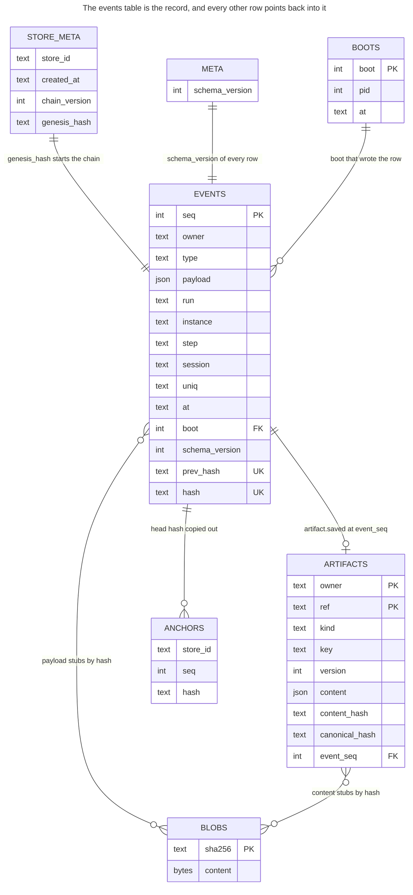

# Data model

*As of 28 Nov 2026. Index: [README](README.md). Lifecycles over these records: [3, lifecycles](3-lifecycles.md).*

Aksha stores very little, and all of it is append-only. There are five tables, a blob folder and an anchor file. Every status a reader sees (a run's state, an open approval, an outbox entry, a stale mark, the budget spent) is computed from rows of the `events` table by a reducer and is never stored. The SQLite schema is in [`adapters/storage/sqlite.py`](../../src/aksha/adapters/storage/sqlite.py) and the PostgreSQL one, with the same columns, in [`adapters/storage/postgres.py`](../../src/aksha/adapters/storage/postgres.py). The schema version is `SCHEMA_VERSION = 2` in [`runtime/storage/schema.py`](../../src/aksha/runtime/storage/schema.py).

## Diagram: the events table is the record, and every other row points back into it

Caption: an artifact row cannot exist without the `artifact.saved` event at its `event_seq`, and a blob is reachable only by the hash a row names. Notice that `owner` is on every event and every artifact row, which is the key every read filters on and the basis of user isolation.

## The stored records

| Record | Where | What it guarantees | Code |
|---|---|---|---|
| `events` | one table | Append-only: triggers refuse `UPDATE`, `DELETE` and, on PostgreSQL, `TRUNCATE`. `seq` is assigned by the single writer. `prev_hash` and `hash` form a SHA-256 chain; `prev_hash` is unique, so the chain cannot fork. `(owner, uniq)` is unique, which is how a dedup key such as `rend:{run}` or `oclaim:{key}/a{n}` stops a second write. | [`runtime/storage/chain.py`](../../src/aksha/runtime/storage/chain.py), [`runtime/storage/append.py`](../../src/aksha/runtime/storage/append.py) |
| `artifacts` | one table | One immutable version per `(owner, ref)`, where `ref` is `kind/key@vN`. `content_hash` covers the bytes and `canonical_hash` the canonical JSON, which is what early cutoff compares. | [`runtime/artifacts/store.py`](../../src/aksha/runtime/artifacts/store.py), [`runtime/artifacts/types.py`](../../src/aksha/runtime/artifacts/types.py) |
| `boots` | one table | One row per process start, so every event says which process wrote it. | storage adapters |
| `meta`, `store_meta` | one row each | The schema version; the store's random ID and the genesis hash, so rows copied from another store do not verify. | [`runtime/storage/schema.py`](../../src/aksha/runtime/storage/schema.py) |
| Blobs | `<root>/sha256/<2 hex>/<64 hex>` | Content-addressed, written by an atomic rename, read-only. Large payloads and uploaded originals live here. | [`adapters/blobs/filesystem.py`](../../src/aksha/adapters/blobs/filesystem.py) |
| Anchors | a JSON Lines file | The head hash at a `seq`, appended with `fsync`; a second hash for an anchored `seq` is refused. Kept apart from the store, it turns a rewrite of the store into a detected change. | [`adapters/anchor/file.py`](../../src/aksha/adapters/anchor/file.py) |

The source inputs themselves (fixture folders, uploads) are versioned records read through a source adapter ([`adapters/sources/`](../../src/aksha/adapters/sources/)); what the store keeps is the version each step read (`read.recorded`), not a copy of the folder.

## Records that are projections, not tables

Each of these is a pure reducer over `events`. Its state names are in [3, lifecycles](3-lifecycles.md).

| Record | Built from | Reducer |
|---|---|---|
| Run | `run.started`, `interrupt.*`, `run.ended` | `RUNS` in [`projections/runs.py`](../../src/aksha/runtime/projections/runs.py), `run_statuses` in [`session/views.py`](../../src/aksha/runtime/session/views.py) |
| Task instance | `task.entered`, `task.withdrawn`, `completion_check.reset`, `stop.decided`, `interrupt.raised` | `run_state` in [`tasks/status.py`](../../src/aksha/runtime/tasks/status.py) |
| Interrupt, approval | `interrupt.*`, `approval.*`, `outbox.enqueued` | `interrupts`, `approvals` in [`interrupts/reducers.py`](../../src/aksha/runtime/interrupts/reducers.py) |
| Outbox entry | `outbox.enqueued`, `outbox.claimed`, `outbox.failed`, `outbox.completed`, `outbox.abandoned` | `Outbox` in [`outbox/outbox.py`](../../src/aksha/runtime/outbox/outbox.py) |
| Lineage | `artifact.saved` reads (`InputRef`: kind, id, version, optional path and entry hash), `relation.saved` | [`artifacts/lineage.py`](../../src/aksha/runtime/artifacts/lineage.py) |
| Evidence spans | `excerpts.minted`, `excerpts.shown`, `citation.bound`, `excerpts.rechecked` | [`grounding/spans.py`](../../src/aksha/runtime/grounding/spans.py) |
| Freshness | `source.changed`, `query.reexecuted`, saves, reviews | `invalidation_view` in [`invalidation/view.py`](../../src/aksha/runtime/invalidation/view.py) |
| Budget spent | step facts, `budget.reached`, `budget.granted` | [`runtime/budgets/`](../../src/aksha/runtime/budgets/) |
| Command receipts | `command.accepted`, `command.refused` | [`runtime/session/commands.py`](../../src/aksha/runtime/session/commands.py) |

## Tests that pin the data model

- An edited event breaks the chain at its `seq`: `test_an_edited_event_is_a_hash_mismatch_at_its_seq` in [`tests/unit/runtime/storage/test_chain.py`](../../tests/unit/runtime/storage/test_chain.py).
- A second `outbox.enqueued` for one key is refused by the store: `test_a_second_enqueued_event_for_one_key_is_refused_by_the_store` in [`tests/unit/runtime/outbox/test_outbox.py`](../../tests/unit/runtime/outbox/test_outbox.py).
- Another owner sees nothing: `test_another_owner_sees_nothing` in [`tests/integration/test_http.py`](../../tests/integration/test_http.py) and `test_another_owners_interrupt_reads_as_unknown` in [`tests/integration/test_session_api.py`](../../tests/integration/test_session_api.py).
- The store contract, for both backends: [`tests/contract/`](../../tests/contract/).

Depth: [ADR-P01](../design/adr/ADR-P01-event-store-and-projections.md), [ADR-P04](../design/adr/ADR-P04-artifact-store-and-lineage.md). Erasure in an append-only store is designed, not built: [ADR-P30](../design/adr/ADR-P30-erasure-in-an-append-only-store.md).
