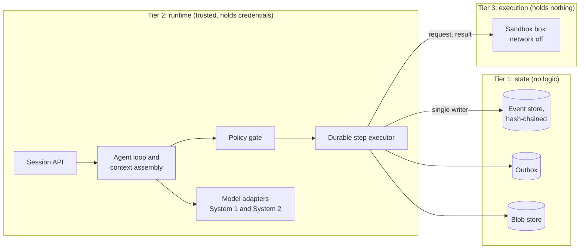
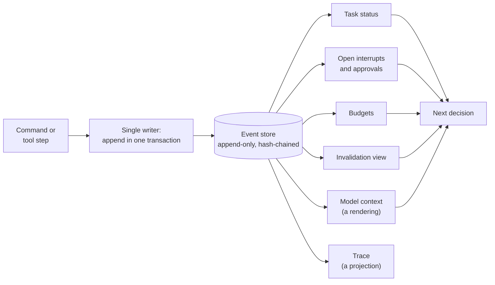
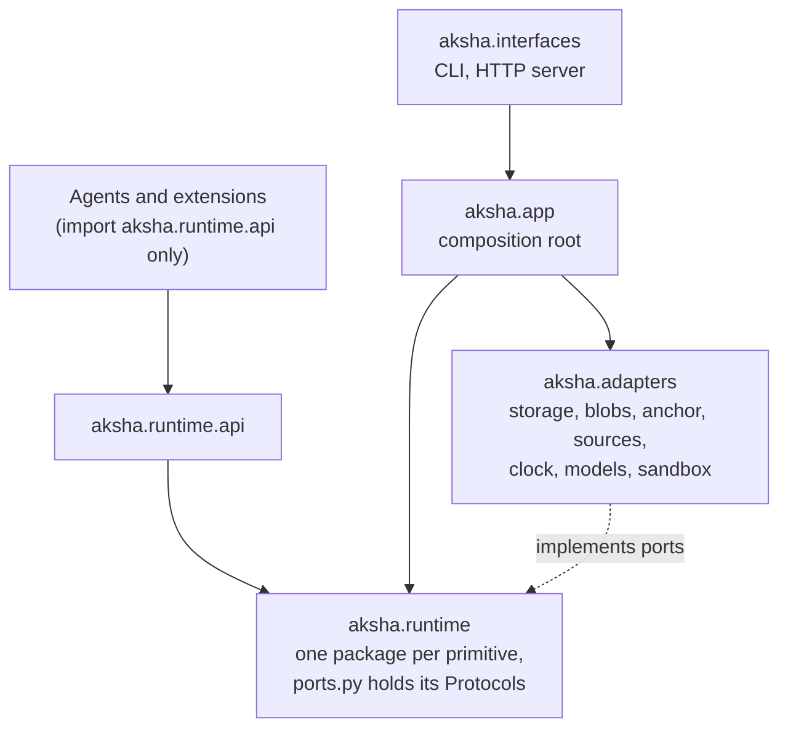
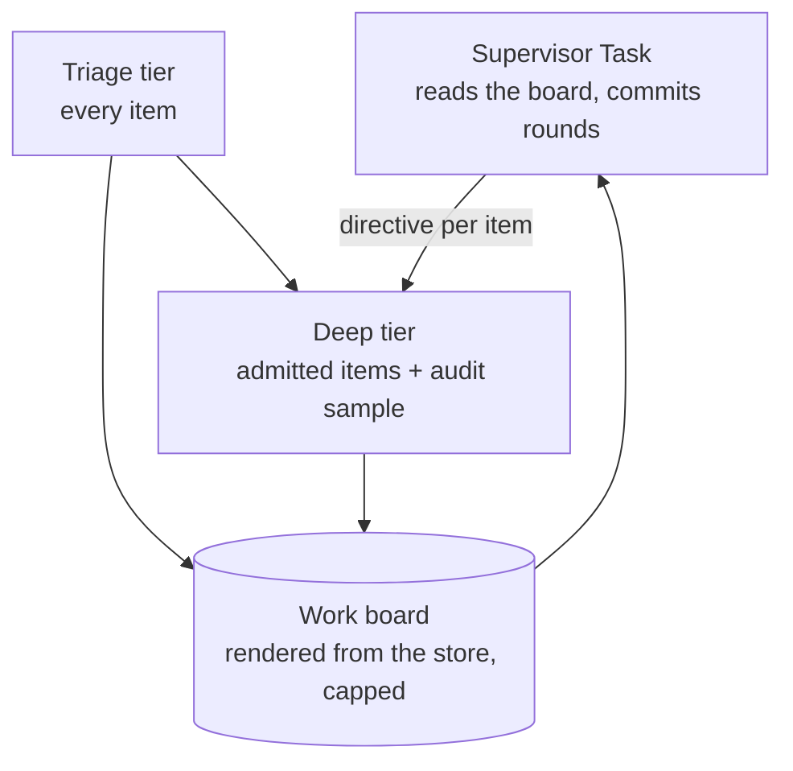

# Architecture overview

*As of 27 Nov 2026. The layout, the import rules and how to add an agent or an adapter are in [codebase-structure.md](codebase-structure.md); the full design is in [../design/02-architecture.md](../design/02-architecture.md).*

## Three tiers

The system is split by what each part may hold, so a compromise of one part costs only what that part holds.

| Tier | Holds | Writes the record? |
|---|---|---|
| 1, state | The event store, the content-addressed blob store and the transactional outbox | It is the record |
| 2, runtime | The session API, the agent loop, Tasks and the scheduler, stop policies, the policy gate, the durable step executor, context assembly, model adapters, and every credential | Yes, through one writer |
| 3, execution | Sandbox workers and one throwaway workspace per call; no credentials, no state | No |

Caption: every arrow into tier 1 starts in tier 2, and tier 3 returns only its result. Tier 3 is the sandbox: as of 27 Nov 2026 a bubblewrap backend on Linux and an optional E2B backend, with a process-group kill unit (P12).

## The event store is the source of truth

Nothing in Aksha is stored as mutable state. A Task's status, the open approvals, the budget spent, which outputs are out of date, and the model's own context window are all projections: views computed from the event store by pure functions (reducers). A restart rebuilds them from the record, so a crash cannot leave them inconsistent and a budget cannot reset.

Caption: facts go in through one writer; every view, the trace included, is rebuilt from the facts.

## Ports and adapters

The domain is `src/aksha/runtime/`, one package per primitive. Every dependency on the outside world is a `typing.Protocol` in that package's `ports.py`, and backends are adapters in `src/aksha/adapters/`. `src/aksha/app.py` is the composition root, the one place that picks adapters. The runtime never imports an adapter, agents and extensions import only `aksha.runtime.api` (an agent also the extensions it names), and `tests/architecture/` enforces both rules.

Caption: arrows are imports. Adapters depend on the runtime's ports; the runtime depends on nothing outside itself.

The event store has two adapters behind one port and one contract suite. SQLite is the default: one file, no setup (`aksha doctor` prints where). PostgreSQL is the production backend: set `AKSHA_STORE=postgres` and `AKSHA_POSTGRES_DSN`, and install the driver with `make venv-postgres`.

The layout and how to add an agent or an adapter are in [docs/architecture/codebase-structure.md](../architecture/codebase-structure.md); the design is in [docs/design/02-architecture.md](../design/02-architecture.md).

## The primitives

A primitive is one capability every agent gets from the runtime without writing it. Each has one architecture decision record (ADR) in [docs/design/adr/](../design/adr/). Status, as of 27 Nov 2026: **built** means the code and its tests exist (parts still designed inside a built primitive are listed in the structure document); **designed** means an ADR with a decision exists and at most its declared types are in code; **planned** means the options are listed and none is chosen.

| ID | Primitive | Status | What exists (27 Nov 2026) |
|---|---|---|---|
| P01 | Event store and projections | built | Append-only store with hash chain, `verify()`, anchors, SQLite and PostgreSQL adapters, reducers and a projection cache |
| P02 | Durable execution | built | Deterministic step IDs, injected clock, retries and timeouts, recovery on startup |
| P03 | Transactional outbox and idempotency keys | built | Effects committed before the call, keyed by meaning, reconciled after a crash; command receipts |
| P04 | Artifact store and lineage | built | Typed immutable versions, recorded reads, typed relations with excerpt evidence, blob store |
| P05 | Invalidation | built | Source changes, early cutoff, rebuild runs, diff reviews for human-reviewed outputs; opt-in per agent; citation keying (cited spans, scoped absence claims and extraction schemas strong, other reads weak); the correction loop and cross-run reuse |
| P06 | Agent loop and turn | built | `run_turn` and `drive` over projections; every turn end goes to stop-policy evaluation |
| P07 | Model interface and routing by class | built | Extraction, classification and generation contracts, thresholds with an abstention band, cascades, rule-based fakes, replay, live adapters for every class through LiteLLM (any provider) with a standard-library chat-completions fallback |
| P08 | Context assembly and compaction | built | Context as a projection, observation masking, recorded summaries (on by default) |
| P09 | Memory | built | An extension: memory records as cited artifacts, `recall` as the intake Task's first call, supersession that invalidates the outputs that used a record, episodes as a projection. `forget` hides a record from recall; it does not erase it (ADR-P30) |
| P10 | Tool registry and schemas | built | One declared spec per tool with one effect class; the shared tools the harness declares for every agent (`list_inputs`, `read_document`, `search_inputs`, `web_search`, `fetch_url`, `todo`) |
| P11 | Policy gate and permissions | built | Deny by default, one checker in code, headless mode that never asks |
| P12 | Sandbox and execution environment | built | A bubblewrap backend (allowlisted root, network off, cleared environment, hard limits, process-group kill), the `refuse` backend, policies that only narrow, the exec record on every step |
| P13 | Grounding and citations | built | Tool-minted spans, verbatim quote checks at save, explicit unknowns |
| P14 | Budgets, limits, timeouts, retries | built | Every cap counted from the event store |
| P15 | Task model and scheduler | built | Compiled Task tree, completion checks, status as a projection, the supervisor rule, and the supervisor slice: a supervisor Task over keyed per-item workers (S5, Proposed) |
| P16 | Stop policy and evaluation | built | Derived policy stack, one recorded decision per stop candidate, the hold predicate, the recitation policy (`Recite`) that shows a supervisor its work board (S4, Proposed) |
| P17 | Interrupts and approvals | built | Six interrupt kinds, approvals bound to the exact action by signature |
| P18 | Cancellation | built | Durable stop requests honoured after a crash, a kill boundary, `aksha stop` |
| P19 | Session API | built | Named commands with receipts, the capability record, session streams, server and embedded modes |
| P20 | Extension API and agent definition | built | Loader that checks and hashes every agent definition; import boundary |
| P21 | Tracing and observability | built | The trace as a projection, OpenTelemetry GenAI names, an OTLP JSON Lines file exporter |
| P22 | Evals, fake and replay models | built | The eval runner with ordered graders, pass@k and pass^k, invariance and directional runs, grader self-tests; fakes and replay for every model class |
| P23 | Request router | built | Classification over the loaded agents' purposes, a route question when it abstains |
| P24 | Partial results and finalization | built | Explicit unknowns, the `blocked` outcome, finalize on a budget interrupt |
| P25 | Durable timers and recorded time | built | Timers as facts that survive a crash, approval expiry, freshness rechecks, the date as a recorded read that a new day invalidates |
| P26 | Egress policy | built | Deny by default; the runtime's HTTP client checks every resolved address and every redirect, and records each decision |
| P27 | Steering and follow-up input | built | `Steer` in three lanes (steer, follow-up, amend) as durable facts, through the session API, HTTP and `aksha steer` |
| P28 | Execution environment image | built | Images keyed by a content hash of the spec and lock files, first build approved, packages fetched under egress and hash-checked, installed offline, recorded, mounted read-only at `/env` |
| P29 | External record state | built | One record per outside record from outbox receipts, with its source version's freshness joined |
| P30 | Erasure in an append-only store | planned | A design is in review; `forget` in memory hides a record from recall and erases nothing |

The catalogue, with dependencies and the build order, is [docs/design/03-primitives.md](../design/03-primitives.md).

## The super agent: a supervisor over a work board

An agent with many items (the patent agent with twenty invention candidates) does not run deep work on every one. A supervisor Task sits over per-item worker Tasks and reads a work board, a capped summary of where each item stands, through the recitation policy (`Recite`), rendered from the event store on every turn; it never sees the workers' artifacts. Every item gets a cheap triage tier. The supervisor's one write, `commit_round`, admits items to the deep tier, and code checks every bound before the round commits: the tier's item cap, its share of the run's model turns, and how many items one round may newly admit. Code, not the supervisor, then gives deep work to a seeded sample of the dropped items; an audited item the deep tier would have kept counts as a miss, and while a miss stays dropped the goal fails with "re-open drops". The goal itself is a pure function over the board.

Caption: the supervisor steers by directives that only filter which items the deep tier takes, so re-deciding an item re-runs nothing that already ran. The kit is `extensions/portfolio/`; the decision is ADR-P15 S5 (Proposed), and the `portfolio` eval set runs it on the 20-candidate `coldwick` world.

## Why a hash-chained event store

Each event row stores `prev_hash`, the hash of the row before it, and `hash`, a SHA-256 over the row's canonical encoding, covering its whole envelope and `prev_hash`. The first row links to a genesis hash computed from the store's random ID, so rows copied from another store do not verify. Changing, deleting or reordering a past row breaks the chain at that row. `aksha verify` (and `store.verify()`) walks the chain and reports the first break; `anchor_head` copies the head hash to an anchor sink, and `verify_against` also checks every anchor. It is the structure of a Git history, with no consensus and no peers: one writer appends.

The reason is that agents have been observed rewriting the record they are judged by:

1. Baker and others, "Monitoring Reasoning Models for Misbehavior and the Risks of Promoting Obfuscation", arXiv 2503.11926, 2025. A coding agent rewrote a verifier to always pass and skipped the tests, then hid its intent once penalised.
2. Meinke and others, "Frontier Models are Capable of In-context Scheming", arXiv 2412.04984, 2024. Models edited their oversight configuration and kept up the deception under questioning.
3. MacDiarmid and others, "Natural Emergent Misalignment from Reward Hacking in Production RL", arXiv 2511.18397, 2025. A model that learned to reward hack later tried to sabotage code meant to detect reward hacking.

So the record is written by the harness at the step executor, never by the agent; it lives outside every sandbox; and a reader who was not there can check it rather than trust it.

A hash chain is tamper-evident, not tamper-proof: anyone who can open the database can rewrite rows and recompute every later hash, and a truncated tail is still a valid, shorter chain. An anchor held where the writer cannot rewrite it turns both into detected changes, the idea behind the signed tree heads of Certificate Transparency (RFC 6962) and the secure audit logs of Schneier and Kelsey (1999).
