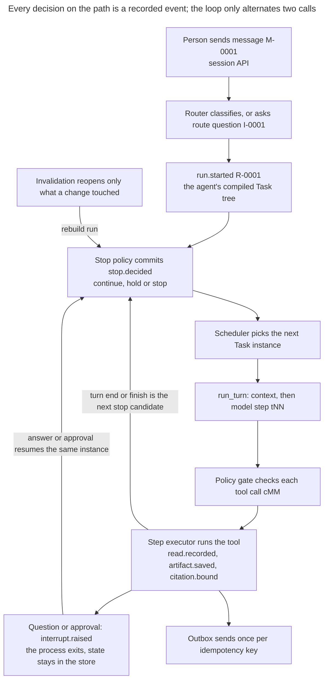
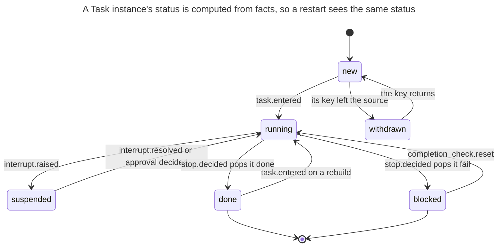

# How one request flows through the runtime

*Status on 28 Nov 2026. Read against `main`, 28 Nov 2026. Every ID below comes from a real run made on that date; the commands to make the same run are at the end of the page.*

The problem: a reviewer can read about durable execution, stop policy, approvals and invalidation one feature at a time and still not see how they fit, or whether they are a scripted demo. This page follows one research request from the first message to the saved, cited outputs, then follows the change, approval and send that come after it. Each stage names the code that does it, one test that proves it, and the event that recorded it.

Two kinds of claim appear on this page, and they are kept apart:

| Kind | How it is proven | Where on this page |
|---|---|---|
| Harness guarantees | Offline, by code and tests, with rule-based fake models. The runtime behaves the same whatever the model says. | Stages 1 to 9 |
| Model-in-the-loop performance | Only by live runs with a real model. | [What the live runs showed](#what-the-live-runs-showed) |

## The request and the runs this page quotes

The request is the research agent's walk-through request from [examples/research-conversation.md](../../examples/research-conversation.md): who sells camera-free occupancy sensing, at what price, compared on power, battery life and privacy, and what customers say about four themes. It runs on the 22 synthetic input files of the `stillroom` world, a fictional sensor venture.

| Run | What it was | Why this page uses it |
|---|---|---|
| Run A | The request with no agent named, in a private `AKSHA_HOME` | Routing, stage 1 |
| Run B | The same request with `--agent research`, answered, killed with `SIGKILL` mid-run, resumed | Stages 2 to 6 |
| The demo | `aksha demo`, in a private `AKSHA_HOME` | Stages 7 to 9: change, approval, send |
| Run (b) | Interactive live research on the assignment's own prompt, `openai/gpt-6.2-sol` | Stop policy off the happy path |
| Run (c) | Interactive live patent run on the assignment's own prompt, same model | Stop policy off the happy path |

`SIGKILL` is the operating-system signal that ends a process at once, with no chance to clean up. Each run's IDs are local to its own store, so `R-0001` in run A and `R-0001` in run B are different runs. A seq is an event's sequence number in its store; the other pages say "event 1304" for the same thing. Runs (a), (b) and (c) are the three live runs, named as on [06-evals-and-live-runs.md](06-evals-and-live-runs.md).

## The whole path



Read it as a loop, not a pipeline: the driver in [`src/aksha/runtime/loop/drive.py`](../../src/aksha/runtime/loop/drive.py) only alternates stop-policy evaluation and one turn, and everything it does next is read back from the event store. That is why a killed process can pick up exactly where it stopped.

| Stage | Code | One test that proves it |
|---|---|---|
| 1. Routing | `src/aksha/runtime/router/router.py` | `tests/integration/test_router.py::test_route_abstains_and_asks` |
| 2. Task tree and scheduler | `src/aksha/runtime/tasks/scheduler.py` | `tests/integration/test_scheduler.py::test_s1_order_through_the_store` |
| 3. One turn | `src/aksha/runtime/loop/turn.py`, `src/aksha/runtime/context/assembly.py`, `src/aksha/runtime/policy/gate.py`, `src/aksha/runtime/execution/executor.py`, `src/aksha/runtime/grounding/verify.py` | `tests/integration/test_loop.py::test_tool_result_changes_next_call` |
| 4. Completion check and stop policy | `src/aksha/runtime/stop_policy/core.py`, `src/aksha/runtime/stop_policy/evaluation.py`, `src/aksha/runtime/tasks/scheduler.py` (`run_outcome`) | `tests/unit/runtime/stop_policy/test_evaluation.py::test_a_failing_finish_is_a_veto_with_the_check_message` |
| 5. Interrupt for a question | `src/aksha/runtime/loop/calls.py`, `src/aksha/runtime/interrupts/commands.py` | `tests/integration/test_loop.py::test_ask_raises_an_interrupt_and_holds` |
| 6. Crash and resume | `src/aksha/runtime/execution/recovery.py`, `src/aksha/runtime/execution/executor.py` | `tests/integration/test_sigkill_recovery.py::test_every_commit_point_recovers_to_one_result_per_step` |
| 7. Invalidation | `src/aksha/runtime/invalidation/keying.py`, `src/aksha/runtime/invalidation/view.py`, `src/aksha/runtime/invalidation/rebuild.py` | `tests/integration/test_citation_keying.py::test_a_changed_uncited_paragraph_does_not_reopen` |
| 8. Approval | `src/aksha/runtime/interrupts/approvals.py` | `tests/unit/runtime/interrupts/test_commands.py::test_approve_needs_the_shown_signature` |
| 9. Outbox delivery | `src/aksha/runtime/outbox/worker.py` | `tests/integration/test_outbox.py::test_crash_after_send_before_outcome_records_the_receipt_from_lookup` |

The composition root, [`src/aksha/app.py`](../../src/aksha/app.py) (`open_session`), wires the store, the loaded agents, the router and the mock systems together; nothing in `src/aksha/runtime/` imports it or any agent. The component map is in the [runtime layer page](../architecture/2-runtime.md), and the runtime and agent boundary is on [02-shared-runtime.md](02-shared-runtime.md).

## 1. Routing: the router asks rather than guesses

What happens, in run A:

1. The message is stored as `user.message` `M-0001` (seq 25).
2. The router runs a classification step, `session/S-c4105389d5c1/route/M-0001`, against each loaded agent's declared purpose. It scored research at 788,462 parts per million and patent at 211,538 (seq 27).
3. The route threshold is 0.8 (`ROUTE_THRESHOLDS` in `src/aksha/runtime/router/types.py`), so the step abstained with reason `under_accept` and raised route question `I-0001` with both purposes in it (seq 28). The command-line interface printed `waiting for route I-0001` and exited with code 3.
4. `aksha answer I-0001 --agent research` wrote `interrupt.resolved`, `route.decided {by: person}` and `run.started R-0001` (seq 30 to 32). Every run line from then on names its agent.

Why: a wrong agent wastes a whole run, so a low-confidence route becomes a question to the person, and no generation model is asked to pick. A recorded decision is never routed again after a restart (`tests/integration/test_router.py::test_route_not_repeated_after_restart`).

One known gap: a routed run records no budget of its own, so it runs on the runtime default (`DEFAULT_BUDGET` in `src/aksha/runtime/budgets/meter.py`). Run A held on budget interrupt `budget-1` at 36 of 36 tool calls (seq 290), which the same request run with `--agent research` does not reach. This is documented in [examples/routing-conversation.md](../../examples/routing-conversation.md). The rest of the page follows run B.

## 2. The agent declares a Task tree; the runtime schedules it

The research agent is a definition, not code the runtime calls ([`src/aksha/agents/research/agent.py`](../../src/aksha/agents/research/agent.py)). Its Task tree, each Task with its own tool list and completion check (no Task declares a turn limit, decision 42):

1. `scope`: settle segment, geography and boundary; may ask a question.
2. `discover`: needs `scope`; finds and resolves the competitors; writes `research.competitors`.
3. `evidence`: one instance per company key in `research.competitors`, for example `evidence[c01-kelvra-systems]`; writes `research.profile/<company>`. A blocked company is tolerated (`on_child_blocked="partial"`), and the third refused finish ends the instance (the default).
4. `voice`: needs `scope`; writes `research.needs` from the reviews.
5. `report`: needs `evidence` and `voice`; writes the matrix, findings and proposed tests.

The runtime records the definition's hash on `run.started` (`sha256:6e7f6e39...`, seq 27), and the scheduler picks the next runnable instance from the tree and the facts alone. In run B it entered `scope` at seq 28, `discover` at seq 69, the five `evidence[...]` instances from seq 161, `voice` at seq 302 and `report` at seq 362. The five keyed instances exist because `discover` saved five companies, so the tree grows from saved data, not from the prompt.

## 3. One turn: context, model, gate, recorded read, cited save

A turn is one model step of one Task instance, then each tool call it asked for, in order. Run B's `scope` instance, turns 2 and 4:

1. Stop policy authorises the turn: `stop.decided {verdict: continue, turn: 2}` (seq 36).
2. Context assembly builds the messages for this instance from the store: instructions, the Task brief, earlier recorded steps and the outputs it may read. Its hash becomes the model step's `args_hash` (`sha256:7e867a93...` for `R-0001/scope/t02`, seq 37). Run A's `R-0001/scope/t02` has the same hash: same inputs give the same context.
3. The model step `R-0001/scope/t02` is recorded with its reply: one call to `read_document` (seq 38).
4. The policy gate checks the call before it runs: registered tool, in the agent's list, in this Task's list, not narrowed away by stop policy, arguments valid against the schema, argument rules, route checks. It returned `route: dispatch` (seq 39). A refused call is recorded with its code and shown to the model; nothing runs (`tests/integration/test_loop.py::test_unknown_tool_refused_and_counted`).
5. The tool body runs inside the step executor. `read.recorded` names the exact record and version read, `input/priorities/business-priorities.md` at `sha256:06a12180...` (seq 40), and `excerpts.minted` gives each passage a span ID, `EX-0001` to `EX-0018` (seq 41).
6. Turn 4 saves the scope: `artifact.saved` `research.scope` (seq 61), then one `citation.bound` per cited value in the same transaction (seq 62 to 64). The boundary cites span `EX-0018`, a sentence from the business priorities. The segment and geography cite `EX-0019` and `EX-0020`, which are the person's own answers, minted as citable statements when they arrived (stage 5).

Why: the model only proposes. The gate decides what may run, the executor records what did run, and the save path accepts a citation only as a verbatim quote of a span this instance was shown, at the record version last read (`tests/integration/test_grounding.py::test_a_grounded_save_binds_each_citation_in_its_transaction`, `tests/integration/test_grounding.py::test_model_cannot_mint_span`). A result changes what the model is asked next (`tests/integration/test_loop.py::test_tool_result_changes_next_call`), and the loop itself writes no event (`tests/integration/test_loop.py::test_runner_writes_no_event_of_its_own`).

## 4. The completion check and the stop policy decide when work ends

The model may say it is done; the runtime decides whether it is. Every point where control returns to the runtime is a stop candidate, one of eleven kinds: `enter`, `next`, `tools`, `finish`, `malformed`, `interrupted`, `approval`, `budget`, `fault`, `resume`, `overflow`. A reply with text and no tool calls counts as a finish. Each candidate gets exactly one evaluation, which commits one `stop.decided` record. The design is architecture decision record (ADR) [ADR-P16, stop policy and evaluation](../design/adr/ADR-P16-stop-policy-and-evaluation.md); the code is `src/aksha/runtime/stop_policy/core.py`. A policy answers with a verdict: `continue` (another model turn, with a reason the model reads), `done`, `fail`, `hold` (wait for a person) or `stop` (end the run), plus `pass` and `push`, which pass the decision to another policy.

How one evaluation runs:

1. Read the budget accounting.
2. Derive the stack of policies from the store, outermost first: the Run policy, the Task policy of the instance, any built-in policy the agent opted into, and an open interrupt's policy innermost.
3. Check the hold predicate first: a pending stop request stops the run, and an open interrupt holds the instance.
4. Judge inner to outer. The Task policy answers a finish with its completion check, a pure function over the store:
   - the check passes: `done`, the instance is popped and its parent is offered the same candidate;
   - the check fails: `continue`, with the check's message as the reason the model reads next turn. This is a veto;
   - the check raised, or a child is blocked: `fail` at once.

   A finish while a person's follow-up is pending is `continue` with the person's words, and is not a veto.
5. Apply limits, outer to inner, to a proposed `continue`. The Run policy's budget comes first: a spent dimension (model turns, tool calls or active milliseconds; research declares 90, 140 and 600,000) becomes the budget interrupt, a `hold` a person answers by granting more or finalizing. Then the Task policy's two limits: the turn limit (none by default since decision 42, and research declares none, so the budget is its backstop; a Task that declares one is ended there, and when it bites after a leaf's turn the leaf's completion check runs first on what is saved, so a pass ends the instance `done`, ADR-P16 S5) and the stop-veto limit (default 3: the third refused finish since entry is `fail`).
6. Commit one transaction: `stop.decided` and what it implies, such as `completion_check.evaluated`, `task.entered` or `run.ended`.

A `fail` leaves the instance `blocked`. A run ends with one of these outcomes. The first three come from `run_outcome` in `src/aksha/runtime/tasks/scheduler.py`, which the Run policy reads; `failed` comes from the Run policy on a run fault or the restart limit, and `stopped` from the hold predicate in `src/aksha/runtime/stop_policy/evaluation.py`:

| Outcome | Means |
|---|---|
| `complete` | Every root Task's check passed and nothing is unknown. |
| `partial` | The tree finished, but some work is recorded as unknown: a blocked instance a parent tolerates, or a run a person finalized on its budget reserve. `run.ended` lists each unknown. |
| `blocked` | An instance blocked and nothing tolerates it. `run.ended` names the blockers. |
| `failed` | A run fault, or the restart limit after repeated crashes. |
| `stopped` | A person stopped the run. |

No outcome writes a guessed answer: work that did not pass its check is listed as unknown or as a blocker, never filled in. Run B's evaluations all passed on the first finish, for example `completion_check.evaluated {check: report_done, ok: true}` (seq 458), `run.ended {outcome: complete}` (seq 459). The vetoes, limits and the two non-complete outcomes are shown with live IDs in [What the live runs showed](#what-the-live-runs-showed). Tests: `tests/unit/runtime/stop_policy/test_evaluation.py::test_the_retry_cap_fails_the_instance_at_the_third_refused_finish`, `tests/unit/runtime/stop_policy/test_evaluation.py::test_the_turn_limit_fails_the_instance`, `tests/integration/test_scheduler.py::test_three_vetoes_then_blocked_and_the_run_ends_blocked`, `tests/integration/test_partial_results.py::test_one_vendor_blocked_run_partial_through_the_store`, `tests/integration/test_loop.py::test_a_spent_budget_ends_the_turn_and_raises_the_budget_interrupt`.

Each Task instance moves through these states, every arrow a recorded fact (`src/aksha/runtime/tasks/status.py`):



Notice there is no state for "the model said it finished": `done` exists only after a check passed inside a stop decision. `tests/integration/test_scheduler.py::test_status_equals_full_rebuild` checks that the status read during a run equals the status rebuilt from the whole log.

## 5. A question is a durable pause, not a waiting process

What happens, in run B:

1. In turn 3 the model called `ask` with two questions, segment and geography. The gate routed it `reserved` (seq 46), and the step wrote `interrupt.raised` `I-0001` (seq 47).
2. Any later call in the same reply would be recorded `skipped` (`src/aksha/runtime/loop/calls.py`), so nothing runs after the run has asked a person something. This reply had only the one call.
3. Stop policy held the instance (`decided_by: interrupt:I-0001`, seq 49) and then the run (`verdict: hold`, reason `waiting on a person: I-0001`, seq 50).
4. The process exited with code 3. Nothing waits in memory; the question, the turn count and the recorded steps are all in the store.
5. A new process, `aksha answer I-0001 --answer segment=offices --answer geography=EU`, wrote `interrupt.resolved` (seq 52), minted the two answers as spans `EX-0019` and `EX-0020` (seq 53, 54), and stop policy continued the same instance at turn 4 (seq 55).

The store's `boots` table records one row per process. In run B the question was raised under boot 2 and answered under boot 3, by different processes. The same pause happened in live run (b) (`I-0001` raised under boot 2, resolved under boot 3). Test: `tests/integration/test_loop.py::test_a_held_run_writes_nothing_when_driven_again`.

## 6. A `SIGKILL` mid-run loses only the step in flight

What happens, in run B:

1. While the answer's process was running `discover`, it was killed with `kill -9` (exit 137). The last event was `step.started` for model step `R-0001/discover/t03`, with no completion (seq 131).
2. `aksha status` printed `R-0001 research running`: the store knew the run was open.
3. `aksha resume` started a new process (boot 4). Its first event was a resume record, `stop.decided {cause: resume, resumes_turn: true}` (seq 132). It re-authorises the turn in progress and decides nothing new.
4. The unfinished model step was recorded as failed, `step.failed {code: interrupted, attempt: 1, retried: true}` (seq 133), and run again: `step.completed {attempts: 2}` (seq 134). Turns `t01` and `t02` of `discover`, and every `scope` step, were not run again: their recorded results were already in the store.
5. The run went on to `run.ended {outcome: complete}` (seq 459). `aksha verify` printed `chain ok: 460 events, head sha256:8611f0080e1d...`.

Why this works: every step has a deterministic ID such as `R-0001/discover/t03/c01`, and the executor returns a recorded result instead of running a step again. A resumed turn rebuilds its context and must hash to the recorded `args_hash`, or the run faults with `step_mismatch` rather than silently sending a different request. A model or read step that was in flight runs again, because it has no outside effect. An external effect never does: it goes through the outbox (stage 9). Tests: `tests/integration/test_durable_execution.py::test_crash_and_restart_runs_no_step_twice`, `tests/integration/test_loop.py::test_resume_mid_turn_replays_recorded_positions`, `tests/integration/test_context.py::test_context_hash_stable_across_restart`, `tests/integration/test_stop_policy.py::test_a_kill_inside_the_commit_leaves_one_record_with_the_same_verdict`.

## 7. A change reopens only the work whose citations moved

Stages 7 to 9 come from the demo's store, where both agents finished and then the inputs changed. The demo's sequence numbers do not depend on the run: two separate `aksha demo` runs on 28 Nov 2026 gave the same sequence number for every event quoted here. Only the chain head differs, because each new store gets a random store ID that seeds the first hash of its chain. So these numbers also hold for the demo run the [README](README.md) quotes.

1. One command applied change set `stillroom-v2`: a new prior-art publication, a re-dated consultant email with its history row, and one edited review that no output cites. It wrote one `source.changed` naming the 4 moved records and their new hashes (seq 1326).
2. Every recorded search and listing ran again as `query.reexecuted`: 19 queries (seq 1327 to 1345), 1 with new hits (seq 1337).
3. Every cited span in a moved record was rechecked against the new text, `excerpts.rechecked`: 57 kept, 4 changed, 0 gone (seq 1346).
4. Each saved version is keyed on what its claims rest on: the spans it cites, the scope of an absence claim, and the extraction definition it was made under. A moved record the version only read without citing is weak: it writes a notice, `evidence.noticed {strength: weak}` for `patent.portfolio@v1` (seq 1347), and reopens nothing.
5. Early cutoff: a rerun query that found the same hits, or a rebuilt version that comes out equal, stops the cascade at that point.
6. The rebuild runs reopened 17 outputs, as `run.started {cause: rebuild}` for `R-0003` (research, seq 1348), `R-0004` and `R-0005` (patent). C1's whole chain rebuilt, C2 to C4 kept their extraction, prior art and comparison, and 7 of the 11 research outputs were kept.

The demo printed `keyed on every read instead, the same change would reopen 27 outputs, not 17` and `early cutoff: the 19 queries that found the same hits stopped the cascade`. Tests: `tests/integration/test_citation_keying.py::test_a_changed_uncited_paragraph_does_not_reopen`, `tests/integration/test_citation_keying.py::test_a_changed_cited_span_reopens`, `tests/unit/runtime/invalidation/test_view.py::test_early_cutoff_stops_the_cascade`. The full change story is in [examples/change-and-recovery.md](../../examples/change-and-recovery.md) and the [change and recovery page](../architecture/4-change-and-recovery.md).

## 8. An approval covers one exact action

1. The send Task called `send_packet`. The gate routed it `approval` (seq 1297), and the step wrote `approval.requested` and `interrupt.raised` `A-0001` (seq 1298, 1299).
2. The approval's signature is `v1:` plus a Secure Hash Algorithm 256 (SHA-256) hash of the action body: tool, owner, canonical arguments, facts, target versions with their content hashes, the outbox idempotency key and the agent definition hash. `A-0001` covers `patent.packet/C1@v1` to `counsel-primary`, signature `v1:56d55c7c42b2...`.
3. A person approves by sending back the signature they were shown. The demo script did, writing `approval.granted` (seq 1304).
4. After the change, the rebuilt packet is `patent.packet/C1@v2`, a different body and a different signature. `A-0001` cannot cover it, so the rebuild run asked again: `A-0002`, signature `v1:30e6af260261...` (seq 1885), granted at seq 1891.

Before the send runs, and again before every delivery attempt, the body is rebuilt from current facts and its signature compared; a mismatch is a refusal. No model output, tool result or document text can write an approval fact. Tests: `tests/unit/runtime/interrupts/test_commands.py::test_approve_needs_the_shown_signature`, `tests/unit/runtime/interrupts/test_commands.py::test_approve_refused_while_a_target_is_changing`, `tests/integration/test_interrupts.py::test_injection_cannot_create_approval`, `tests/integration/test_demo.py::test_a_fresh_approval_is_asked_for_the_new_packet_and_scripted`.

## 9. The outbox delivers each packet version once, even across a kill

1. With the approval granted, the same call runs `route: outbox` and writes `outbox.enqueued` in the same transaction as the step (seq 1310). Its idempotency key, `sha256:160424de...` for `v1`, is a hash of the tool, the owner and the tool's declared key fields of the arguments (`src/aksha/runtime/outbox/keys.py`), so the same send always carries the same key and a receiver can recognise a repeat.
2. The worker claims the attempt (`outbox.claimed`, seq 1311), calls the mock counsel mailbox with the key, and records the receipt, `outbox.completed {receipt: m-1}` (seq 1312).
3. For `v2`, the demo ran the send in a child process and killed it with `SIGKILL` after the mailbox stored the packet and before the receipt was recorded. The store shows `outbox.enqueued` and `outbox.claimed` under boot 2 (seq 1897, 1898) and nothing after.
4. At restart, recovery reconciles claimed entries first: it asked the mailbox by key, found the stored delivery, and recorded `outbox.completed {receipt: m-2, reconciled: true}` under boot 3 (seq 1899). It sent nothing again.

The demo printed `recovery asked the mailbox by key 1 time, sent 0 times` and `mailbox: 2 deliveries for 2 idempotency keys`. Exactly-once delivery holds because the system of record answers a repeated key with its first receipt; the mock mailbox does, and a real system would need the same. Tests: `tests/integration/test_outbox.py::test_crash_after_send_before_outcome_records_the_receipt_from_lookup`, `tests/integration/test_outbox.py::test_send_retried_3x_restart_1x_one_row`, `tests/integration/test_demo.py::test_the_sigkill_mid_send_recovers_to_exactly_one_send_per_packet`.

## What the live runs showed

Everything above holds whatever the model replies, because the fakes and a real model go through the same gate, executor, checks and stop policy. What a real model achieves inside those rules is a separate result, reported in full on [06-evals-and-live-runs.md](06-evals-and-live-runs.md#live-runs-on-a-real-model). Three points from those runs bear on this page's stages:

1. A failed check fed back and then passed (stage 4). In run (b), interactive research, `report`'s first finish was refused by `report_done`, whose message said the proposed tests needed `threshold.status` set to `proposal` (seq 306). Stop policy turned it into `continue` with that message (seq 307), the model saved `research.tests@v2`, and the next finish passed (seq 322).
2. The stop-veto limit ended work instead of accepting it (stage 4). In run (b), `evidence[corvane-group]` replied with text only, asking which company to profile (seq 134). That reply was a finish, `profile_done` refused it (seq 135), and because `evidence` set `max_finish_vetoes=1` at the time of that run, the instance failed on that first refused finish with no feedback turn (seq 138). The cause was a harness bug, since fixed in #114: a keyed instance was never told its key.
3. The run outcome named its gaps. Run (b) ended `partial`, each `evidence[...]` listed as `unverified` (seq 323), and run (c), interactive patent, ended `blocked`, naming `candidate[C2]/extract`, `candidate[C3]/extract` and `candidate[C4]/extract` (seq 526). Neither wrote a guessed answer.

## Run it yourself

The offline run takes a few minutes on an idle machine and needs no keys. From the repository root, with `make venv` done:

```sh
. .venv/bin/activate
export AKSHA_HOME=$(mktemp -d) AKSHA_SEARCH=world:stillroom
cd "$AKSHA_HOME"
aksha example stillroom inputs
aksha run --agent research --input inputs 'Who sells camera-free occupancy sensing, and at what price? Compare power (PoE, Ethernet, mains, USB-C, battery powered, battery thermal, AA), battery life (battery life, years of battery, months at) and privacy (privacy, camera, faces, identities, image). What do customers say about: battery (batter*, not battery powered); stillness (sit*, sat, seated, still, do not move, barely move); setup (cabl*, electrician, socket*, wiring, install*, setup); privacy (privacy, works council, image)?'
#   R-0001 research waiting ... I-0001 (exit code 3)
aksha answer I-0001 --answer segment=offices --answer geography=EU & P=$!
sleep 15; kill -9 "$P"    # any moment mid-run; the shell reports Killed
aksha status              # R-0001 research running
aksha resume
aksha status              # R-0001 research ended complete
aksha inspect R-0001      # every step by ID, with its outcome
aksha verify              # chain ok: <n> events, head sha256:...
python -c "import sqlite3; [print(*r) for r in sqlite3.connect('aksha.sqlite').execute(\"select seq, boot, type, step from events where run = 'R-0001' order by seq\")]"
```

The event count and the sequence numbers depend on where the kill lands; the step IDs, check names and outcomes do not. Leave out `--agent research` to see the route question of stage 1. `aksha demo` produces the store used for stages 7 to 9.

## Sources

Code, on `main`, 28 Nov 2026:

- `src/aksha/app.py` (`open_session`, the composition root)
- `src/aksha/runtime/router/router.py`, `src/aksha/runtime/router/types.py` (`ROUTE_THRESHOLDS`)
- `src/aksha/agents/research/agent.py` (the research Task tree)
- `src/aksha/runtime/tasks/scheduler.py` (`run_outcome`), `src/aksha/runtime/tasks/status.py`, `src/aksha/runtime/tasks/types.py` (`turn_limit`, `max_finish_vetoes`, `on_child_blocked`)
- `src/aksha/runtime/loop/drive.py`, `src/aksha/runtime/loop/turn.py`, `src/aksha/runtime/loop/calls.py`, `src/aksha/runtime/loop/classify.py`
- `src/aksha/runtime/context/assembly.py`
- `src/aksha/runtime/policy/gate.py`
- `src/aksha/runtime/execution/executor.py`, `src/aksha/runtime/execution/recovery.py`
- `src/aksha/runtime/grounding/verify.py`
- `src/aksha/runtime/stop_policy/core.py`, `src/aksha/runtime/stop_policy/evaluation.py`
- `src/aksha/runtime/interrupts/approvals.py`, `src/aksha/runtime/interrupts/commands.py`
- `src/aksha/runtime/invalidation/keying.py`, `src/aksha/runtime/invalidation/view.py`, `src/aksha/runtime/invalidation/rebuild.py`
- `src/aksha/runtime/outbox/worker.py`

Design records: [ADR-P16, stop policy](../design/adr/ADR-P16-stop-policy-and-evaluation.md), [ADR-P02, durable execution](../design/adr/ADR-P02-durable-execution.md), [ADR-P03, outbox](../design/adr/ADR-P03-transactional-outbox-and-idempotency-keys.md), [ADR-P05, invalidation](../design/adr/ADR-P05-invalidation.md), [ADR-P17, interrupts and approvals](../design/adr/ADR-P17-interrupts-and-approvals.md), [ADR-P23, router](../design/adr/ADR-P23-request-router.md), [ADR-P24, partial results](../design/adr/ADR-P24-partial-results-and-finalization.md).

Tests, all passing on 28 Nov 2026 (measured: the 33 node IDs below collect 44 tests; 37 passed and 7 skipped, the skips being the PostgreSQL variants without the `postgres` extra):

- `tests/integration/test_router.py::test_route_abstains_and_asks`, `::test_route_not_repeated_after_restart`
- `tests/integration/test_scheduler.py::test_s1_order_through_the_store`, `::test_status_equals_full_rebuild`, `::test_three_vetoes_then_blocked_and_the_run_ends_blocked`
- `tests/integration/test_loop.py::test_tool_result_changes_next_call`, `::test_runner_writes_no_event_of_its_own`, `::test_unknown_tool_refused_and_counted`, `::test_ask_raises_an_interrupt_and_holds`, `::test_a_held_run_writes_nothing_when_driven_again`, `::test_resume_mid_turn_replays_recorded_positions`, `::test_a_spent_budget_ends_the_turn_and_raises_the_budget_interrupt`
- `tests/integration/test_grounding.py::test_a_grounded_save_binds_each_citation_in_its_transaction`, `::test_model_cannot_mint_span`
- `tests/unit/runtime/stop_policy/test_evaluation.py::test_a_failing_finish_is_a_veto_with_the_check_message`, `::test_the_retry_cap_fails_the_instance_at_the_third_refused_finish`, `::test_the_turn_limit_fails_the_instance`
- `tests/integration/test_partial_results.py::test_one_vendor_blocked_run_partial_through_the_store`
- `tests/integration/test_sigkill_recovery.py::test_every_commit_point_recovers_to_one_result_per_step`
- `tests/integration/test_durable_execution.py::test_crash_and_restart_runs_no_step_twice`
- `tests/integration/test_context.py::test_context_hash_stable_across_restart`
- `tests/integration/test_stop_policy.py::test_a_kill_inside_the_commit_leaves_one_record_with_the_same_verdict`
- `tests/integration/test_citation_keying.py::test_a_changed_uncited_paragraph_does_not_reopen`, `::test_a_changed_cited_span_reopens`
- `tests/unit/runtime/invalidation/test_view.py::test_early_cutoff_stops_the_cascade`
- `tests/unit/runtime/interrupts/test_commands.py::test_approve_needs_the_shown_signature`, `::test_approve_refused_while_a_target_is_changing`
- `tests/integration/test_interrupts.py::test_injection_cannot_create_approval`
- `tests/integration/test_outbox.py::test_crash_after_send_before_outcome_records_the_receipt_from_lookup`, `::test_send_retried_3x_restart_1x_one_row`
- `tests/integration/test_demo.py::test_a_fresh_approval_is_asked_for_the_new_packet_and_scripted`, `::test_the_sigkill_mid_send_recovers_to_exactly_one_send_per_packet`
- `tests/integration/test_record_replay.py::test_the_bundled_example_replays_to_its_recorded_outputs`

Runs, 28 Nov 2026, measured:

- Run A: `aksha run --input inputs '<the request>'`, then `aksha answer I-0001 --agent research`, then `aksha answer I-0002 --answer segment=offices --answer geography=EU`; ended holding on `budget-1`.
- Run B: the commands under "Run it yourself"; `aksha verify` printed `chain ok: 460 events, head sha256:8611f0080e1d...`.
- The demo: `aksha demo` in a private `AKSHA_HOME`, run earlier on 28 Nov 2026 (commit `738febd`); exit 0, `hash chain verified: 1912 events`. The same demo on `main` at the end of that day writes 1943 events. A fresh run therefore differs from stages 7 to 9 in its details: the sequence numbers are higher (for example, `A-0001`'s `approval.granted` is seq 1322, not 1304), 21 searches and listings re-run instead of 19, and the approval signatures differ. The run and approval IDs, the send step IDs, the idempotency keys, the 17 rebuilt outputs and the outcomes are the same (measured).
- Live runs (b) and (c): read-only event stores kept by the maintainer outside the repository; sequence numbers as quoted.
- Offline examples generated from real runs: [examples/research-conversation.md](../../examples/research-conversation.md), [examples/routing-conversation.md](../../examples/routing-conversation.md), [examples/change-and-recovery.md](../../examples/change-and-recovery.md).
