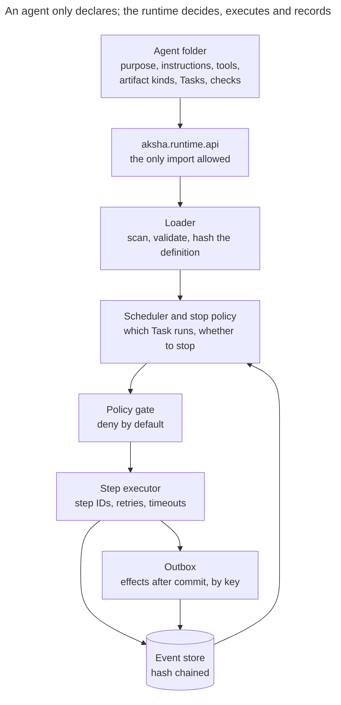

# The shared runtime and its safeguards

*Status on 28 Nov 2026. Read against `origin/main` at commit `738febd`.*

The problem: an agent harness is only worth having if a second and third agent get durability, permissions, approvals and recovery without anyone rewriting them. If each agent carries its own copy, the guarantees drift and a reviewer has to re-check every agent. This page shows what the runtime gives every agent, where each feature lives in code, which test proves it, and what an agent is never allowed to do.

Everything on this page except its last section is a harness guarantee: it is proven offline by code and tests, with fake models and no keys. How well a real model performs inside these guarantees is a separate question, answered only by live runs, and is covered in the [live mode guide](../live-mode.md) and the [known limitations](../limitations.md).

## What the runtime gives every agent

The runtime is one Python package per primitive under [`src/aksha/runtime/`](../../src/aksha/runtime/). Each part reads projections of the event store, decides, and hands its facts to one writer; no part keeps state between calls. The full component map is in the [runtime layer page](../architecture/2-runtime.md).

| Feature | What it does | Why | Where in code | Test that proves it |
|---|---|---|---|---|
| Event store and hash chain | Every fact is an appended event; each event's hash, computed with the Secure Hash Algorithm (SHA-256), covers the previous hash. | One record serves replay, recovery, invalidation and tracing, and an edit or deletion is detectable. | `src/aksha/runtime/storage/chain.py` | `tests/unit/runtime/storage/test_chain.py::test_an_edited_event_is_a_hash_mismatch_at_its_seq` |
| Durable execution | Every model call and tool call is a step with a deterministic ID and a recorded result. | A resumed run replays recorded steps instead of running them again. | `src/aksha/runtime/execution/executor.py` | `tests/integration/test_durable_execution.py::test_crash_and_restart_runs_no_step_twice` |
| Policy gate, deny by default | One pure checker with eight layers in a fixed order; any error inside it is a refusal. | Permissions are enforced in code, so a prompt cannot widen them. | `src/aksha/runtime/policy/gate.py` | `tests/integration/test_policy_gate.py::test_every_cell_fails_closed_when_a_helper_raises` |
| Approvals bound to the action signature | An approval's signature is `v1:` plus a SHA-256 over the exact tool, arguments, owner, facts, target versions with their content hashes, idempotency key and definition hash. | A changed action, or a changed fact behind it, is not covered by the old approval. | `src/aksha/runtime/interrupts/approvals.py` | `tests/unit/runtime/interrupts/test_approvals.py::test_signature_is_version_prefixed_and_covers_every_field` |
| Transactional outbox and idempotency keys | An external effect is committed with its step before it is sent, under a key derived from what it means. | A retry or a crash after sending finds the first receipt instead of sending twice. | `src/aksha/runtime/outbox/keys.py`, `src/aksha/runtime/outbox/worker.py` | `tests/integration/test_outbox.py::test_crash_after_send_intent_sends_once_after_restart` |
| Recorded reads and citations | Every read is recorded with its version; a citation must quote text a tool returned, verbatim. | Each output names exactly what it rests on, and a search snippet cannot be cited. | `src/aksha/runtime/grounding/verify.py`, `src/aksha/runtime/artifacts/` | `tests/integration/test_grounding.py::test_search_hit_cannot_be_cited` |
| Invalidation | When an input changes, the outputs that read it become stale, and only those are rebuilt. | Unaffected work is kept and stale work cannot finish a run. | `src/aksha/runtime/invalidation/view.py` | `tests/integration/test_invalidation.py::test_unrelated_writer_is_not_touched` |
| Limits, timeouts and retries | Tool-call, model-turn and time budgets, per-step timeouts and bounded retries, all counted from the event store. | A runaway or crash-looping run stops, and the counts survive a restart. | `src/aksha/runtime/budgets/limits.py`, `src/aksha/runtime/budgets/meter.py` | `tests/integration/test_budgets.py::test_a_crash_loop_runs_no_more_than_max_retries_plus_one_attempts` |
| Sessions and user isolation | Named commands with receipts, one owner per session, per-owner streams and IDs. | One user never sees another user's runs, uploads or approvals. | `src/aksha/runtime/session/service.py` | `tests/integration/test_http.py::test_another_owner_sees_nothing` |
| Record and replay | A live run's model, search and fetch answers are written to JSON Lines files and replayed offline by step. | A real model run can be re-checked in tests with no keys or network. | `src/aksha/adapters/recording/`, `src/aksha/adapters/models/replay.py` | `tests/integration/test_record_replay.py::test_the_bundled_live_model_run_replays_offline_to_its_recorded_outputs` |
| Routing | Classifies a request by each loaded agent's declared purpose, or asks when unsure. | The router knows no agent by name, and never guesses. | `src/aksha/runtime/router/router.py` | `tests/integration/test_router.py::test_route_abstains_and_asks` |
| Interrupts | A question or approval request is an `interrupt.raised` event; the run holds until it is answered. | A pending question or approval survives a restart unchanged. | `src/aksha/runtime/interrupts/` | `tests/integration/test_interrupts.py::test_mid_approval_restart_shows_the_same_request` |
| Shared tools | The input tools (`list_inputs`, `read_document`, `search_inputs`), `web_search`, `fetch_url`, `todo` and the form tools (`read_form`, `fill_form`) are declared once and listed by any agent; the agent declares only how they read for it: its document kinds and its blank forms (`InputReading`, `FormSpec`); the filled-form kind and its counts come from the harness too (`form_kind`). | A tool two agents need is written once, so its limits, refusals and field-status rules are the same for both, and an agent keeps only its own actions (the patent agent's is `send_packet`). | `src/aksha/runtime/inputs/tools.py`, `src/aksha/runtime/forms/tools.py` | `tests/unit/runtime/forms/test_tools.py::test_fill_form_refuses_a_fill_the_rules_forbid`, `tests/unit/runtime/forms/test_tools.py::test_a_toy_agent_that_lists_the_form_tools_loads_and_saves_through_the_store` |
| Model interface | Three contracts (generation, extraction, classification); LiteLLM (a library that speaks to many model providers) in live mode, each agent's rule-based fakes offline. | Tests run with no paid credentials, and an offline mode can never bind a live model. | `src/aksha/runtime/models/ports.py`, `src/aksha/adapters/models/litellm.py`, `src/aksha/agents/research/fakes.py` | `tests/unit/runtime/models/test_routing.py::test_offline_modes_bind_offline_adapters_only` |

The [requirements page](../requirements.md) maps each of these to the assignment's wording with more tests per row.

## Proof that it is one real system: one send, traced through the store

The table could describe a scripted demo, so here is one send traced through the events a real run wrote. On 28 Nov 2026 I ran the offline demo in a fresh home:

```console
$ AKSHA_HOME=$(mktemp -d) aksha demo
...
   scripted: approved A-0001 for patent.packet/C1@v1; the mailbox received it once
...
   A-0001 approved patent.packet/C1@v1 only, so it does not cover patent.packet/C1@v2; a fresh approval is requested
...
4. SIGKILL mid-send, then recovery (20.87 s)
   a child process sent patent.packet/C1@v2; the mailbox stored it, then SIGKILL (exit -9) before the receipt was recorded
   at restart: 1 outbox entry open with no receipt; recovery asked the mailbox by key 1 time, sent 0 times; R-0005 ended complete
   mailbox: 2 deliveries for 2 idempotency keys (patent.packet/C1@v1, patent.packet/C1@v2): each packet version exactly once

5. Event store
   hash chain verified: 1912 events, head sha256:0271290477174451...
```

Reading that run's store, the first send went through these events, in order:

1. Event 1298, `approval.requested` for A-0001, at step `R-0002/send[C1]/t01/c01`. Its body names `patent.packet/C1@v1`, recipient `counsel-primary`, and idempotency key `sha256:160424de…`.
2. Event 1304, `approval.granted`, signature `v1:56d55c7c…`, covering `patent.packet/C1@v1` only.
3. Event 1310, `outbox.enqueued` at step `R-0002/send[C1]/t02/c01`, under the same key `sha256:160424de…`.
4. Event 1312, `outbox.completed`, receipt `m-1`, one attempt.

After the input change, the packet was rebuilt as version 2, so A-0001 no longer covered it. A fresh approval, A-0002 (event 1891, signature `v1:30e6af26…`), was granted for `patent.packet/C1@v2`. The process was killed after the mailbox stored the message but before the receipt was recorded. On restart, recovery asked the mailbox by key instead of sending again: event 1899 is `outbox.completed` with receipt `m-2` and `"reconciled": true`.

Then `aksha verify` on the same store:

```console
$ AKSHA_HOME=<that home>/demo aksha verify
chain ok: 1912 events, head sha256:0271290477174451999bd53605569605f67bdb9636a73ed36572fb48684f9fc6
```

The event count, 1912, matches the committed example in [examples/change-and-recovery.md](../../examples/change-and-recovery.md). The head hash differs per run, because each new store gets a random store ID that seeds the first hash of its chain (`new_store_id` in `src/aksha/runtime/storage/chain.py`); the demo's clock is fixed, so timestamps do not vary. A second run on 28 Nov 2026 (head `sha256:f7be60d47f4fb092…`) put the same six events at the same numbers, with the same keys and signatures.

## Where the runtime ends and an agent begins

An agent is data plus a few pure functions: a folder the loader finds on a search path, holding `agent.py`, `checks.py` and prompt files. It declares:

1. Its purpose, one sentence the router and the person both read.
2. Its instructions, a prompt file in the folder.
3. Its tools, and for each Task the subset it may call.
4. The artifact kinds it saves, each with a JSON (JavaScript Object Notation) Schema, and the relations between them.
5. Its Task tree: fan-out per key, dependencies, reads, writes and interrupts.
6. Its completion checks, pure functions over a read-only view of the run.
7. Its budget, limits and context caps.

The loader refuses an agent that imports any `aksha` module other than `aksha.runtime.api` (or an extension it names), defines its own stop-policy class, or imports a network module. An agent also never writes an event, calls a tool body without the gate's allow, or grants itself a permission: the runtime does all three, and the gate reads only the proposed call, never model text. The source scan in `src/aksha/runtime/definitions/modules.py` guards against mistakes; it is not a sandbox, so only trusted agent folders load.



Take from this that the agent's code sits above one narrow interface. Everything below it, including stopping, permission checks, writes and sends, is shared runtime code that no agent can replace.

The test agent that proves the boundary is the conformance agent `toy`, in [`tests/fixtures/agents/toy/agent.py`](../../tests/fixtures/agents/toy/agent.py). An excerpt:

```python
AGENT = Agent(
    name="toy",
    purpose="Summarise a few short notes, one line each, then one overall line.",
    instructions="prompts/instructions.md",
    artifacts=(ArtifactKind("line", LINE, keyed=True), ArtifactKind("summary", SUMMARY)),
    tools=(ToolUse("echo.lookup"), ToolUse("save_artifact")),
    tasks=(
        # trimmed here: reads, writes, child Tasks, stop policies, relations,
        # completion checks, limits and extensions are in the file
        Task("collect", per=source_keys("notes"), tools=("echo.lookup", "save_artifact")),
        Task("summarise", needs=("collect",), tools=("save_artifact",), done=checks.summary_saved),
    ),
    budget=Budget(model_turns=10, tool_calls=20),
)
```

The runtime-hash test, from [`tests/architecture/test_extension_boundary.py`](../../tests/architecture/test_extension_boundary.py):

```python
def test_third_agent_runtime_hash_unchanged(plugins: Plugins) -> None:
    before = _runtime_hash()  # comment added here: SHA-256 over every .py path and file under src/aksha/runtime
    (loaded,) = load_agents([plugins.toy], [plugins.extensions])
    assert loaded.agent.name == "toy"
    assert _runtime_hash() == before
```

This test loads the toy agent; it does not run a turn. Three other tests carry the rest of the claim:

- `tests/architecture/test_extension_boundary.py::test_conformance_fixtures_import_only_the_api`: the toy agent and its extension import only `aksha.runtime.api` and live outside the runtime package.
- `tests/architecture/test_extension_boundary.py::test_runtime_has_no_agent_terms`: no runtime file contains a word from the agents' vocabulary in [`tests/fixtures/agent_terms.txt`](../../tests/fixtures/agent_terms.txt).
- `tests/integration/test_cli.py::test_run_embedded_completes_and_exits_zero`: a third fixture agent, `scribe`, kept outside `src`, runs end to end through the command line and ends `complete`.

How to add an agent step by step is in the [agent authoring guide](../agents/authoring.md).

## Why the boundary sits here: the rule of three

No abstraction enters the runtime until three different agents fit it without agent-specific runtime code. The Research Agent and the Patent Agent are built. A contrast coding agent, which would edit a Git repository in a sandbox for hours and push a branch after approval, is designed, not built. Every design record except the one still open (erasure) was reviewed against it, so the runtime would not turn into a document pipeline. The table of the three agents and what each presses on is in the [design rationale](../design/rationale.md).

## Safeguards enforced in code

Each safeguard below is a check in code with a test that would fail if the check were removed.

| Safeguard | What happens | Test |
|---|---|---|
| A disallowed tool is blocked | The call is refused before its body runs, recorded on `step.completed` with a layer and a code, and counted. | `tests/integration/test_loop.py::test_unknown_tool_refused_and_counted`, `tests/integration/test_policy_gate.py::test_every_tool_every_agent_every_task` |
| No path skips the gate | No tool body can be called without an allow; a planted bypass is caught. | `tests/architecture/test_policy_gate.py::test_no_bypass_path` |
| Prompt injection in a fetched page is ignored | A fake model that obeys page text tries `send_document`; layer 1 refuses it as `unknown_tool`, no approval or outbox entry is written, and the matrix equals the clean run's. | `tests/agents/research/test_runs.py::test_a_model_that_obeys_page_text_is_refused_and_nothing_changes`, `tests/integration/test_interrupts.py::test_injection_cannot_create_approval`, eval case `s8a-injection-research` (`src/aksha/data/suites/research/s8a-injection-research.toml`) |
| No secrets in recordings or logs | Keys go only in the request header; a key inside a provider error message is stripped before it is kept; a missing key is reported by variable name, never value. | `tests/unit/adapters/models/test_live.py::test_a_live_call_sends_the_key_only_in_its_header`, `tests/unit/adapters/models/test_litellm.py::test_a_key_in_a_provider_message_is_never_kept`, `tests/unit/adapters/models/test_litellm.py::test_missing_keys_names_the_variables_never_values` |
| A rejected approval changes nothing | Rejecting writes only `command.accepted`, `approval.rejected` and `interrupt.resolved`, and the run keeps waiting. | `tests/unit/runtime/interrupts/test_commands.py::test_reject_changes_nothing`, `tests/integration/test_cli_patent_send.py::test_a_refused_approval_leaves_the_run_waiting_and_other_commands_work` |
| An edited action needs fresh approval | Editing voids the old approval (`replaced_by_edit`) and requests a new one with a new signature. | `tests/unit/runtime/interrupts/test_commands.py::test_edit_needs_fresh_approval` |
| Budgets are enforced | A spent budget ends the turn and raises a budget interrupt; a crash loop stops at the retry limit plus one. | `tests/integration/test_loop.py::test_a_spent_budget_ends_the_turn_and_raises_the_budget_interrupt`, `tests/integration/test_budgets.py::test_budget_tool_calls` |

On 28 Nov 2026 I also scanned all 28 files of the bundled live-model recording, the inputs and trace folders included, for key shapes (`sk-…`, `Bearer …`, `api_key`). The command and its output:

```console
$ grep -rlE "sk-[A-Za-z0-9_-]{12,}|Bearer [A-Za-z0-9._-]{8,}|api[_-]?key\"?\s*[:=]" src/aksha/data/recordings/research-live-gpt/ || echo "no file matches"
no file matches
```

One opt-in mode loosens a safeguard, and it is recorded. `aksha run --headless` never asks a person, so an approval-routed send goes straight to the outbox. Every refusal still holds, a headless start without a declared sandbox is refused `sandbox_required`, and the choice is written on `run.started`. Attended runs, the default, always ask. Details are in the [trust boundary page](../architecture/trust-boundary.md).

## What the live runs found in the runtime

This section is about model-in-the-loop behaviour, so it rests on live runs, not tests. In the three live runs of 28 Nov 2026 (run (a), recorded research; run (b), interactive research; run (c), interactive patent; all on [06-evals-and-live-runs.md](06-evals-and-live-runs.md)), the model never proposed a call the gate refused: each store has zero `step.completed` events with outcome `refused`. So the gate's refusals are proven offline only, by the tests above. Checks inside the runtime's tools did refuse model calls live. In run (c), event 330 is `save_artifact` refused `foreign_writer`: the C3 instance tried to save into `patent.extraction/C1`, the slot of the C1 instance. In run (a), event 287 is `save_artifact` refused `quote_too_short`: a citation quote was too short to verify. Where evidence was missing, the research runs ended `partial` with each gap named, and the patent run ended `blocked`, naming the three extraction Tasks it could not finish.

The live runs also exposed a harness bug, being fixed: a Task instance created per key, such as one per competitor, is never told its key. In run (b) the runtime recorded the key on `task.entered` (event 191, key `noctra`), but the key never reached the model's context, and at step `R-0001/evidence[noctra]/t01` (event 197) the model asked which company to profile. The bug and its effects across all three runs are on [06-evals-and-live-runs.md](06-evals-and-live-runs.md#the-per-key-bug-and-what-is-being-fixed), which also holds the "After the fixes" placeholder.

## Sources

- Runtime packages: `src/aksha/runtime/` (storage, execution, policy, interrupts, outbox, grounding, artifacts, invalidation, budgets, session, router, models, definitions).
- Adapters: `src/aksha/adapters/models/litellm.py`, `src/aksha/adapters/models/replay.py`, `src/aksha/adapters/recording/`.
- Agents: `src/aksha/agents/research/fakes.py`, `tests/fixtures/agents/toy/agent.py`, `tests/fixtures/agents/scribe/`.
- Every test named on this page passed on 28 Nov 2026 at commit `738febd` (33 passed; the 8 skips were PostgreSQL variants, skipped because no PostgreSQL driver was installed).
- Demo store: a fresh `AKSHA_HOME` on 28 Nov 2026; events 1298, 1304, 1310, 1312, 1891 and 1899 read with SQLite from `<home>/demo/aksha.sqlite`.
- Live stores, read-only: the recorded research run ships as `src/aksha/data/recordings/research-live-gpt/`; the two interactive runs' stores (events 191 and 197 are in the research one, event 330 in the patent one; event 287 is in the recorded run's store, `runs/live-sol-final/store`) are kept outside the repository. Refusals were counted with `json_extract(payload, '$.outcome') = 'refused'` on `step.completed` in all three stores.
