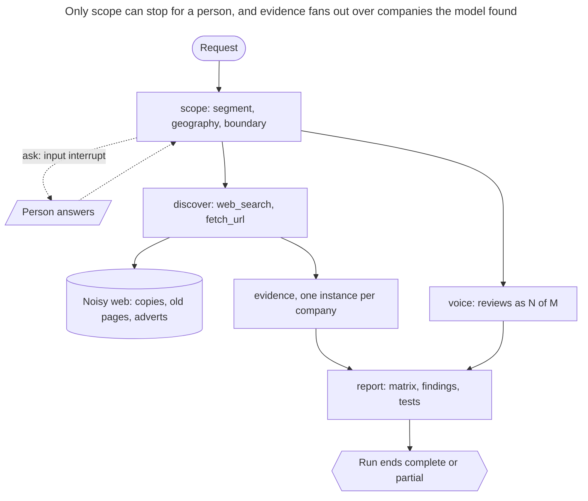

# Research Agent: how it is defined and how it works

*Status on 28 Nov 2026. Read against `origin/main` at commit `738febd`.*

The assignment asks a Research Agent to say who already solves the problem, what customers complain about and what to test next, with every finding linked to the excerpt that supports it. A research agent that writes a fluent report from search snippets fails that bar silently: the table looks complete, and nobody can tell a stated price from a guessed one. This page shows how the agent is defined, how each step uses the shared runtime, which rules keep its outputs grounded, and how it behaves when evidence is missing, both offline and with a real model.

Two kinds of claim appear below. Harness guarantees (sections 2 to 5) are proven offline by code and tests, with rule-based fake models. Model-in-the-loop performance (section 6, live runs) is proven only by live runs, and those runs show real gaps.

## 1. Role and decision boundaries

The agent researches a market over the person's own inputs and the web. It saves seven kinds of versioned output (`scope`, `competitors`, one `profile` per company, `needs`, `matrix`, `findings`, `tests`), each addressed by kind, key and version. The Patent Agent reads `needs` and `findings` this way.

| It decides | It never decides |
|---|---|
| Which questions are material, and asks only those | The segment or geography when the request leaves them open: it asks |
| Which search results are sellers' own current pages | That two names are one company without a page saying so |
| How to label each value: fact, vendor claim, inference or unknown | A value that no fetched page states: that stays unknown |
| One proposed customer test with thresholds | That a threshold is a measured result: it is labelled a proposal |

It has no external effect, so it has no approval point. Its only pause for a person is the clarifying question in `scope`.

## 2. The definition is data

The agent is one module of declarations, [`src/aksha/agents/research/agent.py`](../../src/aksha/agents/research/agent.py). It declares no tool of its own; it lists the harness's shared tools in [`tools.py`](../../src/aksha/agents/research/tools.py) (`list_inputs`, `search_inputs`, `read_document`, `web_search`, `fetch_url`, `todo`), and the loader adds `save_artifact`, `ask` and `finish`. Each output is an `ArtifactKind` with a JSON Schema and cite policies naming which fields must be cited. The prompts are files in [`prompts/`](../../src/aksha/agents/research/prompts/): `instructions.md` for every Task and one brief per Task.

This is the whole declaration of the `evidence` step, copied from `agent.py`:

```python
Task(
    "evidence",
    per=artifact_keys("competitors", "companies"),
    needs=("discover",),
    reads=("competitors",),
    tools=("read_document", "fetch_url", "todo", "save_artifact"),
    writes=("profile",),
    extracts=True,
    done=checks.profile_done,
    brief="prompts/evidence.md",
    on_child_blocked="partial",
    max_finish_vetoes=1,
),
```

Read it as a route declaration in an Express app: the Task names its inputs, its allowed tools and its validator, and the runtime does the rest. `per=` tells the runtime to start one instance for each company key the saved `competitors` lists. `done=` names a pure completion check in [`checks.py`](../../src/aksha/agents/research/checks.py) that must pass before the instance may finish. The full tables of tools, schemas and limits are in the project's [guide to the research agent](../agents/research.md) and its [tools and schemas page](../agents/tools-and-schemas.md), which this page does not repeat.

## 3. The workflow and how each step uses the runtime

The run walks a fixed Task tree. Each step may finish only when its check passes, and the runtime records every step as an event.

1. `scope` reads the request and the inputs, and fixes the question, the segment, the geography, the boundary, the dimensions to compare and the review themes. When a value that changes the result is missing, it calls `ask`, which raises an `input` interrupt: the run is suspended, the question is stored, and it survives a restart. Check: `scope_done` (a comparison needs a segment and geography, each with its basis).
2. `discover` searches the web with `web_search`, fetches the pages that sell something with `fetch_url`, and saves the companies. The search is noisy on purpose. The offline world's web ([`src/aksha/data/worlds/stillroom/web.json`](../../src/aksha/data/worlds/stillroom/web.json)) mixes six seller pages with seven noise pages: two copies of other pages, an archived older page, two adverts, an unrelated report and a page that only lists keywords. A search result never says which pages are noise; that label is read only by the graders, and the world's answer key (`key.json`) is never read by the agent. Check: `discover_done` (each page under one company; a merge needs a `same_entity_as` relation carrying the excerpt that says so).
3. `evidence` runs once per company the model saved, re-reads that company's pages with typed extraction, and saves its `profile`. Runtime features: fan-out by key, and `on_child_blocked="partial"`, so one blocked company becomes an explicit unknown instead of blocking the report. Check: `profile_done` (prices and every dimension cited or unknown; differing prices recorded as a conflict). Status on 28 Nov 2026: an instance is not yet told which company key it holds; run (b) in section 6 shows the effect, and it is being fixed.
4. `voice` reads the customer reviews and saves `needs`, one per scope theme. Check: `needs_done` (each theme is phrased "N of M reviews in this sample", M the unique reviews after cross-posted copies are removed).
5. `report` is the finalizer: it reads the scope, the competitors, every profile and the needs, and saves the `matrix`, `findings` and `tests`. Check: `report_done` (one row per company, no empty cell, every test threshold has `status: "proposal"`). The run is complete when `outputs_exist` passes.



Take from this that the competitor list is something the model finds, and the number of `evidence` instances follows from what it saved, not from a script.

## 4. Evidence rules, and where code enforces them

Every save goes through grounding in the artifact store (`src/aksha/runtime/artifacts/store.py`, which calls `verify_content` in `src/aksha/runtime/grounding/verify.py`). A save that breaks a rule is refused, and the model reads why and tries again.

| Rule | Enforced by | Test |
|---|---|---|
| A claim cites a span a read tool minted, with a verbatim quote of at least 12 characters | Grounding at save | `tests/integration/test_grounding.py::test_quote_must_be_verbatim_and_long_enough` |
| A search snippet or listing is never evidence | Search mints no span | `tests/integration/test_grounding.py::test_search_hit_cannot_be_cited` |
| Duplicates do not inflate counts: one company per merged set of pages, cross-posted reviews counted once | `discover_done`, `needs_done`, counts computed at save in `computed.py` | `tests/agents/research/test_episodes.py::test_five_companies_on_six_pages_one_merged_with_its_excerpt`, `tests/agents/research/test_episodes.py::test_reviews_counted_once_reported_as_this_sample` |
| Facts, vendor claims, inferences and unknowns are labelled | The instructions and the eval graders; the schemas do not require the label | `tests/agents/research/test_episodes.py::test_vendor_claim_and_measured_fact_are_both_shown_and_labelled` |
| Conflicting prices stay side by side with their pages and dates | `profile_done` with `analysis.price_conflict` | `tests/agents/research/test_episodes.py::test_conflicting_prices_stay_side_by_side_with_their_dates` |
| A failed fetch leaves the value `unverified`, naming the failed step | Grounding, and the finalization projection in `src/aksha/runtime/finalization/unknowns.py` | `tests/integration/test_grounding.py::test_failed_fetch_is_unverified` |
| Missing data is an explicit unknown, never zero | `may_be_unknown` cite policies; `report_done` refuses an empty cell | `tests/integration/test_grounding.py::test_missing_is_unknown_not_zero`, `tests/agents/research/test_episodes.py::test_an_unlisted_price_is_unknown_never_zero` |
| No output states a market share from a review sample | The "N of M" phrase computed at save for `needs`; instruction rule 6 and the eval criterion `no_market_percentage` for findings and tests | `tests/agents/research/test_episodes.py::test_no_output_states_a_market_share` |

One example from the offline run in [examples/outputs/research-summary.md](../../examples/outputs/research-summary.md): one company lists, in US dollars (USD), "USD 229 per unit" on a page dated 2026-04-02 (span `EX-0116`) and "USD 199 per unit" as a launch offer on a page dated 2026-09-15 (span `EX-0141`). The finding `price-conflict-c03-brightfield-analytics-1` keeps both and says the conflict is left open.

## 5. Safeguards and failure behaviour

| Safeguard | Behaviour | Proof |
|---|---|---|
| Tools per Task, in code | `report` can only save; `scope` cannot search the web. The policy gate refuses any unlisted call. | `tests/integration/test_policy_gate.py::test_every_tool_every_agent_every_task` |
| Page text is data | A page addressed to AI readers asks to skip approval and send a packet; it is flagged as a finding and changes nothing. | `tests/agents/research/test_runs.py::test_a_model_that_obeys_page_text_is_refused_and_nothing_changes`, eval case `s8a-injection-research` |
| Budgets, no turn limits | 90 model turns, 140 tool calls, 600,000 ms active time per run, multiplied by 3 for turns and calls in a live run. No Task declares a turn limit (decision 42): long work runs until its check passes, its finish vetoes run out, a person stops it, or the run budget holds the run. | `budget=` in `agent.py`; `tests/integration/test_no_turn_limit.py` |
| Bounded finish vetoes | A Task that tries to finish while its check fails is refused and told why; by default the third refusal fails the instance. `evidence` sets `max_finish_vetoes=1`, so its first refused finish already fails that instance, with no turn to act on the reason. | `limit` in `src/aksha/runtime/stop_policy/core.py`; `tests/agents/research/test_counts.py::test_a_missing_theme_is_named_in_one_veto_and_the_next_turn_passes` (default limit) |
| Partial results | A company whose page fails to fetch ends as a row of `unverified` cells; the other four rows are kept and the run ends `partial`. | `tests/agents/research/test_runs.py::test_a_blocked_source_ends_the_run_partial_with_the_gap_named` |
| Crash and restart | A crash mid-evidence resumes without repeating a recorded step; a restart while a question waits asks it once. | `tests/agents/research/test_runs.py::test_a_crash_mid_evidence_resumes_and_repeats_no_recorded_step`, `tests/agents/research/test_runs.py::test_a_restart_while_waiting_on_the_founder_asks_once` |
| Changed inputs | `invalidation="rebuild"` keyed on citations: outputs citing a changed span reopen, with what depends on them. In the demo, 7 of 11 research outputs were kept. | `aksha demo`, line `kept 7 of 11 research outputs` |

## 6. Inspect it working

### Offline, with fake models

The walk-through in [examples/research-conversation.md](../../examples/research-conversation.md) is a real command-line run: 22 synthetic inputs uploaded, the agent asks `I-0001` for the segment and the geography, and after `aksha answer I-0001 --answer segment=offices --answer geography=EU` it prints `R-0001 research ended complete` and 11 outputs, five of them profiles. In the demo run of 28 Nov 2026 the same agent printed `research R-0001 complete: 11 outputs, 23 model calls`, raised `I-0001` ("Which geography should this cover?"), and saved the merge of two pages as a `same_entity_as` relation citing "Corvane Presence P1 is the new name for OccuPoint."

The research eval set in `src/aksha/data/suites/research/` holds six eval cases: `s1-research-happy`, `r-duplicate-competitor`, `r-prices`, `r-claim-vs-fact`, `r-review-duplicates` and `s8a-injection-research`. Each lists the criteria it is graded on, such as `web.noise_unread` (no noise page fetched). `aksha eval run research` passed 6 of 6 on 27 Nov 2026. On three worlds written without sight of the code, the agent passed 25 of 26 eval cases; the failure is `rf-research-claim`, where a claim is cited by its block, not its sentence, as the [evals guide](../evals/README.md) records. These are fake-model results: they prove the plumbing, not a real model's skill.

### A real model, recorded and replayed

Run (a), 28 Nov 2026: a one-shot run with the request "Research the competitors for our occupancy sensor.", all 22 inputs, `openai/gpt-6.2-sol` through LiteLLM (a library that calls many model providers through one interface), offline world web. It took 27.6 minutes, ending at `run.ended` (event 387), and made 392 model calls, 352 of them per-passage document-kind decisions during ingestion, with 3 searches and 8 fetches. `list_inputs` timed out 3 times during ingestion. It found 3 companies, saved one profile, and ended `partial: 2 unknown` with `evidence[noctra]` and `evidence[tallyway]` unverified rather than guessed. Its needs counted 42 review rows as 40 unique. The run is bundled in `src/aksha/data/recordings/research-live-gpt/` and replays with no key or network:

```console
$ aksha replay src/aksha/data/recordings/research-live-gpt --out replay
replayed R-0001 offline from src/aksha/data/recordings/research-live-gpt (partial) in replay
trace: replay/trace/R-0001/1.otlp.jsonl
outputs: the same as recorded (7 outputs)
```

`tests/integration/test_record_replay.py::test_the_bundled_live_model_run_replays_offline_to_its_recorded_outputs` checks the replayed outputs byte for byte.

### A real model, interactive, on the assignment's own prompt

Run (b), 28 Nov 2026: the assignment's example prompt "Who already solves this problem, what do customers complain about, and what should we test next?" with only `reviews/reviews.json` uploaded. The store is `aksha-live/live-chat-research/aksha.sqlite` on the maintainer's machine (not in the repository), run `R-0001`.

1. The agent inferred the problem from the reviews and raised `I-0001`: "Which buyer segment and geography should the comparison cover for the problem suggested by the sample: meeting-room occupancy sensing for lighting control?"
2. The answer, naming the European Union (EU), was "Facility managers of mid-size office buildings in the EU. We sell a camera-free sensor, so privacy, counting accuracy, installation effort and battery life matter as much as price."
3. In about 3.3 more minutes, `discover` ran 3 searches, fetched 6 pages, all sellers' own pages and none of the noise, and saved 5 companies on 6 pages with one merge (event 112, a `same_entity_as` relation), which matches the answer key's count.
4. `voice` found the 2 cross-posted copies (42 rows, 40 unique), but saved every theme as "0 of 40 reviews in this sample" with no evidence, and `needs_done` accepted it. The world's answer key counts 7 of the 40 on battery life alone. That is a gap in the check: it cannot tell a theme nobody mentions from reviews not read for it.
5. `report` saved the matrix, findings and tests. Its first `tests` save had thresholds with no status; `report_done` refused to let the Task finish, and `research.tests@v2` marks all three thresholds `proposal`. The run bound 42 citations and saved 8 output versions.
6. All five `evidence` instances ended unverified, and the run ended `partial: 5 unknown`.

The cause is a harness bug, not the model. A per-key Task instance is never told its key: the brief in `prompts/evidence.md` says "For this one company" and names none. The events show three effects:

1. At event 134 `evidence[corvane-group]` replied with text only, asking which of the five companies to profile. At event 197 `evidence[noctra]` asked the same: "Which company should I profile: Kelvra Systems, Veyra Labs, Noctra, Corvane Group, or Tallyway? The supplied artifact lists all five but doesn't identify which one you mean".
2. A text-only reply counts as a request to finish. With `max_finish_vetoes=1` the first refusal already reached the limit, so at event 138 the stop policy failed `evidence[corvane-group]` (`stop_veto_limit`) with no feedback turn.
3. At event 177 the instance `evidence[kelvra-systems]` saved `research.profile/corvane-group@v1`, the wrong company's profile.

The interactive patent run (c) of the same day hit the same bug ([04-patent-agent.md](04-patent-agent.md#a-real-model-interactive-on-the-assignments-own-prompt)). Both the per-key bug and the cost of ingestion are being fixed; neither fix is merged. All three runs side by side, with the bug's three failure modes, are on [06-evals-and-live-runs.md](06-evals-and-live-runs.md#live-runs-on-a-real-model).

### After the fixes

To be added: runs (a) and (b) repeated on the fixed code, with their run IDs, outcomes and counts. The repeated runs are reported first under [After the fixes](06-evals-and-live-runs.md#after-the-fixes) on the live-runs page.

## Sources

Read on branch `docs/assignment` at commit `738febd`, 28 Nov 2026.

- Definition: `src/aksha/agents/research/agent.py` (Task tree lines 385 to 450, budget line 453), `src/aksha/agents/research/tools.py`, `src/aksha/agents/research/checks.py`, `src/aksha/agents/research/computed.py`, `src/aksha/agents/research/analysis.py`, `src/aksha/agents/research/prompts/` (`instructions.md`, `scope.md`, `discover.md`, `evidence.md`, `voice.md`, `report.md`).
- Grounding and unknowns: `src/aksha/runtime/artifacts/store.py` (line 277), `src/aksha/runtime/grounding/verify.py`, `src/aksha/runtime/finalization/unknowns.py`.
- Noisy web: `src/aksha/data/worlds/stillroom/web.json`, `src/aksha/data/worlds/stillroom/key.json`, `src/aksha/adapters/search/world.py`; guard `tests/architecture/test_no_world_leakage.py`.
- Eval cases: `src/aksha/data/suites/research/*.toml`; results in [docs/evals/README.md](../evals/README.md), "Results on 27 Nov 2026".
- Tests, all passing on 28 Nov 2026 with `pytest` on this branch: `tests/agents/research/test_episodes.py`, `tests/agents/research/test_runs.py`, `tests/agents/research/test_counts.py`, `tests/integration/test_grounding.py`, `tests/integration/test_policy_gate.py::test_every_tool_every_agent_every_task`, `tests/integration/test_record_replay.py::test_the_bundled_live_model_run_replays_offline_to_its_recorded_outputs`.
- Runtime and agent boundary: [02-shared-runtime.md](02-shared-runtime.md), `tests/architecture/test_extension_boundary.py::test_third_agent_runtime_hash_unchanged`.
- Offline runs: [examples/research-conversation.md](../../examples/research-conversation.md), [examples/outputs/research-summary.md](../../examples/outputs/research-summary.md); `aksha demo` with a private `AKSHA_HOME`, 28 Nov 2026, exit 0.
- Live runs (read-only stores on the maintainer's machine; only run (a) is in the repository): run (a) `aksha-live/runs/live-sol-final/` (event 387, `run.ended`), shipped as `src/aksha/data/recordings/research-live-gpt/`; run (b) `aksha-live/live-chat-research/aksha.sqlite` (events 28, 33, 112, 134, 138, 177, 197, 323). Replay measured on 28 Nov 2026 with `aksha replay ... --out`, exit 0.
- Fuller agent documentation: [docs/agents/research.md](../agents/research.md), [docs/agents/tools-and-schemas.md](../agents/tools-and-schemas.md).
