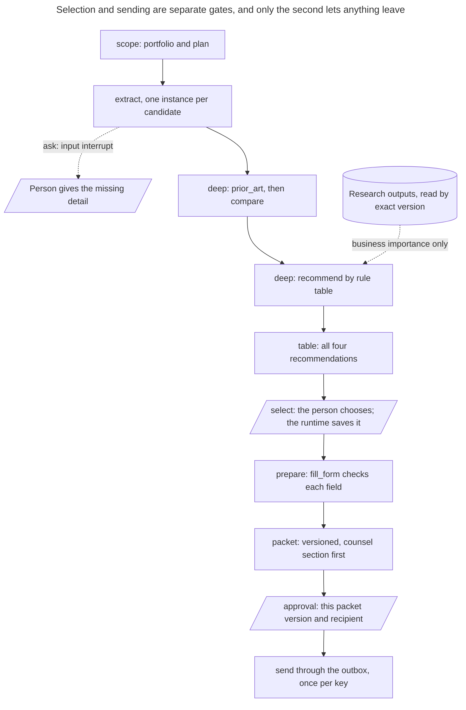

# Patent Agent: how it is defined and how it works

*Status on 28 Nov 2026. Read against `origin/main` at commit `738febd`.*

The assignment asks for a Patent Agent that picks which of four invention candidates should go to a patent attorney first, gives its reasons, and prepares the paperwork for that review. An agent that writes a confident memo fails that bar in a way nobody notices: it can call a feature "novel", fill an inventor field with a guess, or treat a market survey as prior art. This page shows how the agent is defined, how its work is split into steps the runtime checks, which decisions code makes instead of the model, and how it behaved offline and with a real model.

Two kinds of claim appear below. Harness guarantees (sections 2 to 5) are proven offline by code and tests, with rule-based fake models. Model-in-the-loop performance (section 6, the live run) is proven only by live runs, and the one live patent run so far ended blocked.

## 1. Role and legal boundaries

The agent helps a team decide which inventions to put in front of counsel first, and prepares the paperwork for them; it decides no legal question. It reads the venture's own uploaded files (invention notes, tables of who contributed what, a dated record of what was shown in public, the ranked business goals, blank forms and synthetic patent publications), and saves versioned outputs a person can review.

| The agent does | The agent never does | Enforced by |
|---|---|---|
| Recommends one of three next actions from a rule table | Gives a patentability or freedom-to-operate opinion, or a score | `rules.next_action` and the check `recommendation_follows_rules` |
| Says an element is `not_found` in this search | Calls a feature new or novel | `rules.STATES`; `tests/agents/test_patent_episodes.py::test_no_forbidden_output_anywhere` |
| Lists coverage directions as questions for counsel | Drafts claims | Instructions, and the same forbidden-output test |
| Records dates and elapsed days | Computes a deadline or a "file by" date | `tests/agents/test_patent_episodes.py::test_grace_period_fact_is_dates_and_days_only` |
| Marks inventorship and ownership `needs_counsel_confirmation` | Decides inventorship or ownership | The harness's `form_refusal` (code `confirm_only`), with counsel declared as the confirmer in `tools.FORMS` |
| Sends a review packet to a mock counsel mailbox after approval | Files anything | `send_packet` reaches only the `counsel_mail` system, through the outbox |

A finished packet does not approve a filing. Filing strategy, inventorship, jurisdictions and the final documents stay with qualified counsel and the client. Every packet must carry a scope note (`checks.packet_saved` refuses one without it), and in the offline run that note says the agent gave no patentability or freedom-to-operate opinion, drafted no claims, set no deadline and filed nothing.

## 2. The definition is data

The agent is one module of declarations, [`src/aksha/agents/patent/agent.py`](../../src/aksha/agents/patent/agent.py), plus pure rules in [`rules.py`](../../src/aksha/agents/patent/rules.py), pure completion checks in [`checks.py`](../../src/aksha/agents/patent/checks.py), its tools in [`tools.py`](../../src/aksha/agents/patent/tools.py) and the prompts in [`prompts/`](../../src/aksha/agents/patent/prompts/). It imports the runtime only through `aksha.runtime.api`, as every agent must ([02-shared-runtime.md](02-shared-runtime.md)).

It has three groups of tools:

1. The harness's shared tools: `list_inputs`, `search_inputs`, `read_document`, `web_search`, `fetch_url`, `todo`, and the form tools `read_form` and `fill_form`. The agent declares only how they read for it: its document kinds (`tools.READING`) and its blank forms (`tools.FORMS`). The uploaded publications are inputs of the kind `prior_art_publication`, searched with `search_inputs` over that kind and read with `read_document`, whose `publication_biblio` extraction gives the numbers, dates, priority claims and status wordings.
2. One tool of its own, its one external effect: `send_packet`. Plus `commit_round`, the supervisor's one write, from the portfolio extension.
3. `save_artifact`, `ask` and `finish`, which the loader adds to every agent (`src/aksha/runtime/tools/loader_added.py`).

It declares ten artifact kinds of its own: `portfolio`; per candidate `extraction`, `prior_art`, `comparison` and `recommendation`; `table` and `selection`; `form` per candidate and template; `packet` and `handoff` per candidate. The portfolio extension adds `directive` and `round`.

The one external effect is declared on the tool, not described in a prompt. This is the `send_packet` declaration, copied from `tools.py`:

```python
ToolSpec(
    "send_packet",
    AGENT,
    "external",
    "Send one counsel-review packet version to the recipient the person names. ...",
    _obj({"packet": STRING, "recipient": RECIPIENT}, ("packet", "recipient")),
    external=EffectSpec("counsel_mail", ("/packet", "/recipient"), "reconcile"),
    approval=ApprovalRule(facts=_facts, targets=_targets),
)
```

Because it is `external` with an `ApprovalRule`, the runtime's policy gate holds the call until a person approves that exact packet version and recipient, and the outbox sends it once per key. The tool body itself only returns `outbox_only`; it cannot send (`tests/agents/test_patent_units.py::test_send_needs_an_approval_and_goes_through_the_outbox`).

## 3. The workflow across three stages

The Task tree has three stages. Each step ends only when its completion check passes.

**Investigate and compare.**

1. `scope` lists the candidates and blank forms and saves the `portfolio`: the candidates and a plan (search prior art or not, which forms, send or not, how many top business priorities count as top).
2. `candidate` is a supervisor Task over the candidates, built from the portfolio kit (`supervisor_task(portfolio.SPEC, ...)` in `agent.py`, the spec in [`portfolio.py`](../../src/aksha/agents/patent/portfolio.py)). With eight candidates or fewer (`SUPERVISE_ABOVE = 8`) every candidate gets deep work and the supervisor takes no model turn, which is the case for the four here. Above eight, it admits at most `DEEP_CAP = 10` candidates and audits a seeded sample of the dropped ones.
3. `candidate[Cn]/extract` runs once per candidate and is the only Task that reads the raw records. When a note leaves a technical value undecided, it calls `ask`, which raises an `input` interrupt on that one instance. The other candidates keep going.
4. `candidate[Cn]/deep` runs three children in order: `prior_art` (search the uploaded publications and the web, fetch what matches, group families), `compare` (the element-by-family matrix) and `recommend` (the rule table).

**Recommend and select.**

5. `recommend` also reads the Research Agent's `research.needs` and `research.findings`, declared as cross-agent reads by kind. It must cite each by its exact version, and only under `business_importance`.
6. `table` gathers every recommendation, one row per candidate with one and no more; `select` always raises a `choice` interrupt whose options are the table's candidates with their recommendations, built by code (each label is read from the candidate's code-checked recommendation, not from the table's text), and the run waits. The person chooses any of them, or none. The runtime, not the model, saves the `selection` from the answer: `selected` is the list of chosen codes, which `prepare`, `packet` and `send` fan out over. The model only writes the question's summary; its own save of a selection is refused `answer_only`.

**Prepare forms and hand off.**

7. `prepare[Cn]`, keyed by the saved selection, fills each blank form through the harness's `fill_form`. It has no `save_artifact`, so a form can only be saved through the tool that checks it against the template.
8. `packet[Cn]` assembles the counsel-review packet. Its first section must be "Needs counsel confirmation", and it is not ready while any required field is `missing`.
9. `send[Cn]` calls `send_packet`, which raises a separate approval bound to the packet version and recipient. Only after the grant does the outbox deliver it.



Take from this that choosing a candidate authorizes nothing to leave the system: the send has its own approval, and a new packet version needs a new one.

Every step is an event. In the offline demo of 28 Nov 2026 (section 6, rerun after the person-selects fixes) the patent run `R-0002` raised `I-0002` on `candidate[C2]/extract` at event 629 ("C2: the note leaves Minimum distance from a vent undecided. What is it?"). It moved on to `candidate[C3]/extract` at event 632 while C2 waited. `select` asked the person `I-0003` at event 1180, with the table's four candidates as the options; the scripted person answered `C1` at event 1185, and the runtime saved the selection from that answer (origin `choice`) at event 1190. The two forms followed at events 1277 and 1280 and `patent.packet/C1@v1` at event 1298; `A-0001` was requested at event 1311 and the send enqueued only after the grant, at event 1323. The test `tests/agents/test_patent_episodes.py::test_the_selection_comes_before_any_form_and_one_send_happens` checks that order.

## 4. Evidence and decision rules

**Families keep their members' differences.** `rules.family_of` joins publications that share any priority number, from any office. Each member keeps its own identifiers and status wording. In the offline output [`patent.prior_art__C1.json`](../../examples/outputs/patent.prior_art__C1.json), family `SYN-PRI-2022-0118` holds `SYN-PUB-0005` ("Application closed - patent granted") and `SYN-PUB-0006`, which states both "Status: Granted" and "Lapsed - renewal fee not paid (2025-11-30).", and the family records "status wordings differ; each is kept as written". A publication whose source gives no URL gets a gap with a question, never an invented link (`tests/agents/test_patent_episodes.py::test_families_are_grouped_by_priority_with_exact_identifiers`, `tests/agents/test_patent_episodes.py::test_status_wordings_are_kept_verbatim_and_the_conflict_stays_visible`).

**The matrix separates overlap from absence.** Each cell is one mechanism element against one family, with a state of `disclosed`, `partial`, `not_found` or `not_checked`. `not_found` means only that no reference in this search showed the element. For C1, element F3 is `not_found` in both families while F1, F2 and F5 are each disclosed by one ([outputs/patent-summary.md](../../examples/outputs/patent-summary.md)).

**Code, not the model, picks the next action.** `rules.next_action` returns the first matching row:

| Rule | Next action | When |
|---|---|---|
| R1 | `prioritize_counsel_review` | An element is `not_found` in every family searched, the invention is built and tested (or in use), no referenced document is missing, and it serves a top business priority |
| R2 | `collect_more_evidence` | It is an idea only, or a referenced document is missing |
| R3 | `collect_more_evidence` | The venture's own public disclosure describes it in full |
| R4 | `collect_more_evidence` | It serves a top business priority |
| R5 | `deprioritize_for_now` | Everything else |

The check `recommendation_follows_rules` recomputes the table from the current extraction and matrix and refuses any other value. In the live run (c), the model's first recommendation for C1 put prose in `next_action`. Event 496 recorded the refusal:

> the rule table gives next_action 'collect_more_evidence' (R2), but the saved recommendation says 'Take C1 to qualified patent counsel first. ...' <!-- prose-ok -->

R2 matched because the model's own extraction listed three documents it could not find (the bench log, the signed agreements and the demo slides).

**Research is refused as novelty evidence, in code.** A recommendation must cite each research output it read by exact version under `business_importance.research`. It must also carry the note "Research outputs support business importance only; they are not evidence of technical novelty or prior art." Code writes that note at every save (the recommendation kind's `compute`, ADR-P04 K1d), and the check asserts it is there. The same check, through `rules.research_misuse`, refuses any mention of a research version anywhere else in the recommendation. The live run's second attempt left out the note and was refused at event 509; version 3, saved at event 514, passed at event 524. A later live run spent a refused finish on the same sentence in three candidates, and one of them then reached its turn limit (ADR-P16 S5), so the note is now the code's. In the offline demo every recommendation bound both citations, for example events 855 and 856 bind `research.needs@v1` and `research.findings@v1` to `patent.recommendation/C1@v1` (`tests/agents/test_patent_units.py::test_research_cited_as_novelty_or_prior_art_evidence_is_refused`, `tests/agents/test_patent_units.py::test_business_importance_cites_the_exact_research_versions_read`).

**Forms report every field, and code decides which fields are done.** The harness's `fill_form` checks the fields against the blank form (`form_refusal` in `src/aksha/runtime/forms/tools.py`); the patent agent declares only which fields only counsel completes, as data (`tools.FORMS`). Every template field must be present, each is `complete`, `missing` or `needs_counsel_confirmation`, a `complete` field needs a value, and a counsel field cannot be marked `complete`. Whether a field is required comes from the template, and the counts are computed at every save. C1's filing-information worksheet came out 2 complete, 3 missing and 6 needing counsel confirmation (`tests/agents/test_patent_units.py::test_fill_form_refuses_marking_a_counsel_field_complete`, `tests/agents/test_patent_units.py::test_a_missing_required_field_keeps_the_packet_from_ready`).

## 5. Change sensitivity

The agent declares `invalidation="rebuild"` keyed on citations, so a changed passage reopens only the outputs that cite it (an output that cites nothing is keyed on what it read instead), then the packet and approval built on them. In the demo, a new publication family and a consultant email re-dated earlier moved C1 from `prioritize_counsel_review` to `collect_more_evidence`. The rebuild kept C2 to C4's extractions, prior art and matrices, and requested a fresh approval, `A-0002`, for the new packet instead of reusing `A-0001`. [05-change-and-recovery.md](05-change-and-recovery.md) walks through it.

## 6. Inspect it working

### Offline, with fake models

[examples/patent-conversation.md](../../examples/patent-conversation.md) is a real command-line run: `aksha run --agent patent '<the assignment's example prompt>'` waits on `I-0002` for C2's vent distance, then on `I-0003` with "C1: prioritize_counsel_review; C2: collect_more_evidence; C3: deprioritize_for_now; C4: collect_more_evidence", then on `A-0001` for `patent.packet/C1@v1` to `counsel-primary`. Approving it ends `R-0002 patent ended complete`; approving again is refused with `already_decided`. Every output is in [examples/outputs/](../../examples/outputs/), summarized in [patent-summary.md](../../examples/outputs/patent-summary.md).

`aksha demo` with a private `AKSHA_HOME` on 28 Nov 2026 exited 0 and printed, among others:

```text
patent   R-0002 complete: 23 outputs, 55 model calls
scripted: patent asked the inventor one gap question: answered
scripted: patent asked which candidate to prepare: chose C1
scripted: approved A-0001 for patent.packet/C1@v1; the mailbox received it once
C1 next action: prioritize_counsel_review -> collect_more_evidence (the v2 answer key expects collect_more_evidence)
```

The patent eval set, `src/aksha/data/suites/patent/`, holds eight eval cases, among them `s2-patent-happy` (families, matrix and all four next actions against the answer key), `p-consultant` (the outside contributor goes to counsel), `p-grace-period`, `p-status-conflict` and `p-missing-documents`. `aksha eval run patent` passed all 8 in both `stillroom` and `stillroom-v2` and exited 0 when re-run on this branch on 28 Nov 2026. On the three patent worlds written without sight of the code (`pulvane`, `quillmere`, `brackwen`) the agent passed 17 of 24 eval cases on 27 Nov 2026 (not re-run for this page). Most failures are matrix cells: the offline comparison counts words, so a paraphrase reads `partial` where the world's author read `disclosed`, and the next actions inherit it ([limitations, item 19](../limitations.md)). These worlds were read while the reader was made general, so they no longer count as held out. All of these are fake-model results: they prove the plumbing, not a real model's judgement.

### A real model, interactive, on the assignment's own prompt

Run (c), 28 Nov 2026, 08:03 to 08:48 IST (India Standard Time): the prompt "Which of these inventions should we take to a patent attorney, and why? Prepare the selected disclosure documents.", 21 patent input files, `openai/gpt-6.2-sol` through LiteLLM (a library that calls many model providers through one interface) at low reasoning effort. The store is `aksha-live/live-chat-patent/aksha.sqlite`, run `R-0001`. Its `run.started` event records the definition hash `sha256:088b20f4e3c0...`, the same hash the offline demo's approval request carries, so the live model ran the same agent definition.

1. `scope` saved the portfolio (event 144) and `candidate[C1]/extract` saved C1's extraction (event 244).
2. `candidate[C1]/deep` searched the publications, made one web search and two page fetches (`fetch_url`, one of which returned `not_found`), and saved the prior art and an 8-cell matrix (events 451 and 469). Of 8 `fetch_publication` calls (the agent's own publication reader then; since removed, below), 5 returned `not_found`. The search had returned one hit, listed under an ID that still held a fragment of the source file's text (`"publication_number": "SYN-PUB-0002"`, event 404). The model's first four calls passed bare publication numbers and all failed; it then used the fragment form for four IDs, and three of those fetched.
3. `candidate[C1]/deep/recommend` was refused twice by code, as section 4 shows. Version 3, saved at event 514 with `collect_more_evidence`, passed its check at event 524.
4. `candidate[C2]/extract`, `candidate[C3]/extract` and `candidate[C4]/extract` each worked on C1 instead of their own candidate. C2's save of `patent.extraction/C1` was refused with `foreign_writer`, because C1's instance owns that output; it then saved its extraction under the key `C1-disclosure-draft` (event 290) and also wrote the whole answer as chat text. C3's and C4's saves of `patent.extraction/C1` were refused with `foreign_writer` too, and one C3 save without a key was refused with `key_required`. Each was refused three times when it tried to finish with its check failing (the finish-veto limit) and failed (events 309, 355 and 393).
5. The run ended `blocked` at event 526 on those three instances, before the selection question was ever asked. No form, packet or send happened.

The cause is the same harness bug the research run (b) hit ([03-research-agent.md](03-research-agent.md#a-real-model-interactive-on-the-assignments-own-prompt), and all three runs on [06-evals-and-live-runs.md](06-evals-and-live-runs.md#the-per-key-bug-and-what-is-being-fixed)): a Task instance that runs once per candidate (a per-key instance) is never told which candidate it is. The run also showed the cost of reading inputs with a live model: each `fetch_publication` call took 122 to 226 seconds (172 s on average), about 21 document-kind decisions per publication, and each `list_inputs` call took about 126 seconds. Both the per-key bug and the ingestion cost are being fixed. Since 28 Nov 2026 the agent has no publication reader of its own: a publication is read with the shared `read_document`, which reads that one input (with `extract=true` it decides that one input's kind), and the publication search is the shared `search_inputs` over the publications' kind. Not yet measured live.

Two gaps the run exposed are not yet on that list. First, the live reader's publication IDs, shown in step 2. Second, the accepted version 3 has the right `next_action`, but its free-text summary still opens "Take C1 to counsel first." The check binds the action field, not the prose beside it.

### After the fixes

Run (d), 28 Nov 2026, the same prompt on `openai/gpt-6.2-sol` at main `b2dacd9`, store `aksha-live/live-chat-patent-after2-selfselected/aksha.sqlite`, run `R-0001`: it ended `complete` in 12.6 minutes with no question asked. All four candidates got extraction, prior art, comparison and a recommendation (all four `collect_more_evidence`). Then, in `select` (events 906 to 922), the model saved `patent.selection` itself as `{"selected": [{"candidate": "C1", ...}, {"candidate": "C4", ...}]}`, the check (it only asked that a selection exist) passed, and the fan-out over `selected` read no key from a list of objects, so `prepare`, `packet` and `send` ran zero instances. The fix: the person chooses (the `select` Task always asks, with options built from the table), the runtime saves the selection from the answer as a list of codes, the check `chosen_by_person` compares the two, and a key-source list holding an item no key can be read from is refused `key_invalid` instead of fanning out to nothing. `tests/agents/test_patent_selection.py` replays the live reply and checks it is refused while the run waits for the person.

Run (e), 28 Nov 2026, on this branch (runtime commit `4ab5b15`), store `aksha-live/live-chat-patent/aksha.sqlite`, run `R-0001`: the person was asked (`I-0001`, event 758), but the model's table rows held only `candidate`, `quotes` and `question`, and the labels were read from those rows, so every option label was `:` and the saved selection's `recommendations` was `{"C1": null}`. The fix: the labels and `recommendations` are read from each candidate's code-checked recommendation, the select Task reads every recommendation, and `table_saved` refuses a row for a candidate with no recommendation. The same review fixed four runtime gaps: an answer given after the table changed is not saved and the person is asked again; a refused save of an answer ends the instance blocked with its code instead of retrying; a rejected copied selection's fresh answer is saved by the writer entered again; and an empty answer is refused rather than recorded as choosing none.

Recordings made before this change (earlier live stores and example outputs) hold the old selection shape and a model-written selection; they are stale.

To be added: run (c) repeated on the fixed code, with its run ID, outcome, the selection and approval IDs, and the packet versions it saved. The repeated runs are reported first under [After the fixes](06-evals-and-live-runs.md#after-the-fixes) on the live-runs page.

## Sources

Read on branch `docs/assignment` at commit `738febd`, 28 Nov 2026.

- Definition: `src/aksha/agents/patent/agent.py` (`tasks()`, `candidates()`, `build_agent`), `src/aksha/agents/patent/portfolio.py` (`SPEC`, `SUPERVISE_ABOVE`, `DEEP_CAP`), `src/aksha/agents/patent/rules.py` (`next_action`, `family_of`, `required_missing`, `research_misuse`, `RESEARCH_NOTE`), `src/aksha/agents/patent/checks.py` (`recommendation_follows_rules`, `research_cited`, `packet_saved`, `forms_filled`), `src/aksha/agents/patent/tools.py` (`READING`, `FORMS`, `send_packet`), `src/aksha/runtime/forms/tools.py` (`fill_form`, `form_refusal`), `src/aksha/agents/patent/prompts/instructions.md`, `src/aksha/extensions/portfolio/`.
- Tests, 70 passing on 28 Nov 2026 with `pytest tests/agents/test_patent_units.py tests/agents/test_patent_episodes.py tests/architecture/test_extension_boundary.py::test_third_agent_runtime_hash_unchanged`: the node IDs named above, plus `tests/agents/test_patent_episodes.py::test_only_extract_c2_waits_for_its_gap_question`, `tests/agents/test_patent_episodes.py::test_no_send_without_an_approval_bound_to_the_packet_signature`, `tests/agents/test_patent_episodes.py::test_restart_mid_approval_and_mid_send_sends_once`, `tests/agents/test_patent_units.py::test_the_rule_table`, `tests/agents/test_patent_units.py::test_the_recommendation_check_vetoes_an_action_the_rules_do_not_give`.
- Eval cases: `src/aksha/data/suites/patent/*.toml`; `aksha eval run patent` with a private `AKSHA_HOME`, 28 Nov 2026, exit 0; held-out results in [docs/evals/README.md](../evals/README.md), "Results on 27 Nov 2026", and [the limitations, item 19](../limitations.md).
- Offline runs: [examples/patent-conversation.md](../../examples/patent-conversation.md), [examples/outputs/patent-summary.md](../../examples/outputs/patent-summary.md), `examples/outputs/patent.prior_art__C1.json`; `aksha demo` with a private `AKSHA_HOME`, 28 Nov 2026, exit 0 (events 629, 632, 1180, 1185, 1190, 1277, 1280, 1298, 1311, 1323 of its store, 1935 events in all, rerun after the person-selects fixes).
- Live run (read-only store): run (c) `aksha-live/live-chat-patent/aksha.sqlite`, events 26, 144, 244, 290, 309, 355, 393, 451, 469, 496, 509, 514, 526; tool timings and refusal codes from its `step.completed` events (for example 281, 348, 404, 411 and 446).
- Fuller agent reference: [docs/agents/patent.md](../agents/patent.md), [docs/agents/tools-and-schemas.md](../agents/tools-and-schemas.md); requirements R-30 to R-45 in [docs/requirements.md](../requirements.md).
