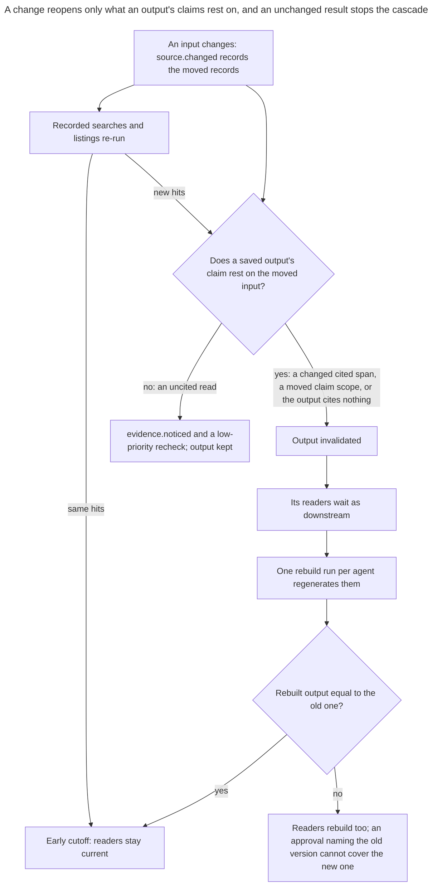

# Change, selective rebuild and crash recovery

*Status on 28 Nov 2026: built and tested on `main`, with scripted fake models. Every number and identifier below comes from one run of `aksha demo` on 28 Nov 2026 unless the line says otherwise. No live model run has exercised this scenario yet.*

The assignment asks for one hard sequence after the first pass: closer prior art arrives, an outside contributor turns out to have suggested part of the key mechanism, and the application restarts. A system that gets this wrong either redoes everything (slow, and it throws away research a person already checked) or redoes too little (a stale recommendation goes to counsel). Worse, a crash in the middle of sending a packet can send it twice, or not at all.

This page shows what Aksha rebuilds, what it keeps, why, and how it recovers from a process kill in the middle of the send. Everything here is a harness guarantee: it is enforced by runtime code and proven offline by tests and the demo. It says nothing about how well a live model writes the recommendation; that is model-in-the-loop performance, covered at the end.

## Two points the demo only partly meets

Both are recorded as "partly met" in [`docs/requirements.md`](../requirements.md).

1. R-83, the outside contributor: The contributor (P-05, Dr. Wei Lin, a synthetic outside consultant) is already in the base inputs. The change re-dates his email so that his suggestion now predates his consulting agreement. It does not introduce a person the first run never saw.
2. R-84, the restart: In the demo the process is killed during the send, after the rebuild. A restart between the change and the rebuild is covered by tests (listed in the evidence table at the end), not shown in the demo.

## 1. The change set is three changes from the answer key, plus one of the demo's own

The demo copies the base fixture world `stillroom` and applies the changes that the variant world `stillroom-v2` records against it in its answer key (`changes_from_base` in [`stillroom-v2/key.json`](../../src/aksha/data/worlds/stillroom-v2/key.json)). Nothing else moves. The code is [`src/aksha/interfaces/demo/world.py`](../../src/aksha/interfaces/demo/world.py).

| # | File | Change | Why it matters |
|---|---|---|---|
| 1 | `publications/SYN-PUB-0011.json` | Added: a new publication family with priority number `SYN-PRI-2023-0215` (the `SYN-` prefix marks a synthetic fixture identifier, `PRI` a priority filing), "Door-state gated background learning for thermal occupancy sensors" | It discloses two of C1's steps (F2, F3): closer prior art |
| 2 | `disclosures/consultant-email.eml.txt` | `Date: Mon, 05 Jan 2026 16:42:10 +0100` becomes `Date: Fri, 21 Nov 2025 16:42:10 +0100` | The consultant's agreement `CA-2025-11` took effect on 2025-12-01, so the suggestion now falls outside it |
| 3 | `disclosures/history.csv` | Row `DISC-05,2026-01-05,` becomes `DISC-05,2025-11-21,` | The same date, in the disclosure history |
| 4 | `reviews/reviews.json` | `"Best accuracy we tested."` becomes `"Best accuracy we have tested."` | The demo's own edit: one customer review that no output cites, to show what is not rebuilt |

Each edit must match exactly once or the demo refuses to run. `tests/integration/test_demo.py::test_the_change_set_is_the_variant_keys_change_and_one_uncited_review` checks that the edited lines are the variant's lines byte for byte and that nothing else changed.

## 2. What the run rebuilt and what it kept

Run it in a private home (19.74 s in the generated example; 117.64 s on 28 Nov 2026 on a loaded machine):

```console
$ AKSHA_HOME=$(mktemp -d) aksha demo
```

Act 1 runs both agents to `complete`: research run `R-0001` saves 11 outputs and patent run `R-0002` saves 23, and approval `A-0001` sends `patent.packet/C1@v1` once. Selected lines of acts 2 and 3, quoted from the run:

```console
2. The input changes to stillroom-v2's change set (3.91 s)
   one command recorded 4 moved records and re-ran 21 recorded searches and listings: 2 found new hits

3. Invalidation reopens only what depends on the change (52.09 s)
   weak, noticed and not rebuilt: patent.portfolio read reviews.json outside what it rests on; 1 low-priority recheck item(s)
   keyed on every read instead, the same change would reopen 27 outputs, not 17
   spans rechecked against the new text: 57 kept, 4 changed, 0 gone
   rebuilt 17: C1: comparison, extraction, handoff, packet, prior_art, recommendation; C1~filing-information-worksheet: form; C1~invention-disclosure-form: form; C2: recommendation; C3: recommendation; C4: recommendation; findings, matrix, needs, tests, selection, table
   kept 10 patent outputs: C2: comparison, extraction, prior_art; C3: comparison, extraction, prior_art; C4: comparison, extraction, prior_art; portfolio
   kept 7 of 11 research outputs: c01-kelvra-systems: profile; c02-noctra: profile; c03-brightfield-analytics: profile; c04-veyra-labs: profile; c05-tallyway: profile; competitors, scope
   C1 next action: prioritize_counsel_review -> collect_more_evidence (the v2 answer key expects collect_more_evidence)
   rebuild runs: R-0003 research (5 model calls), R-0004 patent (21 model calls), R-0005 patent (3 model calls)
```

In plain terms:

- **Rebuilt (17):** C1's whole chain (extraction, prior art, comparison, recommendation, both forms, packet, handoff), the recommendations of C2, C3 and C4, the patent shortlist table and selection, and four research outputs (needs, matrix, findings, tests).
- **Kept (17):** C2, C3 and C4's extraction, prior art and comparison, the patent portfolio, and 7 of 11 research outputs, including all five competitor profiles.
- **The result changed for a stated reason.** C1's rebuilt recommendation (`patent.recommendation/C1@v2`, rule `R4`) now says "family SYN-PRI-2023-0215 discloses F2, F3" and lists the risk "outside contributor P-05 suggested F2, F3 on 2025-11-21, before the note and before the agreement's effective date". The contributor is saved `needs_counsel_confirmation` with a question for counsel.
- **C2 to C4 reopened, and their next actions came out unchanged.** Each recommendation reads the research needs and findings, which moved; the demo fails if any of their next actions changes.

## 3. Why only those: citation-keyed invalidation

Every saved output records what it read and what it cites. Both agents declare `invalidation_keys="citations"` ([`agents/research/agent.py`](../../src/aksha/agents/research/agent.py), [`agents/patent/agent.py`](../../src/aksha/agents/patent/agent.py)), and every `run.started` event in this run records it, so a moved input reopens an output only if the output's claims rest on it. The rules live in [`src/aksha/runtime/invalidation/keying.py`](../../src/aksha/runtime/invalidation/keying.py):

1. One writer, `record_source_changes` in [`invalidation/sources.py`](../../src/aksha/runtime/invalidation/sources.py), records what moved: one `source.changed` event naming the 4 moved records, then one `query.reexecuted` per recorded search or listing, then `excerpts.rechecked` for every cited span over a moved record.
2. A read is strong when the claims rest on it. That means a cited span whose text changed or is gone, the scope of an absence or coverage claim (for example "F3 not found in any family searched", or a count over every review), or an extraction definition. An output that cites nothing gives the runtime nothing to narrow on, so all its reads stay strong. A strong read invalidates the output.
3. Every other moved read is weak: the output is kept and an `evidence.noticed` fact opens a low-priority recheck item.
4. Outputs that read an invalidated output are marked as waiting (downstream), and one rebuild run per agent regenerates them.
5. **Early cutoff.** A re-run search that returns the same hits, or a rebuilt output whose canonical hash equals the old one, counts as unchanged, so its readers stay current and the cascade stops there ([`invalidation/view.py`](../../src/aksha/runtime/invalidation/view.py)).

The same run shows each rule on a real event:

| Rule | What happened in the run | Event |
|---|---|---|
| Cited span changed | 61 spans rechecked, 4 changed (for example `EX-0216` changed, `EX-0217` kept) | `excerpts.rechecked`, seq 1346 |
| Coverage scope | `research.needs` counts every review, so the reworded review reopened it (`scoped record`) | rebuilt as `research.needs@v2`, seq 1377 |
| Cites nothing | C1's extraction and prior art cite nothing, so they are read-keyed and reopened | `patent.extraction/C1@v2`, seq 1571 |
| Weak read | The portfolio read `reviews.json` without citing it: noticed, not rebuilt | `evidence.noticed`, seq 1347 |
| Early cutoff on searches | 19 searches and listings re-ran; only `patent.search_publications` for "background" and "sensor" found new hits | `query.reexecuted`, seq 1327 to 1345; seq 1337 has `"changed":true` |

The run above predates the shared publication search. Since 28 Nov 2026 the patent agent searches the uploaded publications with the shared `search_inputs` over the `prior_art_publication` kind, one recorded query per group of terms, so the same demo on branch `refactor/patent-shared-tools` re-ran 21 searches and listings (`query.reexecuted`, seq 1341 to 1361), and the 2 that found new hits are C1's two searches, for "background" (seq 1351) and "sensor" (seq 1356). It rebuilt and kept the same 17 outputs each, measured with `AKSHA_HOME=<private temp dir> aksha demo`, exit 0.

In this run no rebuilt output came out equal to its old version (the demo prints "0 rebuilt version came out equal"), so the cutoff on rebuilt outputs is proven by tests, not by the demo. Keyed on every read instead of on citations, the same change would have reopened 27 outputs, not 17.



Read it from the top: every change is decided by what each output cites, and both exits on the left (noticed, or cut off) are where work is kept.

## 4. The approval for v1 does not cover v2

An approval is a signature (`"v1:" + sha256`) over one exact action body: the tool, its arguments, the target versions with their content hashes, the outbox idempotency key and the agent definition hash ([`src/aksha/runtime/interrupts/approvals.py`](../../src/aksha/runtime/interrupts/approvals.py)). Before an approved action runs, and again before every delivery, the runtime rebuilds the body from current facts and compares signatures. A different packet version gives a different signature, so a fresh approval is the only way through.

From the run's event store:

1. `approval.granted` seq 1304: `A-0001`, signature `v1:56d55c7c…`, targets `patent.packet/C1@v1`. It was used at `outbox.enqueued` seq 1310.
2. After the change, the rebuilt packet opened a diff review; `review.accepted` seq 1875 records `I-0004`, old `patent.packet/C1@v1`, revision `patent.packet/C1@v2`.
3. `approval.requested` seq 1885: a fresh `A-0002` for `patent.packet/C1@v2`; `approval.granted` seq 1891, signature `v1:30e6af26…`. Both grants are `by: demo-script`: the person is scripted.

A-0001 was already used, so invalidation did not revoke it (the store holds no `approval.revoked`); it simply names v1. An approval that is granted but not yet used is revoked in the same transaction as the change that invalidates its target ([`invalidation/confirm.py`](../../src/aksha/runtime/invalidation/confirm.py)), so a send cannot slip through before the rebuild.

## 5. A kill in the middle of the send, and recovery by key

SIGKILL is the Unix signal that ends a process at once, with no cleanup code run. The demo sends `patent.packet/C1@v2` from a child process whose mailbox wrapper delivers and then kills its own process, after the mailbox wrote its row to disk and before the runtime recorded the receipt ([`src/aksha/interfaces/demo/child.py`](../../src/aksha/interfaces/demo/child.py)). The send tool declares `EffectSpec("counsel_mail", ("/packet", "/recipient"), "reconcile")` in [`src/aksha/agents/patent/tools.py`](../../src/aksha/agents/patent/tools.py), so its idempotency key is fixed by the packet and recipient, and recovery may ask the mailbox whether that key landed.

```console
4. SIGKILL mid-send, then recovery (23.49 s)
   a child process sent patent.packet/C1@v2; the mailbox stored it, then SIGKILL (exit -9) before the receipt was recorded
   at restart: 1 outbox entry open with no receipt; recovery asked the mailbox by key 1 time, sent 0 times; R-0005 ended complete
   mailbox: 2 deliveries for 2 idempotency keys (patent.packet/C1@v1, patent.packet/C1@v2): each packet version exactly once
```

The store records which process wrote each event (the `boot` column): boot 1 is the demo, boot 2 the child that was killed, boot 3 the demo again after restart.

| Seq | Boot | Event |
|---|---|---|
| 1897 | 2 | `outbox.enqueued`, approval `A-0002`, key `sha256:6f12731f…` |
| 1898 | 2 | `outbox.claimed`, attempt 1; then the kill |
| 1899 | 3 | `outbox.completed`, `"reconciled":true`, receipt `m-2` from the mailbox's lookup |
| 1911 | 3 | `run.ended` for `R-0005`, `complete` |

The mailbox file ends with two rows, `m-1` for `patent.packet/C1@v1` and `m-2` for `patent.packet/C1@v2`. Recovery (`recover_on_startup` in [`src/aksha/runtime/execution/recovery.py`](../../src/aksha/runtime/execution/recovery.py)) reconciles entries that landed before it re-checks sources or sends anything, so an entry that landed is closed from its receipt and never reaches the code that sends. The hash chain over all 1,912 events verified at the end of the run.

The restart that the demo does not show (R-84) is in the tests: a crash during invalidation itself, a source check at startup that records what moved while the process was down, and a SIGKILL at every commit point of a resumed rebuild.

## 6. Model-in-the-loop performance

Status on 28 Nov 2026: no live model run has applied a change set or been killed mid-send. On 28 Nov 2026 both agents completed the assignment's example prompts on GPT-6.2 Sol, after the fixes in #114 to #122 ([06-evals-and-live-runs.md](06-evals-and-live-runs.md#after-the-fixes)). Neither run was asked to change its inputs or to send: the research task has no send step, and the patent request asked only to prepare the packet, so it saved the packet and held it unsent. A follow-up in the patent store asking for the send ended blocked before any send (see [examples/live/patent-2026-11-28/](../../examples/live/patent-2026-11-28/README.md)). Neither exported store holds a `source.changed` or an `outbox.enqueued` event. The guarantees above do not depend on the model: they hold for whatever the model writes, because invalidation, approval signatures and the outbox are runtime code, and `aksha demo` shows them offline.

## Evidence for each claim

| Claim | Requirement | Tests and eval cases |
|---|---|---|
| The change set is the answer key's change plus one uncited review | R-83 (partly met) | `tests/integration/test_demo.py::test_the_change_set_is_the_variant_keys_change_and_one_uncited_review` |
| Only C1's chain and the research readers reopen; the rest is kept | R-85, R-88 | `tests/integration/test_demo.py::test_the_change_reopens_only_c1s_chain_and_keeps_the_rest`; `tests/agents/test_patent_episodes.py::test_the_change_set_invalidates_exactly_the_c1_chain`; eval case `s7-replaced-fixtures` |
| An uncited edit is noticed, not rebuilt; read keying would reopen it | R-85 | `tests/integration/test_citation_keying.py::test_a_changed_uncited_paragraph_does_not_reopen`; `tests/integration/test_citation_keying.py::test_read_keying_reopens_the_same_uncited_edit` |
| A changed cited span reopens | R-85 | `tests/integration/test_citation_keying.py::test_a_changed_cited_span_reopens` |
| A new source inside an absence claim's scope reopens; outside any scope it is noticed | R-85 | `tests/integration/test_citation_keying.py::test_a_new_source_matching_an_absence_scope_reopens`; `tests/integration/test_citation_keying.py::test_a_new_source_matching_only_an_unscoped_search_is_noticed` |
| An equal rebuild stops the cascade | R-85 | `tests/unit/runtime/invalidation/test_view.py::test_early_cutoff_stops_the_cascade`; `tests/unit/runtime/invalidation/test_reviews.py::test_an_equal_rebuild_revokes_nothing` |
| An output the change does not reach is not touched | R-88 | `tests/integration/test_invalidation.py::test_unrelated_writer_is_not_touched` |
| The contributor is flagged for counsel | R-86 | `tests/agents/test_patent_episodes.py::test_consultant_suggestion_is_raised_for_counsel`; eval case `p-consultant` |
| C1's next action changes, explained by the new family | R-89 | `tests/integration/test_demo.py::test_the_change_reopens_only_c1s_chain_and_keeps_the_rest`; `tests/integration/test_demo.py::test_c1s_recommendation_reads_and_cites_research_by_version` |
| No send without an approval bound to the packet's signature; v2 needs a fresh one | R-87 | `tests/agents/test_patent_episodes.py::test_no_send_without_an_approval_bound_to_the_packet_signature`; `tests/integration/test_demo.py::test_a_fresh_approval_is_asked_for_the_new_packet_and_scripted`; `tests/agents/test_patent_episodes.py::test_the_fresh_approval_for_the_new_packet_sends_it_once` |
| A pending request on an invalidated target is revoked | R-87 | `tests/unit/runtime/interrupts/test_commands.py::test_request_on_an_invalidated_target_is_revoked_with_its_interrupt`; `tests/integration/test_interrupts.py::test_fact_change_after_handoff_abandons_the_entry` |
| SIGKILL mid-send recovers to one delivery per packet version | R-84, R-88 | `tests/integration/test_demo.py::test_the_sigkill_mid_send_recovers_to_exactly_one_send_per_packet`; `tests/integration/test_outbox.py::test_crash_after_send_before_outcome_records_the_receipt_from_lookup`; `tests/integration/test_outbox.py::test_crash_after_send_intent_sends_once_after_restart`; `tests/agents/test_patent_episodes.py::test_restart_mid_approval_and_mid_send_sends_once` |
| A restart between the change and the rebuild recovers | R-84 (partly met) | `tests/integration/test_invalidation.py::test_crash_during_invalidation`; `tests/integration/test_invalidation.py::test_recovery_source_check_records_what_moved`; `tests/integration/test_resume.py::test_sigkill_at_every_commit_of_a_resumed_rebuild_recovers`; `tests/integration/test_sigkill_recovery.py::test_every_commit_point_recovers_to_one_result_per_step` |
| A scope change rebuilds correctly under each re-entry setting | R-85 | eval case `change-scope-resume-vs-fresh`; `tests/integration/test_eval_change.py::test_every_arm_rebuilds_the_amended_scope_correctly` |

The tests in this table ran on this branch on 28 Nov 2026: 28 passed and 2 skipped (the two PostgreSQL variants of the outbox tests were skipped: the driver was not installed).

The three eval cases also passed on 28 Nov 2026 in fake model mode, where a pass checks the harness plumbing, not a model's reliability:

| Command | Result |
|---|---|
| `aksha eval run patent --case s7-replaced-fixtures` | exit 0; passed on `stillroom` and on `stillroom-v2` |
| `aksha eval run patent --case p-consultant` | exit 0; passed on `stillroom` and on `stillroom-v2` |
| `aksha eval run change` | exit 0; all three arms (`fresh`, `resume`, `resume_scope_exempt`) passed 11 of 11 required checks |

## Sources

- Run on 28 Nov 2026 from branch `docs/assignment` at commit `738febd`: `AKSHA_HOME=<private temp dir> aksha demo`, exit 0, "Done in 117.64 s". Event sequence numbers and IDs were read from that run's `demo/aksha.sqlite` (tables `events`, `artifacts`, `boots`) and `demo/mailbox.json`. The run, approval and interrupt IDs match the generated example below. Its event count, 1,912, matched that example at that commit; the example was regenerated later, and the same demo on `main` now writes 1,943 events, so later sequence numbers are higher there. The chain head hash differs between runs.
- Tests: `PYTHONPATH=src python -m pytest` on the 27 node IDs in the table above (some are parametrized): 28 passed, 2 skipped, in 420 s.
- Generated walkthrough of the same demo: [`examples/change-and-recovery.md`](../../examples/change-and-recovery.md).
- Demo code: [`src/aksha/interfaces/demo/story.py`](../../src/aksha/interfaces/demo/story.py), [`world.py`](../../src/aksha/interfaces/demo/world.py), [`child.py`](../../src/aksha/interfaces/demo/child.py), [`summary.py`](../../src/aksha/interfaces/demo/summary.py).
- Fixtures: [`src/aksha/data/worlds/stillroom/`](../../src/aksha/data/worlds/stillroom/), [`src/aksha/data/worlds/stillroom-v2/key.json`](../../src/aksha/data/worlds/stillroom-v2/key.json).
- Eval cases: [`src/aksha/data/suites/patent/s7-replaced-fixtures.toml`](../../src/aksha/data/suites/patent/s7-replaced-fixtures.toml), [`p-consultant.toml`](../../src/aksha/data/suites/patent/p-consultant.toml), [`src/aksha/data/suites/change/change-scope-resume-vs-fresh.toml`](../../src/aksha/data/suites/change/change-scope-resume-vs-fresh.toml).
- Runtime: [`invalidation/keying.py`](../../src/aksha/runtime/invalidation/keying.py), [`invalidation/sources.py`](../../src/aksha/runtime/invalidation/sources.py), [`invalidation/view.py`](../../src/aksha/runtime/invalidation/view.py), [`invalidation/confirm.py`](../../src/aksha/runtime/invalidation/confirm.py), [`interrupts/approvals.py`](../../src/aksha/runtime/interrupts/approvals.py), [`execution/recovery.py`](../../src/aksha/runtime/execution/recovery.py).
- Architecture, in more depth: [`docs/architecture/4-change-and-recovery.md`](../architecture/4-change-and-recovery.md); decisions: [ADR-P05 invalidation](../design/adr/ADR-P05-invalidation.md), [ADR-P03 outbox and idempotency keys](../design/adr/ADR-P03-transactional-outbox-and-idempotency-keys.md), [ADR-P17 interrupts and approvals](../design/adr/ADR-P17-interrupts-and-approvals.md), [ADR-P02 durable execution](../design/adr/ADR-P02-durable-execution.md) (ADR: architecture decision record).
- Requirements R-83 to R-89: [`docs/requirements.md`](../requirements.md).
