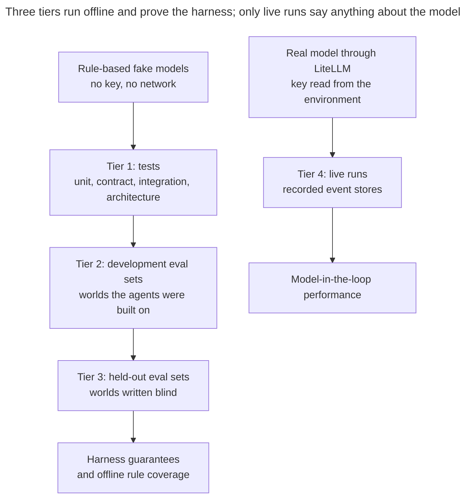
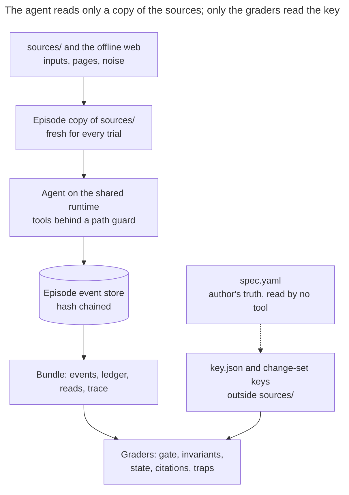
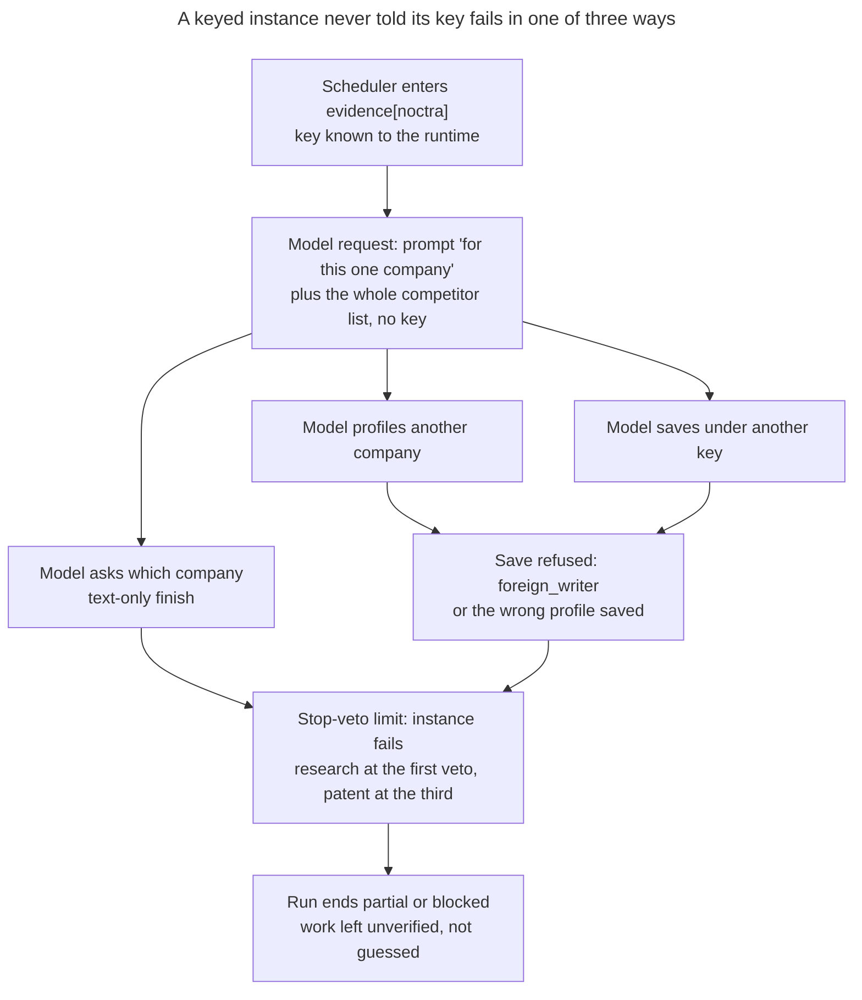

# Evals, held-out worlds and live runs

*Status on 28 Nov 2026. Read against `origin/main` at commit `738febd`; the three live runs below are from 28 Nov 2026.*

The problem: a harness can pass every test and still be a scripted demo, and an agent can do well on the world it was built on and fail on the next one. A reviewer needs to know which claims rest on code and tests, which rest on synthetic worlds the agents were tuned on, which rest on worlds nobody tuned for, and which rest on a real model. This page separates the four, gives the real numbers for each, and says what each one does not prove.

Two kinds of claim, kept apart throughout:

1. Harness guarantees are proven offline, by code and tests with rule-based fake models: permissions, citations, invalidation, approvals, one send per key, crash recovery. They hold whatever the model writes.
2. Model-in-the-loop performance is proven only by live runs on a real model. Three live runs are reported below, and none of them finished all its work; the main cause was a harness bug, described below, that is being fixed.

## Four tiers of evidence

Each tier runs a different thing and proves a different thing. The first three need no key and no network.

| Tier | What runs | What it proves | What it does not prove |
|---|---|---|---|
| 1. Tests | Unit, contract, integration and architecture tests (3,742 collected on this branch with the `make venv` extras, measured 28 Nov 2026; [status.md](../status.md) gives 3,720 from an earlier count), offline | The runtime's guarantees hold in code, including under injected crashes, retries and malicious inputs | Anything about how well a model does the task |
| 2. Development eval sets | Both agents, end to end, on the 5 worlds they were built on (7 eval sets) | The whole pipeline, from tool to store to grader, works, and the graders catch planted traps | Generality: the offline rules were written with these worlds in view |
| 3. Held-out eval sets | The same agents on 6 worlds written without sight of agent code | Whether the offline rules carry to inputs of a new shape | Model quality; and three of the six are no longer strictly held out |
| 4. Live runs | A real model through LiteLLM (a library that calls many model providers through one interface) | How a real model behaves inside the harness, off the happy path | Reliability: three runs are anecdotes, not rates |



Take from this that a pass rate from tiers 2 and 3 measures the harness and the offline rules, never a model; the right-hand path has three runs on it so far.

## How a synthetic world is built

A world is a folder under `src/aksha/data/worlds/<world>/`. It is the eval's environment: the inputs a founder would upload, a small web to search, and an answer key the agent can never reach. Eleven worlds ship. Each one holds:

1. `spec.yaml`: the author's truth about the venture, its people, its candidates and its competitors. No tool reads it.
2. `sources/`: the inputs, such as invention notes, contributor records, disclosure history, publications, reviews and form templates. This is the only folder a tool may read.
3. `web.json` and `web/`: the world's offline web. Each page has a URL and a publish date; some are marked as noise, such as a listing site's verbatim copy of a vendor page (`near_duplicate`) or an archived page with an old price (`outdated`). No tool or model sees the noise marks; only the graders read them.
4. `key.json`: the answer key, with counts, anchors into the sources, expected values and the planted traps. It sits outside `sources/`, and its own header says agents never read it.
5. `changes/<change set>/`: an edit to the inputs with its own derived key, used to grade a rebuild. In `stillroom`, `scope-eu-uk` adds one line to the priorities note, widening the market from the European Union to the European Union and the United Kingdom.
6. `world.lock.json`: a SHA-256 hash of every file, so a grader refuses an episode whose world moved (`world_lock_mismatch`).

One worked example: the `stillroom` key says the venture's offline web holds 6 competitor pages for 5 real competitors (one company was renamed after an acquisition), and the reviews file holds 42 rows of which 40 are unique. An agent that lists 6 competitors fails `research.competitor_count` and falls for trap `T-DUP`; one that counts 42 reviews falls for `T-REVIEWDUP`. Ten traps are planted in `stillroom`, from a duplicate company to a page carrying an injected instruction (`T-INJECT`).

An eval case is one request put to an agent, with the criteria that grade it, and an episode is one trial of one eval case. Each episode runs on a fresh private copy of `sources/`, and the agent is graded on what it left in its own event store, never on what it says it did.



Take from this that the key reaches the graders by a path the agent has no tool for, and the grade comes from the store, not from the agent's final message.

Three tests guard the line between agent and key:

1. `tests/unit/evals/test_episode.py::test_no_tool_path_reaches_a_key` tries ten paths, among them `../key.json`-style escapes and `/etc/passwd`, and every one is refused.
2. `tests/unit/evals/test_episode.py::test_an_agent_asking_for_the_key_is_refused_and_recorded`: the refusal is itself an event.
3. `tests/architecture/test_no_world_leakage.py` (301 checks) reads every world's names, identifiers, file names, column headers and distinctive numbers, and fails if any appears in the runtime, the agents' code and prompts, the app, or the offline models (every `fakes*.py` but the one `stillroom` lexicon, `fakes_stillroom.py`). It needs no hand-kept list of world terms. The offline models carry ten older exceptions, listed in the test's `FAKE_KNOWN_LEAKS` table, which may only shrink. `test_the_guard_catches_planted_values` proves the guard fails when a value is planted.

The graders are tested too. Before any pass rate counts, `aksha eval selftest` grades bundles built from the key. An oracle must pass, perturbed oracles must grade the same, and a null bundle and a lister must fail. Each mutant is a bundle with one planted fault, and it must fail the criterion it targets. The run prints how many criteria its mutants kill: 36 of 36 gradeable criteria for `research` and 16 of 28 for `rimefold`, measured 28 Nov 2026. The full grader cascade is in [evals guide](../evals/README.md).

## Development eval sets: the worlds the agents were built on

On 27 Nov 2026, from a fresh clone of main, every development eval set passed (from the [evals guide](../evals/README.md), re-run on 28 Nov 2026 with the same results per [status.md](../status.md)):

| Eval set | World | Agent | Eval cases passed |
|---|---|---|---|
| research | `stillroom`, `stillroom-v2` | research | 6 of 6 |
| patent | `stillroom`, `stillroom-v2` | patent | 8 of 8 |
| scripted | `stillroom`, `stillroom-v2` | rule-based test agent | 7 of 7 |
| change | `stillroom` | research, three rebuild arms at k = 3 | 1 of 1 |
| tilldew | `tilldew` | both | 12 of 12 |
| cindral | `cindral` | both | 11 of 11 |
| portfolio | `coldwick`, 20 candidates | patent under the supervisor Task | 1 of 1 |

No eval set had an invariant failure (a double send, or a send without its own approval). `stillroom-v2` renames and changes the base world at once, so the invariance cases check that an agent which branches on a name is caught even when its outputs agree (`rel.same_calls`).

What this tier does not prove: the offline rules were written while these worlds were in view, so a pass says the pipeline works, not that the rules generalise.

## Held-out eval sets: worlds written blind

Six worlds were written from the world format alone, without reading any agent module or offline model; `rimefold`'s spec says so in its header. Results on 27 Nov 2026, fake model mode:

| Eval set | Agent | Eval cases passed | What still fails |
|---|---|---|---|
| rimefold | research | 7 of 8 | `rf-research-claim`: a claim is cited by its datasheet block, not its sentence |
| kelasora | research | 9 of 9 | |
| vantlow | research | 9 of 9 | |
| pulvane | patent | 7 of 8 | the happy case's matrix and one next action |
| quillmere | patent | 3 of 7 | the happy case, both combination traps, the units trap |
| brackwen | patent | 7 of 9 | the happy and partial-disclosure cases (matrix) |

The research agent passes 25 of 26 held-out eval cases and the patent agent 17 of 24. I re-ran three of the sets on 28 Nov 2026 on this branch and got the same results, measured:

```console
$ AKSHA_HOME=$(mktemp -d) aksha eval run rimefold
self-tests: pass; mutation coverage 16 of 28 gradeable criteria
fake model mode: rates are plumbing checks, not reliability
suite rimefold: fail; unique case items passed: 7 of 8 in 1 world cluster(s)
...
invariant failures: 0
failure clusters: 1
    1 x citation citation.overlaps_key RF-10  e.g. rf-research-claim/rimefold/r0
```

`aksha eval run quillmere` printed `unique case items passed: 3 of 7` and exited 1; `aksha eval run research` printed `6 of 6` and exited 0.

What is no longer strictly held out, and why: the patent agent passed only 3 of 23 cases on `pulvane`, `quillmere` and `brackwen` at first. Its reader and the graders were then made general, by structure rather than by world, and it reached 17 of 24 (`pulvane` gained a case). Those three worlds were read while that work was done, so they now show that the rules cover their shapes, not that the rules carry to a world nobody has read. The three research worlds were not read that way and still count as held out. A fresh held-out patent world is the next measure. The gaps are left failing on purpose rather than fixed with a rule that fits one world; [limitations item 19](../limitations.md) lists each one. Most patent failures have one cause: the offline comparison decides a matrix cell by counting a step's distinctive words, so a paraphrase reads `partial` where the world's author read `disclosed`. A live comparison model is the intended fix.

## Live runs on a real model

### Settings, so a reviewer can rerun with the same model

All three runs used the same settings. The key is read from the provider's own environment variable by LiteLLM; Aksha never records it, and a start without it is refused `live_key_missing`.

```sh
uv tool install "aksha-harness[live] @ git+https://github.com/SaiiPittu/aksha"
export AKSHA_MODE=live
export OPENAI_API_KEY=...                       # read by LiteLLM, never recorded
export AKSHA_LIVE_MODEL=openai/gpt-6.2-sol
export AKSHA_LIVE_REASONING_EFFORT=low
export AKSHA_LIVE_TIMEOUT_S=240
export AKSHA_SEARCH=world:stillroom             # the world's offline web, with its noise
aksha example stillroom stillroom-inputs        # copy the world's 22 input files
```

Every other setting was its default: six retries per model step with backoff, a one-hour active-time budget, and turn limits multiplied by 3 for a live run (`AKSHA_LIVE_TURN_FACTOR`). Since decision 42 (28 Nov 2026, after these runs) the agents declare no per-Task turn limit, so the factor now scales only the run budget's turns and tool calls. The recording of run (a) stores these limits in its `recording.json`. The full list of settings is on the [live-mode page](../live-mode.md).

### Run (a): one-shot research, recorded and replayable

1. Prompt: "Research the competitors for our occupancy sensor.", with all 22 `stillroom` input files uploaded, run with `aksha run --agent research --input stillroom-inputs --record <folder> "<prompt>"`.
2. Questions: none; a recorded run is given its answers up front, and this one needed none.
3. What it did: 27.6 minutes, 392 model calls, 3 searches and 8 fetches. 352 of the model calls were document-kind decisions, one per passage, made while the inputs were read. `list_inputs` timed out three times during that reading, each after about 335 seconds (events 76, 77 and 83, `litellm.Timeout`, status 408). It then resolved 3 competitors, merging the renamed company with a cited `same_entity_as` relation, profiled one, read the reviews, and saved 7 outputs: `research.scope`, `research.competitors`, `research.profile/corvane-group`, `research.needs`, `research.matrix`, `research.findings` and `research.tests`.
4. How it ended: `partial: 2 unknown`, with `evidence[noctra]` and `evidence[tallyway]` left unverified, not guessed (event 387, `run.ended`).
5. Root cause: the per-key bug below. The two instances' first model requests have the same arguments hash, `sha256:8c73d289…` (events 203 and 211), because nothing in them named the company. `evidence[noctra]` answered with a question (event 206): "Which company should I profile: Corvane Group (including the Brightfield Analytics page), Noctra, or Tallyway?" <!-- prose-ok --> `evidence[tallyway]` tried to save Corvane's profile and was refused `foreign_writer` (event 249).

How to inspect it, with no key and no network (measured on 28 Nov 2026; the replay took about 10 seconds):

```console
$ aksha replay src/aksha/data/recordings/research-live-gpt --out replay-live
replayed R-0001 offline from src/aksha/data/recordings/research-live-gpt (partial) in replay-live
trace: replay-live/trace/R-0001/1.otlp.jsonl
outputs: the same as recorded (7 outputs)
$ AKSHA_HOME=replay-live/store aksha verify
chain ok: 388 events, head sha256:61dadf34318ec5e7...
$ AKSHA_HOME=replay-live/store aksha inspect R-0001       # steps by ID, e.g. R-0001/evidence[noctra]/t01
$ AKSHA_HOME=replay-live/store aksha show research.profile/corvane-group
```

The replay rebuilds the same 388 events, with the same types, Task instances, steps and payloads in the same order, so events 206 and 249 above can be read in `replay-live/store/aksha.sqlite`. Only the hashes differ from one replay to the next, because each new store gets its own random store ID and the chain starts from a genesis hash of that ID (`src/aksha/runtime/storage/chain.py`); two replays measured on 28 Nov 2026 gave heads starting `61dadf34` and `9a4c94c0`. The test `tests/integration/test_record_replay.py::test_the_bundled_live_model_run_replays_offline_to_its_recorded_outputs` replays it on every run of the suite.

### Run (b): interactive research on the assignment's example prompt

1. Prompt: the assignment's own example, "Who already solves this problem, what do customers complain about, and what should we test next?", with only `reviews/reviews.json` uploaded.
2. Question: the agent inferred the problem from the reviews and asked I-0001 (event 28): "Which buyer segment and geography should the comparison cover for the problem suggested by the sample: meeting-room occupancy sensing for lighting control?"
3. Answer, given with `aksha answer I-0001 "..."` (event 33): "Facility managers of mid-size office buildings in the EU. We sell a camera-free sensor, so privacy, counting accuracy, installation effort and battery life matter as much as price."
4. What it did, in 3.3 more minutes: it saved the scope, which records the answer as one of its reads (`I-0001`, event 40). In its discovery step it ran 3 web searches and 6 fetches and saved 5 competitors it found itself (`research.competitors`, event 111). It read the reviews into `research.needs` and wrote the matrix, findings and tests: 8 output versions, 42 citations bound.
5. How it ended: `partial: 5 unknown` (event 323). All five `evidence[<company>]` instances were left unverified.
6. Root cause: the per-key bug. Four instances asked which company they meant, for example `evidence[noctra]` (event 197): "Which company should I profile: Kelvra Systems, Veyra Labs, Noctra, Corvane Group, or Tallyway? ... doesn't identify which one you mean by 'this one company.'" <!-- prose-ok --> `evidence[kelvra-systems]` saved `research.profile/corvane-group`, the wrong company (event 177), then finished with text saying it had saved Corvane's profile. Each of the five instances finished with text and no profile of its own company, and each failed at its first stop veto (`stop_veto_limit`, events 138, 193, 201, 214 and 222), with no turn that told the model what was missing.

### Run (c): interactive patent run on the assignment's example prompt

1. Prompt: the assignment's example, "Which of these inventions should we take to a patent attorney, and why? Prepare the selected disclosure documents.", with the 21 patent input files uploaded.
2. Questions: none were reached; the run ended before any question was asked.
3. What it did, in 45 minutes: candidate C1 completed extraction, prior art (it fetched publications from the world's web), comparison and recommendation. The completion check `recommendation_follows_rules` in `src/aksha/agents/patent/checks.py`, which applies the code rule table in `src/aksha/agents/patent/rules.py`, refused the saved recommendation twice. First the next action disagreed with the table: "the rule table gives next_action 'collect_more_evidence' (R2), but the saved recommendation says ..." (event 496). Then the business-importance note lacked the fixed sentence the rules require, and the check named it: "business_importance.note says: Research outputs support business importance only; they are not evidence of technical novelty or prior art." (event 509). Version 3, `patent.recommendation/C1@v3` with `collect_more_evidence`, was saved at event 514 and passed its check at event 524.
4. How it ended: `blocked: candidate[C2]/extract, candidate[C3]/extract, candidate[C4]/extract` (event 526).
5. Root cause: the same per-key bug. C2 saved its extraction under the key `C1-disclosure-draft` (event 290); C2, C3 and C4 tried to save as `patent.extraction/C1` and were refused `foreign_writer` (events 281, 330 and 369), and C3 once without a key (`key_required`, event 348). A second cost: the 8 `fetch_publication` calls took 122 to 226 seconds each, 172 seconds on average, because each fetch reads the publication passage by passage through the fast models: the one at event 424 made 21 classification calls and 20 extraction calls.

Run (c) also shows a harness guarantee holding under a real model: the model's wording did not move the recommendation, because the rule table is code.

### The per-key bug, and what is being fixed

A Task is one node of an agent's task tree, and a keyed Task runs once per key, such as once per company (`evidence[noctra]`) or once per candidate (`candidate[C2]/extract`). The scheduler entered each instance with its key, but nothing in the instance's model request said which key it was: the prompt says "For this one company" and the context shows the whole competitor list. The model then did one of three things: asked which company, profiled another one, or saved under another key. When an instance tries to finish without passing its completion check, the stop policy vetoes the finish. The research `evidence` instances were allowed one veto at the time of that run (`max_finish_vetoes=1`), so the first one failed them with no feedback turn; the patent `extract` instances have the default of three, and each failed at its third (events 309, 355 and 393 in run (c)).



Take from this that the safeguards held (no wrong profile was accepted under another company's key, and nothing was guessed), while the agent got almost none of the per-key work done.

Fixed and merged on 28 Nov 2026: each keyed instance is told its key, and a text-only finish gets a feedback turn instead of failing at once (#114), and a run asks each fast-class request once (#115). The research run repeated after the fixes is under [After the fixes](#after-the-fixes).

### What the live runs taught earlier

The runs on 27 and 28 Nov 2026 before these three found five harness problems, all fixed and merged; the [live-mode page](../live-mode.md) has each one:

1. Schemas: `save_artifact` now shows the model each writable kind and its schema, and reports every schema error at once.
2. Citations: every cited save was refused `ungrounded_value` or `quote_too_short` because the model had never been told how a cite is written; the tool description now spells it out.
3. Counts: counts that checks assert are now computed by code, not asked of the model.
4. Retries: a 503 spike outlasted two quick retries; a live model step now retries six times over about two minutes and honours `Retry-After`.
5. Replay of timeouts: an unrecorded timeout broke replay; timeouts are now recorded, and a replay takes its live settings from the recording.

### After the fixes

The fixes merged on 28 Nov 2026, each its own pull request:

1. [#114](https://github.com/SaiiPittu/aksha/pull/114): each keyed Task instance is told its key, and a text-only finish gets a feedback turn instead of failing at once.
2. [#115](https://github.com/SaiiPittu/aksha/pull/115): a run asks each fast-class request (decide or extract) once; a retry asks only the call that failed.
3. [#116](https://github.com/SaiiPittu/aksha/pull/116): an empty comparison needs a scoped absence claim, and a world frames its own synthetic pages, so the model does not read the "synthetic" label as a reason to drop every seller.
4. [#117](https://github.com/SaiiPittu/aksha/pull/117): a limit runs the completion check and ends a Task as a finish would, and no Task declares a turn limit by default (decision 42).

#### Research, before and after

| Run | Code | Outcome | What it shows |
| --- | --- | --- | --- |
| (a) first one-shot run | before the fixes | `partial: 2 unknown` | 392 model calls in 27.6 minutes, 352 of them per-passage decisions while reading inputs |
| (b) interactive, assignment prompt | before the fixes | `partial: 5 unknown` | all five `evidence` instances unverified: the per-key bug |
| interactive, after #114 | #114 merged | complete but empty | it saved no competitors, because it read the worlds' "synthetic" label as a reason to drop every seller; fixed in #116 |
| final interactive run | `main` at `b2dacd9`, #114 to #117 | `complete` (`completion_checks_passed`) | 5 of 5 competitors match the answer key, each profile under its own key |

The final run, 28 Nov 2026, had the settings of run (b): `openai/gpt-6.2-sol` through LiteLLM, `AKSHA_LIVE_REASONING_EFFORT=low`, `AKSHA_LIVE_TIMEOUT_S=240`, `AKSHA_SEARCH=world:stillroom`, and only `reviews/reviews.json` uploaded, with the assignment's example prompt.

1. Question: `I-0001` (event 28), "What problem should the comparison focus on? The supplied reviews mention sensors in meeting rooms, but the request doesn't specify the use case."
2. Answer (event 33): camera-free occupancy sensing for office meeting rooms, for facility managers of mid-size EU office buildings, with privacy, counting accuracy, installation effort and battery life weighed as much as price.
3. What it did, in about 8.5 minutes: 57 model calls, 3 web searches, 12 fetches and 147 citations bound. It saved the scope, 5 competitors (`kelvra-systems`, `veyra-labs`, `noctra`, `tallyway`, `corvane-group`), 5 profiles each under its own key, the needs (42 rows, 40 unique, battery life in 7 of 40, the key's count), the matrix, 8 findings with 4 unknowns marked `not_checked`, and 5 tests with thresholds marked `proposal`.
4. The acquisition trap, K5 in the key: it merged the Brightfield Analytics and Corvane pages with a `same_entity_as` relation (event 125) citing "Corvane Presence P1 is the new name for OccuPoint. Brightfield Analytics joined Corvane Group on 12 May 2026, and the product line continues under the Corvane brand."
5. How it ended: `complete` at event 575; `aksha verify` printed `chain ok: 576 events`.

The exported events, inspector output, saved outputs and trace are in [examples/live/research-2026-11-28/](../../examples/live/research-2026-11-28/README.md), with the commands to repeat it. It is not a recording, so it does not replay.

#### Patent

The Patent Agent's run after the fixes is in progress. A live run exposed the model making the person's selection itself, instead of asking; that is being fixed before the run is repeated.

## Top limitations

The full list is on the [limitations page](../limitations.md). The ones that bear on this page:

1. The evals run in fake model mode only; no eval set has run live (item 12).
2. Live-model evidence is thin: one research run, after the fixes, ended complete with 5 of 5 competitors; the earlier research runs ended partial, and no Patent Agent run has yet finished live. Item 11 describes only run (a), the one that is recorded.
3. Three of the six held-out worlds are no longer strictly held out, and the offline patent comparison counts words, so most remaining patent failures are matrix cells (item 19).
4. A world's offline web ranks pages by shared words; live web search has been tested only against a stub (item 17).
5. A replay answers only what was recorded, so a change to an agent's prompt or tools makes its recordings stale (item 18).

## Sources

Read on branch `docs/assignment` at commit `738febd`, 28 Nov 2026.

- Eval design, graders and results: [evals guide](../evals/README.md), [docs/status.md](../status.md#results-on-the-held-out-worlds), [limitations page](../limitations.md) items 11, 12, 17, 18, 19.
- Worlds: `src/aksha/data/worlds/stillroom/` (`spec.yaml`, `manifest.json`, `key.json`, `web.json`, `changes/scope-eu-uk/changeset.json`, `world.lock.json`), `src/aksha/data/worlds/rimefold/spec.yaml`; eval sets in `src/aksha/data/suites/`.
- Leakage and key guards: `tests/architecture/test_no_world_leakage.py`, `tests/architecture/test_no_world_leakage.py::test_the_guard_catches_planted_values`, `tests/unit/evals/test_episode.py::test_no_tool_path_reaches_a_key`, `tests/unit/evals/test_episode.py::test_an_agent_asking_for_the_key_is_refused_and_recorded`, `tests/unit/evals/test_world_and_key.py::test_the_lock_covers_the_key_and_spec_but_not_itself`; all passed on 28 Nov 2026 with `pytest -p no:xdist`.
- Held-out re-runs, measured 28 Nov 2026 with a private `AKSHA_HOME`: `aksha eval run rimefold` (exit 1, 7 of 8), `aksha eval run quillmere` (exit 1, 3 of 7), `aksha eval run research` (exit 0, 6 of 6).
- Run (a): 27.6 minutes as measured by the run's operator; its stored events span 27.5 minutes, from the first event to `run.ended`. Files: `src/aksha/data/recordings/research-live-gpt/` (`recording.json`, `models.jsonl` with 352 `doc_kind`, 38 `generate` and 2 `page_facts` calls, `search.jsonl`, `fetch.jsonl`); `aksha replay src/aksha/data/recordings/research-live-gpt --out replay-live`, measured; `tests/integration/test_record_replay.py::test_the_bundled_live_model_run_replays_offline_to_its_recorded_outputs`. Event numbers from the run's store, which the replay reproduces.
- Runs (b) and (c): the maintainer's live stores, kept outside the repository and read from a copy with `aksha status`, `aksha verify` (324 and 527 events, chain ok), `aksha inspect R-0001`, `aksha show` and `aksha trace R-0001 --out <folder>`; event numbers from each store's `events` table.
- Rule table, completion checks and prompts: `src/aksha/agents/patent/rules.py`, `src/aksha/agents/patent/checks.py`, `src/aksha/agents/research/agent.py` (`evidence` uses the default `max_finish_vetoes`, three), `src/aksha/agents/research/prompts/evidence.md`.
- Test count: `.venv/bin/python -m pytest --collect-only -q` after `make venv` printed `3742 tests collected`, 28 Nov 2026.
- Final research run after the fixes: the maintainer's live store `aksha-live/live-chat-research-final/aksha.sqlite`, read from a copy with `aksha verify` (576 events, chain ok), `aksha inspect R-0001`, `aksha show` and `aksha trace R-0001 --out <folder>`, exported to `examples/live/research-2026-11-28/`; compared with `src/aksha/data/worlds/stillroom/key.json`.
- Earlier live fixes: [live-mode page](../live-mode.md), and commit `5b11d46` for the schema fix.
