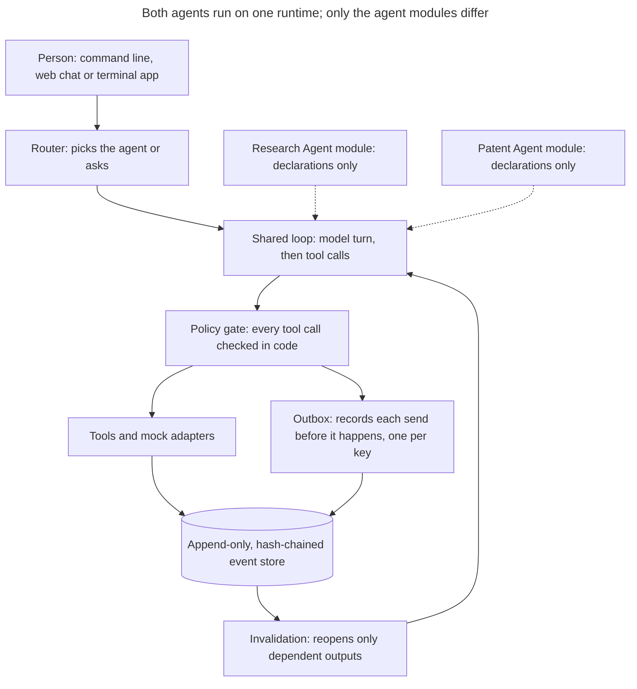

# Reviewer guide: start here

This folder is for the people who set the assignment and want to check the submission quickly: what was built, how to see it run, which tests prove which claim, and where the work falls short. The standard project documentation stays in the [project docs](../); this folder links to it rather than copying it. Status words on these pages are exact: built means merged on `main` and covered by tests, designed means written down with no code, planned means intended.

Status on 28 Nov 2026.

## What was built

Aksha is one shared runtime in Python that runs agents defined as data. The two agents the assignment asks for are built on it: a Research Agent (competitors and customer needs) and a Patent Agent (invention review and disclosure preparation), both working on a synthetic venture that builds camera-free occupancy sensors (the `stillroom` world). An agent is a module of declarations: its purpose, instructions, task tree, allowed tools, output kinds and completion checks. The runtime owns everything else: calling the model, gating and running tools, budgets and timeouts, approvals, the append-only event store, and recovery after a crash. When an input changes, the runtime reopens only the saved outputs that depend on it.



The runtime never imports an agent, and each agent reaches the runtime only through `src/aksha/runtime/api.py`, so a third agent can be added with no runtime edit. In an attended run, a tool that declares an approval rule, such as the patent agent's `send_packet` (`src/aksha/agents/patent/tools.py`), waits for a person's approval of that exact packet version. A headless run (`aksha run --headless`) never asks, but every refusal still holds ([interfaces](../interfaces.md)). [02-shared-runtime.md](02-shared-runtime.md) shows the boundary and the test that enforces it.

## Verify it in 2 minutes

You need Python 3.12 or newer and [uv](https://docs.astral.sh/uv/). No API key and no network are needed after the install; offline, every model is a rule-based fake.

```sh
uvx --from git+https://github.com/SaiiPittu/aksha aksha demo
```

The demo runs both agents, changes the inputs, rebuilds only what depends on the change, kills the process mid-send with a real `SIGKILL` (the signal that ends a process at once, with no cleanup) and recovers it. It exits 0 only when every check passes. Every answer and approval a person would give is scripted, and the store records each one as given by `demo-script`. On 28 Nov 2026 the command above, run from GitHub with `uvx`, printed "Done in 18.66 s" and took 36.7 s including the first install (measured); a busy machine takes longer. It printed the lines below. The hash chain's head differs from run to run, because each new store gets a random store ID that seeds the first hash of its chain (the demo's clock is fixed, so timestamps do not vary; see [02-shared-runtime.md](02-shared-runtime.md#proof-that-it-is-one-real-system-one-send-traced-through-the-store)). Lines from that run, measured:

| Demo line | What it shows |
|---|---|
| `research R-0001 complete: 11 outputs, 23 model calls` | The Research Agent ran its whole task tree through real tool calls and saved 11 versioned outputs. |
| `patent   R-0002 complete: 23 outputs, 55 model calls` | The Patent Agent ran on the same runtime, in a separate run with its own tools. |
| `scripted: approved A-0001 for patent.packet/C1@v1; the mailbox received it once` | The send waited for an approval bound to one exact packet version. |
| `rebuilt 17: C1: comparison, extraction, handoff, packet, prior_art, recommendation; ...` | The new prior-art reference and the re-dated contributor email reopened candidate C1's chain; the edited reviews file reopened the research needs and the outputs built on them, and C2 to C4's recommendations, which read those outputs. |
| `kept 7 of 11 research outputs: ...; competitors, scope` | Work that does not depend on the change was kept, not rerun. |
| `C1 next action: prioritize_counsel_review -> collect_more_evidence` | The code rule table changed C1's recommendation because of the new evidence. |
| `C1 outside contributor P-05: suggested F2, F3 on 2025-11-21, before their agreement took effect; flagged needs_counsel_confirmation` | The contribution and ownership question goes to counsel; the agent does not decide it. |
| `A-0001 approved patent.packet/C1@v1 only, so it does not cover patent.packet/C1@v2; a fresh approval is requested` | An approval covers one packet version; a changed packet needs a fresh one. |
| `at restart: 1 outbox entry open with no receipt; recovery asked the mailbox by key 1 time, sent 0 times` | After the `SIGKILL`, recovery checked whether the send had happened instead of sending again. |
| `hash chain verified: 1943 events, head sha256:928ad01e44731a54...` | Every fact above is an event in one tamper-evident log. |

The run can be inspected afterwards. Set `AKSHA_HOME` to the store folder the demo prints on its last line (`<AKSHA_HOME>/demo`). Then `aksha --user founder-1 inspect R-0005` printed the recovered send run with `"outcome": "complete"` and its steps by ID, such as `R-0005/send[C1]/t01/c01` (tool `send_packet`), and `aksha verify` printed `chain ok: 1943 events` with that store's own head. These were measured on a later run of the same code on 28 Nov 2026. The demo's mock mailbox, `mailbox.json` in that folder, held two deliveries, `m-1` for `patent.packet/C1@v1` and `m-2` for `patent.packet/C1@v2`. A longer walk through the same run is in [01-end-to-end-flow.md](01-end-to-end-flow.md).

### Six targeted tests

Set up once with `make venv`, then run each command from the repository root. Each finished in under 25 seconds on 28 Nov 2026 (measured; most take 1 to 5 s). Tests that are also written for PostgreSQL are skipped when the `postgres` extra is not installed.

| Claim | Command | Expected result |
|---|---|---|
| The runtime is shared: loading a third, toy agent changes no runtime file, and the runtime names no agent | `.venv/bin/pytest -p no:xdist tests/architecture/test_extension_boundary.py::test_third_agent_runtime_hash_unchanged tests/architecture/test_extension_boundary.py::test_runtime_has_no_agent_terms` | `2 passed` |
| Tool permissions are enforced in code, and a document telling the agent to change permissions has no effect | `.venv/bin/pytest -p no:xdist tests/integration/test_policy_gate.py::test_every_tool_every_agent_every_task tests/integration/test_policy_gate.py::test_injection_world_equals_clean_world` | `3 passed` |
| Outputs are grounded: a search snippet cannot be cited, a failed fetch stays unverified, missing data stays unknown | `.venv/bin/pytest -p no:xdist tests/integration/test_grounding.py::test_search_hit_cannot_be_cited tests/integration/test_grounding.py::test_failed_fetch_is_unverified tests/integration/test_grounding.py::test_missing_is_unknown_not_zero` | `3 passed` |
| A crash at any commit point, or repeated retries, still sends once | `.venv/bin/pytest -p no:xdist tests/integration/test_effect_steps.py::test_crash_at_each_commit_point_sends_once_and_records_once tests/integration/test_outbox.py::test_send_retried_3x_restart_1x_one_row` | `4 passed, 4 skipped` without PostgreSQL |
| A changed input reopens its dependents and leaves unrelated work alone | `.venv/bin/pytest -p no:xdist tests/integration/test_invalidation.py::test_s6_change_and_recovery tests/integration/test_invalidation.py::test_unrelated_writer_is_not_touched` | `2 passed` |
| A recorded run replays offline, with no model and no network, to the same outputs byte for byte | `.venv/bin/pytest -p no:xdist tests/integration/test_record_replay.py::test_the_bundled_example_replays_to_its_recorded_outputs` | `1 passed` |

The full suite is `make check` (lint, type check and every test, offline).

## Read these files in 10 minutes

The first six rows are the runtime, which agents reach only through `api.py`. The last four are the agents, which hold only declarations and pure checks.

| Side | File | What it does |
|---|---|---|
| Runtime | `src/aksha/runtime/api.py` | The only runtime module agents import: the declaration types an agent is built from. |
| Runtime | `src/aksha/runtime/loop/turn.py` | One turn of one task: build the context, call the model, run each tool call through the gate. |
| Runtime | `src/aksha/runtime/policy/gate.py` | The one pure check every tool call passes, in fixed layers, failing closed. |
| Runtime | `src/aksha/runtime/grounding/verify.py` | Verifies every citation against stored source text at its current version. |
| Runtime | `src/aksha/runtime/invalidation/plan.py` | Decides which saved outputs a change reopens and in what order they rebuild. |
| Runtime | `src/aksha/runtime/outbox/outbox.py` | Records each external send before it happens, keyed by what it means, so a retry finds the first one. |
| Agents | `src/aksha/agents/research/agent.py` | The Research Agent's task tree: scope, discover, evidence per company, voice, report. |
| Agents | `src/aksha/agents/patent/agent.py` | The Patent Agent's task tree: scope, per-candidate extraction through recommendation, then selection, forms, packet and send. |
| Agents | `src/aksha/agents/patent/rules.py` | The recommendation rule table and the form refusals, as pure code rather than model text. |
| Agents | `tests/fixtures/agents/toy/agent.py` | The third, toy agent the boundary test loads to prove a new agent needs no runtime edit. |

The full [module map](../architecture/codebase-structure.md) and the guide to [adding an agent](../agents/authoring.md) are in the project docs.

## What is met and what is partly met

The [requirements matrix](../requirements.md) maps each assignment requirement, paraphrased, to how the code meets it and the paths, tests and commands that show it. Of 97 rows, 91 are met and 6 are partly met (checked in that file on 28 Nov 2026). A test, `tests/architecture/test_requirements_evidence.py`, fails if any path or test it names stops existing. The partly met rows:

| Row | Requirement area | What falls short |
|---|---|---|
| R-20 | Manual alternatives in research | The bundled worlds hold no page describing a manual alternative, so only the not-found path is tested. |
| R-33 | Patent comparison matrix | The matrix equals the answer key on the bundled worlds, but the offline comparison counts words, so some worlds written without sight of the code get wrong cells. |
| R-47 | Design written before the code | The design is written down, but nothing can show it came before the code. |
| R-64 | Results beyond the bundled worlds | On the six worlds written without sight of the code, research passes 25 of 26 eval cases and patent 17 of 24, in fake model mode. The three patent worlds were read later, so they no longer count as held out. |
| R-83 | Demo: reveal an outside contributor | The contributor is already in the base inputs; the change re-dates the email so the suggestion predates the agreement. |
| R-84 | Demo: restart after the change | The demo restarts during the send; a restart between the change and the rebuild is covered by tests, not shown in the demo. |

## Harness guarantees and model performance are proven differently

Two kinds of claim appear in these pages, and they rest on different evidence.

1. Harness guarantees are proven offline by code and tests. Tool permissions, citation checks, invalidation, approvals bound to one version (in an attended run), one send per key and crash recovery hold whatever the model writes, because the runtime enforces them. The demo and the tests above run on rule-based fake models, so they prove these guarantees and nothing about how well a real model does the task.
2. Model-in-the-loop performance is proven only by live runs. On 28 Nov 2026 both agents completed the assignment's own example prompts on GPT-6.2 Sol through LiteLLM (a library that calls many model providers through one interface), in interactive runs where a person answered their questions. The Research Agent found all five competitors ([examples/live/research-2026-11-28/](../../examples/live/research-2026-11-28/README.md)). The Patent Agent investigated all four candidates, asked which to prepare, filled both blank forms for the one chosen and held the packet unsent, as the request asked ([examples/live/patent-2026-11-28/](../../examples/live/patent-2026-11-28/README.md)). Earlier runs that day ended partial or blocked, and they exposed the harness bugs fixed in #114 to #123. The approve-and-send step has not run live; it runs offline only, in `aksha demo`. A follow-up asking for the send ended blocked (see the patent folder). [06-evals-and-live-runs.md](06-evals-and-live-runs.md) has every run.

## Reading order

1. [01-end-to-end-flow.md](01-end-to-end-flow.md): one request from the first message to a sent packet, with the real IDs each step records.
2. [02-shared-runtime.md](02-shared-runtime.md): where the runtime ends and an agent begins, and the test that keeps it that way.
3. [03-research-agent.md](03-research-agent.md): how the Research Agent scopes, searches, fetches and grounds its competitor table and findings.
4. [04-patent-agent.md](04-patent-agent.md): how the Patent Agent compares, recommends by rule table, fills forms and prepares packets.
5. [05-change-and-recovery.md](05-change-and-recovery.md): invalidation, fresh approvals, crash recovery and the safeguards, each enforced in code.
6. [06-evals-and-live-runs.md](06-evals-and-live-runs.md): results off the happy path, on worlds written without sight of the code and on a real model.

## Sources

Read on `main`, 28 Nov 2026.

- Demo: `uvx --from git+https://github.com/SaiiPittu/aksha aksha demo` on 28 Nov 2026, exit 0, "Done in 18.66 s" (36.7 s wall time with the install); then `aksha demo` twice on `main` in a private `AKSHA_HOME`, exit 0 both times, 1943 events each, followed by `aksha --user founder-1 inspect R-0005`, `aksha verify` and the store's `mailbox.json`.
- Main README: [README.md](../../README.md) (the `uvx` line).
- Requirements matrix: [docs/requirements.md](../requirements.md), [docs/requirements.json](../requirements.json), `tests/architecture/test_requirements_evidence.py`.
- Held-out results: [docs/status.md](../status.md#results-on-the-held-out-worlds), [docs/limitations.md](../limitations.md) item 19.
- Live runs: [examples/live/research-2026-11-28/](../../examples/live/research-2026-11-28/README.md) and [examples/live/patent-2026-11-28/](../../examples/live/patent-2026-11-28/README.md), the exported stores of the two complete runs. The first one-shot research recording, `src/aksha/data/recordings/research-live-gpt/`, predates the fixes and no longer replays ([limitations](../limitations.md) item 18). Settings are in [docs/live-mode.md](../live-mode.md).
- Tests timed on 28 Nov 2026 with `pytest -p no:xdist`, results as in the table above.
