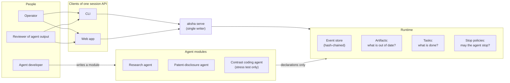

# Aksha product overview

*Status: intermediate design as of 26 Nov 2026. The decisions taken from the maintainer's decision log are Accepted; every primitive design this page points to is Proposed or Accepted in part, exactly as its ADR says. Four primitives are built and tested on a branch in review (ADR-P01, ADR-P10, ADR-P11, ADR-P20); nothing else here is built, and no agent has run end to end.*

Aksha is a general agent harness: one runtime that runs many different agents, so that each agent's author declares what the agent does and never rebuilds when it may stop, how a pause survives a restart, how an approval binds to an action, or what a changed input makes out of date. I test that generality with three deliberately different agents before I accept any abstraction into the runtime. Two of them are built against a fictional hardware venture; the third exists only as a stress test on paper.

## The frame: three users, one runtime, many agents

| User | What they do with Aksha | What they lose without it | What Aksha must give them |
|---|---|---|---|
| Agent developer | Builds a new agent as one Python module | The loop, stop rules, durability and approvals rebuilt for every agent | Declare Tasks, artifacts, tools and checks; edit no runtime file; get every mistake at load time |
| Operator | Runs many agents, runs and items at once, often unattended | Status kept by models, one review card per item, runs that loop forever on restart | One table derived from the record, review batched by kind of judgement, budgets enforced in code |
| Reviewer of agent output | Answers an agent's questions, approves a send, or reads what an agent produced | Outputs that cite nothing, gaps filled with guesses, approved work quietly replaced | Every claim tied to an excerpt, gaps named as gaps, changes shown as a redline |

Caption: people reach the runtime only through the session API, and agents reach it only through what they declare.

## 1. The problem a general harness solves

Most agent frameworks give a developer a model call and a tool loop, and leave the rest of a real workflow to be rebuilt for each agent. Reading other harnesses' code on 25 Nov 2026, I found seven pieces that every agent team rebuilds:

| Piece every team rebuilds | What Aksha does instead | Primitive |
|---|---|---|
| Who decides that the agent may stop | One stop-policy evaluation at every turn end, recorded as one event | ADR-P16 |
| Durable state and resume after a crash | One event store; deterministic step IDs; one recovery sequence at startup | ADR-P01, ADR-P02 |
| What a changed input makes out of date | Lineage on every artifact, and invalidation of exactly the work that read the change | ADR-P04, ADR-P05 |
| Context that only grows | One model context per Task instance, built as a projection | ADR-P08 |
| Delegation across many items | A scheduler starts work from declarations; no model spawns work | ADR-P15 |
| Typed answers from models | Model routing by class: extraction, classification and generation each have their own contract | ADR-P07 |
| Running programs safely | A fresh sandbox workspace per run, built from artifact versions | ADR-P12 |

The hard part sits between these pieces, not inside them. A worked example: an earlier version of the design had seven separate mechanisms deciding "continue or stop" (the run budget, the instance budget, a pause, an approval, a completion check, the turn cap and the default). Seven mechanisms make 7 × 6 / 2 = 21 pairs whose order someone has to get right, and a new agent that wants one more veto adds 7 more pairs and an edit to the loop. Aksha replaces the seven with one evaluation over a stack of stop policies, so a new veto is one more declared policy.

The catch is that a general harness can over-build. Every general piece has to pass the first principle in section 7 (does it need agent-specific code in the runtime?), and the build order in the primitives catalogue ships the pieces the example agents need first.

## 2. The users

### Agent developer

An engineer building a new agent, for example a contract-renewal agent over a folder of vendor contracts. They write one Python module, plus its tools, fixtures and tests. The module declares the agent's purpose, its artifact schemas and the typed relations between them, its Task tree with a completion check per Task, the built-in stop policies each Task opts into (Goal, Plan, ForceTool, TodoReminder), its model roles per class, its tools with their effect class, and its budget. They need three things from Aksha: every mistake reported at load time with the field named, offline deterministic tests with fake models, and a guarantee that a run started under one version of their module never resumes under another.

### Operator

The person responsible for many runs at once: a portfolio of a hundred items overnight, or a queue of research runs for several people. They need to see every run in one table derived from the event store, never from a model's own report of its status; to review in batches, one sitting per kind of judgement; and to know that budgets and a restart limit stop a run that would otherwise loop.

### Reviewer of agent output

Anyone who answers an agent's questions, approves an external effect, or receives what an agent produced. In the example agents this is the venture's founder and the patent counsel who receives a review packet. They need every saved claim to point at the excerpt a tool returned, missing facts to stay missing, and work they already approved never to be replaced without their accept of a redline.

Some actors are threats, not users: a fetched document carrying instructions aimed at the agent, a model proposing a call outside its tools, and a sandboxed program reaching outside its workspace.

## 3. Goals and non-goals

| Goal | How I will know |
|---|---|
| One runtime runs any agent that declares a module | A test loads a new agent from a temporary folder; the runtime package hash is unchanged and a scan finds no agent name in it |
| Every stop has one owner | Every turn end produces exactly one recorded stop decision, and recomputing it from the event store gives the same verdict |
| Approvals and restarts are enforced in code | Tests kill the process at named fault-injection points; no saved work is lost and no external effect repeats |
| A changed input updates only the affected work | The change-and-recovery test asserts the exact invalidated set and the untouched set |
| Every output traces to tool-returned evidence | Citations are minted by tools and verified at save; an ungroundable claim is saved as an explicit unknown |
| Each model job goes to the right model class | The loader refuses a generation model bound to an extraction or classification role |
| Every run is inspectable end to end | `aksha inspect` shows every model turn, tool call, refusal, approval, artifact save and stop decision |

| Non-goal | Why |
|---|---|
| Agents registering their own stop-policy classes | Agents opt into built-in stop policies by configuration (decision log 10) |
| A model that spawns sub-agents or decides who works next | The scheduler starts work from declarations (decision log 8) |
| Self-modifying agents | The agent definition version hash refuses to resume a run under changed code |
| Network access from inside a sandbox in the first version | The policy type reserves the field; ADR-P26 designs egress for later |
| An unconfined fallback when no sandbox is available | The tool refuses instead of degrading silently |
| A polished UI | The web app is a second client of the same session API and adds no runtime behaviour |
| Legal opinions from the patent-disclosure agent | It prepares a packet for counsel and stops there |

## 4. The example agents and what they prove

Both built agents work for Stillroom, a fictional company that makes a camera-free room-occupancy sensor. Every fixture is synthetic and every test runs offline against it.

### The research agent proves grounding and partial results

The research agent scopes a market question, discovers competitors, gathers evidence for each, collects customer voice, builds a comparison matrix and proposes an experiment. It tests grounding (every cell cites an excerpt), entity resolution (one company found three ways becomes one, linked by typed relations that carry their evidence), visible conflicts (two prices stay two prices) and partial results (a blocked competitor ends the run `partial` with the gap named, not filled).

### The patent-disclosure agent proves approvals and invalidation

The patent-disclosure agent reads dated engineering notes for four invention candidates, compares each with prior-art families, recommends, waits for the founder to select, prepares a counsel-review packet and sends it only after approval. It stops at preparation: no patentability opinion, no claims, no filing. It proves interrupts and approvals, the transactional outbox, and invalidation with human review of a diff.

Its change-and-recovery scenario is the hardest test in the design. The founder has approved the packet for candidate C1. A change set then adds a fifth prior-art family that discloses C1's key feature, and an email showing an outside consultant suggested that feature before the firmware lead's note. After a restart, the runtime must produce this result:

| Item | Count | Label |
|---|---|---|
| C1 outputs invalidated | 7 (extraction, comparison, recommendation, disclosure, worksheet, packet, selection) | Designed; from the scenario's answer key |
| Of those, machine-only, which rebuild silently | 5 | Designed |
| Of those, human-reviewed, which get a new version and a redline | 2 (selection, packet) | Designed |
| Approvals revoked | 1 (the send approval on the C1 packet) | Designed |
| Candidates C2 to C4 changed | 0 | Designed |
| Sends repeated | 0 | Designed |

### The contrast coding agent is a stress test, not a product

The contrast coding agent edits a Git repository in a sandbox for hours, runs tests and pushes a branch after approval. It is not built. It exists to break abstractions that happen to suit document work: long sandboxed sessions, path-scoped reads, steering messages to a running agent, and an execution environment image.

## 5. The rule of three

No abstraction enters the runtime until three different agents have tested it. On 25 Nov 2026 I stress-tested every primitive ADR against the research agent, the patent-disclosure agent and the contrast coding agent. For each of the 22 original ADRs, each agent gave its worst verdict: the design fits; it fits with agent code only; it needs a generic runtime change; or a primitive the agent needs is missing.

| Agent | Fits | Agent code only | Generic runtime change | Missing primitive |
|---|---|---|---|---|
| Research agent | 11 | 2 | 7 | 2 (egress, request routing) |
| Patent-disclosure agent | 10 | 3 | 9 | 0 |
| Contrast coding agent | 6 | 5 | 9 | 2 (environment image, steering) |

These counts are verdicts from reading interfaces, not from running code. The finding that mattered: no ADR needed agent-specific code in the runtime, and every failure sat at a seam between two primitives or in a primitive nobody owned. The stress test produced amendments to most ADRs and eight new primitives (ADR-P23 to ADR-P30), all Proposed. The worst seam was invalidation meeting stop policies and approvals: with an approval request still open, the design as first written blocked the very rebuild the approval was waiting on.

The catch: the coding agent is a reviewer's imagination, not a running agent, so its verdicts are the weakest evidence of the three. The first real evidence will be the stress cases in ADR-P22, written to fail before their fixes.

## 6. Interfaces

| Interface | What it is | Decision | Status |
|---|---|---|---|
| Server | `aksha serve` runs the runtime as the backend: it owns the session API and is the single writer to the event store | Decision log 22 | Accepted; session API in ADR-P19 is Proposed |
| Embedded CLI | The CLI is a client of the server; with no server running, `aksha run` starts the runtime in-process for that one command | Decision log 22 | Accepted |
| Headless mode | A run with nobody watching: no approval prompts and no permission asks, in full bypass, expected to run inside a sandbox, as headless agents usually do | Decision log 23 | Accepted |
| Web app | A React client of the same session API that renders approval cards, evidence grids, redlines and the Task tree from runtime events | ADR-P19 | Proposed; a scaffold runs against a mock server, with no real backend yet |

The rule that holds them together: every interface reaches the runtime through one `dispatch(command)` entry point with idempotent receipts, so the same scenario driven through the CLI and the web app produces the same events apart from request IDs.

## 7. Principles

Four principles apply to every design decision.

### P-1. Minimise agent-specific code in the core nouns

The runtime has three core nouns: artifacts (what is out of date?), Tasks (what is done?) and stop policies (may the agent stop?). Each agent supplies only content: schemas, typed relations, check bodies, prompts and tools. The test for every design decision is whether it needs agent-specific code inside the runtime; if it does, the abstraction is wrong.

### P-2. Store facts, derive interpretations

Only facts that happened go into the event store: an interrupt opened, an approval granted, an artifact written with its reads. Everything that interprets them, such as "done", the next action, the stop-policy stack and invalidation, is a projection. Interpretations cannot disagree after a crash, because they are recomputed from one source.

### P-3. Data for what the harness reasons about, code for what it only runs

Structure the runtime must inspect (Tasks, reads and writes, tools, relations, stop-policy choices) is declarative data. Behaviour it only calls (completion checks, tool bodies) is ordinary pure Python.

### P-4. Humans see diffs, machines regenerate

An invalidated machine-only artifact rebuilds silently. An invalidated human-reviewed artifact gets a new version beside the old one with a redline, and only the person's accept approves it again.

Two decisions follow from these and shape the rest of the design. The event store is hash-chained, so the record of an unattended run can be checked rather than trusted (decision log 20). Telemetry has two planes: the agent-run trace is a projection of the event store, while the harness's own operational telemetry is live OpenTelemetry instrumentation kept out of the event store, both exported over OTLP and correlated by trace and span IDs (decision log 21).

## Where this design stops

1. Nothing beyond the four built primitives has run. Every count above is designed, and every verdict in section 5 is a reading of interfaces.
2. Headless full bypass (Accepted) conflicts with two Proposed designs: ADR-P11 says the policy gate has no skip mode, and the non-goals say only a person's approval gates an external effect. Which checks still hold in a headless run, for example whether a declared tool list or a deny rule survives bypass, is open.
3. Storage is PostgreSQL in production and SQLite locally and offline, behind one port with a shared contract suite (decision log 17). Which one an offline run uses by default awaits a confirm.
4. Erasure of personal data in an append-only, hash-chained store (ADR-P30) is Open, with no shape proposed.

## Sources

1. The maintainer's decision log, entries 1 to 24, 25 and 26 Nov 2026.
2. The design patterns file, P-1 to P-4, 25 Nov 2026.
3. The primitives index, its verdict matrix and the 30 primitive ADRs, ADR-P01 to ADR-P30, 25 Nov 2026.
4. The three stress reports (research agent, patent-disclosure agent, contrast coding agent), 25 Nov 2026.
5. The product problem-and-users and features-and-requirements documents, version 2, 25 Nov 2026.
6. The terminology glossary, 25 Nov 2026.
7. The codebase structure document, [`../architecture/codebase-structure.md`](../architecture/codebase-structure.md), 25 Nov 2026.
