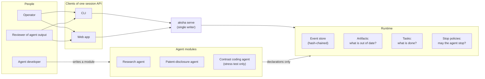

# The harness problem and Aksha's goals

*Status: intermediate design as of 26 Nov 2026. The decisions taken from the [decisions log](../04-decisions-log.md) are Accepted; every primitive design this page points to is Proposed or Accepted in part, exactly as its ADR says. The build has moved on since: as of 27 Nov 2026, 29 of the 30 primitives are built and tested on main and two agents run end to end in fake model mode (see the [architecture overview](../../architecture/overview.md#the-primitives)); this page has not been re-checked against the build. Every count and target on this page is designed, not measured, unless it says otherwise.*

Aksha is a general agent harness: one runtime that runs many different agents, so that each agent's author declares what the agent does and never rebuilds when it may stop, how a pause survives a restart, how an approval binds to an action, or what a changed input makes out of date. I test that generality with three deliberately different agents before I accept any abstraction into the runtime. Two of them, a research agent and a patent-disclosure agent, are example agents built against a fictional hardware venture; the third, a coding agent, is a contrast agent that exists only as a stress test on paper.

This page is the first link in the product chain. It states the problem, the goals, the non-goals and how success will be measured. The chain continues with [personas](02-personas.md), [scenarios](03-scenarios.md), [user stories](04-user-stories.md), [features](05-features.md) and [requirements](06-requirements.md), each tracing back to the one before.

## The frame: three kinds of user, one runtime, many agents

| User | What they do with Aksha | What they lose without it | What Aksha must give them |
|---|---|---|---|
| Agent developer | Builds a new agent as one Python module | The loop, stop rules, durability and approvals rebuilt for every agent | Declare Tasks, artifacts, tools and checks; edit no runtime file; get every mistake at load time |
| Operator | Runs many agents, runs and items at once, often unattended | Status kept by models, one review card per item, runs that loop forever on restart | One table derived from the record, review batched by kind of judgement, budgets enforced in code |
| Reviewer of agent output | Answers an agent's questions, approves a send, or reads what an agent produced | Outputs that cite nothing, gaps filled with guesses, approved work quietly replaced | Every claim tied to an excerpt, gaps named as gaps, changes shown as a redline |

Caption: people reach the runtime only through the session API, and agents reach it only through what they declare.

[Personas](02-personas.md) splits the reviewer of agent output into the people who fill that role for the example agents: a venture founder, an engineer-inventor and the patent counsel who reviews a disclosure packet.

## 1. The harness problem: seven pieces every agent team rebuilds

Most agent frameworks give a developer a model call and a tool loop, and leave the rest of a real workflow to be rebuilt for each agent. Seven pieces come up in every agent team's rebuild:

| Piece every team rebuilds | What goes wrong without it | What Aksha does instead | Primitive |
|---|---|---|---|
| Who decides that the agent may stop | A stop hook that blocks with a reason leaves open how two hooks combine, how continuations are capped, and whether the counter survives a restart | One stop-policy evaluation at every turn end, recorded as one event | [P16](../adr/ADR-P16-stop-policy-and-evaluation.md) |
| Durable state and resume after a crash | No defined answer for a tool whose receiver keeps no ledger, a run that crashes on every resume, or a message that arrives twice | One event store; deterministic step IDs; one recovery sequence at startup | [P01](../adr/ADR-P01-event-store-and-projections.md), [P02](../adr/ADR-P02-durable-execution.md) |
| What a changed input makes out of date | With no record of an output's inputs, a completed task stays completed until someone reopens it | Lineage on every artifact, and invalidation of exactly the work that read the change | [P04](../adr/ADR-P04-artifact-store-and-lineage.md), [P05](../adr/ADR-P05-invalidation.md) |
| Context that only grows | When the unit of work is one conversation that only grows, compaction becomes unavoidable | One model context per Task instance, built as a projection | [P08](../adr/ADR-P08-context-assembly-and-compaction.md) |
| Delegation across many items | Delegation left to the model's choice gets skipped, and model-kept status lags or runs ahead of the facts | A scheduler starts work from declarations; no model spawns work | [P15](../adr/ADR-P15-task-model-and-scheduler.md) |
| Typed answers from models | One chat interface forces extraction and classification through chat calls, which loses spans and probabilities | Model routing by class: extraction, classification and generation each have their own contract | [P07](../adr/ADR-P07-model-interface-and-routing.md) |
| Running programs safely | The sandbox is either long-lived state to snapshot, or throwaway with no record of what went in | A fresh sandbox workspace per run, built from artifact versions | [P12](../adr/ADR-P12-sandbox-and-execution-environment.md) |

The hard part sits between these pieces, not inside them. A worked example: an earlier version of the design had seven separate mechanisms deciding "continue or stop" (the run budget, the instance budget, a pause, an approval, a completion check, the turn cap and the default). Seven mechanisms make 7 × 6 / 2 = 21 pairs whose order someone has to get right, and a new agent that wants one more veto adds 7 more pairs and an edit to the loop. Aksha replaces the seven with one evaluation over a stack of stop policies, so a new veto is one more declared policy and zero edits to the loop.

The catch is that a general harness can over-build. Every general piece has to pass the first principle in section 8 (does it need agent-specific code in the runtime?), and the build order in the [primitives catalogue](../03-primitives.md) ships the pieces the example agents need first.

Takeaway: the harness problem is the 21 or more interactions between stop, pause, approval, budget, invalidation and restart, which each team otherwise discovers one bug at a time.

## 2. The problem the example agents solve for their users

The example agents face the problem their users have: the facts a decision needs are scattered, unchecked or silently out of date. Both agents work for Stillroom, a fictional company that makes a camera-free room-occupancy sensor. Every fixture is synthetic and every test runs offline against it.

### 2.1 On the research side, claims outrun their evidence

A founder asking "who else sells this, and at what price?" gets an answer built from search snippets. One company found three ways (its own site, a reseller listing, an acquirer's product page) is counted three times. A dozen angry reviews are read as market demand. Two prices for the same product are collapsed into one, and nobody can say which page said which. The research agent has to keep every claim tied to a fetched excerpt, merge duplicates with the evidence for the merge, keep conflicts visible and say "not found" when a source could not be read.

### 2.2 On the patent side, the facts drift between notebook and counsel

An invention starts in a firmware lead's dated engineering note, is demonstrated at a trade show, and appears in a blog post months later. By the time counsel asks "who contributed what, first, and what was shown in public?", the answers live in four places and someone rebuilds them from memory. A typical disclosure has 9 field groups; across 4 invention candidates that is 36 field groups gathered by hand (designed count, from the example fixtures). Worse, a fact that arrives late, such as a prior-art family or an email showing an outside contributor, changes some of that work and not the rest, and nothing says which.

The patent-disclosure agent stops at preparation. It gives no patentability opinion, drafts no claims and files nothing.

Takeaway: the example agents need the same three things from the runtime, grounding, approvals and invalidation, which is why they are good tests of it.

## 3. Goals

Each goal names the user it serves and the check that will show it is met. The checks are tests or inspections a reader can run once the code exists; none has run yet.

| ID | Goal | For | How I will know |
|---|---|---|---|
| G1 | One runtime runs any agent that declares a module | Agent developer | A test loads a new agent from a temporary folder; the runtime package hash is unchanged and a scan finds no agent name in it |
| G2 | Every stop has one owner | Operator, agent developer | Every turn end produces exactly one recorded stop decision, and recomputing it from the event store gives the same verdict |
| G3 | Approvals and restarts are enforced in code | Reviewer of agent output | Tests kill the process at named fault-injection points; no saved work is lost and no external effect repeats |
| G4 | A changed input updates only the affected work, and a person sees a diff for work they reviewed | Reviewer of agent output | The change-and-recovery test asserts the exact invalidated set, the untouched set and the diff reviews it opens |
| G5 | Every output traces to tool-returned evidence | Reviewer of agent output | Citations are minted by tools and verified at save; an ungroundable claim is saved as an explicit unknown |
| G6 | Each model job goes to the right model class | Agent developer | The loader refuses a generation model bound to an extraction or classification role |
| G7 | A person's state beats every automatic start | Operator, reviewer of agent output | A test holds a run (a stop, an open approval) and drives every automatic start: recovery, a timer, a rebuild; none starts the held work |
| G8 | Many items are run and reviewed as one table | Operator | The work board equals a full rebuild from the event store at every step; review groups open interrupts by kind of judgement |
| G9 | Every run is inspectable end to end and its record is verifiable | Operator | `aksha inspect` shows every model turn, tool call, refusal, approval, artifact save and stop decision; `aksha verify` checks the hash chain |
| G10 | The same runtime serves a laptop and an unattended factory | Operator | One runtime runs embedded under `aksha run`, as `aksha serve` behind the CLI and web app, and headless inside a sandbox, with the same events apart from request IDs |

## 4. Non-goals

| Non-goal | Why |
|---|---|
| Agents registering their own stop-policy classes | Agents opt into built-in stop policies by configuration ([decision 10](../04-decisions-log.md)) |
| A model that spawns sub-agents or decides who works next | The scheduler starts work from declarations ([decision 8](../04-decisions-log.md)) |
| Self-modifying agents | The agent definition version hash refuses to resume a run under changed code |
| Network access from inside a sandbox in the first milestone | The policy type reserves the field; [P26](../adr/ADR-P26-egress-policy.md) designs egress for later |
| An unconfined fallback when no sandbox is available | The tool refuses instead of degrading silently |
| A polished UI | The web app is a second client of the same session API and adds no runtime behaviour |
| Concurrent Task instances in the first milestone | The scheduler runs instances one at a time in a fixed order, so a second run with fake models gives the same record; concurrency is a setting reserved for later |
| Legal opinions from the patent-disclosure agent | It prepares a packet for counsel and stops there |
| Market-demand claims from reviews | The research agent reports "N of M in this sample", never demand |
| Distribution across machines | One writer process owns the event store |

## 5. Success measures

The goals say what must be true; these measures say how much, and how it is counted. Every target is a proposal for the maintainer to accept or change, and nothing below has been measured.

| Measure | Target for the first milestone | How it is counted | Goal |
|---|---|---|---|
| Runtime files edited to add the third agent | 0 | Runtime package hash before and after the third-agent test | G1 |
| Agent names found in the runtime package | 0 | A static scan against a list of agent names and domain nouns | G1 |
| Turn ends without exactly one stop decision | 0 across the whole test suite | A test that drives every kind of stop candidate | G2 |
| Repeated external effects after a crash | 0 | Ledger entries per idempotency key, never above 1, at every fault-injection point | G3 |
| Saved work lost after a crash | 0 | The rebuilt projections after restart equal an uninterrupted run's at the same point | G3 |
| Work rebuilt outside the lineage of a change | 0 | The change-and-recovery test's untouched set is byte-identical | G4 |
| Saved claims without a verified citation or an explicit unknown | 0 | The save path refuses them; a test plants one | G5 |
| Automatic starts of held work | 0 | The hold-invariant test, `inv.no_auto_start_while_held` | G7 |
| Views that disagree with a full rebuild | 0 of 50 random cut points per scenario | A property test over each scenario's event store | G8 |
| Hash-chain breaks on an untouched store | 0 | `aksha verify` on every test store | G9 |
| Malformed agent modules that get past the loader | 0 | One fixture module per loader refusal | G1, G6 |
| Time for the whole suite on a 4-core laptop | at most 90 s, excluding the real-time timeout test | The test runner's timing | Operator's loop |

Two of these measure plumbing, not reliability. With a deterministic fake model, a repeat run passes every time or never, so these targets prove the runtime's mechanics and say nothing about how often a live model gets the work right. That needs a live model and an eval set, which [P22](../adr/ADR-P22-evals-fake-and-replay-models.md) designs and the first milestone does not build.

## 6. The agents and what each one proves

### The research agent proves grounding and partial results

The research agent scopes a market question, discovers competitors, gathers evidence for each, collects customer voice, builds a comparison matrix and proposes an experiment. It tests grounding (every cell cites an excerpt), entity resolution (one company found three ways becomes one, linked by typed relations that carry their evidence), visible conflicts (two prices stay two prices) and partial results (a blocked competitor ends the run `partial` with the gap named, not filled).

### The patent-disclosure agent proves approvals and invalidation

The patent-disclosure agent reads dated engineering notes for four invention candidates (C1 to C4), compares each with prior-art families, recommends, waits for the founder to select, prepares a counsel-review packet and sends it only after approval. It proves interrupts and approvals, the transactional outbox, and invalidation with human review of a diff.

Its change-and-recovery scenario ([scenario 4](03-scenarios.md#scenario-4-a-changed-input-invalidates-exactly-the-affected-work)) is the hardest test in the design. The founder has approved the packet for candidate C1. A change set then adds a fifth prior-art family that discloses C1's key feature, and an email showing an outside consultant suggested that feature before the firmware lead's note. After a restart, the runtime must produce this result:

| Item | Count | Label |
|---|---|---|
| C1 outputs invalidated | 7 (extraction, comparison, recommendation, disclosure, worksheet, packet, selection) | Designed; from the scenario's answer key |
| Of those, machine-only, which rebuild silently | 5 | Designed |
| Of those, human-reviewed, which get a new version and a redline | 2 (selection, packet) | Designed |
| Approvals revoked | 1 (the send approval on the C1 packet) | Designed |
| Candidates C2 to C4 changed | 0 | Designed |
| Sends repeated | 0 | Designed |

### The contrast coding agent is a stress test, not a product

The contrast coding agent edits a Git repository in a sandbox for hours, runs tests and pushes a branch after approval. It is not built. It exists to break abstractions that happen to suit document work: long sandboxed sessions, path-scoped reads, steering messages to a running agent, and an execution environment image. Headless runs that never ask but still honour deny rules ([scenario 5](03-scenarios.md#scenario-5-a-headless-job-runs-in-a-sandbox-and-never-asks)) are its natural setting.

## 7. The rule of three

No abstraction enters the runtime until three different agents have tested it. On 25 Nov 2026 I stress-tested every primitive ADR against the research agent, the patent-disclosure agent and the contrast coding agent. For each of the 22 original ADRs, each agent gave its worst verdict: the design fits; it fits with agent code only; it needs a generic runtime change; or a primitive the agent needs is missing.

| Agent | Fits | Agent code only | Generic runtime change | Missing primitive |
|---|---|---|---|---|
| Research agent | 11 | 2 | 7 | 2 (egress, request routing) |
| Patent-disclosure agent | 10 | 3 | 9 | 0 |
| Contrast coding agent | 6 | 5 | 9 | 2 (environment image, steering) |

These counts are verdicts from reading interfaces, not from running code. The finding that mattered: no ADR needed agent-specific code in the runtime, and every failure sat at a seam between two primitives or in a primitive nobody owned. The stress test produced amendments to most ADRs and eight new primitives (P23 to P30), all Proposed. The worst seam was invalidation meeting stop policies and approvals: with an approval request still open, the design as first written blocked the very rebuild the approval was waiting on.

The catch: the coding agent is a design on paper, not a running agent, so its verdicts are the weakest evidence of the three. The first real evidence will be the stress cases in [P22](../adr/ADR-P22-evals-fake-and-replay-models.md), written to fail before their fixes.

## 8. Interfaces

| Interface | What it is | Decision | Status |
|---|---|---|---|
| Server | `aksha serve` runs the runtime as the backend: it owns the session API and is the single writer to the event store | Decision 22 | Accepted; the session API in P19 is Proposed |
| Embedded CLI | The CLI is a client of the server; with no server running, `aksha run` starts the runtime in-process for that one command | Decision 22 | Accepted |
| Headless mode | A run with nobody watching: it never asks (every ask becomes an allow), every deny rule still holds, and it runs inside a sandbox | Decisions 23 and 26 | Accepted |
| Web app | A React client of the same session API that renders approval requests, evidence grids, redlines and the Task tree from runtime events | P19 | Proposed; a scaffold runs against a mock server, with no real backend yet |

The rule that holds them together: every interface reaches the runtime through one `dispatch(command)` entry point with idempotent receipts, so the same scenario driven through the CLI and the web app produces the same events apart from request IDs.

## 9. Principles

Five principles apply to every design decision.

### P-1. Minimise agent-specific code in the core nouns

The runtime has three core nouns: artifacts (what is out of date?), Tasks (what is done?) and stop policies (may the agent stop?). Each agent supplies only content: schemas, typed relations, check bodies, prompts and tools. The test for every design decision is whether it needs agent-specific code inside the runtime; if it does, the abstraction is wrong.

### P-2. Store facts, derive interpretations

Only facts that happened go into the event store: an interrupt raised, an approval granted, an artifact written with its reads. Everything that interprets them, such as "done", the next action, the stop-policy stack and invalidation, is a projection. Interpretations cannot disagree after a crash, because they are recomputed from one source.

### P-3. Data for what the harness reasons about, code for what it only runs

Structure the runtime must inspect (Tasks, reads and writes, tools, relations, stop-policy choices) is declarative data. Behaviour it only calls (completion checks, tool bodies) is ordinary pure Python.

### P-4. Humans see diffs, machines regenerate

An invalidated machine-only artifact rebuilds silently. An invalidated human-reviewed artifact gets a new version beside the old one with a redline, and only the person's accept approves it again.

### P-5. The context window is a rendering, not a ledger

The event store is the ledger. It keeps every fact, including the ones a later change has superseded, because audit, replay and the hash chain all need them. The context window is something else: a view the runtime builds from the ledger for one model call. Because it is a view, the runtime can show the model a cleaner picture without rewriting any history. A harness that treats its chat transcript as the record of truth can only append corrections to it; a harness that treats the transcript as a rendering can decide precisely what the model sees at each call.

The masking rule (decision 32) is the first use of this principle. When a Task instance is shown its history again after one of its inputs changed, the stale tool result is not edited and not swapped for the new value in its old position. It is masked: its body is replaced by a short placeholder, for example `[superseded: comparison/C1 changed; the current version is in the change notice below]`. The updated content appears once, at the end of the context, inside a change notice the runtime writes, and that notice also names the agent's own earlier conclusions that relied on the stale input, which the runtime finds through lineage. The new value never sits in an old turn, because an updated value in an old position would mislead the model about when it learned what. The cost is that a provider's prompt cache breaks from the first masked point onward, which is an input to the compaction policy ([ADR-P08](../adr/ADR-P08-context-assembly-and-compaction.md)).

Two decisions follow from these and shape the rest of the design. The event store is hash-chained, so the record of an unattended run can be checked rather than trusted (decision 20). Telemetry has two planes: the agent-run trace is a projection of the event store, while the harness's own operational telemetry is live OpenTelemetry instrumentation kept out of the event store, both exported over OTLP (the OpenTelemetry Protocol) and correlated by trace and span IDs (decision 21).

## Where this design stops

1. Nothing beyond the four built primitives has run. Every count above is designed, and every verdict in section 7 is a reading of interfaces.
2. Decision 26 settles how headless meets the gate: every check holds, and only asks become allows, so a declared tool list and every deny rule survive. The non-goal that only a person's approval gates an external effect therefore holds for watched runs; in a headless run the recipients source, the argument rules and the sandbox gate it instead. What a headless run does on an `input` or `choice` interrupt is open.
3. Storage is PostgreSQL in production and SQLite locally and offline, behind one port with a shared contract suite (decision 17). Decision 34 settles the default for the offline run: SQLite.
4. Erasure of personal data in an append-only, hash-chained store (P30) is Open, with no shape proposed.
5. The name of the stop policy that owns a whole agent run ("run stop policy" is the working name) is still to be picked (decision 14).

## Sources

1. The maintainer's [decisions log](../04-decisions-log.md), entries 1 to 35, 25 and 26 Nov 2026.
2. The design patterns, P-1 to P-4, 25 Nov 2026, and P-5, 26 Nov 2026, as restated in the [primitives catalogue](../03-primitives.md).
3. The primitives index, its verdict matrix and the 30 primitive ADRs, P01 to P30, 25 Nov 2026.
4. The three stress reports (research agent, patent-disclosure agent, contrast coding agent), 25 Nov 2026.
5. The product problem-and-users and features-and-requirements documents, version 2, 25 Nov 2026.
6. The terminology glossary, 25 Nov 2026.
7. The codebase structure document, [`../../architecture/codebase-structure.md`](../../architecture/codebase-structure.md), 25 Nov 2026.
