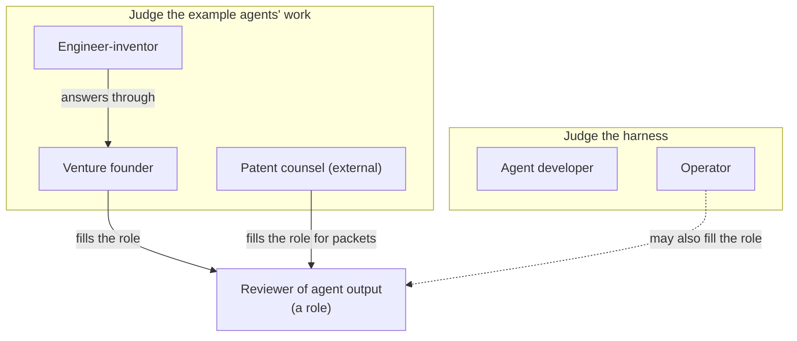

# Personas

*Status: intermediate design as of 26 Nov 2026. Each persona is a role, not a person, and every "Aksha gives them" line below is designed, not built. The build has moved on since this page was written: as of 27 Nov 2026, 29 of the 30 primitives are built and tested on main (see the [architecture overview](../../architecture/overview.md#the-primitives)), and this page has not been re-checked against the build.*

Aksha has two kinds of user, and they judge different things. The agent developer and the operator judge the harness: can a new agent be added without touching the runtime, and can many runs be trusted unattended? The founder, the engineer-inventor and the counsel judge the example agents' work: is every claim grounded, and does nothing leave the system without approval? The reviewer of agent output sits between them, because it is the role the runtime has to serve for every agent, and the three example-agent users are the people who fill it.

## The frame: six personas

| Persona | Kind | Main goal | What they must trust | Main interface | Primitives they lean on |
|---|---|---|---|---|---|
| Agent developer | Harness user | Build a new agent by declaring it | The runtime enforces their declarations exactly as it does for any other agent | Python module, CLI, tests | P20, P10, P15, P16, P22 |
| Operator | Harness user | Run many agents and headless jobs within budget | The board and the record are facts, not a model's report | CLI, web app, OTLP backend | P14, P15, P18, P21, P01 |
| Reviewer of agent output | Role every agent needs | Answer questions and approve exact actions | An approval authorises one exact action and nothing else | Web app, CLI | P17, P13, P05 |
| Venture founder | Example-agent user | Decide on evidence, not snippets | Gaps and conflicts stay visible, and approved work is never replaced quietly | CLI, web app | P13, P05, P17 |
| Engineer-inventor | Example-agent user | Have their invention recorded from their own dated notes | Their notes are read, not rewritten, and an unanswered question stays a question | Through the founder | P04, P13 |
| Patent counsel | Example-agent user, external | Read a packet that is complete, missing or flagged, never guessed | Every field cites its source, and a new version shows only what changed | Receives the packet | P04, P05, P03 |

Caption: the reviewer of agent output is a role the runtime serves for every agent; the founder and counsel fill it for the example agents, and the engineer-inventor reaches the system only through the founder.

## 1. Agent developer

An engineer building a new agent on Aksha, for example a contract-renewal agent over a folder of vendor contracts, or a market-map agent over a hundred companies. They write one Python module, plus its tools, fixtures and tests. They never edit the runtime package.

What they declare, and nothing else:

1. Purpose and instructions, which the request router reads to offer the agent.
2. Artifact schemas, which kinds are reviewable, and the typed relations between kinds.
3. The Task tree: Tasks, child Tasks, fan-out keys, reads and writes, the tools each Task may use, and each completion check as a pure function.
4. Which built-in stop policies each Task opts into (goal condition, plan mode, forced tool choice, todo reminder), with their parameters.
5. Model aliases per model class (extraction, classification, generation), with confidence thresholds as data and fake models in the agent's folder.
6. Tools, each with its schema, its effect class and its step semantics, and for a tool that runs a program, its sandbox policy.
7. A budget: tool calls, model turns, active seconds and a turn limit per Task instance.

| | |
|---|---|
| Goals | Build an agent by declaring it, not by writing a loop. Get every mistake at load time, with the field named. Test the agent offline and deterministically against fixtures of its own |
| Pains | Every framework they have used made them write stop logic, retry logic and approval logic again. Tests that pass against one transcript fail on a renamed input. A code change silently alters what an in-flight run does |
| Must trust | The runtime enforces their tool list, sandbox policy and stop policies exactly as it does for the example agents. A run started under one version of their module never resumes under another. Their checks are only ever called, never rewritten or skipped, and the two checks every save runs (current input versions and valid citations) cannot be turned off |
| How they use Aksha | Write the module; run `aksha run` embedded against fake models; read loader errors; use `aksha inspect` on a failing test run; add eval cases with a kind and a source |

The aim "an agent in a day" is an aim, not a tested claim. No test measures it, and the strongest version of the test, a developer who did not design the runtime building an agent from the documentation alone, is not one I can run myself.

## 2. Operator

The person responsible for many runs at once, across agents, owners and items: a portfolio of a hundred invention candidates overnight, a queue of research runs for several people, or headless jobs started by a schedule or an event in a software factory.

| | |
|---|---|
| Goals | See every run and every item in one table, derived from the event store rather than reported by a model. Batch the human work, one sitting per kind of judgement. Keep spend bounded. Know which capabilities a machine has (sandbox backends, model aliases bound to fakes, thresholds not yet fitted) before a run starts. Send traces to whatever OTLP backend the team already runs |
| Pains | One agent, or one review card, per item. A run that crashes on every resume and is resumed forever. Not knowing whether an out-of-date row means "rebuilding" or "waiting for you". A restart that quietly resumes a run someone had stopped |
| Must trust | The work board is a pure function of the event store, so a full rebuild and the live view agree. Budgets and the restart limit are counted from the event store, so a restart never resets them. A person's stop holds across every restart. A headless run never asks but still honours every deny rule, is confined by its sandbox, and its record is as complete and as verifiable as any other run's |
| How they use Aksha | Run `aksha serve`; start runs from the CLI or the web app; start headless jobs inside a sandbox; watch the work board and the review inbox; `aksha stop` a run; `aksha trace` a run to an OTLP backend; `aksha verify` the hash chain |

An operator sees only their own owner's runs in the first milestone. A view of status and counts across owners, never content, belongs to the general design.

## 3. Reviewer of agent output

Anyone who answers an agent's questions, approves an external effect, or receives what an agent produced. It is a role, and every agent on Aksha needs someone in it. In the example agents the founder fills it for both agents and counsel fills it for the packet; on a team using a coding agent it is the engineer who approves a branch push.

| | |
|---|---|
| Goals | Answer an agent's question once and have it reach the work that asked. Approve or reject an exact action. When reviewed work goes out of date, see the old and new versions side by side and re-approve in one look |
| Pains | Approval prompts that say "allow this tool?" without saying what it will do. An approval given for one version that quietly covers the next. Review cards that show no change at all |
| Must trust | An approval authorises one exact action, by a signature over that action; an edit voids it and asks again. A rejection changes nothing. Accepting a diff review never grants an approval by itself. Nothing they approved is replaced without their accept of a redline |
| How they use Aksha | Open the review inbox in the web app or `aksha pending` in the CLI; answer an interrupt; approve by signature; accept or reject a diff review |

## 4. Venture founder

The founder of Stillroom, the fictional company behind the example agents, which makes a camera-free room-occupancy sensor. They ask both agents for work, answer clarification questions, relay the engineer-inventor's answers, choose which invention candidates to prepare and approve sends. For the example agents they are the authorised client who may approve.

| | |
|---|---|
| Goals | A competitor picture built from fetched pages, not snippets. A recommendation per invention candidate with what would change it. A packet sent to counsel only when it is complete or honestly flagged |
| Pains | Decisions made on double counts and on a few reviews read as demand. Re-answering a question after a restart. Discovering that a late fact changed something, but not what |
| Must trust | Every cell points at the excerpt a tool returned. Missing stays missing: a null with a question, never a typical value. Conflicts stay visible with both sources. A selection or cell they accepted stays fixed when other rows rebuild |
| How they use Aksha | Name an agent or describe a request; answer one targeted question per gap; select candidates from the recommendation table; approve the send; review a redline after a change |

## 5. Engineer-inventor

The firmware lead who wrote the dated engineering notes the patent-disclosure agent reads. They never use Aksha directly; their answers reach the agent through the founder.

| | |
|---|---|
| Goals | Have the disclosure filled from their own dated notes, with targeted questions instead of guesses. Have their contribution recorded as contribution, not flattened into inventorship |
| Pains | Rebuilding an idea from memory months later. A form that guesses a date or a reason they never wrote down |
| Must trust | Their notes are read, quoted and cited, never paraphrased into a claim they did not make. A question they did not answer stays a question in the packet. A corrected answer replaces the old one through a recorded provenance link, and only the work that read the old answer rebuilds |
| How they use Aksha | Indirectly: they answer the questions the founder relays, and they can read the packet's "needs counsel confirmation" section |

## 6. Patent counsel

The external patent counsel who receives the counsel-review packet. Counsel is a recipient, not a user of the system: they get what the founder approved, and nothing reaches them otherwise.

| | |
|---|---|
| Goals | Read a packet where every field is complete, missing or flagged for counsel, never guessed. Know exactly what the packet was built from. When a packet they hold is superseded, read only what changed |
| Pains | Hours rebuilding who did what, when, and what was shown in public. A new version with no indication of what moved |
| Must trust | The packet records the ID and version of every input. Its scope note says what the agent did not do (no patentability opinion, no claims, no filing). A new version carries a redline against the version counsel holds. A send happens once, even across a crash |
| How they use Aksha | They receive the packet through the mock send; a later version arrives only after the founder's fresh approval |

## 7. Threats, not users

Some actors are threats, and the design treats them as such:

1. The author of a fetched document that carries instructions aimed at the agent.
2. A user who asks the agent to mark incomplete work complete or to make a legal call.
3. A model that proposes a call outside its tools, or an effect without approval.
4. A program run inside a sandbox that tries to read outside its workspace, write outside its output folder, open a network connection or leave a symlink pointing out of the workspace.

[Scenario 12](03-scenarios.md#scenario-12-instructions-inside-a-fetched-page-stay-data) walks through the first and third.

## Where this stops

1. The personas come from design reading and the example agents' needs, not from interviews with real founders, operators or counsel.
2. The operator's cross-owner view and any role model beyond "the authorised client may approve" are not designed for the first milestone.
3. In a headless run nobody fills the reviewer role. The policy gate's deny rules, the recipients source and the sandbox replace the person for approvals (decision 26); what replaces the person for an `input` or `choice` interrupt is open (see [scenario 5](03-scenarios.md#scenario-5-a-headless-job-runs-in-a-sandbox-and-never-asks)).

## Sources

1. The product problem-and-users document, version 2, 25 Nov 2026, sections 3.1 to 3.7.
2. The maintainer's [decisions log](../04-decisions-log.md), entries 1, 5, 13, 22 and 23.
3. The [primitives catalogue](../03-primitives.md) and ADRs P13, P15, P16, P17, P18, P20 and P21, 25 Nov 2026.
