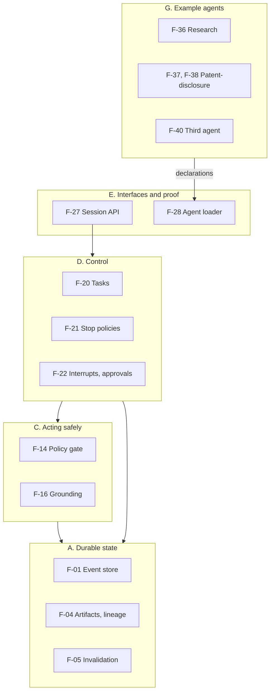

# Features

*Status: intermediate design as of 26 Nov 2026. Every feature below is designed. The build has moved on since this page was written: as of 27 Nov 2026, 29 of the 30 primitives are built and tested on main (see the [architecture overview](../../architecture/overview.md#the-primitives)), and this page has not been re-checked against the build. Priorities are for the first milestone, the 27 Nov 2026 cut of the build, and are proposals until the maintainer accepts them.*

A feature is a capability a persona can name, built from one or more primitives. This page groups the features by the runtime area that owns them, using the same five families as the [primitives catalogue](../03-primitives.md), then adds deployment and the example agents. Each feature lists the [user stories](04-user-stories.md) it serves; the [requirements](06-requirements.md) say exactly what each feature must do.

## The frame: 41 features, seven areas

| Area | Features | Must | Should | Later |
|---|---|---|---|---|
| A. Durable state | F-01 to F-08 | 5 | 1 | 2 |
| B. Thinking | F-09 to F-12 | 1 | 2 | 1 |
| C. Acting safely | F-13 to F-19 | 4 | 0 | 3 |
| D. Control | F-20 to F-26 | 4 | 2 | 1 |
| E. Interfaces and proof | F-27 to F-31 | 4 | 1 | 0 |
| F. Deployment and operations | F-32 to F-35 | 2 | 2 | 0 |
| G. Example agents and fixtures | F-36 to F-41 | 5 | 0 | 1 |
| Total | 41 | 25 | 8 | 8 |

How the priorities map onto the primitives catalogue's "first milestone" column:

1. **Must** is "Build now": in the first milestone's cut.
2. **Should** is "Stub": the interface or a minimal form ships and the rest is written down, or the feature is built if there is room.
3. **Later** is designed only, and named as a limit.

A feature can be Must while one part of it is Later; the Notes column says which part.

Caption: agents reach the runtime through the loader, people through the session API, and every control and safety feature rests on the event store and the artifact store.

## A. Durable state: what is true, and what is out of date, after any crash?

| ID | Feature | Priority | Primitives | Stories | Notes |
|---|---|---|---|---|---|
| F-01 | Hash-chained event store with projections | Must | P01 | OPS-01, OPS-07, FND-05 | Partly built; PostgreSQL in production and SQLite locally behind one port (decision 17) |
| F-02 | Durable execution and recovery on startup | Must | P02 | DEV-03, OPS-03, REV-03 | Deterministic step IDs, injected clock, step semantics, restart limit |
| F-03 | Transactional outbox and idempotency keys | Must | P03 | REV-03, CNS-02, OPS-05, REV-04 | Command deduplication by command ID is Must too (FR-11, FR-36), and is built |
| F-04 | Artifact store with lineage and typed relations | Must | P04 | FND-02, INV-01, CNS-02 | Path-scoped reads for the coding agent are Later |
| F-05 | Invalidation with early cutoff and diff review | Must | P05 | FND-05, REV-05, CNS-02, INV-02 | Rebase mode is Later |
| F-06 | External record state | Should | P29 | CNS-02 | Stub: the agent tracks the outside record's revision |
| F-07 | Durable timers and recorded time | Later | P25 | OPS-04 | A timer firing is an automatic start behind the hold predicate |
| F-08 | Erasure in an append-only store | Later | P30 | none | Open; the limit is stated, no shape is proposed |

## B. Thinking: what does the model see, and which model answers?

| ID | Feature | Priority | Primitives | Stories | Notes |
|---|---|---|---|---|---|
| F-09 | Agent loop: one turn of one Task instance | Must | P06 | DEV-04 | Keeps nothing between turns; every turn end goes to stop-policy evaluation |
| F-10 | Model routing by class: System 1 and System 2 | Should | P07 | DEV-06 | Stub: fake generation model in the first milestone; extraction and classification contracts with thresholds and abstention built if there is room |
| F-11 | Context assembly and compaction | Should | P08 | DEV-04, DEV-07 | Stub: one bounded context per Task instance with truncation; masking and a recorded summary are Later |
| F-12 | Memory extension | Later | P09 | none | Built on artifacts and citations, so lineage answers "which outputs used this preference?" |

## C. Acting safely: what may the agent do, where, and with what evidence?

| ID | Feature | Priority | Primitives | Stories | Notes |
|---|---|---|---|---|---|
| F-13 | Tool registry with declared schemas and effect classes | Must | P10 | DEV-01, DEV-02 | Partly built |
| F-14 | Policy gate: deny by default, one checker | Must | P11 | FND-06, DEV-01, OPS-05 | Partly built; headless asks become allows, denies hold (decision 26) |
| F-15 | Sandbox and execution environment | Later | P12 | DEV-08, OPS-05 | The first milestone ships a backend that refuses every call |
| F-16 | Grounding and citations | Must | P13 | FND-02, CNS-01 | Tools mint citation spans; the runtime verifies every quote at save |
| F-17 | Budgets, limits, timeouts and retries | Must | P14 | OPS-03 | Counted from the event store |
| F-18 | Egress policy | Later | P26 | DEV-08 | Network stays off in every sandbox until this exists |
| F-19 | Execution environment image | Later | P28 | DEV-08 | For the coding agent's interpreter and dependencies |

## D. Control: who starts work, who decides it is finished, who may stop it?

| ID | Feature | Priority | Primitives | Stories | Notes |
|---|---|---|---|---|---|
| F-20 | Task tree, fan-out and scheduler | Must | P15 | DEV-04 | Sequential in the first milestone; concurrency is a reserved setting |
| F-21 | Stop policies and the hold predicate | Must | P16 | DEV-05, OPS-04, REV-03 | Run, Task and interrupt policies are Must; the opt-in goal condition, plan mode, forced tool choice and todo reminder are Later |
| F-22 | Interrupts and approvals bound by signature | Must | P17 | REV-01 to REV-04, FND-04 | Five generic interrupt kinds |
| F-23 | Cancellation: a durable stop request | Should | P18 | OPS-04 | Stub: the stop command and its honouring; the kill boundary for program-running tools is Later |
| F-24 | Partial results and finalisation | Must | P24 | FND-03 | The "finalise" answer may be a stub |
| F-25 | Steering and follow-up input in named lanes | Should | P27 | INV-02 | Stub: the refusal of a message with no lane, and the `amend` lane |
| F-26 | Supervisor Task, work board and review by job | Later | P15, P16, P05 | OPS-01, OPS-02 | Built on 27 Nov 2026 as a slice, Proposed (ADR-P15 S5, ADR-P16 S4): `extensions/portfolio/`, the patent agent above eight candidates, the 20-candidate `coldwick` world and the `portfolio` eval set. Measured offline with the fake model: 138 model turns against about 196 for deep work on every candidate (29% fewer), the planted wrong drop caught by the audit (miss rate 1 of 3). Model-written admission inside code bounds (SA-14) and the per-tier budget (SA-16) await the maintainer; the scale path's instructions, criteria changes, incremental board and pivot ranking are not built |

## E. Interfaces and proof: how is an agent added, watched and tested?

| ID | Feature | Priority | Primitives | Stories | Notes |
|---|---|---|---|---|---|
| F-27 | Session API: one dispatch entry point | Must | P19 | OPS-08, REV-04 | Must for the CLI; the web wiring is Should (F-34) |
| F-28 | Agent loader and extension API | Must | P20 | DEV-01, DEV-02, DEV-03 | Partly built |
| F-29 | Tracing over OTLP, two planes | Should | P21 | OPS-06 | Stub: `aksha inspect` ships; the OTLP exporter is an extension |
| F-30 | Fake models, replay models and eval cases | Must | P22 | DEV-07 | Built: the eval runner runs every eval set in fake model mode; replay and live eval modes are Later |
| F-31 | Request router | Must | P23 | FND-01, DEV-01 | With a fake classifier in the first milestone |

## F. Deployment and operations: how is the runtime run?

| ID | Feature | Priority | Primitives and decisions | Stories | Notes |
|---|---|---|---|---|---|
| F-32 | Server and embedded modes | Must | P19; decision 22 | OPS-08 | `aksha serve` and `aksha run` share one runtime |
| F-33 | Headless mode: never asks, denies hold | Should | P11, P12, P17; decisions 23 and 26 | OPS-05 | The mode and its record are Should; running it inside a real sandbox needs F-15, which is Later |
| F-34 | Web app over the session API | Should | P19 | OPS-08, REV-05 | Built ([#101](https://github.com/SaiiPittu/aksha/pull/101)): a React client of the real session API, served by `aksha serve --web`; accounts live in the HTTP layer, not the runtime |
| F-35 | Run inspector and chain verification | Must | P01, P21 | OPS-07 | `aksha inspect` and `aksha verify` |

## G. Example agents and fixtures: the proofs

| ID | Feature | Priority | Primitives it exercises | Stories | Notes |
|---|---|---|---|---|---|
| F-36 | Research agent | Must | P04, P13, P15, P23, P24 | FND-02, FND-03, FND-06 | Scope, discover, evidence, voice, matrix, experiment |
| F-37 | Patent-disclosure agent: investigate to select | Must | P04, P05, P15, P17 | FND-04, INV-01 | Extract, prior art, compare, recommend, select |
| F-38 | Patent-disclosure agent: prepare, packet, approval and send | Must | P03, P13, P17 | CNS-01, CNS-02, REV-01 | No filing tool exists |
| F-39 | Synthetic fixtures, change sets and answer keys | Must | P05, P22 | FND-05, DEV-07 | Fixtures are visibly synthetic; answer keys are unreachable by tools |
| F-40 | A third agent declared at test time | Must | P20, P10, P11, P23 | DEV-01, DEV-02 | A contract-renewal conformance agent written into a temporary folder |
| F-41 | Contrast coding agent | Later | P04, P08, P12, P27, P28 | DEV-08, OPS-05 | A stress test on paper; not built |

## What is cut from the first milestone, and what remains

| Later or Should feature | If it stays out, what remains | Scenarios that wait for it |
|---|---|---|
| F-10 model routing by class | Built: extraction, classification and generation contracts with thresholds and an abstention band, rule-based fakes offline and LiteLLM in live mode | 7 |
| F-15 sandbox | Built: bubblewrap on Linux and an optional E2B backend (`AKSHA_SANDBOX`); with neither available, a program-running tool fails `sandbox_unavailable` | 5 |
| F-23 cancellation | Built: `aksha stop`, a first Ctrl-C during an embedded run asks the run to stop and exits 6, and the web app has a Stop run button; the `turn` scope is refused `scope_not_built` | 9 |
| F-26 supervisor Task and board | Built as a Proposed slice (27 Nov 2026); at eight candidates or fewer selection reads the recommendation table as before | 6 |
| F-29 OTLP export | `aksha inspect` shows the same facts locally | 10 |
| F-33 headless mode | Built: `aksha run --headless` never asks, every deny holds, and the start is refused `sandbox_required` without a sandbox | 5 |
| F-34 web app | Built ([#101](https://github.com/SaiiPittu/aksha/pull/101)); `aksha serve --web` serves it over the session API beside the CLI | none |

## Where this stops

1. Feature counts and priorities are proposals as of 26 Nov 2026. The primitives catalogue's "first milestone" column is the source; where the two disagree, the catalogue wins.
2. Every Later feature has an ADR, but no Later feature has been stress-tested against running code.
3. F-33 rests on an Accepted decision that conflicts with a Proposed ADR (P11); its requirements list the open points rather than resolve them.

## Sources

1. The [primitives catalogue](../03-primitives.md), "first milestone" column, 26 Nov 2026.
2. The product features-and-requirements document, version 2, 25 Nov 2026, section 1 (feature list).
3. The maintainer's [decisions log](../04-decisions-log.md), entries 15, 17, 20, 21, 22 and 23.
