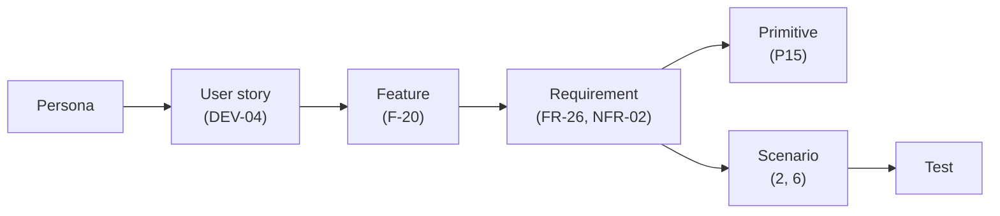

# Requirements and traceability

*Status: intermediate design as of 26 Nov 2026. Every requirement below is designed. Parts of FR-01 to FR-07, FR-22 and FR-23 have code with tests on a branch in review (P01, P10, P11, P20); nothing else is built. Every threshold in a check is a proposal for the maintainer to accept or change, not a measured value.*

This page closes the product chain. Each functional requirement (FR) says what a feature must do; each non-functional requirement (NFR) says how well, with a check that can be measured. Every requirement traces back to the [user stories](04-user-stories.md) and [features](05-features.md) it serves, and the table at the end runs the whole chain from persona to scenario.

## The frame: how to read a requirement

Caption: read left to right for why a requirement exists, and right to left for what a failing test breaks.

| Group | IDs | Count | Must | Should | Later |
|---|---|---|---|---|---|
| Agent definition and loading | FR-01 to FR-04 | 4 | 4 | 0 | 0 |
| Durable state | FR-05 to FR-17 | 13 | 12 | 1 | 0 |
| Thinking | FR-18 to FR-21 | 4 | 1 | 3 | 0 |
| Acting safely | FR-22 to FR-25, FR-48 | 5 | 4 | 0 | 1 |
| Control | FR-26 to FR-35 | 10 | 7 | 2 | 1 (and part of FR-28) |
| Interfaces, deployment and proof | FR-36 to FR-42, FR-47 | 8 | 5 | 3 | 0 |
| Example agents and fixtures | FR-43 to FR-46 | 4 | 4 | 0 | 0 |
| Functional total | FR-01 to FR-48 | 48 | 37 | 9 | 2 (and part of FR-28) |
| Non-functional | NFR-01 to NFR-21 | 21 | 15 | 5 | 1 |

---

## 1. Functional requirements

### 1.1 Agent definition and loading

| ID | Requirement | Stories | Features | Primitives | Priority |
|---|---|---|---|---|---|
| FR-01 | The loader loads every agent module found in the configured plug-in folders. No file in the runtime package names an agent, an agent's artifact kind or an agent's tool | DEV-01 | F-28, F-40 | P20 | Must |
| FR-02 | An agent module declares, as data, its purpose, instructions, artifact schemas, typed relation kinds, Task tree, stop-policy opt-ins, model aliases, tools and budget. Its completion checks and tool bodies are plain pure functions, and it subclasses no runtime class except the fake-model bases | DEV-01, DEV-05 | F-28 | P20 | Must |
| FR-03 | The loader refuses a malformed module before any event is written, naming the module, the Task and the field, for each case in DEV-02 criterion 1 | DEV-02 | F-28 | P20, P10, P07, P12 | Must |
| FR-04 | The runtime records the agent definition version hash at run start. Recovery ends a run whose hash changed as `failed`, reason `definition_changed`, with no model turn | DEV-03 | F-28, F-02 | P20, P02 | Must |

### 1.2 Durable state

| ID | Requirement | Stories | Features | Primitives | Priority |
|---|---|---|---|---|---|
| FR-05 | The event store is append-only (triggers refuse update and delete), has one writer behind a single-writer lock, commits named groups of events in one transaction, enforces deduplication keys as unique indexes, and names the owner on every read | OPS-07, OPS-08 | F-01 | P01 | Must |
| FR-06 | Each event carries `prev_hash` and `hash` (SHA-256 over its canonical record), starting from a genesis hash derived from a random store ID. `aksha verify` reports the first break, and with anchors it reports a rewritten tail as `anchor_mismatch` | OPS-07 | F-01, F-35 | P01 | Must |
| FR-07 | Every interpretation (Task status, next action, stop-policy stack, invalidation, pending items, the work board) is a projection computed by a pure reducer over the event store; none is stored as a fact | OPS-01, FND-05 | F-01 | P01 | Must |
| FR-08 | Recovery on startup runs one fixed sequence: take the lock, reconcile landed outbox entries, re-execute recorded queries per owner, reconcile the rest, close dispatched at-most-once steps as outcome unknown, classify each open run, open rebuild runs. Step IDs are deterministic, time comes from an injected clock, and a recorded step returns its recorded result | REV-03, DEV-03 | F-02 | P02 | Must |
| FR-09 | A run resumed 3 times with no progress in between ends `failed`, reason `restart_limit`; the count is a projection | OPS-03 | F-02, F-17 | P02, P14 | Must |
| FR-10 | Every external effect is an outbox entry, committed with its idempotency key before the call. After a crash, a reconcile step asks the system of record by key, and an at-most-once step with no answer is recorded as outcome unknown, never re-sent blindly | REV-03, CNS-02, OPS-05 | F-03 | P03 | Must |
| FR-11 | Every command carries a command ID and gets an idempotent receipt, so a retried command is recorded once | REV-04, OPS-04, OPS-08 | F-03, F-27 | P03, P19 | Should |
| FR-12 | Artifact versions are typed by a schema the agent declares, immutable and content-hashed. A save that fails its schema is refused; saving identical content returns the existing version | FND-02, CNS-02 | F-04 | P04 | Must |
| FR-13 | Every artifact version records its reads (fixture records, user statements, other artifact versions and recorded queries with their result-set hash) as its lineage. A corrected user statement records a `supersedes` provenance link that no agent can write | FND-05, CNS-02, INV-02 | F-04 | P04 | Must |
| FR-14 | Typed relations are declared beside the schemas with the kinds they may connect. A relation between undeclared kinds is refused at load; a relation saved without an excerpt is refused at save | FND-02, DEV-02 | F-04 | P04 | Must |
| FR-15 | A change set is one `source.changed` fact. Invalidation marks exactly the work whose lineage reaches the change, stops where a rebuilt artifact's canonical content is unchanged (early cutoff), blocks every effect that depends on invalidated work, and revokes an approval only when its target is confirmed out of date | FND-05, REV-05 | F-05 | P05 | Must |
| FR-16 | An invalidated machine-only artifact rebuilds without asking. An invalidated human-reviewed version gets a pending revision beside it and a diff review with its changed inputs and a field-level redline; only the person's accept makes it current, an accept never grants an approval, and diff reviews open in dependency order | REV-05, CNS-02 | F-05 | P05, P17 | Must |
| FR-17 | Citation spans are minted only by tools and the runtime. Every quote is verified against its stored source at save, and a claim that cannot be grounded is saved as an explicit unknown with a question | FND-02, FND-03, CNS-01, INV-01 | F-16 | P13 | Must |

### 1.3 Thinking

| ID | Requirement | Stories | Features | Primitives | Priority |
|---|---|---|---|---|---|
| FR-18 | Three model classes exist, each with its own contract and fake: extraction and classification (System 1) and generation (System 2). Tasks bind model aliases to classes, and the loader refuses a class mismatch | DEV-06 | F-10 | P07 | Should |
| FR-19 | Every System 1 answer lands in accept, reject or abstain by thresholds declared as data. An abstention follows the alias's declared fallback; an adapted model answers only when declared and is recorded `native=False`; no System 1 answer gates an external effect; unfitted thresholds are listed by `aksha inspect` | DEV-06 | F-10 | P07, P22 | Should |
| FR-20 | The agent loop runs one turn of one Task instance, keeps nothing in memory between turns, runs every tool call the model proposes through the gate, and hands every turn end to stop-policy evaluation | DEV-04 | F-09 | P06 | Must |
| FR-21 | Each Task instance has its own model context, assembled as a projection under a declared character limit. Tool results are truncated when recorded, a step whose context would pass the limit is not sent, and the context for a step hashes the same after a restart | DEV-04, DEV-07 | F-11 | P08 | Should |

### 1.4 Acting safely

| ID | Requirement | Stories | Features | Primitives | Priority |
|---|---|---|---|---|---|
| FR-22 | Every tool is declared data with its schema, one effect class and its step semantics (at-least-once, reconcile or at-most-once). The schema the model sees is the schema the gate checks | DEV-01, DEV-02 | F-13 | P10 | Must |
| FR-23 | The policy gate denies by default, is one checker in code, and takes nothing the model wrote as an input to its decision. Recipients come only from configured records. Every refusal is recorded and returned to the model as data | FND-06, DEV-01, REV-01 | F-14 | P11 | Must |
| FR-24 | A program-running tool passes the gate first, then runs in a sandbox whose policy is the intersection of run, agent, Task and tool; the workspace is built fresh from artifact versions; outputs return as artifacts with recorded reads; symlinks out are rejected; network access is off; with no backend strong enough the call fails `sandbox_unavailable` with no fallback | DEV-08, OPS-05 | F-15 | P12 | Later (the refusing backend is Must) |
| FR-25 | Each agent declares budgets of tool calls, model turns and active seconds, with a runtime default for an agent that declares none; each Task instance has a turn limit (10 by default); each tool call has a timeout (10 s) and bounded retries (2). Every count is a projection, and hitting a budget raises a budget interrupt with all saved work kept | OPS-03 | F-17 | P14 | Must |
| FR-48 | Tool results, fetched documents and memory text enter the model context as data. Text in them aimed at the agent is flagged and can change no permission, approval, recipient, budget or stop-policy configuration | FND-06 | F-14, F-16 | P11, P13 | Must |

### 1.5 Control

| ID | Requirement | Stories | Features | Primitives | Priority |
|---|---|---|---|---|---|
| FR-26 | An agent declares a Task tree in which each Task may hold child Tasks with their own completion checks. Fan-out creates one tracked Task instance per key; only the scheduler starts instances, one at a time in a fixed order in the first milestone; keys come from inspectable data, never from model text | DEV-04 | F-20 | P15 | Must |
| FR-27 | At every stop candidate (a turn end, an instance entry or end, a fault, a resume), stop-policy evaluation offers the candidate to a stack of pure stop policies derived from the event store and records exactly one stop decision with the verdict, the deciding policy and the checks evaluated | DEV-05, OPS-04, REV-03 | F-21 | P16 | Must |
| FR-28 | Every agent gets the Run, Task and interrupt stop policies. An agent may opt into goal condition, plan mode, forced tool choice and todo reminder per Task by configuration, and the loader refuses any other name | DEV-05 | F-21 | P16 | Must (built-in policies); Later (opt-ins) |
| FR-29 | One hold predicate, read by stop-policy evaluation and by every automatic start (recovery, the scheduler, rebuild runs, timers, finalisation), refuses to start held work while a person's state holds it: an open interrupt on that work, or a person's stop | OPS-04, REV-03 | F-21 | P16 | Must |
| FR-30 | An interrupt is one of six kinds (`input`, `choice`, `approval`, `budget`, `review`, and the session-scoped `route` the request router raises) with a label the agent declares. Only the instance that raised it waits (for `route`, only that message's intake); only a person resolves it, and the runtime may only void it. A suspended run has no process attached | REV-04, FND-04, INV-01 | F-22 | P17 | Must |
| FR-31 | An approval authorises one exact action by a signature over its canonical form. The runtime recomputes the signature from current facts before the outbox sends, refuses a mismatch as `signature_mismatch`, voids the approval on an edit, and refuses a second decision as `already_decided` | REV-01, REV-02, CNS-02 | F-22 | P17 | Must |
| FR-32 | A stop command appends a stop request under an idempotency key. The Run policy honours it at the next stop candidate, including after a crash, voiding open interrupts and ending the run `stopped` with no model turn; a standing hold then lasts until the person's next command naming that agent | OPS-04 | F-23 | P18 | Should |
| FR-33 | A fan-out parent declares whether a blocked child blocks it (the default) or leaves an explicit unknown. A budget interrupt can be answered "finalise", which marks unstarted keys "not checked" and runs only finaliser Tasks on a reserved budget. Both end the run `partial`, listing completed Tasks, every unknown and its blocker | FND-03 | F-24 | P24 | Must |
| FR-34 | A message to an open run is a durable fact in a named lane: steer, follow-up or amend. A message that names no lane is refused; `amend` replaces a user statement through a `supersedes` link | INV-02 | F-25 | P27 | Should |
| FR-35 | A supervisor Task is a parent Task that reads a capped work board projection, commits directives as data for the scheduler, and is bounded by an activation limit and a no-progress limit counted from the event store. The review inbox groups open interrupts by Task and kind | OPS-01, OPS-02 | F-26 | P15, P16 | Later |

### 1.6 Interfaces, deployment and proof

| ID | Requirement | Stories | Features | Primitives | Priority |
|---|---|---|---|---|---|
| FR-36 | Every interface reaches the runtime through one `dispatch(command)` entry point with idempotent receipts, and reads through event streams with a cursor and a catch-up marker. One capability record per runtime says what it can do | OPS-08 | F-27 | P19 | Must |
| FR-37 | A request router, a classification model alias over the loaded agents' purpose text, picks the agent for free text, records the choice as a durable step, raises a session-scoped `route` interrupt when it abstains, and has no tool access | FND-01, DEV-01 | F-31 | P23 | Must |
| FR-38 | `aksha serve` runs the runtime as the server that owns the session API and is the single writer. With no server running, `aksha run` starts the runtime in-process for that one command | OPS-08 | F-32 | P19 | Must |
| FR-39 | A headless run raises no approval interrupt and asks for no permission, while every deny rule of the policy gate still refuses; it records its mode and the sandbox capability record at start, records every tool call as any run does, and still sends every external effect through the outbox | OPS-05 | F-33 | P11, P17, P03 | Should |
| FR-40 | `aksha inspect` shows, for any run, its agent, Tasks, model turns, tool calls, refusals, input versions, approvals, artifact saves, stop decisions and errors | OPS-07, DEV-07 | F-35 | P21 | Must |
| FR-41 | The agent-run trace is built by a pure function over the event store, named by the OpenTelemetry GenAI semantic conventions, with IDs derived from the store, and exported over OTLP on explicit request. Operational telemetry is live OpenTelemetry instrumentation, never written to the event store. Both planes share trace and span IDs | OPS-06 | F-29 | P21 | Should |
| FR-42 | The runtime provides a fake for every model class, a replay model that reads answers from a recorded event store, and eval cases as data with a kind and a source | DEV-07 | F-30 | P22 | Must |
| FR-47 | The web app renders approval requests, diff reviews, evidence grids and the Task tree from runtime events through the session API, and adds no runtime behaviour | OPS-08, REV-05 | F-34 | P19 | Should |

### 1.7 Example agents and fixtures

| ID | Requirement | Stories | Features | Primitives | Priority |
|---|---|---|---|---|---|
| FR-43 | The research agent scopes the question (asking only questions whose answer changes the result), discovers competitors and resolves duplicates by `same_entity_as` relations, gathers evidence per competitor, reports reviews as "N of M in this sample", keeps conflicting values with a `contradicts` relation, proposes one experiment, and completes only when its four outputs exist at current versions | FND-02, FND-03 | F-36 | P04, P13, P15, P24 | Must |
| FR-44 | The patent-disclosure agent extracts each candidate from the dated notes, groups publications into priority families by `family_member_of` relations, compares features by family in four cell states without reading `not_found` as novel, recommends by a rule table in code, and saves the founder's selection with the recommendation versions it used | FND-04, INV-01 | F-37 | P04, P15, P17 | Must |
| FR-45 | The patent-disclosure agent writes forms through a tool against blank templates, marks each required field complete, missing or needs counsel, builds a packet that records every input version and opens with its "needs counsel confirmation" section and scope note, blocks readiness while a field is missing, sends only under its own approval of the exact version, and has no filing tool | CNS-01, CNS-02 | F-38 | P03, P13, P17 | Must |
| FR-46 | Fixtures are visibly synthetic and carry an answer key that no tool path can reach. A change set is applied with one command, and every agent's tests are graded by its answer key | FND-05, DEV-07 | F-39 | P05, P22 | Must |

---

## 2. Non-functional requirements

Each NFR has a measurable check. The checks with fake models prove the runtime's mechanics, not a live model's reliability: a deterministic fake passes every repeat or none.

| ID | Area | Requirement | Measurable check | Stories | Features | Priority |
|---|---|---|---|---|---|---|
| NFR-01 | Offline | The whole project, every test and every scenario run with no network and no credentials | The suite runs with a fixture that makes any socket connect raise and with no model keys in the environment: 0 failures | DEV-07 | F-30, F-39 | Must |
| NFR-02 | Determinism | Fake-model mode gives the same record for the same fixtures and inputs | Two runs of each example agent give identical artifact hashes, stop-decision sequences and context hashes: 100% equal | DEV-07 | F-30, F-02 | Must |
| NFR-03 | Durability across restart | Killing the process at any named fault-injection point loses no saved work | After restart at each point, the projections equal an uninterrupted run's at the same point: 100% of points | REV-03, OPS-03 | F-02 | Must |
| NFR-04 | Exactly-once effects | Retries and restarts never duplicate a record or a send | Ledger entries per idempotency key never exceed 1 across the suite; a send retried 3 times with one restart gives 1 entry | REV-03, CNS-02 | F-03 | Must |
| NFR-05 | Bounded runs | Every run is bounded and slow calls are cut off | One test per limit, set low, ends the run with saved work kept; a real-time test abandons a 2 s call under a 0.2 s timeout within about 0.5 s | OPS-03 | F-17 | Must |
| NFR-06 | Permissions fail closed | No agent can call a tool outside its list by any path, including the router | A test calls every registered tool from every agent at every Task: 100% of calls outside the narrowed list refused before dispatch; a gate that raises refuses | DEV-01, FND-06 | F-14 | Must |
| NFR-07 | Untrusted content | Injected text changes nothing that governs the run | With and without the injection fixtures, and with a fake that obeys them, tool lists, approvals, recipients, budgets and stop-policy configuration compare equal at the end of scenario 12 | FND-06 | F-14, F-16 | Must |
| NFR-08 | Owner isolation | One owner's data is invisible to another | Two owners on the same fixtures: every cross-owner list and read returns "not found" (never "forbidden"): 100% | OPS-08 | F-01, F-27 | Must |
| NFR-09 | Pluggability | Agents are separate from the runtime | The third-agent test leaves the runtime package hash unchanged; a static scan of runtime source against a list of agent names and domain nouns finds 0 whole-word matches | DEV-01 | F-28, F-40 | Must |
| NFR-10 | Stop ownership | Every stop decision has one owner and one record | Across the suite, every stop candidate has exactly one stop decision, no run or turn ends without one, and recomputing each from the event store gives the recorded verdict in 100% of cases | DEV-05, OPS-04 | F-21 | Must |
| NFR-11 | Derivation agreement | Views never disagree with the event store | A property test cuts each scenario's event store at 50 random points; live views (Task status, next action, stack, invalidation, pending items, board) equal a full rebuild in 100% of cuts | OPS-01, FND-05 | F-01 | Must |
| NFR-12 | Tamper evidence | An altered record is detected | `aksha verify` passes on every untouched test store; editing one event is reported at that sequence; re-hashing a tail is reported against an anchor: 100% detected | OPS-07 | F-01, F-35 | Must |
| NFR-13 | Hold invariant | Human state beats every automatic start | `inv.no_auto_start_while_held` drives each kind of automatic start against held work: 0 starts | OPS-04, REV-03 | F-21, F-23 | Must |
| NFR-14 | Developer errors at load | An agent developer never debugs a half-run | 100% of the loader's malformed-module fixtures fail before the first event, with module, Task and field in the message | DEV-02 | F-28 | Must |
| NFR-15 | Secrets | No secret appears in code, fixtures, the event store or any output | A secret scan over the repository and every test store finds 0 matches; a test sets a fake key and asserts it never appears in the event store | OPS-07 | F-01 | Must |
| NFR-16 | Performance | The developer's loop stays short on a laptop | On a 4-core laptop: full suite at most 90 s, excluding the real-time timeout test; one fake-mode run of either example agent at most 5 s; read from the test runner's timing | DEV-07 | F-30 | Should |
| NFR-17 | Small and readable | A reader can read the runtime in one sitting | The runtime package stays within a line budget the maintainer sets (proposal: 2,000 non-blank, non-comment lines), with each optional package counted separately; no function over 60 lines | DEV-01 | F-28 | Should |
| NFR-18 | Interface parity | The CLI and the web app are two views of one session | Scenario 2 driven through the CLI and through the HTTP API gives event stores equal apart from request IDs | OPS-08 | F-27, F-34 | Should |
| NFR-19 | Calibration honesty | Nothing claims a calibration nobody measured | Every threshold with no fitting data appears in `aksha inspect`; a documentation check finds 0 accuracy or calibration figures for a System 1 alias | DEV-06 | F-10 | Should |
| NFR-20 | Telemetry separation | Operational telemetry never enters the event store, and nothing exports by accident | After a served run with telemetry on, 0 operational events are in the event store; with no endpoint configured, 0 sockets open during export | OPS-06 | F-29 | Should |
| NFR-21 | Sandbox confinement | A sandboxed program cannot reach outside its policy | The conformance suite's escape attempts (read outside the root, write outside the output folder, connect, fork past the limit, symlink out, read an answer key) succeed 0 times on each shipped backend | DEV-08, OPS-05 | F-15 | Later |

---

## 3. Traceability: persona to scenario

One row per story. Read across for the full chain; search a column to find everything a requirement, primitive or scenario touches.

| Persona | Story | Features | Requirements | Primitives | Scenarios |
|---|---|---|---|---|---|
| Agent developer | DEV-01 Add an agent by declaring one module | F-28, F-13, F-14, F-31, F-40 | FR-01, FR-02, FR-22, FR-23, FR-37; NFR-06, NFR-09, NFR-17 | P20, P10, P11, P23 | 8 |
| Agent developer | DEV-02 Mistakes fail at load | F-28, F-04, F-13 | FR-03, FR-14, FR-22; NFR-14 | P20, P04, P10 | 8 |
| Agent developer | DEV-03 A changed module never resumes an old run | F-28, F-02 | FR-04, FR-08 | P20, P02 | 3 |
| Agent developer | DEV-04 Tasks with child Tasks and fan-out | F-09, F-11, F-20 | FR-20, FR-21, FR-26 | P06, P08, P15 | 1, 2, 6 |
| Agent developer | DEV-05 Declare the stop rules I need | F-21 | FR-02, FR-27, FR-28; NFR-10 | P16 | 6, 8 |
| Agent developer | DEV-06 Each model job to its class | F-10 | FR-18, FR-19; NFR-19 | P07 | 7 |
| Agent developer | DEV-07 Test offline against my own fixtures | F-30, F-35, F-39, F-11 | FR-21, FR-40, FR-42, FR-46; NFR-01, NFR-02, NFR-16 | P22, P08, P21 | 1, 7, 8 |
| Agent developer | DEV-08 A program in a sandbox fed by artifacts | F-15, F-18, F-19, F-41 | FR-24; NFR-21 | P12, P26, P28 | 5 |
| Operator | OPS-01 One work board derived from the record | F-26, F-01 | FR-07, FR-35; NFR-11 | P01, P15 | 6 |
| Operator | OPS-02 Review by kind of judgement | F-26 | FR-35 | P15, P16, P05 | 6 |
| Operator | OPS-03 Misbehaving runs stopped with a reason | F-17, F-02 | FR-09, FR-25; NFR-03, NFR-05 | P14, P02 | 3, 11 |
| Operator | OPS-04 A stop that holds across every restart | F-23, F-21, F-07 | FR-11, FR-27, FR-29, FR-32; NFR-10, NFR-13 | P18, P16, P25 | 9 |
| Operator | OPS-05 Headless jobs inside a sandbox | F-33, F-15, F-03, F-14 | FR-10, FR-24, FR-39; NFR-21 | P11, P12, P03, P17 | 5 |
| Operator | OPS-06 Trace any run to any OTLP backend | F-29 | FR-41; NFR-20 | P21 | 10 |
| Operator | OPS-07 Inspect and verify any run | F-01, F-35 | FR-05, FR-06, FR-40; NFR-12, NFR-15 | P01, P21 | 5, 10 |
| Operator | OPS-08 Embedded or server, same results | F-27, F-32, F-34 | FR-05, FR-11, FR-36, FR-38, FR-47; NFR-08, NFR-18 | P19, P01 | 2, 3 |
| Reviewer of agent output | REV-01 See the exact action before approving | F-22, F-14, F-38 | FR-23, FR-31 | P17, P11 | 2 |
| Reviewer of agent output | REV-02 Reject or edit without side effects | F-22 | FR-31 | P17 | 3 |
| Reviewer of agent output | REV-03 A pending approval survives a restart | F-02, F-03, F-21 | FR-08, FR-10, FR-27, FR-29; NFR-03, NFR-04, NFR-13 | P02, P03, P16, P17 | 3 |
| Reviewer of agent output | REV-04 Answer once, reach the work that asked | F-22, F-27 | FR-11, FR-30 | P17, P19 | 1, 2 |
| Reviewer of agent output | REV-05 A diff when reviewed work goes out of date | F-05, F-34 | FR-15, FR-16, FR-47 | P05, P17 | 4 |
| Venture founder | FND-01 Name an agent or describe the request | F-31 | FR-37 | P23 | 1, 8 |
| Venture founder | FND-02 A competitor picture from fetched pages | F-04, F-16, F-36 | FR-12, FR-14, FR-17, FR-43 | P04, P13 | 1, 11, 12 |
| Venture founder | FND-03 A run out of evidence ends partial | F-24, F-16, F-36 | FR-17, FR-33, FR-43 | P24, P13 | 11 |
| Venture founder | FND-04 Choose from a recommendation table | F-22, F-37 | FR-30, FR-44 | P17, P15 | 2, 6 |
| Venture founder | FND-05 A late fact changes only what read it | F-05, F-01, F-39 | FR-07, FR-13, FR-15, FR-46; NFR-11 | P05, P04, P01 | 4 |
| Venture founder | FND-06 Hidden instructions change nothing | F-14, F-16, F-36 | FR-23, FR-48; NFR-06, NFR-07 | P11, P13 | 12 |
| Engineer-inventor | INV-01 A disclosure from my dated notes | F-04, F-37 | FR-17, FR-30, FR-44 | P04, P13, P17 | 2, 4 |
| Engineer-inventor | INV-02 A correction replaces the old answer visibly | F-25, F-05 | FR-13, FR-34 | P27, P05 | 4 |
| Patent counsel | CNS-01 Complete, missing or flagged, never guessed | F-16, F-38 | FR-17, FR-45 | P13 | 2 |
| Patent counsel | CNS-02 Built from known inputs, sent once, redlined | F-03, F-04, F-05, F-06, F-38 | FR-10, FR-12, FR-13, FR-16, FR-31, FR-45; NFR-04 | P03, P04, P05, P29 | 3, 4 |

Reverse checks, done by hand on 26 Nov 2026:

1. Every FR and NFR appears in at least one row above.
2. Every scenario, 1 to 12, appears in at least one row.
3. Primitives that no row names: P09 (memory) and P30 (erasure), both Later, with no story in the first milestone.

## Where this stops

1. Every requirement is designed; none has a passing test except the parts of FR-01 to FR-07, FR-22 and FR-23 on the branch in review.
2. FR-39 records decisions 23 and 26: a headless run keeps every policy-gate check, and only asks become allows. What it does on an `input` interrupt, and whether it may start outside a sandbox, are open (see [architecture](../02-architecture.md), section 11).
3. NFR-17's line budget waits for the maintainer's number. The design estimates available on 25 Nov 2026 already put the core near 2,000 lines before several optional packages; all such figures are estimates.
4. The traceability table was checked by hand, not by a script.

## Sources

1. The product features-and-requirements document, version 2, 25 Nov 2026, sections 2 and 3 (functional and non-functional requirements) and section 6 (traceability).
2. The [primitives catalogue](../03-primitives.md) and the 30 ADRs, P01 to P30, 25 Nov 2026.
3. The maintainer's [decisions log](../04-decisions-log.md), entries 13, 17, 20, 21, 22 and 23.
