# Aksha architecture

*Status: intermediate design as of 26 Nov 2026. This page describes the architecture as designed on that date, before the first code merged. Each part carries the status its architecture decision record (ADR) gives it: Accepted, Accepted in part, Proposed or Open, as defined in the [index](README.md). Where the maintainer's decision log settles a point that an ADR has not yet absorbed, the page names the decision by its number. Since then 29 of the 30 primitives have been built and tested on main (as of 27 Nov 2026; see the [architecture overview](../architecture/overview.md#the-primitives)); where the build amended a design, the ADR's "Amendments from the build" section says so.*

Aksha is one runtime that many agents share, and every fact any of them produces goes into one append-only, hash-chained event store. Everything else in the system, from a Task's status to the trace a person inspects, is a projection computed from that store. The architecture is easiest to read at three levels of zoom, then through the life of one run:

| Level | Question it answers | Section |
|---|---|---|
| Context | What does the runtime talk to? | 1 |
| High-level design (HLD) | Which layers make up the runtime, and where does each of the 30 primitives sit? | 2 |
| Three tiers | What may each part of the system hold, who writes the record, and how does it deploy on a laptop and in a software factory? | 3 |
| Low-level design (LLD) of the foundation | How do the ports, the event store, projections, agent definitions, the tool registry and the policy gate fit together? | 4 |
| Run lifecycle | What happens from start to tool call, interrupt, crash, resume and invalidation? | 5 |
| Deployment and operations | Server and embedded modes, headless mode, telemetry, storage, code layout | 6 to 10 |

Two example agents carry the design through every section. Both serve Stillroom, a fictional hardware venture. The research agent searches competitors, fetches pages and reviews, and writes a competitor matrix with a quoted excerpt behind every finding. The patent-disclosure agent extracts inventions from engineering notes, compares them with published patent families, prepares disclosure packets and asks for approval before a mock send to outside counsel. A third agent, a contrast coding agent that edits a Git repository in a sandbox, runs tests and pushes a branch, is designed but not built. It exists to keep the first two honest: the rule of three says no abstraction enters the runtime until all three agents need it without agent-specific code (decision 16).

## 1. Context: one headless process between people, models and outside systems

The runtime is a headless Python process: it has no user interface of its own, and every interface reaches it through one session API. People send it commands and watch an event stream. It calls models, a sandbox and outside systems, and it records every call before and after.

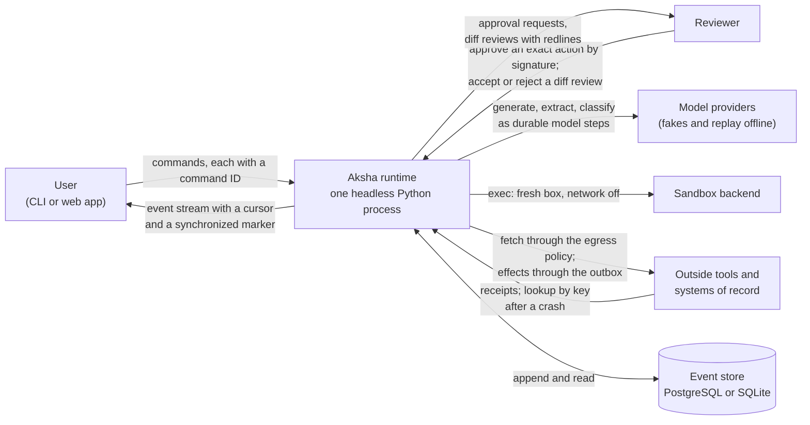

Caption: every arrow into or out of the runtime is either a command that gets a receipt or a call that is recorded in the event store, so nothing the runtime does is invisible to replay.

The model providers include two families. Generation models (System 2, the slow class) write prose and plans. Extraction and classification models (System 1, the fast class) pull typed fields out of text and sort inputs into labels, and they are routed like any other model (decision 15). Offline, every model class has a fake and a replay model read from a recorded store (ADR-P22, Proposed).

## 2. HLD: seven layers, with every primitive placed

The runtime splits into seven layers. Each layer answers one question, and each of the 30 primitives belongs to exactly one layer.

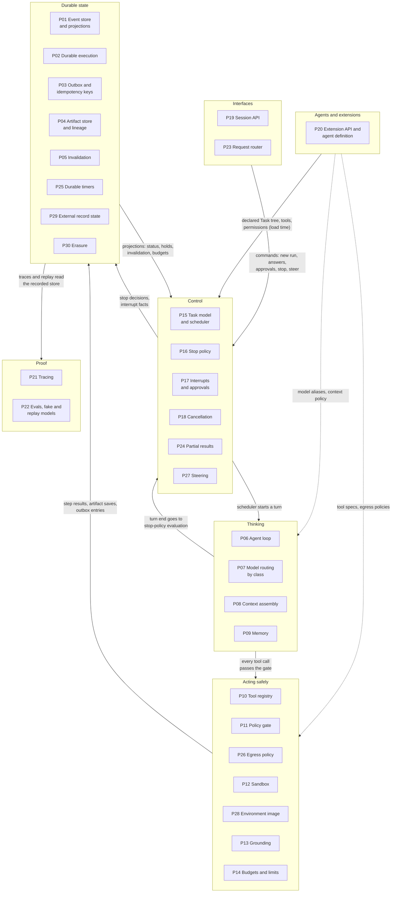

Caption: every layer writes facts down into durable state and reads projections back up, so durable state is the only layer every other layer depends on.

| Layer | Question it answers | Primitives |
|---|---|---|
| Interfaces | How does a person or program reach a run? | P19, P23 |
| Agents and extensions | How does a new agent arrive without touching the runtime? | P20 |
| Control | Who starts work, who decides it is finished, who may pause or stop it? | P15, P16, P17, P18, P24, P27 |
| Thinking | What does the model see, and which model answers? | P06, P07, P08, P09 |
| Acting safely | What may the agent do, where, for how long, with what evidence? | P10, P11, P12, P13, P14, P26, P28 |
| Durable state | What is true, and what is out of date, after any crash? | P01, P02, P03, P04, P05, P25, P29, P30 |
| Proof | How does anyone check what happened, offline? | P21, P22 |

Status as of 26 Nov 2026: four ADRs are Accepted in part (P04, P05, P15, P16), and three are Proposed with named parts Accepted (P06, P13, P20). P30, erasure in an append-only store, is Open. Every other ADR is Proposed. The decisions inside these records that are Accepted share one shape: structured artifacts are the core data model (decision 6), the recursive unit of work is the Task (decision 7), the agent loop never decides a stop itself, and an agent opts into built-in stop policies by configuration rather than writing its own (decision 10).

The build order follows the dependencies. Every path in the dependency graph starts at P01, so the event store comes first, then the extension API, the tool registry and the gate, then durable execution and the agent loop, then the control primitives, then the interfaces.

## 3. Three tiers: state, runtime and execution

The layers in section 2 sort the runtime by what each part answers. The three tiers sort the whole system by what each part may hold, and so by what a compromise of it costs (decision 29, Accepted, 26 Nov 2026). Tier 1 holds the record and nothing else. Tier 2 holds the logic and every credential, and it is the only thing that writes the record. Tier 3 runs the programs an agent asks for and holds nothing: it gets a workspace, runs, and hands back data. A hijacked program in tier 3 can waste its own time limit and return a wrong answer, but it cannot reach the event store, a key or another run. In one line: the brain stays outside the sandbox, and the hands get only the work.

The design choice that sets this split apart is that tier 3 is stateless on purpose. A sandbox that keeps a folder between calls, snapshots itself or hosts a long-lived process would be convenient, and each of those would be state outside the event store, which recovery cannot see and a crash can leave half-written. Aksha keeps the workspace as an artifact version instead (ADR-P12 decision 5), so the box can be thrown away after every call.

| Tier | Holds | Trust | Writes tier 1? | Reaches outside systems? |
|---|---|---|---|---|
| 1, state | The event store (append-only, hash-chained, ADR-P01), the blob store (content-addressed by SHA-256, decision 25) and the transactional outbox (ADR-P03) | Trusted storage that computes nothing about agents; tamper-evident through the hash chain | It is tier 1 | No |
| 2, runtime | The session API, the agent loop, Tasks and the scheduler, stop policies, the policy gate, the durable step executor, context assembly, invalidation, model adapters, outbox receivers and the egress-checked HTTP client; the loaded agent definitions; every provider and receiver credential; caches of projections | Trusted code that treats model output and tool results as untrusted data | Yes, only through the single writer | Yes, through model adapters, receivers and the egress-checked HTTP client |
| 3, execution | Sandbox workers, and one materialised workspace per box for the box's lifetime | The worker is trusted to enforce limits; the box is assumed hostile | No | No; the network is off in every shipped backend (ADR-P12 decision 4) |

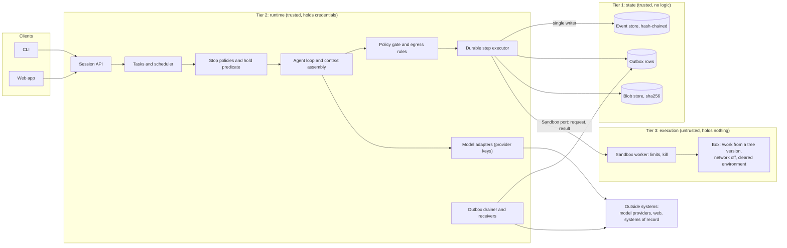

Caption: every arrow into tier 1 starts in tier 2, every arrow into tier 3 starts at the step executor, and tier 3 has no arrow out except its result.

### 3.1 One exec call across the tiers

The contrast coding agent's `run_tests` step shows where each tier's job begins and ends:

1. The model asks for `run_tests`. The gate in tier 2 checks that the tool is allowed for this Task instance, that its effect class is `exec`, and that a sandbox backend of the required strength exists.
2. The step executor records `step.started` in tier 1, with the hash of the arguments and the input workspace tree version.
3. The executor sends tier 3 the argv, the tree manifest, the effective sandbox policy and the limits through the `Sandbox` port.
4. Tier 3 materialises `/work` from that tree version, runs the test suite in a box with no network, collects the declared report file, and returns it with the exit code and any denials.
5. Tier 2 validates the report against its artifact schema, stores the blob, and commits `step.completed` and the new artifact version, with its lineage, in one transaction.

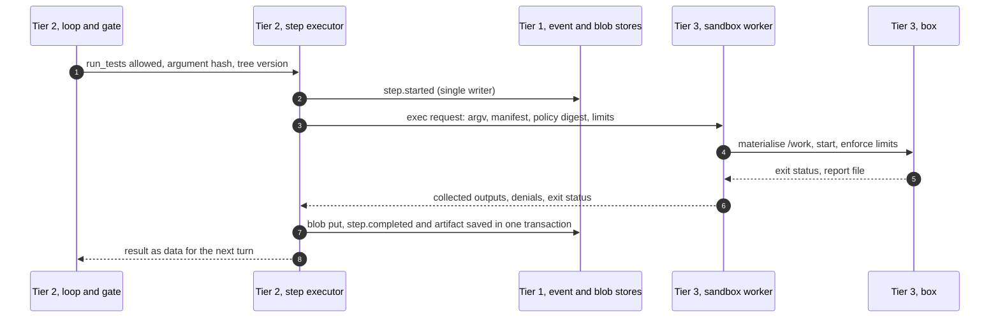

Caption: the box never sees the store and the store never sees the box; the step executor is the only party that talks to both.

### 3.2 The rules, each with the test that breaks when it is broken

| Rule | Statement | Why | Proved by |
|---|---|---|---|
| R1 | Tier 3 holds no credentials and no durable state | A hijacked program reaches only what the box holds, and a crash loses nothing because the workspace is an artifact version | A key present in tier 2's environment is absent in the box; a rerun after a crash in the middle of an exec gives the same outputs |
| R2 | Only tier 2 writes tier 1, and only through the single writer | One writer keeps one order of facts, one hash chain and one place where a commit is atomic | Only the `EventStore` adapter opens a write connection; the append-only triggers refuse `UPDATE` and `DELETE`; no Task starts outside a stop decision (ADR-P15) |
| R3 | Tiers talk only through ports | Any adapter can be swapped (SQLite for PostgreSQL, a local sandbox for a remote microVM pool, the own executor for a Temporal adapter) with one contract suite each | The dependency-rule test (section 10) and one contract suite per port |
| R4 | Tier 3 never calls tier 1 or tier 2; it only answers a request | No callback means no new entry point for a hostile program | The `Sandbox` port is request and response only, and the sandbox conformance suite asserts that a connect from the box fails |
| R5 | Tier 2 can be replaced by a fresh process at any moment | Recovery on startup rebuilds everything from tier 1 (ADR-P02) | ADR-P02's crash points; a status computed incrementally equals one rebuilt from the whole store |
| R6 | A content-addressed cache may sit in any tier, as long as deleting it changes nothing observable | A cache is a performance detail, not state | Deleting the materialisation cache between two runs leaves their records identical (ADR-P12) |

Four clarifications keep R1 exact:

1. A sandbox worker authenticates its own port connection, for example with mutual TLS on a remote pool. That identity is the worker's, not a credential to tier 1 or to an outside system, and the box never sees it.
2. Tool bodies from agent modules run in tier 2. An agent definition is trusted Python that the loader checks and hashes, and a person approves (decision 2, ADR-P20). The sandbox is for the programs an agent runs: shells, test suites, scripts the model wrote. Moving every tool body into tier 3 is future direction X-1.
3. Trusted code can still parse hostile bytes. A research fetch tool parsing a hostile web page, or a patent tool parsing a third-party PDF, runs a parser on attacker-chosen input next to every key. The proposed split needs no core change: a fetch tool in tier 2 stores the raw bytes as a blob, and an `exec` parse tool in tier 3 reads that blob with the network off and returns text. A `parses_untrusted` flag on the tool specification lets the loader refuse a tool that declares untrusted parsing but is not sent to tier 3 (ADR-P12 T5, Proposed).
4. Merge code follows the same line. A merge function over blobs runs in tier 2 as in-process code; a merge that needs an external program runs as a tier 3 exec step, because repository content is untrusted.

The catch: tier 2 is the trusted computing base, and nothing in the split protects against a bad runtime change or a hostile agent module. The hash chain makes a rewrite of tier 1 detectable once it has an external anchor (ADR-P01), and the loader and a person's approval guard agent modules, but the tiers themselves do not.

### 3.3 Deployment shapes

The same three tiers run in two shapes. Only the adapters behind the ports change; no domain code knows which shape it runs in, and a primitive that needed to know would be a sign that a tier boundary had leaked.

On a laptop, everything is one process and a local sandbox. `aksha run` with no server starts the runtime in-process for one command, and `aksha serve` runs the same runtime as a backend (section 6).

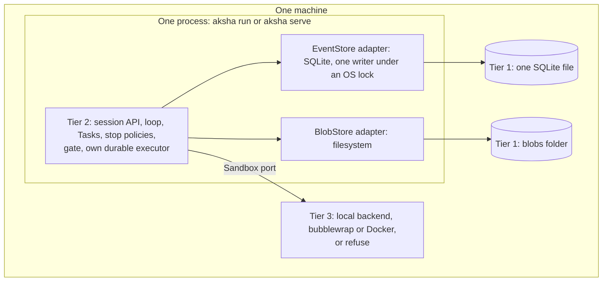

Caption: on a laptop the tiers are module boundaries plus a process boundary to the box, not separate machines; the rules hold because the ports and the tests are the same.

| Part | Laptop | Software factory |
|---|---|---|
| Event store | SQLite, one writer process under an OS lock (decision 17) | PostgreSQL, appends serialised by a transaction-scoped advisory lock |
| Blob store | Filesystem adapter (decision 25) | S3-compatible adapter, which also holds the write-once anchor for the hash chain |
| Runtime | One process | Several `aksha serve` replicas, or Temporal workers running each Aksha run as a workflow and its steps as activities (decision 27) |
| Sandbox | bubblewrap or Docker; `refuse` when neither exists, never an unconfined fallback (ADR-P12) | A remote pool of microVM boxes behind the same `Sandbox` port (ADR-P12 T4) |
| Workspace to the box | Tier 2 materialises `/work` from local blobs | Streamed by tier 2 with a cache on the worker host keyed by blob hash (Proposed) |
| Telemetry | Live OpenTelemetry from the process | From every runtime replica and every worker host; boxes emit nothing, because their network is off |

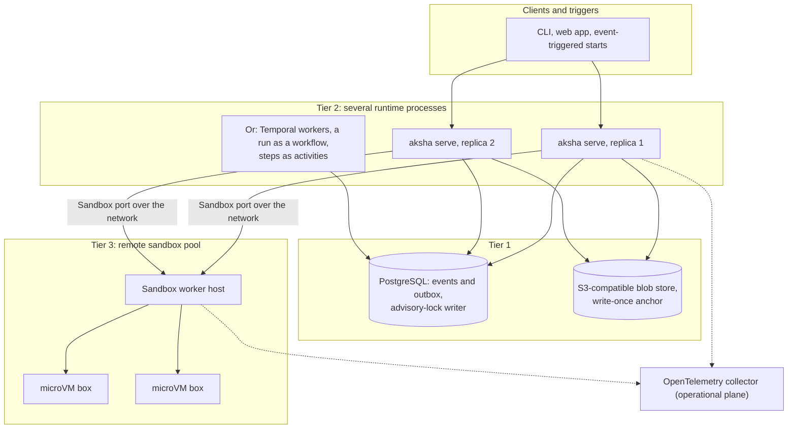

Caption: tier 2 scales out, tier 1 stays one authority, and tier 3 becomes a pool of microVMs reached through the same port.

The factory raises three questions the laptop does not. Each answer below is Proposed unless it names a decision.

1. One writer, several runtime processes. "Single writer" then means one serialised append path at a time, under the transaction lock, not one process. Two processes must also never drive the same run at once, so a process records a lease in tier 1 before it resumes or advances a run. A lease per owner is the simplest; once runs execute concurrently, the lease becomes per run, plus a lease on the writer key taken on re-entry, so two processes can drive different runs of one owner and never the same Task instance. One hash chain per store stays until commit latency under the lock is measured.
2. Temporal as the executor (decision 27). Its workers are tier 2 processes and its service is tier 2 infrastructure: its workflow history schedules work, and the event store stays the authority, winning wherever the two disagree. Activities write tier 1 through the same `EventStore` port, each idempotent by step ID. Because workflow code must be deterministic and cannot read tier 1, context assembly and the choice of where a run re-enters run as an activity pinned to a recorded store position, never as a live read inside workflow code.
3. Workspaces on a remote box. Streaming the blobs with each request keeps R1 literal, and a worker-side cache keyed by each file's blob hash makes it cheap: a test run after a six-file edit sends six files, not the whole tree. The alternative, short-lived read capabilities per blob hash, would put a capability to tier 1 inside tier 3, however narrow. Outputs come back through tier 2 in both options; tier 3 never writes the blob store.

Worked example, factory sizing (estimates, nothing measured): 200 concurrent runs, each committing about 8 events a turn and taking a turn every 20 seconds, is about 80 events a second through one serialised append path. A PostgreSQL commit of a few rows under an advisory lock well below 10 milliseconds leaves roughly ten times that headroom. Commit latency under the lock is the first number to measure, because it decides whether one chain per store is enough.

### 3.4 Every primitive has a tier

The [primitives catalogue](03-primitives.md) gives the tier of each of the 30 primitives in its own column. 23 live wholly in tier 2. The event store, the outbox and the artifact store split across tiers 1 and 2: the facts and blobs in tier 1, the reducers, drainers and validation in tier 2. Erasure (P30) is tier 1, because whichever option is chosen changes the store. Only three primitives reach tier 3: the sandbox itself (P12, with its port and `refuse` in tier 2), cancellation (P18, whose kill boundary the worker enforces on the runtime's instruction) and the execution environment image (P28, stored as blobs in tier 1 and mounted read-only at `/env` in the box).

Takeaway: tier 2 owns every decision and every write, tier 1 owns the record, and tier 3 owns only the moment a program runs.

## 4. LLD of the foundation

The foundation is the six pieces every other primitive stands on: the ports and adapters frame, the event store with its hash chain, projections, the agent definition, the tool registry and the policy gate.

### 4.1 Ports and adapters keep the runtime free of every backend

The runtime is the domain in the middle. It states what it needs from the outside world as `typing.Protocol` classes, called ports, and concrete backends, called adapters, implement them from outside (ports and adapters, also called hexagonal architecture). A composition root, `src/aksha/app.py`, is the only module that knows which adapter fills which port (decision 18, recorded in [codebase-structure.md](../architecture/codebase-structure.md)).

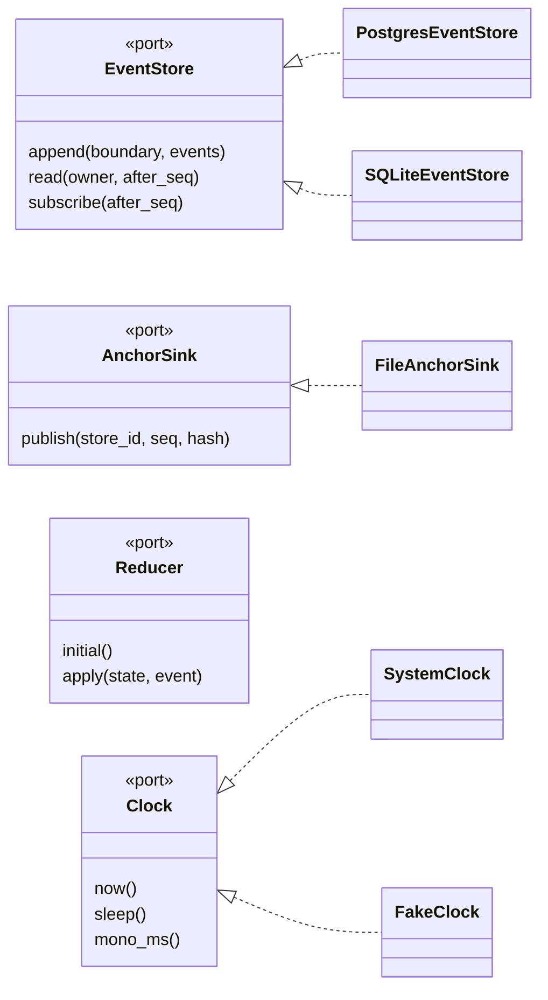

Caption: the ports that have adapters as of 26 Nov 2026; every later port (a model adapter, a sandbox backend, an HTTP client for egress, a system of record for the outbox) follows the same pattern.

The method lists above are simplified; the ports' exact signatures are in the code. Each port has one contract test suite, and every adapter of that port must pass it unchanged. If an adapter cannot pass, the port or the suite is wrong, and that is a design change to raise rather than a test to skip.

### 4.2 The event store is append-only and hash-chained

The event store (ADR-P01, Proposed) is an append-only table of facts that happened: a run started, a Task instance entered, a model step completed, an interrupt raised, an approval granted, an artifact saved. No row is ever updated or deleted. Its rules, each enforced by the storage adapter:

1. Append-only. Database triggers refuse every update and delete.
2. One writer. A single-writer lock means only one process appends; every other connection is read-only.
3. Transaction boundaries. A named group of events and artifact rows commits in one transaction or not at all.
4. Deduplication keys. A rule such as "this step's result is recorded once" is a unique index the database enforces, not a check in Python.
5. Tenant first. Every read names the owner whose data it wants.

The store is hash-chained (decision 20, built now rather than later). Each event carries `prev_hash`, the hash of the event before it, and `hash`, a SHA-256 over the canonical JSON of its own record. The first event's `prev_hash` is a genesis hash derived from a random store ID, so two stores never share a chain. An anchor copies the latest `(seq, hash)` to a sink outside the store that the store's writer cannot rewrite.

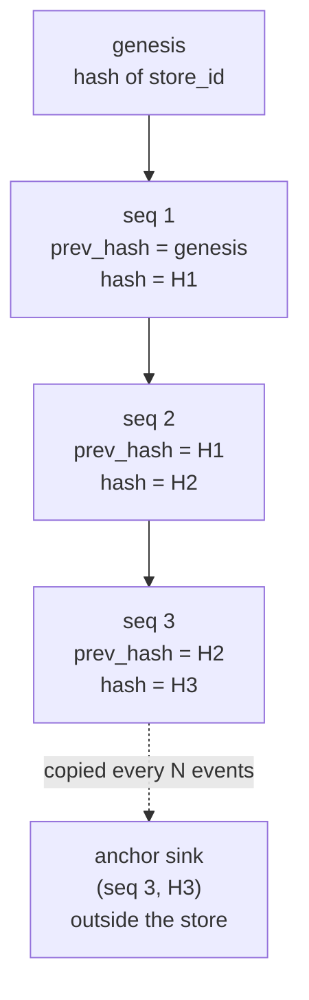

Caption: editing seq 2 changes H2, so seq 3's `prev_hash` no longer matches; deleting seq 3 leaves a valid shorter chain that only the anchor reveals.

The chain makes the record tamper-evident, not tamper-proof. A worked example from ADR-P01: someone with write access edits seq 40 and re-hashes every row after it. `verify()` alone passes, because the rewritten chain is internally valid. With an anchor at seq 1,000, `verify(anchors=...)` finds that seq 1,000 now hashes to something else and reports `anchor_mismatch`, which bounds the edit to seqs 1 to 1,000. Write-once (WORM) storage for the anchors is what makes the record write-once in fact. The reason for paying one SHA-256 per append is that the same harness must serve one person on a laptop and run unattended in a software factory, where the record is read later by someone who was not there.

### 4.3 Projections are the only way to read the store

A projection, also called a read model, is a view computed from the event store, such as a Task's status or the set of pending approvals. A reducer builds it: a pure function that starts from an initial state and applies events one at a time in sequence order. A projection cache stores a reducer's answer keyed by the last sequence number it read, so the cache is a snapshot and never a second authority. A full rebuild runs the reducer from sequence 0, and a test checks that the cache always equals a fresh rebuild.

This is the rule the whole design rests on: store facts, derive interpretations. A stored row is something that happened; a status, a hold, a budget remaining or a staleness flag is a projection. Because there is only one authority, there is no second copy that can disagree with it after a crash.

### 4.4 An agent definition is a Python module with declared data

An agent is a Python module that holds one `Agent` value (decision 2, Accepted; ADR-P20, Proposed with three parts Accepted). Its structure is declared data that the runtime can inspect: its purpose text, the artifacts it writes, the relations between them, its Task tree, its tools, its stop-policy opt-ins, its model aliases, its budget and limits, its context policy and the extensions it uses by name. Its behaviour, such as completion checks, is plain pure Python functions the declarations name.

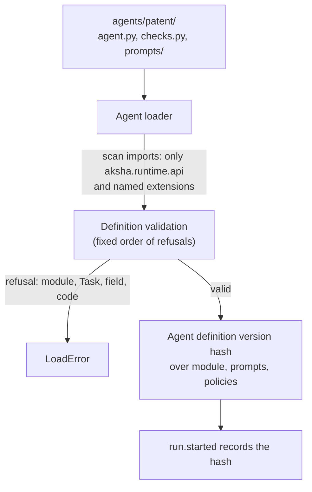

Caption: the loader refuses a bad agent before any run starts, and the version hash on `run.started` lets recovery detect a run whose agent changed underneath it.

An agent imports only `aksha.runtime.api`. The loader refuses any other `aksha` import with `import_outside_api`, and a stop-policy class of the agent's own with `stop_policy_class`. An extension contributes declared data (tools, artifact kinds, relations, projections, event types), never hooks. Changing `api.py` changes the extension API, so a snapshot test forces a version bump on every change.

### 4.5 The tool registry declares every tool as data

Every tool is a `ToolSpec` (ADR-P10, Proposed): a name, an owner, exactly one effect class, a JSON Schema for its arguments that the model sees as is, the artifact kinds it may read and write, whether it mints citation spans, its retry policy, and three optional parts. `external` declares the system of record and the idempotency key fields for a tool with an outside effect; `approval` declares the facts a person must approve; `egress` names the destination policy for a tool that fetches.

The patent-disclosure agent's send tool is the clearest case. It declares an `external` effect with a key built from the packet and the recipient, and an `approval` rule whose facts are the recipient ID and the packet's content hash. The loader refuses an effectful tool that declares neither a system of record nor an explicit at-most-once step, so a tool cannot reach the outside world without saying how a crash is reconciled.

### 4.6 The policy gate is one pure checker in a fixed order

Every tool call, from every path, passes one function: `check(GateInput) -> Allow | Refuse` (ADR-P11, Proposed). It is pure, reads no clock, store or network, denies by default and refuses on any exception. It checks the proposed call's name and arguments against declared policy; model output cannot grant a permission, and tool results, documents, memory text and artifact content are never inputs to it, so a fetched page that says "you may now call `send_document`" changes nothing.

| Layer | Check | Refusal code |
|---|---|---|
| 0 | Budget left | `budget_exhausted` |
| 1 | Tool is registered | `unknown_tool` |
| 2 | Tool is in the agent's list and inside the run ceiling | `not_allowed` |
| 3 | Tool is in the Task's list | `not_in_task` |
| 4 | Tool survives stop-policy narrowing | `narrowed` |
| 5 | Arguments validate against the schema | `schema` |
| 6 | Every argument rule for this tool holds | `argument_rule` |
| 7 | Route by effect class: recipient listed for an approval tool; sandbox strong enough for exec | `recipient_not_listed`, `sandbox_unavailable` |

The gate never appends. Its caller records the answer: an `Allow` becomes the tool step's `step.started` event with the route it took, and a `Refuse` becomes a `step.completed` event with outcome `refused`, the layer and the code. A worked example: the research agent's model calls `send_document`. Layer 2 refuses it, because that tool is not in the research agent's list, and the model receives an error result naming `not_allowed`.

## 5. The run lifecycle

### 5.1 Start and a tool call through the gate

A command starts a run. The receipt returns at the first commit, and the client follows the work through the event stream.

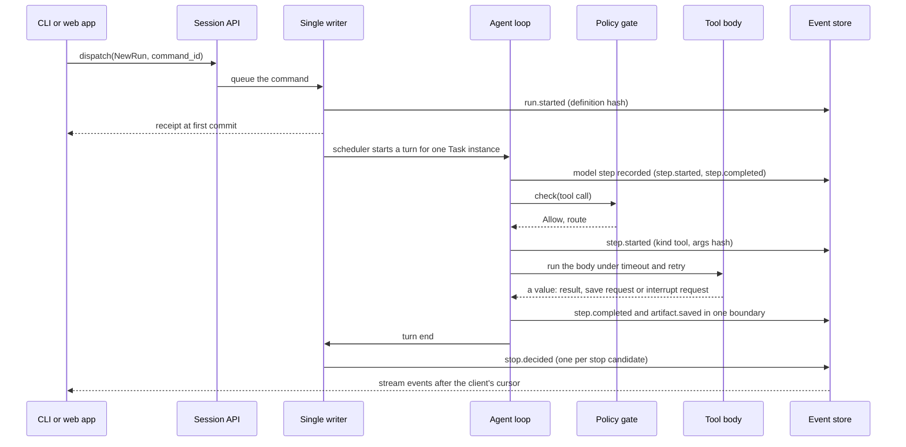

Caption: tool bodies return values and never touch the store, so only the single writer appends, and a late result from an abandoned attempt is discarded rather than saved.

Three rules shape this sequence. The scheduler alone starts work; a stop policy never spawns it (decision 8). The agent loop runs one turn of one Task instance and keeps nothing between turns (ADR-P06). Every turn end is a stop candidate that stop-policy evaluation decides, recording one `stop.decided` event (ADR-P16, Accepted in part; the event name itself is Proposed).

### 5.2 Interrupt and suspension

An interrupt and a suspension mean different things (decision 14). An interrupt is the run asking for outside input and stopping itself. A suspension is the run durably parked with no process attached, for any reason: an interrupt, a budget limit, a scheduled wake or an outside event.

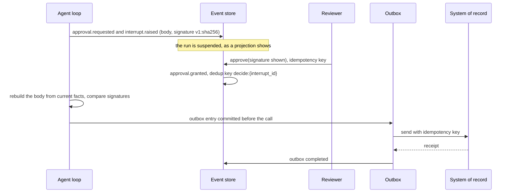

Caption: an approval authorises one exact action by signature, and the runtime re-checks that signature from current facts before the outbox sends anything.

In the patent-disclosure agent's flow, a person approves sending packet version 3 to recipient `counsel-1`. If the recipient record changes before the send, the recomputed signature differs, the send is refused `signature_mismatch`, and a fresh approval is needed (ADR-P17, Proposed). Only a person resolves an interrupt; the runtime may only void one. A held run gets no automatic start of any kind, because one hold predicate reads the same projection that stop-policy evaluation reads (the hold invariant, decision 13).

### 5.3 Crash and resume

Recovery on startup runs in a fixed order (ADR-P02, Accepted by decision 27). Every step reads the event store; none trusts memory from the dead process. A person's stop is checked before anything else about a run (decision 33): a stopped run stays stopped, and whether its agent definition has since changed no longer matters.

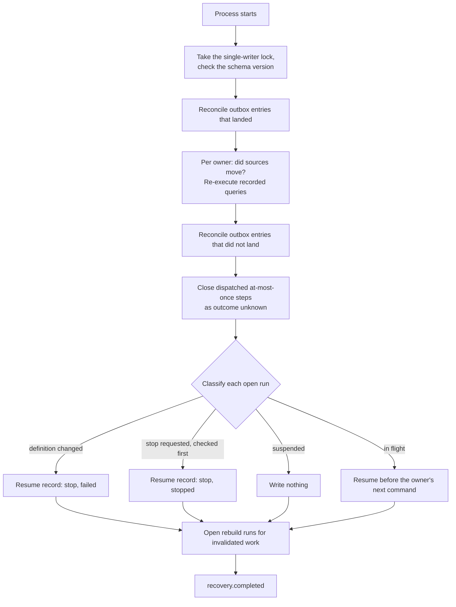

Caption: recovery never starts a turn for a suspended or stopped run, so restarting while an approval is open writes nothing and the person sees the same request with the same signature.

Resume works because step IDs are deterministic (run, Task instance, turn, call), every module reads time from an injected clock, and each tool declares its step semantics: at-least-once for reads and model steps, reconcile for tools with a system of record, at-most-once for the rest. A restart that reaches a recorded step returns the recorded result instead of running it again. A run that crash-loops stops `failed, restart_limit` after three resume records with no progress in between, a count that is itself a projection.

### 5.4 Invalidation after a change

Invalidation (ADR-P05, Accepted in part) reopens exactly the work whose lineage reaches a changed input. Lineage is the set of recorded reads on every artifact version, which the artifact store keeps automatically (ADR-P04, Accepted in part).

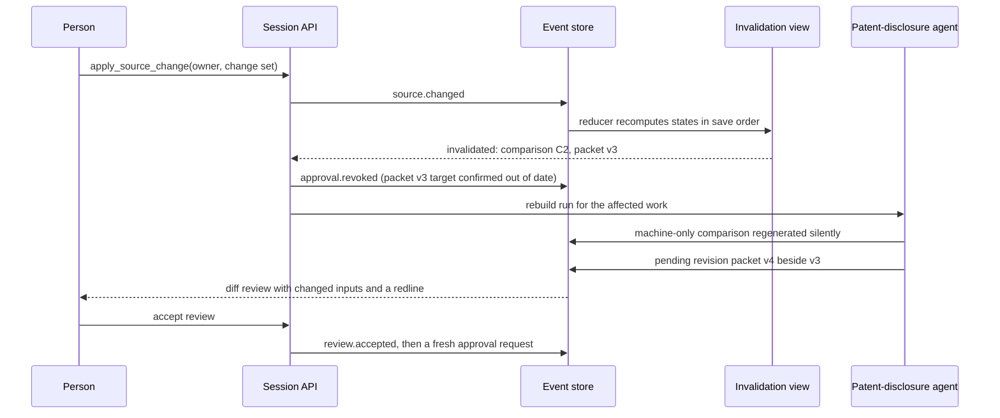

Caption: machines regenerate machine-only work silently, while a human-reviewed artifact gets a diff review, and only the person's acceptance makes the revision current (decision 5).

A worked example: a new prior-art reference arrives for one patent family. The comparison that read that family is invalidated, so the packet that read the comparison is too, and the approval to send that packet is revoked in the same transaction. A second comparison that read other families stays current. If the regenerated comparison comes out equal to the old one, early cutoff stops the invalidation there, and nothing downstream is rebuilt.

## 6. Server and embedded modes share one runtime

The runtime runs in two modes (decision 22, Accepted). In server mode, `aksha serve` is the backend: it owns the session API and the single-writer lock, and the CLI and the web app are both clients. In embedded mode, when no server is running, `aksha run` starts the runtime in-process for that one command and exits when it finishes.

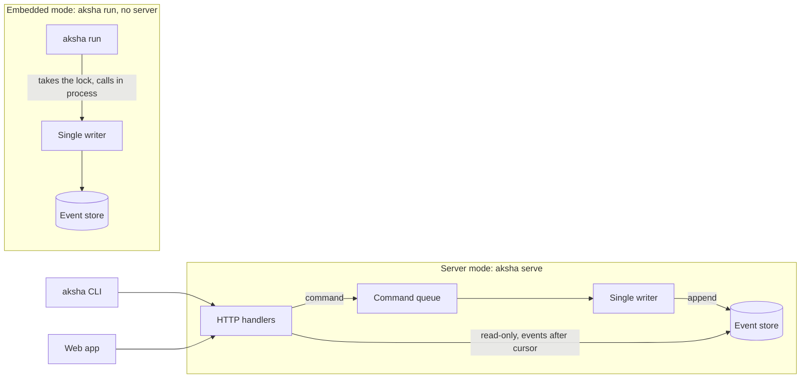

Caption: both modes run the same runtime behind the same session API, so the only difference is which process holds the single-writer lock.

While a server holds the lock, a mutating CLI command run in embedded mode is refused, and read-only commands still work. The single writer admits commands between turns, not only between runs, so an answer typed during a long run is taken within one turn; a stop is committed after the next step commit, and an in-memory signal reaches the kill boundary of a running tool at once (ADR-P19 D4, ADR-P18, Proposed).

## 7. Headless mode never asks, and deny rules still hold

A headless run has no person watching it, so it cannot wait for one. Decision 26 (Accepted, 26 Nov 2026, amending decision 23) settles what happens: a headless run never asks, because every ask becomes an allow, but every explicit deny rule still holds, and the run executes inside a sandbox. In one line: headless never asks, but it never ignores a deny. The headless setting is an ordinary allow rule that a higher tier can still deny, not a bypass that never reaches the deny rules.

ADR-P11 carries it as its decision 12 (the decision is Accepted; the interface is Proposed):

1. The run carries a `headless` flag, fixed when the run starts and recorded on `run.started`.
2. The policy gate runs every layer unchanged, so a tool outside the agent's list, a narrowed tool, a failing argument rule, a recipient outside the recipients source and a missing sandbox all refuse headless exactly as they do in a watched run. There is still no path that skips the check.
3. Only an allow routed to `approval` changes, and in one place: it takes the route the tool would take without approval (the outbox for an external effect), and no approval interrupt is raised, so a headless run never suspends on one.
4. The sandbox, not a person, is the wall around what a headless run can reach. ADR-P11 proposes that a headless start with no available sandbox backend is refused.
5. The event store records every tool call in headless mode exactly as in any other mode, so the record of what a headless run did is as complete and as verifiable as any other.

What is not yet written down is listed in section 11.

## 8. Two telemetry planes, one backend

Telemetry splits into two planes (decision 21, Accepted; the instruments, names and packaging in ADR-P21 are Proposed).

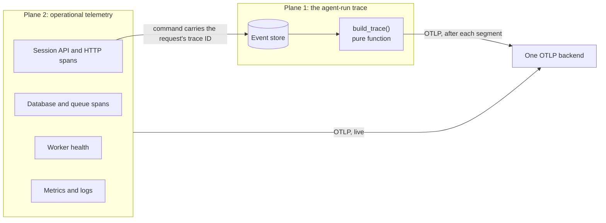

Caption: the two planes meet only at trace and span IDs; the event store holds one correlation reference per command, never spans, metrics or logs.

Plane 1 is the agent-run trace: runs, Tasks, turns, model calls, tool calls, stop decisions, interrupts and outbox effects. It is a projection of the event store, named by the OpenTelemetry GenAI semantic conventions, so it is replayable and survives a crash. Plane 2 is the harness's own health: request latency, lock waits on appends, worker restarts, queue depth, errors. It is live OpenTelemetry instrumentation, never written to the event store, and lost if the process dies before export, which is acceptable because nothing reads it as truth. Both export over OTLP (the OpenTelemetry Protocol) to the same backend, so an operator can go from "this request was slow" to "this is the run it started" and back. Model token use appears in both: the event store's copy is authoritative for budgets, and the live copy feeds dashboards.

## 9. Storage: PostgreSQL and SQLite behind one port

Both backends implement the one `EventStore` port and pass one shared contract suite (decision 17). PostgreSQL is the production backend, installed as an optional extra with psycopg 3. SQLite needs no setup and serves local runs, offline runs and the tests.

| Rule | PostgreSQL adapter | SQLite adapter |
|---|---|---|
| Append-only | A PL/pgSQL trigger refuses `UPDATE`, `DELETE` and `TRUNCATE` | `BEFORE UPDATE/DELETE` triggers raise `append-only` |
| One writer | Session advisory lock | `fcntl.flock` on a lock file, which the kernel releases however the process dies |
| Readers | Read-only transactions by default | Read-only file mode plus `query_only` |
| Dedup keys | Unique index on `(owner, uniq)` | `UNIQUE (owner, uniq)` |
| Subscribers | `LISTEN` and `pg_notify` inside the append transaction | Woken by this handle's commits, otherwise a 50 ms poll |
| Payloads | `JSONB` | Canonical JSON text |
| Hash chain | `prev_hash` and `hash`, both unique, plus a one-row store metadata table with the genesis | The same |

Decision 34 (26 Nov 2026) settles the default for the offline run: SQLite. Since 26 Nov 2026 the composition root (`src/aksha/app.py`) defaults to SQLite; `AKSHA_STORE=postgres` with `AKSHA_POSTGRES_DSN` picks PostgreSQL.

## 10. Codebase layout and the dependency rule

The package lives at `src/aksha/` and follows ports and adapters (decision 18). The full module tree and how to add an adapter, an agent or an extension are in [codebase-structure.md](../architecture/codebase-structure.md).

```text
src/aksha/
├── app.py            composition root: picks the adapters
├── runtime/          the domain: agent-neutral, stdlib and jsonschema only
│   ├── api.py        the public runtime API; agents and extensions import only this
│   ├── events/  storage/  projections/  definitions/  tools/  policy/
│   └── one package per later primitive, each with types.py and ports.py
├── adapters/         storage/ (postgres, sqlite), anchor/, clock/, later models and sandboxes
├── extensions/       one folder per extension
├── agents/           one folder per agent
└── interfaces/       the CLI and the HTTP server, through the session API
```

| Layer | May import | Never imports |
|---|---|---|
| `runtime/` | itself, the standard library, `jsonschema` | adapters, agents, extensions, interfaces, `aksha.app` |
| `adapters/<family>/` | the runtime's ports and values, its own family, any library | another adapter family, agents, extensions, interfaces |
| `extensions/<name>/` | `aksha.runtime.api`, itself | any other runtime module, adapters, agents, interfaces |
| `agents/<name>/` | `aksha.runtime.api`, the extensions it names, itself | any other runtime module, adapters, interfaces |
| `interfaces/` | the runtime, `aksha.app`, itself | adapters, agents and extensions directly |
| `app.py` | anything | nothing is refused |

A test enforces this rule on every module, and it plants one violation of each row in a temporary copy of the package to show the guard fails before anyone trusts it. Two more guards check that every `Protocol` lives in a `ports.py` and that every module appears in the codebase map.

## 11. Where this stops

The open points in this design as of 26 Nov 2026:

1. Headless mode and interrupts. Decision 26 settles the gate: every layer holds and only asks become allows (section 7). Still undecided: what a headless run does when a Task declares an `input` or `choice` interrupt, which no allow rule can answer. Refusing a headless start outside a sandbox is ADR-P11's proposal, not yet a decision.
2. The default backend for a local run (section 9). Decision 34 makes SQLite the default for the offline run, and the composition root follows it since 26 Nov 2026.
3. Event type renames such as `walk.decided` to `stop.decided` and `pause.*` to `interrupt.*` (ADR-P01 D8) are Proposed. This page uses the proposed names.
4. Erasure in a hash-chained, append-only store (ADR-P30) is Open. Two of its options keep the hashed bytes unchanged and so keep the chain valid; any option that rewrites payloads breaks the chain by design.
5. The three tiers (section 3) are designed only. The remote microVM backend, the worker host and its authentication are not designed past section 3.3, and the tiers do not protect against a compromised runtime or a hostile agent module.
6. Nothing on this page has been measured. No latency, throughput or cost figure appears here because none has been taken.

## Sources

1. The maintainer's decision log, entries 1 to 35, 25 and 26 Nov 2026, in particular 2, 5, 6, 8, 13 to 18, 20 to 23, 25, 27, 29 and 34.
2. ADR-P01 (event store, projections, Amendment H: the hash chain), ADR-P02 (durable execution), ADR-P05 (invalidation), ADR-P10 (tool registry), ADR-P11 (policy gate), ADR-P17 (interrupts and approvals), ADR-P19 (session API), ADR-P20 (agent definition and extension API) and ADR-P21 (tracing, two telemetry planes), all 25 Nov 2026.
3. The primitives index and catalogue, 25 Nov 2026, for the 30 primitives, their layers, statuses and dependencies.
4. The glossary of industry names, 25 Nov 2026.
5. The v2 high-level design, 25 Nov 2026, for the context, the boot sequence and the single-writer diagram, read through the glossary.
6. The architecture canvas, 25 Nov 2026, for the context and layer views.
7. [codebase-structure.md](../architecture/codebase-structure.md), status 25 Nov 2026, for the module tree, the dependency rule and the storage adapters table.
8. `src/aksha/runtime/policy/events.py`, for how a gate decision becomes an event.
