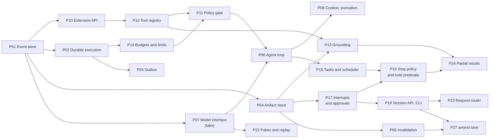

# Harness primitives: the catalogue

*Intermediate design as of 26 Nov 2026. This page lists the 30 primitives Aksha's runtime is designed around, one architecture decision record (ADR) each, with the status each ADR states and its scope for the first milestone. It is a design record: where a row says "Build now", that is the plan, and the code pull requests are the evidence of what exists.*

A **primitive** is one capability every agent on the harness gets from the runtime without writing it: an event store, a policy gate, a stop policy. I designed the harness primitive by primitive because a general harness is only as general as its smallest shared pieces, and each piece has to hold for agents that look nothing alike. Every ADR was therefore tested against three agents before it was accepted as a design:

| Agent | What it does | What it presses on |
|---|---|---|
| Research agent (example) | For Stillroom, a fictional hardware venture, it searches competitors, fetches pages and reviews, and writes a competitor matrix with a verified excerpt behind every finding | Grounding, deduplication through typed relations, partial results when a fetch fails |
| Patent-disclosure agent (example) | For the same venture, it extracts inventions from engineering notes, compares them with patent families, prepares disclosure packets and asks approval before a mock send | Invalidation, human review of changed documents, approvals bound to the exact action, no duplicate send after a crash |
| Contrast coding agent (not built) | Edits a Git repository in a sandbox for hours, runs tests and pushes a branch after approval | Long contexts and compaction, a shell inside a sandbox, a completion check that runs the tests, cancellation in the middle of an edit |

This is the **rule of three** (decision 16): no abstraction is accepted until three different agents fit it. An ADR that passes the two document agents and fails the coding agent has designed a document pipeline, not a harness.

## How to read the table

1. **Status** is the ADR's own status line. "Proposed" means designed and waiting for the maintainer's call. "Accepted in part" means the [decisions log](04-decisions-log.md) records the maintainer's call on the named decisions; every other part of that ADR, including every stress-test amendment (S1, S2 and so on), stays Proposed. "Open" means no design is proposed yet.
2. **First milestone** is the scope for the 27 Nov 2026 cut. "Build now" is in the cut. "Stub" means the interface or a minimal form ships and the rest is written down. "Later" means designed only and named as a limit.
3. **IDs.** P01 to P22 came from the first catalogue (written there as PR-01 to PR-22). P23 to P30 are primitives the stress test found missing.
4. Names follow the industry terms the design settled on (decisions 11 and 14): event store, projection built by a reducer, transactional outbox, idempotency key, interrupt, suspension, stop policy, completion check, lineage, invalidation, model routing by class.

## Four patterns every ADR applies

| Pattern | Rule | The question it asks of each primitive |
|---|---|---|
| P-1 | Minimise agent-specific code in the runtime | Does this primitive need agent-specific code inside the runtime? If yes, the abstraction is wrong |
| P-2 | Store facts, derive interpretations | Is every stored row a fact that happened, and every interpretation a projection built by a reducer over the event store? |
| P-3 | Data for what the harness reasons about, code for what it only runs | Is the structure the harness inspects declared as data, and the behaviour it only calls written as plain Python? |
| P-4 | Humans see diffs, machines regenerate | Does a changed machine-only output rebuild silently, while a changed reviewed output goes back to a person as a diff? |

## The primitives, by family

The five families split the work by the question their ADRs answer. Each row links to its ADR.

### A. Durable state: what is true, and what is out of date, after any crash?

| ID | Primitive | Decision in one line | Status | First milestone |
|---|---|---|---|---|
| P01 | [Event store and projections](adr/ADR-P01-event-store-and-projections.md) | One append-only, hash-chained event store (PostgreSQL in production, SQLite locally, behind one port) is the only authority; every view is a projection built by a pure reducer | Proposed; the hash chain itself is Accepted (decision 20) | Build now |
| P02 | [Durable execution: resume and replay](adr/ADR-P02-durable-execution.md) | Deterministic step IDs, an injected clock and declared step semantics, with one recovery sequence on startup | Proposed | Build now |
| P03 | [Transactional outbox and idempotency keys](adr/ADR-P03-transactional-outbox-and-idempotency-keys.md) | Every external effect is an outbox entry committed before the call, keyed by meaning and reconciled after a crash; every command carries a command ID with an idempotent receipt | Proposed | Build now (command deduplication is a stub) |
| P04 | [Artifact store and lineage](adr/ADR-P04-artifact-store-and-lineage.md) | Typed, immutable artifact versions record what they read; agents declare typed relations, each with its excerpt as evidence | Accepted in part (D1 to D3) | Build now (path-scoped reads later) |
| P05 | [Invalidation](adr/ADR-P05-invalidation.md) | A change invalidates exactly the work whose lineage reaches it, with early cutoff; machines rebuild, people review a diff | Accepted in part (D1, D2) | Build now (rebase mode later) |
| P25 | [Durable timers and recorded time](adr/ADR-P25-durable-timers-and-recorded-time.md) | A timer is a fact on the injected clock, firing is an automatic start behind the hold predicate, and a read of the date is a lineage input | Proposed | Later |
| P29 | [External record state](adr/ADR-P29-external-record-state.md) | A projection over outbox completions tracks each outside record an effect created and the freshness of the version it was written from | Proposed | Stub |
| P30 | [Erasure in an append-only store](adr/ADR-P30-erasure-in-an-append-only-store.md) | The options for erasing personal data are listed; no shape is proposed | Open | Later (the limit is stated) |

### B. Thinking: what does the model see, which model answers, and what carries across sessions?

| ID | Primitive | Decision in one line | Status | First milestone |
|---|---|---|---|---|
| P06 | [Agent loop and turn](adr/ADR-P06-agent-loop-and-turn.md) | The loop runs one turn of one Task instance, keeps nothing between turns, and hands every turn end to stop-policy evaluation | Proposed; one part Accepted | Build now |
| P07 | [Model interface and model routing by class](adr/ADR-P07-model-interface-and-routing.md) | Three owned contracts (extraction, classification, generation) bound to adapters through model aliases, with confidence thresholds and an abstention band | Proposed | Stub (fake generation model) |
| P08 | [Context assembly and compaction](adr/ADR-P08-context-assembly-and-compaction.md) | The model's context is a pure projection of the event store; compaction is truncation, then observation masking, then a recorded summary | Proposed | Stub (truncation only) |
| P09 | [Memory](adr/ADR-P09-memory.md) | An extension built on artifacts, citations and one recall tool, so lineage answers "which outputs used this preference?" | Proposed | Later |

### C. Acting safely: what may the agent do, where, for how long, and with what evidence?

| ID | Primitive | Decision in one line | Status | First milestone |
|---|---|---|---|---|
| P10 | [Tool registry and schemas](adr/ADR-P10-tool-registry-and-schemas.md) | Every tool is declared data with one effect class, and the schema the model sees is the schema the gate checks | Proposed | Build now |
| P11 | [Policy gate and permissions](adr/ADR-P11-policy-gate-and-permissions.md) | Deny by default, one checker in code, and nothing the model writes is an input to the decision | Proposed | Build now |
| P12 | [Sandbox and execution environment](adr/ADR-P12-sandbox-and-execution-environment.md) | The gate decides whether a program runs, the sandbox decides what it can reach, and a workspace is an artifact version | Proposed | Later (a refusing backend only) |
| P13 | [Grounding and citations](adr/ADR-P13-grounding-and-citations.md) | Tools mint citation spans, the runtime verifies every quote at save, and a claim it cannot ground becomes an explicit unknown | Proposed; one part Accepted | Build now |
| P14 | [Budgets, limits, timeouts and retries](adr/ADR-P14-budgets-limits-timeouts-retries.md) | Every cap is counted from the event store, so a restart never resets it | Proposed | Build now |
| P26 | [Egress policy](adr/ADR-P26-egress-policy.md) | Declared destination rules, enforced by the runtime's HTTP client after DNS resolution and on every redirect | Proposed | Later |
| P28 | [Execution environment image](adr/ADR-P28-execution-environment-image.md) | A read-only, content-addressed layer of interpreter and dependencies, built once per lock-file hash and mounted at `/env` | Proposed | Later |

### D. Control: who starts work, who decides it is finished, and who may stop or pause it?

| ID | Primitive | Decision in one line | Status | First milestone |
|---|---|---|---|---|
| P15 | [Task model and scheduler](adr/ADR-P15-task-model-and-scheduler.md) | A declared Task tree with pure completion checks; fan-out creates tracked Task instances, and only the scheduler starts work | Accepted in part | Build now (supervisor Task later) |
| P16 | [Stop policy and stop-policy evaluation](adr/ADR-P16-stop-policy-and-evaluation.md) | A stack of pure stop policies, one recorded stop decision per stop candidate, and one hold predicate that puts human state ahead of every automatic start | Accepted in part | Build now (Run, Task and interrupt policies; opt-in policies later) |
| P17 | [Interrupts and approvals](adr/ADR-P17-interrupts-and-approvals.md) | A run suspends on a durable interrupt and resumes on a recorded answer; an approval authorises one exact action by signature | Proposed | Build now |
| P18 | [Cancellation](adr/ADR-P18-cancellation.md) | A person's stop is a durable stop request honoured at the next stop candidate, including after a crash | Proposed | Stub |
| P24 | [Partial results and finalization](adr/ADR-P24-partial-results-and-finalization.md) | A fan-out parent declares whether a blocked child blocks it, a budget interrupt can be answered "finalize", and both end the run `partial` with every unknown listed | Proposed | Build now (finalize may stub) |
| P27 | [Steering and follow-up input](adr/ADR-P27-steering-and-follow-up-input.md) | A message to an open run is a durable fact in a named lane (steer, follow-up or amend), and the interface must name the lane | Proposed | Stub (the refusal and `amend`) |

### E. Interfaces and proof: how does a third author add an agent, a front end watch it, and a test prove it?

| ID | Primitive | Decision in one line | Status | First milestone |
|---|---|---|---|---|
| P19 | [Session API](adr/ADR-P19-session-api.md) | One write entry point with idempotent receipts, event streams with a cursor and a catch-up marker, and one capability record per runtime | Proposed | Build now (CLI); stub (web) |
| P20 | [Extension API and agent definition](adr/ADR-P20-extension-api-and-agent-definition.md) | A small runtime, extensions that contribute declared data, and agent definitions loaded, checked and version-hashed by one loader | Proposed; three parts Accepted | Build now |
| P21 | [Tracing and observability](adr/ADR-P21-tracing-and-observability.md) | The agent-run trace is a projection of the event store in OpenTelemetry GenAI terms; the harness's own telemetry is a separate, live plane | Proposed | Stub (`aksha inspect` ships) |
| P22 | [Evals, fake models and replay models](adr/ADR-P22-evals-fake-and-replay-models.md) | A fake for every model class, replay read from the recorded store, and eval cases as data with a kind and a source | Proposed | Build now (fakes and replay); eval runner later |
| P23 | [Request router](adr/ADR-P23-request-router.md) | A runtime classification alias over the loaded agents' purpose text, recorded as a durable step, with a session-scoped `route` interrupt when it abstains | Proposed | Build now (fake classifier) |

Takeaway: 24 of the 30 primitives are built or stubbed in the first milestone, and the six marked "Later" each have a design and a named limit.

## Build order

Each primitive is built after everything it needs. The diagram shows the first-milestone primitives only.

Caption: every arrow points from a primitive to one that needs it. P20 comes second because every later declaration lands in its `Agent` value.

The first code pull request follows this order: it builds the event store with its hash chain (P01), the agent definition loader and extension API (P20), and the tool registry and policy gate (P10, P11).

## The three-agent stress test

On 25 Nov 2026 three design reviews walked each agent through every ADR. Nothing was run: each verdict is a reading of the interfaces. The verdict values are:

1. **Fits**: the agent needs nothing new.
2. **Agent code**: the agent supplies code, and the runtime is unchanged.
3. **Core change**: a generic runtime change was needed, with no agent-specific word in it.
4. **Missing**: the agent needed a primitive no ADR owned.

Each cell is the agent's worst verdict for the ADR as it stood before its amendments.

| ADR | Research | Patent | Coding | Amendments that answer it |
|---|---|---|---|---|
| P01 | Fits | Fits | Fits | S1 one name per concept, S2 incremental reducer by measurement |
| P02 | Fits | Core change | Agent code | S1 `suspended_with_rebuilds`, S2 shared source writer |
| P03 | Fits | Agent code | Core change | S1 `lookup(key, request)`, S2 `record_fields`, `receipt_kind` |
| P04 | Core change | Fits | Core change | S1 `validate`, S2 `components`, S3 path-scoped reads, S4 chained writer |
| P05 | Core change | Core change | Core change | S1 sibling rule, S2 one writer, S3 withdrawn reads `gone`, S4 `review_rejected`, S5 `rebase` |
| P06 | Fits | Fits | Fits | none |
| P07 | Core change | Agent code | Fits | S1 `options_from`, S2 router alias |
| P08 | Agent code | Core change | Core change | S1 `Rendered.spans`, S2 argument stubs |
| P09 | Fits | Fits | Agent code | none |
| P10 | Fits | Core change | Agent code | S1 one `ToolSpec`, S2 `result_key`, S3 `egress` |
| P11 | Missing | Fits | Agent code | S1 egress moves to P26 |
| P12 | Fits | Fits | Missing | S1 environment moves to P28, S2 nested manifests |
| P13 | Core change | Core change | Core change | S1 `shown_to`, S2 record-grain `stale_source` |
| P14 | Core change | Fits | Core change | S1 `finalize`, S2 restart limit since progress |
| P15 | Core change | Core change | Agent code | S1 `on_child_blocked`, S3 `withdrawn` to `new` |
| P16 | Fits | Core change | Fits | S1 hold narrowed to the held work |
| P17 | Agent code | Core change | Core change | S1 `target_changing`, S2 `answers`, S3 `key_withdrawn`, S4 receipt artifact |
| P18 | Fits | Fits | Fits | none (rename only) |
| P19 | Missing | Core change | Missing | S1 change set, S2 lanes, S3 `route`, S4 `Finalize` |
| P20 | Core change | Agent code | Core change | S1 `Agent` fields, S2 `Extension.systems`, S3 source-root refusal |
| P21 | Fits | Fits | Fits | none (rename only) |
| P22 | Fits | Fits | Core change | S1 tool replay adapters, S2 cases written before fixes |

Totals before the amendments, counted from the table above:

| Agent | Fits | Agent code | Core change | Missing |
|---|---|---|---|---|
| Research | 11 | 2 | 7 | 2 (egress under P11, the router under P19) |
| Patent | 10 | 3 | 9 | 0, plus three gaps no ADR touched: external record state, time, erasure |
| Coding | 6 | 5 | 9 | 2 (the environment image under P12, steering under P19) |

The eight missing primitives became P23 to P30. Their verdicts, against their own designs:

| ADR | Research | Patent | Coding |
|---|---|---|---|
| P23 Request router | Fits | Fits | Fits |
| P24 Partial results | Fits | Fits | Fits |
| P25 Timers and recorded time | Fits | Fits | Fits |
| P26 Egress policy | Fits | Fits | Fits |
| P27 Steering and follow-up | Fits | Fits | Fits |
| P28 Environment image | Fits (unused) | Fits (unused) | Fits |
| P29 External record state | Fits (unused) | Fits | Fits |
| P30 Erasure | Not tested | Not tested | Not tested |

No ADR needed agent-specific code in the runtime, so P-1 held everywhere. Every failure sat at a seam between two primitives or in a primitive nobody owned. The worst seam was invalidation (P05) meeting the hold predicate (P16) and approvals (P17): with an approval request still open, the Patent agent's change-and-recovery demo ran in the wrong order. Amendment P16 S1 narrows the hold to the held work to fix it.

After the amendments every row fits on paper for all three agents, except P30, which has no design to test. That is a reading of interfaces, not a run. The first evidence will be the stress cases of P22 S2, written to fail before their fixes land.

## Where this stops

1. As of 26 Nov 2026 the verdicts are design reviews. The amendments were written into the ADRs on 25 Nov 2026, and the three reviews were not re-run against the amended text, so the "after" verdicts are my reading.
2. Sizes and counts inside the ADRs are estimates unless they name a source.
3. P30 (erasure) is open on purpose: the choice depends on where Aksha runs and under which data-protection law.
4. Decision 23 (26 Nov 2026: headless runs in full bypass, with no approval prompts) postdates P11 and P17, and neither ADR yet says how a bypassed run meets the gate.
5. Future work that extends these primitives is in [future directions](05-future-directions.md).
