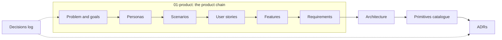

# Aksha design documents

*Status: intermediate design as of 26 Nov 2026. These documents record the design as it stood before the first code merged. Each decision carries the status its architecture decision record (ADR) gives it: Accepted where the maintainer has made the call, Proposed everywhere else. Proposed means designed and open to change, not built.*

Aksha is a general agent harness in Python: one runtime that runs many different agents, each defined in its own module, with durable state, enforced tool permissions, approvals that bind to an exact action, and recovery after a crash that never repeats a send. These documents explain what the harness is for, how it is put together, and the primitives it is built from.

## Reading order

Read the product chain first, because every later document answers a requirement it states. Then the architecture, the primitives catalogue and the ADRs.

| Order | Document | What it answers | Read it if you |
|---|---|---|---|
| 1 | [01-product/01-problem-and-goals.md](01-product/01-problem-and-goals.md) | What problem a general harness solves, its goals, non-goals and success measures, the three agents that test it, and the principles behind every decision | are new to Aksha |
| 2 | [01-product/02-personas.md](01-product/02-personas.md) | Who uses Aksha: the agent developer, the operator, the reviewer of agent output, and the example agents' founder, engineer-inventor and counsel | want to know whom each decision serves |
| 3 | [01-product/03-scenarios.md](01-product/03-scenarios.md) | Twelve end-to-end walkthroughs, from a research happy path to a headless job in a sandbox | want to see the design in motion |
| 4 | [01-product/04-user-stories.md](01-product/04-user-stories.md) | 31 user stories grouped by persona, each with numbered acceptance criteria and its scenarios | are writing or reviewing a test |
| 5 | [01-product/05-features.md](01-product/05-features.md) | 41 features by runtime area, each with its first-milestone priority and the stories it serves | want to know what is in the first milestone |
| 6 | [01-product/06-requirements.md](01-product/06-requirements.md) | 48 functional and 21 non-functional requirements, and the traceability table from persona to scenario | need the exact requirement behind a feature |
| 7 | [02-architecture.md](02-architecture.md) | How the runtime, the agents, the interfaces and the storage fit together | want the system shape before the details |
| 8 | [03-primitives.md](03-primitives.md) | The 30 harness primitives, each in one line, with its status, its dependencies and the build order | want to know what exists and what comes next |
| 9 | [adr/](adr/) | One ADR per primitive: the options considered, the decision, its cost, and how three different agents stress-tested it | are reviewing or changing one primitive |
| 10 | [04-decisions-log.md](04-decisions-log.md) | The maintainer's numbered decisions, which the ADRs cite | need to know whether something is decided |
| 11 | [05-future-directions.md](05-future-directions.md) | What I would build next for an unattended software factory | are planning beyond the first milestone |

The code layout, the dependency rule between layers and how to add an agent are in [`../architecture/codebase-structure.md`](../architecture/codebase-structure.md), which lands with the first code change.

Caption: each product document traces to the one before it, the requirements trace to primitives, and the decisions log settles what every layer cites.

## How to read a status

1. **Accepted**: the maintainer decided it, and code may rely on it.
2. **Proposed**: designed and reviewed on paper, not yet decided. Code that depends on it says so.
3. **Accepted in part**: named decisions inside the ADR are Accepted; every other part, including every amendment from the stress test, is Proposed.
4. **Open**: the options are listed and no shape is proposed.

Separately from status, each piece of work is labelled by what happened to it: designed (on paper only), built (code exists with tests), or built and run (exercised end to end). As of 26 Nov 2026, four primitives are built and tested on a branch in review: the event store and projections (ADR-P01), the agent definition and extension API (ADR-P20), the tool registry (ADR-P10) and the policy gate (ADR-P11). Everything else in these documents is designed only.

## Words these documents use

The documents use the industry name for each concept, one name per concept:

| Term | Meaning here |
|---|---|
| Runtime | The harness code that every agent shares; it holds no agent-specific code |
| Event store | The append-only, hash-chained record of every fact that happened; the only source of truth |
| Projection | A view computed from the event store by a pure function, called a reducer |
| Task | The recursive unit of work an agent declares; a Task can hold child Tasks, each with its own completion check |
| Completion check | A pure function that says whether a Task is done |
| Stop policy | A rule that decides, at each turn end, whether the agent may stop |
| Artifact | A typed, immutable, versioned output that records what it read |
| Lineage | The recorded reads of an artifact, so the runtime knows which inputs it came from |
| Invalidation | Marking exactly the work whose lineage reaches a changed input as out of date |
| Interrupt | The run asks for outside input and stops itself |
| Suspension | The run is durably parked with no process attached, for any reason |
| Transactional outbox | Every external effect is recorded before it is attempted, under an idempotency key, so a retry never sends twice |
| Model routing by class | Each model job goes to the kind of model its answer needs: extraction or classification (System 1, fast) or generation (System 2, slow) |
| Headless mode | A run with nobody watching, in full bypass of approval prompts and permission asks, expected to run inside a sandbox |

## Sources

1. The maintainer's decision log, entries 1 to 24, 25 and 26 Nov 2026.
2. The primitives index and the 30 primitive ADRs, ADR-P01 to ADR-P30, 25 Nov 2026.
3. The glossary that maps older working names to these industry names, 25 Nov 2026.
4. The product problem-and-users and features-and-requirements documents, version 2, 25 Nov 2026, from which the product chain is drawn.
