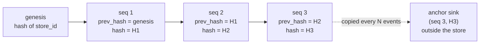

# ADR-P01: Event store and projections (lean: one append-only event store, PostgreSQL in production and SQLite with zero setup, is the only authority, and every view is a projection built by a pure reducer)

*Intermediate design as of 26 Nov 2026. Status: Proposed. This is a design record, not a description of shipped code. The Research agent and the Patent agent named below are example agents for Stillroom, a fictional hardware venture; the coding agent is a contrast case used only to test the design, and it is not built. "First milestone" means the 27 Nov 2026 cut of the build. Decision numbers refer to the [decisions log](../04-decisions-log.md); PR-NN and PNN IDs name primitives and P-1 to P-4 name design patterns, all listed in the [catalogue](../03-primitives.md); "v2" is the previous, unpublished design revision.*

## Status

Proposed, 25 Nov 2026. Decision for the maintainer. Nothing here was built as of 25 Nov 2026. No entry in the decisions log chooses the storage format, the reducer shape or the event names, so every decision below stays Proposed. Decision 11 (industry names) and pattern P-2 (store facts, derive interpretations) are applied, not reopened. Primitive PR-01 in the primitives catalogue; carries forward v2 ADR-001 under the new names and adds three decisions v2 left open: The reducer interface, event types added by extensions, and renaming the event types. Amended 25 Nov 2026 after the three-agent stress test: S1 and S2 below are new and Proposed. Amended again 25 Nov 2026 for decision 20 (the maintainer: X-8 is built now): The event store is hash-chained, section "Amendment H: The hash chain". That the store is chained is Accepted; the encoding, the anchor and the names in that section are my proposal and stay Proposed. Decision 17 (PostgreSQL for production, SQLite for local, one `EventStore` port) postdates D1; the chain is specified so both adapters compute the same hashes.

## Terms

The event store is the first primitive because every later one has to answer "what is true after a crash?", and only one log of facts answers it without a second source that can disagree. The terms this ADR defines:

- An **event store** is an append-only table of facts that happened: a Task instance entered, a model step completed, an interrupt raised, an approval granted, an artifact saved. Rows are never updated or deleted.
- A **projection** (also called a read model) is a view computed from the event store, such as a Task's status or the set of pending approvals.
- A **reducer** is the pure function that builds a projection: it starts from an initial state and applies events one at a time, in sequence order. "Fold" was Aksha's older word for the same thing (the design glossary).
- A **full rebuild** runs a reducer from sequence 0. A **projection cache** stores a reducer's answer keyed by the last sequence number it read, so it is a snapshot, never a second authority.
- A **transaction boundary** (v2: commit unit) is a named set of events and artifact rows that commit in one SQLite transaction or not at all.
- A **deduplication key** (v2: uniqueness token) is a string in one column under a unique index, so a rule such as "this step's result is recorded once" is a constraint SQLite enforces.
- The **owner** is the tenant whose data a fact belongs to; every read is filtered by it.

## Context: what breaks without it

| Without this primitive | What a user or a test sees | Requirement |
|---|---|---|
| State kept in mutable rows (a `status` column, a `stale` flag) beside a log | After a crash between the two writes, the row says "running" and the event store says the run ended; the next boot believes the wrong one | state survives a restart, a stated requirement |
| No single authority | `inspect` and the web UI disagree about which approval is pending | each run inspectable |
| "At most once" checked in memory before each append | A restart re-records a step result, and a second send follows from it | a stated requirement |
| No owner on every row and every read | One founder's conversation leaks into another's context | users' data separate |
| Event types with no schema | A coding agent's 300-turn session writes a malformed payload on turn 212, and every reducer after it fails | a run keeps useful partial work |

The three agents press on it differently:

1. The Research Agent writes a few hundred events per run (estimate), mostly tool steps and saves; it needs the owner filter and the dedup keys.
2. The Patent Agent needs facts that outlive the run that wrote them: an approval pending after its run ended, a source change that arrives after a restart.
3. The contrast coding agent writes the longest logs: hundreds of turns, tool outputs of megabytes (a test run's output), and sessions that span days. It is the case where "rebuild from sequence 0 on every read" and "put the tool output in the payload" stop being harmless.

## Decision

I propose these eight decisions. D1 to D5 carry v2 ADR-001 forward under the new names; D6 to D8 are new.

1. D1, storage (amended 25 Nov 2026, B1). An `EventStore` port with two adapters that pass one contract suite. PostgreSQL is the production backend (advisory-lock single writer, `LISTEN`/`NOTIFY` for subscribers). SQLite is the zero-setup local and offline-test backend and, since 26 Nov 2026 (decision 34), the default: one file in write-ahead log (WAL) mode with `synchronous=FULL`, one process writing under an operating-system advisory lock (`fcntl.flock` on `var/aksha.lock`, released by the kernel however the process dies). In both, triggers refuse `UPDATE` and `DELETE` on every table, and readers open read-only. Originally: one SQLite file only.
2. D2, authority. The event store is the only authority and is never truncated. No projection is ever the truth, at any scale; a projection cache is a snapshot keyed by the last sequence number, and a test proves it equals a full rebuild. A bounded replay window is ruled out, because it would make projections the truth and P-2 forbids a second source.
3. D3, reducers. A projection is built by a reducer with two pure methods, `initial()` and `apply(state, event)`, and a declared set of event types it reads. The first milestone ships full rebuilds with the cache; incremental application of new events to a cached state is the same interface and is designed, guarded by the same equality test.
4. D4, event types. The runtime core has a closed catalogue of event types, each with a JSON Schema, a writer, the transaction boundaries it may appear in, and an optional dedup-key template. Every payload is validated on append. An extension may register namespaced event types (`memory.recalled`, `board.round_committed`) through the extension API, with their own schemas; no core reducer reads them.
5. D5, constraints. One `uniq` column under a unique index carries every dedup key, the transaction boundaries are a closed list (eleven in v2 05a section 2.4), nothing else calls `append`, and every read takes the owner first.
6. D6, forward compatibility. A reducer ignores every event type outside its declared set, so a projection built by older code over an event store with newer event types still computes. Unknown types are never an error on read; they are an error on append when the catalogue does not hold them.
7. D7, large payloads. A payload is capped at 64 KiB (a placeholder, not measured). A larger body (a test log, a fetched page) is stored as a content-addressed blob in the artifact store (ADR-P04), and the event carries its hash and a preview. This keeps a coding agent's full rebuild reading kilobytes per event, not megabytes.
8. D8, names. Rename the event types and dedup-key prefixes to the industry names now, before slice 2 writes code, because renaming is free before the first test fixture and expensive after it (the design glossary, "Where this stops" item 2). The table follows.

| v2 event type | Proposed name | v2 key prefix | Proposed prefix |
|---|---|---|---|
| `walk.decided` | `stop.decided` | `walk:` | `stop:` |
| `pause.opened`, `pause.answered`, `pause.voided` | `interrupt.raised`, `interrupt.resolved`, `interrupt.voided` | `close:` | `resolve:` |
| `effect.intent`, `effect.outcome`, `effect.abandoned` | `outbox.enqueued`, `outbox.completed`, `outbox.abandoned` | `intent:`, `outcome:` | `outbox:`, `done-outbox:` |
| `instance.entered` | `task.entered` | `enter:` | `task:` |
| `check.evaluated`, `check.reset` | `completion_check.evaluated`, `completion_check.reset` | none | none |
| `edge.saved` | `relation.saved` | none | none |
| `world.changed` | `source.changed` | none | none |
| `query.rechecked` | `query.reexecuted` | none | none |
| `boot.completed` | `recovery.completed` | none | none |
| `user.message` | `user.message`, carrying a `command_id` (ADR-P03) | `msg:` | `cmd:` |
| `recheck` run cause | `rebuild` run cause | `recheck:` | `rebuild:` |

Every other v2 type keeps its name (`run.started`, `step.started`, `step.completed`, `artifact.saved`, `approval.*`, `review.*`, `budget.*`). The other cluster A ADRs use the proposed names, with the v2 name in parentheses at first use.

Takeaway: The store is v2's design under industry names, with three additions a general harness needs: a reducer interface an extension can implement, typed extension events, and a payload cap that keeps long coding sessions cheap to rebuild.

### Amendments from the stress test (25 Nov 2026, Proposed)

1. S1, one name per concept across all ADRs. The Patent review found eleven concepts with two names in different ADRs. D8's rename list now covers them, and every ADR in this folder uses the middle column:

   | Concept | The one name | Retired names |
   |---|---|---|
   | A command's receipt event | `command.accepted`, `command.refused` | `command.received` (ADR-P03), `decision.refused` (ADR-P03, ADR-P17) |
   | A command's receipt type | `CommandReceipt` (ADR-P19) | `Receipt` in ADR-P19 |
   | A system of record's answer | `SystemReceipt` (ADR-P03) | `Receipt` in ADR-P03 |
   | What the person approved | `shown_signature` | `shown_hash` (ADR-P19) |
   | The client's key on a command | `command_id` | `request_id` (ADR-P17, ADR-P18) |
   | Review accept | `AcceptReview(review_id, edits=None)`; edits mint a user statement (ADR-P17 S6) | `accept_review` without edits (ADR-P05) |
   | Typed relations, stop-policy opt-ins, model aliases on an agent | `relations`, `stop_policies`, `model_aliases` | `edges`, `directors`, `roles` (ADR-P20) |
   | Step semantics | `at_least_once`, `reconcile`, `at_most_once` | `rerun`, `reconcile`, `report` (ADR-P10) |
   | The outbox entry | `outbox.enqueued`, `outbox.completed`, `outbox.abandoned` | `effect.intent`, `effect.outcome`, `effect.abandoned` (ADR-P11, ADR-P21) |
   | A rebuild run's trace link | `rebuild_of` | `recheck_of` (ADR-P21) |

2. S2, the incremental reducer switches on by measurement. The coding review estimates about 5,000 events in a 600-turn session, and the first milestone's projection cache misses after every commit, so each stop evaluation rebuilds several reducers from sequence 0 and total work grows with the square of the session length. D3's incremental path stays behind the same interface and is switched on when a measured rebuild passes a budget (placeholder: 50 ms per stop evaluation). The first milestone's fake runs stay far below it.

### Amendment H: The hash chain (decision 20, 25 Nov 2026)

The maintainer decided on 25 Nov 2026 that the event store is hash-chained now, not later (decision 20 in the decisions log; it was future direction X-8 in decision 19). Each event row stores the hash of the event before it, so changing, removing or reordering any past event breaks every hash after it, and a check that walks the table finds the first broken row. The terms:

- A **hash chain** is a sequence of records where each record's hash is computed over its own content plus the previous record's hash.
- **Tamper-evident** means a change can be detected afterwards. **Tamper-proof** means a change cannot be made at all. The chain gives the first, never the second.
- An **anchor** is the latest chain hash, with its sequence number, copied to a sink outside the store that the store's writer cannot rewrite.
- **WORM** (write once, read many) storage, such as an object store bucket under object lock, refuses overwrites and deletes for a retention period.

#### Why a chain: one harness, two places it runs

The same harness has to serve one person on a laptop and an unattended software factory (decision 20). On the laptop the person who reads the record is usually the person who wrote it, and the chain costs one SHA-256 per append. In the factory, runs send emails, open pull requests and record approvals with no one watching, and the record is read later by someone who was not there: an operator after an incident, a reviewer asking "was this approval really given before the send?". That reader needs to check the record, not trust it. The chain makes the check a single command, and the anchor makes it hold even against someone who could edit the database file.

#### "The blockchain way", plainly

A git commit names its parent commit by hash, and its own hash covers that parent hash. Change one old commit and its hash changes, so its child's parent pointer no longer matches, and the same holds for every commit after it. The event store does the same with one parent per event: event 41's hash covers event 40's hash. This is the one idea a blockchain shares with git. Aksha takes only that part: there are no peers, no consensus and no mining, and one writer process appends (D1).



Caption: an edit to seq 2 changes H2, so seq 3's `prev_hash` no longer matches; deleting seq 3 leaves a valid shorter chain that only the anchor reveals.

#### Decisions H1 to H7 (Proposed, under Accepted decision 20)

1. H1, columns. Each `events` row gains `prev_hash TEXT NOT NULL` and `hash TEXT NOT NULL`, both written as `sha256:` plus 64 lowercase hex characters. `hash` is unique, and `prev_hash` is unique too, so the table cannot hold a fork (two rows claiming the same parent). The append-only triggers cover the new columns like every other.
2. H2, what is hashed. `hash = SHA-256(canonical_json(record))`, where `record` is a JSON object with the keys `chain` (the chain format version, `1`), `seq`, `prev_hash`, `type`, `payload`, `at` (the recorded time, from the injected clock), and `dedup_key` (the uniqueness token; `null` when absent). I also include the rest of the envelope: `owner`, `run`, `instance`, `step`, `session`, `boot` and `schema_version`, because any column left out of the hash can be changed without breaking the chain, and moving an event to another owner is exactly the change the owner filter exists to prevent.
3. H3, canonical encoding. `canonical_json` follows RFC 8785 (the JSON Canonicalization Scheme, JCS): object keys sorted by their UTF-16 code units, no insignificant whitespace, strings as UTF-8 with JCS's minimal escaping, `true`, `false` and `null` literal. To keep the encoder small and exact, hashed values allow integers only within plus or minus 2^53, and no floats: a payload that needs a fraction stores it as a decimal string or an integer in fixed units (tokens, microdollars), and schema validation (D4) refuses a float on append. With that restriction, Python's `json.dumps(sort_keys=True, separators=(",", ":"), ensure_ascii=False)` differs from JCS only in key order for characters outside the Basic Multilingual Plane, which the encoder handles by sorting on `key.encode("utf-16-be")`. The same module serves ADR-P04's `canonical_hash`, so the store has one canonicaliser.
4. H4, genesis. Each store has one row in a new one-row table `store_meta(store_id, created_at, chain_version, genesis_hash)`, written once at creation and protected by the same triggers. `genesis_hash = SHA-256(canonical_json({"chain": 1, "store_id": ..., "created_at": ...}))`, and seq 1's `prev_hash` is the genesis hash. A random `store_id` per store means two stores never share a chain, so a row copied from another store fails verification. The chain is per store, across owners, because the single writer orders all owners' events in one sequence.
5. H5, appends. The writer computes the hash inside the same transaction as the insert, under the single-writer lock (D1). It assigns `seq = last_seq + 1` itself rather than relying on an auto-increment, because a PostgreSQL sequence leaves gaps on rollback and a gap would read as a deletion. In SQLite the transaction is `BEGIN IMMEDIATE`; in PostgreSQL the adapter also takes `pg_advisory_xact_lock` on the store's key, so a second writer that slipped past the process lock still serialises. The writer keeps the last hash in memory and re-reads it from the table at open; a rolled-back boundary leaves the in-memory value unchanged. A transaction boundary of four events gets four chained hashes in one transaction.
6. H6, what the chain covers outside the `events` table. Artifact rows commit in the same boundary as their `artifact.saved` event, and this amendment requires that event's payload to carry the artifact version's `content_hash` (ADR-P04 D5). Changing an artifact row then fails verification at its event, so the artifact table is covered without a second chain. Blobs offloaded under D7 are content-addressed, and the event carries the blob hash, so they are covered the same way.
7. H7, verification and anchors. `verify()` walks the chain from genesis (or from a trusted checkpoint) and reports the first broken sequence number and why. An **anchor** extension, optional and off by default, publishes `(store_id, seq, hash, at)` to an `AnchorSink` every N events and at every run end (placeholders: N = 1,000, plus at most every 10 minutes when events were appended), and records each publish as a `chain.anchored` event. Anchoring needs a sink the writer cannot rewrite: another machine, a WORM bucket, a signed commit in another repository, or a transparency log. A file next to the store is a sink in name only.

#### What it does and does not protect

| Change to the record | Detected without an anchor? | Detected with an anchor? |
|---|---|---|
| A payload, type, time, owner or dedup key edited in one past row | Yes, at that row: its recomputed hash differs from the stored one | Yes |
| Two rows swapped, or a row moved to a new position | Yes, at the first moved row: its `prev_hash` no longer matches the row before it | Yes |
| A row deleted from the middle | Yes, at the row after the gap (seq skips and `prev_hash` mismatches) | Yes |
| The last N rows deleted (truncation) | No: what remains is a valid shorter chain | Yes, when an anchor covers a seq past the new end, or the anchored hash no longer matches |
| A past row edited and every later row re-hashed by someone with write access | No: The rewritten chain is internally valid | Yes, at the first anchored seq at or after the edit |
| An artifact row edited | Yes, through H6 | Yes |
| Rows appended or changed after the last anchor | Only edits to older rows; truncation and rewrite of the unanchored tail are not | Not for the tail after the last anchor; the anchor interval is the exposure window |
| A false event written through the real writer (a compromised process, a buggy agent) | No: it is chained like any true fact | No. Per-agent identity and signed actions (X-4) are the defence, not the chain |
| Someone reading the data | No: The chain is integrity, not confidentiality | No |

So the chain is tamper-evident, not tamper-proof. Anyone who can open the SQLite file can drop the triggers, rewrite rows and recompute every hash, and nothing inside the store can stop that. An external anchor turns that rewrite into a detected one, and WORM or object-lock storage for the store itself (or for its anchors) is what makes the record write-once in fact. On a laptop with no anchor, the chain still catches accidental damage, a hand edit with a database browser, and rows copied between stores; it does not stop a determined local editor, and the README must say so.

Erasure (ADR-P30, open) interacts with the chain: options A (personal text in a deletable side table, events hold references) and B (crypto-shredding, events hold ciphertext) both keep the hashed bytes unchanged and so keep the chain valid. Any option that rewrites payloads would break the chain by design and needs a re-anchored, recorded rewrite. I note this for ADR-P30 and propose nothing there.

#### Worked example (illustrative values)

1. The store is created with `store_id = st_7f3a`; `genesis_hash = sha256:9c1e...`.
2. seq 40 is `step.completed` for `compare[C1]/t01/c02`, `hash = sha256:41ab...`.
3. seq 41 is `artifact.saved` with `prev_hash = sha256:41ab...` and a payload carrying `content_hash = sha256:d0f2...`; its `hash = sha256:77e0...`.
4. Someone edits seq 40's payload to change a tool result. `verify()` recomputes seq 40's hash, gets `sha256:5b3c...`, and reports `first_broken_seq = 40, reason = hash_mismatch`.
5. If they also re-hash seq 40 to the end, `verify()` alone passes. With an anchor at seq 1,000 holding `sha256:e81f...`, `verify(anchors=...)` finds the store's seq 1,000 now hashes to something else and reports `anchor_mismatch` at 1,000, which bounds the edit to seqs 1 to 1,000.
6. If instead they delete seqs 990 to 1,012, `verify()` passes on seqs 1 to 989, and the anchor at 1,000 reports `truncated`: The anchor names a seq the store no longer holds.

Cost, estimated and not measured: one SHA-256 over a few hundred bytes of canonical JSON per append, a few microseconds on a laptop, against an fsync per transaction under `synchronous=FULL` that costs milliseconds. A full `verify()` over the coding agent's 5,000-event session hashes a few megabytes.

#### Interface (additions; proposal, design only)

```python
# aksha/runtime/canonical.py
def canonical_json(value: Any) -> bytes:
    """RFC 8785 subset: sorted keys by UTF-16 code units, no whitespace, UTF-8,
    integers within +/-2**53, no floats, no NaN. Raises NotCanonical on anything else."""
def sha256_ref(data: bytes) -> str: ...        # "sha256:" + 64 hex

# aksha/runtime/store.py
CHAIN_VERSION: Final = 1

@dataclass(frozen=True, kw_only=True)
class Event(NewEvent):                         # replaces the Event above
    seq: int
    owner: str
    at: str
    boot: int
    prev_hash: str                             # H1
    hash: str                                  # H1

def event_hash(record: Mapping[str, Any]) -> str:
    """sha256_ref(canonical_json(record)); record holds chain, seq, prev_hash, type, payload,
    at, dedup_key and the envelope fields (H2). Pure."""
def genesis_hash(store_id: str, created_at: str) -> str: ...

@dataclass(frozen=True)
class ChainBreak:
    seq: int                                   # the first broken sequence number
    reason: Literal["hash_mismatch", "prev_hash_mismatch", "seq_gap", "genesis_mismatch",
                    "anchor_mismatch", "truncated", "not_canonical"]
    expected: str | None
    found: str | None

@dataclass(frozen=True)
class VerifyReport:
    store_id: str
    checked_through: int                       # last seq verified
    last_hash: str
    anchors_checked: int
    first_break: ChainBreak | None             # None means the chain and every anchor agree

class EventStore(Protocol):                    # additions to the protocol above
    def store_id(self) -> str: ...
    def head(self) -> tuple[int, str]: ...     # (last seq, its hash), across all owners
    def verify(self, *, from_seq: int = 0, trusted_hash: str | None = None,
               anchors: Sequence["Anchor"] = ()) -> VerifyReport:
        """Read-only walk over all owners in seq order. Recomputes every hash, checks each
        prev_hash, checks seq has no gaps, then checks each anchor: anchor.seq beyond the head
        is 'truncated', a differing hash is 'anchor_mismatch'. Operator use only, like
        owners_with_open_runs; never exposed per owner."""

# aksha/runtime/api.py (port) and aksha/extensions/anchor/ (adapters)
@dataclass(frozen=True)
class Anchor:
    store_id: str
    seq: int
    hash: str
    at: str
    sink: str                                  # "file:/mnt/audit", "s3-object-lock:bucket/prefix"
    receipt: str | None                        # the sink's own id for the write, if it gives one

class AnchorSink(Protocol):
    name: str
    def publish(self, anchor: Anchor) -> Anchor: ...          # idempotent on (store_id, seq)
    def read(self, store_id: str) -> Sequence[Anchor]: ...    # every anchor, oldest first
```

CLI (ADR-P19 owns the surface; listed here so the tests have a name): `aksha verify [--from SEQ] [--anchors SINK]` prints the report and exits 0 when the chain holds, 9 at the first break (placeholder code).

#### Events

| Event | Writer | Payload | Dedup key | Transaction boundary |
|---|---|---|---|---|
| `chain.anchored` (new) | The anchor extension, through `register_event_type` | `anchored_seq`, `anchored_hash`, `sink`, `receipt` | `anchor:{sink}/{anchored_seq}` | A new boundary, A1 "anchor recorded", holding only this event |
| `recovery.completed` (changed) | Runtime | Adds `chain_head` (seq and hash at boot) and `tail_verified` (the last row's hash recomputed at open) | unchanged | unchanged |
| `artifact.saved` (changed) | Runtime | Must carry `content_hash` (H6) | unchanged | unchanged |

The anchor event is a record that a publish happened, for the trace and `inspect`; verification trusts the sink's copy, never the store's own `chain.anchored` rows, since those can be truncated with the rest.

#### Tests (all new)

| Test | Asserts | the first milestone |
|---|---|---|
| `test_chain_links_every_append` | After a fixture run, every row's `prev_hash` equals the previous row's `hash`, seq 1 links to the genesis hash, and `verify()` reports no break | Ships |
| `test_tampered_row_detected` | Opening the SQLite file with triggers dropped and changing one byte of seq k's payload makes `verify()` report `hash_mismatch` at k, and at no earlier seq | Ships |
| `test_reordered_rows_detected` | Swapping the contents of seqs k and k+1 makes `verify()` report a break at k | Ships |
| `test_middle_deletion_detected` | Deleting seq k reports `seq_gap` at k+1 | Ships |
| `test_truncation_undetected_without_anchor` | Deleting the last 10 rows leaves `verify()` passing with no anchors; this test exists to keep the limit honest | Ships |
| `test_truncation_detected_with_anchor` | With a file sink anchor at the old head, the same truncation reports `truncated` at the anchored seq | Ships |
| `test_rehashed_rewrite_detected_only_by_anchor` | Editing seq k and re-hashing to the end passes `verify()` alone and fails it with an anchor at or after k | Ships |
| `test_owner_change_breaks_chain` | Changing a row's `owner` column reports `hash_mismatch` (the reason for H2's envelope) | Ships |
| `test_artifact_row_edit_detected` | Editing an artifact row's content makes its `artifact.saved` event fail verification through `content_hash` | Ships |
| `test_canonical_json_matches_rfc8785_vectors` | The encoder reproduces the RFC 8785 test vectors that fall inside H3's subset, including non-BMP key ordering, and refuses floats | Ships |
| `test_sqlite_and_postgres_hash_identically` | The store contract suite appends the same boundaries to both adapters and gets identical hashes | Later, with the Postgres adapter |
| `test_rolled_back_boundary_leaves_chain_intact` | A boundary refused by `AlreadyRecorded` leaves `head()` unchanged and the next append links to it | Ships |

### Amendments from the build (25 Nov 2026, Proposed)

The first build and its review found eight places where the code and this text differed, and the review of the hash chain found five more (B9 to B13). Each is settled here; the code is in `aksha/runtime/events/`, `storage/`, `projections/` and `aksha/adapters/storage/` (see `docs/architecture/codebase-structure.md`).

1. B1, PostgreSQL in production (D1). The maintainer wrote on 25 Nov 2026 that PostgreSQL is better than SQLite, which may not hold up at scale. D1 now reads: an `EventStore` port; PostgreSQL is the production backend (advisory-lock single writer, `LISTEN`/`NOTIFY`); SQLite is the zero-setup local and offline-test backend; both pass one contract suite. `StorageConfig` in `aksha/app.py` defaulted to PostgreSQL at first; since 26 Nov 2026 (decision 34) it defaults to SQLite, and `AKSHA_STORE=postgres` with `AKSHA_POSTGRES_DSN` picks PostgreSQL. The driver, psycopg, stays in the optional extra `aksha-harness[postgres]`, so the runtime is still the standard library plus `jsonschema`.
2. B2, four tables, one schema version (D1). Both adapters keep `events`, `artifacts`, `boots` (one row per writer start, the source of an event's `boot`) and a one-row `meta(schema_version)`, all append-only. `meta` is written with the tables and checked on every open, writer or reader; a store of another shape is refused with `schema_mismatch`, never opened with `CREATE TABLE IF NOT EXISTS`.
3. B3, one set of facts for both backends (D4). A string holding NUL (`\u0000`) is valid canonical JSON and SQLite stores it, but PostgreSQL refuses it. `Catalogue.validate_payload` refuses it as `PayloadInvalid` naming the path, and `prepare_append` refuses it in envelope fields (`nul_in_field`) and artifact rows (`nul_in_content`), so an append succeeds or fails the same way on both.
4. B4, extension event types are declared data (D4). There is no `register_event_type` call in `api.py`: an extension lists its types in `Extension.event_types`, and the agent loader registers them through `Catalogue.register_extension(spec, extension=name)` once every definition loads. The name must be `<extension>.<past participle>` and the writer must be the extension; core namespaces and dedup prefixes stay refused. A refused load registers nothing.
5. B5, dedup keys are unique per owner (D5). The unique index is on `(owner, uniq)` and the lookup is `by_dedup_key(owner, key)`, so one owner's key can never collide with, or reveal, another's.
6. B6, the projection cache is the runtime's object (D2, D3). `project(reducer, view, args, *, cache)` always goes through a `ProjectionCache` the runtime owns and passes in; `rebuild` is the uncached path. Only a complete view (`LogView.complete`, set by `load_view`) is cached, because the key's sequence number says nothing about a view built from a filtered read. `ProjectionCache.get` returns `(found, state)`, so a reducer whose state is `None` still gets hits.
7. B7, "one writer per type" is kept by placement (D4, D5). `EventTypeSpec.writer` and `Boundary.written_by` are documentation the runtime does not check at append time. What enforces the rule today: The policy gate builds `decision_event(...)` and never appends (`step.started` and `step.completed` name `execution` as writer; the durable step executor, ADR-P02, appends them), and `tests/architecture` refuses any storage import in the policy package, with a planted companion. A static map from every `append` call site to a writer arrives with the step executor, the first core module that appends.
8. B8, the interface's file is split (Interface). The proposed `aksha/runtime/store.py` is `events/` (envelope, catalogue, boundaries), `storage/` (the port, `prepare_append`, rows, schema version, errors) and `projections/` (the `Reducer` port, views, `project`, the cache).
9. B9, H6 as built (Amendment H). `artifact.saved` requires `content_hash` (`^sha256:[0-9a-f]{64}$`), computed as `sha256_ref(canonical_bytes(content))` (`storage/chain.py`, `content_hash`), so artifact content takes the chain's encoding and a float in it is refused (`not_canonical_content`). `prepare_append` refuses a row whose content does not hash to its `content_hash` (`content_hash_invalid`) and a row its event does not describe exactly: `ref`, `kind`, `key`, `version` and `content_hash` (`content_hash_mismatch`). `verify()` reads every artifact row with the events and reports `artifact_mismatch` at the saving event's seq when the row and the event disagree, when the content no longer hashes to the event's `content_hash`, or when a row points at a seq with no event. The blob half of H6 waits for the blob table (D7, with ADR-P04). Tested by `test_artifact_row_edit_detected` on both backends.
10. B10, H7's interface is partly built (Amendment H, Interface). As built, `verify(*, anchors=())` returns the first `ChainBreak` or `None`. Deferred, each to the primitive that first needs it: `VerifyReport` (`checked_through`, `last_hash`, `anchors_checked`), `from_seq` and `trusted_hash` (with `aksha verify`, ADR-P19); the `chain.anchored` event, the A1 boundary and scheduled anchoring (with the anchor extension); the `recovery.completed` fields `chain_head` and `tail_verified` (with recovery, ADR-P02). The store's id comes from `identity()` (a `StoreIdentity`), not `store_id()`, and `Event` does not carry `prev_hash` and `hash`, so the extension API stays at 1.1. Until those land, H7's "Ships" rows in the Tests table that name them describe the target, not the build.
11. B11, two canonical encoders (H3). H3's last sentence does not hold as built. `canonical_bytes` (the RFC 8785 subset: UTF-16 key order, no floats) is the only encoder behind a hash the chain covers: event hashes, the genesis and artifact `content_hash` (B9). `canonical_json` (code-point key order, floats allowed) remains for stored payload text and for hashes the chain never covers: The tool registry's `canonical_hash`, the agent definition hash and gate argument hashes. ADR-P04's `canonical_hash` should move to `canonical_bytes` when ADR-P04 is built, if it is ever bound into the chain.
12. B12, verification also refuses what it cannot read (H7). A stored payload that does not decode is `not_canonical` at its seq, reported after the seq and `prev_hash` checks of the rows before it, instead of a crash. In SQLite, where payloads are text, a payload that decodes but is not exactly the canonical JSON the writer stores (other spacing, a duplicated key, which SQLite's own JSON functions resolve differently from Python) is `not_canonical` too, so the text cannot differ from the value the hash covers; the same holds for artifact content (`artifact_mismatch`). A store whose `store_meta.chain_version` is not this runtime's is refused on open (`chain_version_unsupported`), and the genesis is recomputed with the stored version. An anchor with a negative seq is refused (`anchor_invalid`).
13. B13, both backends refuse before the transaction (B3, H5). `prepare_append` encodes the owner, the boundary and every envelope string with `canonical_bytes`, so a lone surrogate is `not_canonical_field` before `BEGIN`, never a driver error halfway through a boundary. The PostgreSQL adapter refuses a database whose `server_encoding` is not `UTF8` (`encoding_unsupported`), so the same payloads succeed or fail on both. The recorded time `at` is read from the clock after the writer lock (`BEGIN IMMEDIATE` or `pg_advisory_xact_lock`), so `at` never runs backwards against `seq`.

## Alternatives considered

| Option | For | Against | Verdict |
|---|---|---|---|
| A. JSON Lines file per session | Readable with `cat`; the common transcript format | A transaction boundary of four rows needs hand-written group markers and torn-group recovery; dedup becomes an in-memory index, and a bug there is a duplicate send; artifacts need a second store | Rejected |
| B. Typed journal with fsync per entry | Precise crash semantics | Same group-commit and uniqueness problems as A, written by hand in Python | Rejected |
| C. One SQLite file, two append-only tables, projections by reducer (lean) | A transaction boundary is one transaction; "at most once" is a constraint; standard library only | The file is binary, so people read it through `aksha inspect`; one writer at a time | Chosen as the shape; amended (B1): PostgreSQL is the production adapter of the same design, SQLite the zero-setup one |
| D. C plus projection tables updated in the same transaction | Direct queries; scales past a full rebuild | A second source that must agree with the event store after every crash, which P-2 forbids | Rejected; the cache in D2 is the scale path instead |
| E. Checkpointed state plus a log | Fast resume of one graph | Two authorities for "what happened" | Rejected |
| F. One SQLite file per owner | Physical isolation | Source changes and receiver ledgers still cross files; one owner filter in `store.py` is simpler to prove | Rejected |
| H-a. Hash chain per store, optional external anchor (Amendment H) | Detects edits, reorders and deletions with one pass; a few lines in the writer; anchor makes truncation and rewrites visible | Tamper-evident only; the unanchored tail is exposed | Chosen (decision 20) |
| H-b. A Merkle tree over events | Short proofs that one event is included, without the whole log | More code; proofs matter when a third party checks one event, which no reader here does yet | Later, if per-event proofs are asked for |
| H-c. Sign each event with the writer's key | Proves which writer appended | Key management in the runtime; a stolen key re-signs a rewrite, so an anchor is still needed | Folded into X-4 (per-agent identity) |
| H-d. One chain per owner | An owner can be verified alone | Cross-owner reorders go unseen; the writer already orders all owners in one sequence | Rejected |

Background, not code: Martin Fowler's "Event Sourcing" (12 Dec 2005) is the pattern C follows, and his snapshot note is the projection cache of D2.

## Interface

```python
# aksha/runtime/store.py (proposal; built as events/, storage/ and projections/, B8)

@dataclass(frozen=True)
class EventTypeSpec:
    name: str                                  # "stop.decided"; extensions: "memory.recalled"
    schema: Mapping[str, Any]                  # JSON Schema for the payload
    writer: str                                # the one core module, or the extension, allowed to append it
    boundaries: frozenset[str]                 # transaction boundaries it may appear in, e.g. {"U3"}
    dedup_key: str | None = None               # template over envelope and payload, e.g. "stop:{run}/w{walk:03d}"
    schema_version: int = 1

@dataclass(frozen=True)
class NewEvent:
    type: str
    payload: Mapping[str, Any]
    run: str | None = None
    instance: str | None = None                # Task instance path, e.g. "compare[C1]"
    step: str | None = None                    # deterministic step ID (ADR-P02)
    session: str | None = None
    dedup_key: str | None = None               # required when the spec has a template

@dataclass(frozen=True, kw_only=True)
class Event(NewEvent):                         # kw_only, so required fields may follow NewEvent's defaults
    seq: int
    owner: str
    at: str                                    # from the injected clock (ADR-P02)
    boot: int                                  # which process start wrote it

class AlreadyRecorded(Exception):
    """A dedup key already exists. Carries the existing Event, so a caller that reached the
    same fact twice (a restart, two front ends) reads the first one and moves on."""
    existing: Event

class EventStore(Protocol):
    def append(self, owner: str, boundary: str, events: Sequence[NewEvent],
               artifacts: Sequence["ArtifactRow"] = ()) -> tuple[Event, ...]:
        """One transaction. Validates every payload against its spec, checks the boundary is
        allowed for each type, fills seq, at, boot and schema_version. On a dedup-key conflict
        rolls back the whole boundary and raises AlreadyRecorded. Writer only."""
    def read(self, owner: str, *, after_seq: int = 0, upto_seq: int | None = None,
             run: str | None = None, types: frozenset[str] | None = None) -> Iterator[Event]: ...
    def last_seq(self, owner: str) -> int: ...
    def by_dedup_key(self, owner: str, key: str) -> Event | None: ...   # B5: per owner
    def owners_with_open_runs(self) -> tuple[str, ...]: ...   # recovery on startup only

def open_store(path: Path, clock: "Clock", *, writer: bool) -> EventStore:
    """writer=True takes fcntl.flock(LOCK_EX | LOCK_NB) and raises LockHeld(pid), exit 8."""

S = TypeVar("S")

class Reducer(Protocol[S]):
    name: str                                  # "task_status"; part of the cache key
    reads: frozenset[str]                      # event types it applies; all others are skipped (D6)
    def initial(self, args: Hashable) -> S: ...
    def apply(self, state: S, event: Event, artifacts: "ArtifactsView") -> S:
        """Pure: no I/O, no clock, no randomness, never mutates state in place."""

def project(reducer: Reducer[S], view: "LogView", args: Hashable = ()) -> S:
    """A full rebuild through the projection cache. The cache key is (owner, reducer.name, args,
    view.seq_read); a commit by this owner makes earlier entries unreachable, and a commit by
    another owner touches nothing. The first milestone: a miss rebuilds from seq 0. Designed: a miss with an
    older cached state applies only the events after its seq."""

@dataclass(frozen=True)
class LogView:
    """A read-only snapshot of one owner's log up to seq_read; every reducer, completion check
    and stop policy reads only this, and it holds no store handle."""
    owner: str
    seq_read: int
    events: tuple[Event, ...]
    artifacts: "ArtifactsView"

# aksha/runtime/api.py: The extension API's part of this primitive
# B4: built as the declared field Extension.event_types, registered by the loader; the
# function below is not in api.py.
def register_event_type(spec: EventTypeSpec) -> None:
    """Called by the agent loader for an extension's declared types. The name must carry the
    extension's namespace; core names, core boundaries and core dedup prefixes are refused."""
```

Events it writes: none of its own. The store writes the envelope (seq, owner, `at`, boot, schema version) of every event the other primitives append.

Projections it reads: none. It serves every projection; the core ones are listed below so a third author knows what already exists.

| Projection | Reducer reads | Read by |
|---|---|---|
| Task status per instance (`new`, `running`, `suspended`, `done`, `blocked`, `withdrawn`) | `task.entered`, `stop.decided`, open interrupts, `completion_check.evaluated` | Stop-policy evaluation, `inspect`, the work board |
| Next runnable Task instance | The declared Task tree, statuses, key sources | The scheduler (PR-15) |
| Stop-policy stack | `run.started`, `stop.decided`, open interrupts | Stop-policy evaluation (PR-16) |
| Budget accounting | Turns authorised, tool calls, active durations, grants | Policy gate, stop-policy evaluation (PR-14) |
| Invalidation view | `source.changed`, `query.reexecuted`, artifact rows and their reads | ADR-P05 |
| Pending interrupts and approvals | `interrupt.*`, `approval.*` | CLI `pending`, web inbox (PR-17, PR-19) |
| Conversation history | `user.message`, `agent.reply` | Context assembly (PR-08), interfaces |

## Stress test (25 Nov 2026)

Three design reviews in the three stress reviews walked the Research Agent (the Research stress review), the Patent Agent (the Patent stress review) and the contrast coding agent (the coding stress review) through this ADR on 25 Nov 2026. Nothing was built or run; each verdict is a reading of the interfaces. The verdict values are: fits; fits with agent-side code (the core is unchanged); needs a runtime change (generic, with no agent word in the core); missing primitive (no ADR owned it).

| Agent | Verdict as written | The scenario | What this ADR now says |
|---|---|---|---|
| Research | Fits | A 40,000-character pricing page and a few hundred events per run (estimate) | Nothing new: D7 offloads payloads over 64 KiB to a blob; the owner filter keeps two founders apart |
| Patent | Fits | An approval for `packet/C1@v1` stays pending across a restart; the pending list is a projection over `interrupt.*` and `approval.*` | S1 settles the eleven clashing names the Patent author would otherwise write twice |
| Coding | Fits | A 600-turn session rebuilds reducers from sequence 0 at every stop evaluation | S2: The incremental reducer switches on when a measured rebuild passes a budget |

Verdict after the amendments: fits for all three agents. S1 is a rename, not a design change, and lands before slice 2.

Open for the maintainer: none beyond D8's rename, which S1 completes.

## Sources (public)

1. Martin Fowler, "Event Sourcing", martinfowler.com, 12 Dec 2005 (page), as recorded in the quote sheet in the design notes.
1. RFC 8785, "JSON Canonicalization Scheme (JCS)", June 2020; RFC 6962, "Certificate Transparency", June 2013. Cited from general knowledge for this amendment, not re-read.
