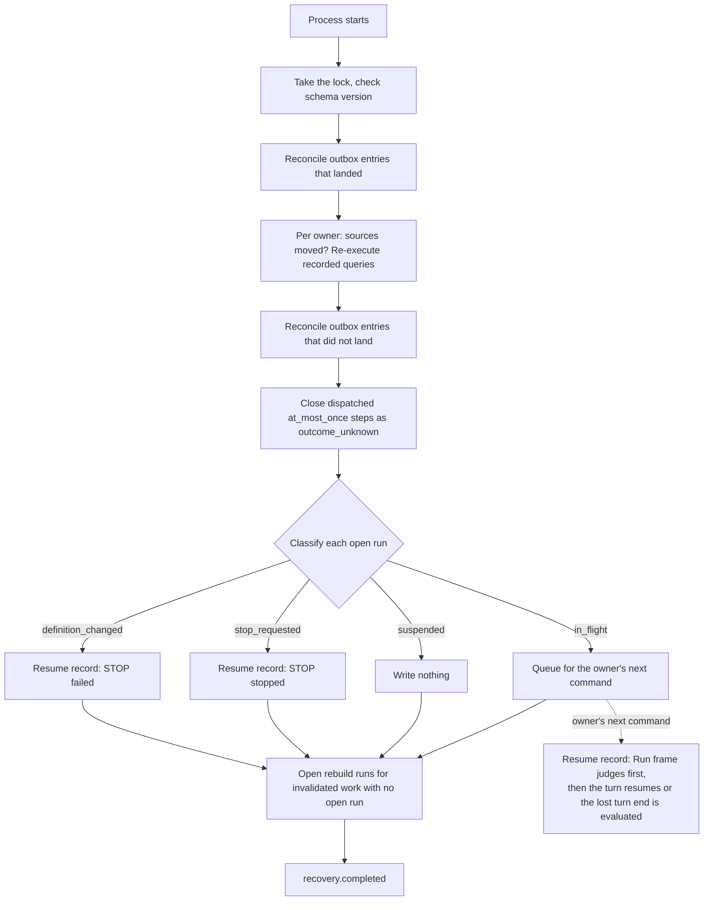

# ADR-P02: Durable execution, resume and replay (lean: Aksha's own durable step executor on the event store, deterministic step IDs, an injected clock, declared step semantics, and one recovery sequence on startup)

*Intermediate design as of 26 Nov 2026. Status: Proposed. This is a design record, not a description of shipped code. The Research agent and the Patent agent named below are example agents for Stillroom, a fictional hardware venture; the coding agent is a contrast case used only to test the design, and it is not built. "First milestone" means the 27 Nov 2026 cut of the build. Decision numbers refer to the [decisions log](../04-decisions-log.md); PR-NN and PNN IDs name primitives and P-1 to P-4 name design patterns, all listed in the [catalogue](../03-primitives.md); "v2" is the previous, unpublished design revision.*

## Status

Proposed, 25 Nov 2026. Decision for the maintainer. Nothing here was built as of 25 Nov 2026. No entry in the decisions log chooses the engine, the step semantics or the recovery order, so every decision below stays Proposed. P-2 (store facts, derive interpretations) and decision 11 (industry names) are applied. Primitive PR-02 in the primitives catalogue; carries forward v2 ADR-004 (own step runner) and ADR-020 (recovery policies and guards) under the new names, and adds the replay check and the semantics rename. Event names follow ADR-P01's proposed rename, with the v2 name in parentheses at first use. Amended 25 Nov 2026 after the three-agent stress test: S1 to S4 below are new and Proposed.

## Terms

A run must continue after the process dies, and a third author's tools cannot each invent their own recovery. The terms this ADR defines:

- **Durable execution** means each step of a run (a model call, a tool call, a completion check, a save) is recorded in the event store before it starts and when it ends, so a restarted process returns recorded results instead of running the step again and continues from the first step with no recorded outcome.
- A **durable step executor** (v2: step runner) is the runtime component that does this for every step.
- A **deterministic step ID** is a name computed from the run's structure, never from a clock or a random number: `R-0002/compare[C1]/t03/c02` is the second call of turn 3 of Task instance `compare[C1]` in run `R-0002`.
- An **injected clock** is a `Clock` object the runtime passes in; nothing in the runtime core reads the system time or a random source directly.
- **Step semantics** is a tool's declared answer to "what does a crash in the middle of this call mean": `at_least_once` (safe to run again), `reconcile` (ask the downstream system of record whether it landed) or `at_most_once` (never run again once dispatched; record the outcome as unknown).
- **Recovery on startup** (v2: boot) is the fixed sequence the process runs before it accepts a command.
- A **resume record** (v2: resume walk) is the one stop decision recovery writes for each turn end a crash swallowed.
- **Replay** is the same mechanism used on purpose: re-drive a finished run against its recorded model and tool results and assert it makes the same decisions.
- **Suspended** describes a run held on an open interrupt (v2: Wait): a question, an approval, a budget grant or a diff review waiting for a person.

## Context: what breaks without it

| Without this primitive | What a user or a test sees | Requirement |
|---|---|---|
| A restart re-runs the whole run | Every model call is paid twice; a send that already landed is attempted again | a stated requirement |
| A dangling tool call is given a synthetic "aborted" result | The model tries again, and a webhook with no ledger fires twice | a stated requirement |
| Step IDs built from time or random numbers | After a restart the runtime cannot find "the second call of turn 3" again, so it cannot return the recorded result | a stated requirement |
| A retry counter kept in memory | "Three tries" becomes "three tries per process"; a crash loop never ends | a stated requirement |
| A suspended run treated as work in flight | A restart while an approval is open writes records, counts toward a crash limit, or resumes a turn the person has not answered | a stated requirement |
| Changed code resumes an old run | A run started under one prompt finishes under another, and nobody can say which produced the packet | a stated requirement |

The three agents press on it differently. The Research Agent's tools are reads, safe to repeat. The Patent Agent has two effectful tools (form write, send) whose receivers keep ledgers. The contrast coding agent has all three kinds in one session: `pytest` is safe to repeat, `git push` can be checked against the remote, and a deploy webhook can be neither repeated nor asked. It also has the longest sessions: a crash on turn 40 must not re-spend 40 model calls.

## Decision

I propose eleven decisions. D1 to D3 and D5 to D9 carry v2 forward under the new names; D4, D10 and D11 are new or changed.

1. D1, engine. Aksha owns a durable step executor on the event store, behind a `DurableStepExecutor` protocol, with no Temporal, DBOS or Restate underneath (v2 ADR-004 lean C). An engine can go under the protocol later; the mapping is written as "designed so that", never "works with".
2. D2, step IDs. Every step ID follows the grammar of v2 05a section 2.7: run, Task instance, turn, call, with reserved segments (`t03`, `c02`, `w043`, `d01`, `derived`, `handoff`) that the loader refuses as Task names. A recorded `step.started` carries the arguments' hash; a restart that reaches the same step ID with different arguments raises `StepMismatch` and stops.
3. D3, clock and IDs. One `Clock` with `now()`, `sleep()` and a real `mono_ms()` for deadlines only, and one `IdSource` that counts run, interrupt, citation span and query IDs from the event store per owner. No module in the runtime core calls `datetime.now`, `time.time`, `time.sleep`, `uuid4` or `random`; a static test greps for them. Two fake-model runs therefore write byte-identical logs, except the `mono_ms` diagnostic, which every comparison excludes by name.
4. D4, step semantics, renamed. Each tool declares `semantics` as data: `at_least_once` (v2 `rerun`), `reconcile` (v2 `reconcile`) or `at_most_once` (v2 `report`). The names follow the AWS durable execution SDK's `StepSemantics` and Pi Durable's `replay: "safe"`. Defaults come from the tool class: reads, saves and model steps are `at_least_once`; a tool with a declared receiver is `reconcile`; the loader refuses an effectful tool that declares neither a receiver nor `at_most_once`.
5. D5, recovery on startup, in a fixed order (v2 HLD 10.3): take the lock and check the schema version; reconcile outbox entries that landed (ADR-P03); check each owner's sources for change and record `query.reexecuted` (ADR-P05); reconcile outbox entries that did not land; close each dispatched `at_most_once` step as `outcome_unknown`; classify every open run; write resume records; open rebuild runs; commit `recovery.completed` (v2: `boot.completed`).
6. D6, classification. Each open run is exactly one of: `definition_changed` (the loaded agent definition version hash differs from the one on `run.started`), `stop_requested` (a person's durable stop, `run.stop_requested`, exists; PR-18), `in_flight` (a turn end was lost, or a turn is incomplete), or `suspended` (its last stop decision was HOLD and nothing has resolved the interrupt since). Recovery writes nothing at all for a suspended run, so restarting while an approval request is open never counts toward a limit and never starts a turn.
7. D7, one resume record per lost turn end. The root stop policy, the Run frame, judges the resume first, before any inner frame: a changed definition stops the run `failed, definition_changed`; a stop request stops it `stopped`; the restart limit stops it `failed, restart_limit`. Otherwise the record either re-authorises the incomplete turn (`resumes_turn: true`, no turn charged) or relabels the lost turn end and lets the ordinary stop-policy evaluation decide (PR-16). Stencil's omp2 calls each such policy a Director (Stencil's term); in Aksha it is a stop policy.
8. D8, restart limit counted from the event store. The number of resume records since the run's last progress (a completed tool step or a saved artifact) is a projection; above 3 the run stops `failed, restart_limit`. No counter field exists.
9. D9, timeouts. A timed-out attempt is abandoned, not killed, because `concurrent.futures` cannot kill a thread. That is safe only because tool bodies return values and never touch the store: a late result reaches a step executor that no longer waits for it, and the runtime records `attempt.discarded` and saves nothing. Killing a process-based tool is the kill boundary, designed with the sandbox (PR-12).
10. D10, lazy resume per owner. In-flight work resumes before that owner's next mutating command or on `aksha resume`, never eagerly for every owner, so one owner's crash-looping run cannot block another owner's commands (v2 LC-4).
11. D11, replay check. A designed `replay_check` re-drives a finished run with a replay model and the recorded tool results under the current definition, and fails at the first step ID, argument hash or stop decision that differs, as Temporal's replayer does. Restart itself needs no replay mode, because the executor returns recorded results.

Work reuse when a new run meets earlier work: in the first milestone a new run adopts existing artifacts only when the whole agent definition version hash is unchanged, so a prompt edit re-runs every Task instance (v2 SR-7 lean B). A hash per Task, adopting under an unchanged Task hash, is the general design and makes a prompt edit cost only what it touches.



Caption: every arrow out of "Classify" either ends the run inside a resume record, writes nothing, or waits for the owner; recovery never starts a turn for a suspended run or a stopped one.

Takeaway: durability is a fixed recovery order plus one rule per tool, and the only judgement recovery makes is delegated to the same stop-policy evaluation that judges every other turn end.

### Amendments from the stress test (25 Nov 2026, Proposed)

1. S1, a suspended run that a change has reached gets one candidate. D6 writes nothing for a suspended run. The Patent review found the natural variant of the product requirements' demo: The approval request for `packet/C1@v1` is still open when the change set lands, so recovery classifies the run `suspended`, nothing rebuilds, and the founder is asked to decide a card for a packet the runtime already knows is out of date. A new class, `suspended_with_rebuilds`, covers a suspended run whose invalidation view gained a latest version written by this run since its last stop decision. Recovery queues one `next` candidate for it; the Run policy relays `next_instance`, which re-enters the affected writers by writer key while the held instance stays held (ADR-P16 S1).

   ```python
   # aksha/runtime/recovery.py (proposal)
   def classify_open_run(view: "LogView", run: str, loaded_hash: str) -> RunClass: ...
       # suspended_with_rebuilds: last stop decision HOLD, and invalidation_view(run) has a
       # writer of this run whose latest version is invalidated or dirty since that decision
   ```

2. S2, recovery's source check calls the one writer of source facts. D5 has recovery check each owner's sources and re-execute recorded queries, while ADR-P05 D6 said a restart re-executes nothing. The two now agree: both the `ApplySourceChange` command and recovery call `record_source_changes` (ADR-P05 S2), once per owner, in one transaction, and `RecoveryReport.reexecuted` prints every source and query that moved, so a stray fixture edit during development is visible.
3. S3, a re-entered instance starts at a fresh turn number. When a withdrawn key returns (ADR-P15 S3), the instance's earlier turns are already in the event store. The step-ID grammar of D2 gains no generation segment; re-entry starts at the next unused turn number, as `done` to `running` already does.
4. S4, D8 is the only restart rule. ADR-P14 D7 counted restarts per run; the coding review showed that a 6-hour session crashing four times, each after real progress, would end `crash_loop`. ADR-P14 now adopts D8 (resume records since the last completed tool step or saved artifact).

Agent-side rules the reviews added, with no core change: The Patent demo runs `aksha resume` after the restart, because resume is lazy (D10); fixtures and templates live outside the agent folder (ADR-P20 S3); and the coding agent puts the base tree's hash into `apply_patch`'s arguments so an `at_least_once` re-run applies to the recorded base.

## Alternatives considered

| Option | Prior art (what it does, with evidence) | For | Against | Verdict |
|---|---|---|---|---|
| A. Fold a transcript and repair dangling calls with a synthetic result | Codex inserts an `"aborted"` output for any call left with none (code, `codex-rs/core/src/context_manager/normalize.rs:21-140` at `1263a383`); opencode tells the model "continue without repeating completed work", with `maxAttempts` 10 (code, `packages/core/src/session/execution/restart.ts:31-32`, `:99-115` at `2255b893`) | Smallest | A synthetic result invites a repeated effect; no answer for a tool nobody can ask | Rejected: fails a stated requirement by design |
| B. Typed call phases with a typed abort on recovery | omp2 records `ready` then `started` per call and closes an unsettled call at boot with one of five typed aborts (code, `crates/session/src/session.rs:743-790`, `crates/tool/src/lib.rs:1709-1758` at `2f92f3b5aa`) | Honest "may have run" answer | No lookup against a system of record | Adopted as `at_most_once` only |
| C. Refuse to resume an unknown outcome | Exo resumes an unfinished round only on a client tool or an unanswered approval bound to the identical request, otherwise "cannot safely resume unresolved tool call" (code, `crates/executor/src/basic.rs:405-422` at `e1e5669`) | Never guesses | Fails runs a lookup could finish | Adopted for `at_most_once` with no receiver; `reconcile` covers the rest |
| D. Declared step semantics per step | Pi Durable re-runs an interrupted tool only if declared `replay: "safe"` and caps restarts at `restartLimit` 5 (docs and code, `packages/durable/README.md:265`, `:336` at `747c217`); the AWS durable execution SDK declares `StepSemantics` (code, `aws_durable_execution_sdk_python/config.py:479-481`, `:508-522` at `ae524b1`); DBOS dead-letters above `max_recovery_attempts` (code, `dbos/_core.py:1362-1374` at `da90502`) | A defined answer per tool, checked at load | Authors must declare | Adopted (D4, D8) |
| E. Temporal | Replay compares each command with the stored history and fails on a mismatch; the clock, IDs and randomness come through `workflow.now()` and its siblings (code, `workflow/_context.py`, `worker/_replayer.py` at `5c925a4`) | The reference model for durable agents | A server to run; its history is a second authority beside the event store (P-2) | Rejected as the engine; its replay check is D11 and its injected clock is D3 |
| F. DBOS or Restate in process | Decorated steps in your own SQLite (DBOS); `always_replay` mode (Restate, code, `python/restate/harness.py:295-303` at `26dc900`) | An engine's answers as a library | Its step table is a second record of the same facts; a dependency in the core; still needs `at_most_once` | Later candidate under the protocol |
| G. Own executor on the event store (lean) | ADK injects clock, ID and random providers (code, `src/google/adk/platform/` at `2b90353`); T3 Code counts its restart chain (at most 3 in 5 minutes) by walking stored links (code, `apps/server/src/orchestration-v2/RestartContinuation.ts:42-43`, `:290-310` at `ca81b7b9`) | One authority; standard library; restart returns recorded results with no replay mode | Aksha owns edge cases an engine has already met | Chosen |

Background, not code: Burckhardt and others, "Durable Functions: Semantics for Stateful Serverless" (OOPSLA 2021), give formal semantics for record and replay, which saves progress without checkpointing the runtime; the executor here is that idea over one SQLite file.

## Interface

```python
# aksha/runtime/steps.py, clock.py, recovery.py (proposal; design only)

StepSemantics = Literal["at_least_once", "reconcile", "at_most_once"]
OnUnknown = Literal["tell_model", "interrupt"]

@dataclass(frozen=True)
class StepId:
    run: str                                   # "R-0002"
    instance: str | None                       # "compare[C1]"
    turn: int | None                           # 3 -> "t03"
    call: int | None                           # 2 -> "c02"
    sub: str | None = None                     # "d01" (a fast model-class step), "derived"
    def __str__(self) -> str: ...              # "R-0002/compare[C1]/t03/c02"
    @classmethod
    def parse(cls, s: str) -> "StepId": ...

class Clock(Protocol):
    def now(self) -> datetime: ...             # injected UTC: event `at`, durations, backoff
    def sleep(self, seconds: float) -> None: ...   # virtual under FakeClock
    def mono_ms(self) -> int: ...              # real in every mode; deadlines only

class IdSource(Protocol):
    def next(self, owner: str, prefix: str) -> str: ...   # counted from the event store per owner

@dataclass(frozen=True)
class StepPolicy:
    timeout_ms: int
    max_retries: int
    retry_on: frozenset[str]                   # {"timeout", "transient", "model_transient"}
    backoff: "Backoff"
    semantics: StepSemantics
    on_unknown: OnUnknown = "tell_model"
    counted: bool = True                       # counts toward budget accounting (PR-14)

@dataclass(frozen=True)
class StepResult(Generic[T]):
    step_id: StepId
    outcome: Literal["ok", "error", "refused", "interrupted"]
    value: T | None
    attempts: int
    replayed: bool                             # True when returned from the event store without running

class DurableStepExecutor(Protocol):
    def step(self, step_id: StepId, kind: Literal["model", "tool", "check"], name: str,
             args: Mapping[str, Any], args_hash: str,
             work: Callable[["Deadline"], T], policy: StepPolicy) -> StepResult[T]:
        """Run one step at most once to completion:
        1. a recorded step.completed returns its value, replayed=True;
        2. a recorded step.started with another args_hash raises StepMismatch;
        3. at_most_once: commit step.dispatched alone before the body;
        4. attempts are counted from step.failed and attempt.discarded, so a restart never
           resets them; an abandoned attempt's late value is recorded as attempt.discarded;
        5. only the live attempt's value, on the runtime thread, becomes step.completed and
           the facts it carries (saves, interrupts, outbox entries)."""

RunClass = Literal["definition_changed", "stop_requested", "in_flight", "suspended",
                   "suspended_with_rebuilds"]   # S1

@dataclass(frozen=True)
class DanglingStep:
    step_id: StepId
    tool: str | None
    semantics: StepSemantics
    dispatched: bool
    attempts: int

def dangling_steps(view: "LogView") -> tuple[DanglingStep, ...]: ...            # projection
def classify_open_run(view: "LogView", run: str, loaded_hash: str) -> RunClass: ...   # projection
def lost_turn_end(view: "LogView", run: str) -> "LostTurnEnd | None": ...      # projection
def resumes_since_progress(view: "LogView", run: str) -> int: ...              # projection

@dataclass(frozen=True)
class RecoveryReport:
    prior_exit: Literal["clean", "unclean", "first_start"]
    reconciled: tuple[str, ...]                # idempotency keys (ADR-P03)
    reexecuted: tuple[str, ...]                # query IDs (ADR-P05)
    closed_unknown: tuple[str, ...]            # step IDs
    ended: tuple[tuple[str, str], ...]         # (run, reason) ended by a resume record
    in_flight: Mapping[str, tuple[str, ...]]   # owner -> runs waiting for that owner's next command
    rebuild_runs: tuple[str, ...]

def recover_on_startup(rt: "Runtime") -> RecoveryReport: ...
def resume_owner(rt: "Runtime", owner: str) -> tuple["Yielded", ...]:
    """Drain one owner's in-flight runs to HOLD or STOP; called before that owner's next
    mutating command and by `aksha resume`."""

@dataclass(frozen=True)
class ReplayDivergence:
    step_id: StepId | None
    expected: str                              # the recorded step, args hash or stop decision
    got: str

def replay_check(store: "EventStore", owner: str, run: str,
                 definitions: "AgentRegistry") -> ReplayDivergence | None:
    """Designed. Re-drive a finished run with the replay model (PR-22) and recorded tool
    results into a scratch store; return the first divergence, or None."""
```

Events it writes:

| Event | Transaction boundary | When |
|---|---|---|
| `step.started` (args hash, semantics) | Step intent | Before any step runs |
| `step.dispatched` | Dispatch, its own commit | `at_most_once` steps only, just before the body |
| `step.failed`, `attempt.discarded` | Attempt failed | A retryable failure; a late result from an abandoned attempt |
| `step.completed` (with the facts the value carries) | Step result | The live attempt's value accepted on the runtime thread |
| `step.completed{interrupted, outcome_unknown}` | Recovery | A dispatched `at_most_once` step found dangling |
| `stop.decided` (v2: `walk.decided`) with `turn_end_kind: resume` | Stop decision | One per lost turn end, written through stop-policy evaluation |
| `recovery.completed` (v2: `boot.completed`), `process.closed` | Recovery, clean exit | Designed (v2 cut M3) |

Projections it reads: dangling steps, open-run classification, lost turn end, resumes since progress, the definition hash on `run.started`, the pending-interrupt set, a durable stop request (PR-18), outbox entries with no completion (ADR-P03), and the invalidation view (ADR-P05) for the source check and rebuild runs.

## Stress test (25 Nov 2026)

Three design reviews in the three stress reviews walked the Research Agent (the Research stress review), the Patent Agent (the Patent stress review) and the contrast coding agent (the coding stress review) through this ADR on 25 Nov 2026. Nothing was built or run; each verdict is a reading of the interfaces. The verdict values are: fits; fits with agent-side code (the core is unchanged); needs a runtime change (generic, with no agent word in the core); missing primitive (no ADR owned it).

| Agent | Verdict as written | The scenario | What this ADR now says |
|---|---|---|---|
| Research | Fits | The process dies during a page fetch | Nothing new: a read is `at_least_once`; earlier turns return `replayed=True` |
| Patent | Needs a runtime change | The change set lands while A-0001 for `packet/C1@v1` is open; recovery writes nothing for the suspended run | S1 adds `suspended_with_rebuilds`; S2 makes recovery and the command share one writer of `source.changed` |
| Coding | Fits with agent-side code | A crash after `apply_patch` ran but before `step.completed` | Agent puts the base hash in the arguments; S4 keeps D8's restart rule for long sessions |

Verdict after the amendments: fits for all three once S1 and S2 land. S1 is on the Patent demo's path and is first-milestone work.

Open for the maintainer: S3's fresh turn number against a generation segment in the step ID (lean: fresh turn number).

## Sources (public)

1. Sebastian Burckhardt and others, "Durable Functions: Semantics for Stateful Serverless", OOPSLA 2021 (abstract), and Temporal's "Workflow Definition" and "Testing (Python SDK)" docs, as recorded in the quote sheet in the design notes.
