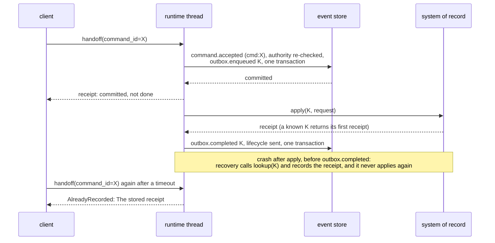

# ADR-P03: Transactional outbox and idempotency keys (lean: every external effect is an outbox entry committed before the call, keyed by what it means, reconciled against the downstream system of record after a crash; every command carries a command ID with an idempotent receipt)

*Intermediate design as of 26 Nov 2026. Status: Proposed. This is a design record, not a description of shipped code. The Research agent and the Patent agent named below are example agents for Stillroom, a fictional hardware venture; the coding agent is a contrast case used only to test the design, and it is not built. "First milestone" means the 27 Nov 2026 cut of the build. Decision numbers refer to the [decisions log](../04-decisions-log.md); PR-NN and PNN IDs name primitives and P-1 to P-4 name design patterns, all listed in the [catalogue](../03-primitives.md); "v2" is the previous, unpublished design revision.*

## Status

Proposed, 25 Nov 2026. Decision for the maintainer. Nothing here was built as of 25 Nov 2026. No entry in the decisions log chooses the key shape, the receipt or the outcome-unknown handling, so every decision below stays Proposed. P-2 and decision 11 (industry names) are applied. Primitive PR-03 in the primitives catalogue; carries forward v2 ADR-012 (effect keys) and the effect half of ADR-020 under the new names, and generalises v2's request ID on user messages to every command. Event names follow ADR-P01's proposed rename, with the v2 name in parentheses at first use. Amended 25 Nov 2026 after the three-agent stress test: S1 to S3 below are new and Proposed.

## Terms

The store and an outside system are two places that cannot commit together, so "a restart during a send does not send twice" cannot be one transaction. It is closed instead by a fact recorded before the call and a key both sides index. The terms this ADR defines:

- A **transactional outbox** is a table of side effects the harness intends to perform, written in the same transaction as the decision that wants them and run after that commit. In Aksha the table is the event store itself: an **outbox entry** is the `outbox.enqueued` event (v2: `effect.intent`).
- An **external effect** is a write to a system outside Aksha's store: a mock send service, a form service, a Git remote, a webhook. A save to the artifact store is not one; it commits inside the store.
- The **downstream system of record** (v2: receiver) is the outside system that keeps its own ledger of what it applied.
- An **idempotency key** is a value sent with a request so that a repeated request returns the first result instead of acting twice. Stripe made the pattern familiar; Brandur Leach's post of 27 Oct 2017 shows it in Postgres. Aksha builds the key from what the effect means, never from where in a run it happened.
- **Reconciliation** is asking the system of record, by key, whether an effect landed.
- **Outcome unknown** is the recorded result of an effect that was dispatched and cannot be asked about.
- A **command** is a request through the session API that changes state (send a message, approve, accept a diff review, stop). A **command ID** is the client's name for one command; a **command receipt** is the stored record that a command with that ID was accepted, so a retried command returns the first result.

## Context: what breaks without it

| Without this primitive | What a user or a test sees | Requirement |
|---|---|---|
| Call first, record after | A crash between the receiver's commit and Aksha's record leaves a send nobody knows happened; the next run sends again | a stated requirement |
| Keys built from step IDs | A rebuild run after a source change has new step IDs, so it is not refused a second send of the same packet version | a stated requirement |
| Keys without the owner | Two founders building the same packet share one ledger row; the second founder's send is swallowed | a stated requirement |
| No answer for a system with no ledger | A webhook in flight at the crash is either fired twice or silently dropped | a stated requirement |
| No command receipt | A retry after a crash, before the first attempt's receipt arrived, is recorded as a second message and starts a second run; two browser tabs approving one action both succeed | a stated requirement |
| Acknowledgement means "done" | A client waits on a request that holds the runtime for a whole model turn, then times out and retries | none directly; every multi-interface harness |

The three agents press on it differently. The Research Agent has no external effects. The Patent Agent has two (form write, send), both behind approval and both with ledgered mock services. The contrast coding agent has the effects the field actually meets: `git push`, opening a pull request, triggering a continuous-integration (CI) webhook. Each needs its own answer to "did it land?".

## Decision

I propose eight decisions. D1 to D3 and D6 to D7 carry v2 forward under the new names; D4, D5 and D8 are new or generalised.

1. D1, outbox entry before every external effect. An external effect runs only after an `outbox.enqueued` entry commits, in the transaction of the decision that wants it: The `handoff` command for an approved send, or the step intent of an effectful tool call. The same transaction re-checks authority (an approval granted for this exact action, the target current in the invalidation view, the approval signature recomputed and equal; PR-17, ADR-P05). After commit, the outbox drainer calls the system of record, but only after re-checking the same authority before each delivery attempt (retries included): the approval signature recomputed from current facts and the target still current. On a mismatch it commits `outbox.abandoned{hash_mismatch}` or `{target_invalidated}` and delivers nothing, because a source change can land between enqueue and a later attempt. On success the drainer commits `outbox.completed` (v2: `effect.outcome`) with the receipt and the step's result in one transaction. In the first milestone the drainer is the runtime thread, immediately after commit; one drainer lane per session is the designed scale path.
2. D2, keys from meaning. Each effectful tool declares `key_fields`, the argument fields that say what the effect is. The runtime builds the key as a SHA-256 over the tool name, the owner, and the canonical JSON of those fields, with every artifact reference resolved to its exact version. A send's key covers the document, its version, the recipient ID and the recipient record's version; a form's covers the form kind, the Task instance key, the reads hash and the content hash (v2 HLD 5.5).
3. D3, the system of record protocol. A system of record implements `apply(key, request)`, which returns the existing receipt for a known key, and `lookup(key)`. A tool with a system of record that has `lookup` gets `reconcile` semantics (ADR-P02).
4. D4, outcome unknown. A tool whose system cannot be asked declares `at_most_once`. The executor commits `step.dispatched` alone before the body; recovery closes a dispatched entry with no completion as `outcome_unknown`, tells the model and the person in fixed text, and, when the tool declares `on_unknown="interrupt"`, raises an interrupt asking a person to check the outside system. It never sends again.
5. D5, a command ID on every command. Every session API command carries a `command_id`, generated by the client at random once per invocation and reused only for that invocation's retries (the CLI keeps it in a local pending file until the receipt arrives). No ID is derived from the arguments or the session state, because a derived ID drops a deliberate repeat and changes on a retry after a reply lands (corrected 26 Nov 2026; this drops v2 DU-6's derived fallback). Each command's transaction starts with one `command.accepted` event (new) whose dedup key is `cmd:{owner}/{command_id}`; that event is the command receipt. A retried command hits `AlreadyRecorded` and returns the stored receipt. The acknowledgement means "committed", not "done": The client learns what happened next from the event stream (PR-19).
6. D6, one decision per pending item. Approval decisions, interrupt resolutions and diff-review decisions keep their own dedup keys (`decide:{approval_id}`, `resolve:{interrupt_id}`, `review:{interrupt_id}`), so a second front end deciding the same item gets `command.refused{already_decided}` even with a different command ID.
7. D7, reconciliation order and refusal. Recovery reconciles entries that landed before the source check and entries that did not land after it (ADR-P02 D5). An entry that did not land is finished with the same key only if its target is still current and its recomputed approval signature is equal; otherwise it is abandoned with `outbox.abandoned{hash_mismatch}` or `{target_invalidated}`. A person's approval is never spent on an action that changed.
8. D8, bounded receiver retries counted from the event store. A transient failure from the system of record is retried under the tool's step policy, each retry passing D1's pre-delivery re-check first; a timeout on a dispatched `at_most_once` entry is never retried and stays `outcome_unknown` (D4); attempts are counted from `step.failed` events, so a restart never resets them. With retries used up, the entry is abandoned with `retries_exhausted`, the document keeps its lifecycle state, and it appears in the person's pending list.



Caption: two keys do two jobs. The command ID makes a retried click the same click; the idempotency key makes a regenerated run's send the same send.

Takeaway: "at most once" across two systems is a recorded intent plus a key the other side indexes, and every command gets the same treatment one level up.

### Amendments from the stress test (25 Nov 2026, Proposed)

1. S1, `lookup` receives the request as well as the key. A Git remote does not index Aksha's idempotency key; it knows branches and commits. With only the key, a push adapter cannot answer "did it land?" after a kill between `git push` and `outbox.completed`. `lookup(key, request)` lets an adapter check the system's own state. A force push declares `at_most_once` with `on_unknown="interrupt"`, because "the remote head equals my commit" stops being a safe check once someone else can move the branch.
2. S2, `EffectSpec` gains two fields and loses one. `record_fields` names which outside record a request revises, which external record state (ADR-P29) reads. `receipt_kind` names an artifact kind that `outbox.completed` saves in the same transaction, so a completion check can read an effect's result: The coding review found that under the first milestone's `handoff` path the push result reaches no Task, because `TaskView` exposes artifacts and not outbox receipts. `needs_approval` moves to `ToolSpec.approval: ApprovalRule | None` (ADR-P10 S1), so approval is declared in one place.
3. S3, names. The command receipt event is `command.accepted` or `command.refused`, and a system of record's answer is `SystemReceipt`, per ADR-P01 S1. This file has been updated.

## Alternatives considered

| Option | For | Against | Verdict |
|---|---|---|---|
| A. Call, then record | Nothing to build | A crash between the call and the record duplicates or loses the effect | Rejected: fails a stated requirement |
| B. Intent before effect with the key memoised (lean, with D1's outbox framing) | The receiver can answer "did it land?" by key | The receiver must index the key | Chosen |
| C. Outbox committed with the decision, run by a worker after commit | The decision and its effect commit together or not at all | A separate worker is a second thread touching the store | Adopted as D1's framing, with the runtime thread as the drainer |
| D. Step IDs as keys (v2 K-C) | Free | A rebuild run's new step IDs escape the key, so a second send passes | Rejected |
| E. Keys without the owner (v2 K-B) | Shorter keys | Two owners collide on one ledger row | Rejected |
| F. Deduplication for a time window | Bounded index size | A retry after the window is a duplicate; Aksha's store is never truncated, so it needs no window | Rejected |
| G. Two-phase commit with the outside system | True atomicity | No mock or real email, form or Git service offers it | Rejected |
| H. Command receipts on every command (D5) | One rule for every interface | One extra event per command | Chosen |

## Interface

```python
# aksha/runtime/outbox.py and session.py (proposal; design only)

@dataclass(frozen=True)
class SystemReceipt:
    key: str
    ledger_id: str                             # which ledger answered; a replaced ledger is refused
    body: Mapping[str, Any]                    # the system's own reference, e.g. a message ID or commit sha

class SystemOfRecord(Protocol):                # v2: Receiver
    name: str
    def ledger_id(self) -> str: ...
    def apply(self, key: str, request: Mapping[str, Any]) -> SystemReceipt:
        """Apply once. A known key returns its existing SystemReceipt and changes nothing."""
    def lookup(self, key: str, request: Mapping[str, Any]) -> SystemReceipt | None:   # S1
        """Did this effect land? The adapter may check the system's own state from the
        request (a Git remote: does the branch point at the intended commit?). None: it did not."""

@dataclass(frozen=True)
class EffectSpec:                              # part of ToolSpec (PR-10)
    system: str | None                         # a registered SystemOfRecord, or None
    key_fields: tuple[str, ...]                # JSON pointers into the arguments: ("/document", "/recipient_id")
    semantics: "StepSemantics"                 # ADR-P02; "reconcile" needs a system with lookup
    on_unknown: Literal["tell_model", "interrupt"] = "tell_model"
    record_fields: tuple[str, ...] = ()        # S2, ADR-P29: which outside record a request revises
    receipt_kind: str | None = None            # S2: outbox.completed saves this artifact kind
    # needs_approval moved to ToolSpec.approval (ADR-P10 S1)

def idempotency_key(tool: str, owner: str, args: Mapping[str, Any],
                    spec: EffectSpec, artifacts: "ArtifactsView") -> str:
    """sha256 over tool, owner and canonical JSON of the key fields, with every artifact
    reference resolved to its exact version (and a recipient to its record version)."""

@dataclass(frozen=True)
class OutboxEntry:                             # a projection over outbox.* events
    key: str
    owner: str
    tool: str
    request_hash: str
    approval_id: str | None
    target: "ArtifactRef | None"
    state: Literal["enqueued", "dispatched", "completed", "abandoned", "outcome_unknown"]
    attempts: int

def pending_outbox(view: "LogView") -> tuple[OutboxEntry, ...]: ...      # projection

def enqueue(tx: "Transaction", owner: str, tool: str, args: Mapping[str, Any],
            spec: EffectSpec, *, approval_id: str | None) -> OutboxEntry:
    """Adds outbox.enqueued to the caller's transaction after re-checking authority:
    approval granted for this exact signature, target current, signature recomputed equal.
    Raises Refused(code) instead: approval_required, target_invalidated, hash_mismatch."""

def drain(rt: "Runtime", owner: str) -> tuple[OutboxEntry, ...]:
    """Run every enqueued entry of this owner after commit, in order, on the runtime thread.
    Before each delivery attempt, retries included, re-check the approval signature and the
    target's freshness; on a mismatch commit outbox.abandoned{hash_mismatch | target_invalidated}."""

def reconcile_on_startup(rt: "Runtime", *, phase: Literal["landed", "unlanded"]) -> tuple[str, ...]:
    """landed: lookup each entry with no completion and record outbox.completed for a receipt.
    unlanded: finish with the same key if authority still holds, else outbox.abandoned."""

@dataclass(frozen=True)
class Command:
    name: str                                  # "send", "approve", "reject", "accept_review", "handoff", "stop", ...
    owner: str
    session: str
    args: Mapping[str, Any]
    command_id: str                            # client-generated per invocation, reused only for retries (D5)

@dataclass(frozen=True)
class CommandReceipt:
    command_id: str
    seq: int                                   # the command.accepted event's sequence number
    accepted: bool
    refused: str | None                        # "already_decided", "hash_mismatch", ...
    duplicate: bool                            # True when this is a retry answered from the store

def dispatch(rt: "Runtime", command: Command) -> CommandReceipt:
    """The one write entry point of the session API (PR-19). Commits command.accepted with
    dedup key cmd:{owner}/{command_id} and the command's own events in one transaction, then
    returns. Work the command starts (a turn, a drain) runs after the receipt is returned."""
```

Events it writes:

| Event | Dedup key | Transaction boundary |
|---|---|---|
| `command.accepted` (new: command ID, name, arguments hash) | `cmd:{owner}/{command_id}` | The command's own |
| `outbox.enqueued` (v2: `effect.intent`) | `outbox:{key}` | The deciding command's, or the step intent |
| `step.dispatched` | `disp:{step_id}` | Its own, `at_most_once` only |
| `outbox.completed` (v2: `effect.outcome`), with lifecycle `sent` | `done-outbox:{key}` | With the step result |
| `outbox.abandoned` (v2: `effect.abandoned`), reason `hash_mismatch`, `target_invalidated`, `retries_exhausted` | `done-outbox:{key}` | Recovery, or the drainer |
| `command.refused` (`already_decided`, `hash_mismatch`, `target_invalidated`, `definition_changed`) | none | The refused command's |

Projections it reads: pending outbox entries; approval state and the approved signature (PR-17); the invalidation view for the target (ADR-P05); command receipts by dedup key; the attempts per step (ADR-P02).

## Stress test (25 Nov 2026)

Three design reviews in the three stress reviews walked the Research Agent (the Research stress review), the Patent Agent (the Patent stress review) and the contrast coding agent (the coding stress review) through this ADR on 25 Nov 2026. Nothing was built or run; each verdict is a reading of the interfaces. The verdict values are: fits; fits with agent-side code (the core is unchanged); needs a runtime change (generic, with no agent word in the core); missing primitive (no ADR owned it).

| Agent | Verdict as written | The scenario | What this ADR now says |
|---|---|---|---|
| Research | Fits | No external effect; a retried `save_artifact` after a crash | Nothing new: saves are internal and idempotent against the slot's latest version |
| Patent | Fits with agent-side code | After the change, `write_form` for `disclosure/C1@v2` has a new key, so the mock forms ledger holds two records for C1 and v1 carries no mark | The forms adapter keeps one record per form kind and candidate with revisions; the general form is ADR-P29, which S2's `record_fields` feeds |
| Coding | Needs a runtime change | Kill after `git push` lands and before `outbox.completed`; `lookup(key)` cannot ask the remote | S1: `lookup(key, request)`; force push is `at_most_once` with an interrupt; S2: a receipt artifact a check can read |

Verdict after the amendments: fits for all three once S1 and S2 land.

Open for the maintainer: none new.
