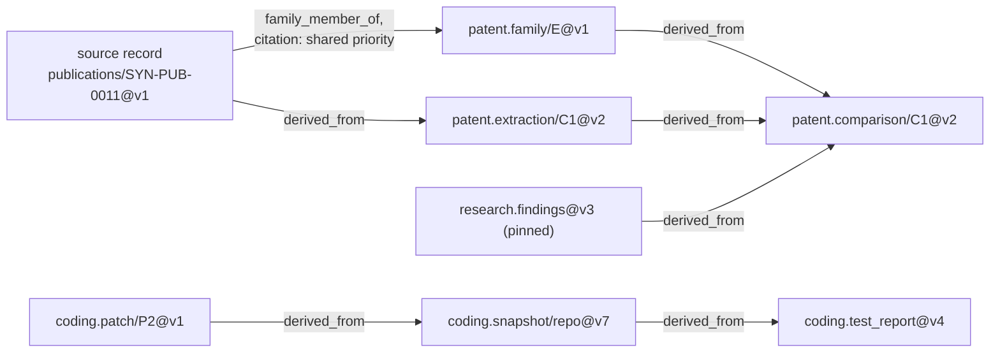

# ADR-P04: Artifact store, versions, lineage and typed relations (typed, immutable versions that record what they read; lineage captured by the runtime, never declared by the model; typed relations an agent declares with evidence)

*Intermediate design as of 26 Nov 2026. Status: Accepted in part. This is a design record, not a description of shipped code. The Research agent and the Patent agent named below are example agents for Stillroom, a fictional hardware venture; the coding agent is a contrast case used only to test the design, and it is not built. "First milestone" means the 27 Nov 2026 cut of the build. Decision numbers refer to the [decisions log](../04-decisions-log.md); PR-NN and PNN IDs name primitives and P-1 to P-4 name design patterns, all listed in the [catalogue](../03-primitives.md); "v2" is the previous, unpublished design revision.*

## Status

Accepted in part, 25 Nov 2026, by the maintainer, for the main decision: Decision 6 in the decisions log (structured artifacts are the core data model; raw inputs are read only by extraction; each agent declares its own schemas; the runtime's artifact base gives versioning, content hash, recorded reads, staleness, citation validation and approval binding) and decision 9 (artifacts form a graph: provenance edges the runtime records from recorded reads, and domain edges an agent declares, each carrying its own excerpt). Those are D1 to D3 below. Every other decision here (D4 to D12) is not in the log and stays Proposed. Primitive PR-04 in the primitives catalogue; carries forward v2 ADR-016 under the new names and adds a blob store for large content, a canonicaliser hook and the relation rename. Event names follow ADR-P01's proposed rename. Amended 25 Nov 2026 after the three-agent stress test: S1 to S5 below are new and Proposed. Amended 27 Nov 2026 by the correction loop (amendment C1) and cross-run reuse (amendment R1) below, both Proposed.

## Terms

The product requirements ask that saved outputs stay linked to their inputs, and that the Patent Agent cite Research Agent outputs by ID and version. Without a record of what each output read, the harness cannot tell which outputs a changed input affects, so invalidation (ADR-P05) has nothing to follow. The terms this ADR defines:

- An **artifact** is a typed, versioned output a run saves, such as a competitor matrix, a disclosure form or a test report. An **artifact kind** is an agent's declaration of one output type: its schema and the properties the runtime reasons about.
- A **version** is one immutable saved artifact, named by its **ref**, `patent.packet/C1@v2`: agent namespace, kind, key, version number.
- A **slot** is the line of versions with one owner, kind and key, over which "latest" and "current" are taken. The **writer key** (agent, Task path, key) is the Task instance that owns a slot and regenerates it.
- **Lineage** (also called **provenance**) is the record of which artifact versions, source records, user statements and recorded queries a version was built from. In Aksha the runtime captures it as **lineage inputs**: The exact versions it rendered to the Task instance or that the instance's tools returned. A **lineage edge** (`derived_from`) is one lineage input seen as a graph edge.
- A **typed relation** (v2: domain edge) is a named edge between artifacts or records that an agent declares, such as `same_entity_as` or `family_member_of`, saved with a citation as its evidence.
- A **blob** is a content-addressed byte string stored once by its SHA-256 hash, for content too large or too binary for a JSON payload.

## Context: what breaks without it

| Without this primitive | What a user or a test sees | Requirement |
|---|---|---|
| Outputs saved as files or free-form JSON with no input list | A changed prior-art reference cannot be traced to the comparisons it affects | a stated requirement |
| Lineage declared by the model ("I used sources 3 and 7") | A model that forgets a source leaves an output that never goes stale; one that invents a source leaves a false trail | a stated requirement |
| Overwriting in place | An approval granted on the packet's content no longer matches what is stored | a stated requirement |
| No version IDs | The Patent Agent cannot cite "the competitor matrix" by an exact version | a stated requirement |
| Entity merges and conflicts as fields each agent invents | Two listings of one company inflate the matrix; a price conflict disappears into one value | a stated requirement |
| Large tool output stuffed into events | A coding agent's test log makes every rebuild read megabytes (ADR-P01 D7) | a stated requirement |

The three agents press on it differently. The Research Agent needs typed relations (`same_entity_as`, `contradicts`) with evidence, because deduplication and visible conflicts are what it is graded on. The Patent Agent needs cross-agent reads pinned to a version and approvals bound to a content hash. The contrast coding agent needs the general form: its artifacts are file snapshots, patches and test reports, and "this test report was produced from this snapshot" is the same lineage record. It is also the first agent whose artifacts are large and binary.

## Decision

Accepted by the maintainer (decisions 6 and 9):

1. D1, structured artifacts are the core data model. Each agent declares its artifact kinds with schemas. Raw inputs (fixture records, fetched pages, a repository's files) are read only by extracting Tasks; every other Task reads artifacts.
2. D2, artifacts form a graph. Lineage edges come from lineage inputs and only the runtime writes them; typed relations are declared by the agent alongside its kinds, and each saved relation carries a citation.
3. D3, the artifact store gives every agent, with no agent code: versioning, content hashes, lineage, invalidation (ADR-P05), citation verification (PR-13) and approval binding (PR-17).

Proposed (not in the log):

4. D4, identity. Four names for four jobs: kind, ref, slot and writer key. A slot has exactly one writer key; another instance that needs the same slot adopts an equal version as a read and is refused `foreign_writer` for a different one (v2 AE-2).
5. D5, three hashes per version. `content_hash` over the full content answers "is this the exact document a person approved?". `canonical_hash` over a canonical form (refs reduced to slots, citations reduced to record and quote, declared pointers excluded, keyed lists sorted, JSON canonicalised following RFC 8785) answers "did a regeneration change anything a reader cares about?". `reads_hash` over the sorted lineage inputs answers "was it built from the same inputs?". A kind may add a pure `canonicalize` function for normalisation the declarative rules cannot express, such as whitespace in source code (new).
6. D6, lineage is captured, never declared. Lineage inputs are exactly the versions context assembly rendered to this instance and the versions its tools returned during its turns. A declared kind is not a read; a version is. A save records every input the instance read, never a subset: lineage and invalidation always use the full set of captured reads, plus every record a citation in it points to (v2 LA-3), so an input the save used can never be left out of invalidation (corrected 26 Nov 2026). A save may label some of those reads as its primary inputs, for display in the run inspector only; the label changes no lineage edge and no invalidation. A tool that tries to write `derived_from` or `supersedes` is refused.
7. D7, one save path. Every save from any tool or extension goes through `ArtifactStore.save` on the runtime thread, in order: rights, schema, lineage inputs, the two checks no agent can switch off (every read current, every citation verified), phrase rules, verifiers (model routing's checks, PR-07), idempotency, then one transaction with the artifact row, `artifact.saved` with its reads, any `relation.saved` (v2: `edge.saved`), any derived versions, any lifecycle change, and the step's `step.completed`.
8. D8, idempotency against the slot's latest version only. A save equal to the latest version in content and reads returns it; history is never searched, so a reverted change produces a new version equal to an old one, which is the right history (v2 05b W1). An equal regeneration with new reads is a new version (v2 SR-8 lean A).
9. D9, derived kinds are stored versions. A kind declared as a pure function over other kinds (the Patent Agent's recommendation table) is saved by the runtime in the transaction of the save that completes its inputs. It is one of two stored interpretations in the design (v2 HLD 24.4), justified because later artifacts cite it by version.
10. D10, a blob table for large content (new). One insert-only `blobs(hash, bytes)` table in the same SQLite file. Artifact content and event payloads reference `blob:sha256:<hash>` with a preview. A workspace snapshot (a manifest of path to blob hash, the shape of a Git tree) is a kind the sandbox extension declares, not a core kind.
11. D11, reads of another agent's artifacts are pinned. A Patent Task's read of `research.findings@v3` stays `@v3`; a newer Research version from an ordinary request does not invalidate it, only invalidation of the pinned version itself does (v2 AE-9).
12. D12, names. `EdgeKind` becomes `RelationKind`, `edge.saved` becomes `relation.saved`, "domain edge" becomes typed relation, and "recorded reads" becomes lineage in prose; the field stays `reads` in code.



Caption: plain `derived_from` arrows are lineage the runtime recorded; the labelled arrow is a typed relation the agent declared, carrying its own citation; the bottom row is the contrast coding agent's chain in the same shapes.

Takeaway: an artifact is a node that knows what it read, and a relation is a claim with its own evidence; nothing about either is specific to patents.

### Amendments from the stress test (25 Nov 2026, Proposed)

1. S1, save-time validators can read the evidence. The Research Agent's rules "a claim whose only spans come from the vendor's own domain is a vendor claim" and "a review finding keeps the review's date and geography" need a validator that sees each cited span's source record. `readiness` checks see a `TaskView` without span access. v2 had `validate` on an artifact kind (05b line 177) and D7's save path still names verifiers, so the field returns:

   ```python
   # aksha/runtime/artifacts.py (proposal)
   @dataclass(frozen=True)
   class EvidenceSpan:
       span_id: str; source: str; record_id: str; version: str
       metadata: Mapping[str, Any]               # the record's declared metadata fields only
   class EvidenceView(Protocol):
       def spans(self, pointer: str) -> tuple[EvidenceSpan, ...]: ...   # spans cited at one field
   Validator = Callable[[Mapping[str, Any], EvidenceView], tuple[Mapping[str, Any], tuple[str, ...]]]
   ```

2. S2, connected components of a relation. The competitor matrix must count entities, not hits. v2's relation index had `components(kind)` (05b line 560); D12's `relations()` returns a flat list. `ArtifactsView.components(kind: str) -> tuple[frozenset[ArtifactRef], ...]` returns them, and the same view is passed to `Derived` functions, so no agent re-implements union-find.
3. S3, path-scoped reads. A **path-scoped read** is a lineage input of one entry inside an artifact version (a file in a tree, a row in a list), pinned to that entry's own content hash. The coding review traced four failures to one cause: The repository is one artifact, so a one-line README edit makes every citation (ADR-P13), memory fact (ADR-P09) and finished plan step (ADR-P15) look out of date. Invalidation (ADR-P05 D4) gives a path-scoped read the state `same` when the latest version's entry hash equals the recorded one. Reads the runtime cannot see, such as the files `pytest` opened, stay whole-version reads.

   ```python
   def entry_hash(kind: "ArtifactKind", content: Mapping[str, Any], path: str) -> str: ...   # pure
   ```

4. S4, a chained writer. D4 gives a slot one writer key, so `fix[S1]` and `fix[S2]` writing the same tree are refused `foreign_writer`. A kind may declare `writers="chain"`: any instance of one declared Task may write the slot, each version reading the previous one, and each version still records its writer.
5. S5, the workspace tree kind belongs to the sandbox extension. D10 and ADR-P12's interface disagreed. D10 is kept: The core holds blobs and path-scoped reads; the tree kind is the sandbox extension's (ADR-P12 S4).

### Amendment C1: a version saved by a correction (27 Nov 2026, Proposed)

1. C1a, origin `correction`. An approved correction to an artifact value (ADR-P05 C1) saves the slot's next version in the decision's transaction (U4), with `origin: "correction"` and `correction: K-<n>`. Its content is the old version's with the value at the pointer replaced; it is checked against the kind's schema like any save. Its writer is the old version's writer, so the slot keeps one writer key (D4). Its reads are the old version's reads plus the old version itself, which is its one primary input: lineage says what it corrects. The old version's citations outside the corrected value are carried to it (`citation.bound` with the new carrier). Citations inside the corrected value are dropped, because the value they were bound in is gone, and the correction's evidence stays on `correction.proposed`.

### Amendment R1: a later run reuses an earlier run's versions (27 Nov 2026, Proposed)

A second run of the same agent asked the same thing redid every step, or, before this amendment, passed its completion checks at entry on the earlier run's versions without checking that anything they read still held. R1 makes reuse a decision with a recorded reason (`runtime/tasks/reuse.py`). The rule follows the verifying traces of incremental build systems: a stored result is reused when every dependency it recorded still has the value it was recorded at (Mokhov, Mitchell and Peyton Jones, "Build systems à la carte", ICFP 2018).

1. R1a, the key. A Task instance's writer key (agent, Task path, key) is the same in every run of the agent for one owner, so it names the work a later run would redo.
2. R1b, the check, at entry. When a request run enters an instance whose writer has current versions written for another run's line, it reuses them only if every one of them passes. Its origin is a Task's save, a derived kind or a correction, never a person's choice, which was made for its own run. Its run started under the same definition hash and the same request text. It is not invalidated or dirty by ADR-P05's rules, whatever its run's invalidation mode. Every recorded read still holds for the new run: a record or query at the version last recorded for it, and an artifact read whose slot holds no newer version written for the new run or for the version's own run, or only an equal one (early cutoff). Once citation-keyed reads land, the same check applies to a version's strong dependencies only. The decision is all or nothing per writer, because the writer's versions are one unit of work.
3. R1c, the record. One `artifact.reused{version, from_run, writer}` per version commits in the stop decision that records `task.entered` (U3, dedup `reuse:{run}/{version}`), and the entry's completion check reads the log with them, so the instance pops DONE with no model turn.
4. R1d, recompute. Otherwise nothing is recorded, and the instance's completion checks do not see the other line's versions (`hidden_for`), so the instance does its work. A version an approved correction saved (C1a) is never hidden, whatever the run's setting: it replaces the slot for every run (ADR-P05 C1e), so a run that recomputes does not regenerate over the domain owner's value. An equal save then becomes a new version for that run instead of D8's repeat, because the run did not reuse the earlier one. A retry within one line still returns the version it saved.
5. R1e, the setting. `Agent.reuse` is `on` (the default) or `off` (`reuse_unknown` otherwise) and is hashed into the definition. `AKSHA_REUSE=off` turns it off for every run a process starts. `run.started{reuse: "off"}` records it, and a run that records nothing reuses. A rebuild run never reuses, because the rebuild plan decides what it re-enters.


## Alternatives considered

| Option | For | Against | Verdict |
|---|---|---|---|
| A. Opaque bytes per path with a version number | Simple; any content | No lineage, so no invalidation; two puts can tear | Rejected |
| B. Free-form artifacts with an input list (Aksha v1) | Simple | Merges, conflicts and families become fields each agent invents; the runtime cannot check them | Rejected |
| C. Typed artifacts, captured lineage, declared typed relations with evidence (the maintainer's call, D1 to D3) | Merges, conflicts and families are checkable claims; invalidation flows through one graph | Agents declare more; the save path does more | Chosen |
| D. Lineage declared by the model | No runtime work | The model can omit or invent sources | Rejected |
| E. A whole-workspace snapshot as the only artifact | Fits coding agents | One coarse node: any change reopens everything | Adopted only as the sandbox extension's snapshot kind (D10) |
| F. Full tool output stored, the model sees a preview | Keeps contexts small and outputs recoverable | Bytes only, no types | Adopted as D10's blob and preview |
| G. A separate graph database | Fast graph queries at scale | A second store that must agree with the event store after a crash (P-2) | Rejected |

The W3C PROV model and a content-addressed object store are the general-usage shapes nearest to D6 and D10.

## Interface

```python
# aksha/runtime/artifacts.py and api.py (proposal; design only)

InputKind = Literal["record", "query", "statement", "artifact", "blob"]

@dataclass(frozen=True, order=True)
class InputRef:                                # one lineage input, one lineage edge
    kind: InputKind
    id: str                                    # "publications/SYN-PUB-0004", "Q-0007", "patent.extraction/C1"
    version: str                               # record version, result-set hash, "v2"
    path: str | None = None                    # S3: "/files/src~1auth.py" or "/steps/S1"; None: The whole version
    entry_hash: str | None = None              # S3: content hash of that entry; required when path is set

@dataclass(frozen=True)
class ArtifactRef:
    kind: str                                  # "patent.comparison"
    key: str | None                            # "C1"; None for an un-keyed kind
    version: int
    def slot(self) -> tuple[str, str | None]: ...
    def __str__(self) -> str: ...              # "patent.comparison/C1@v2"

@dataclass(frozen=True)
class WriterId:
    agent: str
    task_path: str                             # "compare"
    key: str | None

@dataclass(frozen=True)
class ArtifactKind:                            # declared by an agent; P-3: data the runtime reads
    name: str
    schema: type | Mapping[str, Any]           # a dataclass or a JSON Schema
    keyed: bool = False
    reviewable: bool = False                   # diff review applies (ADR-P05)
    lifecycle: bool = False                    # document lifecycle (draft to sent)
    derived: "Derived | None" = None           # a pure function over other kinds (D9)
    readiness: tuple["Check", ...] = ()
    validate: tuple["Validator", ...] = ()     # S1: (content, EvidenceView) -> (content, errors)
    writers: Literal["one", "chain"] = "one"    # S4: "chain" lets instances of one declared Task write in turn
    cites: tuple["CitePolicy", ...] = ()       # per-field citation rules (PR-13)
    choice: "ChoiceBinding | None" = None      # the field a person's choice fills
    canon_exclude: tuple[str, ...] = ()        # pointers left out of the canonical form
    list_keys: Mapping[str, str] = field(default_factory=dict)   # "/rows" -> "row_id"
    canonicalize: Callable[[Mapping[str, Any]], Mapping[str, Any]] | None = None   # pure, new
    save: Literal["any", "tool_only"] = "any"  # v2 SR-9
    summary: str | None = None                 # template for the readable summary

@dataclass(frozen=True)
class RelationKind:                            # v2: EdgeKind
    name: str                                  # namespaced by the loader: "research.same_entity_as"
    src: tuple[str, ...]                       # artifact kinds or "record:<collection>"
    dst: tuple[str, ...]
    labels: tuple[str, ...] = ()               # "brand_of", "reseller_of"
    symmetric: bool = False
    transitive: bool = False
    cites: Literal["one", "per_end"] = "one"

@dataclass(frozen=True)
class ArtifactVersion:
    owner: str
    ref: ArtifactRef
    content: Mapping[str, Any]
    content_hash: str
    canonical_hash: str
    reads: tuple[InputRef, ...]                # lineage, sorted and deduplicated
    reads_hash: str
    writer: WriterId
    origin: Literal["task", "derived", "choice", "copy_choice"]
    proposal_of: ArtifactRef | None            # set only for a pending revision (ADR-P05)
    run: str
    run_cause: Literal["request", "rebuild", "handoff"]
    for_runs: tuple[str, ...] = ()            # a rebuild run's originating runs (ADR-P05 S1)
    step: str                                  # deterministic step ID (ADR-P02)
    event_seq: int

@dataclass(frozen=True)
class SaveRequest:                             # returned by a tool; the store does the save
    kind: str
    key: str | None
    content: Mapping[str, Any]
    primary_inputs: tuple[InputRef, ...] = ()  # display label only; lineage is always every captured read (D6)
    relations: tuple["RelationRequest", ...] = ()

class ReadRecorder(Protocol):
    """The only way a read enters lineage. Context assembly and tool results call it; tools
    and models cannot."""
    def record(self, run: str, instance: str, read: InputRef) -> None: ...
    def reads(self, run: str, instance: str) -> frozenset[InputRef]: ...   # a projection

class ArtifactStore(Protocol):
    def save(self, tx: "Transaction", owner: str, writer: WriterId, req: SaveRequest,
             *, step: str) -> ArtifactVersion:
        """The save path of D7. Raises SaveRefused(code, path) with a structured error the
        model sees: rights, schema, read_not_seen, read_invalidated, citation_invalid,
        phrase, foreign_writer, provenance_relation_forbidden."""
    def latest(self, view: "LogView", kind: str, key: str | None, *,
               include_pending: bool = False) -> ArtifactVersion | None: ...
    def current(self, view: "LogView", kind: str, key: str | None) -> ArtifactVersion | None:
        """The latest version that is not an unaccepted pending revision."""
    def version(self, view: "LogView", ref: ArtifactRef) -> ArtifactVersion | None: ...
    def lineage(self, view: "LogView", ref: ArtifactRef, *,
                direction: Literal["up", "down"] = "up", depth: int | None = None) -> "LineageGraph": ...
    def relations(self, view: "LogView", *, kind: str | None = None,
                  touching: ArtifactRef | None = None) -> tuple["Relation", ...]: ...
    def put_blob(self, tx: "Transaction", data: bytes) -> str: ...      # returns "blob:sha256:..."; insert-only
    def get_blob(self, ref: str) -> bytes: ...

def content_hash(content: Mapping[str, Any]) -> str: ...
def canonical_hash(kind: ArtifactKind, content: Mapping[str, Any],
                   citations: Mapping[str, "Citation"]) -> str: ...
def reads_hash(reads: Iterable[InputRef]) -> str: ...
```

Events it writes:

| Event | Transaction boundary | Notes |
|---|---|---|
| `artifact.saved` (ref, writer, origin, reads, both hashes, `derived`, `proposal_of`) | Step result | With the artifact row |
| `relation.saved` (v2: `edge.saved`: kind, label, resolved ends, citation IDs, carrier ref) | Step result | Current exactly while its carrier version is current |
| `artifact.lifecycle` | Step result or a decision command | Draft, blocked, ready for review, approval pending, approved for handoff, sent |

Projections it reads: current and latest per slot; the instance's lineage inputs; rights per agent and Task; the relation index; the invalidation view (ADR-P05) for the "every read current" check; citations and citation spans (PR-13).

## Stress test (25 Nov 2026)

Three design reviews in the three stress reviews walked the Research Agent (the Research stress review), the Patent Agent (the Patent stress review) and the contrast coding agent (the coding stress review) through this ADR on 25 Nov 2026. Nothing was built or run; each verdict is a reading of the interfaces. The verdict values are: fits; fits with agent-side code (the core is unchanged); needs a runtime change (generic, with no agent word in the core); missing primitive (no ADR owned it).

| Agent | Verdict as written | The scenario | What this ADR now says |
|---|---|---|---|
| Research | Needs a runtime change | A finding labels COMP-02's own pricing page "279 EUR per sensor" a fact; two queries return "Acme Sensors" and "Acme Sensors GmbH" | S1 restores `validate` with an `EvidenceView`; S2 adds `components(kind)` |
| Patent | Fits | A new member of shared family A re-enters `prior_art[C2]`, the slot's first writer; pinned reads keep `research.competitor_matrix@v1` fixed | Nothing new; the README says a shared family is rebuilt by the instance that wrote it first |
| Coding | Needs a runtime change | A README edit saves tree `@v42` and invalidates a citation into `src/auth.py`; `fix[S2]` is refused `foreign_writer` | S3 path-scoped reads; S4 `writers="chain"`; S5 settles who declares the tree kind |

Verdict after the amendments: fits for all three once S1 to S4 land. S1 and S2 are small and help the first milestone's Research Agent; S3 and S4 are post-the first milestone, first in the coding agent's build order.

Open for the maintainer: S3 as an amendment here rather than its own ADR (lean: here, because it is one field and one rule in this ADR's types).
