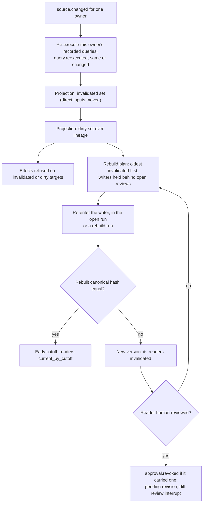

# ADR-P05: Invalidation in an incremental build (a change invalidates exactly the work whose lineage reaches it, early cutoff stops the cascade where rebuilt content is equal, machines rebuild silently and people review a diff)

*Intermediate design as of 26 Nov 2026. Status: Accepted in part. This is a design record, not a description of shipped code. The Research agent and the Patent agent named below are example agents for Stillroom, a fictional hardware venture; the coding agent is a contrast case used only to test the design, and it is not built. "First milestone" means the 27 Nov 2026 cut of the build. Decision numbers refer to the [decisions log](../04-decisions-log.md); PR-NN and PNN IDs name primitives and P-1 to P-4 name design patterns, all listed in the [catalogue](../03-primitives.md); "v2" is the previous, unpublished design revision.*

## Status

Accepted in part, 25 Nov 2026, by the maintainer. Decision 5 in the decisions log settles D1 (a stale machine-only artifact regenerates silently; a stale human-reviewed artifact gets a new version beside the old one with the changed inputs and a redline, and only the person's accept creates the new approval), and decision 6 settles D2 (invalidation, there called staleness, is a service of the runtime's artifact base for every agent). Decisions D3 to D12 are not in the log and stay Proposed. Pattern P-2 (staleness is a projection, never a stored mark) and P-4 (humans see diffs, machines regenerate) are applied. Primitive PR-05 in the primitives catalogue; carries forward v2 ADR-017 under the build-system names. Event names follow ADR-P01's proposed rename. Amended 25 Nov 2026 after the three-agent stress test: S1 to S7 below are new and Proposed. Amended 26 Nov 2026 by decision 38, which makes invalidation opt-in per agent: amendment M1 below, Proposed.

## Terms

The product requirements' required demo is invalidation: a closer prior-art reference and a newly revealed external contributor must reopen the affected comparisons, forms, recommendations and approvals, and leave unrelated research alone. A general harness needs the same for any agent whose sources change under it. Build systems solved this shape decades ago, so this ADR uses their names:

- An **incremental build** recomputes only the outputs whose inputs changed. **Invalidation** is the step that decides which outputs those are.
- A version is **invalidated** (v2: stale) when one of its direct inputs really changed: a source record has a new version, a recorded query re-executed with a different result set, an input artifact was rebuilt with a different canonical hash, or a user statement it read was superseded.
- A version is **transitively invalidated**, written **dirty** below (v2: possibly stale), when it is reachable from an invalidated version through lineage while the versions between them have not yet been rebuilt.
- **Early cutoff** (v2: confirmed current) is the rule that stops the cascade: when a rebuilt input's canonical hash equals the old one, everything downstream of it stays current. The name comes from build systems; Mokhov, Mitchell and Peyton Jones use it in "Build Systems à la Carte" (ICFP 2018).
- A **rebuild run** (v2: recheck run) is a run the runtime opens itself, cause `rebuild`, to regenerate one agent's invalidated work for one owner after the run that wrote it has ended. It records the runs it rebuilds for (`for_runs`), which decides whose readers its versions may move (S1).
- A **diff review** (v2: review card) is the interrupt a person answers for an invalidated human-reviewed version: it shows the **pending revision** (v2: proposed version) beside the old one, the inputs that changed, the lineage chain back to the change, and a field-level **redline** (tracked changes).
- A **human-reviewed** version is one with a person's choice, acceptance or approval on it; every other version is **machine-only**.

## Context: what breaks without it

| Without this primitive | What a user or a test sees | Requirement |
|---|---|---|
| Rebuild everything on any change | All four candidates and every Research artifact regenerate; unaffected work is lost or churned; every approval is re-asked | a stated requirement |
| Rebuild nothing | The packet goes out with the old prior-art comparison and no contributor question for counsel | a stated requirement |
| Stored stale marks written by a source check | A crash between the check and the marks leaves the two disagreeing | a stated requirement |
| No early cutoff | A source edit that changes nothing a comparison quoted still invalidates the comparison, the packet and its approval, and opens a diff review with an empty redline | a stated requirement |
| Silent regeneration of reviewed work | A person's selection or approval changes under them without their knowledge | a stated requirement |
| No explanation | The person cannot see why C1 reopened and C2 did not | a stated requirement |

The three agents press on it differently. The Research Agent's sources (pages, reviews) change, and only the findings that quoted them should move. The Patent Agent is the product requirements' demo: a change to C1's prior art and contributors must reach C1's comparison, recommendation, selection, forms and packet, revoke one approval, and leave C2 to C4 untouched. The contrast coding agent is the case every build system was written for: an edit to one file should re-run the tests that depend on it, and a comment-only edit should re-run nothing.

## Decision

Accepted by the maintainer:

1. D1 (decision 5). A machine-only invalidated version is rebuilt by re-entering its writer, with no prompt to anyone. A human-reviewed invalidated version keeps its lifecycle; its writer writes a pending revision beside it, and a diff review opens. Only the person's acceptance makes the revision current. Acceptance records `review.accepted` and, where invalidation revoked an approval, requests a fresh approval for the new version's exact action; it never grants one, which only the person's separate approve does. Rejection leaves the old version invalidated and nothing sendable.
2. D2 (decision 6). Invalidation is a service of the artifact store (ADR-P04); no agent writes invalidation code.

Proposed (not in the log):

3. D3, a projection, never stored. The stored facts are `source.changed` (v2: `world.changed`), `query.reexecuted` (v2: `query.rechecked`), the artifact saves and `approval.revoked`. The invalidation view is a reducer over them. Because each version reads only versions saved before it, sequence order is already a topological order of the lineage graph, so one pass in save order computes every version's state.
4. D4, four states per version: `current`, `invalidated`, `dirty`, `current_by_cutoff`. Each read gets one of `same`, `equivalent` (a later version with equal canonical hash), `moved`, `unsettled` (an input that is itself invalidated or dirty and not yet rebuilt) or `gone`. A version is invalidated if any read moved or is gone, else dirty if any is unsettled, else current by cutoff if any is equivalent, else current.
5. D5, early cutoff for machine-only versions only. A human-reviewed invalidated version always gets a diff review, even when its pending revision's content is equal, because the person decided on evidence that changed; the review leads with the changed inputs (v2 AE-6).
6. D6, source changes are per-owner facts. `apply_source_change(owner, change_set)` is a command, so it lands only between commands, never mid-turn. It moves that owner's source version and writes `source.changed`. Recorded queries are re-executed only for an owner whose source version moved, each writing `query.reexecuted{changed}`; an ordinary restart re-executes nothing. Query accounting (every hit of a recorded query an instance relied on is accounted for in an artifact keyed by that instance) is what lets a changed query reach the right artifacts (v2 SR-4 lean A).
7. D7, a rebuild plan recomputed after every commit. Take every latest version that is invalidated; skip one with an open diff review or a withdrawn writer; choose the mode (`regenerate` for machine-only, `copy_choice` for a version whose reviewed property came from a person's choice, `propose` for other human-reviewed versions); hold a writer while any of its other reads is invalidated, dirty or under an open diff review; order oldest first. Dirty versions are never re-entered; they settle when their inputs do.
8. D8, rebuild runs. When the invalidation view changes for an owner and an affected agent has no open run, the runtime opens one rebuild run for that agent and owner, dedup key `rebuild:{owner}/{agent}/{source_version}`, in dependency order across agents (a Research rebuild before a Patent rebuild that read it). An open run regenerates its own work in place instead. A rebuild run is never opened while that agent and owner have a durable stop request (PR-18) and obeys the hold invariant `inv.no_auto_start_while_held` (D13-4, PR-16).
9. D9, effects blocked and approvals revoked. No selection save, form write, packet save, approval request or handoff runs on a version that is invalidated or dirty. An approval is revoked only when its target is confirmed invalidated (its input came back different), in the same transaction that confirmed it, so a change that comes out equal revokes nothing. `approval.revoked` is one of two stored interpretations in the design, kept because it withdraws a person's authorisation at a moment the approval request must show.
10. D10, a rebuilt instance starts a fresh context holding its old version, the reads that changed, its current reads and the answered statements for its key, so it does not ask the person again what they already said (v2 LA-6 lean A).
11. D11, diff reviews in dependency order. When a reviewed version reads or takes its keys from another reviewed version, the downstream review opens only after the upstream one is accepted; receiver effects never run in silent regeneration while a reviewed upstream review is open.
12. D12, every change is explained. Each invalidated version carries its direct causes and one shortest lineage chain (`via`) back to the source change. After a change the interfaces show five lists: what was invalidated, what was rebuilt, what stayed current by cutoff, what waits on a person, and what is blocked.



Caption: The only stored facts are the source change, the query re-executions, the saves and the revocations; every set on this diagram is a projection over them, recomputed after each commit.

Worked example, the product requirements' demo (S6), with the numbers from v2 05b section 9.7:

| After | Invalidated | Dirty (latest) | Rebuilt next |
|---|---|---|---|
| Restart; the source check finds C1's prior-art query and contributor query changed | `prior_art/C1@v1`, `extraction/C1@v1` | 7 versions: C1's comparison, recommendation, the table, the selection, C1's disclosure, worksheet and packet | `extract[C1]`, then `prior_art[C1]` |
| Both rebuilt with different content | `comparison/C1@v1`, `disclosure/C1@v1`, `worksheet/C1@v1` | recommendation, table, selection, packet | `compare[C1]` |
| Comparison, recommendation and table rebuilt | `selection@v1` (human-reviewed by a choice) | `packet/C1@v1` | `select` in `copy_choice` mode; `prepare[C1]` held behind the selection review |
| The person accepts the selection review; forms rebuilt with different content | `packet/C1@v1`; its approval revoked in that transaction | none | `packet[C1]` in `propose` mode: one diff review, then one fresh approval request |

Every C2, C3 and C4 version and every Research version stays current throughout, because none of their reads moved. Zero sends happen.

Takeaway: invalidation is one deterministic pass in save order, and rebuilding is that pass asked "what is invalidated and has nobody waiting on a person".

### Amendments from the stress test (25 Nov 2026, Proposed)

1. S1, a version from an unrelated run of the same agent is a sibling. A founder's UK research request writes `research.competitor/COMP-02@v2` into the slot an earlier EU matrix read at `@v1`; under D4 that read is `moved` and the EU matrix rebuilds from UK data with no source change. A newer version now moves a same-agent reader only when it was written by the reader's own run or by a rebuild run opened for the reader's run. A rebuild run records the originating runs whose invalidated work it regenerates, `run.started{cause: rebuild, for_runs}`, and each version it saves carries them, so a later rebuild of the UK work (for the UK run) is still a sibling to the EU reader (corrected 26 Nov 2026: "any run whose cause is `rebuild`" let an unrelated rebuild move the reader again). A version from an unrelated `request` run, or from a rebuild for another run, is a sibling, as D11 of ADR-P04 already says for reads across agents. Agents that want shared slots across requests qualify their keys with a scope ID.
2. S2, one writer of source facts. `record_source_changes` is the only writer of `source.changed` and `query.reexecuted`. The `ApplySourceChange` command (now one change set over several sources, ADR-P19 S1) and recovery's source check (ADR-P02 S2) both call it, once per owner, in one transaction. D6's sentence "an ordinary restart re-executes nothing" is replaced: a restart checks sources and reports what moved.

   ```python
   # aksha/runtime/invalidation.py (proposal)
   def record_source_changes(tx: "Transaction", owner: str,
                             moved: Mapping[str, str],            # source -> new version
                             cause: Literal["command", "recovery", "clock"]) -> tuple[str, ...]: ...
                             # clock: the run-start and day-boundary date write of ADR-P25 D4
   ```

3. S3, a withdrawn writer's versions read as `gone`. When `resolve` merges COMP-06 into COMP-02 after `fetch_extract[COMP-06]` has saved, the withdrawn instance's version stays latest in its slot and a `keys="all"` matrix counts the vendor twice. v2 handled this (05b line 348); this ADR's four read states dropped it. A version whose writer instance is `withdrawn` now reads as `gone` to every reader, and `keys="all"` reads skip withdrawn keys.
4. S4, a rejected review blocks its writer. Rejecting a choice-backed review left the plan free to re-enter `select` in `copy_choice` mode and raise the same review again. v2 05b section 10.5 item 5 is carried forward: The writer becomes `blocked` with `review_rejected`, the rebuild plan skips it, and the rejection raises a fresh `choice` interrupt on the writer instance in the same transaction, so the person can choose again.
5. S5, a `rebase` rebuild mode. All three modes re-enter the writer, so an upstream pull under a coding agent throws away hours of edits. A kind may declare a pure three-way merge; a clean merge saves a new version that reads the new base, and a conflict raises a `review` interrupt carrying the conflicting entries.

   ```python
   MergeResult = Union["Merged", "Conflict"]
   Merge = Callable[[Mapping[str, Any], Mapping[str, Any], Mapping[str, Any]], MergeResult]
   #               (old base,           new base,            derived version)
   # ArtifactKind.rebuild: Literal["regenerate", "propose", "copy_choice", "rebase"]; "rebase" needs merge
   ```

6. S6, recorded queries hash identities, not raw hits. A re-executed search returning the same five vendors in a new order invalidated every finding. `ToolSpec.result_key` (ADR-P10 S2), a JSON pointer to a hit's stable identity, makes the result-set hash cover the set of identities.
7. S7, freshness lifetimes come from timers. Data that goes out of date with time, such as a pricing page older than 30 days, needs `max_age_s` on a versioned source or artifact kind and a durable timer that records `source.expired`. Both belong to ADR-P25 and are not first-milestone work.

### Amendments from the build (26 Nov 2026, Proposed)

1. B1, a recorded read names no source, so a change set checks a record against every source that serves its collection. `record_source_changes` asks each `VersionedSource` about every record the owner read in that source's collections. Two agents that read one folder through two readers under one owner (the demo: the research agent's folder reader names `priorities/business-priorities.md`, the patent agent's world names `notes/C1-self-calibration.md#note`) collide on the shared `priorities` collection: the patent world does not know the research agent's record ID, answers None, and the research agent's read is recorded `gone`: a rebuild run opens for its `scope`, every save is refused `stale_source`, and the run cannot settle (`evaluation_loop`). The demo composes one versioned source per folder (`aksha.app.SharedFolder`) that answers each ID through the reader that names it that way. The general fix, recording the source on `read.recorded` and checking a read only against its own source, changes an event payload and is left open.
2. B2, re-entry mode (decision 36). D10 stands as the default: a re-entered writer starts a fresh context with the rebuild summary. A run may set `reentry: "resume"` on its `run.started`; a rebuild run records the setting it opens with (the opener's, or `resume` inherited only when every run in `for_runs` chose it). With `resume`, each re-entry records the mode `choose_reentry` picks on its `task.entered` (ADR-P08, amendment B3), and a resumed writer continues its own recorded session. An in-place re-entry in an open run follows the same choice; under the default it now starts fresh too, where before it kept its earlier turns.

### Amendments from the general agents (26 Nov 2026, Proposed)

1. G1, uploads are a source change. A person's own files are each owner's *input workspace* (`InputWorkspace` port, `adapters/sources/workspace.py`): one versioned source, `inputs`, with one collection, `input`, whose records are the uploaded files at their relative paths (`input/<path>`), versioned by the `sha256` of their bytes. The `UploadInputs` named command writes the files and records what moved with the same `record_source_changes` as any change set, so uploading a file again with other bytes moves exactly that record and reopens only the work built on it; the same bytes move nothing. The session opens the rebuild runs a recorded change calls for once no open run of the owner can move (`Session(rebuilds=True)`), and the server's runtime thread gives the commanded owner a pass, so an upload reaches its work without another command.
2. G2, record parts. A tool that reads some rows of a table records a *part*, `<record>#where:<column>=<value>`, versioned by exactly those rows (`runtime/grounding/parts.py`, `where_part` and `part_version` in the extension API 2.5). Any folder-backed source answers a part's version with the same function, so a change to another candidate's rows moves nothing this one built on. This replaces the patent world's private view versions (amendment B1's `SharedFolder`): the demo now composes one plain `FolderSource`, and its expected reopening (C1's chain only) holds unchanged. A renamed field inside a row read still moves that row, where a view that left the field out did not: the price of reading files any source can version.
3. G3, recorded queries re-execute through the tool that recorded them. A query ID is `<agent>.<tool>?<canonical JSON arguments>`; `aksha.app.ToolQueryRunner` calls that tool's body again over the owner's current inputs and answers the version it records. Listings are recorded queries too (`research.list_inputs`, `patent.list_candidates`, `patent.list_templates`), so a file added later re-executes them and reopens only the work whose listing it changes: a new publication changes no research listing (it is no seller page and no review export) and only C1's search.
4. G4, a rebuild run records its agent's declared budget (`run.started{budget}`, the same fields a request run records), so it is metered like the agent's request runs, not by the runtime's default; before, a rebuild that re-entered most of an agent's Tasks ran out of the default 40 tool calls.
5. G5, recovery checks the inputs. An upload writes its files, then records what moved, so a process that stops between the two leaves bytes on disk the log has not seen. `Session.check_inputs` runs recovery's source check (S2, `check_sources`, cause `recovery`) over the owner's input workspace during recovery and `aksha resume`, and before an owner's first command in a process (which covers server mode, where an owner with no open run is not recovered at startup). Record parts (G2) take a CSV row as one logical row, so a quoted line break's continuation lines are part of the row's version.
6. Open: a change to a page the research `discover` step read gives a new `competitors` version (its citation spans are new), and every company's `evidence` instance reads that one artifact, so all of them re-enter, each saving an equal profile. Reading a keyed slice of a non-keyed artifact would narrow it; no such read exists yet.

### Amendment M1: invalidation is opt-in per agent (decision 38, 26 Nov 2026, Proposed)

Decision 38 amends decision 6 and D2: invalidation stays a service of the runtime, but an agent gets it only as far as its definition asks. `Agent.invalidation` (ADR-P20, amendment M1) is one of four modes, each including the one before it:

| Mode | What the runtime does for the agent's runs |
|---|---|
| `off` (the default) | Nothing. Its versions never read as stale, so they are never in the rebuild plan, never refuse an effect (D9), never open a diff review and never revoke an approval; its old tool results are never masked as stale; its reads schedule no freshness recheck (ADR-P25 D3); no rebuild run opens for it. |
| `edit_guard` | `off`, plus the edit-time check: a tool that declares `ToolSpec.edits` is refused `stale_edit` when its target record changed since the instance last read it, and `unread_overwrite` when it replaces a whole existing record the instance never read. The refusal carries the current version and text, so the model reads again once instead of resending stale text. Creating a record is free; a partial edit of a record never read is let through, because an edit quotes the text it changes and fails on its own when that text is gone. |
| `notify` | `edit_guard`, plus stale masking of old tool results and the change notice at the next turn boundary (D4 with ADR-P08 and decision 32). Its versions still never read as stale, so nothing rebuilds and no review or revocation follows. |
| `rebuild` | Everything in this ADR: the invalidation graph, rebuild runs, early cutoff, diff reviews and fresh approvals. The research and patent agents declare it. |

1. M1a, the mode is a fact. `run.started{invalidation}` records the mode the run's definition declared, and every reader derives the same answer from the log after a restart: the view (`invalidation/view.py`, rule 6), the masking plan (`context/masking.py`), the loop's recheck timers and edit check (`loop/calls.py`). A rebuild run records `rebuild`. A `run.started` without the field was written before decision 38, when every run had the full cascade, so it reads as `rebuild`; logs and tests written before the setting keep their meaning.
2. M1b, what `off` means for recorded reads. A tool's reads are still recorded on `read.recorded` and on saved versions: they are lineage and provenance (ADR-P04, ADR-P13), which an agent cannot opt out of. Invalidation simply never evaluates them for a run that did not opt in.
3. M1c, the edit-time check (`invalidation/guard.py`). It runs inside the tool's durable step, before the body, so a resumed step returns the recorded answer and never checks again. The version last read is the instance's last `read.recorded` of that record ID; a body that writes returns the version it wrote in `Ok.reads`, so consecutive edits by the same instance pass. With no record reader the edit is refused `edit_unchecked` (fail closed). Nothing is rebased onto the new text: a refused edit changes nothing, at the cost of one more read round trip per conflict. Known limit: reads are recorded once per version, so after reading v1, then v2, then the record going back to v1, the edit is refused until the instance reads again.
4. M1d, instruction files. The agent's instruction file and Task briefs are read and hashed into the definition (ADR-P20 D7) for every agent, whatever the mode, so a run never continues on instructions that changed; the mode governs only what the runtime does on its own about the agent's tool reads and artifacts.
5. M1e, scope of the coding stress test. The stress test's coding agent and the S5 `rebase` mode apply only to a coding agent that opts into `rebuild`. A coding agent is expected to declare `edit_guard`: no watcher, no masking, no notices and no rebuild, with the check at edit time that keeps a whole-file write from silently reverting someone else's change. The evidence for the split is a study of how coding harnesses treat a file that changed after it was read: none invalidates proactively, all check only at edit time, and the data-loss reports come from whole-file writes left unchecked and from refusals that did not show the current text. The study says nothing about agents whose sources are web pages, records or prior art, so `rebuild` for the research and patent agents rests on this ADR's own requirements.
6. Open: `notify` is built as masking plus notices on the turn after a change is recorded; a lazy per-step check of recorded paths, without a recorded source change, is not built.

## Alternatives considered

| Option | For | Against | Verdict |
|---|---|---|---|
| A. Regenerate everything, or nothing | Nothing to build | Fails a stated requirement and the demo | Rejected |
| B. Stored stale marks plus one "confirm recheck" pause (Aksha v1) | Easy to query | Marks can disagree with facts after a crash; every recheck needs a person | Rejected |
| C. Timestamp comparison | Simple | Clocks and copies lie; an equal rebuild still cascades | Rejected |
| D. Content-hash invalidation with early cutoff (lean for D3 to D5) | Exactly the affected work; equal rebuilds stop the cascade | Needs a canonical form that reduces references consistently (ADR-P04 D5) | Chosen |
| E. Silent regeneration of everything, reviewed work included | Fewest interruptions | A person's selection or approval changes under them | Rejected by decision 5 |
| F. Tracked changes for reviewed documents (D1) | The person sees exactly what moved | A review per reviewed version | Chosen (decision 5) |
| G. Store "confirmed current" as a fact | Cheap reads | Stores an interpretation P-2 forbids and the projection already gives | Rejected (v2 SR-8 lean A) |

## Interface

```python
# aksha/runtime/invalidation.py (proposal; design only)

Freshness = Literal["current", "invalidated", "dirty", "current_by_cutoff"]
ReadState = Literal["same", "equivalent", "moved", "unsettled", "gone"]

class VersionedSource(Protocol):               # implemented by fixture worlds and live adapters, outside the core
    name: str
    def version(self, owner: str) -> str: ...
    def record_version(self, owner: str, record_id: str) -> str | None: ...   # None: The record is gone

@dataclass(frozen=True)
class ReadStatus:
    input: "InputRef"
    state: ReadState
    now: str | None                            # the current version, or the new result-set hash

@dataclass(frozen=True)
class VersionState:
    ref: "ArtifactRef"
    freshness: Freshness
    reads: tuple[ReadStatus, ...]
    is_latest: bool
    human_reviewed: bool
    open_revision: "ArtifactRef | None"
    via: tuple[str, ...]                       # one shortest chain back to the source change

@dataclass(frozen=True)
class InvalidationView:
    owner: str
    as_of_seq: int
    versions: Mapping[str, VersionState]
    def state(self, ref: "ArtifactRef") -> VersionState: ...
    def invalidated_latest(self) -> tuple[VersionState, ...]: ...
    def summary(self) -> "ChangeSummary": ...  # the five lists of D12

def invalidation_view(view: "LogView", sources: Mapping[str, VersionedSource]) -> InvalidationView:
    """A projection (ADR-P01): one pass over versions in event_seq order. Cached by seq."""

@dataclass(frozen=True)
class RebuildEntry:
    writer: "WriterId"
    mode: Literal["regenerate", "propose", "copy_choice", "rebase"]   # "rebase": S5
    invalidated: "ArtifactRef"
    because: tuple[ReadStatus, ...]

def rebuild_plan(iv: InvalidationView, definitions: "AgentRegistry",
                 open_reviews: Mapping[str, str]) -> tuple[RebuildEntry, ...]: ...   # pure

def apply_source_change(rt: "Runtime", owner: str, change_set: str, *,
                        command_id: str | None = None) -> "CommandReceipt":
    """A session API command (ADR-P03): moves this owner's source version, writes
    source.changed, re-executes this owner's recorded queries, and in the same transaction
    revokes approvals whose targets are confirmed invalidated. Open runs of this owner get a
    plain `next` turn end; suspended instances stay suspended."""

def open_rebuild_runs(rt: "Runtime", owner: str) -> tuple[str, ...]:
    """One run per affected agent with no open run, cause 'rebuild', in dependency order,
    recording for_runs (the runs whose invalidated work it regenerates, S1);
    none while a stop request or the hold invariant forbids an automatic start."""

@dataclass(frozen=True)
class Hunk:
    path: str                                  # JSON pointer, keyed lists matched by their key field
    old: Any
    new: Any

def redline(kind: "ArtifactKind", old: Mapping[str, Any], new: Mapping[str, Any], *,
            max_hunks: int = 40) -> tuple[Hunk, ...]: ...      # field level; word level later

@dataclass(frozen=True)
class DiffReview:                              # the payload of interrupt.raised{kind: "review"}
    interrupt_id: str
    old: "ArtifactRef"
    revision: "ArtifactRef"
    changed_reads: tuple[ReadStatus, ...]
    via: tuple[str, ...]
    hunks: tuple[Hunk, ...]
    card_hash: str                             # what the person accepts; a different hash is refused

def accept_review(rt: "Runtime", owner: str, interrupt_id: str, card_hash: str, *,
                  command_id: str | None = None) -> "CommandReceipt":
    """Records review.accepted; where an approval was revoked, records approval.requested for
    the revision's exact action. Never records approval.granted."""

def reject_review(rt: "Runtime", owner: str, interrupt_id: str, card_hash: str, *,
                  command_id: str | None = None) -> "CommandReceipt": ...
```

Events it writes:

| Event | Dedup key | Transaction boundary |
|---|---|---|
| `source.changed` (v2: `world.changed`), per owner | none | Source change |
| `query.reexecuted` (v2: `query.rechecked`: query ID, new result-set hash, `changed`) | none | Source change |
| `approval.revoked` (approval ID, target, the inputs that moved), `interrupt.voided{revoked}` | none | The save, source change or recovery step that confirmed the invalidation |
| `run.started{cause: rebuild, for_runs}` | `rebuild:{owner}/{agent}/{source_version}` | Rebuild start |
| `interrupt.raised{kind: review}` with `card_hash` | none | The step result that saved the pending revision |
| `review.accepted`, `review.rejected` | `review:{interrupt_id}` | Decision command |
| `approval.requested` (on acceptance only) | none | Decision command |

Projections it reads: artifact versions and their lineage (ADR-P04); `supersedes` relations; recorded queries and their re-executions; each owner's source versions; the human-reviewed property of each version; open interrupts and open runs; durable stop requests (PR-18); approvals and their targets (PR-17).

## Stress test (25 Nov 2026)

Three design reviews in the three stress reviews walked the Research Agent (the Research stress review), the Patent Agent (the Patent stress review) and the contrast coding agent (the coding stress review) through this ADR on 25 Nov 2026. Nothing was built or run; each verdict is a reading of the interfaces. The verdict values are: fits; fits with agent-side code (the core is unchanged); needs a runtime change (generic, with no agent word in the core); missing primitive (no ADR owned it).

| Agent | Verdict as written | The scenario | What this ADR now says |
|---|---|---|---|
| Research | Needs a runtime change | A UK request invalidates the EU matrix; ranking noise invalidates findings; a merged duplicate vendor is counted twice | S1 sibling rule; S6 `result_key`; S3 withdrawn writer reads `gone`; S7 points freshness at ADR-P25 |
| Patent | Needs a runtime change | The designed S6 fits; but the command and recovery are two entry points for one change, and a rejected selection review is raised again | S2 one writer of `source.changed`; S4 `review_rejected` blocks the writer and raises a fresh choice |
| Coding | Needs a runtime change | Pulling upstream invalidates the imported tree and regenerates hours of edits | S5 the `rebase` mode with a declared pure merge |

Verdict after the amendments: fits for all three once S1 to S6 land. S2 and S3 are first-milestone work (the demo's change set and the product requirements); S1 and S4 are small and should ride with them; S5 to S7 are later.

Open for the maintainer: S1's rule (lean: sibling unless the writer's run is the reader's run or a rebuild).
