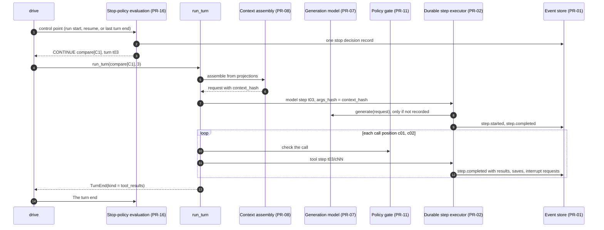

# ADR-P06: Agent loop and turn (the loop runs one turn of one Task instance, keeps nothing between turns, and hands every turn end to stop-policy evaluation)

*Intermediate design as of 26 Nov 2026. Status: Proposed. This is a design record, not a description of shipped code. The Research agent and the Patent agent named below are example agents for Stillroom, a fictional hardware venture; the coding agent is a contrast case used only to test the design, and it is not built. "First milestone" means the 27 Nov 2026 cut of the build. Decision numbers refer to the [decisions log](../04-decisions-log.md); PR-NN and PNN IDs name primitives and P-1 to P-4 name design patterns, all listed in the [catalogue](../03-primitives.md); "v2" is the previous, unpublished design revision.*

## Status

Proposed, 25 Nov 2026. One part is Accepted because the maintainer's recorded calls settle it: The loop never decides a stop itself, and every turn end goes to stop-policy evaluation over a stack derived from the event store (pattern P-2, decisions log items 3 and 10, as ADR-014 records). Decisions log item 8 (each fan-out Task instance has its own model context, and the scheduler, not the model, starts it) is also the maintainer's call and this ADR builds on it. Everything else here is my lean and waits for the maintainer. Nothing was built as of 25 Nov 2026. Reviewed 25 Nov 2026 in the three-agent stress test: no amendment needed.

## Terms

Primitive: PR-06, cluster B (Thinking). Depends on PR-02 (durable execution), PR-07 (model interface), PR-10 (tool registry), PR-11 (policy gate). Needed by PR-08 (context assembly) and PR-15 (Task model and scheduler). Older Aksha name: "runner". Carries forward HLD sections 3.4 and 6.7 and LLD 05a sections 5.4 to 5.6; this ADR renames, does not redesign.

Terms used here:

- **Agent loop** is the code that calls the model, runs the tool calls it asked for, records the results, and repeats.
- **Turn** is one pass of the loop for one Task instance: one model call, then every tool call that reply asked for, in order.
- **Turn end** is the point where a turn's last result is recorded and control returns to the runtime. It carries a kind (tool results, final answer, interrupt and so on) and is the **stop candidate** that stop-policy evaluation judges.
- **Stop-policy evaluation** (PR-16) combines every active stop policy into one recorded stop decision.
- **Stop decision** is one of PASS, CONTINUE, PUSH, HOLD, DONE, FAIL and STOP (PR-16 defines them). Only CONTINUE starts another turn.
- **Durable step executor** (PR-02) runs one model or tool step at most once to completion under a deterministic step ID such as `R-0002/compare[C1]/t03`, and returns the recorded result on a restart instead of running the work again.
- **Final answer** is a reply with text and no tool calls, or a call to the reserved `finish` tool. It is a claim that the work is done, which the Task's completion check (PR-15) accepts or refuses.

## Context: what breaks without it

Every harness has a loop, so the question is not whether to have one but what it owns. Four things break when the loop owns too much:

1. State in local variables is lost at the first crash. A coding agent's session runs for hundreds of turns; a loop that counts turns or remembers "the plan was written" in memory restarts with those facts gone, re-spends model calls, and may re-run a `git push`.
2. Stop rules accrete as `if` statements around the loop. v1 Aksha's designed loop decided "continue or stop" at six places, with a seventh (the per-instance turn cap) that had no agreed home (ADR-014 context). With six such rules there are 15 pairs whose order somebody must get right, and nobody chose that order.
3. A tool result that does not reach the next model call breaks a requirement ("Tool results must affect the next step"). If the loop builds the next request from its own variables, a resumed run sends a different request than the uninterrupted one would have.
4. A third agent author who needs one more behaviour at the turn end (a todo reminder, "run the tests before you finish") has to edit the loop, which fails pattern P-1.

The product requirements ask for the loop directly ("Calling the model and running tools") and indirectly through restart recovery and partial results.

## Decision

My lean, with the Accepted part marked:

1. The loop is one function, `run_turn`, that runs exactly one turn of one Task instance and returns a `TurnEnd`. A small driver, `drive`, alternates between stop-policy evaluation and `run_turn`. Nothing else in the runtime core calls the model for a Task instance.
2. The loop keeps nothing between turns. Each turn starts from projections over the event store: The instance's own recorded turns, the stop-policy stack's `prepare` output, the current artifact versions it may read, and the budget accounting (pattern P-2).
3. The loop writes no event of its own. Every write goes through the durable step executor (PR-02): a model step, then one tool step per call position. This is what lets recovery on startup ask the event store "did a turn end after the last stop decision record?" and get one answer.
4. Accepted (P-2, DL-3, DL-10, as ADR-014 records): The loop never decides whether the work is over. Every turn end goes to stop-policy evaluation, which commits one stop decision record and returns a stop decision. Only CONTINUE runs another turn, and only CONTINUE spends one turn of budget (ADR-014 decision 4). The turn limit, the stop-veto limit, a person's stop request (PR-18) and an open interrupt (PR-17) are all read there, never in the loop.
5. Within a turn, tool calls run one at a time, in the order the model listed them, through the policy gate (PR-11) and the durable step executor. A position after an interrupt request, an approval request, a `budget_exhausted` refusal or the `finish` tool is recorded `skipped`, not run, so nothing happens after the run has asked a person something.
6. When one turn produces several outcomes, the turn end takes the first that applies, in this order: `approval`, `interrupt`, `budget`, `final_answer`, `tool_results`. A turn whose reply was cut off by the output limit is `malformed`; a context over the limit is `context_overflow`; a model unavailable after retries or a step mismatch on resume is `fault`.
7. The model call goes through the Task's generation model alias (PR-07), the request is built by context assembly (PR-08), and its hash is the step's argument hash, so a resumed turn either returns the recorded reply or fails with `step_mismatch`. It never silently sends a different request.
8. An agent cannot replace the loop in v1. Its extension points are its tools, its Task tree with completion checks, the stop policies it opts into, its context policy parameters and its model aliases. A replaceable loop is worth revisiting only when a third agent needs a turn shape this one cannot express (see "Where this stops").



Caption: The loop asks projections for its inputs and the step executor for every write, and the only arrow that leads to another turn passes through stop-policy evaluation.

Worked example, the coding agent on a crash at turn 140 of 200 (toy numbers): turns t001 to t139 each have a recorded model `step.completed` and tool results. Recovery on startup finds that t139's turn end has no stop decision record, so it evaluates that turn end once (PR-02, PR-16); the decision is CONTINUE, so `run_turn(edit, 140)` runs. Its model step has no record, so it is the first model call made after the restart. Model calls re-spent: 0 of 139. If the crash came between t140's model step and its tool steps, the model reply is returned from the record and only the unrecorded tool positions run, under each tool's recovery policy (PR-02, PR-03): `pytest` re-runs because it is safe to repeat, `git push` goes through the outbox and its idempotency key.

## Alternatives considered

| Option | For | Against |
|---|---|---|
| A. An inline loop with the stop branch inside it | One function, easy to read | Each new stop rule is another `if` inside the loop; the turn's state lives in local variables |
| B. A loop owned by another process, driven over a protocol, stopped by a hook | Reuses a mature loop | The loop is closed source; a Stop hook can block at most eight times in a row; nothing durable records why a turn continued |
| C. Continue while local tool calls remain | Minimal | Any message from any plugin continues the run, so the precedence is "whoever spoke" |
| D. A graph engine that ends when no node is triggered | General and composable | The stop is the absence of a trigger; nothing records why the run ended or continued |
| E. A replaceable loop module that commits the reply before tools run | Durable across a crash; a team can swap the loop | The loop still decides its own end; a swapped loop can skip the record |
| F. A stateless turn over projections whose turn end is judged by a stop-policy stack (my lean) | One owner of every stop; durable; a stop decision can be recomputed in a test and compared with the record | One extra recorded decision per turn end; the loop is not replaceable in v1 |

Takeaway: every option has the same sample-then-tools shape; they differ only in who decides the end and whether the decision is recorded, and F is the only option where both answers are "one owner" and "yes".

## Interface

### Types and functions

```python
# aksha/runtime/loop.py (proposal; design only; HLD's runner.py renamed)
TurnEndKind = Literal[
    "tool_results",      # the model called tools and every position is recorded
    "final_answer",      # text with no tool calls, or the reserved `finish` tool
    "interrupt",         # a tool asked a person a question or a choice (PR-17)
    "approval",          # a tool requested an approval for an exact action (PR-17)
    "budget",            # a call was refused with budget_exhausted (PR-14)
    "malformed",         # the reply was cut off by the output limit
    "context_overflow",  # over the context limit before sending, or the provider refused it (PR-08)
    "fault",             # model unavailable after retries, or step_mismatch on resume
]

@dataclass(frozen=True)
class TurnEnd:
    run_id: str              # "R-0002"
    instance: str            # "compare[C1]"
    turn: int                # 3, for step IDs ending t03
    kind: TurnEndKind
    reason: str | None       # "context_limit", "context_overflow", "model_unavailable", "step_mismatch"
    last_seq: int            # sequence number of the last event this turn wrote

@dataclass(frozen=True)
class InstanceRef:
    run_id: str
    task_path: str           # "compare"
    key: str | None          # "C1"; None for an un-keyed Task

def run_turn(rt: "Runtime", owner: str, instance: InstanceRef, turn: int) -> TurnEnd:
    """Run one turn: assemble the context, run the model step, run each call position
    through the gate and the step executor, and classify the turn end. Writes nothing
    except through the step executor."""

def classify_turn_end(reply: "GenerationResult", positions: tuple["PositionOutcome", ...]) -> TurnEndKind:
    """Pure: apply the priority approval > interrupt > budget > final_answer > tool_results;
    'length' gives malformed."""

def drive(rt: "Runtime", owner: str, run_id: str) -> "RunOutcome":
    """Alternate stop-policy evaluation and run_turn until a decision is HOLD (suspended)
    or STOP (ended). Holds no state between iterations; each pass re-reads projections."""
```

The driver in outline, so the one place a turn can start is visible:

```python
def drive(rt, owner, run_id):
    point = rt.control_point(owner, run_id)          # run start, a resume, or the last turn end
    while True:
        decision = evaluate_stop_policies(rt, owner, point)   # PR-16; commits one stop decision record
        if decision.verdict == "CONTINUE":
            point = run_turn(rt, owner, decision.instance, decision.turn)
        elif decision.verdict == "PUSH":
            point = rt.entered(decision.instance)    # the scheduler's pick, already committed (PR-15)
        else:                                        # HOLD or STOP; PASS, DONE and FAIL resolve inside evaluation
            return rt.outcome(owner, run_id)
```

### Events it writes

None directly. Through the durable step executor, one turn writes:

| Event (v2 catalogue name) | When | Carries |
|---|---|---|
| `step.started` | Before the model step and before each tool step | Step ID, kind, `args_hash` (the `context_hash` for a model step), rendered reads |
| `step.completed` | After each step, including `refused`, `skipped`, `malformed` outcomes | The reply or result's recorded view, usage (model steps only), outcome code |
| `step.failed`, `attempt.discarded` | A retryable failure; a late result from an abandoned attempt | Attempt number, code, timing |
| Facts a tool step returns, in the same transaction | A save, an interrupt request, an approval request | `artifact.saved`, `relation.saved` (v2: `edge.saved`), `interrupt.raised` (v2: `pause.opened`), `approval.requested` |

The stop decision record (event type `stop.decided`, v2 `walk.decided`, as ADR-P01 D8 proposes) is written by stop-policy evaluation, not by the loop. Event type names follow ADR-P01 D8's proposed renames.

### Projections it reads

| Projection | Owner primitive | What the loop uses it for |
|---|---|---|
| The instance's recorded turns and results | PR-01 | Which call positions of a resumed turn already have results |
| Stop-policy stack `prepare` output (`compose_prep`) | PR-16 | Guidance for the system message and any tool narrowing |
| Current artifact versions and invalidation state | PR-04, PR-05 | Rendered reads, through context assembly |
| Alias table recorded on `run.started` | PR-07 | Which generation adapter answers this Task |
| Budget accounting | PR-14 | Read by the gate per call; the loop itself counts nothing |

## Stress test (25 Nov 2026)

Three design reviews in the three stress reviews walked the Research Agent (the Research stress review), the Patent Agent (the Patent stress review) and the contrast coding agent (the coding stress review) through this ADR on 25 Nov 2026. Nothing was built or run; each verdict is a reading of the interfaces. The verdict values are: fits; fits with agent-side code (the core is unchanged); needs a runtime change (generic, with no agent word in the core); missing primitive (no ADR owned it).

| Agent | Verdict as written | The scenario | What this ADR now says |
|---|---|---|---|
| Research | Fits | The model asks for six page fetches in one reply | Nothing new: positions run in listed order through the gate; a timed-out fetch is an error result the next turn reads |
| Patent | Fits | In `handoff_request[C1]` a second call follows the approval-raising `send_document` | Nothing new: The second position is recorded `skipped` and the turn ends `approval` |
| Coding | Fits | Three file reads and a 90-second suite in one reply take the sum of all four | Accepted for v1; read-only positions on worker threads committed in position order stay designed |

Verdict after the amendments: fits for all three. Steering input (ADR-P27) reaches the model through context assembly (ADR-P08), so the loop is unchanged.
