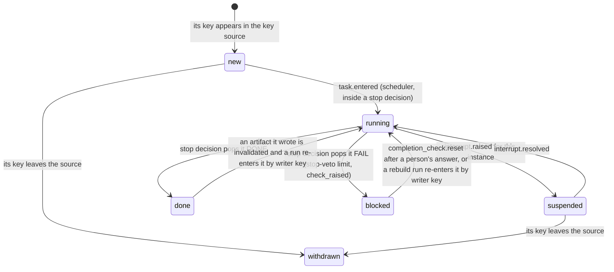

# ADR-P15: Task model and scheduler (a declared Task tree with pure completion checks, fan-out as tracked Task instances, a scheduler that alone starts work, and a supervisor Task built from the same parts)

*Intermediate design as of 26 Nov 2026. Status: Accepted in part. This is a design record, not a description of shipped code. The Research agent and the Patent agent named below are example agents for Stillroom, a fictional hardware venture; the coding agent is a contrast case used only to test the design, and it is not built. "First milestone" means the 27 Nov 2026 cut of the build. Decision numbers refer to the [decisions log](../04-decisions-log.md); PR-NN and PNN IDs name primitives and P-1 to P-4 name design patterns, all listed in the [catalogue](../03-primitives.md); "v2" is the previous, unpublished design revision.*

## Status

Accepted in part, 25 Nov 2026, by the maintainer. Accepted: one recursive unit named `Task` (decisions log items 4 and 7); fan-out creating tracked Task instances, each with its own model context, started only by the runtime's scheduler, sequential in the first milestone (item 8); an agent declaring its Task tree as data in a Python module (items 2 and 10); and a completion check on each Task written as a plain pure function (item 4, pattern P-3). These carry v2 ADR-011 and ADR-013 forward under the industry names of decision 11. Proposed: The supervisor Task (v2 ADR-018, SA-1), the generalised completion-check rules for agents that run code (D4), and every sub-decision in "Decisions for the maintainer". Primitive PR-15 in the primitives catalogue, cluster D (Control). Nothing here was built as of 25 Nov 2026. Amended 25 Nov 2026 after the three-agent stress test: S1 to S4 below are new and Proposed. Amended 27 Nov 2026 by the portfolio slice of D7: S5 below is Proposed. Amended 27 Nov 2026 from the build: S6 below (a failed instance is not re-entered in the same stop evaluation) is Proposed.

## Terms

A harness that cannot say what work exists, which piece runs next and when a piece is finished leaves all three to the model, and the model is the party the product requirements say not to trust about completion. This primitive gives the harness its own answer to each. The terms it defines:

- A **Task** is the one recursive unit of work an agent declares: its tools, the artifact kinds it reads and writes, a completion check, optional child Tasks, an optional key source for fan-out, at most one declared interrupt, the stop policies it opts into, and a prompt file. Aksha kept the name `Task` on 25 Nov 2026; the older words "state", "milestone" and "phase" are retired (the design glossary).
- A **completion check** (v2: done-check) is a pure function from a read-only view of the event store and artifacts to a `CheckResult`: pass, or fail with a message the model reads. "Pure" means it reads only the view: no clock, store handle, network, model call or randomness.
- **Fan-out** is a Task declared with `per=`, a key source; the runtime makes one tracked **Task instance** per key, such as `compare[C1]`, each with its own model context, turn limit and events. Each instance's context names its key and the entry the key stands for (ADR-P08 D3, the key notice), since the Task's brief and reads are the same for every key.
- A **key source** is data naming where keys come from: a collection in a versioned data source (`source_keys("candidates")`) or a field of an artifact (`artifact_keys("patent.selection", "candidate_ids")`).
- The **scheduler** is the runtime component that, alone, starts Task instances. It picks the next runnable instance by a pure function over the view.
- A **supervisor Task** is a parent Task whose children are per-item worker Tasks and which takes turns of its own to steer them, by saving data the scheduler reads. It is the general form of a "super agent" (the design glossary).
- A **writer key** is (agent, Task path, key): The identity a rebuild run (v2: recheck run) uses to re-enter the instance that wrote a stale artifact, whatever run wrote it first.

Event names follow ADR-P01's proposed renames (D8), with the v2 name in parentheses at first use: `task.entered` (`instance.entered`), `completion_check.evaluated` (`check.evaluated`), `completion_check.reset` (`check.reset`), `interrupt.voided` (`pause.voided`), `stop.decided` (`walk.decided`), and the `rebuild` run cause (`recheck`).

## Context: what breaks without it

| Without this primitive | What a user or a test sees | Requirement |
|---|---|---|
| "Done" is whatever the model says | A packet with an unsourced required field is reported ready because the founder insisted | a stated requirement |
| Progress lives in the model's context or in a mutable `status` column | After a crash the column says `running` and the event store says the instance finished; the README's state table and the code drift apart | a stated requirement |
| One conversation per agent, not per item | A change to candidate C1's prior art reruns C2 to C4, because nothing scopes work to one item | a stated requirement |
| The model starts sub-work through a spawn tool | Delegation is skipped or duplicated, and the lead's context grows with every child; the super-agent research found both (super-agent OSS 2, ENG 2.3) | a stated requirement |
| No owner of "what runs next" | Two front ends, a restart and a rebuild run can each start the same instance | a stated requirement |

The three agents press on it differently:

1. The Research Agent fans out per competitor and must return a partial matrix when a fetch fails, so its completion check has to accept an explicit unknown and refuse a silent blank.
2. The Patent Agent fans out per candidate, parks two candidates on questions while the other two proceed, and must reopen only C1's chain after a change. It needs per-key instances and re-entry by writer key.
3. The contrast coding agent has a short tree (plan, edit, test, push) and a long middle: one `fix` instance that may take 200 turns. Its completion check, "the tests pass", is the clearest case for a check that depends on running code, which a pure function cannot do itself.

## Decision

Seven decisions. D1 to D3 and D5 are the maintainer's (items 2, 4, 7, 8, 10). D4, D6 and D7 are my proposals.

1. D1, a declared tree. An agent definition declares its Tasks as frozen dataclasses (structure as data, P-3). The loader compiles the tree, prints it as the README's state table, hashes it into the agent definition version hash (ADR-P20), and refuses a bad tree before any run starts: a leaf with no completion check, a tree deeper than `max_task_depth` (default 4), a `needs` naming no sibling, a key source the loader cannot resolve, and, in the first milestone, a keyed child below a top-level Task (`keyed_child_unsupported`, v2 LC-8).
2. D2, completion checks. Every leaf Task has a completion check, `Check = Callable[[TaskView], CheckResult]`. A parent is done when its own check passes (or it has none) and every child instance is done; a blocked child blocks the parent and is named as the blocker. The check runs only inside stop-policy evaluation (ADR-P16), on entry, on every finish request, and when a Task limit ends the instance after its turn (ADR-P16 S5); a passing check on entry finishes the instance with no model turn, which is how unaffected work stays untouched after a change. A failing check on a finish request becomes the next turn's runtime message; the stop-veto limit (`max_finish_vetoes`, default 3, counted from stop decision records) turns the next veto into FAIL and the instance becomes `blocked`. A text-only reply is a finish request too (ADR-P06), so its failed check is answered the same way. The count includes the refusal being judged: with the default of 3, the first two refused finishes come back to the model and the third fails; with 1, the first refusal fails and its message never reaches the model. A check that raises becomes FAIL with `check_raised`, never a crash.
3. D3, fan-out as tracked instances. `per=KeySource` makes one Task instance per key, each with its own model context, turn limit and events. Each instance's context names its key and the entry the key stands for (ADR-P08 D3, the key notice), since the Task's brief and reads are the same for every key. An instance saves a keyed kind under its own key: a save that names no key gets it, and a save under a key its key source gives a sibling is refused `key_not_own`, since the first writer of a slot owns it (ADR-P04 D4) and one wrong-key save would lock the sibling out. Keys are sorted as strings so two fake-model runs give the same order. When a key leaves its source, the instance is `withdrawn`, its open interrupts are voided with `interrupt.voided{reason: key_withdrawn}`, and none of its downstream instances is entered. An un-keyed child Task shares its parent instance's context (v2 HD-4, still Proposed).
4. D4, checks that depend on running code read an artifact; they never run it. The coding agent's "tests pass" is two pieces: a tool step (`run_tests`) that runs in the sandbox (ADR-P12) and saves a `test_report` artifact whose lineage records the file versions it ran against (ADR-P04), and a completion check that reads the latest report and passes only if it has no failures and its lineage matches the current file versions. An edit after the last test run invalidates the report (ADR-P05), so the check fails again by construction. This keeps every check pure (P-3) and makes "tests pass" replayable from the event store.
5. D5, the scheduler starts all work. Only the scheduler writes `task.entered{cause: scheduler}`, and only inside the stop-decision transaction that pushed the instance. `next_instance(view, run)` is a pure function of the declared tree, the key sources and the derived statuses: declared order, then depth-first per key, then sorted key order; an instance with an open interrupt, an unmet `needs`, or an upstream reviewed version awaiting review is not runnable. The concurrency setting exists and the loader refuses any value but 1 in v1. A model or a stop policy that asks for work gets nothing; the only way a model can propose work is to save data a key source reads, such as a plan artifact whose `steps` field feeds `artifact_keys("code.plan", "steps")`.
6. D6, status is a projection. A Task instance's status (`new`, `running`, `suspended`, `done`, `blocked`, `withdrawn`) is computed by a reducer from `task.entered`, stop decision records, interrupts and key sources, never stored (P-2). Status after a restart is the status before it.
7. D7, the supervisor Task is a Task (Proposed, SA-1). A parent Task with children may take turns of its own under one rule, from super-agent section 7.1: every failing check on a parent carries a `clears` tag (`supervisor`, `worker` or `person`). On an entry or "next" stop candidate the parent takes a turn if a declared wake event happened since its last turn; else it pushes its first runnable child; else it is done if its check passes; else it takes a turn if a failing check is tagged `supervisor`; else every failing check waits on a person and it passes the decision up, so the run holds. Its view is a capped work board, a projection that an extension builds (v2: portfolio kit). Its steering is data (directives, priorities) that the scheduler's key source reads. Two limits counted from the event store bound it: an activation limit and a no-progress limit (super-agent 7.2). No spawn tool exists.

The tree's lifecycle for one instance, every arrow a fact already in the event store:



Caption: no arrow is a write of a status; each is an event another primitive already records, so the reducer that computes status cannot disagree with the event store after a crash.

Takeaway: The harness, not the model, owns what work exists (the tree), what runs next (the scheduler) and what "finished" means (a pure check); the model can only do the work and propose more by saving data.

### Amendments from the stress test (25 Nov 2026, Proposed)

1. S1, a fan-out parent may finish with blocked children. D2 says a blocked child blocks its parent. When `fetch_extract[COMP-04]` hits its turn limit, `fetch_extract` blocks, `matrix` never meets its `needs`, and the run returns zero of five matrix rows although four vendors are complete. The agent cannot intercept this, because a turn-limit FAIL never reaches its completion check. (Since ADR-P16 S5 it does: an instance whose saved work passes its check at the turn limit is DONE, so only work that still fails blocks.) `Task.on_child_blocked = "partial"` makes the parent done once every child is done or blocked; each blocked key appears to readers as `Unknown(reason="unverified")` naming the blocker; the run's outcome becomes `partial`. The parent's readers' own completion checks still decide whether a row may stay unknown. ADR-P24 owns the rule.
2. S2, `finalizer=True` marks a Task that runs when a person answers `finalize` to the budget interrupt (ADR-P14 S1), under a reserved budget.
3. S3, a withdrawn key can return. The status diagram had no arrow out of `withdrawn`, so a candidate dropped on the selection review and added back restarted nothing. `withdrawn` now goes to `new` when the key returns to its key source; re-entry uses the writer key and a fresh turn number (ADR-P02 S3), and a withdrawn writer's versions read as `gone` meanwhile (ADR-P05 S3).
4. S4, `Read(kind, keys="own")` reads one row. A coding `fix[S1]` instance reads only its own plan row, recorded as a path-scoped read (ADR-P04 S3), so adding step S5 to the plan does not invalidate finished steps (about 90 turns re-spent, estimate, without it). Completion checks that read a test report also check the report's freshness (D4); ADR-P20's sample check is corrected to do so.

### Amendment from the build: the re-entry record (26 Nov 2026, decision 36)

`task.entered{cause: rebuild}` of a leaf instance carries `reentry`: the mode (`fresh` or `resume`), the fresh reason, the run's setting, `from_turn` (turn numbers continue within a run, so step keys never depend on the mode), `as_of_seq`, the session's segments, `read_runs`, `new_reads` and the measured session sizes. The Task stop policy computes it once, in the stop decision that re-enters the instance. F2 is unchanged in both modes.

### Amendment from the build: the portfolio slice of D7 (27 Nov 2026, S5, Proposed)

D7's supervisor rule was built on 26 Nov 2026 over un-keyed children only. This slice puts it over many items (feature F-26) and records where the code now differs. Everything here is Proposed and awaits the maintainer.

1. S5.1, a keyed worker below an un-keyed supervisor. A Task with `per=` may sit below an un-keyed parent; `keyed_child_unsupported` now refuses only a keyed Task below another keyed Task, so a path holds at most one keyed Task. The instance ID keeps the key on the top segment (`lead[a]/work`), so it is read back without the tree and a worker's steps never fall under the supervisor's own `lead/` step prefix. `RunState.children` lists every instance of a keyed child, `CompiledTree.key_node` finds the Task whose key binds a path, the supervisor's no-progress limit counts a keyed worker's saves as progress, and `TaskView.spent(key)` counts the model turns and tool calls spent below an instance on one key, from the records every budget reads.
2. S5.2, a filtered key source binds `needs` key to key. A key filter (`unless`) only narrows the keys one Task takes, so a filtered source keys the same items as its unfiltered sibling, and the deep tier's instance for an item needs that item's triage, not every item's.
3. S5.3, steering is a key filter, not a key source. The supervisor's directives (one `directive/{key}` per decided item) are read only by the deep tier's `unless` filter. No worker reads a directive, so re-deciding an item re-runs nothing that ran. A directive records the version of the triage output it was based on; it never goes stale, and the board shows `basis_changed` so the supervisor decides again.
4. S5.4, `commit_round` is the supervisor's one write. Its body checks every bound in code and returns one save per changed directive plus a `round` (notes, plan, the decided sets and the audit sample), which the agent loop commits in the step's one transaction, or none on a refusal: `plan_required`, `key_unknown`, `key_twice`, `not_triaged`, `tier_not_admissible`, `reason_required`, `tier_cap`, `batch_cap`, `over_budget`. Both kinds are `save="tool_only"`.
5. S5.5, model-written admission inside code bounds. The model proposes which items get deep work; code caps the deep tier's item count, its share of the run's model turns (admitted plus audited items times the tier's declared effort) and the items one round may newly admit. The tier's effort is not an estimate: `supervisor_task` refuses a deep tier whose Tasks' turn limits add up to more than its declared effort (`turn_ceiling`), so the runtime fails a worker before it overruns what admission counted for it; the patent agent's deep tier is 6 turns of prior art and 2 each for compare and recommend. This is the super-agent design's lean on SA-14 (option a) and, for the deep tier only, on SA-16 (option a). Both are recorded as awaiting the maintainer. The run budget stays one number per agent: the patent agent's was raised from 120 to 160 model turns and from 240 to 900 tool calls so twenty candidates fit (after the shared input tools, triage reads through `list_inputs` and `read_document`, and the run measures 744 calls).
6. S5.6, an audit of the drops. Code, not the supervisor, gives deep work to a sample of the dropped items, chosen by a seeded hash of the key so the same drops give the same sample, topped up and never forgotten. An audited item the deep tier would have kept is a miss; the review reports the miss rate, and while a miss stays dropped above `max_miss_rate` the goal fails with "re-open drops", tagged for the supervisor. A sample bounds what a cut on a cheap score costs; it cannot catch a miss outside itself, which is why the rate is reported rather than claimed. The two-tier cut is successive halving applied once (Jamieson and Talwalkar, arXiv 1502.07943), and sending only the unsure cases to the stronger step is the cascade of Patel et al. (arXiv 2407.11418); neither paper measures agent portfolios.
7. S5.7, the goal is a condition over the board. The supervisor's completion check is a pure function over the board: every item has a triage result (`worker`), then a decision (`supervisor`), no decision rests on a moved basis (`supervisor`), and no audit miss stays dropped (`supervisor`). Each failing branch aggregates its keys into one message with a count and the first five keys. D7's rule then decides between a turn and a hold from the tags alone.
8. S5.8, the patent agent. Its candidates run under a supervisor Task named `candidate`: `extract` for every candidate (triage) and `deep` (`prior_art`, `compare`, `recommend`) for the admitted ones and the audit sample. At eight candidates or fewer every candidate gets deep work and the supervisor takes no turn, so the base worlds run as before; `extract`'s instance IDs are unchanged. `table` carries the batched review (decisions, the drop list with reasons, the audit), checked in code against the kit's own review, and `select` shows it beside the choice.

Measured on the synthetic 20-candidate world `coldwick` with the offline fake model (27 Nov 2026, eval set `portfolio`): 138 model turns and 744 tool calls to the selection and packet, of which 2 turns were the supervisor's, 60 triage and 60 deep over 10 of 20 candidates; deep work for every candidate would be about 196, so the tiers saved about 29%. The supervisor's requests showed no artifact and held at most 15,989 characters. The planted wrong drop was in the audit sample, found worth the deep work (miss rate 1 of 3) and re-opened. These are plumbing numbers from a rule-based model; a live model's are unmeasured.

### Amendment from the build: a failed instance is not re-entered in the same evaluation (27 Nov 2026, S6, Proposed)

The arrow `blocked --> running` on a rebuild re-entry had no guard against the evaluation that drew `running --> blocked`. When an instance the rebuild plan lists failed (its stop-veto limit, its turn limit, `check_raised`), its old version was still invalidated, so the plan still listed it, and the Run policy picked it again in the same stop evaluation: a reset, a new `task.entered{cause: rebuild}`, and a fresh veto and turn count. A failure on entry looped inside one evaluation until the loop bound refused the candidate (`StopRefused: evaluation_loop ... did not settle`); a failure after turns looped across evaluations until the run budget held it ([#95](https://github.com/SaiiPittu/aksha/issues/95)).

1. S6.1, one evaluation fails an instance once. Stop-policy evaluation (ADR-P16 D3) keeps the instances it has popped FAIL (`StopView.failed`). The Run policy relays no pick among them, and `run_outcome` counts them as not runnable although the plan lists them. The Run policy then pushes other runnable work, holds for a person, or ends the run; with nothing else to do the run ends `blocked`, its `run.ended` naming the instance among its blockers. Nothing new is stored: the set is read from the pops of the evaluation under way, so a restart that reaches the same decision writes the same record.
2. S6.2, what is not decided. A later evaluation of the same run starts with an empty set, so while other work runs, the scheduler may re-enter the blocked instance once per evaluation, and the run budget bounds that. Whether a rebuild that failed should wait for a person (a `completion_check.reset` on an answer) or for a new change before it is re-entered again is a retry rule for the maintainer; S6 does not choose one.

Tests: `tests/integration/test_rebuild_loop.py` drives a rebuild whose writer fails on entry (a turn limit of 0, the in-evaluation loop) and one whose writer refuses to save until its stop-veto limit fails it; both end `blocked`, naming the writer, after one entry.

### Amendment from the build: a missing field is a failing check, not a raise (28 Nov 2026, S7, Proposed)

D2 makes a check that raises a FAIL with `check_raised`, which blocks the instance at once. A live run on a real model blocked that way: the research agent's discover and report checks indexed each company's `key`, the model's saved companies had none (the schema did not require it), and the run ended `blocked` with work that one more save would have fixed.

1. S7.1, `run_check` reads a `KeyError` as a gap in the saved work: an ordinary failing result (`check_failed`) whose message names the check and the missing field and asks for it, so the stop-veto limit counts it like any other failure. Every other exception, and a value that is not a `CheckResult`, stays `check_raised`.
2. S7.2, the guard is the backstop. Each agent's checks still read optional fields with `get` and say what is missing, and a field a check needs that code can give (a key, a count) is computed at save (ADR-P04 K1).

## Alternatives considered

| Option | For | Against | Verdict |
|---|---|---|---|
| A. The model delegates with a spawn tool | A familiar pattern; open-ended work | The model starts work, so delegation can be skipped or repeated; a second starter beside the scheduler (against DL-8); the lead's context grows with every child | Rejected |
| B. Code fans out inside a graph | Code decides the fan-out, as DL-8 wants | "Done" is "no node triggered", not a declared check; status lives in checkpointed channels or session state beside the events | Rejected as a whole; its "code decides" idea is kept in D5 |
| C. A ledger orchestrator | A rebuildable supervisor context | The ledger and the progress answer are model-written | Rejected; its stall limit is kept in D7, computed from the event store instead of asked |
| D. A typed output tool as the completion check | A check the model cannot talk past | It checks the shape of the model's answer, not the state of the artifacts, so "every cell is cited" or "the tests pass on the current files" cannot be expressed | Partly kept: Aksha's save path validates shape, and the completion check judges state |
| E. Stop hooks in configuration | The converged way to veto a finish | Separate from the Task it judges; the loop guard is easily kept in memory, where a restart resets it | Rejected for completion; ADR-P16 places veto ownership |
| F. A declared tree, pure completion checks, one scheduler (the maintainer's call) | One shape for sub-goals and items; status and order are data; a restart re-evaluates the same functions | Recursion needs a depth limit; every leaf needs a check; open-ended work must be expressed through a key source over model-saved data | Chosen |

## Interface

```python
# aksha/runtime/api.py: The extension API's part of this primitive (proposal; design only)
@dataclass(frozen=True)
class KeySource:
    origin: Literal["source", "artifact"]
    name: str                                   # a collection, or an artifact kind
    path: str | None = None                     # the field holding the keys, for origin="artifact"
    unless: "Check | None" = None               # a pure per-key filter (v2 LA-4)

def source_keys(collection: str) -> KeySource: ...
def artifact_keys(kind: str, path: str, unless: "Check | None" = None) -> KeySource: ...

@dataclass(frozen=True)
class Read:
    kind: str
    keys: Literal["own", "all"] | "FromField" = "own"

@dataclass(frozen=True)
class CheckResult:
    ok: bool
    message: str = ""                           # the runtime message the model reads on a veto
    count: int = 0                              # failing items, for aggregation into a parent's message
    keys: tuple[str, ...] = ()                  # the first five failing keys
    clears: Literal["supervisor", "worker", "person"] | None = None   # D7; None outside a supervisor

Check = Callable[["TaskView"], CheckResult]     # pure: reads only the view

@dataclass(frozen=True)
class Task:
    id: str
    tools: tuple[str, ...] = ()                 # narrowed from the agent's list; a child narrows its parent's
    reads: tuple[str | Read, ...] = ()
    writes: tuple[str, ...] = ()
    done: Check | None = None                   # None only on a parent: "every child is done"
    children: tuple["Task", ...] = ()
    per: KeySource | None = None
    needs: tuple[str, ...] = ()                 # sibling Task ids done for the same key, or at all
    interrupt: "DeclaredInterrupt | None" = None   # v2 field name `wait`; ADR-P17; adds the implicit ask tool
    extracts: bool = False                      # may hold raw-read tools (DL-6)
    stop_policies: tuple["StopPolicyOptIn", ...] = ()   # v2 field name `directors`; ADR-P16
    guidance: str | None = None
    turn_limit: int = 10                        # v2 `turn_cap`
    max_finish_vetoes: int = 3
    on_child_blocked: Literal["block", "partial"] = "block"   # S1, ADR-P24
    finalizer: bool = False                     # S2, ADR-P24: runs under the reserved budget on finalize
    wakes_on: tuple[str, ...] = ()              # D7: event types that give a supervisor a turn; designed
```

```python
# aksha/runtime/tasks.py (proposal; design only)
@dataclass(frozen=True)
class InstanceRef:
    run: str
    task_path: str                              # "compare", "prior_art/fetch"
    key: str | None

InstanceStatus = Literal["new", "running", "suspended", "done", "blocked", "withdrawn"]

@dataclass(frozen=True)
class TaskView:
    """What a completion check may read: The run view narrowed to one instance."""
    instance: InstanceRef
    def latest(self, kind: str, key: str | None = None) -> "ArtifactRow | None": ...
    def answers(self) -> tuple["InterruptView", ...]: ...       # resolved interrupts for this key
    def child_status(self, task_id: str) -> Mapping[str | None, InstanceStatus]: ...
    def freshness(self, ref: str) -> "Freshness": ...           # ADR-P05's projection

def compile_tree(definition: "AgentDefinition") -> "CompiledTree":
    """The loader's checks (D1). Raises DefinitionRefused with every failing rule, not the first."""

def keys_of(view: "RunView", source: KeySource) -> tuple[str, ...] | None:
    """Sorted keys, or None while the artifact a key source reads does not exist yet."""

def instance_status(view: "RunView", ref: InstanceRef) -> InstanceStatus: ...   # a reducer (D6)

def runnable(view: "RunView", run: str) -> tuple[InstanceRef, ...]:
    """Every instance that may start or continue now, in pick order (D5)."""

def next_instance(view: "RunView", run: str) -> InstanceRef | None:
    """runnable(...)[0], or None. With concurrency N (later), the first N."""

def evaluate_completion(view: "RunView", ref: InstanceRef) -> CheckResult:
    """Called only by stop-policy evaluation. Joins the Task's own check with its children's (D2)."""

def task_tree(view: "RunView", run: str) -> "TaskTreeView": ...    # session API read view
```

Events this primitive causes (all committed inside a stop decision's transaction, ADR-P16, so no event here has a second writer):

| Event | Payload | When |
|---|---|---|
| `task.entered` (`instance.entered`) | run, instance ref, `cause: scheduler`, key source, writer key | The Run stop policy relays `next_instance` |
| `completion_check.evaluated` (`check.evaluated`) | instance, check id, ok, message, count, keys | Every evaluation, on entry and on every finish request |
| `completion_check.reset` (`check.reset`) | instance, cause (`answer`, `rebuild`) | A person's answer to a blocked instance's interrupt, or a rebuild run's re-entry |
| `interrupt.voided{reason: key_withdrawn}` | interrupt id | A key leaves its source |

Projections it reads: The latest artifact per kind and key and its freshness (ADR-P04, ADR-P05), the key sources, open interrupts (ADR-P17), stop decision records for veto counts and turn counts (ADR-P16), the budget accounting (ADR-P14), the hold predicate and stop requests (ADR-P16, ADR-P18), and the agent definition version hash (ADR-P20).

## Stress test (25 Nov 2026)

Three design reviews in the three stress reviews walked the Research Agent (the Research stress review), the Patent Agent (the Patent stress review) and the contrast coding agent (the coding stress review) through this ADR on 25 Nov 2026. Nothing was built or run; each verdict is a reading of the interfaces. The verdict values are: fits; fits with agent-side code (the core is unchanged); needs a runtime change (generic, with no agent word in the core); missing primitive (no ADR owned it).

| Agent | Verdict as written | The scenario | What this ADR now says |
|---|---|---|---|
| Research | Needs a runtime change | One vendor hits its turn limit and the run returns 0 of 5 matrix rows; a merged duplicate's saved version is counted twice | S1 `on_child_blocked="partial"`; the duplicate is ADR-P05 S3 |
| Patent | Needs a runtime change | C1 is swapped out on the selection review and later added back; `withdrawn` has no exit | S3 `withdrawn` to `new`; ADR-P17 S3 voids the approval `key_withdrawn` |
| Coding | Fits with agent-side code | A fifth plan step invalidates three finished `fix` instances | S4 `keys="own"` reads, path-scoped once ADR-P04 S3 lands |

Verdict after the amendments: fits for all three once S1 and S3 land. S1 is first-milestone work (a tested requirement case); S3 is small and rides with the selection review.

Open for the maintainer: S1's default (lean: `block`, so partial results are always declared).
