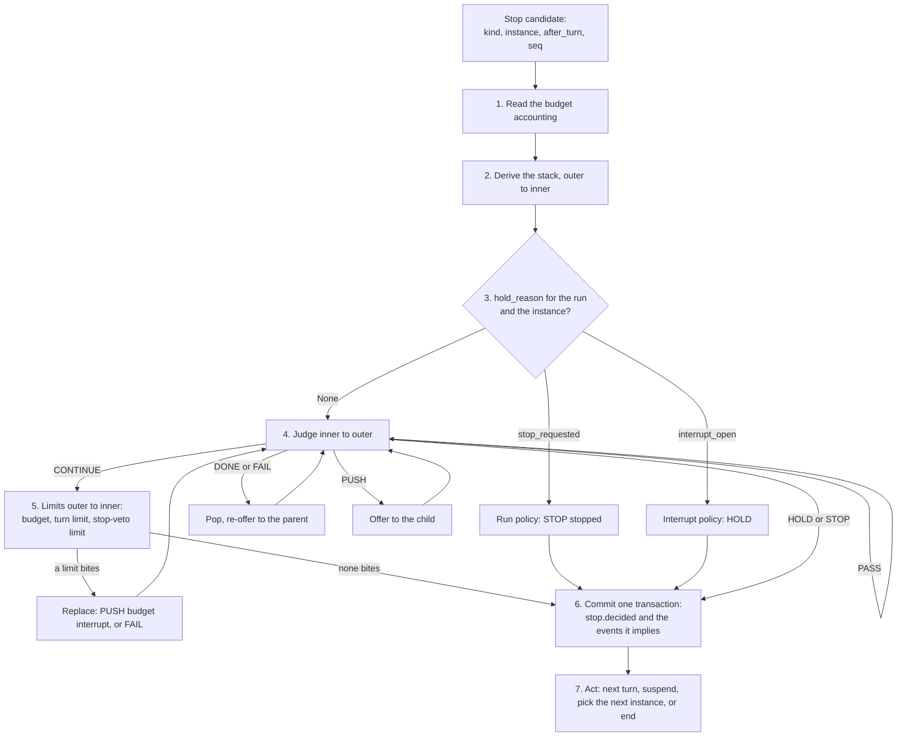

# ADR-P16: Stop policy and stop-policy evaluation (a stack of pure stop policies derived from the event store, one recorded stop decision per stop candidate, four built-in policies an agent opts into, and one hold predicate that puts human state ahead of every automatic start)

*Intermediate design as of 26 Nov 2026. Status: Accepted in part. This is a design record, not a description of shipped code. The Research agent and the Patent agent named below are example agents for Stillroom, a fictional hardware venture; the coding agent is a contrast case used only to test the design, and it is not built. "First milestone" means the 27 Nov 2026 cut of the build. Decision numbers refer to the [decisions log](../04-decisions-log.md); PR-NN and PNN IDs name primitives and P-1 to P-4 name design patterns, all listed in the [catalogue](../03-primitives.md); "v2" is the previous, unpublished design revision.*

## Status

Accepted in part, 25 Nov 2026, by the maintainer. Accepted: The stack of stop policies is an interpretation computed as a pure function over the event store (pattern P-2, which settles v2 ADR-014 towards its option E); goal condition, plan mode, forced tool choice and todo reminder are built-in stop policies beside the Run, Task and interrupt policies (decisions log item 3); an agent opts into them by configuration and never subclasses one in v1 (item 10). These carry v2 ADR-014 forward under decision 11's names. Proposed: The hold invariant (TC-4, from the T3 Code comparison notes section 4), the shared hold predicate that implements it (D6), and every sub-decision in "Decisions for the maintainer". Primitive PR-16 in the primitives catalogue, cluster D (Control). Nothing here was built as of 25 Nov 2026. Amended 25 Nov 2026 after the three-agent stress test: S1 to S3 below are new and Proposed; S1 narrows TC-4's hold invariant.

## Terms

Plan mode, goal mode, todo reminders, forced tool calls, a completion check, a budget and a person's pending approval all want the same line of the agent loop: The moment the model ends a turn and the harness must decide whether to run another, wait, or stop. Written as separate `if`s, their order becomes a precedence nobody chose; with six such mechanisms there are 15 pairs whose order someone must get right. This primitive gives that line one owner. The terms it defines:

- A **stop candidate** (v2: yield) is a point where control returns to the runtime: a turn ended with tool calls, a finish request, an instance entered or ended, a step faulted, a run resumed after a crash, a context overflowed. The kinds are a closed set of eleven.
- A **stop policy** is a pure rule that may refuse or allow the end of the work at a stop candidate: "the plan is not written", "the tests have not passed", "an approval is pending". Stencil's omp2 calls each such policy a Director (Stencil's term) and keeps them on a stack walked innermost first; Aksha adopted that stack, derived from the event store.
- The **stop-policy stack** is the ordered set of policies active for one Task instance: The Run policy outermost, then the Task policy, then any opted-in policies, then an open interrupt's policy innermost. It is derived from events at every evaluation; no push or pop event exists.
- **Stop-policy evaluation** (v2: The walk) is the one function that offers a stop candidate to the stack, combines the answers with a fixed precedence, and commits one **stop decision record** (`stop.decided`, v2 `walk.decided`, as ADR-P01 D8 proposes).
- A **verdict** is one of seven answers: PASS (no opinion), CONTINUE (another model turn, with a reason the model reads), PUSH (a child policy decides), HOLD (wait for a person), DONE (this level's goal is met), FAIL (this level gives up), STOP (end the run).
- **Human state** is any fact that a person, not the runtime, must change before work may go on: a stop request (ADR-P18), an open interrupt such as a pending approval or question (ADR-P17), and, if Aksha later adds them, snooze and archive.
- The **hold invariant** (TC-4), `inv.no_auto_start_while_held`: while human state holds a scope, nothing automatic may start work in that scope.

## Context: what breaks without it

| Without this primitive | What a user or a test sees | Requirement |
|---|---|---|
| Each mechanism decides "continue or stop" in its own branch | A goal check and a budget limit disagree, and which wins depends on line order; v1's designed loop decided at six places and had a seventh with no home | a stated requirement |
| Counters kept in memory | Three vetoes become three per process; Codex's loop guard `stop_hook_active` is a local variable that resets every turn (code, `codex-rs/core/src/session/turn.rs:532` at `1263a383`) | a stated requirement |
| No record of who decided | `inspect` cannot say why the run stopped or why it took turn 14 | a stated requirement |
| Automatic starts that read human state each in their own way | A restart, a rebuild run or a usage-limit resume starts a turn while an approval is pending; T3 Code's usage-limit path repeats the restart predicate's checks inline rather than calling it (code, `UsageLimitRecoveryWorker.ts:23-32` at `ca81b7b9`) | a stated requirement |
| A third author must edit the loop to add plan mode | The harness is general only for agents already written | a stated requirement |

The three agents press on it differently:

1. The Research Agent uses only the Run, Task and interrupt policies; its pressure is the budget limit that must keep partial work.
2. The Patent Agent's pressure is a kill during an approval wait, and a source change that would start a rebuild run while a person still has a card open.
3. The contrast coding agent uses the opt-in policies most: plan mode before any edit, a goal condition ("all tests pass") that keeps it working across many turns, todo reminders in a long session, and a person who wants it to stop now.

## Decision

Seven decisions. D1, D2 and D4 are the maintainer's (P-2, items 3 and 10). D3, D5, D6 and D7 are my proposals, carried from v2 ADR-014's Proposed sub-decisions or new.

1. D1, a stop policy is a pure judge with three methods. `prepare(view) -> Prep` says what the policy adds to the next model request (guidance lines, tool narrowing), called outer to inner. `judge(view, candidate) -> Verdict` answers one stop candidate, called inner to outer. `limit(view, candidate, proposed) -> Verdict | None` may replace a proposed CONTINUE when continuing would cost what this level cannot pay, called outer to inner. Policies are frozen dataclasses built fresh from the definition at every evaluation, and read only the view and the candidate: never a clock, a store, a model or randomness. A policy that raises yields FAIL with `check_raised`.
2. D2, the stack is a view of the event store. Run exists from `run.started` to `run.ended`; a Task policy exists for the instance the candidate concerns; an un-keyed child Task's policy exists while it is the first child whose check fails; opted-in policies exist with their Task; an interrupt policy exists from `interrupt.raised` to its closing event. An edit, a revocation or a key withdrawal therefore needs no stack code.
3. D3, one evaluation per stop candidate, one record. Evaluation reads the budget accounting first, derives the stack, judges inner to outer (DONE and FAIL pop and re-offer the same candidate to the parent; PUSH offers it to the child), applies limits outer to inner to a proposed CONTINUE (budget first, then the turn limit and the stop-veto limit), and commits one transaction holding `stop.decided` and what it implies (`completion_check.evaluated`, `task.entered`, `budget.reached` with the budget interrupt's `interrupt.raised`, `interrupt.voided`, `run.ended`). Only CONTINUE spends budget, one model turn each; only the Run policy returns STOP. The record stores the trail, the final verdict, which limit bit and the counts behind it, never seconds left, so two fake-model runs give identical records.
4. D4, a closed built-in set, opted into by configuration. Run, Task (including un-keyed child Tasks) and interrupt are always present. Four more are built in and opt-in with parameters, never subclassed:

| Built-in policy (v2 name) | Opted in with | Judges | Verdicts | Adds to the request |
|---|---|---|---|---|
| Goal condition (Goal) | `Goal(check)` on a Task; a run-level goal is one of the Run policy's completion checks | A pure goal check; vetoes a finish while it fails | CONTINUE with the check's message, PASS | One line naming the goal |
| Plan mode (Plan) | `Plan(kind, accept)` | Holds the first non-plan tool turn until a `plan` artifact passes the accept rule | CONTINUE, PASS | "Write the plan first"; tools narrowed to the plan save |
| Forced tool choice (ForceTool) | `ForcedTool(tool, when)` | When the condition holds, narrows the next turn to one tool; `finish` and `ask` always stay | PASS | The narrowed tool list and one line saying so; a `tool_choice` hint live adapters may pass |
| Todo reminder (TodoReminder) | `TodoReminder(every)` | Never vetoes | PASS | Every N turns, the open todos derived from the Task's unmet child checks |

5. D5, a judgement that needs a model call is not a stop policy. It becomes a recorded step (a classification call through ADR-P07) that saves an artifact, and a policy's pure check reads that artifact. "Is the user's goal met?" for an open-ended coding request is therefore a classification step that writes `goal.assessment`, and the goal check reads it; replay returns the recorded answer.
6. D6, the hold predicate (TC-4, Proposed). One function, `hold_reason(view, scope)`, returns why a scope is held by human state, or None. Scopes are an instance, a run, and an (owner, agent) pair. Reasons are a closed set: `stop_requested`, `interrupt_open` (any of ADR-P17's five kinds on that instance or run), and `stopped_by_person` (a standing hold after a person's stop, ADR-P18 D4). Every automatic start path calls this one function before it writes: The Run policy before it relays `next_instance` or proposes CONTINUE for an instance, recovery on startup before it writes a resume record, the rebuild-run opener before `run.started{cause: rebuild}`, and the restart limit's path. A start caused by a person's command carries `cause: command:<name>` with its idempotency key and is not automatic. T3 Code is the evidence for one shared predicate rather than a convention: its restart path has one (`restartContinuationBlocked`, code, `RestartContinuation.ts:45-91`) plus a separate stored-Stop check (code, `RestartContinuation.ts:94-136`), while its usage-limit path repeats four of the predicate's checks inline (archived, settled, a pending request, snooze) and calls neither function (code, `UsageLimitRecoveryWorker.ts:23-32`, `:57-62`). Deleted threads, pending secret requests and a stored Stop are checked on one path and not the other, so the two can drift (my reading of the two files).
7. D7, a named invariant proved by an audit. `inv.no_auto_start_while_held` holds when, for every `run.started`, `task.entered`, model `step.started` and resume record whose cause is not a person's command, `hold_reason(view at seq - 1, its scope)` is None. An audit runs it over every log the suite produces, and a mutation test removes the predicate's call from one start path and asserts the audit fails, because a guard nobody has seen fail is a guard nobody has proved.

One evaluation, as a diagram:



Caption: box 3 is the hold predicate placed before any policy can propose work, so human state wins by position, not by each policy remembering to check it; every branch that ends a turn, an instance or a run passes through box 6.

Takeaway: one function owns the stop, it writes once per candidate, and human state is checked by one predicate before anything automatic can start.

### Amendments from the stress test (25 Nov 2026, Proposed)

1. S1, a hold covers the held work, not the whole agent. The Patent review's most serious finding: The product requirements' demo (select, prepare, change, restart; the product requirements) naturally leaves the approval request for `packet/C1@v1` open when the change lands. D6 counted any open interrupt for the (owner, agent) scope, so the rebuild opener opened nothing, and the founder had to decide a card for a packet already known to be dirty before anything was rechecked, which inverts the product requirements. Nothing was sent, but the order was wrong. The invariant TC-4 now reads: human state beats every automatic start of the held work. An instance's interrupt holds that instance and the rebuild entries it writes; writers upstream of it still rebuild inside the run (ADR-P02 S1); `approve` is refused `target_changing` while the target is dirty (ADR-P17 S1). The catch: a rebuild can now run while a person reads a card about the same candidate, so the card refetches on the invalidation events the stream already carries (ADR-P19 D5), and the CLI prints the target's freshness on `aksha pending`.
2. S2, follow-up input vetoes a finish. A pending `follow_up` input (ADR-P27) turns a proposed DONE into CONTINUE with the text as the reason. The precedence stays here: The Task policy reads `pending_input`, so no second owner of the stop appears.
3. S3, every new automatic start calls the predicate. Durable timers (ADR-P25) and the partial-result finalizer (ADR-P24) are automatic starts and call `hold_reason` first. The `partial` outcome literal, which no path reached, is now reached by ADR-P24.

## Alternatives considered

| Option | Prior art (what it does, with evidence) | For | Against | Verdict |
|---|---|---|---|---|
| A. Hand-ordered flags, first match wins | omp v1's `agent_end` handler runs compaction recovery, rewind, plan-mode decision, todo completion, waiters, wake sources and the extension hook as early returns in a fixed order (code, `agent-session.ts:5654-5692` at `03597e34f1`) | Simple | The precedence is line order; a third author edits the handler | Rejected |
| B. Stop hooks that block with a reason | Codex: `decision: block` with a reason becomes the next user message; `continue: false` forces the stop; "stop beats block beats allow" across hooks (code, `codex-rs/hooks/src/events/stop.rs:283-310`, `:411-430` at `1263a383`); Claude Code adds a cap of eight consecutive blocks (docs, hooks guide; code, `src/claude_agent_sdk/types.py:816-855` at `6fc539e0`) | The pattern the coding harnesses converged on; a reason the model reads | No order between two blocking hooks; Codex's loop guard resets each turn; the hook is configuration beside the Task it judges | Rejected as the owner; its "reason the model reads" is kept as CONTINUE's reason |
| C. A hook that admits a message, any message continues | opencode's `experimental.idle` plugin hook (code, `packages/opencode/src/session/runner/llm.ts:182-191` at `2255b893`) | Flexible | Any extension can keep the run going; no veto record | Rejected |
| D. Graph edges, any trigger beats the end | LangGraph's `tick()` checks the step budget, then "no tasks means done", then breakpoints, then drain, in a fixed order (code, `libs/langgraph/langgraph/pregel/_loop.py:678-706` at `732da520`); a deferred node runs at the would-be stop (`graph/state.py:1530-1535`) | Precedence is fixed in one place | The recursion limit is a per-invocation counter that a resume resets (`_loop.py:1936`); "done" is "nothing triggered" | Rejected |
| E. A stack journalled with push and pop entries | omp2's `DirectorStack::on_yield` walks innermost first and the first non-Pass verdict decides (code, `crates/agent/src/director.rs:959-1048` at `2f92f3b5aa`); its verdicts are Pass, Continue, Yield, Push, Done, Fail (`director.rs:136-152`); but kernel paths still decide before the walk (`crates/agent/src/loop.rs:1574-1675`) and an idle timer outside the kernel continues Goal (`crates/app/src/chat_control.rs:734-738`) | Named ownership; composes by position | Push and pop are stored, so the stack can disagree with what the events imply; the ADR's own "no path decides outside the walk" is not held in code | Kept as the shape; rejected as storage |
| F. A stack derived from the event store, one recorded evaluation per candidate (the maintainer's call) | v2 ADR-014 option E; P-2 | No push or pop event to disagree; every decision is a record replay can compare | About 40 extra events per Research run and 100 per Patent run (estimate); a reader must learn that the stack is a view | Chosen |
| G. Human state checked by each automatic path | T3 Code: one predicate on the restart path (code, `RestartContinuation.ts:45-91`, used at `:197`, `:271`), inline checks on the usage-limit path (code, `UsageLimitRecoveryWorker.ts:23-32`, `:57-62`); Codex lets a host refuse new turns through `TurnStartAdmission`, which silently skips a goal continuation (code, `ext/extension-api/src/turn_admission.rs:11-20`, `ext/goal/src/runtime.rs:503-508` at `1263a383`); omp2's Goal timer re-checks pause, plan and pending input before each hidden turn (code, `chat_control.rs:881-904`) | Each path is simple | The rule is a convention every new path must remember | Rejected in favour of D6: one predicate, called by every path, proved by D7 |

The built-in set's prior art, for D4: omp2's Goal yields on prose-only turns and otherwise continues (code, `crates/agent/src/directors/goal.rs:345-353`); its Plan pushes a forced write up to three times (code, `directors/plan.rs:142-180`); its ForceTool fails after its retries (code, `directors/force_tool.rs:168-183`); its TodoReminder has no production caller (code, `directors/todo_reminder.rs:56-89`; tombstone at `crates/proto/proto/omp/toolhost/v1/toolhost.proto:563`). Codex's goal extension does not veto the stop; it accepts it and starts a fresh turn with a steering message (code, `ext/goal/src/runtime.rs:437-515`). Claude Code's plan mode is a permission mode, not a stop rule (code, `src/claude_agent_sdk/types.py:26`).

## Interface

```python
# aksha/runtime/api.py: The extension API's part of this primitive (proposal; design only)
@dataclass(frozen=True)
class StopPolicyOptIn:                          # built-ins only (D4)
    name: Literal["goal", "plan", "forced_tool", "todo_reminder"]
    params: Mapping[str, object]

def Goal(check: "Check") -> StopPolicyOptIn: ...
def Plan(kind: str, accept: "Check") -> StopPolicyOptIn: ...
def ForcedTool(tool: str, when: "Check") -> StopPolicyOptIn: ...
def TodoReminder(every: int) -> StopPolicyOptIn: ...
```

```python
# aksha/runtime/stop.py (proposal; design only)
CandidateKind = Literal["enter", "next", "tools", "finish", "malformed", "interrupted",
                        "approval", "budget", "fault", "resume", "overflow"]
                        # v2 kind "paused" renamed "interrupted"

@dataclass(frozen=True)
class StopCandidate:
    run: str
    seq_no: int                                 # one more than the run's last stop decision
    kind: CandidateKind
    instance: "InstanceRef | None"              # None for run-level "next", "fault", "resume"
    after_turn: int | None
    seq: int                                    # the last event sequence this evaluation may read
    remaining: "Remaining"                      # from the budget accounting, read before any policy judges
    lost_kind: CandidateKind | None = None      # on "resume": The candidate a crash lost

VerdictKind = Literal["pass", "continue", "push", "hold", "done", "fail", "stop"]
Outcome = Literal["complete", "partial", "failed", "stopped"]          # "stopped" is ADR-P18's

@dataclass(frozen=True)
class Verdict:
    kind: VerdictKind
    reason: str | None = None                   # continue: The model reads it; hold, fail: a person reads it
    child: "PolicyRef | None" = None            # push only
    outcome: Outcome | None = None              # stop only
    checks: tuple[tuple[str, "CheckResult"], ...] = ()
    raises: "InterruptRequest | None" = None    # push of the budget interrupt only

@dataclass(frozen=True)
class Prep:
    guidance: tuple[str, ...] = ()                 # outer policy first
    tools: frozenset[str] | None = None         # None: no narrowing; else intersected, never widened

class StopPolicy(Protocol):
    ref: "PolicyRef"
    def prepare(self, view: "RunView") -> Prep: ...
    def judge(self, view: "RunView", c: StopCandidate) -> Verdict: ...
    def limit(self, view: "RunView", c: StopCandidate, proposed: Verdict) -> Verdict | None: ...

@dataclass(frozen=True)
class StopDecision:                             # the stop.decided record
    seq_no: int
    candidate: CandidateKind
    instance: "InstanceRef | None"
    stack: tuple[str, ...]                      # policy ids, outer to inner, as derived
    trail: tuple[tuple[str, VerdictKind], ...]
    decided_by: str
    verdict: Verdict                            # only CONTINUE, HOLD or STOP end an evaluation
    replaced: tuple[str, VerdictKind] | None    # which limit bit, and what it replaced
    counts: Mapping[str, int]                   # turns, calls, vetoes behind any limit

def derive_stack(view: "RunView", c: StopCandidate) -> tuple[StopPolicy, ...]: ...
def evaluate_stop(view: "RunView", c: StopCandidate) -> StopDecision:
    """Pure. Steps 1 to 5 of the diagram. Writes nothing."""
def commit_stop_decision(store: "Store", owner: str, d: StopDecision) -> None:
    """Step 6, one transaction. AlreadyRecorded on the stop:{run}/{seq_no} key means a restart got here first."""
def compose_prep(stack: tuple[StopPolicy, ...], view: "RunView") -> Prep: ...

# D6, the hold predicate
HoldScope = Union["InstanceRef", "RunRef", "AgentScope"]   # AgentScope = (owner, agent)
HoldReason = Literal["stop_requested", "interrupt_open", "stopped_by_person"]

@dataclass(frozen=True)
class Hold:
    reason: HoldReason
    by: str                                     # the event id that holds it
    scope: HoldScope

def hold_reason(view: "RunView", scope: HoldScope) -> Hold | None:
    """The one predicate every automatic start path calls (D6). Pure; a reducer over the event store.
    S1: InstanceRef: an open interrupt on that instance, or a hold on its run.
    RunRef: a stop request or an open run-scoped interrupt (the budget interrupt) only.
    AgentScope: a stop request or a standing hold (ADR-P18 D4) only, never an instance's interrupt."""

def rebuild_blocked(view: "RunView", entry: "RebuildEntry") -> Hold | None:
    """S1: holds one rebuild entry, not the agent: its writer instance is suspended, or its run or
    (owner, agent) is held. Writers upstream of a suspended instance still rebuild."""

AutoCause = Literal["scheduler", "resume", "rebuild", "restart"]       # automatic
PersonCause = str                                                      # "command:send", "command:handoff"
```

Events this primitive writes, all inside `commit_stop_decision`'s transaction: `stop.decided` (`walk.decided`); and as the decision implies, `completion_check.evaluated`, `task.entered`, `budget.reached` with the budget interrupt's `interrupt.raised`, `interrupt.voided{reason: run_ended | run_stopped}`, and `run.ended{outcome}`.

Projections it reads: Task tree and instance status (ADR-P15), open interrupts and approvals (ADR-P17), stop requests and standing holds (ADR-P18), the budget accounting (ADR-P14), earlier stop decisions (veto counts, turn counts, the restart limit's resume count, ADR-P02), artifacts and their freshness for checks (ADR-P04, ADR-P05), and the agent definition version hash (ADR-P20).

## Stress test (25 Nov 2026)

Three design reviews in the three stress reviews walked the Research Agent (the Research stress review), the Patent Agent (the Patent stress review) and the contrast coding agent (the coding stress review) through this ADR on 25 Nov 2026. Nothing was built or run; each verdict is a reading of the interfaces. The verdict values are: fits; fits with agent-side code (the core is unchanged); needs a runtime change (generic, with no agent word in the core); missing primitive (no ADR owned it).

| Agent | Verdict as written | The scenario | What this ADR now says |
|---|---|---|---|
| Research | Fits | The model says done after `matrix` with two blank cells | Nothing new: The Task policy returns CONTINUE with the check's message; the hold predicate holds the run while the scope question is open |
| Patent | Needs a runtime change | The change set lands while A-0001 is `requested`; `hold_reason((owner, patent))` is `interrupt_open`, so no rebuild opens | S1 narrows the hold to the held instance and its readers; `rebuild_blocked` per entry |
| Coding | Fits | The model says done before running tests | Nothing new: The goal condition reads the latest test report; S2 adds follow-up input |

Verdict after the amendments: fits for all three once S1 lands. S1 is first-milestone work, because it is on the Patent demo's path.

Open for the maintainer: S1 changes TC-4's wording from "every automatic start" to "every automatic start of the held work" (lean: accept).
