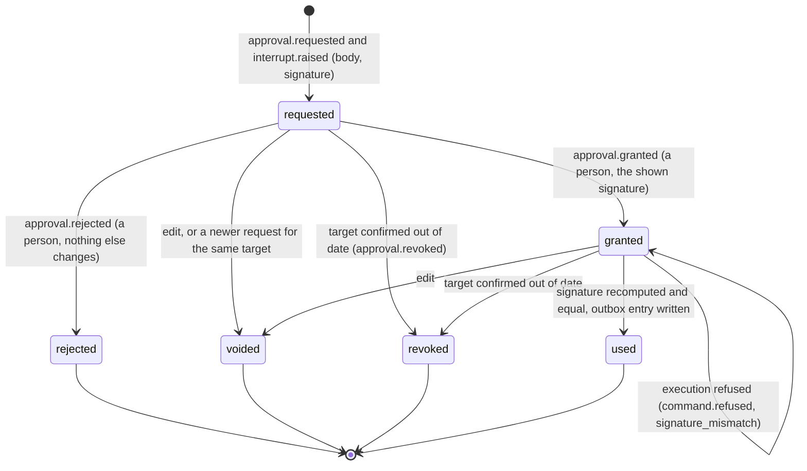

# ADR-P17: Interrupts and approvals (a run suspends on a durable interrupt and resumes on a person's recorded answer; an approval authorises one exact action, bound to an approval signature over a generic action body)

*Intermediate design as of 26 Nov 2026. Status: Proposed. This is a design record, not a description of shipped code. The Research agent and the Patent agent named below are example agents for Stillroom, a fictional hardware venture; the coding agent is a contrast case used only to test the design, and it is not built. "First milestone" means the 27 Nov 2026 cut of the build. Decision numbers refer to the [decisions log](../04-decisions-log.md); PR-NN and PNN IDs name primitives and P-1 to P-4 name design patterns, all listed in the [catalogue](../03-primitives.md); "v2" is the previous, unpublished design revision.*

## Status

Proposed, 25 Nov 2026. Decision for the maintainer. Two parts rest on the maintainer's calls and are applied, not reopened: an open interrupt and an approval decision are facts in the event store, and suspension is a projection over them (pattern P-2); only a person's accept makes a proposed version of a changed, human-reviewed artifact current, and that accept never grants an approval (decisions log item 5, pattern P-4). No log entry chooses the interrupt kinds, how an approval binds to an action, or the generic action body, so those stay Proposed. Carries v2 ADR-007 (approval versioning, Proposed) forward under decision 11's names and changes one thing in it: The action body loses its Patent-specific fields (D6). Primitive PR-17 in the primitives catalogue, cluster D (Control). Nothing here was built as of 25 Nov 2026. Amended 25 Nov 2026 after the three-agent stress test: S1 to S7 below are new and Proposed.

## Terms

A run that needs a person must stop spending, survive any number of restarts while it waits, and continue from exactly where it was when the person answers. When the person's answer is an approval, it must authorise the action the person saw and nothing else. The terms this ADR defines:

- An **interrupt** (v2: Wait, pause) is a recorded request that suspends work until something outside the run answers it.
- **Suspension** (v2: parked) is the state of a Task instance or run while an interrupt on it is open. It is a projection, costs nothing, and survives a restart because the open interrupt is a fact.
- An **interrupt kind** is one of five: `input` (a free-text answer), `choice` (one of listed options), `approval` (authorise one action), `budget` (grant more budget), `review` (accept or reject a changed human-reviewed artifact).
- An **approval** is the interrupt kind that authorises one exact action. It exists as granted only after `approval.granted`, written by a person's command.
- The **action body** is the canonical description of the action an approval covers: The tool, its canonical arguments, the target artifact versions with content hashes, the idempotency key of the outbox entry it will create, the agent definition version hash, and agent-supplied facts.
- The **approval signature** (v2: action hash) is a version-prefixed SHA-256 over the canonical JSON of the action body. The approval request shows it; the person approves that signature; the execution path recomputes it before acting.
- An **approval request** (v2: approval card) is what a person sees: The body in readable form, the signature, and the choices.

Event names follow ADR-P01's proposed renames (D8), with the v2 name at first use: `interrupt.raised` (`pause.opened`), `interrupt.resolved` (`pause.answered`), `interrupt.voided` (`pause.voided`). Approval, budget and review events keep their v2 names.

## Context: what breaks without it

| Without this primitive | What a user or a test sees | Requirement |
|---|---|---|
| A wait held in a blocked process or an in-memory future | A restart loses the question, or asks it twice | a stated requirement |
| A wait that ends the run | The answer arrives and nothing knows where to continue | a stated requirement |
| Approval by ID | A person approves packet v2 for recipient R; packet v3 or a changed recipient record is sent under the same approval | a stated requirement |
| An approval the model or a document can create | A fetched page that says "approval granted" sends a document | a stated requirement |
| Rejection that edits state | A rejected send still marks the packet `sent` or moves its lifecycle | a stated requirement |
| Approvals that ignore changed inputs | A new prior-art reference arrives after approval and the stale packet is still sendable | a stated requirement |

The three agents press on it differently:

1. The Research Agent asks a person for missing scope (`input`) and continues; its pressure is only that the question survives a restart.
2. The Patent Agent uses all five run-level kinds: per-candidate gap questions (`input`), the selection (`choice`), the send (`approval`), more budget (`budget`), and accepting a changed packet after a source change (`review`). Two candidates suspended at once must not block the other two.
3. The contrast coding agent asks before `git push --force`. Its action is not an artifact the runtime saved but a command against a remote, and the thing that must not change between approval and execution is the commit the branch points to. A v2 action body with `recipient_id` and `validation` fields cannot describe it.

## Decision

Eight decisions. D1 rests on P-2 and D7 on P-4 and item 5; the rest are my proposals.

1. D1, an interrupt is a fact; suspension is a projection. Raising writes `interrupt.raised{id, kind, scope, payload}`; closing writes `interrupt.resolved` (a person answered), or a kind-specific decision event (`approval.granted`, `approval.rejected`, `budget.granted`, `review.accepted`, `review.rejected`), or `interrupt.voided{reason}` (the runtime withdrew it). An instance or run with an open interrupt is suspended. Nothing else stores the state.
2. D2, a closed set of six kinds, each with one raiser. `input` and `choice` are raised by a tool step: The implicit `ask` tool on a Task that declares an interrupt. `approval` is raised by a tool step that requests approval for an action. `budget` is raised only by stop-policy evaluation, when a limit replaces a CONTINUE (ADR-P16). `review` is raised only by invalidation, when a human-reviewed artifact gets a pending revision (ADR-P05). `route` is raised only by the request router's session-scoped classification step when it abstains (ADR-P23, S5), and is the one kind scoped to a session. A step's interrupt commits in the same transaction as its `step.completed`, so the next stop decision only records HOLD; there is no second writer.
3. D3, an interrupt suspends only its own scope. An instance-scoped interrupt suspends that instance; the scheduler keeps running other keys (ADR-P15 D5). A run-scoped interrupt (the budget interrupt) suspends the run. A session-scoped interrupt (`route`) holds that session's intake: no run opens for the message it asks about until a person answers. The interrupt policy on the stop-policy stack returns HOLD until a closing event exists, and the hold predicate (ADR-P16 D6) reads the same projection, so no automatic start enters a suspended scope.
4. D4, only a person resolves; the runtime may only void. Every resolution arrives as a session API command carrying an idempotency key (ADR-P03) and is guarded by the deduplication key `decide:{interrupt_id}`, so two front ends racing to decide get one decision and one `command.refused{already_decided}`. Free text may resolve only `input`, `choice` and `route` (v2 IE-10, with `route` answered by `AnswerInterrupt` naming one of its listed agents); `approval`, `budget` and `review` need an explicit command. The runtime voids an interrupt when its key is withdrawn, its run ends or stops, or an edit replaces it; it never resolves one. No model output, tool result or document text writes any of these events.
5. D5, an approval binds to an approval signature. The signature is `"v1:" + sha256(canonical_json(body))`, with the version prefix so a later body schema cannot collide with an earlier signature. The person approves the signature they were shown; `approve` with any other signature is refused `signature_mismatch`. An edit voids the approval and raises a new one under a new signature. Rejection writes `approval.rejected` and changes nothing else.
6. D6, the action body is generic, and agent facts come from a pure function. The core body holds only harness words: tool, canonical arguments, target refs with content hashes, idempotency key, definition version hash, and `facts: Mapping[str, str]`. A tool that needs approval declares `approval_facts`, a pure function from the view and the arguments to those facts. The Patent Agent's send declares recipient id, recipient record version and validation counts; the coding agent's push declares remote URL, branch and head commit SHA. v2's `ActionBody` had `recipient_id`, `recipient_version` and `validation` as core fields; under P-1 those are the Patent Agent's words in the runtime core, which is the abstraction fault this ADR fixes.
7. D7, review is not approval. Accepting a review makes a pending revision current (P-4) and may raise a fresh approval request where invalidation revoked one; it never writes `approval.granted`. Invalidation revokes a granted approval only when its target is confirmed out of date, in the same transaction that made it so (v2 05b section 11.4); a used approval is never revoked.
8. D8, execution re-checks the signature, then goes through the outbox. Before an approved action runs, the runtime rebuilds the body from current facts (calling `approval_facts` again) and compares signatures; a mismatch is refused `signature_mismatch` (v2 `hash_mismatch`), a stale target `stale_target`, a changed definition `definition_changed`, and a fresh approval is needed. Only then does it write the outbox entry with its idempotency key (ADR-P03). The same check runs again before every delivery attempt, retries included: the drainer recomputes the approval signature and the target's freshness before it calls the system of record, and on a mismatch commits `outbox.abandoned{hash_mismatch}` or `{target_invalidated}` instead of delivering (ADR-P03 D1, D8). A pending entry therefore never delivers an action that changed after it was enqueued. In the first milestone the Patent Agent's send runs this way through a separate `handoff` command in its own short run (v2 HD-10). The general form for a tool call that needs approval mid-turn, a deferred call that the runtime executes when the approval is granted and whose result enters the instance's next turn, is designed only (P17-4).

The life of one approval, every arrow one event:



Caption: only a person reaches granted, rejected or an edit's voided; only the runtime reaches revoked; a changed fact after the grant leaves the approval granted but unusable until a fresh approval under the new signature.

Takeaway: an interrupt is a row, not a blocked thread, and an approval is a signature over facts the runtime can recompute, not a yes attached to an ID.

### Amendments from the stress test (25 Nov 2026, Proposed)

1. S1, an approval cannot be granted while its target is changing. While `packet/C1@v1` was dirty after the change, the founder could still approve A-0001, and the grant was revoked only once the packet was confirmed out of date. `approve` is now refused `target_changing` while any target in the action body is invalidated or dirty, and the card's view carries each target's freshness from ADR-P05.
2. S2, one answer per question. An `input` interrupt asking two gaps took one free-text answer, so both fields cited one user statement and a reviewer could not tell which sentence supported which field. `AnswerInterrupt` gains `answers: Mapping[str, str]`, keyed by question ID, and each answer is minted as its own statement span. `text` stays for a single-question interrupt.
3. S3, an approval voided by key withdrawal. The approval states had no edge for an approval whose interrupt was voided `key_withdrawn` (ADR-P15 D3). `requested` and `granted` now go to `voided` on `interrupt.voided{key_withdrawn}`, written as `approval.voided{reason: key_withdrawn}` in the same transaction.
4. S4, an effect's result is readable by a check. Under the first milestone's `handoff` path the push or send runs in a separate short run and its result reaches no Task. `EffectSpec.receipt_kind` (ADR-P03 S2) makes `outbox.completed` save a receipt artifact a completion check can read. P17-4's deferred call, which feeds the result into the next turn, stays designed and moves up the coding agent's build order.
5. S5, a session-scoped interrupt kind, `route`. The routing question comes before any run exists, and interrupts were scoped to an instance or a run. ADR-P23 adds `route`, scoped to the session. Corrected 26 Nov 2026 after review: `route` is now in `InterruptKind`, the interrupt scope admits a `SessionRef`, the hold predicate has a session scope (ADR-P16), `AnswerInterrupt` resolves it (ADR-P19), and its step ID has a session form (ADR-P02 D2).
6. S6, an accept with edits mints a statement. `AcceptReview` with `edits` (used to swap C1 for C3 on the selection review) mints a user statement from the edits, so the edited selection stays choice-backed (ADR-P04's `ChoiceBinding`).
7. S7, `expires_at` gets an owner. Approval expiry stays later; when it ships it is a durable timer of ADR-P25.

### Amendments from the build (26 Nov 2026, Proposed)

1. B1, the fresh request after an accept moves the call, not only its target (D7, D8). The first build moved the revoked body's target to the accepted revision and kept its arguments, facts and idempotency key, so the person was shown the old version and execution, which rebuilds the body from its arguments, refused every approval of it `signature_mismatch`. `retarget` now replaces every argument equal to the old ref with the new one and, given the tool (`accept_review(..., tools=)`), rebuilds the body with `build_body`, so the request equals the body execution rebuilds. Without the tool the targets, arguments and facts move but the key cannot, and execution still refuses it. The session API's `AcceptReview` passes the agent's approval tools, the same ones the outbox re-checks against.

Agent-side, no core change: The Research Agent's scope question is one `input` interrupt listing only the missing items, with an extraction step turning the answer into three cited `scope` fields; a field it cannot locate stays `Unknown` and triggers one follow-up.

## Alternatives considered

| Option | For | Against | Verdict |
|---|---|---|---|
| A. Re-execute the step on resume | Durable with a checkpointer; one call in user code | Every node before the interrupt must be safe to repeat; the model never sees the pause | Rejected; Aksha resumes from the recorded step instead (ADR-P02) |
| B. An in-process permission callback | Immediate, simple | Lives in a process; a restart loses the pending decision | Rejected |
| C. Return the call to the caller, resume with the result | The approved call's result enters the model's next turn | The caller must store and replay the deferred call | Kept as the designed general form, P17-4 |
| D. Approval as an event-store fact, recovery matches the first request | Durable; the closest shape to D1 | Equality of requests, not a signature over facts the executor recomputes | Kept for D1; D5 adds the signature |
| E. Cancel pending requests after a crash | Never acts on a request the wrapped harness lost | The person's pending decision is thrown away | Rejected; Aksha owns its loop, so an open interrupt stays open across restarts |
| F. Approve by ID | Simplest | Nothing ties the decision to what was shown | Rejected |
| G. A mutable approval row with a version counter | Familiar | A counter does not say what changed; an update path in an append-only store | Rejected |
| H. A version-prefixed signature over the canonical action (lean) | "An edited action needs fresh approval" holds by construction | The CLI must accept a signature prefix; the person sees a hash | Chosen |

## Interface

```python
# aksha/runtime/api.py: The extension API's part of this primitive (proposal; design only)
@dataclass(frozen=True)
class DeclaredInterrupt:                         # on a Task (ADR-P15 `interrupt`); adds the implicit ask tool
    kind: Literal["input", "choice"]             # the two a Task may declare
    label: str                                   # the agent's word, rendered, never branched on

ApprovalFacts = Callable[["TaskView", Mapping[str, object]], Mapping[str, str]]   # pure (D6)

@dataclass(frozen=True)
class ApprovalRule:                              # declared on a tool in the tool registry (ADR-P10)
    facts: ApprovalFacts
    targets: Callable[[Mapping[str, object]], tuple[str, ...]] = lambda args: ()  # artifact refs the action acts on
```

```python
# aksha/runtime/interrupts.py (proposal; design only)
InterruptKind = Literal["input", "choice", "approval", "budget", "review", "route"]   # route: S5, ADR-P23
VoidReason = Literal["key_withdrawn", "run_ended", "run_stopped", "replaced_by_edit", "superseded"]

@dataclass(frozen=True)
class InterruptRequest:                          # what a tool step or the runtime asks to raise
    kind: InterruptKind
    scope: Union["InstanceRef", "RunRef", "SessionRef"]   # SessionRef only for route
    payload: Mapping[str, object]                # question, options, action body, revision diff, budget ask

@dataclass(frozen=True)
class InterruptView:
    id: str                                      # "P-0009"
    kind: InterruptKind
    scope: Union["InstanceRef", "RunRef", "SessionRef"]   # SessionRef only for route
    payload: Mapping[str, object]
    state: Literal["open", "resolved", "voided"]
    resolution: Mapping[str, object] | None

def interrupts(view: "RunView") -> Mapping[str, InterruptView]: ...      # a reducer
def open_interrupts(view: "RunView", run: str, instance: "InstanceRef | None" = None) -> tuple[InterruptView, ...]: ...

@dataclass(frozen=True)
class ActionBody:                                # generic (D6)
    tool: str
    owner: str
    canonical_args: str                          # canonical JSON of the tool arguments
    targets: tuple[tuple[str, str], ...]         # (artifact ref, content hash)
    idempotency_key: str                         # of the outbox entry it will create (ADR-P03)
    definition_hash: str
    facts: Mapping[str, str]                     # from the tool's ApprovalRule.facts

def approval_signature(body: ActionBody) -> str:
    """'v1:' + sha256 over the canonical JSON of body (D5)."""

ApprovalState = Literal["requested", "granted", "rejected", "voided", "revoked", "used"]

@dataclass(frozen=True)
class ApprovalView:
    approval_id: str
    body: ActionBody
    signature: str
    state: ApprovalState
    decided_by: str | None
    revoked_because: tuple["InputRef", ...] = ()

def approvals(view: "RunView") -> Mapping[str, ApprovalView]: ...        # a reducer
def request_approval(ctx: "StepContext", tool: str, args: Mapping[str, object]) -> InterruptRequest | "Refusal": ...
def verify_for_execution(view: "RunView", approval_id: str) -> ActionBody | "Refusal":
    """D8: rebuild the body from current facts and compare signatures; refuse stale_target,
    signature_mismatch, definition_changed, or not granted."""
```

```python
# aksha/runtime/session.py: The commands that resolve interrupts (proposal; owner first, as ADR-P19)
def answer(owner: str, interrupt_id: str, text: str, command_id: str | None = None) -> "Yielded": ...   # input, choice
def approve(owner: str, approval_id: str, shown_signature: str, command_id: str | None = None) -> "Outcome": ...
def reject(owner: str, approval_id: str, note: str | None = None, command_id: str | None = None) -> "Outcome": ...
def edit(owner: str, approval_id: str, changes: Mapping[str, object], command_id: str | None = None) -> ApprovalView: ...
def grant_budget(owner: str, run_id: str, grant: "Grant", command_id: str | None = None) -> "Yielded": ...
def accept_review(owner: str, review_id: str, edits: Mapping[str, object] | None = None, command_id: str | None = None) -> "Yielded": ...
def reject_review(owner: str, review_id: str, command_id: str | None = None) -> "Outcome": ...
def handoff(owner: str, approval_id: str, command_id: str | None = None) -> "Outcome": ...   # D8, the first milestone's execution path
```

Events it writes:

| Event | Writer | Transaction |
|---|---|---|
| `interrupt.raised` (`pause.opened`) | A tool step (`input`, `choice`, `approval`); stop-policy evaluation (`budget`); invalidation (`review`) | With the step's `step.completed`; with the stop decision; with the save or source change that invalidated |
| `interrupt.resolved` (`pause.answered`), `completion_check.reset` | `answer` | One command transaction |
| `approval.requested`, `approval.granted`, `approval.rejected`, `approval.voided`, `approval.revoked` | The tool step; `approve`, `reject`, `edit`; invalidation | As above; `approval.revoked` with the commit that made the target out of date |
| `budget.granted`, `review.accepted`, `review.rejected` | The matching command | One command transaction |
| `interrupt.voided` | Key withdrawal, run end, stop (ADR-P18), edit | With the event that caused it |
| `command.refused{already_decided, signature_mismatch, stale_target, definition_changed}` | Any resolving or executing command | One command transaction |

Projections it reads: Task instance status and key sources (ADR-P15), artifact versions, content hashes and freshness (ADR-P04, ADR-P05), the outbox and its idempotency keys (ADR-P03), the agent definition version hash (ADR-P20), and stop requests (ADR-P18), which void open interrupts when a stop is honoured.

## Stress test (25 Nov 2026)

Three design reviews in the three stress reviews walked the Research Agent (the Research stress review), the Patent Agent (the Patent stress review) and the contrast coding agent (the coding stress review) through this ADR on 25 Nov 2026. Nothing was built or run; each verdict is a reading of the interfaces. The verdict values are: fits; fits with agent-side code (the core is unchanged); needs a runtime change (generic, with no agent word in the core); missing primitive (no ADR owned it).

| Agent | Verdict as written | The scenario | What this ADR now says |
|---|---|---|---|
| Research | Fits with agent-side code | Scope needs segment, geography and boundary, asked only if material | One `input` interrupt plus extraction; S2 lets each answer be its own span |
| Patent | Needs a runtime change | The founder approves a dirty packet; two gap answers share one citation; a voided-by-withdrawal approval has no state | S1 `target_changing`; S2 `answers`; S3 `key_withdrawn` void; S6 edits mint a statement |
| Coding | Needs a runtime change | The approved push's result never reaches the `push` instance's check | S4 receipt artifact; the deferred call stays designed |

Verdict after the amendments: fits for all three once S1 to S4 land. S1 is first-milestone work with ADR-P16 S1; S2, S3 and S6 are small and should ride with the selection review; S4 is later.

Open for the maintainer: none new.
