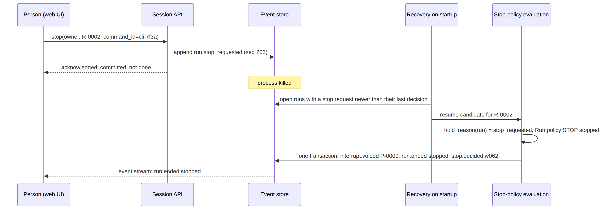
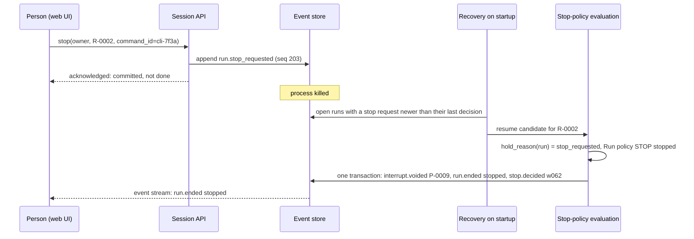

# ADR-P18: Cancellation (a person's stop is a durable stop request honoured at the next stop candidate, including after a crash; a kill boundary for tool bodies that do not stop on request)

*Intermediate design as of 26 Nov 2026. Status: Proposed. This is a design record, not a description of shipped code. The Research agent and the Patent agent named below are example agents for Stillroom, a fictional hardware venture; the coding agent is a contrast case used only to test the design, and it is not built. "First milestone" means the 27 Nov 2026 cut of the build. Decision numbers refer to the [decisions log](../04-decisions-log.md); PR-NN and PNN IDs name primitives and P-1 to P-4 name design patterns, all listed in the [catalogue](../03-primitives.md); "v2" is the previous, unpublished design revision.*

## Status

Proposed, 25 Nov 2026. Decision for the maintainer: D13-1 (decisions log item 13), not accepted by silence. No entry in the decisions log covers cancellation; v2 has no stop command at all, so this ADR is new rather than a carry-forward. Primitive PR-18 in the primitives catalogue, cluster D (Control), the one primitive the catalogue found missing from v2. Nothing here was built as of 25 Nov 2026. Reviewed 25 Nov 2026 in the three-agent stress test: no design change; `request_id` renamed `command_id` per ADR-P01 S1.

## Terms

In Aksha's v2 design a person cannot make a run stay stopped. The session API (v2 HLD 14.1) has no stop call; in the CLI, Ctrl-C kills the process, and recovery on startup treats every killed process as a crash to recover from, so the next start resumes the run (my reading of v2 HLD 10.3). This ADR adds the missing control. The terms it defines:

- **Cancellation** is a person's request that work stop, recorded as an event so it holds across a crash, honoured by the runtime at a defined point, and distinct from a crash, which the runtime recovers from.
- A **stop request** is that event, `run.stop_requested{scope, reason, by, command_id}`. Its default reason is "Stopped by user".
- A **stop scope** says what the request ends: `run` ends the whole run with outcome `stopped`; `turn` (designed only) ends the current turn and asks the person what to do next, leaving the run alive.
- The **honouring point** is the next stop candidate (ADR-P16) for that run, which includes the resume candidate recovery writes after a crash. Between two candidates, the durable step executor checks the request before starting each new step of the turn.
- A **kill boundary** is the line around a tool body that lets the host terminate it when it does not settle on request: ask it to settle, wait a bounded grace, then terminate the execution unit, and record the outcome as uncertain if the tool had external effects.
- A **standing hold** is the rule that, after a person's stop, nothing automatic restarts that agent's work for that owner until the person's next command for it.

## Context: what breaks without it

| Without this primitive | What a user or a test sees | Requirement |
|---|---|---|
| Ctrl-C is a crash | The person stops a run; the next `aksha` start resumes it and spends more model turns | a stated requirement |
| A stop that lives only in the process | The person presses Stop in the web UI, the server restarts, and the run continues | a stated requirement |
| Each interface invents its own stop | The CLI kills the process, the web UI closes a socket, and neither leaves a fact `inspect` can show | a stated requirement |
| A stop that ignores in-flight work | A 10-minute test run keeps going after the person stopped, or a push lands with no record of whether it did | a stated requirement |
| No rule after a stop | A source change an hour later opens a rebuild run for the stopped agent, which the person did not ask for | a stated requirement, D13-4 |

The three agents press on it differently:

1. The Research Agent's runs take seconds with the fake model, so its only need is that a stop is a recorded outcome, not a crash.
2. The Patent Agent gives the cluster's hardest test (catalogue, "How the five clusters split the work"): a person presses Stop while an approval is pending, and the process then crashes. The stop must win, the pending card must be handled consistently, and no turn may run.
3. The contrast coding agent needs the stop most: a person who sees it editing the wrong file needs the edit to end now and stay ended, and its tool calls are long (a test suite) or effectful (a push), so "at the next turn end" can be minutes away.

## Decision

Seven decisions, all my proposals. D1 to D4 are D13-1 option A, made precise; D5 to D7 are new.

1. D1, a stop command that appends a fact. `stop(owner, run_id, scope="run", reason="Stopped by user", command_id=None)` is a session API command (ADR-P19) that appends `run.stop_requested` under an idempotency key, so a retried click is one request. Its acknowledgement means "committed", not "stopped": The client learns the run ended from the event stream. A stop on a run that has already ended is refused `run_not_open`.
2. D2, the Run policy honours it at the next stop candidate. From the moment the request is committed, `hold_reason` (ADR-P16 D6) returns `stop_requested` for that run, so stop-policy evaluation returns STOP with outcome `stopped` at the next candidate of any kind, before any inner policy can propose a turn. The same transaction voids the run's open interrupts with `interrupt.voided{reason: run_stopped}` and writes `run.ended{outcome: stopped}`. Approvals keep their own lifecycle, as they do when a run ends any other way (v2 HLD 10.3): a pending approval stays decidable, and executing it is a separate person's command (ADR-P17 D8), which the hold invariant allows because it is not automatic.
3. D3, a stop survives a crash. Recovery on startup gives every open run that has a stop request newer than its last stop decision one resume candidate, even when the run is held on an interrupt, and the Run policy judges it first, so it ends `stopped` with no model turn. This changes v2's rule LC-2 ("held runs get nothing") for exactly this case. A second kill and restart writes nothing, because the run has ended.
4. D4, a standing hold after a person's stop. After `run.ended{outcome: stopped}`, `hold_reason` returns `stopped_by_person` for the (owner, agent) scope until the person's next command naming that agent (a message, an answer, a new run). The rebuild-run opener and any future scheduled wake therefore open nothing for that agent. Queued messages are likewise held after a stop until the person resumes; this is the same rule for automatic work.
5. D5, cooperative stop between steps. Within a turn, the durable step executor reads the stop request before starting each tool call. The request is visible there because the single writer commits a queued `Stop` after every step commit, not only at the turn's end (ADR-P19 D4). Calls not yet started are recorded `step.completed{outcome: skipped, reason: run_stopped}`, the same shape as a budget refusal (v2 LC-6), so the turn ends at once and the next candidate honours D2. A call already running finishes: Python cannot kill a thread, which is why v2 abandons timed-out attempts rather than killing them (v2 HLD 10.4).
6. D6, a kill boundary for subprocess tools (designed). A tool whose body runs in a sandbox process (ADR-P12) declares itself killable. On a stop, signalled in memory the moment the session API enqueues the `Stop` and committed as `run.stop_requested` at the next step boundary (ADR-P19 D4), the runtime asks it to settle (SIGTERM to its process group), waits a bounded grace (a placeholder of 5 seconds, not measured), then sends SIGKILL. It records `step.completed{outcome: cancelled}` for a tool with no external effects, and `outcome: effects_unknown` for an effectful one, which recovery then reconciles through the tool's idempotency key or reports (ADR-P03). The rule is cooperative settlement, then forced termination after a bounded grace, and forced termination after effects were authorised is recorded as uncertainty, never as success.
7. D7, interfaces map onto the one command. The CLI gains `aksha stop RUN`. In a running CLI command, the first Ctrl-C calls `stop` and waits a bounded time for it to commit, then exits with a new exit code 6, "stopped"; a second Ctrl-C, or SIGKILL, is a crash, and recovery honours any stop that committed (D3). The web UI's Stop button posts the same command. A `turn` scope (designed only) ends the current turn as D5 and D6 do, then raises an `input` interrupt labelled `stopped_by_user` on the instance, so the person can redirect without ending the run; it stops a turn while the agent remains available.

The hardest stress test, traced. The Patent Agent's `handoff_request[C1]` has asked for approval; the person then presses Stop; the process dies before the next stop candidate.

| Seq | Event | Written by |
|---|---|---|
| 201 | `step.completed` for `handoff_request[C1]/t02`, with `approval.requested A-0001` and `interrupt.raised P-0009{kind: approval}` | The tool step's transaction |
| 202 | `stop.decided` w061: stack `R-0002 > handoff_request[C1] > P-0009`, HOLD | Stop-policy evaluation |
| 203 | `run.stop_requested{run: R-0002, scope: run, reason: "Stopped by user", command_id: cli-7f3a}` | `stop`, from the web UI |
| (kill) | The process dies before any later candidate | |
| 204 | `interrupt.voided P-0009{reason: run_stopped}` | Recovery's resume candidate, one transaction |
| 205 | `run.ended{run: R-0002, outcome: stopped}` | Same transaction |
| 206 | `stop.decided` w062: candidate `resume`, decided by Run, STOP `stopped` | Same transaction |

After 206: no model step started; `A-0001` is still `requested` and decidable from the pending list; `hold_reason` for (owner, Patent Agent) is `stopped_by_person` until the person's next Patent command; a second kill and restart writes nothing. Under v2's LC-2, recovery would have written nothing at 204 to 206, and the run would have stayed open and held on P-0009 with the person's stop unrecorded in any decision.

<!-- diagram: docs/diagrams/design-adr-adr-p18-cancellation-1.png -->


<details><summary>Diagram source (Mermaid)</summary>



</details>

Caption: The acknowledgement promises only that the request is recorded; the run ends in a stop decision that recovery writes, so the person's intent outlives the process that received it.

Takeaway: a stop is a fact that the one owner of the stop reads first, so it wins against a pending approval, a crash, and every automatic restart.

## Alternatives considered

| Option | For | Against | Verdict |
|---|---|---|---|
| A. Ctrl-C is a crash; the README says so | Zero lines; honest for a first milestone whose fake-model runs take seconds | A person cannot make a run stay stopped; a second interface has no stop at all | the first milestone fallback only |
| B. An in-memory abort signal | Familiar; immediate | Lost at a crash; a tool that forgets the signal never stops | Rejected as the record; used inside D5 as the in-process check |
| C. A hook that forces the stop | Ends a turn at the stop line | Decided by configured code, not a person; not stored; ends one turn, not the work | Rejected |
| D. A durable stop item, honoured after a restart (lean) | Survives a crash; one meaning for every interface | One more event type and one recovery rule | Chosen for the run scope, D1 to D4 |
| E. A kill boundary | A tool that ignores the request still stops | Needs tools to run in a unit the host can terminate | Chosen for subprocess tools, designed (D6) |
| F. Stop the turn, keep the agent | The redirect a coding user wants | A second meaning of "stop" to explain | Designed as `scope="turn"` (D7) |

## Interface

```python
# aksha/runtime/session.py (proposal; owner first, as ADR-P19)
StopScope = Literal["run", "turn"]             # "turn" is designed only; the first milestone refuses it with scope_not_built

def stop(owner: str, run_id: str, scope: StopScope = "run",
         reason: str = "Stopped by user", command_id: str | None = None) -> "Outcome":
    """D1. Appends run.stop_requested under the idempotency key. Returns committed, not stopped.
    Refused: run_not_open, not_found (another owner's run, as every session call)."""
```

```python
# aksha/runtime/cancel.py (proposal; design only)
@dataclass(frozen=True)
class StopRequestView:
    run: str
    scope: StopScope
    reason: str
    by: str                                    # the principal who asked
    seq: int
    honoured_by: int | None                    # the stop.decided that ended the run, if any

def stop_requests(view: "RunView", run: str) -> tuple[StopRequestView, ...]: ...          # a reducer
def pending_stop(view: "RunView", run: str) -> StopRequestView | None:
    """The newest request not yet honoured; read by hold_reason (ADR-P16 D6)."""
def standing_hold(view: "RunView", owner: str, agent: str) -> StopRequestView | None:
    """D4: The last stopped run's request, until the person's next command naming that agent."""
def runs_to_resume_for_stop(view: "RunView") -> tuple[str, ...]:
    """D3: open runs whose pending stop is newer than their last stop decision."""

# D5, inside the durable step executor (ADR-P02)
def stop_before_step(view: "RunView", run: str) -> bool: ...

# D6, the kill boundary (designed)
class KillableUnit(Protocol):
    def request_settle(self) -> None: ...      # SIGTERM to the process group
    def terminate(self) -> None: ...           # SIGKILL after the grace
    def settled(self) -> bool: ...

@dataclass(frozen=True)
class KillPolicy:
    grace_seconds: float = 5.0                 # placeholder, not measured
```

Events it writes:

| Event | Writer | When |
|---|---|---|
| `run.stop_requested{scope, reason, by, command_id}` | `stop` | D1 |
| `step.completed{outcome: skipped, reason: run_stopped}` | The durable step executor | D5, each call of the turn not yet started |
| `interrupt.voided{reason: run_stopped}`, `run.ended{outcome: stopped}`, `stop.decided` | Stop-policy evaluation, one transaction | D2, including recovery's resume candidate (D3) |
| `step.completed{outcome: cancelled}` or `{outcome: effects_unknown}` | The durable step executor after the kill boundary | D6, designed |
| `interrupt.raised{kind: input, label: stopped_by_user}` | Stop-policy evaluation | D7 `turn` scope, designed |

Projections it reads: open runs and their last stop decision (ADR-P16), open interrupts and approvals (ADR-P17), Task instance status (ADR-P15), the outbox and in-flight steps with their recovery policies (ADR-P02, ADR-P03), and the commands that clear a standing hold (ADR-P19).

## Stress test (25 Nov 2026)

Three design reviews in the three stress reviews walked the Research Agent (the Research stress review), the Patent Agent (the Patent stress review) and the contrast coding agent (the coding stress review) through this ADR on 25 Nov 2026. Nothing was built or run; each verdict is a reading of the interfaces. The verdict values are: fits; fits with agent-side code (the core is unchanged); needs a runtime change (generic, with no agent word in the core); missing primitive (no ADR owned it).

| Agent | Verdict as written | The scenario | What this ADR now says |
|---|---|---|---|
| Research | Fits | The person presses Stop between two fetches | Nothing new: remaining calls are recorded `skipped`; saved records keep their lineage; the run ends `stopped` |
| Patent | Fits | Stop while A-0001 is pending, then the process dies | Nothing new: recovery ends the run `stopped`; A-0001 stays decidable. A demo that uses Stop must send a Patent command before the change set, or the rebuild waits for one (D4) |
| Coding | Fits | Stop four minutes into a ten-minute suite, wanting to redirect rather than end | Nothing new: The kill boundary (D6) and `turn` scope (D7) are designed and are the first items after the sandbox; redirecting is steering (ADR-P27), not a stop |

Verdict after the amendments: fits for all three. D13-1's lean stands: The durable stop in the general design, and the simple version in the first milestone if slice 2 has room.
