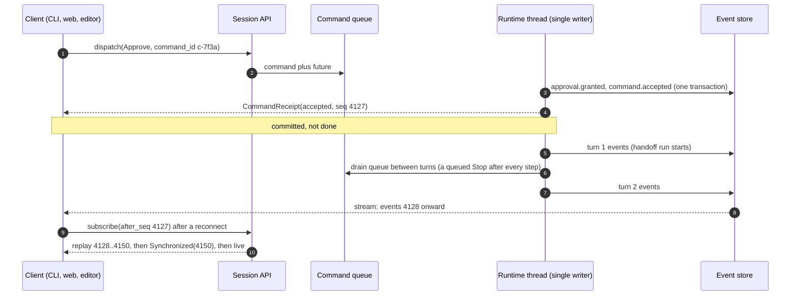

# ADR-P19: Session API (one write entry point with idempotent receipts, event streams with a cursor and a catch-up marker, and one capability record per runtime)

*Intermediate design as of 26 Nov 2026. Status: Proposed. This is a design record, not a description of shipped code. The Research agent and the Patent agent named below are example agents for Stillroom, a fictional hardware venture; the coding agent is a contrast case used only to test the design, and it is not built. "First milestone" means the 27 Nov 2026 cut of the build. Decision numbers refer to the [decisions log](../04-decisions-log.md); PR-NN and PNN IDs name primitives and P-1 to P-4 name design patterns, all listed in the [catalogue](../03-primitives.md); "v2" is the previous, unpublished design revision.*

## Status

Proposed, 25 Nov 2026. Nothing here was built as of 25 Nov 2026. The React web shell in web/ exists, built on 25 Nov 2026 against a mock session API with no backend. One call in the decisions log shapes this ADR and is the maintainer's: Aksha is a general headless harness with several interfaces (decision 1). No entry in the log settles the write entry point, the receipt, the stream rules or the capability record, and D13-2 (forward-compatible streams with a catch-up marker) is a decision for the maintainer that is not applied, so every part below stays Proposed. Amended 25 Nov 2026 after the three-agent stress test: S1 to S4 below are new and Proposed.

## Terms

Primitive PR-19 in the primitives catalogue, cluster E (interfaces and proof). Depends on PR-01 (every command and every stream item is a fact in the event store) and PR-17 (most commands answer an interrupt). Needed by PR-18 (the stop command travels through it) and PR-22 (the eval runner drives agents through it). It refines v2 ADR-023, which stays the source for the HTTP endpoint table, the exit codes and the CLI-versus-web decision; this ADR changes what sits underneath those.

Terms used here, in the industry names of the design glossary:

- **Session API** is the one programmatic surface every interface uses: The CLI, the web server, the demo script, the eval runner and any later editor plug-in or bot. No interface reaches the runtime core another way.
- **Command** is a request to change state, such as "send this message" or "approve this action". Commands form one closed, tagged union of frozen dataclasses.
- **Command ID** is an idempotency key the client generates for each command. A **command receipt** is the stored record that a command with that ID was accepted or refused, and with what result. A retried command with the same ID returns the first receipt and does nothing else.
- **Committed, not done** is the receipt's promise: The command's facts are durably in the event store and will not be applied twice. The receipt does not promise that the model turn, the tool call or the side effect it leads to has happened; the client learns that from the stream.
- **Stream** is the ordered delivery of the events a client may see, each carrying its sequence number. The **cursor** is the last sequence number the client holds. A **resync** tells the client to refetch every view and move its cursor, used when replay would be too large. The **catch-up marker** (`synchronized`) says replay has reached the live tail.
- **Forward-compatible decoding** means a client that receives a stream item type it does not know skips it, advances its cursor and keeps working.
- **Capability record** is a structured description of what this runtime, as configured, can do: which commands it accepts, which interrupt kinds and model classes it has, which stream features it sends. A client branches on the record, never on a backend's or agent's name.
- **Tenant** is the principal whose data a fact belongs to (Aksha's code calls it the owner). Every call names it first.
- **Single writer** is the one runtime thread that appends to the event store, whichever interface is in use.

## Context: without one session API, every interface becomes its own runtime

The product requirements ask for one interface (a web chat, CLI or bot), routing with a clarification when a request is unclear, a label on every reply naming the agent, separate user sessions, and runs a person can inspect. A general harness has several interfaces at once, and each of them asks the same four questions. Each question breaks in a known way when the answer lives in the interface instead of the runtime core.

| Question an interface asks | What breaks without a shared answer |
|---|---|
| Did my click count, and only once? | A double-click on Approve, or a retry after a dropped connection, records two approvals or two messages. v2 has a request ID only on `user.message`, and its uniqueness token waits for cut row 11 (HLD 10.2 gap 3) |
| Did the decision and what it caused both happen, or neither? | An interface that writes a decision and then calls the runtime can crash between the two |
| I reconnected; what did I miss, and when have I caught up? | A browser that reconnects either refetches everything blindly or patches views from payloads and drifts; an older web build crashes on an event type added later; the UI cannot tell when to stop showing "reconnecting" |
| Which features may I show? | A client that asks "is this the Patent Agent?" or "is this the live model?" grows one branch per agent and per backend, which is agent-specific code in an interface (P-1) |

The contrast coding agent adds three pressures the product requirements agents do not:

1. Its runs last for hundreds of turns, so a design where the one writer runs a command "until the run yields" (05e section 2.4) holds the writer for minutes. A Stop or an answer typed during that time would wait behind the whole run.
2. It produces live output a person wants to watch (test logs, token streams) that is not a fact worth storing.
3. An editor becomes a third client beside the CLI and the web, with its own idea of which buttons to show.

## Decision

1. **One write entry point, `dispatch(command) -> CommandReceipt`, over a closed union of commands.** Every state change any interface makes is one `Command` value. The named functions of v2 HLD 14.1 (`send`, `approve`, `answer` and the rest) stay, as one-line constructors over `dispatch`, so the CLI and the tests read the same as before. `boot` leaves the union, because no client sends it; the runtime thread runs it at start.
2. **Every command carries a client-generated command ID, and every command gets a receipt.** The client generates one random ID per invocation (a click, a CLI call) and reuses it only for that invocation's retries; it never derives the ID from the command's arguments or from the session's state, so two deliberate identical messages are two commands and a retry after a reply landed is still the same command. The CLI keeps the ID in a local pending file until the receipt arrives, so a retry after a CLI crash, before any receipt, reuses it; once the receipt has arrived the entry is cleared, and the next identical command is a new invocation with a new ID. In the command's first transaction the runtime core appends one fact, `command.accepted` or `command.refused`, with a deduplication key `cmd:{tenant}/{command_id}` under a unique constraint (PR-03 owns the constraint). A second dispatch with the same ID and the same argument hash returns the stored receipt with `replayed=True` and appends nothing. The same ID with different arguments is refused with `command_id_reused`. This generalises v2's `request_id` on `user.message` to every command, and it replaces that field.
3. **A receipt means committed, not done.** `dispatch` returns when the command's own facts commit (`user.message`, `approval.granted`, `run.started` and so on). Turns, tool calls and outbox work happen after, on the runtime thread, and reach the client through the stream. For the CLI and the tests, `wait_for_yield(tenant, session, after_seq)` blocks until the run yields to a person or ends and returns the same `Yielded` view v2 designed, so exit codes do not change.
4. **The single writer admits commands between turns, not only between runs, and admits a stop between steps.** The runtime thread runs scheduler work one turn at a time and drains the command queue after every turn's commit, so an answer or an approval typed during a long run is accepted within one turn, not after the run. A queued `Stop` is not left for the turn's end: the runtime thread commits any queued `Stop` after each step commit as well (the stop's `run.stop_requested` and its receipt, in one transaction), so ADR-P18 D5's per-step check reads it before the next tool call. On enqueueing a `Stop`, the session API also sets an in-memory stop signal for that run, which the kill boundary (ADR-P18 D6) watches while a long tool body runs, so a stop four minutes into a ten-minute suite reaches the running process without waiting for the step to end. The signal is a wake-up only; the committed `run.stop_requested` is the record, and there is still one writer. This is a change to 05e section 2.4, which ran each command to its yield.
5. **One stream per session, resumable from a cursor, with a resync, a catch-up marker and forward-compatible decoding (D13-2 option A).** `subscribe(tenant, session, after_seq)` replays every stored event of that tenant and session with a greater sequence number, then sends `Synchronized(seq)` once, then follows live commits. If the gap exceeds `max_replay` (default: unbounded, because the whole event store is local), it sends `Resync(seq)` instead of the replay: The client refetches every view and moves its cursor. Because clients never build views from payloads (FR-IF-11), a resync needs no snapshot payload. Clients decode an unknown item type as `Unknown`, which advances the cursor and invalidates nothing. The runtime core never renames or removes an event type without bumping the stream's `schema_version`.
6. **Live deltas are transient and never facts.** Token streams and command output arrive as `Transient` items on the stream while a step runs. They are not stored, never replayed, and carry no cursor; a reconnecting client sees the completed step instead.
7. **One capability record per runtime, derived from the composition root and the loaded agent definitions, never stored.** `capabilities(tenant)` returns which commands `dispatch` accepts, the interrupt kinds, the model classes with the adapter bound to each, the stream features, the sandbox backends, the run mode and, per agent, its interrupt labels, its effectful tools and its opted-in stop policies. An interface hides a button whose command is absent, so a first-milestone build without cancellation simply reports no `stop` command. The honesty rule: a capability that is claimed and fails at runtime is a bug, so every claimed capability maps to a conformance test.
8. **The stop command is reserved in the union; its meaning belongs to PR-18.** `Stop(run_id, reason)` is part of the union so the receipt, the stream and the capability record already handle it. Whether it ships in the first milestone is D13-1 (lean B in the first milestone), and the capability record says so either way.
9. **Tenant first, and another tenant's ID is "not found".** Every command and every read names the tenant, and an ID that belongs to another tenant gets the same `not_found` refusal as an unknown one (FR-IF-14), unchanged from v2.

Worked example, a double-clicked Approve after a dropped connection. The browser sends `Approve(approval_id="A-0001", shown_signature="sha256:3f9c...", command_id="c-7f3a")`. The runtime thread commits `approval.granted` and `command.accepted{command_id: "c-7f3a"}` at sequence 4127 and resolves the receipt, but the response is lost. The browser retries with the same command ID. `dispatch` finds the deduplication key, returns the stored receipt `{status: accepted, seq: 4127, ids: ("A-0001",), replayed: True}`, and appends nothing. The event store holds one `approval.granted`. Without the receipt, the second call would have reached the approval code, which refuses it with `already_decided`; the client would then show an error for a click that worked.

Worked example, a reconnect. A browser tab holds cursor 412 and sleeps; the run commits up to 450. On reconnect the tab subscribes with `after_seq=412`. The server replays 413 to 450, the client refetches the views those 38 events name, the server sends `Synchronized(450)` and the tab hides its "reconnecting" banner, then live events follow from 451. One of the 38 is `run.stop_requested`, a type the cached web build predates: it decodes as `Unknown`, the cursor moves past it, and nothing breaks.



Caption: The receipt returns at the first commit, the work continues on the single writer, which drains the queue after every turn, and the client follows the work through the stream.

### Amendments from the stress test (25 Nov 2026, Proposed)

1. S1, a source change is one change set. The product requirements' demo changes two sources (publications and contributor records), and `ApplySourceChange` named one. Two commands with turns admitted between them can rebuild against half the change and raise two selection or packet reviews for one demo. `ApplySourceChange(change_set)` applies a change set over several sources in one transaction through `record_source_changes` (ADR-P05 S2); the receipt's `ids` lists the sources it moved.
2. S2, a message to a session with an open run needs a lane. Nothing defined what `SendMessage` means while a run is open: a new request, an amendment of the answered scope, or steering for the running instance. A bare `SendMessage` to a session with an open run is refused `lane_required`, and the interface asks the person once. `Steer(run_id, text, lane)` carries the answer: `steer` and `follow_up` are ADR-P27's lanes; `amend` offers the text to the run's intake Task as an amendment of its last answered interrupt, the same path as `AnswerInterrupt(amend=True)`, so invalidation reopens scope and its dependents. A message to an ended run starts a new routed run, as before.
3. S3, the routing question is an interrupt of kind `route`, scoped to the session (ADR-P23). `route.decided` gets an owner there. `AnswerInterrupt(agent=...)` resolves it, naming one of the listed agents (or the "other" choice with `text`).
4. S4, `Finalize(run_id)` answers a budget interrupt with partial finalization (ADR-P14 S1, ADR-P24).
5. Names per ADR-P01 S1: `shown_signature`, and the command receipt type is `CommandReceipt`.

### Amendments from the build (26 Nov 2026, Proposed)

Built on 26 Nov 2026 in `src/aksha/runtime/session/`, `src/aksha/interfaces/` and `src/aksha/app.py`. Where the code differs from the text above:

1. B1, the union (D1). The named commands are frozen keyword-only dataclasses in `session/named.py`; the tenant field is `owner`, as everywhere in the code, and every command carries `by`, the sender's role. `OpenSession` is not in the union: no `session.opened` fact exists, so a session is the ID its first message names, and a client generates it (`S-` and 12 random hex digits). `SendMessage` carries `headless` (ADR-P11 D12: the flag is fixed when the run starts). `AcceptReview` and `RejectReview` carry the shown `card_hash` (ADR-P05), not edits. `GrantBudget` names the budget interrupt and the extra units (`interrupt_id`, `extra`), the shape of the built `grant_budget`.
2. B2, the receipt (D2, D3). The receipt is ADR-P03's `CommandReceipt` (`command_id`, `seq`, `accepted`, `refused`, `duplicate`); its wire form names them `status`, `code` and `replayed`. It carries no `command` name, `ids` or `run`: a client reads the run a message started from the session's status.
3. B3, honesty (D7). A command this runtime cannot carry out is refused `unsupported`, with a stored receipt like any refusal. `Session.commands()` is the set `dispatch` carries out and the set the capability record lists, and a test dispatches every listed command and finds none refused `unsupported`. Built: every member but `Steer` (no lane exists, ADR-P27) and `ApplySourceChange` (listed only when the session is given versioned sources); `EditAction` and `Handoff` are listed only when an agent has a tool that needs approval.
4. B4, the single writer (D4). `Session.step` runs one pass of one movable run: one stop-policy decision and at most the one turn it authorises (`loop.drive.drive_pass`, which reads the next point from the log, so a run of passes writes what one `drive` writes). The runtime thread (`session/worker.py`) drains its queue before every pass, so a command waits at most one turn. Not built: committing a queued stop after every step, and the in-memory stop signal to a running tool's kill boundary; a stop is committed between passes, and the step executor's per-step check (ADR-P18 D5) reads it. A run that waits on a person and has a pending stop is ended at recovery's `resume` candidate on the next pass (ADR-P18 D3), so a stop sent while a run waits for an answer ends it.
5. B5, streams (D5, D6). `subscribe` follows the owner's log and admits an event that names the session, belongs to a run the session started, or names neither a session nor a run (an owner-wide fact). `Transient` is defined and decodable but never sent (the record says `transient: false`); a quiet stream sends a heartbeat every 15 seconds; span text is left out of `excerpts.minted`. Over HTTP each event's `seq` is the SSE `id`, `Last-Event-ID` resumes, and `synchronized` and `resync` are SSE events with their own `id`.
6. B6, the capability record (D7). It holds the extension API version, the commit and dirty flag read from git, the run mode, the commands, the interrupt kinds (`route` only with a router), the model bindings keyed `agent/alias`, the declared sandbox backend, whether a headless start can succeed, whether a router is configured, the stream features, and per agent its interrupt labels, effectful tools, tools that need approval and opted-in stop policies.
7. B7, waiting (D3). There is no `Yielded` type: `views.SessionStatus` and `views.RunStatus` say where a session and a run stand. Embedded, `Session.run_until_yield` passes until every open run of the owner waits on a person or ends; in server mode the CLI polls the run's status.
8. B8, the HTTP adapter and the exit codes. `interfaces/http/server.py` serves the commands (one generic `POST /api/v1/commands` and a route per common command), the reads and one SSE stream per session; the owner is the `X-Aksha-User` header. A refusal is HTTP 409 (404 for an unknown item) with the receipt in the error's `details`, a malformed command 422. The exit codes are in `interfaces/wire.py`: 0 done, 1 internal, 2 usage, 3 waiting for an answer, 4 waiting for approval, 5 partial, 6 stopped, 7 refused, 8 environment (lock held, store or load failure), 9 blocked or failed, 10 hash chain broken. The AI SDK chat stream of the web contract is not built.
9. B9, CLI command IDs (D2). The pending file keys an invocation by the owner and the command line, so running the same command line again after a crash, before a receipt, reuses the ID; the entry is cleared when a receipt arrives.
10. B10, recovery before a mutating command. An embedded mutating command first recovers the owner and resumes its in-flight runs (ADR-P02 D10); `aksha serve` does the same for every owner with an open run before it listens.
11. B11, the demo script drives the loop beside the session service. `make demo` (`src/aksha/interfaces/demo/`) needs two things `Session` does not do yet: a record reader in the loop setup it builds (the research agent mints its spans through one, ADR-P13 D1) and opening rebuild runs after a source change (`loop.drive.drive_rebuilds`, ADR-P05 D8). So it calls the commands' functions (`answer`, `approve`, `accept_review`, `apply_source_change`, each through `session.commands.dispatch` with its receipt) and the loop's `drive` and `drive_rebuilds` directly, over the composition `aksha.app.open_demo` builds, and reaches no adapter or agent except through `aksha.app`. Nothing it does writes to the store outside a command, the loop or recovery. It moves onto `Session` once the session gives the loop its reader and opens rebuild runs.
12. B12, answering from the CLI. `aksha answer I-0001 TEXT` sends the text as the command's `text`, and the answer command files it under the interrupt's one question ID (or takes it as the choice), so an agent whose question is not `q1` can be answered; before this the CLI always sent it as question `q1`. With several questions, each takes `--answer ID=TEXT`. The session now takes a record reader too (ADR-P13 B3), so the first of the two gaps B11 names is closed for `aksha run`; the demo keeps its own setup.
13. B13, an approval that cannot run is refused (D2). `Session.dispatch` refuses an `Approve` whose effect names a system of record the session has none for: code `system_unavailable`, a stored receipt like any refusal, and nothing is granted, so the run keeps waiting on the same approval and a later `Approve` in a session that has the system grants it. The CLI prints how to bind the development mock (ADR-P20 B9).
14. B14, one run that cannot move does not hold up the owner (D4). A run holding a granted, unused approval whose effect has no system in this process (it was approved by a process that had one) is skipped by `Session.step` and by `Session.resume` (ADR-P02 B1), and so is a run whose drive raised `effect_needs_outbox`. `Session.unavailable(owner)` says which runs were skipped and why; the CLI prints it after the command's report. Nothing about a skip is stored: the next process that has the system drives the run. Recovery itself still refuses an owner with outbox entries to finish and no worker (ADR-P02 D5), since skipping a recovery step is not safe.
15. B15, what an interrupt asks (D3). `views.Waiting` carries the interrupt's questions as `(id, text)` pairs, a choice's options, and for an approval the tool it would run and the facts its approval rule showed (the target and recipient of a send). `aksha run`, `answer`, `status` and `resume` print them under each waiting line, and the wire form carries them.
16. B16, rebuilds through the session (ADR-P05 D8). `Session.drive_rebuilds(owner)` opens and drives, per loaded agent, the rebuild runs a source change left runnable (`loop.drive.drive_rebuilds`: one run per set of work, never for held work), so a caller with only a `Session` can settle an `ApplySourceChange`; a run that waits on a person is driven on by `run_until_yield` once answered. A rebuild run that no message opened takes the request of the first run it rebuilds for (`run.started{for_runs}`), so every pass shows the model the same request. The eval adapters use it (ADR-P22 B20); B11's demo script still drives the loop itself. Proposed.

### Amendments from the general agents (26 Nov 2026, Proposed)

1. G1, `UploadInputs(files)` joins the closed union of named commands: `files` maps relative paths to UTF-8 text, written to the owner's input workspace and recorded as one source change (ADR-P05 G1); a path that is not clean or text that is not UTF-8 is refused `upload_refused` with a stored receipt, before anything is written. It is in the capability record only when a loaded agent declares the inputs source. Over HTTP it is `POST /inputs` (body `{"files": {...}}`) or `POST /commands`.
2. G2, the command line: `aksha run --input PATH` (repeatable: a folder, at its relative paths, or files, under their names) uploads before the message is sent; `aksha upload PATH...` uploads alone, then drives and reports the rebuild runs the change opened. Hidden files are skipped; a file that is not UTF-8 text is reported skipped (extract a PDF's text first). `aksha show [KIND[/KEY]]` is a read command: it lists the owner's latest outputs, or prints one output's content as JSON with its `freshness` from the invalidation view, so a person reads what the agents saved without a server; a version an input change invalidated, or one waiting on such a version, is listed with `(stale: invalidated)` or `(stale: dirty)` until its rebuild saves a new one.

### Amendments from the design review (27 Nov 2026, Proposed)

Design decisions for parts that are designed but not built as described, recorded before they are built.

1. R1, `Steer.lane` is required (S2, ADR-P27 D1). D1 says the lane is explicit, but the declaration gave `lane` the default `"steer"`, so a scope change sent without a lane would steer the running instance instead of going through `amend`, which is the mistake `lane_required` exists to prevent. `lane` has no default in the interface above or in ADR-P27's: a `Steer` without one does not construct, and a wire request without one is refused `lane_required` with a stored receipt, as a bare `SendMessage` to an open run is. Each interface asks the person, as S2 says; a command-line or HTTP default is an interface choice that must be shown to the person, never filled in by the runtime. The built `Steer` and `aksha steer --lane` still default to `steer`; removing the default is a breaking change to the extension API (a major bump under ADR-P20 D2) and is made when this amendment is built.
2. R2, an unknown event type refetches (D5). D5 said an unknown item advances the cursor and invalidates nothing. That holds for an unknown stream item type (a new kind of item beside `EventItem`, `Resync` and the rest), which carries no state. It does not hold for an `EventItem` whose `event_type` the client does not recognise: a newer runtime's event can change a view the client shows, and a client that only advanced its cursor would leave that view stale with no signal. A client that receives an `EventItem` with an unrecognised `event_type` therefore refetches every view of the item's run (every view of the session when `run` is None) before it moves its cursor past the item, exactly as it does for the events it knows; several unknown events in one replay cost one refetch at the `Synchronized` marker. Because clients never build views from payloads (FR-IF-11), this needs no schema knowledge and no new item type, and an older client stays correct against a newer runtime at the cost of extra reads. Unknown stream item types stay as D5 says.

## Alternatives considered

| Option | What it is | For | Against | Verdict |
|---|---|---|---|---|
| A. One function per action, request ID only on messages | v2 HLD 14.1 as written | Readable; already designed | A retried approve, grant or review accept has no receipt; each new command repeats the dedupe question | Kept as sugar over D |
| B. A JSON-RPC protocol over standard input and output, one method per verb | Each harness exposes its own headless protocol | Language-neutral; a process boundary | A wire format, not a contract: The receipt, replay and capability questions remain; adds a process per client | Rejected for the core; a stdio JSON-RPC front end over `dispatch` is a later interface |
| C. A control protocol driving a closed loop | The client drives the harness as a subprocess | Hooks and permission callbacks reach the client | State lives in the subprocess; the client's callback is part of the decision path | Rejected: The gate and the stop policy stay inside the runtime core |
| D. One dispatch over a tagged union, every command with an ID and an idempotent receipt (my lean) | `dispatch(Command) -> CommandReceipt` | One dedupe rule for every command; one place to add `Stop`; interfaces hold no behaviour | One more record per command | Chosen |
| E. Durable intake with idempotency keys and leases | A turn queue that dedupes for 24 hours and promises a wakeup before accepting | A written intake contract | Dedupe by time window, not forever; leases matter only with several workers | Adapted: The deduplication key is permanent, and the single writer needs no lease |

Streams:

| Option | For | Against | Verdict |
|---|---|---|---|
| Replay by `Last-Event-ID` only | Exact, because the event store is append-only | No signal for "caught up"; a new event type can crash an old client | Kept as the base |
| Cursor, bounded replay or snapshot, `synchronized`, `unknown-event` (D13-2 A, my lean) | Old clients survive new servers; the UI knows when replay ends | About 10 more lines (estimate) | Chosen, with the snapshot replaced by `Resync` because Aksha's clients refetch views |
| A bidirectional WebSocket with many methods | One socket for everything | A product-scale surface; one local browser needs POST plus SSE | Rejected in the first milestone |
| Chat stream only | One stream | Exists only while a request is open, so a change applied from the CLI never reaches the panels | Rejected; the chat stream stays beside the session stream |

Capabilities:

| Option | For | Against | Verdict |
|---|---|---|---|
| No record; clients branch on names | Nothing to build | Every new agent or backend adds client branches (P-1 fails at the interface) | Rejected |
| A twelve-group record per adapter | Covers every feature group | Twelve groups describe wrapped providers Aksha does not have | Adapted |
| One small record per runtime with per-agent rows, derived from config (my lean) | Lets the first-milestone build say "no stop" honestly; the editor and web read one shape | Must stay true; the conformance test enforces it | Chosen |

## Interface

```python
# aksha/runtime/session.py (proposal; design only). Exported through aksha/runtime/api.py.
WaitKind = Literal["input", "choice", "approval", "budget", "review", "route"]   # S3: route, ADR-P23

@dataclass(frozen=True)
class CommandBase:
    tenant: str
    command_id: str                     # client-generated, random per invocation, reused only for its retries (D2)

@dataclass(frozen=True)
class OpenSession(CommandBase): session_id: str | None = None
@dataclass(frozen=True)
class SendMessage(CommandBase): session_id: str; text: str; agent: str | None = None
@dataclass(frozen=True)
class AnswerInterrupt(CommandBase):     # input, choice and route interrupts only (IE-10; route: S3)
    interrupt_id: str; text: str | None = None; keys: tuple[str, ...] = (); amend: bool = False
    answers: Mapping[str, str] = {}      # ADR-P17 S2: one answer per question, keyed by question ID;
                                        # `text` stays for a single-question interrupt
    agent: str | None = None            # route only: one of the agents the interrupt listed (ADR-P23)
@dataclass(frozen=True)
class Approve(CommandBase): approval_id: str; shown_signature: str
@dataclass(frozen=True)
class Reject(CommandBase): approval_id: str; note: str | None = None
@dataclass(frozen=True)
class EditAction(CommandBase): approval_id: str; changes: Mapping[str, object]
@dataclass(frozen=True)
class Handoff(CommandBase): approval_id: str
@dataclass(frozen=True)
class AcceptReview(CommandBase): review_id: str; edits: Mapping[str, object] | None = None
@dataclass(frozen=True)
class RejectReview(CommandBase): review_id: str
@dataclass(frozen=True)
class GrantBudget(CommandBase): run_id: str; grant: "Grant"
@dataclass(frozen=True)
class ApplySourceChange(CommandBase): change_set: str   # S1: one change set over one or more sources
@dataclass(frozen=True)
class Stop(CommandBase): run_id: str; reason: str = "Stopped by user"  # reserved; PR-18 owns it
@dataclass(frozen=True)
class Finalize(CommandBase): run_id: str                               # S4, ADR-P24
@dataclass(frozen=True)
class Steer(CommandBase):                                              # S2, ADR-P27
    run_id: str; text: str; instance: str | None = None
    lane: Literal["steer", "follow_up", "amend"]                      # required, no default (R1, Proposed: the built code still defaults to "steer")

Command = (OpenSession | SendMessage | AnswerInterrupt | Approve | Reject | EditAction | Handoff
           | AcceptReview | RejectReview | GrantBudget | ApplySourceChange | Stop
           | Finalize | Steer)

@dataclass(frozen=True)
class CommandReceipt:
    command_id: str
    command: str                        # the union member's name, "Approve"
    status: Literal["accepted", "refused"]
    code: "RefusalCode | None"          # v2's codes, plus "command_id_reused" and "unsupported"
    seq: int                            # sequence number of the command's commit
    ids: tuple[str, ...]                # created or affected IDs: "A-0002", "R-0004"
    run: str | None                     # the run the command started or resumed
    replayed: bool                      # True when this is the stored receipt of an earlier dispatch

def dispatch(cmd: Command) -> CommandReceipt: ...                       # returns at commit, not at the turn end
def wait_for_yield(tenant: str, session_id: str, after_seq: int,
                   timeout_s: float | None = None) -> "Yielded": ...  # v2's Yielded, a projection
def receipt(tenant: str, command_id: str) -> CommandReceipt | None: ...  # a projection over command.* events

# Sugar kept from v2 HLD 14.1, each one line over dispatch, for example:
def approve(tenant: str, approval_id: str, shown_signature: str, command_id: str | None = None) -> CommandReceipt: ...

def new_command_id() -> str: ...       # random per invocation; never derived from the arguments (D2)
def cli_pending_command_id(invocation: str) -> str: ...  # the CLI's local pending file: the same
    # invocation's retry reuses its ID until the receipt arrives; a new invocation gets a new one

# Streams
@dataclass(frozen=True)
class EventItem:
    seq: int; event_type: str; run: str | None; step: str | None; at: str
    payload: Mapping[str, object]       # source text and citation-span text left out (v2 contract 4)
    # R2: an event_type the client does not recognise refetches the views of its run (every
    # session view when run is None) before the cursor moves past it
@dataclass(frozen=True)
class Resync: seq: int                  # refetch every view, then cursor = seq
@dataclass(frozen=True)
class Synchronized: seq: int            # replay reached the live tail; sent once per subscription
@dataclass(frozen=True)
class Transient: run: str; step: str; channel: Literal["text", "tool_output"]; data: str  # never stored
@dataclass(frozen=True)
class Heartbeat: pass
@dataclass(frozen=True)
class Unknown: seq: int | None; raw_type: str   # client-side only: what an unknown item decodes to

StreamItem = EventItem | Resync | Synchronized | Transient | Heartbeat

def subscribe(tenant: str, session_id: str, after_seq: int | None,
              max_replay: int | None = None) -> Iterator[StreamItem]: ...
def decode(raw: Mapping[str, object], known: frozenset[str]) -> StreamItem | Unknown: ...

# Capabilities: a projection of the composition root and the loader's output, never stored
@dataclass(frozen=True)
class StreamCapabilities:
    schema_version: int; synchronized_marker: bool; resync: bool; transient: bool
    max_replay: int | None

@dataclass(frozen=True)
class AgentCapabilities:
    name: str; purpose: str; definition_hash: str
    interrupt_labels: tuple[tuple[WaitKind, str], ...]   # ("input", "needs_input")
    effectful_tools: tuple[str, ...]                     # an interface can say "this agent can send"
    stop_policies: tuple[str, ...]                       # opted-in built-ins (PR-16)

@dataclass(frozen=True)
class CapabilityRecord:
    api_version: str                    # the extension API version (ADR-P20)
    runtime_commit: str; dirty: bool
    mode: Literal["fake", "scripted", "replay", "live"]
    commands: frozenset[str]            # union members dispatch accepts here; no "Stop" until PR-18 ships
    interrupt_kinds: frozenset[WaitKind]
    model_classes: Mapping[str, str]    # {"generation": "rule-based"}; extraction and classification at cut row 8
    sandbox_backends: tuple[str, ...]   # ("refuse",) in the first milestone
    stream: StreamCapabilities
    agents: tuple[AgentCapabilities, ...]

def capabilities(tenant: str) -> CapabilityRecord: ...

# The single writer (changes 05e section 2.4)
class RuntimeThread:
    def start(self, app: "App") -> None: ...                    # takes the writer lock, boots, serves
    def submit(self, cmd: Command) -> "Future[CommandReceipt]": ...    # resolved at the command's commit
    def on_commit(self, fn: Callable[[str, str, int], None]) -> None: ...  # (tenant, session, seq)
    def stop(self, timeout_s: float = 5.0) -> None: ...         # finishes the current turn, then exits
```

How the runtime thread works, in order:

1. Take the writer lock, run recovery on startup (PR-02), then loop.
2. If the command queue is not empty, take one command, run its handler in one transaction that also appends `command.accepted` or `command.refused`, and resolve its future with the receipt.
3. Else, if the scheduler has a runnable Task instance, run one turn of it (PR-06), commit, and call every `on_commit` callback.
4. Go to step 2. A command that needs a run to continue (an answer, an approval) only appends facts; the scheduler then finds the run runnable on its next pick.

Events it writes:

| Event | When | Deduplication key |
|---|---|---|
| `command.accepted` (new; name provisional until the PR-01 event catalogue) | In the command's first transaction, beside the command's own facts | `cmd:{tenant}/{command_id}` |
| `command.refused` (new; provisional) | When the handler refuses (`hash_mismatch`, `not_found` and the rest) | `cmd:{tenant}/{command_id}` |
| Each command's own facts, unchanged from v2: `session.opened`, `user.message`, `route.decided`, `run.started`, `interrupt.resolved` (v2: `pause.answered`), `approval.granted`, `approval.rejected`, `approval.voided`, `review.accepted`, `review.rejected`, `budget.granted`, `source.changed` (v2: `world.changed`), and `run.stop_requested` once PR-18 ships | As v2 HLD 5.2 | As v2 HLD 5.3 |

`user.message` loses its `request_id` field; the command ID on `command.accepted` replaces it. `decision.refused` (v2) becomes the `command.refused` record for decisions, so one refusal is one fact.

Projections it reads: The session view (transcript with agent labels), pending interrupts and approvals, run status and the next action, the receipt index by command ID, the stop-policy stack and last stop decision for the run view, and the capability record (from configuration, not the event store).

## Stress test (25 Nov 2026)

Three design reviews in the three stress reviews walked the Research Agent (the Research stress review), the Patent Agent (the Patent stress review) and the contrast coding agent (the coding stress review) through this ADR on 25 Nov 2026. Nothing was built or run; each verdict is a reading of the interfaces. The verdict values are: fits; fits with agent-side code (the core is unchanged); needs a runtime change (generic, with no agent word in the core); missing primitive (no ADR owned it).

| Agent | Verdict as written | The scenario | What this ADR now says |
|---|---|---|---|
| Research | Missing primitive | "Who else does camera-free occupancy sensing?" arrives with no agent named; mid-run "also include manual alternatives" | S3 points at ADR-P23 (router); S2 `lane_required` and the `amend` lane |
| Patent | Needs a runtime change | Two fixture sources change for one demo; `ApplySourceChange` names one | S1 one change set, one transaction |
| Coding | Missing primitive | Turn 37 of `fix[S2]`: "use the existing retry helper instead" | S2 `Steer` with lanes; the primitive is ADR-P27 |

Verdict after the amendments: fits for all three once S1 and S2 land and ADR-P23 and ADR-P27 exist. S1, S3 and S4 are first-milestone work; S2's refusal ships the first milestone and the `steer` lane is later.

Open for the maintainer: S2's refusal against a default lane (lean: refuse and ask, because each default is wrong for one of the three agents).
