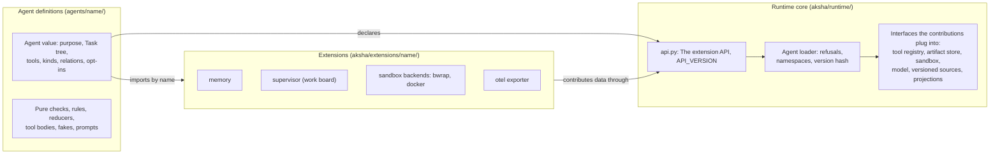

# ADR-P20: Extension API and agent definition (a small runtime core, extensions that contribute declared data, agent definitions loaded, checked and version-hashed by one loader)

*Intermediate design as of 26 Nov 2026. Status: Proposed. This is a design record, not a description of shipped code. The Research agent and the Patent agent named below are example agents for Stillroom, a fictional hardware venture; the coding agent is a contrast case used only to test the design, and it is not built. "First milestone" means the 27 Nov 2026 cut of the build. Decision numbers refer to the [decisions log](../04-decisions-log.md); PR-NN and PNN IDs name primitives and P-1 to P-4 name design patterns, all listed in the [catalogue](../03-primitives.md); "v2" is the previous, unpublished design revision.*

## Status

Proposed, 25 Nov 2026, with three parts Accepted because the decisions log records the maintainer's call on them. Nothing here was built as of 25 Nov 2026. Amended 25 Nov 2026 after the three-agent stress test: S1 to S5 below are new and Proposed. S1 must land before the extension API snapshot freezes `API_VERSION = "1.0"`.

## Terms

| Part | Status | Where the maintainer decided |
|---|---|---|
| Aksha is a general harness; a third agent must run with no edit to the runtime core, and every design decision passes P-1's test | Accepted, 25 Nov 2026 | Decision 1; the design patterns note P-1; v2 ADR-015's main decision |
| An agent declares its Task tree and opts into built-in stop policies by configuration; it does not subclass them | Accepted, 25 Nov 2026 | Decision 10 |
| The industry names used here (runtime core, extension, extension API, agent definition, projection built by a reducer) | Accepted, 25 Nov 2026 | Decision 11 |
| Agents are Python modules with structure as declared data and checks as pure functions | Proposed: Decision 2 is marked "pending the maintainer's confirm" (SR-12) | Decision 2 |
| Extensions contribute declared data, not hooks; the extension API is versioned; the package layout; the definition version hash contents | Proposed | None yet |

Primitive PR-20 in the primitives catalogue, cluster E (interfaces and proof). Depends on PR-01 (the definition version hash is stored on `run.started`). Needed by PR-09 (memory is an extension), PR-10 (tools arrive with the agent definition) and PR-11 (the gate reads the definition's tool lists). It refines v2 ADR-002 (the definition format) and v2 ADR-015 (the boundary), and renames their words: substrate becomes runtime core, kit and plugin become extension, ring becomes layer.

Terms used here, in the industry names of the design glossary:

- **Runtime core** is `aksha/runtime/`: The package that holds only durable, generic agent concepts (the event store, artifacts, Tasks and the scheduler, stop policies, the gate, budgets, the outbox, interrupts, the model and sandbox interfaces, the session API). It imports the Python standard library and `jsonschema`, nothing else.
- **Extension API** is the set of public names agents and extensions import, all from `aksha/runtime/api.py`, with a version number. Nothing outside the runtime core imports any other runtime module.
- **Extension** is a package beside the runtime core that uses the extension API and holds no domain word, such as the memory extension, the supervisor extension (the work board), a sandbox backend or the OpenTelemetry exporter. An agent imports an extension by name. Older Aksha documents call these kits and plugins; this ADR uses one word for both.
- **Contribution** is a piece of declared data an extension or an agent definition adds to a run: a tool spec, an artifact kind, a typed relation, a projection, a reusable child Task, a sandbox backend, a model adapter, a versioned data source.
- **Agent definition** is the frozen `Agent` value one agent module exports: purpose, instructions, Task tree, tools, artifact schemas, typed relations, opted-in stop policies, budget, fakes.
- **Agent loader** is the runtime module that imports every agent definition and extension, validates every declaration in a fixed order, and refuses to start any run on a violation, naming module, Task and field.
- **Agent definition version hash** is a hash over everything that can change an agent's behaviour: its module files, prompt files and schema files, the versions and file hashes of the extensions it imports, and the extension API version. It is stored on `run.started`, and a run cannot resume under a different one.
- **Conformance agent** is a small agent written only to prove the boundary: it loads from a temporary folder, runs, and the runtime core's file hash is unchanged afterwards (v2 calls it the toy agent).

## Context: a harness is general only if a third author never edits the core

The product requirements ask that each agent define its purpose, instructions and allowed tools separately from the shared runtime, that a test add a plugin without runtime edits, and that both agents share one runtime with separate instructions and permissions. The maintainer's decision 1 raises the bar from "two agents share a runtime" to "any agent can be added". Two failures follow when the core and the agents are not separated by something stronger than intent.

| What goes wrong | Example | Why it matters |
|---|---|---|
| Agent words leak into the core | A `per: candidate` literal in the scheduler, a `needs_scope` branch in the stop policy, an `approve_above: int` that counts items (each found and removed in v2, HLD 4.3) | Every new agent adds a branch; the core grows with the number of agents |
| The core rule is enforced only by review | A written rule (only durable, generic runtime concepts belong in the core) sits beside an example agent that mounts the whole repository read-write, core included | A rule nobody can see fail is a rule nobody has proved |
| Extensions get hooks into the decision path | An extension that can return "continue" from a turn-end hook, or rewrite a tool's arguments before the gate | Two hooks that both want the turn end recreate the precedence problem PR-16 exists to solve; a hook that reads tool results can be steered by injected text |
| A run resumes under changed code | A prompt edit between a crash and the restart makes the resumed run take a different path than its recorded steps | Durable execution (PR-02) returns recorded results that the new code would not have produced; a replay check would fail it as non-deterministic |
| An extension changes without anyone noticing | An agent under evaluation has no version, so nothing records which build ran which trial | Eval results (PR-22) and resumes cannot be tied to the code that produced them |

The contrast coding agent is the stress test for the boundary. It needs a sandbox backend, an exec tool, a test-report artifact, a completion check meaning "the tests pass", and a `push_branch` effect. If any of those needs a line in `aksha/runtime`, the core was built for document agents.

## Decision

1. **Three layers, imports pointing inward only.** The runtime core (`aksha/runtime/`), extensions (`aksha/extensions/<name>/`, replacing `aksha/kits/` and `aksha/plugins/`), and agent definitions (`agents/<name>/`). The core imports no extension and no agent; an extension imports only `aksha.runtime.api`; an agent imports `aksha.runtime.api` and the extensions it names. Interfaces (the CLI, the web server) and the composition root `aksha/app.py` sit outside the core and are not extensions, because they hold no contributions.
2. **The extension API is one module with a version.** `aksha/runtime/api.py` is the only runtime module anything outside the core imports. It carries `API_VERSION` as `major.minor`. Adding a name bumps the minor version; removing or changing one bumps the major. Every agent and extension declares `requires_api` (for example `">=1.0,<2"`), and the loader refuses a mismatch. A test compares the module's public names and signatures with a committed snapshot, so an API change cannot happen by accident.
3. **Extensions contribute declared data; they do not register hooks.** An `Extension` value lists contributions: tool specs with bodies, artifact kinds, typed relations, projections (a name, a reducer and the event types it reads), reusable child Tasks, sandbox backends, model adapters and versioned data sources. The runtime core uses each contribution only through the interface that kind of thing already has: The tool registry, the artifact store, the sandbox interface, the model interface. No extension can return a stop decision, edit a model request, or run before or after the gate. This is P-3 applied to extensions: everything the core reasons about is inspectable data. An extension that only wants to observe a run is a stream subscriber of the session API (ADR-P19), outside the decision path.
4. **An agent definition is a Python module exporting one frozen `Agent` value** (v2 ADR-002 option A, decision 2 pending the maintainer's confirm). Structure the harness reasons about (the Task tree, reads and writes, tool lists, interrupt declarations, typed relations, stop-policy opt-ins) is declared data; behaviour it only calls (completion checks, rule bodies, tool bodies, reducers) is plain pure Python. Prompts are files the loader reads and hashes. The `Agent` fields are 05d section 2.2's, plus `extensions` and `requires_api`.
5. **Stop policies form a closed, built-in set.** An agent opts into the built-in stop policies (goal condition, plan mode, forced tool choice, todo reminder) with parameters; neither an agent nor an extension can define a new stop-policy class (decision 10, Accepted). In Aksha a stop policy is configuration, never a subclass. A request for a new stop policy is a change to the runtime core, reviewed as one.
6. **One loader, one fixed order of refusals, before any event.** The loader resolves extensions first, then agents, in sorted order, and applies 05d section 2.7's steps, extended for extensions: resolve each named extension, check `requires_api`, namespace every contributed kind as `<extension>.<kind>` or `<agent>.<kind>`, refuse a duplicate full name, then validate the agent as before. Every refusal names module, Task and field and stops the process before `run.started` (FR-RC-03, NFR-25).
7. **The agent definition version hash covers everything that can change behaviour, and a run cannot resume under a different one.** The hash is SHA-256 over the canonical list of (relative path, file hash) for every file in the agent folder except `tests/`, each imported extension's name, version and file hashes, and `API_VERSION`. File hashes are used, never only version strings, because a version string can stay the same while the code changes. `run.started` records the hash, the extension versions, the API version, the runtime commit and a dirty flag. Recovery on startup ends a run whose recorded hash differs from the loaded one with `definition_changed` (05a section 9), and a new run may reuse earlier work only under an equal hash (SR-7 lean B).
8. **The boundary is enforced by tests that are shown to fail.** The five v2 guards stay (the import rule, the static term check, the runtime file hash with the conformance agent, the closed stop-policy set, the store triggers), and two are added: The extension API snapshot and a conformance extension. Each guard has a companion test that plants a violation in a temporary copy and asserts the guard catches it, because a guard nobody has seen fail is a guard nobody has proved.
9. **Loading runs the module's code, so only trusted modules load.** An agent or extension written by someone other than the repository owner needs a module sandbox and the improvement gate (v2 HD-8) first. Both are later work, named in the README as a limit.

Worked example, the contrast coding agent with no core edit. Its folder declares `push_branch` (external, receiver `git_remote`, recovery `reconcile` by comparing the remote ref with the intended commit), `shell` (exec, network off), artifact kinds `patch` and `test_report`, a typed relation `tested_at` from a test report to the commit it ran on, and a Task tree `plan → edit → test → push`. The `test` Task's completion check is `lambda view: (r := view.latest("coding.test_report")).failed == 0 and view.freshness(r) == "current"` (S5): a pure function over artifacts, because the exec tool already ran the suite and saved the report. It imports the `bwrap` sandbox extension by name. Every piece is a contribution to an interface the core already has, so `test_third_agent_runtime_hash_unchanged` passes with this agent in place of the conformance agent.



Caption: every arrow points inward; the runtime core imports nothing from the two outer layers, and contributions reach the core only through interfaces it already has.

### Amendments from the stress test (25 Nov 2026, Proposed)

1. S1, the `Agent` value carries what other ADRs say an agent declares, under the renamed fields. ADR-P08, P14, P07 and P05 each said agents declare a context policy, limits, model aliases or sources, and the `Agent` value had no field for them; it also kept v2's `edges`, `directors` and `roles`, which ADR-P04, P15 and P16 renamed. Every agent would hit this, so it is one core edit, made now, before the API snapshot test freezes `API_VERSION = "1.0"`. The interface above is updated.
2. S2, an extension can contribute a system-of-record adapter. The coding agent's Git remote adapter had nowhere to plug in except the composition root. `Extension.systems` holds `SystemOfRecordSpec` values, and `environments` and `egress` hold ADR-P28's and ADR-P26's declarations.
3. S3, the loader refuses a source root inside an agent folder (`source_root_inside_agent`). Every file in the agent folder except `tests/` enters the definition version hash, so fixtures or templates kept there end every open run `definition_changed` when edited. Fixtures live in the fixture world as versioned sources.
4. S4, per-Task definition hashes are a requirement for long sessions. A one-word prompt edit ends a 5-hour coding session `definition_changed`. LC-7's per-Task hashes stay out of the first milestone's cut, and move from refinement to requirement for any agent whose runs last longer than a demo.
5. S5, the worked example's completion check also reads the test report's freshness, as ADR-P15 D4 requires; without it an edit after a green run still passes.

### Amendments from the build (25 Nov 2026, Proposed)

1. B1, the layout (D1). Agents live in `aksha/agents/<name>/`, inside the package, so packaging and the import guard cover them; D1's `agents/<name>/` at the repository root is replaced. The loader machinery is `aksha/runtime/definitions/` (it holds `Agent`, `Extension`, the loader and hashing), so it no longer shares a word with `aksha/extensions/`, where extensions live.
2. B2, the boundary is enforced in every import form (D1). The loader's source scan refuses every `aksha` import except `aksha.runtime.api`, and for an agent `aksha.extensions.<name>` for the extensions it names: `import aksha.x`, `from aksha import x` (read as `aksha.x`), `from aksha.app import y`, and `importlib.import_module("aksha.x")` with a literal name. `test_conformance_fixtures_import_only_the_api` checks the conformance agent and extension; it carries the "no core edit" guarantee until the agent loop (ADR-P06) lets the hash tests run a turn.
3. B3, one name space (D6). An agent may not share a name with an extension it loads (`namespace_collision`), and merging an agent's kinds, relations and projections with its extensions' refuses any full name both declare (`duplicate_name`).
4. B4, extension event types (D3, ADR-P01 B4). `Extension.event_types` holds the extension's `EventTypeSpec`s; the loader checks them (`event_type_invalid`) and registers them once every definition loads.
5. B5, the API version (D2, S1). `API_VERSION` is 1.1: 1.0 is the first frozen snapshot S1 names, and 1.1 added `Extension.event_types` and `LogView.complete`, both trailing fields with defaults. `requires_api` defaults to `">=1.0,<2"`. `required_bump` counts a trailing parameter with a default as minor, any other signature change as major. (An earlier build had bumped to 2.0 before any consumer existed; it was reset.)
6. B6, the `Projection` shape (Interface). `Projection(name, reducer)` holds an ADR-P01 `Reducer`, which already carries `reads` and `initial`; `event_types` is a property. One reducer shape serves the core and extensions.
7. B7, tests. `test_resume_under_changed_definition_ends_definition_changed` is a strict expected failure in `tests/architecture/test_definitions.py` until recovery on startup (ADR-P02) exists, so it is tracked and turns red when it starts passing.
8. B8, contributed systems of record are wired by the composition root (S2, 26 Nov 2026). `app.open_session` builds each system the loaded agents' extensions declare, once per full name `<extension>.<name>` (an `EffectSpec.system` names it so), by calling the spec's factory with the keyword `state_dir`: a folder beside the SQLite file, `systems/<full name>`, where a local or fixture system may keep its own ledger. A factory that returns no system of record (no `ledger_id`, `apply` and `lookup`) is refused `system_invalid`; systems passed to `open_session` by name replace the extension's. Before this, extension systems reached no session, so an approved effect run from the CLI was refused `effect_needs_outbox`. API 2.2 exports `SystemOfRecord` and `SystemReceipt` so an extension can implement one while importing only `aksha.runtime.api`.
9. B9, a development mock bound by setting (26 Nov 2026). `AKSHA_SYSTEMS=<system>=mailbox:<folder>` (comma-separated) binds the ledgered mock mailbox `make demo` uses (`adapters/systems/mailbox.py`, a JSON ledger in `<folder>/mailbox.json` that delivers once per idempotency key) as the system of record an effect names, for example `counsel_mail` for the patent agent's `send_packet`, or as an extension's system by its full name, replacing the extension's own. The composition root builds it (`app.configured_systems`); nothing is bound by default; a name no loaded agent's effect or extension uses is refused `system_unknown`, and a kind other than `mailbox` `system_invalid`. Every CLI command that opens a session prints a line saying the bound system is a mock and that nothing it receives leaves the machine. The setting lives in the composition root, not in an extension, because the patent agent's effect names an unqualified system (`counsel_mail`) that no extension declares.

### Amendments from the general agents (26 Nov 2026, Proposed)

1. G1, an agent's logic knows no fixture. The research and patent agents take the task, the venture's context and what to compare from the request, and recognise every input by its content (a seller page, a review table, an invention note, a contributor table, a disclosure history, a form template, a publication), never by a folder, a file name or a column name. Only the offline models (`fakes.py`, and `fakes_*.py` beside it) may know a fixture, and no other module of an agent imports them; `tests/architecture/test_agent_generality.py` fails on any stillroom or tilldew value in an agent's definition, tools, readers, rules, checks or prompts.
2. G2, what the offline models understand. A rule-based fake stands in for a live model, so it reads the request by a small, documented grammar (`Compare <dimension> (<terms>), ...`; `say about: <theme> (<terms>); ...`; `for <segment>`; a named geography) and applies general rules (the patent fake makes one element per mechanism step, its distinctive words the reference groups). The stillroom notes' hand-written lexicon applies only to the exact notes it was written for (same candidate ID and title). A live model adapter runs the same agent code and reads the request as free text; no such run is recorded yet.

### Amendment M1: the invalidation field (decision 38, 26 Nov 2026, Proposed)

1. `Agent.invalidation` is a trailing field (extension API 2.10), one of `off`, `edit_guard`, `notify` or `rebuild` (`InvalidationMode`), with `off` the default when nothing is declared. What each mode does is ADR-P05 amendment M1. The loader refuses any other value with `invalidation_unknown` (field `invalidation`) and hashes the resolved mode into the definition hash beside the context policy (D7), because the default lives in the runtime and no file of the agent shows it. `run_started_fields` records the mode on every `run.started` a definition opens.
2. `ToolSpec.edits` is a trailing field (`EditSpec(source, record, collection=None, overwrite=False)`): the record a `store` or `exec` tool edits or overwrites, named by a JSON pointer to a required string argument, optionally a path inside a collection. The loader refuses it on any other effect class (`edits_not_allowed`) and a pointer that is not a required top-level string argument, or an empty source (`edits_invalid`). It enters the tool registry's canonical hash only when declared, so the hash of a tool that edits nothing is unchanged.
3. The research and patent agents declare `invalidation="rebuild"`; `make demo` and every eval suite run as before.
4. `RecordReader` gains `serves(source) -> bool` (extension API 2.10), so the edit-time check can tell a source it cannot read from a record that does not exist yet. Agents and extensions call the reader and do not implement it; the readers the composition root wires (folder sources, the inputs workspace, the eval episode reader) implement it. The loader refuses two differently named versioned sources, across an agent and its extensions and across loaded agents, that declare the same collection (`collection_served_twice`, field `sources`), because a recorded read names a record by its ID alone.

### Amendment from the design review: imports from outside the folder (27 Nov 2026, Proposed)

1. B10, the definition hash covers or refuses every import from outside the folder (D7). D7's hash covered the agent folder (except `tests/`), each named extension's files and `API_VERSION`, and B2's source scan refused `aksha` imports other than `aksha.runtime.api` and the named extensions. A module from elsewhere on `sys.path` (a helper package beside the agent, a `PYTHONPATH` folder) was in neither: an edit to it changed behaviour with the hash unchanged, so a run could resume under changed code, which is what D7 forbids. `run.started` records the runtime commit and a dirty flag, but recovery compares only the definition hash. The choice: pin what can be pinned, refuse what cannot. The loader reads every absolute import in the agent's and each extension's sources without running them (`runtime/definitions/imports.py`), counting a dynamic import by literal name (`importlib.import_module("x")`, `__import__("x")`) as an import of `x`, as B2's scan does; a dynamic import by a computed name is not seen, as in B2, and sorts each top-level module into one of four. (a) The standard library, `__future__` and `aksha`: nothing to pin (B2 limits `aksha`, and the runtime commit is on `run.started`). (b) A module of an installed distribution: pinned as `name==version` of every distribution that owns it, and the pins enter the definition hash (an agent's in the top-level material, an extension's in its own entry), so installing, upgrading or removing a dependency is a new definition. (c) A module that is not installed (an optional parser imported inside `try`): pinned as `absent`, so installing it later is a new definition. (d) Anything else is refused `import_unpinned` (field `imports`), naming the file and module: a module on `sys.path` that no installed distribution owns, or one from an editable install, whose version does not follow its code. Such a helper belongs in the agent folder, where its files are hashed, or in a package installed by version. Hashing the helper's files instead was rejected: the loader cannot tell which files of a package an import reaches without running it, and a helper hashed today could import another tomorrow. Pins are added to the hash material only when there are some, so a definition that imports nothing outside the standard library and `aksha` keeps the hash it had. The cost: a definition's hash now differs between two machines with different versions of a dependency it imports, which is the point, since their behaviour can differ too.

## Alternatives considered

| Option | What it is | For | Against | Verdict |
|---|---|---|---|---|
| A. Lifecycle hooks and callbacks | Extensions register functions on events such as turn end, before and after the model, before a tool | Familiar; any behaviour can be added | Hooks share the decision path, so their order becomes a precedence nobody chose (PR-16); a hook can read model-writable content; the core cannot inspect what a hook will do | Rejected for decisions; observation goes through the session API stream |
| B. Compiled-in contributors | Extensions contribute typed items to a registry the core reads | Inspectable; no ordering problem | Compiled in, a third party must rebuild the binary | Adapted: contributions as declared data, loaded at start |
| C. A written core rule enforced by review | "Only durable, generic runtime concepts belong in the core" | Clear words | Nothing fails when the rule breaks | Adopted as the rule, enforced by decision 8's tests |
| D. Declared contributions, a versioned extension API, one loader, a version hash, guards that fail (my lean) | Decisions 1 to 8 | A third agent and a third extension both load with no core edit, and a test proves it | More upfront declaration for authors; a hook-style extension must be rethought as data | Chosen |
| E. Agent definition as a data file with callables named by dotted path | YAML or JSON validated by a schema | Diffs cleanly; a UI could edit it | Checks are still Python, so loading still imports code; a typo fails at load, not in the editor | Rejected (v2 ADR-002 option B) |
| F. Agent definition as a code object in the host language | An `Agent(...)` object with tools and instructions | What SDK users expect | Those objects carry no Task tree, no artifact kinds and no stop-policy opt-ins the core can inspect | Adopted as the shape, extended with the declared structure |
| G. No version on the agent under test | Results and resumes not tied to code | Nothing to compute | A rebuilt agent between trials is invisible | Rejected; decision 7 |

## Interface

```python
# aksha/runtime/api.py. The only runtime module outside code imports. The version is the one
# built as of 27 Nov 2026 (B5 gives the numbering; each minor added trailing fields or names).
API_VERSION = "2.11"

@dataclass(frozen=True)
class Projection:                               # a read view built by a reducer (PR-01; B6)
    name: str                                   # namespaced by the loader: "supervisor.board"
    reducer: "Reducer"                          # ADR-P01's Reducer: carries `reads` and `initial`; pure
    @property
    def event_types(self) -> frozenset[str]: ...   # the reducer's `reads`: the only events it is given

@dataclass(frozen=True)
class Extension:
    name: str                                   # "memory"; the namespace of its kinds
    version: str                                # informative; the version hash uses file hashes
    requires_api: str                           # ">=1.0,<2"
    tools: tuple["ToolDecl", ...] = ()          # ADR-P10
    artifacts: tuple["ArtifactKind", ...] = ()  # ADR-P04
    relations: tuple["RelationKind", ...] = ()  # typed relations (decision 9; ADR-P04 D12)
    projections: tuple[Projection, ...] = ()
    tasks: tuple["Task", ...] = ()              # reusable child Tasks, such as memory intake
    sandbox_backends: tuple["SandboxBackendSpec", ...] = ()   # ADR-P12
    model_adapters: tuple["ModelAdapterSpec", ...] = ()       # PR-07
    sources: tuple["VersionedSourceSpec", ...] = ()           # PR-05
    systems: tuple["SystemOfRecordSpec", ...] = ()            # S2: system-of-record adapters (ADR-P03)
    environments: tuple["EnvironmentSpec", ...] = ()          # ADR-P28
    egress: tuple["EgressPolicy", ...] = ()                   # ADR-P26
    event_types: tuple["EventTypeSpec", ...] = ()             # B4: the extension's own event types (ADR-P01 B4)

@dataclass(frozen=True)
class Agent:                                    # 05d section 2.2, renamed and extended (S1)
    name: str
    purpose: str                                # also the router's option text (ADR-P23)
    instructions: str                           # prompt file path, read and hashed by the loader
    reads: tuple[str, ...]
    artifacts: tuple["ArtifactKind", ...]
    relations: tuple["RelationKind", ...] = ()    # v2 `edges` (ADR-P04 D12)
    tasks: tuple["Task", ...] = ()
    tools: tuple["ToolUse", ...] = ()
    stop_policies: tuple["StopPolicyOptIn", ...] = ()   # v2 `directors`; built-in only (decision 10)
    completion: tuple["Check", ...] = ()
    model_aliases: tuple["ModelAlias", ...] = ()  # v2 `roles` (ADR-P07)
    budget: "Budget | None" = None
    limits: "Limits | None" = None                # S1: turn, veto and restart limits (ADR-P14)
    context_policy: "ContextPolicy | None" = None # S1: caps and compaction limits (ADR-P08)
    sources: tuple["VersionedSourceSpec", ...] = ()   # S1: The agent's own fixture sources (ADR-P05)
    fakes: str = "fakes"
    phrases: str | None = "phrases.json"
    extensions: tuple[str, ...] = ()              # imported by name: ("memory",)
    requires_api: str = ">=1.0,<2"

# aksha/runtime/loader.py (proposal; built as aksha/runtime/definitions/, B1)
@dataclass(frozen=True)
class LoadRefusal:
    module: str                                 # "agents/patent/agent.py"
    task: str | None                            # "compare"
    field: str                                  # "tools"
    code: str                                   # "tool_widens_parent", "api_mismatch", ...
    message: str

class LoadError(Exception):
    refusals: tuple[LoadRefusal, ...]           # the first refusal is the most basic (NFR-25)

@dataclass(frozen=True)
class LoadedExtension:
    ext: Extension
    file_hashes: tuple[tuple[str, str], ...]    # (relative path, sha256)
    imports: tuple[tuple[str, str], ...] = ()   # B10: (module, "dist==version" or "absent")

@dataclass(frozen=True)
class LoadedDefinition:
    agent: Agent
    extensions: tuple[LoadedExtension, ...]
    registry: "ToolRegistry"                    # ADR-P10
    kinds: Mapping[str, "ArtifactKind"]         # full names: "patent.packet", "memory.fact"
    projections: Mapping[str, Projection]
    definition_hash: str                        # "sha256:<64 hex>"
    file_hashes: tuple[tuple[str, str], ...]

def discover(agent_paths: Sequence[Path], extension_paths: Sequence[Path]) -> tuple[Path, ...]: ...
def load_extensions(names: Iterable[str], search: Sequence[Path]) -> tuple[LoadedExtension, ...]: ...
def load_agents(paths: Sequence[Path], search: Sequence[Path]) -> tuple[LoadedDefinition, ...]: ...
    # raises LoadError; writes no event; runs before any run.started
def definition_hash(folder: Path, extensions: Sequence[LoadedExtension], api_version: str) -> str: ...
def api_surface() -> Mapping[str, str]: ...     # public name -> signature text, for the snapshot test
```

Events it writes: none of its own; the loader runs before the event store is touched, so a refused definition leaves no trace in it. It adds fields to `run.started`, which the event store ADR (PR-01) owns: `definition_hash`, `extension_versions` (name to version and hash), `api_version`, `runtime_commit`, `dirty`. Recovery on startup writes the run's end with `definition_changed` when hashes differ (05a section 9).

Projections it reads: The run view's recorded `definition_hash`, at recovery, to compare with the loaded one. Contributed projections are read by whoever asks for them by full name.

## Stress test (25 Nov 2026)

Three design reviews in the three stress reviews walked the Research Agent (the Research stress review), the Patent Agent (the Patent stress review) and the contrast coding agent (the coding stress review) through this ADR on 25 Nov 2026. Nothing was built or run; each verdict is a reading of the interfaces. The verdict values are: fits; fits with agent-side code (the core is unchanged); needs a runtime change (generic, with no agent word in the core); missing primitive (no ADR owned it).

| Agent | Verdict as written | The scenario | What this ADR now says |
|---|---|---|---|
| Research | Needs a runtime change | The agent must declare its context policy, limits, model aliases and fixture source, and `Agent` has no fields for them | S1 adds the fields and the renames |
| Patent | Fits with agent-side code | Fixtures inside `agents/patent/` end every open run `definition_changed` when edited | Keep the fixture world outside; S3 makes it a loader refusal |
| Coding | Needs a runtime change | The Git remote adapter has no extension slot; a prompt edit ends a 5-hour session | S2 `Extension.systems`; S4 per-Task hashes become a requirement; S5 fixes the sample check |

Verdict after the amendments: fits for all three once S1 to S3 land. S1 is the first item of the first milestone, because every later declaration lands in the `Agent` value and the API snapshot freezes it.

Open for the maintainer: none new; decision 2 (Python module) is still pending the maintainer's confirm.
