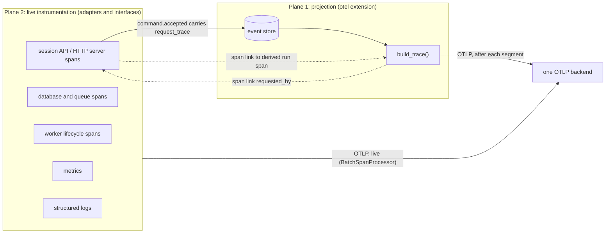

# ADR-P21: Tracing with OpenTelemetry (the trace is a projection of the event store, named by the OpenTelemetry GenAI conventions v0.1.0, exported by an extension to a local file by default and to any OTLP/HTTP backend on request)

*Intermediate design as of 26 Nov 2026. Status: Proposed. This is a design record, not a description of shipped code. The Research agent and the Patent agent named below are example agents for Stillroom, a fictional hardware venture; the coding agent is a contrast case used only to test the design, and it is not built. "First milestone" means the 27 Nov 2026 cut of the build. Decision numbers refer to the [decisions log](../04-decisions-log.md); PR-NN and PNN IDs name primitives and P-1 to P-4 name design patterns, all listed in the [catalogue](../03-primitives.md); "v2" is the previous, unpublished design revision.*

## Status

Proposed, 25 Nov 2026. Rewritten the same day after the maintainer asked for "a proper OTel way of tracing" so that the observability backend can be chosen later (25 Nov 2026), using a study of the OpenTelemetry GenAI conventions (25 Nov 2026). Nothing here was built as of 25 Nov 2026. P-2 ("store facts, derive interpretations") is the maintainer's call and already says every interpretation is a projection built by a reducer over the event store; this ADR applies it to traces. The maintainer has said OpenTelemetry is the layer to build on now and the backend is chosen later; no entry in the decisions log yet chooses the span tree, the convention version, the exporter packaging or the backend, so those stay Proposed. The backend is a decision for the maintainer (section "Backend shortlist").

## Terms

Primitive PR-21 in the primitives catalogue, cluster E (interfaces and proof). Depends on PR-01 (every span is built from stored events) and PR-02 (deterministic step IDs). Needed by PR-22 (eval graders attach their results to these spans). It refines v2 ADR-009.

What changed from the earlier version of this ADR (same date): The span tree gains a turn level and the stop-policy evaluation becomes a span under it; tool and model retries become one span with attempt events (the convention's retry rule); exec steps use the standard `process.exit.code`; the capture values follow the convention exactly; a run that suspends exports one trace per execution segment; and the exporter uses the official OpenTelemetry Python SDK inside an optional extra instead of a hand-written writer. The runtime is unchanged by all of it.

Amended 25 Nov 2026 for decision 21 (the maintainer: two telemetry planes), section "Two telemetry planes". Everything above that section is plane 1, the agent-run trace. The split into two planes, plane 2 as live OpenTelemetry instrumentation never written to the event store, and one OTLP backend correlated by trace and span IDs are Accepted; the instruments, names, packaging and the correlation field in that section are my proposal and stay Proposed.

Terms used here, in the industry names of the design glossary:

- **Runtime** is Aksha's core package, `aksha/runtime/`. Its dependencies are the Python standard library and `jsonschema`, nothing else (`pyproject.toml`, read 25 Nov 2026).
- **Event store** is the append-only record of every fact about a run (PR-01). A **projection** is a pure function from stored events to a view.
- **Extension** is a package under `aksha/extensions/<name>/` that imports only `aksha.runtime.api` (ADR-P20). OpenTelemetry lives in one, `aksha/extensions/otel/`.
- **Stop policy** decides at each turn end whether a Task instance continues (PR-16). A **stop-policy evaluation** commits one stop decision record, `stop.decided`, with a verdict (PASS, CONTINUE, PUSH, HOLD, DONE, FAIL or STOP) and a trail.
- **Interrupt** is a recorded request that suspends work until something outside the run answers it; an approval is one interrupt kind (PR-17). **Suspension** is the state of a run or Task instance while an interrupt on it is open.
- **Model classes** are extraction, classification and generation (ADR-P07). A call is **native** when the model returns the class's own probabilities, **adapted** when a generation model answers under a schema.
- **Tracing** records each run as a tree of **spans** (start, end, status, attributes). A **span event** is a timestamped point on a span. A **span link** joins spans in different traces.
- **OpenTelemetry (OTel) GenAI semantic conventions** are the shared span and attribute names for generative-AI work, in their own repository `open-telemetry/semantic-conventions-genai`. **OTLP** is the OpenTelemetry Protocol for sending telemetry; **OTLP/HTTP** is OTLP over HTTP, and **OTLP JSON** its JSON encoding.

## Context: one record of what happened, many readers

The product requirements ask that each run be inspectable (the selected agent, workflow state, tool calls, input versions, approvals, saved outputs and errors) and that logs hold no secrets. The maintainer's question on 25 Nov 2026 was whether emitting proper OTel lets us pick the agent and observability backends later, since almost everyone supports the format.

The answer is yes, at two layers of different safety:

1. **The wire format is safe.** OTLP over HTTP is the transport GenAI-aware backends and viewers accept; some accept only HTTP, not gRPC, so HTTP is the one to emit.
2. **The names are not yet safe.** The GenAI conventions released v0.1.0 on 21 Nov 2026 with every span and attribute at "Development" stability, and by 24 Nov 2026 the repository held eight unreleased changelog fragments, five marked breaking (re-counted at `43c136b` on 25 Nov 2026). Each backend maps a different subset; the operations most reliably typed are `chat` and `execute_tool`, while `invoke_agent` is not typed everywhere.

So the design must keep the wire standard and the names replaceable. What breaks otherwise:

| Failure | How it happens |
|---|---|
| A resumed run emits spans twice | Durable execution (PR-02) returns recorded results instead of re-running a step; a span emitted by the code that runs the step is emitted again on replay |
| The trace and the event store disagree after a crash | Live spans sit in an in-memory buffer; a kill loses the buffer while the events committed |
| A convention rename touches the whole codebase | `gen_ai.*` strings are spelled wherever spans are made |
| A span stays open for days | A run suspends on an approval overnight inside one trace; a backend that buffers children of an absent parent for a fixed window (12 hours is a common default) can orphan them |
| Document text or secrets reach a backend | Content capture on by default, or tool arguments copied onto spans |
| Cost comes from the wrong writer | An agent-side process reports its own model usage |
| A backend shows nothing offline | a first-milestone user running offline has no collector or account |

## Decision

1. **The trace is a projection of the event store; there is no second source of truth.** `build_trace(events)` is a pure function over one run's stored events. The runtime has no tracing write path and imports no OpenTelemetry package. A replayed or resumed step writes no new event, so it cannot produce a second span: one span per logical step holds by construction.

2. **The span tree is run > Task > turn > {model call, tool call, stop-policy evaluation, interrupt}.**

   | Level | Span name | `gen_ai.operation.name` | Kind | Built from | Basis |
   |---|---|---|---|---|---|
   | Run (one execution segment) | `invoke_workflow {agent}` | `invoke_workflow` | INTERNAL | `run.started` or the resume to `run.ended` or suspension | Convention: "the application defines the control flow" (`gen-ai-agent-spans.md` L194, v0.1.0) |
   | Task instance, model chooses tool calls | `invoke_agent {agent}` | `invoke_agent` | INTERNAL | `task.entered` to the stop decision that ends it | Convention |
   | Task instance, steps declared | `invoke_workflow {task path}` | `invoke_workflow` | INTERNAL | same | Convention: workflows "SHOULD be reported even when nested" |
   | Task instance, pure code | `aksha.task {task path}` | none | INTERNAL | same | My choice: not a GenAI operation |
   | Turn | `aksha.turn {task path}/t{nn}` | none | INTERNAL | first `step.started` whose step ID has segment `t{nn}`, to the `stop.decided` that closes it | My choice: The conventions have no turn span |
   | Model call, generation or adapted fast class | `chat {gen_ai.request.model}` | `chat` | CLIENT (INTERNAL for an in-process model) | model `step.started` to `step.completed` or `step.failed` | Convention |
   | Model call, native extraction or classification | `extract {model}`, `classify {model}` | `extract`, `classify` | CLIENT or INTERNAL | same | My choice; the convention allows a custom value when none applies |
   | Tool call | `execute_tool {gen_ai.tool.name}` | `execute_tool` | INTERNAL | tool `step.started` to its outcome; a refusal is zero length | Convention |
   | Exec tool call | `execute_tool {tool} {process.executable.name}` | `execute_tool` | INTERNAL | same | Convention, command-execution refinement (`execute-tool.md`, v0.1.0) |
   | Stop-policy evaluation | `aksha.stop_policy.evaluate {task path}` | none | INTERNAL | the `stop.decided` transaction; zero length under the injected clock | My choice |
   | Interrupt | `aksha.interrupt {kind}` | none | INTERNAL | `interrupt.raised` to `interrupt.resolved`, `interrupt.voided` or suspension | My choice |

   Three rules shape the tree. **Retries**: one model or tool span covers all attempts, with a span event `aksha.attempt` per attempt, because the convention says the span "SHOULD cover the duration of the logical operation with all retries" (the OpenTelemetry GenAI spans notes, v0.1.0); backends then count one tool call per model request. **Interrupts that suspend**: The interrupt span ends at suspension with `aksha.interrupt.state=open`, and the resuming segment carries a span event `aksha.interrupt.resolved` linked back to it, so no span is open across segments. **Segments**: a run that suspends and resumes exports one trace per execution segment; each root carries `aksha.segment`, the next root links `resumed_from` to the previous one, and all share `gen_ai.conversation.id` (the session ID), which conversation-aware backends group by. Outbox effects are spans `aksha.effect {receiver}` under the turn whose tool enqueued them, or under the run span of a handoff run, linked `authorised_by` to the approval interrupt span.

   Facts with no duration are span events: `aksha.stop_requested` (PR-18) and `aksha.command` (ADR-P19) on the run span; `aksha.artifact.saved` on the innermost open span; `aksha.agent.loaded` and `aksha.boot` (recovery) on the first segment; `gen_ai.evaluation.result` on the span a grader judges, in eval export only (ADR-P22).

3. **Names follow the OTel GenAI semantic conventions v0.1.0, pinned; `aksha.*` covers what they lack.** The pin is tag `v0.1.0`, commit `d0e74ba`, 21 Nov 2026, which depends on semantic conventions v1.45.0 for general keys (`error.type`, `process.exit.code`, `process.executable.name`). I re-read the tag in the local clone on 25 Nov 2026: it defines 85 `gen_ai.*` attribute keys in `model/gen-ai/registry.yaml` (measured), including every key below. Every exported resource carries `aksha.semconv = "otel-genai/0.1.0"`.

   | Need | Attribute | Source |
   |---|---|---|
   | Which agent | `gen_ai.agent.name` | Convention |
   | Which definition | `aksha.agent.version` (the definition hash) | Aksha: `gen_ai.agent.version` is a v0.1.0 registry key, but v0.1.0 removed it from the internal `invoke_agent` span (CHANGELOG, PR #322) and keeps it only on `create_agent` and the client `invoke_agent` span (`spans.yaml` L665, a stated requirement) |
   | Which session groups the segments | `gen_ai.conversation.id` | Convention |
   | Model call | `gen_ai.provider.name`, `gen_ai.request.model`, `gen_ai.response.model`, `gen_ai.response.finish_reasons`, `gen_ai.usage.input_tokens`, `gen_ai.usage.output_tokens`, `gen_ai.output.type=json` for an adapted fast-class call, `gen_ai.conversation.compacted=true` only after compaction (PR-08) | Convention |
   | Tool call | `gen_ai.tool.name`, `gen_ai.tool.call.id`, `gen_ai.tool.type`, `error.type` on failure | Convention |
   | Exec | `process.executable.name`, `process.exit.code` | Convention (general v1.45.0) |
   | Run and segment | `aksha.run.id`, `aksha.segment`, `aksha.segment.outcome` (`ended`, `suspended`) | Aksha |
   | Task id | `aksha.task.id` (`compare[C1]`), `aksha.task.path`, `aksha.task.key`, `aksha.task.status` | Aksha |
   | Turn and step | `aksha.turn.index`, `aksha.step.id` (the deterministic step ID) | Aksha |
   | Stop-policy verdict | `aksha.stop.verdict` (PASS to STOP), `aksha.stop.policy` (the stack layer that decided), `aksha.stop.trail` (rule IDs, never content), `aksha.stop.limit` when a budget or turn limit fired | Aksha |
   | Approval hash | `aksha.approval.signature` (the version-prefixed SHA-256 over the action body, ADR-P17 D8; v2 "action hash"), `aksha.approval.decision`, `aksha.approval.decided_by_role` (a role, never a name) | Aksha |
   | Model class | `aksha.model.class` (`extraction`, `classification`, `generation`), `aksha.model.native`, `aksha.model.alias` | Aksha |
   | Fast-class outcome | `aksha.classification.p`, `aksha.extraction.p_null`, `aksha.threshold.accept_at`, `aksha.abstained` | Aksha |
   | Artifact ids | `aksha.artifact.refs` (refs saved by the span, such as `patent.packet/C1@v2`) on the span; `aksha.artifact.ref` on each `aksha.artifact.saved` event | Aksha |
   | Interrupt | `aksha.interrupt.id`, `aksha.interrupt.kind`, `aksha.interrupt.state` | Aksha |
   | Effects and retries | `aksha.effect.outcome` (`sent`, `reconciled`, `abandoned`), `aksha.effect.receipt`, `aksha.retry.count`, `aksha.attempt.n`, `error.type=aksha.refused` with `aksha.policy.rule` for a refused tool call, `aksha.sandbox.backend` | Aksha |

   Adapted fast-class calls are typed `chat` on purpose: some backends read token usage only from spans they type as model calls. Usage attributes are absent on fake models, never zero; `gen_ai.provider.name=aksha.fake`.

4. **The mapping lives in one module, so a convention rename touches one file.** `aksha/extensions/otel/semconv.py` holds the pinned version, every span-name template, every operation value, every attribute key as a constant, and the mapping table (event type to span, span event or attribute) as data. No other module spells a `gen_ai.*` or `aksha.*` attribute string; a test enforces it. Beside it, `semconv_otel_genai_0_1_0.json` lists the 85 `gen_ai.*` keys and the operation values extracted from the tag, plus the general keys we use; moving to v0.2.0 means regenerating that file and editing `semconv.py`, then re-exporting old runs, which works because the trace is rebuilt from events.

5. **Content capture is off by default, controlled by the standard environment variable.** Export reads `OTEL_INSTRUMENTATION_GENAI_CAPTURE_CONTENT` with the convention's four values, `NO_CONTENT` (default), `SPAN_ONLY`, `EVENT_ONLY` and `SPAN_AND_EVENT`, case-insensitive, with an unknown value meaning `NO_CONTENT` (the OpenTelemetry GenAI spans notes L556-569, v0.1.0, read 25 Nov 2026). Under `NO_CONTENT` no messages, system instructions, tool definitions, tool arguments or tool results leave. Withholding tool definitions is stricter than the pin: v0.1.0 says schema attributes such as `gen_ai.tool.definitions` are not governed by the switch (the OpenTelemetry GenAI spans notes L547), and the unreleased fragment from PR #722 brings them under it, so this matches where the convention is going. The `aksha.*` attributes carry IDs, rule names and numbers, never document text; a classification label whose option list came from an artifact (ADR-P07 S1) is dropped under `NO_CONTENT` (research section 5, inference). The tenant never enters an ID or attribute. The local inspector, which is not an export, keeps content for the person debugging.

6. **IDs are derived, never random.** `trace_id = sha256("aksha|" + store_id + "|" + run_id + "|" + segment)[:32]`; `span_id = sha256(trace_id + "|" + span_key)[:16]`, where `span_key` is the deterministic step ID or `run`, `task:`, `turn:`, `stop:`, `interrupt:`, `effect:` plus its ID. The resource is built with `Resource({...})`, not `Resource.create`, and sets `service.instance.id` from a hash of the store ID, because `Resource.create` in SDK 1.45.2 adds a random instance UUID that broke byte-identical output in probe 2 (measured 25 Nov 2026). Two fake-mode runs export byte-identical files (NFR-3).

7. **Usage and cost are written only by the model adapter inside the runtime**, on the model step's `step.completed`. No agent, fake or extension can write a usage field.

8. **Exporters are an extension: a local OTLP JSON file by default, OTLP/HTTP to any backend on request.** `aksha/extensions/otel/` converts `SpanRecord`s into the SDK's own `ReadableSpan` (probe 1 built these from recorded times and derived IDs and exported them offline, 25 Nov 2026) and hands them to the SDK's exporters:

   | Exporter | Package (optional extra) | When |
   |---|---|---|
   | OTLP JSON Lines file, `.aksha/traces/{run}/{segment}.otlp.jsonl` | `aksha[otel]`: `opentelemetry-sdk~=1.45.2`, `opentelemetry-exporter-otlp-json-file==0.66b2` (Beta, 29 Oct 2026; no protobuf or gRPC; 18 MB installed, measured 25 Nov 2026) | Default. Offline |
   | OTLP/HTTP, protobuf body, to `{endpoint}/v1/traces` | `aksha[otel-http]` adds `opentelemetry-exporter-otlp-proto-http==1.45.2` (Production/Stable, 29 Oct 2026, requires `opentelemetry-sdk~=1.45.2`, `opentelemetry-proto` and `requests`; PyPI JSON, 25 Nov 2026) | Only when `--otlp-endpoint URL` is passed, or `--otlp` with the standard `OTEL_EXPORTER_OTLP_TRACES_ENDPOINT` or `OTEL_EXPORTER_OTLP_ENDPOINT`; headers from `OTEL_EXPORTER_OTLP_HEADERS` |

   An inherited environment variable alone never turns on network export, so an offline run cannot call out by accident (my choice). HTTP, not gRPC, because some backends take only HTTP. Export runs after a segment ends, as `aksha trace RUN` or `aksha run --trace`, over a read-only store; because IDs are derived, re-exporting overwrites rather than duplicates. `make venv` installs `aksha[otel,dev]`; without the extra, `aksha trace` exits with an install hint and `aksha inspect` still works. The SDK is imported lazily inside the extension only.

9. **Every event type has a mapping row.** An event type with no row becomes a span event `aksha.unmapped {type}` and fails a test, so a new event type cannot vanish from traces.

10. **The run inspector ships beside the trace.** `aksha inspect RUN` and `aksha inspect REF` are projections over a read-only store and never boot (IE-5); they need no OpenTelemetry package.

### Worked examples

A Research Agent turn, fake models, frozen clock (illustrative values):

```
invoke_workflow research          R-0001 segment 1   gen_ai.conversation.id=S-01
└─ invoke_agent research          aksha.task.id=compare[C1]
   ├─ aksha.turn compare[C1]/t01
   │  ├─ chat fake-generation     aksha.model.class=generation, gen_ai.provider.name=aksha.fake
   │  ├─ execute_tool fetch_page  status ERROR, aksha.retry.count=1, events: aksha.attempt x2
   │  ├─ classify fake-nli        aksha.model.class=classification, aksha.model.native=true, aksha.abstained=true
   │  └─ aksha.stop_policy.evaluate compare[C1]   aksha.stop.verdict=CONTINUE
   └─ aksha.turn compare[C1]/t02
      ├─ chat fake-generation
      ├─ execute_tool save_matrix_cell   aksha.artifact.refs=[research.cell/C1-price@v1]
      └─ aksha.stop_policy.evaluate compare[C1]   aksha.stop.verdict=DONE
```

The Patent Agent's send after a restart (v2 05e section 7.6). Run R-0002's segment 1 ends `suspended`; its `aksha.interrupt approval` span runs 09:14:03 to suspension with `aksha.approval.signature` set. Segment 2 opens at the person's answer, links `resumed_from` segment 1, and records `aksha.interrupt.resolved` at 09:20:11. The handoff run R-0003 is its own trace, `invoke_workflow patent`, 09:20:15 to 09:21:02; under it `aksha.effect send` carries `aksha.effect.outcome=reconciled` and receipt `RC-1`, linked `authorised_by` to the approval span, and `aksha.boot` with `reconciled=1` sits at 09:21:02. A reader sees the approval came first, the send finished only after a restart, and recovery found the receipt instead of sending again. Resuming the run twice more changes nothing, because no new step ran.

### Amendments from the build (26 Nov 2026, Proposed)

Built on 26 Nov 2026 in `src/aksha/extensions/otel/`, with `aksha inspect` and `aksha trace` in `src/aksha/interfaces/cli/`. Where the code differs from the text above:

1. B1, where the projection lives (D1, D4). `build_trace` is in the extension (`extensions/otel/trace.py`), importing only `aksha.runtime.api`, so the runtime has no tracing module and imports no OpenTelemetry package (the dependency rule, with planted companions for `opentelemetry` and `fastapi`). The run inspector (D10) is `runtime/session/views.inspect_run`.
2. B2, segments (D2). A run's events split into segments at a run-level HOLD (suspension) and wherever the writing process changed (`boot`).
3. B3, the span tree (D2). Every Task instance is an `invoke_agent {agent}` span; the workflow and pure-code variants are not distinguished yet. Outbox facts are span events (`aksha.effect.*`) on the tool step that enqueued them, not `aksha.effect` spans, and carry no `authorised_by` link. A command receipt appears only when its event names the run.
4. B4, the exporter (D8). Only the OTLP JSON Lines file exporter is built, on `opentelemetry-sdk~=1.45.2` and `opentelemetry-exporter-otlp-json-file==0.66b2` in the extra `aksha[otel]`; `make venv` installs it. The file is `<out>/<run>/<segment>.otlp.jsonl`, `var/traces` beside the store by default, and is replaced on every export. OTLP/HTTP (`aksha[otel-http]`) is not built.
5. B5, content (D5). The event store holds no model messages, so the only content the switch governs is a tool result's text: the span modes add `gen_ai.tool.call.result`, the event modes a span event holding it.
6. B6, the name guard (D4). A test refuses a `gen_ai.*` string literal anywhere in the package outside `semconv.py`, with a planted companion; `semconv_otel_genai_0_1_0.json` is not committed.

## Two telemetry planes (decision 21, 25 Nov 2026)

The event store records what happened in an agent run; it does not record how the harness itself behaved while serving it. A session API request that took four seconds, a database append that waited on a lock, a worker that restarted, a queue that grew to 300 pending items: none of these is a fact about a run, and putting them in the event store would mix domain facts with machine noise in the one record that must replay byte for byte. The maintainer's call (decision 21) is two planes:

- **Plane 1, the agent-run trace**, is everything above this section: a projection of the event store, built after the fact by a pure function, replayable, deterministic, with derived IDs.
- **Plane 2, operational telemetry**, is the harness's own health: live OpenTelemetry spans, metrics and logs emitted by the code as it runs, with random IDs, never written to the event store, and lost if the process dies before export, which is acceptable because nothing reads them as truth.

Both export over OTLP to the same backend, and they are joined by trace and span IDs, so an operator can go from "this request was slow" to "this is the run it started" and back.



Caption: The two planes meet only at IDs; the event store holds one correlation reference per command, never spans, metrics or logs.

### What goes where

| Signal | Plane | Where it is emitted | Why that plane |
|---|---|---|---|
| Run, Task, turn, model call, tool call, stop-policy evaluation, interrupt, outbox effect | 1 | Built from events by `build_trace` | Domain facts; must survive a crash and replay without duplicates (D1) |
| Model token usage and cost per call | 1, authoritative | `step.completed` written by the model adapter (D7) | Billing and budgets read the event store; a live counter can lose increments on a kill |
| Model token and cost counters for dashboards and alerts | 2, a live copy | The model adapter, at call time | Alerting needs a rate now, not after the segment exports; when the two disagree, plane 1 wins |
| Session API and HTTP server requests (route, status, duration) | 2 | The interface layer (`aksha/interfaces/http/`) | A request is not a run fact; a refused or unauthenticated request may touch no run at all |
| Database operations: append, read, projection rebuild, lock wait | 2 | The `EventStore` adapters (`aksha/adapters/store/`) | Latency of the storage, not content of the record |
| Queue operations: outbox dispatch, scheduler picks, timer wakes | 2 | The outbox dispatcher, scheduler and timer adapters | Health of the machinery; the facts they produce (`outbox.completed`, `task.entered`) are still plane 1 |
| Worker lifecycle: start, lock acquired, recovery, heartbeat, shutdown, crash restart | 2 for timing and health; 1 for `recovery.completed` | Process entry points | The boot fact is a run-relevant event; how long boot took is not |
| Sandbox and execution-environment resource use (CPU, memory, wall time per exec) | 2 | The sandbox adapter (ADR-P12) | Capacity planning; the exec's exit code stays plane 1 (`process.exit.code`) |
| Errors and exceptions in harness code | 2 (span status, exception event, log); 1 only when the error is a step outcome (`step.failed`) | Where raised | A crash in the HTTP layer is not a run fact; a tool failure is |
| Structured logs | 2 | Python `logging` with a JSON formatter and the OpenTelemetry logs bridge | Free-form diagnostics; never a source for any projection |
| Hash-chain verification results (ADR-P01 Amendment H) | 2 for the check's duration and outcome; 1 for `chain.anchored` | `aksha verify`, the anchor extension | An anchor publish is a recorded fact; a verify run is an operation |

The rule behind the table: if a projection, a stop policy, a budget or an approval would ever read it, it is plane 1 and goes through the event store. Everything else is plane 2.

### Plane 2 instrumentation (Proposed)

1. P2-1, where the dependency lives. The runtime still imports no OpenTelemetry package (D1, and `test_runtime_never_imports_opentelemetry` still holds). The runtime declares a small `Telemetry` port with a no-op default; adapters and interfaces get an OpenTelemetry-backed implementation from `aksha/adapters/telemetry/otel.py`, which depends on `opentelemetry-api` and `opentelemetry-sdk` in a new optional extra, `aksha[ops]` (name proposed). Without the extra, every plane-2 call is a no-op, and a laptop run pays nothing.
2. P2-2, spans. Live spans use the general OpenTelemetry semantic conventions v1.45.0 (already pinned by D3 for `error.type` and `process.*`; I did not re-read the HTTP and database pages for this section):

   | Span | Kind | Key attributes |
   |---|---|---|
   | `{method} {route}` for each session API and HTTP request | SERVER | `http.request.method`, `http.route`, `http.response.status_code`, `aksha.command.id` when the request carries a command, `aksha.run.id` when it names one |
   | `aksha.store.append {boundary}`, `aksha.store.read`, `aksha.store.lock_wait` | INTERNAL (CLIENT for PostgreSQL) | `db.system.name` (`sqlite`, `postgresql`), `db.operation.name`, `aksha.store.boundary`, `aksha.store.events` (count), never payloads |
   | `aksha.projection.rebuild {reducer}` | INTERNAL | `aksha.reducer.name`, `aksha.projection.cache_hit`, `aksha.projection.events_read` |
   | `aksha.outbox.dispatch {receiver}`, `aksha.scheduler.pick`, `aksha.timer.wake` | INTERNAL or PRODUCER/CONSUMER | `aksha.outbox.id`, `aksha.run.id`, `aksha.task.id` |
   | `aksha.worker.boot`, `aksha.worker.recovery`, `aksha.worker.shutdown` | INTERNAL | `aksha.boot`, `aksha.worker.recovered_runs`, `service.instance.id` |
   | Outbound HTTP from tools and model adapters | CLIENT | `http.request.method`, `server.address`, `http.response.status_code`; W3C `traceparent` propagated only to receivers the egress policy (ADR-P26) allows |

3. P2-3, metrics. Instruments, with names proposed except where marked as convention:

   | Metric | Instrument | Unit | Attributes | Source of the name |
   |---|---|---|---|---|
   | `http.server.request.duration` | Histogram | s | method, route, status | General conventions v1.45.0 (not re-read) |
   | `aksha.runs.active` | UpDownCounter | {run} | agent | Mine |
   | `aksha.runs.suspended` | UpDownCounter | {run} | agent, reason (`interrupt`, `budget`, `timer`, `external`) | Mine |
   | `aksha.queue.depth` | Observable gauge | {item} | queue (`outbox`, `scheduler`, `timers`) | Mine |
   | `aksha.store.append.duration` | Histogram | s | backend, boundary | Mine |
   | `aksha.store.lock_wait.duration` | Histogram | s | backend | Mine |
   | `aksha.projection.rebuild.duration` | Histogram | s | reducer, cache_hit | Mine; it is S2's measurement in ADR-P01 |
   | `gen_ai.client.inference.duration` | Histogram | s | `gen_ai.operation.name`, `gen_ai.provider.name`, `gen_ai.request.model`, `aksha.model.class` | GenAI conventions v0.1.0, `gen-ai-metrics.md` (checked 25 Nov 2026) |
   | `gen_ai.client.inference.usage.input_tokens`, `gen_ai.client.inference.usage.output_tokens` | Counter | {token} | as above | GenAI conventions v0.1.0, `gen-ai-token-metrics.md` (checked 25 Nov 2026) |
   | `aksha.model.cost` | Counter | microdollars | provider, model, model class | Mine; an operational copy of plane 1's cost |
   | `aksha.worker.restarts` | Counter | {restart} | reason | Mine |
   | `aksha.policy.refusals` | Counter | {refusal} | rule | Mine; feeds X-3's repeated-denial signal for alerting, not for decisions |

4. P2-4, logs. Harness code logs through Python `logging` as one JSON object per line, and the OpenTelemetry logs bridge adds `trace_id` and `span_id` from the active plane-2 span, so a log line opens the request that wrote it. Logs carry IDs, rule names and numbers; they never carry prompts, tool arguments, tool results, document text, credentials or the tenant, and the content-capture switch of D5 does not turn them on.
5. P2-5, export. A `BatchSpanProcessor` and a periodic metric reader send plane 2 live over OTLP/HTTP to the same endpoint variables plane 1 uses. The network gate of D8 applies to both: an inherited `OTEL_EXPORTER_OTLP_ENDPOINT` alone never turns on export; `aksha serve --otlp` or `--otlp-endpoint URL` does. Offline, plane 2 can write to the same file exporter for a debugging session, and is off by default on the first milestone run.

### Correlation between the planes (Proposed)

Plane 1 IDs are derived from the store ID, run ID and segment (D6), so they are known before the trace is ever built. Plane 2 IDs are random and live. Three links join them:

1. Plane 2 to plane 1, at request time. A session API request that accepts a command for a run computes that run's plane-1 trace ID and root span ID with the same derivation function (`aksha/extensions/otel/ids.py`, shared by both planes) and adds a span link `run_segment` to its own server span. The segment number comes from the run's status projection: The next segment for a resume, 1 for a new run.
2. Plane 1 to plane 2, at export time. `command.accepted` gains one optional field, `request_trace`, holding the W3C `traceparent` string of the plane-2 request span that carried the command. When `build_trace` meets it, the run span (or the `aksha.command` span event on it) carries a span link with reason `requested_by` to that plane-2 span. This is a correlation reference, like a request ID: one string per command, never spans, metrics or logs. In fake-mode and test runs no plane-2 tracer exists, the field is absent, and two runs still export byte-identical plane-1 files (NFR-3).
3. Shared attributes. Every plane-2 span that acts for a run carries `aksha.run.id`, and for a step `aksha.step.id`, so a backend that ignores links can still join the planes by attribute.

`SpanLink.reason` gains `requested_by`; plane 2's links use reason `run_segment`. Whether `request_trace` may sit in the event store at all is a question for the maintainer (P21-T1 below), because decision 21 keeps telemetry out of it; my reading is that an ID pointing at telemetry is not telemetry.

### Interface (additions; proposal, design only)

```python
# aksha/runtime/ports.py: The runtime's only view of plane 2. Stdlib only.
class Telemetry(Protocol):
    def span(self, name: str, attributes: Mapping[str, object] | None = None,
             *, kind: Literal["INTERNAL", "SERVER", "CLIENT", "PRODUCER", "CONSUMER"] = "INTERNAL",
             links: Sequence["SpanLink"] = ()) -> ContextManager[None]: ...
    def counter(self, name: str, value: int = 1, attributes: Mapping[str, object] | None = None) -> None: ...
    def histogram(self, name: str, value: float, attributes: Mapping[str, object] | None = None) -> None: ...
    def gauge(self, name: str, callback: Callable[[], Iterable[tuple[float, Mapping[str, object]]]]) -> None: ...
    def current_traceparent(self) -> str | None: ...   # for command.accepted.request_trace

NO_TELEMETRY: Telemetry                                  # the default; every call is a no-op

# aksha/adapters/telemetry/otel.py (needs aksha[ops])
def otel_telemetry(*, service_name: str = "aksha", endpoint: str | None,
                   headers: Mapping[str, str] | None, file_dir: Path | None) -> Telemetry: ...

# aksha/extensions/otel/ids.py: shared by both planes
def run_trace_id(store_id: str, run_id: str, segment: int) -> str: ...
def span_id_for(trace_id: str, span_key: str) -> str: ...
```

### Tests (new)

| Test | Asserts | the first milestone |
|---|---|---|
| `test_plane2_never_writes_events` | A fixture run with an in-memory plane-2 exporter produces the same event rows (apart from `request_trace`) as the same run with `NO_TELEMETRY` | Ships |
| `test_runtime_never_imports_opentelemetry` | Unchanged; still passes with plane 2 enabled, because only adapters import the SDK | Ships |
| `test_request_span_links_to_derived_run_span` | A session API command's server span carries a `run_segment` link whose trace and span IDs equal those `build_trace` later derives for that run's segment | Later, with the HTTP interface |
| `test_run_span_links_back_to_request` | A run whose `command.accepted` holds `request_trace` exports a run span with a `requested_by` link to that span | Ships |
| `test_logs_carry_trace_ids_and_no_content` | Log lines inside a plane-2 span carry its `trace_id` and `span_id`, and a fixture with planted secrets and document text leaks neither | Ships |
| `test_plane2_off_without_flag` | With `OTEL_EXPORTER_OTLP_ENDPOINT` set and no flag, plane 2 opens no socket | Ships |
| `test_token_counters_match_event_usage` | Over a fake run, plane-2 token counters equal the sum of plane-1 usage on `step.completed` | Ships |

## Alternatives considered

| Option | What it is | For | Against | Verdict |
|---|---|---|---|---|
| A. Projection of the event store, SDK exporters in an extension (lean) | Decisions 1 to 10 | One authority; any SDK exporter, so any backend; runtime stays stdlib plus `jsonschema` | Each export rescans the run's events; the file exporter is Beta | Chosen |
| B. Projection plus a hand-written OTLP JSON writer, no SDK | The earlier version of this ADR's D7 | No extra install | We maintain the OTLP encoding and an HTTP client; every new exporter is our code | Rejected: probe 1 shows the SDK accepts projected spans directly |
| C. OTel SDK in the runtime, spans emitted as code runs | Instrument the loop with a tracer | Live dashboards | A dependency in the runtime; replay emits twice unless guarded; a kill loses buffered spans | Rejected |
| D. A live trace file beside the event store | JSON Lines written as the run goes | Readable during a run | A second record that can disagree after a kill | Rejected |
| E. A vendor attribute vocabulary, or dual emit | A vendor-specific span vocabulary instead of, or beside, `gen_ai.*` | Native to the backends that define it | Not the standard; those backends convert `gen_ai.*` on ingest anyway; such vocabularies exist to instrument other people's libraries | Rejected |
| F. One trace per run, spanning suspensions | The run root stays open until `run.ended` | One tree per run | A root open for days; a backend's fixed buffer window can orphan late children | Rejected for segments plus links |
| G. Stop decisions as span events | The earlier version's choice | Fewer spans | The requested tree puts the evaluation under the turn, where one span per turn does not bury tool spans | Replaced by the turn-level span |
| H. One plane: operational telemetry written to the event store as events | Request timings, lock waits and queue depth stored as `ops.*` events | One record, one exporter | Machine noise in the record that must replay byte for byte; a hash-chained row per HTTP request; projections would have to skip it | Rejected by decision 21 |
| I. Two planes, joined only by `aksha.run.id` attributes | Plane 2 never touches the event store, not even an ID | Strictest reading of decision 21 | No direct span link from a run to the request that started it; backends that join by link, not attribute, show two unrelated traces | Fallback if the maintainer says no to P21-T1 |

## Interface

```python
# aksha/extensions/otel/semconv.py (proposal). The only module that spells convention names.
SEMCONV_VERSION: Final = "otel-genai/0.1.0"          # tag v0.1.0, commit d0e74ba, 21 Nov 2026
GENERAL_SEMCONV: Final = "1.45.0"                     # error.type, process.*
CUSTOM_OPERATIONS: Final = frozenset({"extract", "classify"})

SpanLevel = Literal["run", "task", "turn", "model_call", "tool_call",
                    "stop_evaluation", "interrupt", "effect"]

@dataclass(frozen=True)
class MappingRow:                                     # one row per event type; the table is data
    event_type: str                                   # "stop.decided"
    produces: Literal["span_open", "span_close", "span_event", "attribute"]
    level: SpanLevel | None
    name: str                                         # template, "aksha.stop_policy.evaluate {task_path}"
    operation: str | None                             # gen_ai.operation.name, or None
    convention: Literal["otel-genai/0.1.0", "aksha", "custom-operation"]

MAPPING: tuple[MappingRow, ...]
KNOWN_KEYS: frozenset[str]                            # loaded from semconv_otel_genai_0_1_0.json
def is_allowed_key(key: str) -> bool: ...             # in KNOWN_KEYS or starts with "aksha."

# aksha/extensions/otel/trace.py (proposal). Pure; imports only aksha.runtime.api.
CaptureMode = Literal["NO_CONTENT", "SPAN_ONLY", "EVENT_ONLY", "SPAN_AND_EVENT"]

@dataclass(frozen=True)
class SpanLink:
    trace_id: str; span_id: str
    reason: Literal["resumed_from", "authorised_by", "handoff_of", "rebuild_of",
                    "requested_by"]            # requested_by: plane-1 run span to plane-2 request span

@dataclass(frozen=True)
class SpanEvent:
    name: str                                         # "aksha.attempt"
    at_ns: int                                        # from the event's injected clock
    attributes: Mapping[str, object]
    source_seq: int

@dataclass(frozen=True)
class SpanRecord:
    trace_id: str; span_id: str; parent_span_id: str | None
    level: SpanLevel
    kind: Literal["INTERNAL", "CLIENT"]
    name: str                                         # "execute_tool fetch_page"
    start_ns: int; end_ns: int | None                 # None only if the store ends mid-span
    status: Literal["OK", "ERROR", "UNSET"]; status_message: str | None
    attributes: Mapping[str, object]
    events: tuple[SpanEvent, ...]
    links: tuple[SpanLink, ...]
    source_seqs: tuple[int, ...]                      # the events this span was built from

@dataclass(frozen=True)
class TraceSegment:
    run_id: str; segment: int; trace_id: str
    outcome: Literal["ended", "suspended", "open"]
    spans: tuple[SpanRecord, ...]

def capture_mode_from_env(environ: Mapping[str, str]) -> CaptureMode: ...
def build_trace(events: Sequence["Event"], *, store_id: str,
                capture: CaptureMode = "NO_CONTENT") -> tuple[TraceSegment, ...]: ...   # pure
def unmapped_types(events: Iterable["Event"]) -> frozenset[str]: ...

# aksha/extensions/otel/export.py (proposal). Imports the SDK lazily; needs aksha[otel].
def to_readable_spans(segment: TraceSegment, *, store_id: str) -> list["ReadableSpan"]: ...
def export_file(segment: TraceSegment, out_dir: Path, *, store_id: str) -> Path: ...  # FileSpanExporter
def export_otlp_http(segment: TraceSegment, *, store_id: str, endpoint: str | None = None,
                     headers: Mapping[str, str] | None = None,
                     timeout_s: float = 10.0) -> bool: ...                            # needs aksha[otel-http]
def read_file(path: Path) -> TraceSegment: ...        # parse OTLP JSON Lines back, for tests

# aksha/interfaces/cli/trace.py (proposal). `aksha trace RUN [--out DIR] [--otlp | --otlp-endpoint URL]`
@dataclass(frozen=True)
class TraceExportReport:
    files: tuple[Path, ...]; span_count: int
    unmapped: frozenset[str]; sent_to: str | None
def trace_run(store: "ReadOnlyStore", tenant: str, run_id: str, *, out: Path,
              otlp: bool, otlp_endpoint: str | None,
              environ: Mapping[str, str]) -> TraceExportReport: ...

# aksha/cli/inspect.py (proposal; unchanged). Never boots.
def inspect_run(store: "ReadOnlyStore", tenant: str, run_id: str) -> "RunRecord": ...
def inspect_ref(store: "ReadOnlyStore", tenant: str, ref: str) -> "ArtifactRecord": ...
def render_run(record: "RunRecord", *, json: bool) -> str: ...
```

Events it writes: none. Everything here opens the store read-only.

Events it reads, with the level each feeds:

| Events | Level |
|---|---|
| `run.started`, `run.ended`, `run.stop_requested`, `command.accepted`, `command.refused`, recovery and boot events | run |
| `task.entered` and the `stop.decided` that ends an instance | task |
| `step.started`, `step.completed`, `step.failed` (step kind, deterministic step ID with its `t{nn}` and `c{nn}` segments, `args_hash`, usage from the model adapter, attempt number, exit code, sandbox backend) | turn, model call, tool call |
| `stop.decided`, `completion_check.evaluated`, `budget.reached` | stop-policy evaluation |
| `interrupt.raised`, `interrupt.resolved`, `interrupt.voided`, `approval.requested`, `approval.granted`, `approval.rejected`, `approval.revoked`, `approval.voided` | interrupt |
| `outbox.enqueued`, `outbox.completed`, `outbox.abandoned` | effect |
| `artifact.saved`, `relation.saved`, `edge.saved`, compaction events (PR-08) | span events and attributes |

The runtime's only obligation is that these events carry the fields above (05e section 6.4): The step ID on every step event, the adapter's usage on model steps, the stop decision's verdict and trail, the approval signature on approval events, and the model class and alias on model steps.

## Stress test (25 Nov 2026)

Three design reviews in the three stress reviews walked the Research Agent (the Research stress review), the Patent Agent (the Patent stress review) and the contrast coding agent (the coding stress review) through this ADR on 25 Nov 2026. Nothing was built or run; each verdict is a reading of the interfaces. The verdict values are: fits; fits with agent-side code (the core is unchanged); needs a runtime change (generic, with no agent word in the core); missing primitive (no ADR owned it).

| Agent | Verdict as written | The scenario | What this ADR now says |
|---|---|---|---|
| Research | Fits | Which pages were fetched, which failed, which spans each matrix cell came from | Nothing new: fetches are `execute_tool` spans; saves are span events carrying lineage |
| Patent | Fits | `aksha inspect R-0002` shows the approval before the send, one send after a restart, the diff review after the change | Nothing new: contributor names stay out of exported spans because content capture defaults to `NO_CONTENT` (D5) |
| Coding | Fits | A 400-turn session gives about 1,200 spans (estimate) | Nothing new: exec attributes are in the mapping table |

Verdict after the amendments: fits for all three.

Note on the rewrite (25 Nov 2026, not re-reviewed by the three agents): with a turn span and a stop-evaluation span per turn, the 400-turn coding session grows to about 2,000 spans (my estimate: 400 turns times a turn span, a stop span and about three calls). Retries no longer add spans. I read this as still "fits"; the reviews should be re-run against this version.

## Sources (public)

1. PyPI JSON for `opentelemetry-exporter-otlp-json-file`, 25 Nov 2026.
