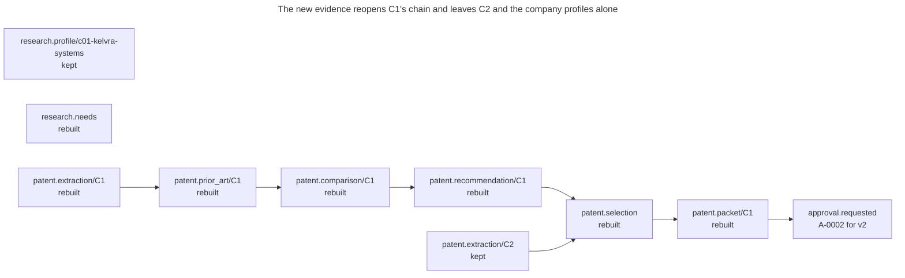

# Examples: conversations, outputs and the change-and-recovery demo

Everything in [examples/](../examples/) comes from real offline runs on the synthetic `stillroom` world. [scripts/generate_examples.py](../scripts/generate_examples.py) drives the `aksha` command the way a person would type it and writes each file. Nothing is written by hand, so the examples change when the code does. The models are the rule-based fakes (`AKSHA_MODE=fake`), the web is the world's offline web (`AKSHA_SEARCH=world:stillroom`), and the counsel mailbox is the mock one. No keys and no network are used.

```sh
make venv
.venv/bin/python scripts/generate_examples.py              # rewrite examples/ (about 3 minutes)
.venv/bin/python scripts/generate_examples.py --summaries  # only the readable summaries, from the saved JSON
```

The script replaces three things that change from run to run: the scratch folder becomes `<work>`, a random session ID becomes `S-<session>`, and the demo's timings become `(n s)`. Dates the agents compute against today, such as the days since a public disclosure, still move.

## The conversations

| File | What it shows |
|---|---|
| [examples/research-conversation.md](../examples/research-conversation.md) | `aksha example`, then `aksha run --agent research --input ...`. The agent asks for the buyer segment and the geography in one interrupt, `aksha answer` gives both, and `aksha show` lists and prints the saved outputs. |
| [examples/patent-conversation.md](../examples/patent-conversation.md) | `aksha run --agent patent`. The agent asks for a detail the C2 note leaves open, recommends a next action for all four candidates, asks which to prepare and saves the choice. The send of the counsel-review packet waits on its own approval. Approving a second time is refused `already_decided`. |
| [examples/routing-conversation.md](../examples/routing-conversation.md) | Requests with no `--agent`. An unclear one raises a route question, answered with `aksha answer I-... --agent patent`. A clear one is routed to the research agent with no question. Every run line names its agent. |
| [examples/change-and-recovery.md](../examples/change-and-recovery.md) | `aksha demo`, quoted act by act, with what each act means for the venture. |

## The outputs

[examples/outputs/](../examples/outputs/) holds every latest output of both agents as `aksha show` prints it: the content, the version reference and whether it is still current. File names are the output slots, with `/` written as `__` and `~` as `--`.

| Requirement | Saved output | Readable summary |
|---|---|---|
| Competitor table | `research.matrix`, built from one `research.profile/<company>` per resolved company | [research-summary.md](../examples/outputs/research-summary.md), "Competitor matrix" |
| Linked source list | `research.competitors` (`web.fetched`, `web.skipped`) and the `EX-...` span on every cited value | "Sources" and every "source:" line |
| Customer findings without duplicates | `research.needs` (`sample.rows` against `sample.unique`) and `research.findings` | "Customer needs", "Findings" |
| Proposed customer test | `research.tests`, each threshold with status `proposal` | "Proposed customer tests" |
| Recommendation table for all four candidates | `patent.table`, one `patent.recommendation/<C>` each | [patent-summary.md](../examples/outputs/patent-summary.md), "Recommendation table" |
| Comparison matrix | `patent.comparison/C1` (element by family, state `disclosed`, `partial` or `not_found`) | "Comparison matrix for C1" |
| Saved user selection | `patent.selection` (`chosen_by`, `selected`, the table version it was chosen from) | "Saved selection" |
| Completed mock forms | `patent.form/C1~invention-disclosure-form`, `patent.form/C1~filing-information-worksheet`, each field `complete`, `missing` or `needs_counsel_confirmation` | the two form tables |
| Counsel-review packet | `patent.packet/C1`, then `patent.handoff/C1` after the approved send | "Counsel-review packet" |

The demo's full report, as JSON, is [examples/outputs/demo-report.json](../examples/outputs/demo-report.json). [tests/integration/test_demo.py](../tests/integration/test_demo.py) reads the same report.

## What the change reopens



Notice that only outputs that read a moved record are rebuilt: the consultant email, the disclosure history and the new publication reach C1's chain and `research.needs`, while C2 and the company profiles keep their v1. The rebuilt packet is a new version, so the old approval does not cover it and `approval.requested` asks again for `patent.packet/C1@v2`.

The full lists of rebuilt and kept outputs are printed in act 3 of [examples/change-and-recovery.md](../examples/change-and-recovery.md).
